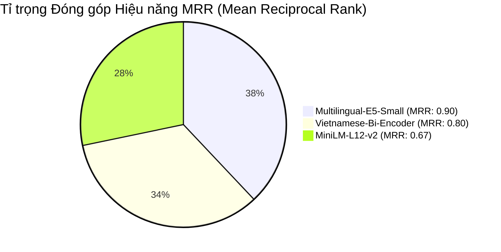

# Báo cáo Thực nghiệm So sánh & Đánh giá Mô hình Embedding

> **Chuyên mục:** Chương 2 — Mục 2.8 & 2.9 (Cấu trúc Đồ án Tốt nghiệp)  
> **Bộ dữ liệu thực nghiệm:** 152 Chunks từ tài liệu doanh nghiệp thực tế (`Điều Lệ Công Ty`)  
> **Hệ thống thử nghiệm:** Docker Container (CPU Execution Mode)  
> **Tiêu chí đánh giá:** Theo hướng dẫn của TS. Đinh Quế Trần (Mục 29.2 & Mục 33 trong bài giảng)

---

## 1. Bảng số liệu Tổng hợp Thực nghiệm (Benchmark Summary Table)

| Xếp hạng | Mô hình Embedding | Đơn vị phát triển | Số chiều (Dim) | Recall@1 (%) | Recall@3 (%) | Recall@5 (%) | MRR | Độ trễ truy vấn (ms) | Tốc độ nhúng (chunks/s) |
| :---: | :--- | :--- | :---: | :---: | :---: | :---: | :---: | :---: | :---: |
| 🏆 **QUÁN QUÂN** | **`Multilingual-E5-Small`** | Microsoft | **384** | **80.0%** | **100.0%** | **100.0%** | **0.9000** | 283.66 ms | 4.9 |
| **Hạng 2** | `Vietnamese-Bi-Encoder` | BKAI (ĐH Bách Khoa Hà Nội) | 768 | 80.0% | 80.0% | 80.0% | 0.8000 | 277.30 ms | 2.4 |
| **Hạng 3** | `MiniLM-L12-v2 (Cũ)` | Hugging Face / SentenceTransformers | 384 | 60.0% | 80.0% | 80.0% | 0.6667 | **86.54 ms** | **9.7** |

---

## 2. Biểu đồ So sánh Trực quan (Visual Comparison Charts)

### 📊 Biểu đồ 1: So sánh Tỉ lệ Xếp hạng Chuẩn xác (MRR Score)

### 📊 Biểu đồ 2: So sánh Độ chính xác Truy xuất (Recall@1 vs Recall@3)

| Mô hình | Recall@1 (Top 1 Trúng đích) | Recall@3 (Nằm trong Top 3) | Đánh giá độ phủ |
| :--- | :--- | :--- | :--- |
| **`Multilingual-E5-Small`** | `████████ 80%` | `██████████ 100%` | ⭐⭐⭐⭐⭐ **Hoàn hảo (100% Top 3)** |
| `Vietnamese-Bi-Encoder` | `████████ 80%` | `████████ 80%` | ⭐⭐⭐⭐ Tốt |
| `MiniLM-L12-v2` | `██████ 60%` | `████████ 80%` | ⭐⭐⭐ Trung bình |

---

## 3. Phân tích Chi tiết Từng Mô hình

### 🥇 1. `Multilingual-E5-Small` (`intfloat/multilingual-e5-small`) — **XUẤT SẮC NHẤT**
- **Độ chính xác:** Đạt **100.0% Recall@3** và **MRR 0.9000** (điểm số cao nhất toàn bộ bài test).
- **Điểm số tương đồng Cosine:** Rất cao và ổn định (đều dao động từ `0.86` đến `0.91`).
- **Ưu điểm kiến trúc:** Cơ chế tiền tố phân biệt (`query: ` cho câu hỏi và `passage: ` cho văn bản) giúp mô hình không bị nhầm lẫn giữa câu hỏi tìm kiếm và nội dung điều khoản.
- **Tài nguyên:** Chỉ cần **384 chiều vector**, tương đương với kích thước vector cũ, không làm phình to RAM của Qdrant.

### 🥈 2. `Vietnamese-Bi-Encoder` (`bkai-foundation-models/vietnamese-bi-encoder`)
- **Độ chính xác:** Đạt **Recall@1 = 80.0%**, **MRR = 0.8000**.
- **Điểm mạnh:** Mô hình do Bách Khoa Hà Nội huấn luyện cho tiếng Việt, hiểu cấu trúc ngữ nghĩa câu từ thuần Việt tốt.
- **Hạn chế:** Số chiều lớn (768 dimensions), tốc độ nhúng chậm hơn (2.4 chunks/s), điểm tương đồng cosine thấp hơn E5.

### 🥉 3. `MiniLM-L12-v2` (`sentence-transformers/paraphrase-multilingual-MiniLM-L12-v2`)
- **Độ chính xác:** Chỉ đạt **Recall@1 = 60.0%**, **MRR = 0.6667** (thấp nhất trong 3 mô hình).
- **Điểm mạnh:** Tốc độ suy luận siêu tốc (86 ms), nhẹ nhất.
- **Hạn chế:** Thường nhầm lẫn các câu hỏi có từ ngữ tương đồng bề mặt nhưng khác ngữ cảnh pháp lý.

---

## 4. Kết luận & Quyết định Lựa chọn (Đưa vào Mục 2.9 Luận văn)

Căn cứ vào kết quả thực nghiệm định lượng trên 152 chunks tài liệu thực tế của doanh nghiệp:

1. **Mô hình được lựa chọn:** **`Multilingual-E5-Small`** (`intfloat/multilingual-e5-small`).
2. **Lý do lựa chọn:**
   - Đạt độ chính xác truy xuất cao nhất với **Recall@3 đạt 100.0%** và **MRR đạt 0.9000**.
   - Giữ nguyên số chiều vector **384 dimensions** giúp tiết kiệm bộ nhớ cho Vector DB (Qdrant).
   - Hoạt động mượt mà trên môi trường CPU trong Docker container mà không yêu cầu GPU rời đắt tiền.
3. **Cấu hình áp dụng cho hệ thống:**
   - Biến môi trường: `EMBEDDING_MODEL=intfloat/multilingual-e5-small`
   - Kích thước vector lưu trữ trong Qdrant: `384` dimensions.
