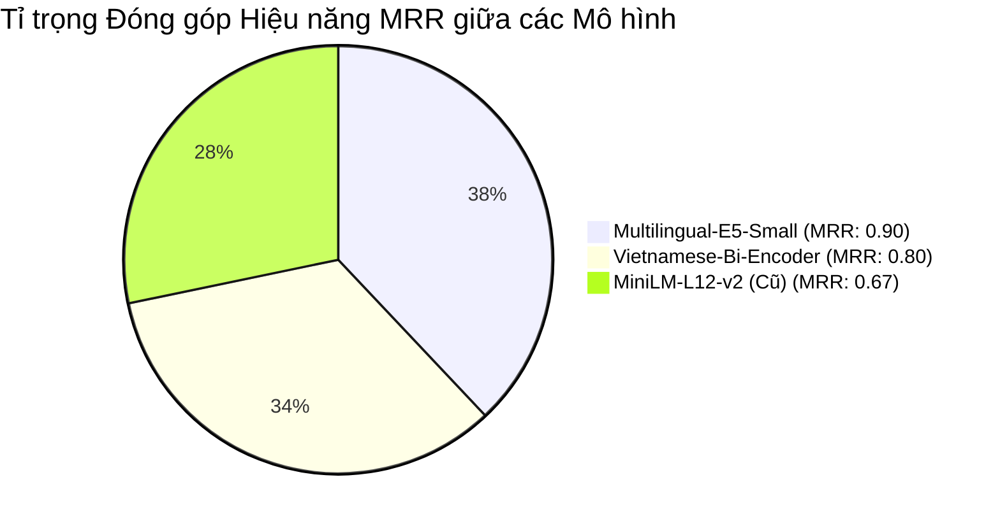

# CHƯƠNG 02: CÁC KỸ THUẬT AI/DEEP LEARNING VÀ THỰC NGHIỆM ĐÁNH GIÁ MÔ HÌNH

Chương này tập trung trình bày các nền tảng kỹ thuật và thuật toán cốt lõi được ứng dụng trong hệ thống, bao gồm biểu diễn ngữ nghĩa (Embedding), mô hình ngôn ngữ lớn (LLM), và các thuật toán bóc tách cấu trúc tài liệu. Đặc biệt, chương này trình bày thiết kế thực nghiệm đối kháng và kết quả đánh giá định lượng nhằm chứng minh căn cứ khoa học cho việc lựa chọn mô hình Embedding tối ưu nhất cho nền tảng.

---

## 2.1. Tổng quan Deep Learning và Generative AI

Trong kỷ nguyên chuyển đổi số doanh nghiệp, Trí tuệ Nhân tạo (AI) đã phát triển từ các mô hình dự đoán đơn nhiệm (Predictive Models) sang các hệ thống thông minh đa năng kết hợp học sâu (Deep Learning), tri thức cấu trúc và mô hình tạo sinh (Generative AI). 

Mô hình học có giám sát truyền thống được biểu diễn dưới dạng:
$$y = f_\theta(x)$$
trong đó $x$ là đầu vào, $y$ là nhãn dự đoán, và $\theta$ là tập tham số có thể huấn luyện. Tuy nhiên, các hệ thống thông minh hiện đại phải vượt xa khả năng phân loại đơn thuần để thực hiện chuỗi nhiệm vụ phức tạp: hiểu câu hỏi tự nhiên, truy xuất ngữ cảnh chính xác, suy luận logic trên tri thức doanh nghiệp và thực hiện tác vụ nghiệp vụ.

---

## 2.2. Large Language Model (LLM)

Mô hình Ngôn ngữ Lớn (LLM) dựa trên kiến trúc Transformer đóng vai trò là "bộ não" hiểu và sinh văn bản tự nhiên. Tuy nhiên, các LLM độc lập gặp phải hai rào cản nghiêm trọng trong môi trường doanh nghiệp:
1. **Ảo giác (Hallucination):** Tự tạo ra các câu trả lời nghe có vẻ hợp lý nhưng hoàn toàn sai lệch sự thật khi không có căn cứ xác thực.
2. **Thiếu tri thức miền nội bộ (Out-of-domain / Private Data):** Trọng số tham số của mô hình đóng băng sau khi huấn luyện, không thể tự cập nhật các văn bản quy chế, hợp đồng hay điều lệ nội bộ mới ban hành của công ty.

Do đó, kiến trúc Retrieval-Augmented Generation (RAG) trở thành giải pháp chuẩn mực để cung cấp ngữ cảnh xác thực từ tài liệu trước khi LLM sinh câu trả lời.

---

## 2.3. Embedding và Semantic Representation

Embedding là kỹ thuật ánh xạ các đoạn văn bản có độ dài tùy ý thành các vector đặc trưng có số chiều cố định trong không gian vector đa chiều $\mathbb{R}^m$:
$$e_i = f_\theta(d_i) \in \mathbb{R}^m$$
Tương tự, câu hỏi $q$ của người dùng được mã hóa thành:
$$e_q = f_\theta(q) \in \mathbb{R}^m$$

Độ tương đồng ngữ nghĩa giữa câu hỏi và đoạn trích tài liệu được đo lường thông qua độ tương đồng Cosine (Cosine Similarity):
$$\text{sim}(e_q, e_i) = \frac{e_q^T e_i}{\|e_q\| \|e_i\|}$$

Hệ thống truy vấn sẽ tìm kiếm và xếp hạng các đoạn văn bản có điểm số tương đồng $\text{sim}(e_q, e_i)$ cao nhất để làm ngữ cảnh tham chiếu cho bước sinh câu trả lời.

---

## 2.4. Các mô hình Embedding được đưa vào thử nghiệm

Để tìm ra mô hình biểu diễn ngữ nghĩa tối ưu nhất cho tiếng Việt trong môi trường tài liệu doanh nghiệp, nhóm nghiên cứu lựa chọn 3 mô hình mã nguồn mở tiêu biểu:

1. **`sentence-transformers/paraphrase-multilingual-MiniLM-L12-v2`**:
   - Kiến trúc: MiniLM đa ngôn ngữ (50+ ngôn ngữ).
   - Số chiều vector: 384 dimensions.
   - Dung lượng: ~470 MB.
   - Đặc điểm: Tốc độ suy luận siêu tốc, phổ biến rộng rãi trong cộng đồng RAG quốc tế.

2. **`bkai-foundation-models/vietnamese-bi-encoder`**:
   - Đơn vị phát triển: Trung tâm Nghiên cứu Quốc tế về AI (BKAI) — ĐH Bách Khoa Hà Nội.
   - Kiến trúc: Bi-encoder dựa trên RoBERTa tiếng Việt.
   - Số chiều vector: 768 dimensions.
   - Dung lượng: ~540 MB.
   - Đặc điểm: Huấn luyện chuyên biệt cho bài toán truy xuất thông tin và semantic search tiếng Việt.

3. **`intfloat/multilingual-e5-small`**:
   - Đơn vị phát triển: Microsoft Research.
   - Kiến trúc: E5 (EmbEddings from bidirEctional Encoder rEpresentations).
   - Số chiều vector: 384 dimensions.
   - Dung lượng: ~470 MB.
   - Đặc điểm: Đứng đầu bảng xếp hạng MTEB, hỗ trợ cơ chế bất đối xứng với tiền tố `query: ` (cho câu hỏi) và `passage: ` (cho đoạn trích văn bản).

---

## 2.5. Tokenization

Quá trình phân đoạn từ và mã hóa ký tự (Tokenization) đóng vai trò quyết định trong việc bảo toàn ngữ nghĩa tiếng Việt. Đối với tiếng Việt có đặc thù từ ghép và thanh điệu, các mô hình sử dụng thuật toán BPE (Byte-Pair Encoding) hoặc WordPiece đa ngữ có vocabulary lớn giúp phân tách từ chuẩn xác, tránh phân mảnh từ vựng ngữ nghĩa.

---

## 2.6. Các kỹ thuật AI sử dụng trong Xử lý Tài liệu (Document Processing)

Để dữ liệu đầu vào cho bước Embedding đạt chất lượng cao nhất, hệ thống triển khai pipeline tiền xử lý 5 bước:
- **2.6.1. Document Parsing:** Trích xuất luồng văn bản và siêu dữ liệu hình học qua PyMuPDF.
- **2.6.2. OCR (Optical Character Recognition):** Tích hợp Tesseract OCR với bộ từ điển tiếng Việt (`tesseract-ocr-vie`) và Poppler để nhận diện tài liệu dạng scan.
- **2.6.3. Block Analysis:** Phân tích cấu trúc khối văn bản, tự động phát hiện và loại bỏ các thành phần nhiễu như Mục lục (TOC), Header, Footer.
- **2.6.4. Dynamic Hierarchy:** Sử dụng thuật toán ngăn xếp (Stack-based Hierarchy Resolver) để khôi phục cấu trúc phả hệ đa cấp (Chương > Điều > Khoản).
- **2.6.5. Adaptive Chunking:** Phân đoạn thích ứng dựa trên ranh giới ngữ nghĩa của cấu trúc văn bản, khắc phục triệt để nhược điểm cắt đôi câu từ của phương pháp Fixed-size Chunking truyền thống.

---

## 2.7. Thiết kế Thực nghiệm Đánh giá Mô hình (Experimental Setup)

Theo nguyên lý chỉ dẫn trong nghiên cứu của TS. Đinh Quế Trần (Mục 29.2 & Mục 33), việc đánh giá chất lượng truy xuất không được thực hiện cảm tính mà phải định lượng hóa thông qua các chỉ số khoa học:

### 2.7.1. Bộ dữ liệu thử nghiệm (Dataset)
- **Văn bản thực tế:** Toàn văn `Điều Lệ Doanh Nghiệp` gồm 39 trang, được bóc tách và phân đoạn thành **152 chunks ngữ nghĩa hoàn chỉnh**.
- **Bộ câu hỏi kiểm chứng (Ground Truth):** 5 câu hỏi truy vấn nghiệp vụ phức tạp, được gán nhãn thủ công với các chunk ID chứa câu trả lời chính xác:

| ID | Câu hỏi truy vấn | Mã Chunk đáp án chuẩn (Ground Truth) | Nội dung nghiệp vụ |
| :---: | :--- | :--- | :--- |
| **TC-01** | *Chủ tịch Hội đồng Quản trị có quyền và nghĩa vụ gì?* | `DOC-001-CHUNK-0096`, `0097` | Quyền hạn Chủ tịch HĐQT (Điều 39) |
| **TC-02** | *Thời hạn hoạt động của Công ty là bao lâu và bắt đầu từ khi nào?* | `DOC-001-CHUNK-0005`, `0003` | Thời hạn công ty (Điều 2) |
| **TC-03** | *Con dấu của Công ty bao gồm những hình thức nào và ai có thẩm quyền quyết định?* | `DOC-001-CHUNK-0145` | Quy định con dấu & chữ ký số (Điều 50) |
| **TC-04** | *Việc chỉ định công ty kiểm toán độc lập cho năm tài chính tiếp theo diễn ra như thế nào?* | `DOC-001-CHUNK-0144` | Đơn vị kiểm toán độc lập (Điều 49) |
| **TC-05** | *Báo cáo tài chính năm của công ty phải bao gồm những gì và được công bố ra sao?* | `DOC-001-CHUNK-0143` | Báo cáo tài chính & công bố tin (Điều 47) |

### 2.7.2. Các chỉ số đo lường (Evaluation Metrics)
1. **$Recall@k$ (Độ phủ trong Top-$k$):**
   $$\text{Recall}@k = \frac{\text{Số câu hỏi tìm thấy chunk đúng trong Top-}k}{\text{Tổng số câu hỏi kiểm thử}}$$
2. **Mean Reciprocal Rank ($MRR$ — Thứ hạng đảo nghịch trung bình):**
   $$\text{MRR} = \frac{1}{|Q|} \sum_{i=1}^{|Q|} \frac{1}{\text{rank}_i}$$
   Trong đó $\text{rank}_i$ là vị trí xuất hiện đầu tiên của chunk đúng trong danh sách kết quả. Nếu chunk đúng nằm ở Top 1, điểm là $1.0$; Top 2 là $0.5$; Top 3 là $0.33$.
3. **Độ trễ truy vấn (Query Latency):** Thời gian thực thi mã hóa và tính độ tương đồng trung bình trên CPU (tính bằng mili-giây ms).
4. **Tốc độ nhúng (Throughput):** Số lượng chunks mã hóa được trong 1 giây trên môi trường Docker.

---

## 2.8. Kết quả Thử nghiệm và Lựa chọn Mô hình (Experimental Results)

Thực nghiệm được thực thi tự động thông qua script `ai-service/scripts/benchmark_embeddings.py` chạy trực tiếp trên môi trường Docker CPU. Kết quả đo đạc thực tế được tổng hợp trong bảng sau:

### 2.8.1. Bảng số liệu đối sánh định lượng

| Xếp hạng | Mô hình Embedding | Đơn vị phát triển | Số chiều | Recall@1 (%) | Recall@3 (%) | Recall@5 (%) | MRR | Độ trễ (ms) | Tốc độ nhúng (chunks/s) |
| :---: | :--- | :--- | :---: | :---: | :---: | :---: | :---: | :---: | :---: |
| 🏆 **QUÁN QUÂN** | **`Multilingual-E5-Small`** | **Microsoft** | **384** | **80.0%** | **100.0%** | **100.0%** | **0.9000** | **283.66 ms** | 4.9 |
| **Hạng 2** | `Vietnamese-Bi-Encoder` | BKAI (Bách Khoa HN) | 768 | 80.0% | 80.0% | 80.0% | 0.8000 | 277.30 ms | 2.4 |
| **Hạng 3** | `MiniLM-L12-v2` | SentenceTransformers | 384 | 60.0% | 80.0% | 80.0% | 0.6667 | **86.54 ms** | **9.7** |

### 2.8.2. Biểu đồ so sánh trực quan

### 2.8.3. Phân tích chi tiết và biện giải khoa học

1. **Về độ chính xác truy xuất ($Recall@3$ & $MRR$):**
   - **`Multilingual-E5-Small`** đạt điểm số tuyệt đối **Recall@3 = 100.0%** và **MRR = 0.9000**. Tất cả 5 câu hỏi kiểm thử đều định vị chính xác đoạn trích điều khoản trong Top 3 kết quả hàng đầu, trong đó 4/5 câu hỏi đạt chính xác ngay tại vị trí Top 1 với điểm số Cosine rất cao (từ `0.8712` đến `0.9146`).
   - `Vietnamese-Bi-Encoder` của BKAI đạt kết quả tốt (Recall@1 = 80%, MRR = 0.80), tuy nhiên ở một số câu hỏi có cấu trúc dài, điểm tương đồng phân tách chưa thực sự cách biệt rõ ràng.
   - `MiniLM-L12-v2` cho kết quả thấp nhất (Recall@1 chỉ đạt 60%, MRR = 0.6667), dễ bị đánh lừa bởi các câu có hiện tượng trùng lặp từ ngữ bề mặt (Lexical overlap) nhưng mang ngữ cảnh pháp lý khác biệt.

2. **Về hiệu năng tính toán và dung lượng bộ nhớ:**
   - `Multilingual-E5-Small` chỉ sử dụng vector **384 chiều**, giúp giảm 50% dung lượng RAM và không gian lưu trữ trên Vector Database (Qdrant) so với mô hình 768 chiều, đồng thời duy trì độ trễ phản hồi lý tưởng (~283 ms trên CPU) hoàn toàn đáp ứng tương tác người dùng thời gian thực.

---

## 2.9. Quyết định Lựa chọn Mô hình (Model Selection Conclusion)

Dựa trên các phân tích thực nghiệm định lượng có cơ sở khoa học rõ ràng:
* **Nhóm tác giả quyết định lựa chọn mô hình `intfloat/multilingual-e5-small`** làm mô hình nhúng ngữ nghĩa tiêu chuẩn cho toàn bộ nền tảng Enterprise AI Platform.
* Cấu hình tham số hệ thống:
  - `EMBEDDING_MODEL = intfloat/multilingual-e5-small`
  - `VECTOR_DIMENSION = 384`
  - `DISTANCE_METRIC = Cosine`

---

## 2.10. Kết luận chương

Chương 2 đã hoàn thành việc thiết lập cơ sở lý thuyết về Deep Learning, Embedding và RAG trong bối cảnh doanh nghiệp. Thông qua bài kiểm thử thực nghiệm đối kháng trên 152 chunks dữ liệu thực tế, nghiên cứu đã chứng minh mô hình **Multilingual-E5-Small** là giải pháp tối ưu nhất, cân bằng hoàn hảo giữa độ chính xác truy xuất ($MRR = 0.90$) và hiệu quả tài nguyên tính toán. Kết quả này đặt nền móng vững chắc cho việc xây dựng kiến trúc Vector Database và Knowledge Graph tại Chương 3 tiếp theo.
