# CHƯƠNG 4: THIẾT KẾ HỆ THỐNG VÀ PIPELINE

---

## GIỚI THIỆU TỔ CHỨC CHƯƠNG

Chương 4 trình bày toàn bộ thiết kế của hệ thống **Enterprise AI Knowledge & Workflow Platform (EAKWP)**, tổ chức thành **3 phần**:

| Phần               | Nội dung                                                                                                                                                                                                                                                                                                                                                                                                                                                                                    |
| :------------------ | :------------------------------------------------------------------------------------------------------------------------------------------------------------------------------------------------------------------------------------------------------------------------------------------------------------------------------------------------------------------------------------------------------------------------------------------------------------------------------------------- |
| **PHẦN I**   | Thiết kế kiến trúc tổng thể: kiến trúc đa tầng & phân tách dịch vụ, sơ đồ triển khai Docker, tác nhân & Use Case tổng quan, bảng phân rã 10 chức năng, sơ đồ cây chức năng, thiết kế API                                                                                                                                                                                                                                                                   |
| **PHẦN II**  | Phân tích và thiết kế theo **12 bước OOAD chuẩn hóa**: ① Biểu đồ Use Case chi tiết & mô tả ② Kịch bản chuẩn & ngoại lệ ③ Trích lớp thực thể ④ Biểu đồ trạng thái màn hình giao diện ⑤ Biểu đồ lớp pha phân tích ⑥ Biểu đồ giao tiếp pha phân tích ⑦ Thiết kế lớp thực thể ⑧ Thiết kế CSDL liên quan ⑨ Biểu đồ lớp chi tiết ⑩ Biểu đồ hoạt động chi tiết ⑪ Biểu đồ tuần tự chi tiết ⑫ Biểu đồ gói |
| **PHẦN III** | Thiết kế cơ sở dữ liệu chuyên biệt & Pipeline AI: quy trình xây dựng kho tri thức, cấu trúc Payload Qdrant, đồ thị tri thức Neo4j, Pipeline Hybrid GraphRAG                                                                                                                                                                                                                                                                                                                |

> **Nguyên tắc trình bày:**
>
> * Hệ thống được phân rã thành **10 chức năng (CN-01 → CN-10)** thuộc 5 phân hệ. Mỗi chức năng được theo dõi **xuyên suốt** chương với đánh số tương ứng giữa các bước: **1.x (Use Case) ↔ 2.x (Kịch bản) ↔ 11.x (Tuần tự)**.
> * Những artifact chỉ phụ thuộc vào *cấu trúc tĩnh* của hệ thống (trích lớp thực thể, mô hình lớp, CSDL, gói, deployment) trình bày **một lần duy nhất**; những artifact gắn với *hành vi* được đặc tả **riêng cho từng chức năng**.

---

## PHẦN I: THIẾT KẾ KIẾN TRÚC TỔNG THỂ HỆ THỐNG

### 4.1. Kiến trúc Đa tầng và Phân tách Dịch vụ (Layered & Microservices Architecture)

Hệ thống **Enterprise AI Knowledge & Workflow Platform (EAKWP)** được thiết kế theo mô hình kiến trúc phân tầng kết hợp Microservices hướng dịch vụ AI. Sự kết hợp này giải quyết bài toán cốt lõi: phân tách hoàn toàn giữa khối nghiệp vụ truyền thống (quản lý người dùng, phân quyền, quản lý văn bản, workflow) chạy trên nền tảng **Spring Boot** với khối xử lý tính toán trí tuệ nhân tạo nặng (Document Parser, OCR, Embedding, Vector Search, Knowledge Graph, LLM Orchestration) chạy trên **FastAPI**.

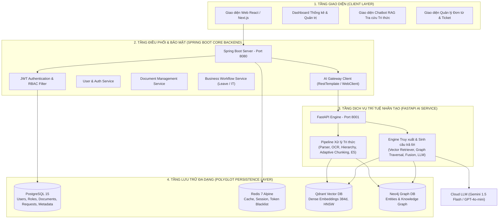

**Nguyên tắc phân tách trách nhiệm:**

* **Spring Boot Backend** quản lý toàn bộ nghiệp vụ, xác thực, phân quyền và vòng đời yêu cầu; **không** chứa logic AI.
* **FastAPI AI Service** quản lý toàn bộ tính toán AI (xử lý tài liệu, embedding, truy xuất, sinh câu trả lời); **không** truy cập trực tiếp CSDL nghiệp vụ.
* Hai khối giao tiếp qua **REST nội bộ** (Backend → AI: trigger xử lý, hỏi đáp, phân loại; AI → Backend: callback cập nhật trạng thái). Mọi bất đồng bộ (xử lý tài liệu nặng) được giải quyết qua **callback + WebSocket thông báo** cho Client.

---

### 4.2. Kiến trúc Triển khai Docker Container (Deployment Diagram)

Toàn bộ hệ thống được container hóa theo chuẩn Zero-Setup qua tệp `docker-compose.yml`:

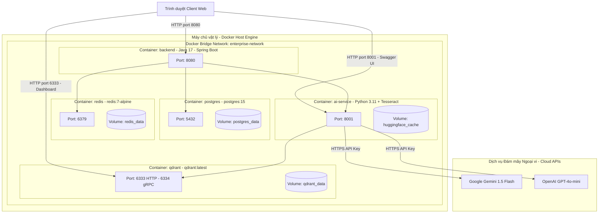

**Đặc điểm triển khai:**

* Các container giao tiếp nội bộ qua **Docker DNS** (`postgres:5432`, `qdrant:6333`, `ai-service:8001`) thay vì `localhost`, đảm bảo chạy được trên mọi máy chỉ với `docker compose up`.
* Thứ tự khởi động được kiểm soát bằng `depends_on` kết hợp `healthcheck` (PostgreSQL và Redis phải `healthy` trước khi Backend khởi động).
* Model embedding (`multilingual-e5-small`) được cache trong volume `huggingface_cache`, tránh tải lại nhiều lần giữa các lần chạy.

---

### 4.3. Tác nhân Hệ thống và Biểu đồ Use Case Tổng quan

#### 4.3.1. Danh sách tác nhân (Actors)

| # | Tác nhân                            | Loại                                     | Mô tả & phạm vi quyền                                                                                                                                     |
| :- | :------------------------------------ | :---------------------------------------- | :------------------------------------------------------------------------------------------------------------------------------------------------------------ |
| 1 | **Nhân viên (Employee)**      | Người dùng                             | Tra cứu tri thức qua AI, tìm kiếm tài liệu, tạo đơn xin nghỉ phép, gửi yêu cầu hỗ trợ IT.                                                     |
| 2 | **Quản lý (Manager)**         | Người dùng *(kế thừa Nhân viên)* | Toàn bộ quyền của Nhân viên, bổ sung quyền phê duyệt/từ chối đơn nghỉ phép của cấp dưới và xem thống kê.                               |
| 3 | **Quản trị viên (Admin)**    | Người dùng                             | Quản lý tài khoản & phân quyền RBAC, tải lên/ban hành/quản lý phiên bản tài liệu tri thức.                                                    |
| 4 | **Nhân viên IT (IT Support)** | Người dùng                             | Tiếp nhận, phân loại lại, xử lý và đóng các Ticket hỗ trợ kỹ thuật.                                                                            |
| 5 | **Trợ lý AI (AI Assistant)**  | Tác nhân hệ thống (tự động)        | Băm nhỏ & tạo vector tài liệu, truy vấn tri thức kết hợp, sinh câu trả lời kèm trích dẫn, phân loại & gợi ý xử lý yêu cầu nghiệp vụ. |

> *Ghi chú:* **Cloud LLM (Gemini 1.5 Flash / GPT-4o-mini)** không phải tác nhân use case mà là **hệ thống ngoại vi (External System)** được Trợ lý AI triệu gọi trong quá trình sinh câu trả lời — thể hiện trong biểu đồ tuần tự của CN-05.

#### 4.3.2. Biểu đồ Use Case Tổng quan toàn hệ thống

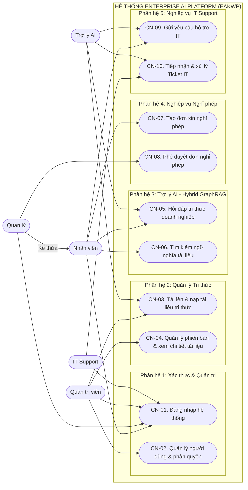

---

### 4.4. Bảng phân rã chức năng

Hệ thống được phân rã thành **10 chức năng nghiệp vụ (CN-01 → CN-10)** thuộc 5 phân hệ. Bảng dưới đây là **cơ sở phân công công việc của nhóm** (khớp với kế hoạch phát triển tại `project_master_plan.md`):

| Mã             | Tên chức năng                                                   | Phân hệ      | Tác nhân chính                       | Thành viên phụ trách                        | Giao diện chính                                  |
| :-------------- | :----------------------------------------------------------------- | :------------- | :-------------------------------------- | :---------------------------------------------- | :------------------------------------------------- |
| **CN-01** | Đăng nhập hệ thống                                            | 1. Xác thực  | Nhân viên, Quản lý, QTV, IT Support | Đức                                           | `LoginView`                                      |
| **CN-02** | Quản lý người dùng & phân quyền RBAC                        | 1. Xác thực  | Quản trị viên                        | Đức                                           | `UserManagementView`                             |
| **CN-03** | Tải lên & nạp tài liệu tri thức                              | 2. Tri thức   | Quản trị viên *(+ Trợ lý AI)*    | Thọ *(pipeline AI)* · Đức *(API)*       | `UploadDocumentView`, `IngestionProgressView`  |
| **CN-04** | Quản lý phiên bản & xem chi tiết tài liệu                   | 2. Tri thức   | Quản trị viên                        | Thọ                                            | `DocumentManagementView`, `DocumentDetailView` |
| **CN-05** | Hỏi đáp tri thức doanh nghiệp (Hybrid GraphRAG + trích dẫn) | 3. Trợ lý AI | Nhân viên *(+ Trợ lý AI)*         | Đạt *(AI Engine)* · Thọ *(Chat UI)*     | `ChatView`                                       |
| **CN-06** | Tìm kiếm ngữ nghĩa tài liệu                                  | 3. Trợ lý AI | Nhân viên                             | Đạt                                           | `SearchView`                                     |
| **CN-07** | Tạo đơn xin nghỉ phép                                         | 4. Nghỉ phép | Nhân viên                             | Đức                                           | `LeaveRequestFormView`                           |
| **CN-08** | Phê duyệt đơn nghỉ phép                                      | 4. Nghỉ phép | Quản lý                               | Đức                                           | `ApprovalListView`                               |
| **CN-09** | Gửi yêu cầu hỗ trợ IT *(AI phân loại tự động)*         | 5. IT Support  | Nhân viên *(+ Trợ lý AI)*         | Đức *(workflow)* · Đạt *(AI classify)* | `TicketFormView`                                 |
| **CN-10** | Tiếp nhận & xử lý Ticket IT *(AI gợi ý xử lý)*           | 5. IT Support  | IT Support *(+ Trợ lý AI)*          | Đức *(workflow)* · Đạt *(AI suggest)*  | `TicketQueueView`                                |

### 4.5. Sơ đồ cây chức năng

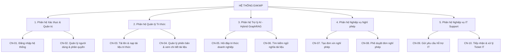

### 4.6. Thiết kế API và Giao tiếp Dịch vụ (Service Communication Design)

#### 4.6.1. Public REST API (Spring Boot Backend — tiền tố `/api`)

| Nhóm         | Endpoint                              | Phương thức | Quyền truy cập      | Chức năng                                               |
| :------------ | :------------------------------------ | :------------- | :-------------------- | :-------------------------------------------------------- |
| Xác thực    | `/api/auth/login`                   | POST           | Công khai            | CN-01 — Đăng nhập, trả JWT                           |
| Xác thực    | `/api/auth/logout`                  | POST           | Mọi vai trò         | CN-01 — Thu hồi token (Redis Blacklist)                 |
| Người dùng | `/api/users`                        | GET            | ADMIN                 | CN-02 — Danh sách + tìm kiếm + phân trang            |
| Người dùng | `/api/users`                        | POST           | ADMIN                 | CN-02 — Tạo tài khoản                                 |
| Người dùng | `/api/users/{id}/role`              | PATCH          | ADMIN                 | CN-02 — Cập nhật vai trò                              |
| Người dùng | `/api/users/{id}/status`            | PATCH          | ADMIN                 | CN-02 — Khóa / Mở khóa tài khoản                    |
| Tài liệu    | `/api/documents/upload`             | POST           | ADMIN                 | CN-03 — Tải lên tài liệu mới (multipart) → `202` |
| Tài liệu    | `/api/documents`                    | GET            | Mọi vai trò         | CN-04 — Danh sách + lọc danh mục/trạng thái         |
| Tài liệu    | `/api/documents/{id}`               | GET            | Mọi vai trò         | CN-04 — Chi tiết tài liệu                             |
| Tài liệu    | `/api/documents/{id}/versions`      | GET            | Mọi vai trò         | CN-04 — Lịch sử phiên bản                            |
| Tài liệu    | `/api/documents/{id}/versions`      | POST           | ADMIN                 | CN-04 — Tải lên phiên bản mới → `202`            |
| Tài liệu    | `/api/documents/{id}/chunks`        | GET            | ADMIN                 | CN-04 — Danh sách Chunk kèm phả hệ                   |
| Trợ lý AI   | `/api/ai/chat`                      | POST           | Mọi vai trò         | CN-05 — Hỏi đáp RAG + trích dẫn                     |
| Trợ lý AI   | `/api/ai/search`                    | POST           | Mọi vai trò         | CN-06 — Tìm kiếm ngữ nghĩa                           |
| Trợ lý AI   | `/api/ai/status/{versionId}`        | GET            | ADMIN                 | CN-03 — Kiểm tra tiến trình nạp                      |
| Nghỉ phép   | `/api/leave-requests`               | POST           | Nhân viên           | CN-07 — Tạo đơn                                       |
| Nghỉ phép   | `/api/leave-requests`               | GET            | Nhân viên / MANAGER | CN-07+08 — Đơn của tôi / hàng đợi chờ duyệt     |
| Nghỉ phép   | `/api/leave-requests/{id}/approve`  | PATCH          | MANAGER               | CN-08 — Phê duyệt                                      |
| Nghỉ phép   | `/api/leave-requests/{id}/reject`   | PATCH          | MANAGER               | CN-08 — Từ chối kèm lý do                            |
| Nghỉ phép   | `/api/leave-requests/{id}/cancel`   | PATCH          | Chủ đơn            | CN-08 — Hủy đơn PENDING                               |
| IT Support    | `/api/it-requests/classify-preview` | POST           | Nhân viên           | CN-09 — AI phân loại trước khi gửi                  |
| IT Support    | `/api/it-requests`                  | POST           | Nhân viên           | CN-09 — Tạo Ticket                                      |
| IT Support    | `/api/it-requests`                  | GET            | IT_SUPPORT            | CN-10 — Hàng đợi Ticket                               |
| IT Support    | `/api/it-requests/{id}/assign`      | PATCH          | IT_SUPPORT            | CN-10 — Tiếp nhận xử lý                              |
| IT Support    | `/api/it-requests/{id}/suggestions` | GET            | IT_SUPPORT            | CN-10 — AI gợi ý hướng xử lý                       |
| IT Support    | `/api/it-requests/{id}/resolve`     | PATCH          | IT_SUPPORT            | CN-10 — Hoàn tất xử lý                               |
| IT Support    | `/api/it-requests/{id}/close`       | PATCH          | Chủ ticket           | CN-10 — Đóng Ticket                                    |

#### 4.6.2. Internal REST API (FastAPI AI Service — cổng `8001`)

| Endpoint                    | Phương thức | Bên gọi                      | Mô tả                                                               |
| :-------------------------- | :------------- | :----------------------------- | :-------------------------------------------------------------------- |
| `/health`, `/health/dependencies` | GET   | Docker healthcheck, vận hành   | Trạng thái dịch vụ; Qdrant, Neo4j, LLM                               |
| `/api/v1/extract`         | POST           | Backend (`AiParseClient`)      | Đọc/OCR PDF và chia chunk theo cấu trúc                              |
| `/api/v1/ingest`          | POST           | Backend (`AiIngestClient`)     | Nhúng và ghi chunk vào Qdrant + Neo4j với cùng `chunk_id`            |
| `/api/v1/ingest/documents/{id}` | DELETE   | Backend                        | Xóa vector và node đồ thị của tài liệu hoặc một phiên bản            |
| `/api/v1/chat/ask`        | POST           | Backend (`AiGatewayService`)   | Hỏi đáp Hybrid GraphRAG + trích dẫn                                  |
| `/api/v1/search`          | POST           | Backend (`AiGatewayService`)   | Vector Search có bộ lọc tài liệu và vai trò                          |
| `/api/v1/eval/*`          | POST, GET      | Đánh giá                       | So sánh flat_rag, graph_rag, hybrid_rag                              |
| `/api/v1/metrics/latency` | GET            | Vận hành                       | p50/p95 từng bước của pipeline                                       |

Mọi endpoint trừ nhóm `/health` yêu cầu header `X-Internal-Token`; trình duyệt chỉ gọi AI qua `/api/ai/*` của Backend. Pipeline nạp chạy đồng bộ theo từng bước do `IngestionService` điều phối, Backend theo dõi tiến trình trong bảng `ingestion_tasks`. Phân loại Ticket và callback trạng thái ở các mục liên quan thuộc thiết kế mục tiêu, chưa triển khai.

#### 4.6.3. Callback và Kênh thời gian thực

| Kênh                                              | Chiều                | Cơ chế xác thực                         | Mô tả                                                                                                        |
| :------------------------------------------------- | :-------------------- | :------------------------------------------ | :------------------------------------------------------------------------------------------------------------- |
| `PUT /api/internal/documents/{versionId}/status` | AI Service → Backend | Header `X-Internal-Token` (shared secret) | Callback cập nhật trạng thái nạp (`INGESTED`/`FAILED`)                                                |
| WebSocket `/ws/notifications`                    | Backend → Client     | JWT trong handshake                         | Đẩy sự kiện: hoàn tất nạp tài liệu, đơn nghỉ được duyệt/từ chối, Ticket được tạo/xử lý |

#### 4.6.4. Quy ước chung

* Payload: JSON UTF-8; xác thực qua `Authorization: Bearer <JWT>` (trừ nhóm `/api/auth/**` và callback nội bộ).
* Định dạng lỗi thống nhất: `{ "code": "DOC_DUPLICATE_CODE", "message": "...", "timestamp": "..." }` — Frontend ánh xạ `code` sang thông báo tiếng Việt.
* Phân trang chuẩn: `?page=0&size=20&sort=createdAt,desc`.
* Bất đồng bộ: các tác vụ AI nặng (nạp tài liệu) trả ngay `202 Accepted` + `taskId`; kết quả về qua callback → WebSocket; Client không giữ kết nối chờ đợi (tránh timeout HTTP).

---

## PHẦN II: PHÂN TÍCH VÀ THIẾT KẾ

PHẦN II áp dụng **12 bước phân tích – thiết kế hướng đối tượng chuẩn hóa** cho toàn bộ 10 chức năng của hệ thống. Việc đánh số được giữ nhất quán xuyên suốt chương: mỗi chức năng `CN-xx` được đặc tả Use Case tại **Bước 1** (mục `1.x`), Kịch bản tại **Bước 2** (mục `2.x`) và Biểu đồ tuần tự tại **Bước 11** (mục `11.x`).

### Bước 1: Biểu đồ Use Case Chi tiết và Mô tả

Mỗi mục dưới đây trình bày **biểu đồ Use Case chi tiết** của một chức năng (phạm vi chức năng, các use case con, quan hệ `include` / `extend` với tác nhân và hệ thống ngoại vi) kèm **mô tả ý nghĩa từng use case** trong biểu đồ.

#### 1.1. Use Case chi tiết: Chức năng Đăng nhập hệ thống (CN-01)

> **Thành viên phụ trách:** Đức *(Module M5.1 — Auth & JWT)*

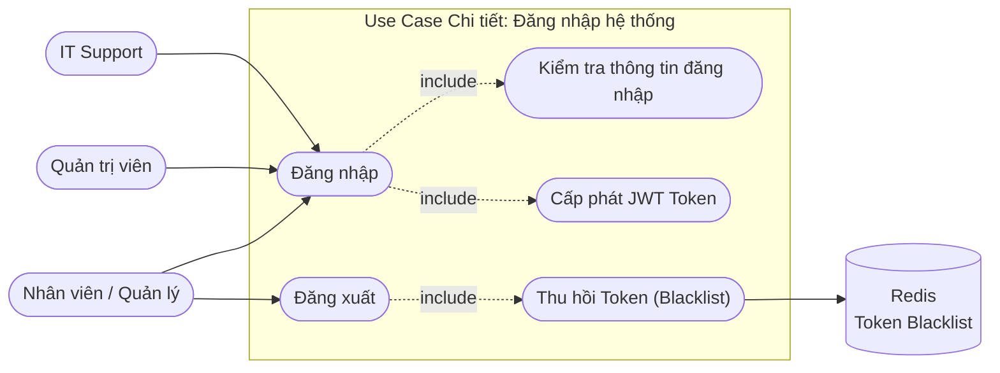

**Mô tả Use Case:**

* **Đăng nhập:** Người dùng nhập Email + Mật khẩu để xác thực tài khoản nội bộ. Hệ thống kiểm tra thông tin và cấp JWT Token nếu hợp lệ.
* **Kiểm tra thông tin đăng nhập:** Đối chiếu `email` trong bảng `users` và so khớp mật khẩu bằng **BCrypt** (mật khẩu được băm một chiều, không lưu plain-text).
* **Cấp phát JWT Token:** Sinh token ký thuật toán **HS256** chứa `userId`, `email`, `role`, thời hạn **3.600.000 ms (1 giờ)** — cấu hình qua biến `JWT_EXPIRATION`.
* **Đăng xuất:** Người dùng chủ động kết thúc phiên làm việc.
* **Thu hồi Token (Blacklist):** Token hiện hành được ghi vào **Redis Blacklist** với TTL bằng thời gian hết hạn còn lại. Mọi request sau đó mang token này bị `JwtAuthenticationFilter` từ chối (Stateless Session — không tồn tại session phía server để hủy).

#### 1.2. Use Case chi tiết: Chức năng Quản lý người dùng và phân quyền RBAC (CN-02)

> **Thành viên phụ trách:** Đức *(Module M5.2 — RBAC / Role management)*

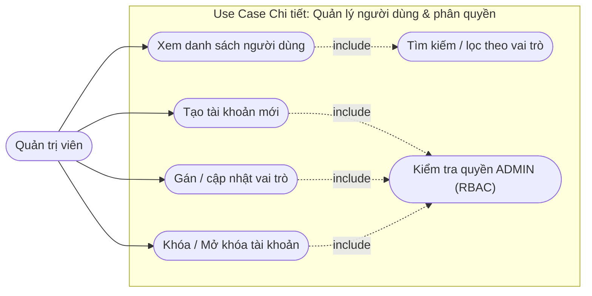

**Mô tả Use Case:**

* **Xem danh sách người dùng:** Hiển thị bảng người dùng gồm `fullName`, `email`, `role`, `isActive`, `createdAt`; hỗ trợ tìm kiếm theo từ khóa và lọc theo vai trò.
* **Tạo tài khoản mới:** Quản trị viên tạo tài khoản cho nhân sự mới bằng Email + Họ tên + Vai trò; hệ thống sinh mật khẩu tạm hoặc nhận mật khẩu khởi tạo, băm bằng BCrypt trước khi lưu.
* **Gán / cập nhật vai trò:** Thay đổi `role` của người dùng trong 4 giá trị: `EMPLOYEE`, `MANAGER`, `ADMIN`, `IT_SUPPORT`.
* **Khóa / Mở khóa tài khoản:** Đảo trạng thái `is_active` — thay thế cho thao tác xóa cứng, đảm bảo toàn vẹn dữ liệu lịch sử (đơn từ, ticket, tài liệu đã tạo vẫn giữ nguyên người tạo).
* **Kiểm tra quyền ADMIN (RBAC):** Mọi API quản trị người dùng yêu cầu role `ADMIN`, được thực thi tự động bởi `JwtAuthenticationFilter` + `SecurityConfig` trước khi vào Controller.

#### 1.3. Use Case chi tiết: Chức năng Tải lên và nạp tài liệu tri thức (CN-03)

> **Thành viên phụ trách:** Thọ *(Module M2 — Document Processing Pipeline)* · Đức *(Module M5.3 — Document Management API)*

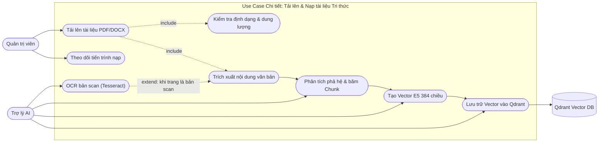

**Mô tả Use Case:**

* **Tải lên tài liệu PDF/DOCX:** Quản trị viên chọn tệp từ máy trạm, gắn Mã văn bản, Tên tài liệu, Danh mục (Nội quy, Quy chế, Chính sách IT, Hướng dẫn) và Phiên bản ban hành.
* **Kiểm tra định dạng & dung lượng:** Xác thực tệp thuộc định dạng cho phép (`.pdf`, `.docx`) và dung lượng không vượt quá $50\text{MB}$ trước khi lưu trữ.
* **Theo dõi tiến trình nạp:** Hiển thị tiến trình xử lý bất đồng bộ theo các giai đoạn: trích xuất → phả hệ → băm chunk → embedding → ghi Qdrant; cập nhật qua WebSocket khi hoàn tất.
* **Trích xuất nội dung văn bản:** Document Parser đọc cấu trúc tầng vật lý của PDF (khối văn bản, bảng biểu) và chuẩn hóa văn bản (Unicode, font chữ cũ VNI/TCVN3).
* **OCR bản scan (Tesseract):** Kích hoạt tự động với các trang không có text layer (ảnh scan) — nhận dạng ký tự quang học tiếng Việt; kết quả đi qua bộ chuyển đổi font và bộ khử nhiễu OCR.
* **Phân tích phả hệ & băm Chunk:** Dựng cây cấu trúc động (Chương → Điều → Khoản → Mục) bằng thuật toán nhận diện đa tín hiệu; băm nhỏ văn bản theo ranh giới ngữ nghĩa (**Adaptive Chunking**) và làm giàu metadata phả hệ (`section_path`).
* **Tạo Vector E5 384 chiều:** Nhúng từng chunk bằng mô hình `multilingual-e5-small` (đã thắng benchmark tại Chương 2).
* **Lưu trữ Vector vào Qdrant:** Upsert theo batch (64 điểm/batch) vào collection `enterprise_documents` với `point_id` sinh từ `uuid5(chunk_id)` đảm bảo tính lũy đẳng (chạy lại không nhân bản vector).

#### 1.4. Use Case chi tiết: Chức năng Quản lý phiên bản và xem chi tiết tài liệu (CN-04)

> **Thành viên phụ trách:** Thọ *(Module M6 — Document List/Detail UI)* · Đức *(API phiên bản)*

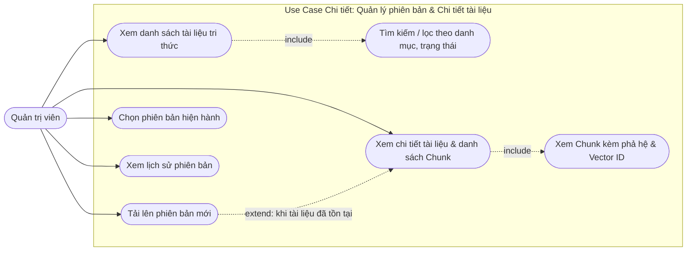

**Mô tả Use Case:**

* **Xem danh sách tài liệu tri thức:** Bảng tài liệu hiển thị mã, tên, danh mục, phiên bản hiện hành, số trang, số chunk và trạng thái nạp (`UPLOADED`, `PROCESSING`, `INGESTED`, `FAILED`).
* **Tìm kiếm / lọc:** Lọc theo danh mục (Nội quy, Quy chế, Chính sách IT...) và trạng thái nạp.
* **Xem chi tiết tài liệu & danh sách Chunk:** Xem toàn bộ thông số kỹ thuật (mã băm tệp, số trang, số chunk, người tạo, ngày tạo) và danh sách các đoạn văn bản đã lập chỉ mục.
* **Xem Chunk kèm phả hệ & Vector ID:** Mỗi chunk hiển thị `section_path` (Chương/Điều/Khoản), khoảng trang (`page_start` → `page_end`), nội dung và `vector_id` trong Qdrant — phục vụ truy vết nguồn trích dẫn.
* **Tải lên phiên bản mới:** Upload tệp hiệu đính cho tài liệu đã tồn tại; hệ thống tự tăng `version_number`, phiên bản cũ được giữ nguyên phục vụ đối soát (audit).
* **Chọn phiên bản hiện hành:** Chuyển cờ `is_current` sang phiên bản mới — chỉ phiên bản hiện hành tham gia vào tìm kiếm/trả lời của Trợ lý AI.
* **Xem lịch sử phiên bản:** Danh sách toàn bộ phiên bản kèm trạng thái nạp và ngày hiệu lực.

#### 1.5. Use Case chi tiết: Chức năng Hỏi đáp tri thức doanh nghiệp — Hybrid GraphRAG (CN-05)

> **Thành viên phụ trách:** Đạt *(Module M3 + M4 — Vector RAG & GraphRAG)* · Thọ *(Module M6 — Chat UI)*

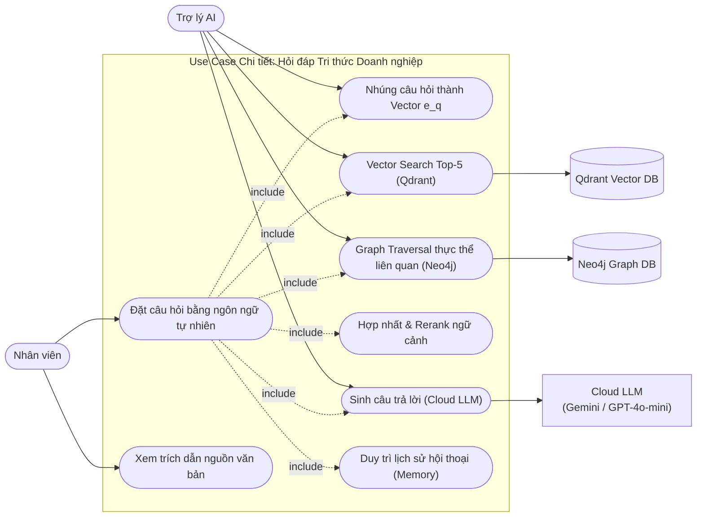

**Mô tả Use Case:**

* **Đặt câu hỏi bằng ngôn ngữ tự nhiên:** Nhân viên gõ câu hỏi trong `ChatView` (hỗ trợ câu hỏi tiếng Việt không cần đúng cú pháp từ khóa).
* **Nhúng câu hỏi thành Vector e_q:** Biểu diễn câu hỏi qua mô hình `multilingual-e5-small` (384d); với E5, câu hỏi truy vấn được thêm tiền tố `query:` theo đúng chế độ huấn luyện của mô hình.
* **Vector Search Top-5 (Qdrant):** Lấy 5 chunk gần nghĩa nhất, lọc nhiễu theo ngưỡng `score ≥ 0.3`, hỗ trợ bộ lọc metadata (`document_id`, `document_type`).
* **Graph Traversal (Neo4j):** Duyệt đồ thị tri thức từ các thực thể nhận diện trong câu hỏi (Điều/Khoản/Chính sách/Role) để bổ sung ngữ cảnh quan hệ mà Vector Search có thể bỏ sót (ví dụ điều khoản A tham chiếu văn bản B).
* **Hợp nhất & Rerank:** Hợp nhất hai nguồn kết quả, khử trùng lặp theo `chunk_id`, xếp hạng lại và chọn tập ngữ cảnh tối ưu (Top-3).
* **Sinh câu trả lời (Cloud LLM):** Đóng gói Prompt gồm: chỉ thị chống bịa đặt (chỉ trả lời từ ngữ cảnh, nếu thiếu thông tin thì phải nói rõ), ngữ cảnh đánh số `[1]..[3]` kèm phả hệ, và câu hỏi. Gọi Gemini 1.5 Flash (fallback: GPT-4o-mini).
* **Xem trích dẫn nguồn văn bản:** Mỗi nhận định trong câu trả lời gắn nhãn `[n]`; UI hiển thị danh sách nguồn: **Tài liệu → Phiên bản → Chương → Điều → Khoản → Trang**, kèm liên kết mở `DocumentDetailView`.
* **Duy trì lịch sử hội thoại (Memory):** Mỗi phiên chat lưu các `chat_messages` (câu hỏi, câu trả lời, citations) để hỗ trợ các câu hỏi nối tiếp ngữ cảnh ("Điều đó áp dụng cho ai?").

#### 1.6. Use Case chi tiết: Chức năng Tìm kiếm ngữ nghĩa tài liệu (CN-06)

> **Thành viên phụ trách:** Đạt *(Module M3.3 — Vector Retrieval)*

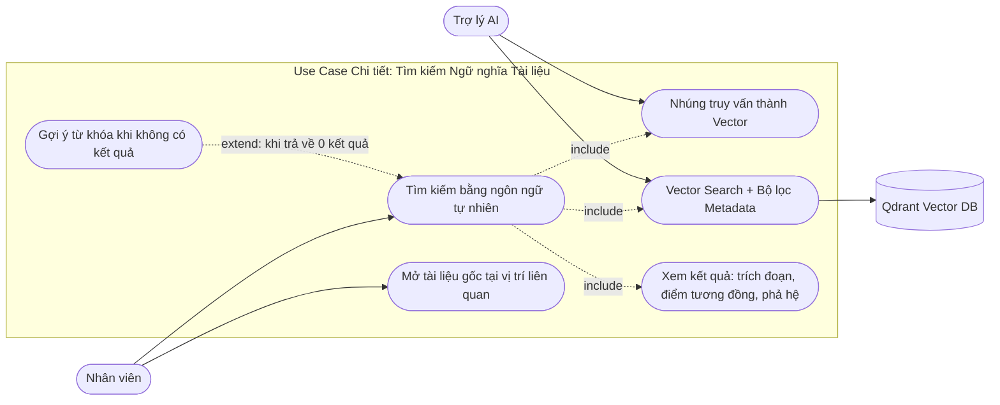

**Mô tả Use Case:**

* **Tìm kiếm bằng ngôn ngữ tự nhiên:** Khác với tìm kiếm `LIKE` truyền thống, người dùng mô tả ý định (*"quy định thử việc"*) — hệ thống hiểu theo ngữ nghĩa, không phụ thuộc khớp từ khóa chính xác.
* **Nhúng truy vấn thành Vector:** Chuyển truy vấn thành vector 384 chiều bằng cùng mô hình E5 đã dùng khi nạp tài liệu (đảm bảo cùng không gian vector).
* **Vector Search + Bộ lọc Metadata:** Truy vấn Qdrant với `top_k = 10`, kết hợp bộ lọc payload như `document_type`, `document_id`, `access_level`.
* **Xem kết quả:** Mỗi kết quả hiển thị: điểm tương đồng (`score`), trích đoạn nội dung, phả hệ (`section_path`), khoảng trang và tên tài liệu.
* **Mở tài liệu gốc tại vị trí liên quan:** Click kết quả → mở `DocumentDetailView` cuộn đến đúng chunk — phục vụ đối chiếu toàn văn.
* **Gợi ý từ khóa khi không có kết quả:** Khi 0 kết quả đạt ngưỡng, hệ thống gợi ý các danh mục tài liệu hiện có để người dùng điều chỉnh truy vấn.

#### 1.7. Use Case chi tiết: Chức năng Tạo đơn xin nghỉ phép (CN-07)

> **Thành viên phụ trách:** Đức *(Module M5.4 — Request Workflow)*

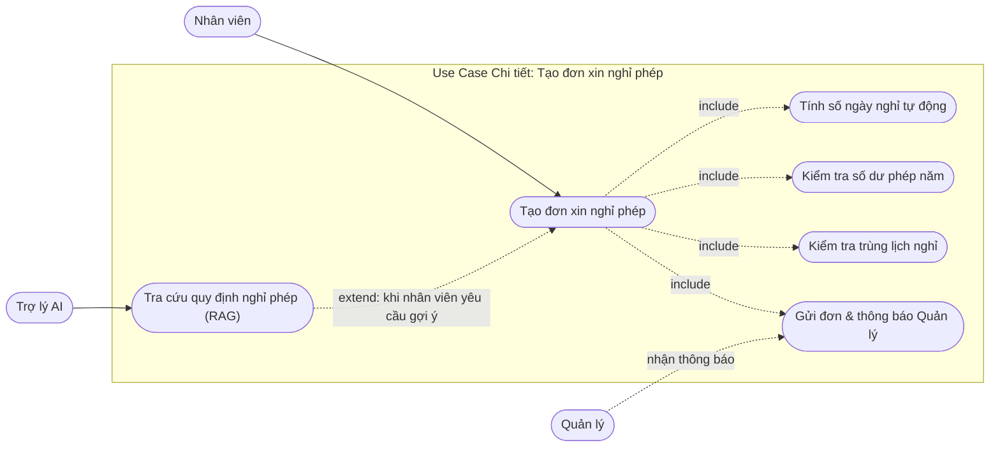

**Mô tả Use Case:**

* **Tạo đơn xin nghỉ phép:** Nhân viên chọn khoảng ngày nghỉ, nhập lý do, gửi đơn ở trạng thái `PENDING` để Quản lý phê duyệt.
* **Tính số ngày nghỉ tự động:** Đếm số ngày làm việc trong khoảng đã chọn (loại trừ cuối tuần), tránh nhập sai thủ công.
* **Kiểm tra số dư phép năm:** Đối chiếu với hạn mức 12 ngày/năm; nếu vượt, hệ thống cảnh báo rõ *"Đơn vượt X ngày phép năm — phần vượt sẽ tính nghỉ không lương"* và yêu cầu xác nhận trước khi gửi.
* **Kiểm tra trùng lịch nghỉ:** Chặn tạo đơn trùng khoảng ngày với đơn khác đang `PENDING`/`APPROVED` của cùng nhân viên.
* **Tra cứu quy định nghỉ phép (RAG):** Nút `[Xem quy định nghỉ phép]` — Trợ lý AI trả lời trích dẫn trực tiếp Điều khoản quy định (tái sử dụng CN-05), giúp nhân viên nắm quyền lợi trước khi gửi đơn.
* **Gửi đơn & thông báo Quản lý:** Lưu đơn vào CSDL và bắn thông báo thời gian thực đến màn hình Quản lý.

#### 1.8. Use Case chi tiết: Chức năng Phê duyệt đơn nghỉ phép (CN-08)

> **Thành viên phụ trách:** Đức *(Module M5.4 — Request Workflow)*

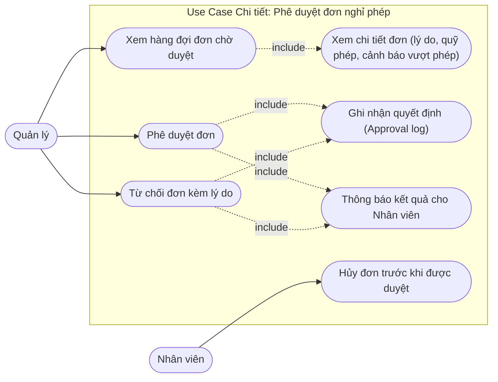

**Mô tả Use Case:**

* **Xem hàng đợi đơn chờ duyệt:** Danh sách các đơn `PENDING` của nhân viên, sắp xếp theo thời điểm gửi; hỗ trợ đếm nhanh trên badge thông báo.
* **Xem chi tiết đơn:** Hiển thị lý do, số ngày, khoảng ngày, cảnh báo vượt phép (nếu có) và lịch sử đơn trước đó của nhân viên.
* **Phê duyệt đơn:** Chuyển `PENDING → APPROVED` kèm ghi chú tùy chọn.
* **Từ chối đơn kèm lý do:** Chuyển `PENDING → REJECTED`; **bắt buộc** nhập lý do để nhân viên hiểu và điều chỉnh.
* **Ghi nhận quyết định (Approval log):** Mọi quyết định lưu vào bảng `approvals` (ai quyết định, quyết định gì, khi nào, ghi chú) — phục vụ truy vết và kiểm toán.
* **Thông báo kết quả cho Nhân viên:** Bắn WebSocket thời gian thực; nhân viên thấy kết quả ngay trên màn hình *Đơn của tôi*.
* **Hủy đơn trước khi được duyệt:** Nhân viên tự hủy đơn `PENDING → CANCELLED` (VD: thay đổi kế hoạch) — đơn đã duyệt/từ chối thì không hủy được.

#### 1.9. Use Case chi tiết: Chức năng Gửi yêu cầu hỗ trợ IT — AI phân loại tự động (CN-09)

> **Thành viên phụ trách:** Đức *(workflow M5.5)* · Đạt *(Module M2.7.4 — Classification)*

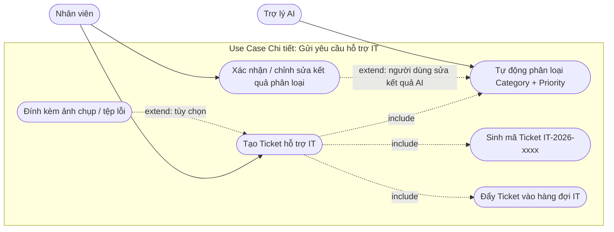

**Mô tả Use Case:**

* **Tạo Ticket hỗ trợ IT:** Nhân viên mô tả sự cố bằng ngôn ngữ tự nhiên (VD: *"Không kết nối được VPN sau khi đổi mật khẩu"*).
* **Tự động phân loại Category + Priority:** AI phân tích nội dung mô tả và đề xuất Danh mục (`NETWORK`, `ACCOUNT`, `HARDWARE`, `SOFTWARE`, `OTHER`) cùng Độ ưu tiên (`LOW`, `MEDIUM`, `HIGH`, `URGENT`) kèm độ tin cậy.
* **Xác nhận / chỉnh sửa kết quả phân loại:** Nhân viên thấy gợi ý của AI **trước khi gửi** và có quyền sửa lại — AI hỗ trợ, không thay thế quyết định con người.
* **Đính kèm ảnh chụp / tệp lỗi:** Hỗ trợ gửi kèm ảnh màn hình lỗi (tối đa 10MB) giúp IT chẩn đoán nhanh.
* **Sinh mã Ticket IT-2026-xxxx:** Mã tuần tự theo năm, dễ tra cứu và giao tiếp nội bộ.
* **Đẩy Ticket vào hàng đợi IT:** Ticket mới ở trạng thái `OPEN`, xuất hiện trên hàng đợi của bộ phận IT kèm thông báo thời gian thực.

#### 1.10. Use Case chi tiết: Chức năng Tiếp nhận và xử lý Ticket IT — AI gợi ý xử lý (CN-10)

> **Thành viên phụ trách:** Đức *(workflow M5.5)* · Đạt *(AI Suggestion — tái sử dụng RAG)*

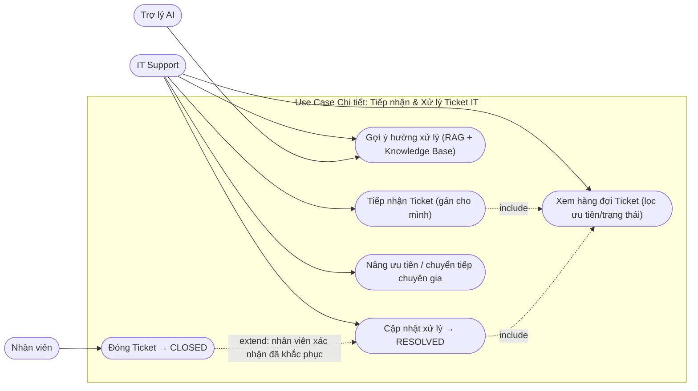

**Mô tả Use Case:**

* **Xem hàng đợi Ticket:** Bảng ticket sắp xếp theo mức ưu tiên (`URGENT → HIGH → MEDIUM → LOW`) và tuổi thọ ticket; bộ lọc trạng thái, danh mục, người xử lý.
* **Tiếp nhận Ticket (gán cho mình):** Chuyển `OPEN → IN_PROGRESS`, gán `assignee_id` = IT Support đang thao tác — tránh hai người cùng xử lý một lỗi.
* **Gợi ý hướng xử lý (RAG + Knowledge Base):** Trợ lý AI đọc nội dung ticket, truy vấn kho tri thức nội bộ (tài liệu Hướng dẫn IT, Chính sách mật khẩu, cấu hình VPN...) và trả về **các bước xử lý đề xuất kèm trích dẫn** — tái sử dụng nguyên hạ tầng Hybrid GraphRAG của CN-05.
* **Cập nhật xử lý → RESOLVED:** IT nhập ghi chú cách khắc phục (`resolution_note`); nhân viên nhận thông báo để kiểm tra lại.
* **Đóng Ticket → CLOSED:** Sau khi nhân viên xác nhận đã khắc phục, ticket được đóng; thời gian xử lý (từ `OPEN` đến `RESOLVED`) lưu phục vụ thống kê.
* **Nâng ưu tiên / chuyển tiếp chuyên gia:** IT có quyền nâng `priority` (VD: `HIGH → URGENT`) kèm ghi chú lý do.

---

### Bước 2: Kịch bản Chuẩn và Ngoại lệ (Scenario)

Mỗi chức năng được đặc tả một **kịch bản chuẩn (Main Event)** theo từng bước và các **tình huống ngoại lệ (Exception)** tương ứng. Đánh số kịch bản `2.x` khớp với Use Case `1.x` của cùng chức năng tại Bước 1.

#### 2.1. Kịch bản chuẩn và ngoại lệ: Đăng nhập hệ thống (CN-01)

| Thuộc tính             | Nội dung mô tả chi tiết                                                                                                                                                                                                                                                                                                                                                                                                                                                                                                                                                                                                                                                                                                                                                                                                                                                                                                                                                                                                                                                |
| :----------------------- | :------------------------------------------------------------------------------------------------------------------------------------------------------------------------------------------------------------------------------------------------------------------------------------------------------------------------------------------------------------------------------------------------------------------------------------------------------------------------------------------------------------------------------------------------------------------------------------------------------------------------------------------------------------------------------------------------------------------------------------------------------------------------------------------------------------------------------------------------------------------------------------------------------------------------------------------------------------------------------------------------------------------------------------------------------------------------- |
| **Scenario**       | **Đăng nhập hệ thống bằng tài khoản nội bộ**                                                                                                                                                                                                                                                                                                                                                                                                                                                                                                                                                                                                                                                                                                                                                                                                                                                                                                                                                                                                               |
| **Actor**          | Nhân viên (đại diện cho mọi vai trò: Nhân viên, Quản lý, Quản trị viên, IT Support)                                                                                                                                                                                                                                                                                                                                                                                                                                                                                                                                                                                                                                                                                                                                                                                                                                                                                                                                                                          |
| **Pre-Condition**  | Tài khoản đã tồn tại trong bảng `users` (được khởi tạo bởi seed data hoặc tài khoản Quản trị viên tạo trước đó) và đang ở trạng thái kích hoạt.                                                                                                                                                                                                                                                                                                                                                                                                                                                                                                                                                                                                                                                                                                                                                                                                                                                                                           |
| **Post-Condition** | Phiên làm việc được thiết lập: Client lưu JWT vào `localStorage`; người dùng được điều hướng đến trang chủ tương ứng với vai trò (`role`).                                                                                                                                                                                                                                                                                                                                                                                                                                                                                                                                                                                                                                                                                                                                                                                                                                                                                                 |
| **Main Event**     | **1.** Nhân viên mở ứng dụng Web, hệ thống hiển thị giao diện `LoginView`.**2.** Nhân viên nhập Email (`nva@congty.vn`) và Mật khẩu, nhấn nút `[Đăng nhập]`.**3.** `LoginView` gửi yêu cầu `POST /api/auth/login` chứa `LoginRequest { email, password }`.**4.** `AuthController` tiếp nhận và gọi `authService.login(request)`.**5.** `AuthService` truy vấn `userRepository.findByEmail(email)`.**6.** Đối chiếu mật khẩu bằng `BCryptPasswordEncoder.matches(rawPassword, user.password)`.**7.** `JwtService.generateToken(user)` sinh JWT (HS256, hạn 1 giờ) chứa `userId`, `email`, `role`.**8.** Hệ thống trả `AuthResponse { accessToken, tokenType, fullName, role }` về Client.**9.** `LoginView` lưu token, cập nhật `AuthContext` và điều hướng: `EMPLOYEE` → Giao diện Chat/Tra cứu, `MANAGER` → Hàng đợi phê duyệt, `ADMIN` → Trang quản trị tài liệu, `IT_SUPPORT` → Hàng đợi Ticket. |
| **Exception**      | **5a.** Email không tồn tại **hoặc 6a.** Mật khẩu sai: hệ thống trả `401 Unauthorized` với thông báo chung *"Email hoặc mật khẩu không đúng"* (không tiết lộ chi tiết để tránh dò quét tài khoản).**6b.** Tài khoản bị khóa (`is_active = false`): trả `403 Forbidden` — *"Tài khoản đã bị khóa, liên hệ Quản trị viên"*.**7a.** `JWT_SECRET` không hợp lệ/thiếu cấu hình: ghi log lỗi hệ thống, trả `500`.**9a.** Trong phiên làm việc, token hết hạn: `JwtAuthenticationFilter` trả `401`, Client tự động xóa token và quay về `LoginView`.                                                                                                                                                                                                                                                                                                                                                                                                        |

#### 2.2. Kịch bản chuẩn và ngoại lệ: Quản lý người dùng và phân quyền RBAC (CN-02)

| Thuộc tính             | Nội dung mô tả chi tiết                                                                                                                                                                                                                                                                                                                                                                                                                                                                                                                                                                                                                                                                                                                                                                                                                                                                                                                                          |
| :----------------------- | :------------------------------------------------------------------------------------------------------------------------------------------------------------------------------------------------------------------------------------------------------------------------------------------------------------------------------------------------------------------------------------------------------------------------------------------------------------------------------------------------------------------------------------------------------------------------------------------------------------------------------------------------------------------------------------------------------------------------------------------------------------------------------------------------------------------------------------------------------------------------------------------------------------------------------------------------------------------- |
| **Scenario**       | **Quản trị viên tạo tài khoản cho nhân viên mới**                                                                                                                                                                                                                                                                                                                                                                                                                                                                                                                                                                                                                                                                                                                                                                                                                                                                                                     |
| **Actor**          | Quản trị viên (Admin)                                                                                                                                                                                                                                                                                                                                                                                                                                                                                                                                                                                                                                                                                                                                                                                                                                                                                                                                             |
| **Pre-Condition**  | Quản trị viên đã đăng nhập hợp lệ với `role = ADMIN`.                                                                                                                                                                                                                                                                                                                                                                                                                                                                                                                                                                                                                                                                                                                                                                                                                                                                                                   |
| **Post-Condition** | Tài khoản mới xuất hiện trong danh sách với vai trò được gán; mật khẩu lưu dưới dạng băm BCrypt; nhân viên có thể đăng nhập ngay.                                                                                                                                                                                                                                                                                                                                                                                                                                                                                                                                                                                                                                                                                                                                                                                                          |
| **Main Event**     | **1.** Quản trị viên chọn chức năng *Quản lý người dùng* trên thanh điều hướng.**2.** Hệ thống hiển thị `UserManagementView` với bảng người dùng phân trang và ô tìm kiếm.**3.** Quản trị viên bấm nút `[+ Tạo tài khoản]`.**4.** Hệ thống hiển thị biểu mẫu: Email, Họ tên, Vai trò (dropdown 4 giá trị), Mật khẩu khởi tạo.**5.** Quản trị viên nhập `nva@congty.vn`, `Nguyễn Văn A`, vai trò `EMPLOYEE`, nhấn `[Lưu]`.**6.** Client gửi `POST /api/users` *(yêu cầu kèm JWT có role ADMIN)*.**7.** `UserController` → `UserService` kiểm tra trùng Email.**8.** Hệ thống băm mật khẩu BCrypt, lưu bản ghi mới vào bảng `users` với `is_active = true`.**9.** Trả `201 Created` + `UserResponse`; `UserManagementView` làm mới bảng và hiển thị *"Tạo tài khoản thành công"*. |
| **Exception**      | **7a.** Email đã tồn tại: trả `409 Conflict` — *"Email đã được sử dụng"*.**6a.** Người gọi không có role ADMIN: `403 Forbidden` (chặn ở tầng Filter, không vào Controller).**5b.** Định dạng Email sai hoặc bỏ trống trường bắt buộc: hiển thị lỗi validate ngay trên biểu mẫu.**8a.** Quản trị viên cố hạ vai trò của **chính mình** hoặc khóa chính mình: hệ thống chặn — *"Không thể tự hạ quyền/khóa tài khoản đang đăng nhập"* (chống tự khóa hệ thống).                                                                                                                                                                                                                                                                                                                                                                                         |

#### 2.3. Kịch bản chuẩn và ngoại lệ: Tải lên và nạp tài liệu tri thức (CN-03)

| Thuộc tính             | Nội dung mô tả chi tiết                                                                                                                                                                                                                                                                                                                                                                                                                                                                                                                                                                                                                                                                                                                                                                                                                                                                                                                                                                                                                                                                                                                                                                                                                                                                                                                                                                                                                                                                                                                                                                                                                                                                                                                                                                                                                                                                                                                                                                                                                                                                                                                          |
| :----------------------- | :--------------------------------------------------------------------------------------------------------------------------------------------------------------------------------------------------------------------------------------------------------------------------------------------------------------------------------------------------------------------------------------------------------------------------------------------------------------------------------------------------------------------------------------------------------------------------------------------------------------------------------------------------------------------------------------------------------------------------------------------------------------------------------------------------------------------------------------------------------------------------------------------------------------------------------------------------------------------------------------------------------------------------------------------------------------------------------------------------------------------------------------------------------------------------------------------------------------------------------------------------------------------------------------------------------------------------------------------------------------------------------------------------------------------------------------------------------------------------------------------------------------------------------------------------------------------------------------------------------------------------------------------------------------------------------------------------------------------------------------------------------------------------------------------------------------------------------------------------------------------------------------------------------------------------------------------------------------------------------------------------------------------------------------------------------------------------------------------------------------------------------------------------- |
| **Scenario**       | **Tải lên và nạp tài liệu vào kho tri thức doanh nghiệp**                                                                                                                                                                                                                                                                                                                                                                                                                                                                                                                                                                                                                                                                                                                                                                                                                                                                                                                                                                                                                                                                                                                                                                                                                                                                                                                                                                                                                                                                                                                                                                                                                                                                                                                                                                                                                                                                                                                                                                                                                                                                             |
| **Actor**          | Quản trị viên (Admin), Trợ lý AI (AI Assistant)                                                                                                                                                                                                                                                                                                                                                                                                                                                                                                                                                                                                                                                                                                                                                                                                                                                                                                                                                                                                                                                                                                                                                                                                                                                                                                                                                                                                                                                                                                                                                                                                                                                                                                                                                                                                                                                                                                                                                                                                                                                                                                 |
| **Pre-Condition**  | Quản trị viên đã đăng nhập thành công với vai trò `ADMIN`. Tệp tài liệu hợp lệ tồn tại trên máy trạm.                                                                                                                                                                                                                                                                                                                                                                                                                                                                                                                                                                                                                                                                                                                                                                                                                                                                                                                                                                                                                                                                                                                                                                                                                                                                                                                                                                                                                                                                                                                                                                                                                                                                                                                                                                                                                                                                                                                                                                                                                        |
| **Post-Condition** | Tài liệu được lưu trữ, băm nhỏ thành các Chunk ngữ nghĩa, mã hóa thành Vector 384 chiều và lưu vào Qdrant; trạng thái phiên bản chuyển thành `INGESTED`.                                                                                                                                                                                                                                                                                                                                                                                                                                                                                                                                                                                                                                                                                                                                                                                                                                                                                                                                                                                                                                                                                                                                                                                                                                                                                                                                                                                                                                                                                                                                                                                                                                                                                                                                                                                                                                                                                                                                                                 |
| **Main Event**     | **1.** Quản trị viên chọn chức năng *Quản lý tài liệu* từ giao diện Trang chủ Quản trị.**2.** Hệ thống hiển thị giao diện `DocumentManagementView` gồm danh sách tài liệu hiện có, ô tìm kiếm và nút `[+ Tải lên tài liệu]`.**3.** Quản trị viên click vào nút `[+ Tải lên tài liệu]`.**4.** Hệ thống hiển thị cửa sổ `UploadDocumentView`: ô chọn tệp, ô nhập Mã tài liệu, Tên tài liệu, Danh mục, Phiên bản.**5.** Quản trị viên chọn tệp `NoiQuyLaoDong2026.pdf`, điền mã `DOC-NQLD`, tên `Nội quy Lao động 2026`, danh mục `Nội quy` và nhấn nút `[Lưu & Xử lý]`.**6.** Hệ thống kiểm tra dung lượng ($12.5\text{MB} \le 50\text{MB}$), định dạng `.pdf` hợp lệ và tính mã băm SHA-256 của tệp.**7.** Hệ thống lưu tệp vào máy chủ, ghi bản ghi `documents` + phiên bản mới vào `document_versions` với trạng thái `PROCESSING`.**8.** Hệ thống chuyển sang giao diện `IngestionProgressView` và gửi tác vụ xử lý bất đồng bộ sang AI Service (`POST /api/v1/process`).**9.** AI Service trích xuất nội dung từng trang; với các trang scan ảnh, hệ thống tự động kích hoạt Tesseract OCR tiếng Việt.**10.** AI Service phân tích cấu trúc cây (Dynamic Hierarchy), băm nhỏ theo đoạn văn ngữ nghĩa (Adaptive Chunking) và tạo ra **152 Chunk** dữ liệu.**11.** AI Service dùng mô hình `multilingual-e5-small` tạo vector 384 chiều cho từng Chunk.**12.** AI Service upsert toàn bộ Vector kèm Payload vào Qdrant theo batch 64 điểm.**13.** AI Service gọi Callback `PUT /api/internal/documents/{versionId}/status` thông báo `INGESTED`; Backend cập nhật trạng thái phiên bản và bắn WebSocket tới Client.**14.** Giao diện hiển thị *"Nạp tri thức thành công (152 chunks)"*; Quản trị viên có thể chuyển sang `DocumentDetailView` để kiểm tra các đoạn văn bản đã lập chỉ mục. |
| **Exception**      | **6a.** Tệp vượt quá $50\text{MB}$ hoặc sai định dạng: hệ thống thông báo lỗi, dừng quy trình và yêu cầu chọn lại.**7a.** Mã tài liệu bị trùng trong CSDL: báo lỗi trùng mã, yêu cầu nhập mã khác.**7b.** Mã băm SHA-256 trùng với một phiên bản đã nạp: cảnh báo *"Nội dung tệp không thay đổi so với phiên bản hiện có"* và đề nghị dùng lại phiên bản cũ thay vì nạp lại.**9a.** Trang PDF lỗi text hoặc ảnh scan quá mờ: ghi cảnh báo lỗi trang vào nhật ký xử lý và tiếp tục các trang còn lại (cơ chế OCR Resilience).**12a.** Mất kết nối tới Qdrant: AI Service báo callback `FAILED` kèm thông điệp lỗi; trạng thái phiên bản cập nhật thành `FAILED`, giao diện hiển thị nút `[Thử lại]` (Retry) để kích hoạt lại pipeline.                                                                                                                                                                                                                                                                                                                                                                                                                                                                                                                                                                                                                                                                                                                                                                                                                                                                                                                                                                                                                                                                                                                                                                                                                                                   |

#### 2.4. Kịch bản chuẩn và ngoại lệ: Quản lý phiên bản và xem chi tiết tài liệu (CN-04)

| Thuộc tính             | Nội dung mô tả chi tiết                                                                                                                                                                                                                                                                                                                                                                                                                                                                                                                                                                                                                                                                                                                                                                                                                                                                                                                                                                                                                                                                                                                                                                                                                                                                                                                                                                                                                                                          |
| :----------------------- | :----------------------------------------------------------------------------------------------------------------------------------------------------------------------------------------------------------------------------------------------------------------------------------------------------------------------------------------------------------------------------------------------------------------------------------------------------------------------------------------------------------------------------------------------------------------------------------------------------------------------------------------------------------------------------------------------------------------------------------------------------------------------------------------------------------------------------------------------------------------------------------------------------------------------------------------------------------------------------------------------------------------------------------------------------------------------------------------------------------------------------------------------------------------------------------------------------------------------------------------------------------------------------------------------------------------------------------------------------------------------------------------------------------------------------------------------------------------------------------- |
| **Scenario**       | **Ban hành phiên bản mới cho tài liệu đã có và đối chiếu Chunk**                                                                                                                                                                                                                                                                                                                                                                                                                                                                                                                                                                                                                                                                                                                                                                                                                                                                                                                                                                                                                                                                                                                                                                                                                                                                                                                                                                                                  |
| **Actor**          | Quản trị viên (Admin)                                                                                                                                                                                                                                                                                                                                                                                                                                                                                                                                                                                                                                                                                                                                                                                                                                                                                                                                                                                                                                                                                                                                                                                                                                                                                                                                                                                                                                                             |
| **Pre-Condition**  | Tài liệu `DOC-NQLD` đã tồn tại với phiên bản `v1` ở trạng thái `INGESTED`. Quản trị viên đã đăng nhập vai trò `ADMIN`.                                                                                                                                                                                                                                                                                                                                                                                                                                                                                                                                                                                                                                                                                                                                                                                                                                                                                                                                                                                                                                                                                                                                                                                                                                                                                                                                  |
| **Post-Condition** | Phiên bản `v2` được nạp thành công (`INGESTED`) và được đánh dấu `is_current`; `v1` giữ nguyên trạng thái với `is_current = false`; các chunk của v2 thay thế v1 trong phạm vi tìm kiếm.                                                                                                                                                                                                                                                                                                                                                                                                                                                                                                                                                                                                                                                                                                                                                                                                                                                                                                                                                                                                                                                                                                                                                                                                                                                         |
| **Main Event**     | **1.** Quản trị viên mở `DocumentManagementView`, danh sách hiển thị tài liệu `DOC-NQLD — Nội quy Lao động 2026` (v1, INGESTED, 152 chunks).**2.** Quản trị viên click vào dòng tài liệu, hệ thống mở `DocumentDetailView` với 2 tab: *Thông tin chung* và *Danh sách Chunk*.**3.** Tab *Thông tin chung* hiển thị: mã tài liệu, danh mục, người tạo, `file_hash`, số trang (15), số chunk (152), lịch sử phiên bản.**4.** Quản trị viên mở tab *Danh sách Chunk*: xem 152 đoạn văn kèm `section_path` (VD: *Chương III: Thời giờ làm việc và nghỉ ngơi → Điều 15: Nghỉ phép năm*), khoảng trang 12–13 và Vector ID.**5.** Quản trị viên bấm `[Tải lên phiên bản mới]`, chọn tệp `NoiQuyLaoDong2026_hieudinh.pdf` (đã sửa Điều 15).**6.** Hệ thống kiểm tra định dạng/dung lượng, tính SHA-256, xác nhận nội dung khác phiên bản cũ.**7.** Hệ thống tạo `v2` trạng thái `PROCESSING`, kích hoạt pipeline nạp bất đồng bộ (như CN-03) và chuyển sang `IngestionProgressView`.**8.** Pipeline hoàn tất: `v2` → `INGESTED` (154 chunks). Hệ thống tự động chuyển `is_current` từ `v1` sang `v2`.**9.** Quản trị viên quay lại `DocumentDetailView` xác nhận danh sách chunk mới; tìm kiếm/Trợ lý AI từ thời điểm này chỉ sử dụng v2. |
| **Exception**      | **5a.** Phiên bản cũ đang ở trạng thái `PROCESSING`: hệ thống chặn — *"Vui lòng đợi phiên bản trước nạp xong"* (mỗi tài liệu chỉ xử lý một phiên bản tại một thời điểm).**6a.** SHA-256 trùng phiên bản hiện hành: cảnh báo nội dung không thay đổi, gợi ý hủy thao tác.**8a.** Nạp `v2` thất bại: `v2` giữ trạng thái `FAILED`, `v1` **vẫn là** phiên bản hiện hành — đảm bảo hoạt động tra cứu không bị gián đoạn.**9a.** Người dùng cố đặt `is_current` cho phiên bản `FAILED`: hệ thống từ chối.                                                                                                                                                                                                                                                                                                                                                                                                                                                                                                                                                                                                                                                                                                                                                                                                                                              |

#### 2.5. Kịch bản chuẩn và ngoại lệ: Hỏi đáp tri thức doanh nghiệp (CN-05)

| Thuộc tính             | Nội dung mô tả chi tiết                                                                                                                                                                                                                                                                                                                                                                                                                                                                                                                                                                                                                                                                                                                                                                                                                                                                                                                                                                                                                                                                                                                                                                                                                                                                                                                                                                                                                                                                                                                                                                                                                                                                          |
| :----------------------- | :--------------------------------------------------------------------------------------------------------------------------------------------------------------------------------------------------------------------------------------------------------------------------------------------------------------------------------------------------------------------------------------------------------------------------------------------------------------------------------------------------------------------------------------------------------------------------------------------------------------------------------------------------------------------------------------------------------------------------------------------------------------------------------------------------------------------------------------------------------------------------------------------------------------------------------------------------------------------------------------------------------------------------------------------------------------------------------------------------------------------------------------------------------------------------------------------------------------------------------------------------------------------------------------------------------------------------------------------------------------------------------------------------------------------------------------------------------------------------------------------------------------------------------------------------------------------------------------------------------------------------------------------------------------------------------------------------- |
| **Scenario**       | **Nhân viên hỏi đáp chính sách nghỉ phép và nhận câu trả lời kèm trích dẫn**                                                                                                                                                                                                                                                                                                                                                                                                                                                                                                                                                                                                                                                                                                                                                                                                                                                                                                                                                                                                                                                                                                                                                                                                                                                                                                                                                                                                                                                                                                                                                                                                  |
| **Actor**          | Nhân viên (Employee), Trợ lý AI (AI Assistant)                                                                                                                                                                                                                                                                                                                                                                                                                                                                                                                                                                                                                                                                                                                                                                                                                                                                                                                                                                                                                                                                                                                                                                                                                                                                                                                                                                                                                                                                                                                                                                                                                                                   |
| **Pre-Condition**  | Kho tri thức đã có ít nhất một tài liệu ở trạng thái `INGESTED`; Qdrant hoạt động; khóa API của Cloud LLM được cấu hình hợp lệ.                                                                                                                                                                                                                                                                                                                                                                                                                                                                                                                                                                                                                                                                                                                                                                                                                                                                                                                                                                                                                                                                                                                                                                                                                                                                                                                                                                                                                                                                                                                                            |
| **Post-Condition** | Câu trả lời chính xác dựa trên ngữ cảnh nội bộ, kèm danh sách trích dẫn nguồn kiểm chứng được; hội thoại được lưu vào lịch sử phiên chat.                                                                                                                                                                                                                                                                                                                                                                                                                                                                                                                                                                                                                                                                                                                                                                                                                                                                                                                                                                                                                                                                                                                                                                                                                                                                                                                                                                                                                                                                                                                             |
| **Main Event**     | **1.** Nhân viên mở `ChatView` và gõ câu hỏi: *"Nhân viên được nghỉ phép bao nhiêu ngày mỗi năm?"*.**2.** `ChatView` gửi `POST /api/ai/chat { question, sessionId }` tới Backend (kèm JWT).**3.** Backend chuyển tiếp sang AI Service qua `POST /api/v1/chat/ask`.**4.** AI Service nhúng câu hỏi: `e_q = model.encode("query: " + question)` → vector 384 chiều.**5.** AI Service chạy song song hai luồng truy xuất:&nbsp;&nbsp;&nbsp;• `QdrantService.search(e_q, top_k=5, min_score=0.3)` → 5 chunk liên quan nhất.&nbsp;&nbsp;&nbsp;• `GraphService.traverse(entities)` → các thực thể liên quan (Điều 15 → APPLIES_TO → Role: Employee).**6.** Bộ Fusion hợp nhất, khử trùng lặp và Rerank → chọn Top-3 ngữ cảnh tối ưu.**7.** AI Service đóng gói Prompt: *System Prompt (chống bịa đặt + định dạng trích dẫn)* + ngữ cảnh `[1] Chương III → Điều 15 → tr.12–13` + câu hỏi.**8.** Gọi Cloud LLM (Gemini 1.5 Flash) sinh câu trả lời; bóc tách tham chiếu trích dẫn trong văn bản sinh.**9.** AI Service trả `AnswerDTO { answer, citations[] }`; Backend lưu `chat_messages` (Memory) và chuyển tiếp về Client.**10.** `ChatView` hiển thị: *"Người lao động làm việc đủ 12 tháng được nghỉ 12 ngày phép hưởng nguyên lương [1]"* kèm thẻ nguồn trích dẫn *Nội quy Lao động 2026 → Chương III → Điều 15 → trang 12–13*.**11.** Nhân viên click thẻ nguồn → hệ thống mở `DocumentDetailView` đúng vị trí chunk để đối chiếu toàn văn. |
| **Exception**      | **5a.** Không có chunk nào đạt ngưỡng `score ≥ 0.3`: AI Service trả lời *"Không tìm thấy thông tin trong kho tri thức nội bộ, vui lòng liên hệ bộ phận phụ trách"* — **tuyệt đối không suy diễn** (chống hallucination).**5b.** Neo4j không khả dụng: hệ thống tự động suy giảm (degrade) về Vector RAG thuần, ghi cảnh báo *"Kết quả có thể thiếu ngữ cảnh quan hệ"*.**8a.** Cloud LLM timeout/quá tải: thử lại 1 lần, nếu vẫn lỗi chuyển sang mô hình dự phòng (GPT-4o-mini); nếu cả hai thất bại trả thông báo *"Trợ lý đang bận, vui lòng thử lại sau"*.**2a.** Người dùng gửi câu hỏi rỗng hoặc dài quá 1.000 ký tự: UI chặn và hướng dẫn chia nhỏ câu hỏi.**10a.** LLM sinh câu trả lời nhưng không trích dẫn được nguồn nào: hệ thống gắn cảnh báo *"Câu trả lời thiếu trích dẫn — hãy kiểm chứng"* và giảm điểm tin cậy hiển thị.                                                                                                                                                                                                                                                                                                                                                                                                                                                                                                                                                                                                                                                                         |

#### 2.6. Kịch bản chuẩn và ngoại lệ: Tìm kiếm ngữ nghĩa tài liệu (CN-06)

| Thuộc tính             | Nội dung mô tả chi tiết                                                                                                                                                                                                                                                                                                                                                                                                                                                                                                                                                                                                                                                                                                                                                                                                                                                                                                                                                                                                                                                                                                                                                                |
| :----------------------- | :----------------------------------------------------------------------------------------------------------------------------------------------------------------------------------------------------------------------------------------------------------------------------------------------------------------------------------------------------------------------------------------------------------------------------------------------------------------------------------------------------------------------------------------------------------------------------------------------------------------------------------------------------------------------------------------------------------------------------------------------------------------------------------------------------------------------------------------------------------------------------------------------------------------------------------------------------------------------------------------------------------------------------------------------------------------------------------------------------------------------------------------------------------------------------------------- |
| **Scenario**       | **Nhân viên tìm kiếm ngữ nghĩa quy định về thử việc**                                                                                                                                                                                                                                                                                                                                                                                                                                                                                                                                                                                                                                                                                                                                                                                                                                                                                                                                                                                                                                                                                                                     |
| **Actor**          | Nhân viên (Employee)                                                                                                                                                                                                                                                                                                                                                                                                                                                                                                                                                                                                                                                                                                                                                                                                                                                                                                                                                                                                                                                                                                                                                                     |
| **Pre-Condition**  | Kho tri thức có dữ liệu đã `INGESTED`; người dùng đã đăng nhập (mọi vai trò).                                                                                                                                                                                                                                                                                                                                                                                                                                                                                                                                                                                                                                                                                                                                                                                                                                                                                                                                                                                                                                                                                            |
| **Post-Condition** | Danh sách tối đa 10 kết quả liên quan được hiển thị kèm vị trí phả hệ; người dùng mở được tài liệu gốc tại đúng chunk.                                                                                                                                                                                                                                                                                                                                                                                                                                                                                                                                                                                                                                                                                                                                                                                                                                                                                                                                                                                                                                        |
| **Main Event**     | **1.** Nhân viên mở `SearchView` (ô tìm kiếm ngữ nghĩa trên thanh điều hướng).**2.** Nhân viên gõ truy vấn: *"quy định thử việc"* và bấm `[Tìm kiếm]`.**3.** `SearchView` gửi `GET /api/ai/search?query=...` tới Backend.**4.** Backend chuyển tiếp sang AI Service: `POST /api/v1/search`.**5.** AI Service nhúng truy vấn thành vector `e_q` (thêm tiền tố `query:`).**6.** `VectorRetriever.search("query: quy định thử việc", top_k=10, min_score=0.3)` truy vấn Qdrant.**7.** Qdrant trả về các điểm gần nghĩa nhất kèm payload (`content`, `section_path`, `page_start`, `page_end`, `document_type`).**8.** AI Service ánh xạ thành `SearchResultDTO { score, snippet, section_path, pages, document }`.**9.** `SearchView` hiển thị danh sách kết quả sắp xếp giảm dần theo điểm; top đầu: *Nội quy Lao động 2019 → Chương II → Điều 5: Thử việc (tr. 4)* — score 0.87.**10.** Nhân viên click kết quả → mở `DocumentDetailView` cuộn đến chunk liên quan để đọc toàn văn ngữ cảnh. |
| **Exception**      | **2a.** Truy vấn rỗng hoặc chỉ chứa khoảng trắng: UI chặn, không gửi request.**6a.** Không có kết quả đạt `score ≥ 0.3`: giao diện hiển thị *"Không tìm thấy tài liệu phù hợp"* kèm gợi ý danh mục hiện có (Nội quy / Quy chế / Chính sách IT / Hướng dẫn) để người dùng thử lại.**5a.** Qdrant không phản hồi quá 5 giây: trả `503` kèm thông báo *"Dịch vụ tìm kiếm tạm thời gián đoạn, vui lòng thử lại"* và ghi log cảnh báo.**2b.** Truy vấn dài quá 500 ký tự: chặn và hướng dẫn rút gọn truy vấn.                                                                                                                                                                                                                                                                                                                                                                                                                                                                                                                                                               |

#### 2.7. Kịch bản chuẩn và ngoại lệ: Tạo đơn xin nghỉ phép (CN-07)

| Thuộc tính             | Nội dung mô tả chi tiết                                                                                                                                                                                                                                                                                                                                                                                                                                                                                                                                                                                                                                                                                                                                                                                                                                                                                                                                                                                                                                                                                                                                                                                      |
| :----------------------- | :--------------------------------------------------------------------------------------------------------------------------------------------------------------------------------------------------------------------------------------------------------------------------------------------------------------------------------------------------------------------------------------------------------------------------------------------------------------------------------------------------------------------------------------------------------------------------------------------------------------------------------------------------------------------------------------------------------------------------------------------------------------------------------------------------------------------------------------------------------------------------------------------------------------------------------------------------------------------------------------------------------------------------------------------------------------------------------------------------------------------------------------------------------------------------------------------------------------- |
| **Scenario**       | **Nhân viên tạo và gửi đơn xin nghỉ phép 3 ngày**                                                                                                                                                                                                                                                                                                                                                                                                                                                                                                                                                                                                                                                                                                                                                                                                                                                                                                                                                                                                                                                                                                                                                |
| **Actor**          | Nhân viên (Employee), Trợ lý AI (chỉ cho luồng gợi ý quy định)                                                                                                                                                                                                                                                                                                                                                                                                                                                                                                                                                                                                                                                                                                                                                                                                                                                                                                                                                                                                                                                                                                                                         |
| **Pre-Condition**  | Nhân viên đã đăng nhập; tài khoản có quỹ phép năm (số dư còn 8 ngày).                                                                                                                                                                                                                                                                                                                                                                                                                                                                                                                                                                                                                                                                                                                                                                                                                                                                                                                                                                                                                                                                                                                           |
| **Post-Condition** | Đơn được lưu trạng thái `PENDING`, Quản lý nhận thông báo; nhân viên theo dõi được trạng thái đơn.                                                                                                                                                                                                                                                                                                                                                                                                                                                                                                                                                                                                                                                                                                                                                                                                                                                                                                                                                                                                                                                                                      |
| **Main Event**     | **1.** Nhân viên vào `LeaveRequestFormView`, bấm `[+ Tạo đơn nghỉ phép]`.**2.** Nhân viên chọn Ngày bắt đầu `20/10/2026`, Ngày kết thúc `22/10/2026`, lý do *"Giải quyết việc gia đình"*.**3.** Hệ thống tự tính Tổng ngày nghỉ = 3 ngày (20, 21, 22/10/2026).**4.** (Tùy chọn) Nhân viên bấm `[Xem quy định nghỉ phép]` → Trợ lý AI (CN-05) trả lời trích dẫn *"Điều 15 — Nghỉ phép năm: 12 ngày phép hưởng nguyên lương"*.**5.** Nhân viên bấm `[Gửi đơn]`; Client gửi `POST /api/leave-requests {startDate, endDate, reason}`.**6.** `LeaveRequestService` kiểm tra ràng buộc: ngày hợp lệ, không trùng lịch nghỉ, số dư phép (8 ≥ 3 ngày).**7.** Hệ thống lưu `leave_requests` với `status = PENDING`, gán `user_id` từ JWT.**8.** `NotificationService` bắn WebSocket tới Quản lý: *"Nguyễn Văn A gửi đơn nghỉ 20–22/10 (3 ngày)"*.**9.** `LeaveRequestFormView` hiển thị *"Gửi đơn thành công, vui lòng chờ phê duyệt"* và đưa đơn vào danh sách *Đơn của tôi* trạng thái PENDING. |
| **Exception**      | **2a.** Ngày kết thúc < Ngày bắt đầu: chặn ngay trên form, không cho gửi.**6a.** Trùng khoảng ngày với đơn đang hiệu lực: chặn — *"Bạn đã có đơn nghỉ trong khoảng 21–23/10, vui lòng kiểm tra lại"*.**6b.** Số ngày vượt quỹ phép còn lại: hiển thị cảnh báo đỏ, yêu cầu xác nhận *"Đồng ý gửi đơn nghỉ không lương cho phần vượt phép"*; nếu xác nhận, đơn vẫn được tạo bình thường — quyết định thuộc Quản lý.**4a.** AI Service không khả dụng khi bấm xem quy định: hiển thị thông báo *"Không tải được quy định, bạn vẫn có thể gửi đơn bình thường"* — **không chặn luồng nghiệp vụ**.**6c.** Ngày gửi đơn nằm trong quá khứ: cảnh báo và yêu cầu chọn lại.                                                                                                                                                                                                                                                                                                                                                                |

#### 2.8. Kịch bản chuẩn và ngoại lệ: Phê duyệt đơn nghỉ phép (CN-08)

| Thuộc tính             | Nội dung mô tả chi tiết                                                                                                                                                                                                                                                                                                                                                                                                                                                                                                                                                                                                                                                                                                                                                                                                                                                                                                                                                                                                      |
| :----------------------- | :------------------------------------------------------------------------------------------------------------------------------------------------------------------------------------------------------------------------------------------------------------------------------------------------------------------------------------------------------------------------------------------------------------------------------------------------------------------------------------------------------------------------------------------------------------------------------------------------------------------------------------------------------------------------------------------------------------------------------------------------------------------------------------------------------------------------------------------------------------------------------------------------------------------------------------------------------------------------------------------------------------------------------- |
| **Scenario**       | **Quản lý phê duyệt đơn xin nghỉ phép của nhân viên**                                                                                                                                                                                                                                                                                                                                                                                                                                                                                                                                                                                                                                                                                                                                                                                                                                                                                                                                                           |
| **Actor**          | Quản lý (Manager), Nhân viên (nhận thông báo)                                                                                                                                                                                                                                                                                                                                                                                                                                                                                                                                                                                                                                                                                                                                                                                                                                                                                                                                                                             |
| **Pre-Condition**  | Tồn tại ít nhất một đơn ở trạng thái `PENDING`; Quản lý đã đăng nhập với `role = MANAGER`.                                                                                                                                                                                                                                                                                                                                                                                                                                                                                                                                                                                                                                                                                                                                                                                                                                                                                                                 |
| **Post-Condition** | Đơn chuyển sang `APPROVED` (hoặc `REJECTED`); bản ghi quyết định lưu vào `approvals`; nhân viên nhận thông báo kèm ghi chú của Quản lý.                                                                                                                                                                                                                                                                                                                                                                                                                                                                                                                                                                                                                                                                                                                                                                                                                                                                |
| **Main Event**     | **1.** Quản lý mở `ApprovalListView` — badge hiển thị *"3 đơn chờ duyệt"*.**2.** Quản lý click đơn của *Nguyễn Văn A* (20–22/10, 3 ngày, lý do *"Giải quyết việc gia đình"*, quỹ phép còn 8 ngày — đơn hợp lệ).**3.** Quản lý nhập ghi chú *"Đã sắp xếp bàn giao công việc"* và bấm `[Phê duyệt]`.**4.** Client gửi `PATCH /api/leave-requests/{id}/approve { comment }`.**5.** `LeaveRequestService` kiểm tra trạng thái hiện tại vẫn là `PENDING`.**6.** Hệ thống ghi `approvals { request_type: 'LEAVE', request_id, approver_id, decision: 'APPROVED', comment }`.**7.** Cập nhật `leave_requests.status = 'APPROVED'`.**8.** `NotificationService` bắn WebSocket cho Nhân viên: *"Đơn nghỉ 20–22/10 đã được duyệt"*.**9.** `ApprovalListView` xóa đơn khỏi hàng đợi; danh sách *Đơn của tôi* của nhân viên cập nhật trạng thái tức thời. |
| **Exception**      | **5a.** Đơn đã bị nhân viên hủy hoặc xử lý bởi thao tác khác trước đó: trả `409 Conflict` — *"Đơn đã thay đổi trạng thái, vui lòng tải lại"*, danh sách tự refresh.**3a.** Bấm `[Từ chối]` nhưng bỏ trống lý do: chặn và đánh dấu trường bắt buộc.**5b.** Quản lý thao tác trên đơn của chính mình (nếu tài khoản vừa là MANAGER vừa có đơn cá nhân): hệ thống không hiển thị nút duyệt (tách vai trò).**8a.** Nhân viên đang offline: thông báo lưu vào trung tâm thông báo trong ứng dụng, thấy ngay khi đăng nhập lại.                                                                                                                                                                                                                                                                                                                                                                           |

#### 2.9. Kịch bản chuẩn và ngoại lệ: Gửi yêu cầu hỗ trợ IT (CN-09)

| Thuộc tính             | Nội dung mô tả chi tiết                                                                                                                                                                                                                                                                                                                                                                                                                                                                                                                                                                                                                                                                                                                                                                                                                                                                                                                                                                                                                                                                                                                                                                                                                |
| :----------------------- | :----------------------------------------------------------------------------------------------------------------------------------------------------------------------------------------------------------------------------------------------------------------------------------------------------------------------------------------------------------------------------------------------------------------------------------------------------------------------------------------------------------------------------------------------------------------------------------------------------------------------------------------------------------------------------------------------------------------------------------------------------------------------------------------------------------------------------------------------------------------------------------------------------------------------------------------------------------------------------------------------------------------------------------------------------------------------------------------------------------------------------------------------------------------------------------------------------------------------------------------- |
| **Scenario**       | **Nhân viên gửi yêu cầu hỗ trợ kỹ thuật với phân loại tự động**                                                                                                                                                                                                                                                                                                                                                                                                                                                                                                                                                                                                                                                                                                                                                                                                                                                                                                                                                                                                                                                                                                                                                       |
| **Actor**          | Nhân viên (Employee), Trợ lý AI (AI Assistant)                                                                                                                                                                                                                                                                                                                                                                                                                                                                                                                                                                                                                                                                                                                                                                                                                                                                                                                                                                                                                                                                                                                                                                                         |
| **Pre-Condition**  | Nhân viên đã đăng nhập; dịch vụ AI phân loại khả dụng (nếu không, luồng vẫn hoạt động — xem ngoại lệ).                                                                                                                                                                                                                                                                                                                                                                                                                                                                                                                                                                                                                                                                                                                                                                                                                                                                                                                                                                                                                                                                                                              |
| **Post-Condition** | Ticket được tạo với mã `IT-2026-xxxx` ở trạng thái `OPEN`, có danh mục & độ ưu tiên do nhân viên xác nhận; bộ phận IT nhận thông báo.                                                                                                                                                                                                                                                                                                                                                                                                                                                                                                                                                                                                                                                                                                                                                                                                                                                                                                                                                                                                                                                                          |
| **Main Event**     | **1.** Nhân viên mở `TicketFormView`, nhập tiêu đề *"Không kết nối được VPN"* và mô tả chi tiết, đính kèm ảnh lỗi `vpn_error.png` (2MB).**2.** Nhân viên bấm `[Phân loại tự động]`; Client gọi `POST /api/it-requests/classify-preview`.**3.** `ITRequestService` gọi `AIGatewayService.classify(title + description)` chuyển sang AI Service (`POST /api/v1/classify`).**4.** AI phân loại nội dung → trả về `{ category: 'NETWORK', priority: 'HIGH', confidence: 0.87 }`.**5.** Form hiển thị gợi ý: *Danh mục: Mạng (NETWORK) — Ưu tiên: Cao (HIGH)* kèm nút cho phép chỉnh sửa.**6.** Form đồng thời liệt kê các ticket `OPEN` cùng danh mục của nhân viên (nếu có) để tránh tạo trùng.**7.** Nhân viên giữ nguyên gợi ý, bấm `[Gửi yêu cầu]`; Client gọi `POST /api/it-requests`.**8.** `ITRequestService` sinh mã `IT-2026-0007`, lưu bản ghi `it_requests` với `status = OPEN`, `ai_confidence = 0.87`.**9.** `NotificationService` đẩy thông báo tới hàng đợi IT; `TicketFormView` hiển thị *"Đã gửi yêu cầu IT-2026-0007"*. |
| **Exception**      | **3a.** AI Service không phản hồi / lỗi: kết quả phân loại mặc định `category = UNCLASSIFIED, priority = MEDIUM`; hệ thống ghi log cảnh báo và IT sẽ phân loại thủ công — **không chặn nhân viên gửi ticket**.**1a.** Mô tả quá ngắn (< 10 ký tự): yêu cầu nhập cụ thể hơn.**1b.** Tệp đính kèm > 10MB hoặc sai định dạng (chỉ nhận ảnh/`.txt`/`.log`/`.zip`): chặn và báo lỗi.**8a.** Sinh mã lỗi (race condition đa người dùng): retry sinh mã tối đa 3 lần; nếu vẫn lỗi trả `500` và yêu cầu gửi lại.**4a.** Độ tin cậy thấp (`confidence < 0.5`): hiển thị thêm nhãn *"AI chưa chắc chắn — vui lòng kiểm tra lại danh mục"* để nhân viên chủ động chọn.                                                                                                                                                                                                                                                                                                                                                                                                                             |

#### 2.10. Kịch bản chuẩn và ngoại lệ: Tiếp nhận và xử lý Ticket IT (CN-10)

| Thuộc tính             | Nội dung mô tả chi tiết                                                                                                                                                                                                                                                                                                                                                                                                                                                                                                                                                                                                                                                                                                                                                                                                                                                                                                                                                                                                                                                                                                                                                                                                                                                                                                                                                                                                  |
| :----------------------- | :--------------------------------------------------------------------------------------------------------------------------------------------------------------------------------------------------------------------------------------------------------------------------------------------------------------------------------------------------------------------------------------------------------------------------------------------------------------------------------------------------------------------------------------------------------------------------------------------------------------------------------------------------------------------------------------------------------------------------------------------------------------------------------------------------------------------------------------------------------------------------------------------------------------------------------------------------------------------------------------------------------------------------------------------------------------------------------------------------------------------------------------------------------------------------------------------------------------------------------------------------------------------------------------------------------------------------------------------------------------------------------------------------------------------------- |
| **Scenario**       | **IT Support xử lý Ticket VPN với gợi ý của Trợ lý AI**                                                                                                                                                                                                                                                                                                                                                                                                                                                                                                                                                                                                                                                                                                                                                                                                                                                                                                                                                                                                                                                                                                                                                                                                                                                                                                                                                        |
| **Actor**          | IT Support (IT), Trợ lý AI (AI Assistant), Nhân viên (xác nhận đóng)                                                                                                                                                                                                                                                                                                                                                                                                                                                                                                                                                                                                                                                                                                                                                                                                                                                                                                                                                                                                                                                                                                                                                                                                                                                                                                                                                 |
| **Pre-Condition**  | Tồn tại ticket `IT-2026-0007` trạng thái `OPEN`, ưu tiên `HIGH`. IT Support đã đăng nhập vai trò `IT_SUPPORT`.                                                                                                                                                                                                                                                                                                                                                                                                                                                                                                                                                                                                                                                                                                                                                                                                                                                                                                                                                                                                                                                                                                                                                                                                                                                                                           |
| **Post-Condition** | Ticket `CLOSED`; ghi chú xử lý đầy đủ; thời gian xử lý được ghi nhận; nhân viên đã xác nhận hết lỗi.                                                                                                                                                                                                                                                                                                                                                                                                                                                                                                                                                                                                                                                                                                                                                                                                                                                                                                                                                                                                                                                                                                                                                                                                                                                                                                 |
| **Main Event**     | **1.** IT Support mở `TicketQueueView`, lọc ưu tiên `HIGH`; hàng đợi hiển thị `IT-2026-0007 — Không kết nối được VPN — OPEN`.**2.** IT bấm `[Nhận xử lý]` → ticket chuyển `IN_PROGRESS`, `assignee_id` gán cho IT này.**3.** IT bấm `[Gợi ý xử lý]`; Client gọi `GET /api/it-requests/{id}/suggestions`.**4.** `ITRequestService` gọi AI Service với ngữ cảnh ticket; AI chạy pipeline Hybrid GraphRAG trên kho tri thức IT.**5.** AI trả về 3 bước đề xuất: ① Kiểm tra trạng thái dịch vụ VPN; ② Đồng bộ lại profile mật khẩu qua client; ③ Xóa cache DNS — kèm trích dẫn *"Hướng dẫn VPN nội bộ — Điều 3.2 (tr. 7)"*.**6.** IT thực hiện theo hướng dẫn, trao đổi trực tiếp với nhân viên để xác nhận.**7.** IT nhập ghi chú *"Đã đồng bộ lại profile mật khẩu, VPN hoạt động bình thường"* và bấm `[Hoàn tất]`; Client gọi `PATCH /api/it-requests/{id}/resolve`.**8.** Hệ thống chuyển `RESOLVED`, lưu `resolution_note`, bắn thông báo cho nhân viên: *"Yêu cầu IT-2026-0007 đã được xử lý, vui lòng xác nhận"*.**9.** Nhân viên xác nhận đã khắc phục → Client gọi `PATCH /api/it-requests/{id}/close`; trạng thái `CLOSED`; thống kê thời gian xử lý được cập nhật. |
| **Exception**      | **4a.** AI Service lỗi hoặc không trả kết quả: ẩn khối gợi ý, hiển thị *"Không lấy được gợi ý — xử lý thủ công"*; luồng nghiệp vụ tiếp tục bình thường.**2a.** Ticket vừa được IT khác nhận (race condition): trả `409 Conflict` — *"Ticket đã được tiếp nhận bởi Nguyễn Văn B"*, danh sách tự refresh.**7a.** Thao tác trên ticket đã `CLOSED`: chặn, chỉ đọc.**5a.** Gợi ý AI không liên quan (điểm tương đồng thấp): IT bỏ qua gợi ý, quy trình không phụ thuộc AI — thể hiện đúng nguyên tắc *AI hỗ trợ, con người quyết định*.**9a.** Nhân viên báo lỗi vẫn còn: đổi trạng thái ticket thành `REOPENED` (quay lại `IN_PROGRESS`), ghi chú vòng xử lý mới.                                                                                                                                                                                                                                                                                                                                                                                                                                                                                                                                                                                                      |

---

### Bước 3: Trích Lớp Thực thể Liên quan (Entity Extraction)

Thực hiện phương pháp phân tích ngôn ngữ học trên **toàn bộ kịch bản của 10 chức năng** tại Bước 2: trích xuất danh từ rồi phân loại, sàng lọc.

#### 3.1. Phân loại và sàng lọc danh từ

* *Giao diện, Màn hình, Cửa sổ, Biểu mẫu:* Loại bỏ (thuộc tầng giao diện View — đã mô hình hóa ở Biểu đồ lớp phân tích tại Bước 5).
* *Hệ thống, Máy chủ, CSDL, Qdrant, Neo4j, Redis, Docker:* Loại bỏ (thuộc tầng hạ tầng kỹ thuật).
* *Trợ lý AI, Cloud LLM:* Loại bỏ khỏi mô hình thực thể (tác nhân/hệ thống ngoại vi, không có vòng đời dữ liệu nghiệp vụ).
* *Người dùng, Nhân viên, Quản lý, Quản trị viên, IT Support:* → Lớp **`SystemUser`**, phân biệt bằng thuộc tính `role` (`EMPLOYEE`, `MANAGER`, `ADMIN`, `IT_SUPPORT`).
* *Tài khoản, Email, Mật khẩu, Họ tên, Trạng thái kích hoạt:* → Thuộc tính `email`, `password` (đã băm BCrypt), `fullName`, `isActive` của `SystemUser`.
* *Tài liệu, Tệp văn bản, Mã tài liệu, Danh mục:* → Lớp **`Document`** với `documentCode`, `title`, `category`, `createdBy`.
* *Phiên bản, Số phiên bản, Tệp gốc, Mã băm, Số trang, Số chunk, Trạng thái nạp:* → Lớp **`DocumentVersion`**.
* *Đoạn văn bản, Chunk, Vector, Phả hệ, Khoảng trang:* → Lớp **`DocumentChunk`** với `chunkId`, `vectorId`, `sectionPath`, `pageStart`, `pageEnd`, `content`.
* *Cuộc hội thoại, Câu hỏi, Câu trả lời, Trích dẫn (Memory):* → Lớp **`ChatSession`** và **`ChatMessage`**.
* *Đơn xin nghỉ phép, Khoảng ngày nghỉ, Số ngày, Lý do, Quỹ phép:* → Lớp **`LeaveRequest`**.
* *Yêu cầu hỗ trợ IT, Ticket, Mã ticket, Danh mục sự cố, Độ ưu tiên, Độ tin cậy AI, Ghi chú xử lý:* → Lớp **`ItRequest`**.
* *Quyết định phê duyệt, Người duyệt, Ghi chú, Thời điểm quyết định:* → Lớp **`Approval`**.

#### 3.2. Xét quan hệ số lượng giữa các lớp thực thể

* Một `SystemUser` (Admin) tải lên nhiều `Document` $(1 - n)$; một `Document` được tạo bởi duy nhất một `SystemUser` $(n - 1)$.
* Một `Document` có nhiều phiên bản `DocumentVersion` $(1 - n)$; một `DocumentVersion` thuộc duy nhất một `Document` $(n - 1)$; ràng buộc nghiệp vụ: **tối đa một phiên bản `is_current = true`** trên mỗi tài liệu.
* Một `DocumentVersion` được phân tách thành nhiều `DocumentChunk` $(1 - n)$; một `DocumentChunk` thuộc duy nhất một phiên bản $(n - 1)$.
* Một `SystemUser` (Employee) tạo nhiều `LeaveRequest` $(1 - n)$; một `LeaveRequest` thuộc một nhân viên $(n - 1)$.
* Một `SystemUser` (Employee) tạo nhiều `ItRequest` $(1 - n)$ *(vai trò người gửi)*; một `SystemUser` (IT Support) được gán xử lý nhiều `ItRequest` $(1 - n)$ *(vai trò người xử lý — quan hệ hai vai trò trên cùng một lớp)*.
* Một `SystemUser` (Manager) đưa ra nhiều `Approval` $(1 - n)$; mỗi `Approval` gắn với đúng một đối tượng yêu cầu (`LeaveRequest` **hoặc** `ItRequest`).
* Một `SystemUser` sở hữu nhiều `ChatSession` $(1 - n)$; một `ChatSession` chứa nhiều `ChatMessage` $(1 - n)$.
* Một `DocumentChunk` thuộc về một hoặc nhiều nhánh cấu trúc `DocumentSection` $(n - n)$.

#### 3.3. Khử quan hệ nhiều - nhiều $(n - n)$

* **`DocumentChunk` ↔ `DocumentSection`:** quan hệ $n - n$ được khử bằng cách chuẩn hóa trường phả hệ `section_path` (mảng JSON biểu diễn đường dẫn phân cấp, ví dụ `["Chương III", "Điều 15", "Khoản 1"]`) lưu trực tiếp trong `DocumentChunk`. Cách này giữ truy vấn phẳng tốc độ cao khi tìm kiếm ngữ nghĩa, đồng thời bảo tồn toàn bộ ngữ cảnh phả hệ cần cho trích dẫn nguồn.
* **`Approval` ↔ đa hình yêu cầu (`LeaveRequest` / `ItRequest`):** thay vì tạo hai bảng `leave_approvals` và `it_approvals` trùng lặp cấu trúc, thiết kế dùng **khóa ngoại đa hình logic** bằng cặp trường `request_type` (`LEAVE` / `IT`) + `request_id`. Đánh đổi: không thể ràng buộc khóa ngoại vật lý ở tầng CSDL — bù lại bằng kiểm tra tầng Service và ghi log đối soát.

---

### Bước 4: Biểu đồ Trạng thái Màn hình Giao diện (Statechart Diagram)

Đặc tả sự chuyển đổi giữa các **màn hình giao diện** theo hành vi của người dùng và kết quả kiểm tra của hệ thống (validate dữ liệu, gọi dịch vụ, xử lý lỗi mạng). Trạng thái màn hình là tầng hiển thị phản chiếu trực tiếp trạng thái dữ liệu và tiến trình xử lý phía sau — bốn sơ đồ dưới đây tương ứng bốn luồng giao diện lớn của hệ thống.

#### 4.1. Luồng màn hình Đăng nhập và điều hướng theo vai trò

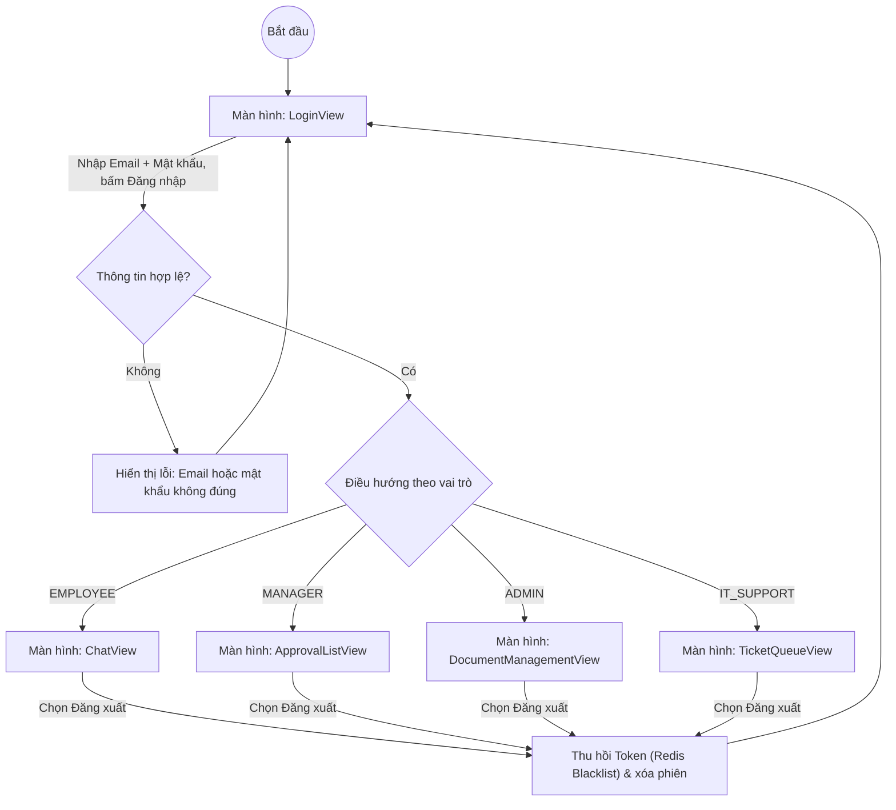

#### 4.2. Luồng màn hình Quản lý và Nạp tài liệu tri thức

```mermaid
flowchart TD
    DocManageView["Màn hình: DocumentManagementView"] -->|Bấm + Tải lên tài liệu| UploadView["Màn hình: UploadDocumentView"]
    DocManageView -->|Chọn một tài liệu| DetailView["Màn hình: DocumentDetailView"]
    UploadView -->|Bấm Hủy / Quay lại| DocManageView
    UploadView -->|Bấm Lưu & Xử lý| ValidateState{"Kiểm tra tệp: định dạng, dung lượng, mã trùng?"}
    ValidateState -- Không hợp lệ --> UploadError["Hiển thị cảnh báo lỗi ngay trên biểu mẫu"]
    UploadError --> UploadView
    ValidateState -- Hợp lệ --> ProgressView["Màn hình: IngestionProgressView theo dõi tiến trình"]
    ProgressView -->|Lỗi nạp: mất kết nối AI Service / Qdrant| ErrorView["Hiển thị lỗi kèm nút Thử lại"]
    ErrorView -->|Bấm Thử lại| ProgressView
    ErrorView -->|Bấm Quay lại| UploadView
    ProgressView -->|Nạp hoàn tất (status = INGESTED)| SuccessState["Thông báo: Nạp tri thức thành công (152 chunks)"]
    SuccessState --> DetailView
    DetailView -->|Tải lên phiên bản mới| UploadView
    DetailView -->|Bấm Quay lại| DocManageView
```

#### 4.3. Luồng màn hình Trợ lý AI (Hỏi đáp & Tìm kiếm ngữ nghĩa)

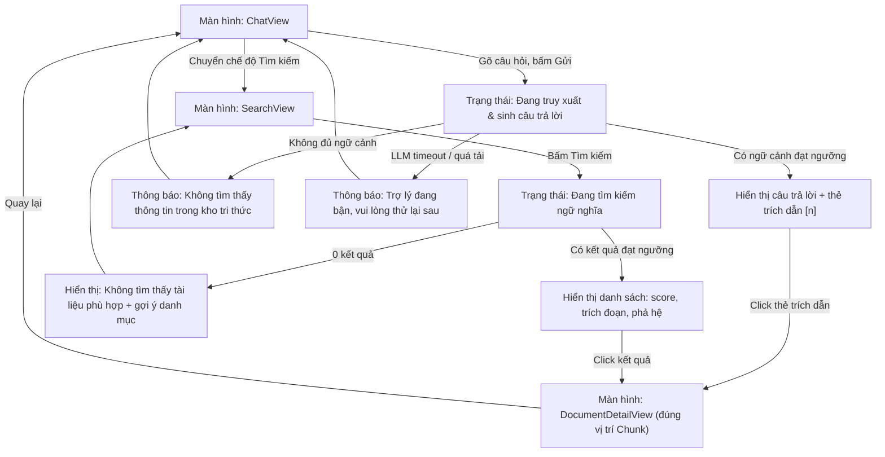

#### 4.4. Luồng màn hình Nghiệp vụ (Nghỉ phép & IT Support)

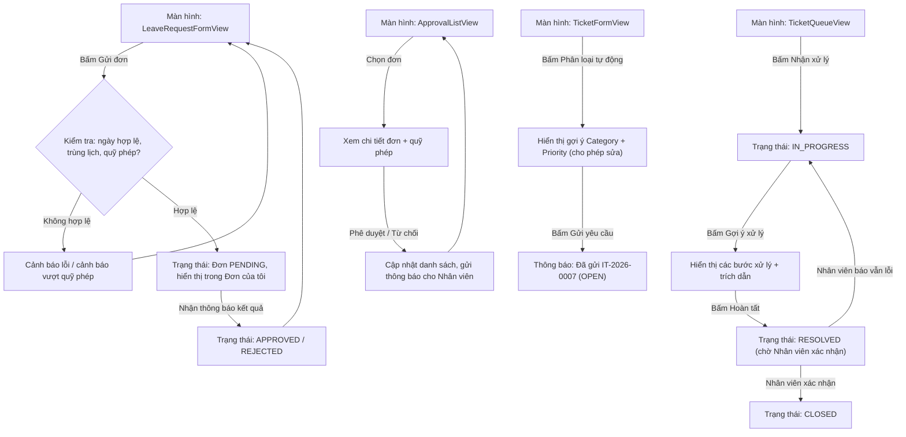

---

### Bước 5: Biểu đồ Lớp Pha Phân tích (Analysis Class Diagram)

Quy ước đặt tên thuộc tính theo chuẩn giáo trình PTIT:

* **`in_`**: Tiền tố thuộc tính nhận dữ liệu đầu vào (ô nhập, chọn ngày, chọn tệp).
* **`out_`**: Tiền tố thuộc tính hiển thị dữ liệu (bảng, thông báo, tiến trình).
* **`sub_`**: Tiền tố thuộc tính kích hoạt gửi yêu cầu (nút bấm, liên kết).

#### 5.1. Phân hệ Quản lý Tri thức & Trợ lý AI (CN-01 → CN-06)

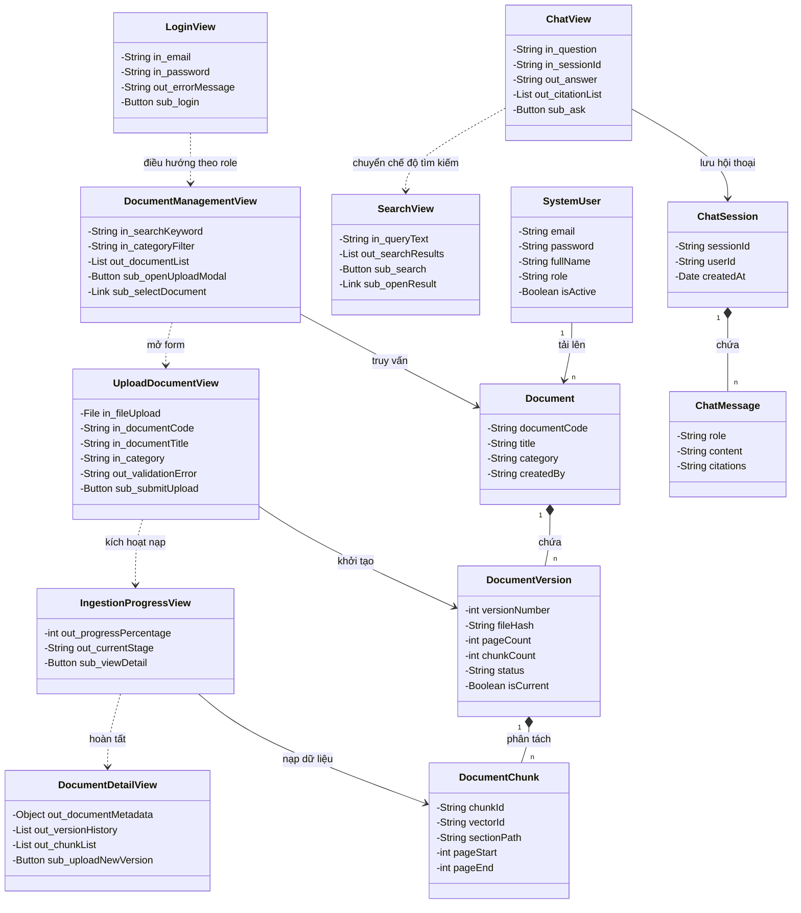

#### 5.2. Phân hệ Nghiệp vụ — Nghỉ phép & IT Support (CN-07 → CN-10)

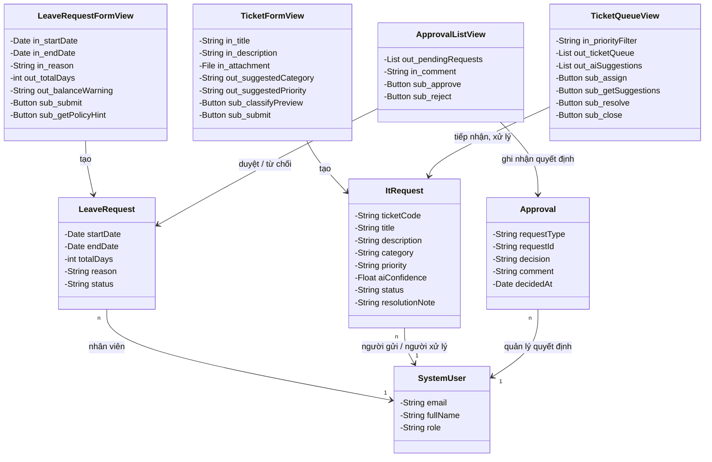

---

### Bước 6: Biểu đồ Giao tiếp Pha Phân tích (Communication Diagram)

Biểu đồ giao tiếp thể hiện tương tác giữa các **đối tượng pha phân tích** (View ↔ Entity ↔ hệ thống ngoài) qua **danh sách thông điệp đánh số thứ tự**; khác biểu đồ tuần tự (Bước 11) ở chỗ nhấn mạnh *liên kết* giữa các đối tượng thay vì trục thời gian. Dưới đây trình bày hai luồng giao tiếp quan trọng nhất: **nạp tài liệu tri thức** và **hỏi đáp RAG**.

#### 6.1. Biểu đồ giao tiếp: Tải lên và Nạp tài liệu tri thức (CN-03)

Kịch bản thông điệp:

1. Quản trị viên nhập thông tin tệp và nhấn `sub_submitUpload` trên `UploadDocumentView`.
2. `UploadDocumentView` kiểm tra định dạng/dung lượng và chuyển dữ liệu sang thực thể `Document`.
3. `Document` khởi tạo bản ghi tài liệu mới.
4. `UploadDocumentView` yêu cầu `DocumentVersion` khởi tạo phiên bản đầu tiên (trạng thái `PROCESSING`).
5. `DocumentVersion` lưu thông tin phiên bản và mã băm SHA-256.
6. `UploadDocumentView` chuyển quyền điều khiển sang `IngestionProgressView`.
7. `IngestionProgressView` yêu cầu `DocumentChunk` phân tích và băm nhỏ nội dung tài liệu.
8. `DocumentChunk` gọi Trợ lý AI (AI Service) sinh vector E5 384 chiều và nạp vào Qdrant.
9. `DocumentChunk` phản hồi số lượng chunk đã nạp thành công cho `DocumentVersion`.
10. `DocumentVersion` cập nhật trạng thái `INGESTED` và đánh dấu `is_current`.
11. `DocumentVersion` phản hồi kết quả hoàn tất cho `IngestionProgressView`.
12. `IngestionProgressView` thông báo *"Nạp tri thức thành công (152 chunks)"* cho Quản trị viên và liên kết mở `DocumentDetailView`.

```mermaid
flowchart TD
    Admin(["Quản trị viên"])
    UploadUI["UploadDocumentView"]
    ProgressUI["IngestionProgressView"]
    DetailUI["DocumentDetailView"]
    DocEntity["Document"]
    VerEntity["DocumentVersion"]
    ChunkEntity["DocumentChunk"]
    AIService["Trợ lý AI<br/>(AI Service)"]
    Qdrant[(Qdrant)]

    Admin -->|"1: submitUpload()"| UploadUI
    UploadUI -->|"2: validateAndCreate()"| DocEntity
    UploadUI -->|"3: initVersion()"| VerEntity
    UploadUI -->|"4: showProgress()"| ProgressUI
    ProgressUI -->|"5: requestIngestion()"| ChunkEntity
    ChunkEntity -->|"6: embedAndIndex()"| AIService
    AIService -->|"7: upsert batch 64"| Qdrant
    ChunkEntity -->|"8: updateChunkCount(152)"| VerEntity
    VerEntity -->|"9: setStatus(INGESTED)"| ProgressUI
    ProgressUI -->|"10: displaySuccess()"| Admin
    ProgressUI -->|"11: navigateToDetail()"| DetailUI
```

#### 6.2. Biểu đồ giao tiếp: Hỏi đáp Tri thức doanh nghiệp (CN-05)

Kịch bản thông điệp:

1. Nhân viên gõ câu hỏi và nhấn `sub_ask` trên `ChatView`.
2. `ChatView` yêu cầu `ChatSession` ghi nhận tin nhắn người dùng (`role = USER`).
3. `ChatView` gửi câu hỏi kèm `sessionId` sang Trợ lý AI (RAG Engine).
4. RAG Engine nhúng câu hỏi thành vector `e_q` (E5, 384d) và truy vấn `Qdrant` — Top-5 chunk, ngưỡng `score ≥ 0.3`.
5. RAG Engine duyệt `Neo4j` lấy các thực thể liên quan (Graph Traversal).
6. RAG Engine hợp nhất & rerank (Top-3), gọi Cloud LLM sinh câu trả lời.
7. RAG Engine trả `AnswerDTO { answer, citations[] }` về `ChatView`.
8. `ChatView` yêu cầu `ChatSession` lưu tin nhắn trợ lý (`role = ASSISTANT`, kèm citations).
9. `ChatView` hiển thị `out_answer` + `out_citationList` cho Nhân viên.
10. Nhân viên nhấn `sub_openCitation` → mở `DocumentDetailView` đúng vị trí chunk.

```mermaid
flowchart TD
    Emp(["Nhân viên"])
    ChatUI["ChatView"]
    Session["ChatSession / ChatMessage"]
    RAG["Trợ lý AI<br/>(RAG Engine)"]
    Qdrant[(Qdrant)]
    Neo4j[(Neo4j)]
    LLM["Cloud LLM"]
    DetailUI["DocumentDetailView"]
    RAG -->|"4: search(e_q, top_k=5, min_score=0.3)"| Qdrant
    RAG -->|"5: traverse(entities)"| Neo4j
    RAG -->|"6: generatePrompt(context, question)"| LLM
    LLM -->|"7: answer + citations"| RAG

    Emp -->|"1: ask(question)"| ChatUI
    ChatUI -->|"2: appendMessage(USER, question)"| Session
    ChatUI -->|"3: chat(question, sessionId)"| RAG
    RAG -->|"8: AnswerDTO"| ChatUI
    ChatUI -->|"9: appendMessage(ASSISTANT, answer, citations)"| Session
    ChatUI -->|"10: displayAnswer()"| Emp
    Emp -->|"11: openCitation()"| DetailUI
```

---

### Bước 7: Thiết kế Lớp Thực thể Liên quan (Design Class Model)

Từ các lớp thực thể đã trích xuất tại Bước 3, bước này hoàn thiện **thiết kế lớp thực thể** với kiểu dữ liệu cụ thể và các phương thức nghiệp vụ — độ chi tiết đủ để ánh xạ trực tiếp sang JPA Entity. Kèm theo là các **biểu đồ trạng thái vòng đời** của những thực thể có máy trạng thái.

#### 7.1. Sơ đồ lớp thực thể với kiểu dữ liệu

```mermaid
classDiagram
    class SystemUser {
        -UUID id
        -String email
        -String password
        -String fullName
        -String role
        -Boolean isActive
        -LocalDateTime createdAt
        +checkLogin(String, String) Boolean
    }
    class Document {
        -UUID id
        -String documentCode
        -String title
        -String category
        -UUID createdBy
        -LocalDateTime createdAt
        +getCurrentVersion() DocumentVersion
    }
    class DocumentVersion {
        -UUID id
        -UUID documentId
        -Integer versionNumber
        -String filePath
        -String fileHash
        -Integer pageCount
        -Integer chunkCount
        -String status
        -Boolean isCurrent
        -LocalDateTime createdAt
        +updateStatus(String) void
        +setCurrent(boolean) void
    }
    class DocumentChunk {
        -UUID id
        -UUID versionId
        -String chunkId
        -String vectorId
        -Integer pageStart
        -Integer pageEnd
        -Integer headingLevel
        -String sectionPath
        -String content
        -LocalDateTime createdAt
    }
    class ChatSession {
        -UUID id
        -UUID userId
        -String title
        -LocalDateTime createdAt
    }
    class ChatMessage {
        -UUID id
        -UUID sessionId
        -String role
        -String content
        -String citations
        -LocalDateTime createdAt
    }
    class LeaveRequest {
        -UUID id
        -UUID userId
        -LocalDate startDate
        -LocalDate endDate
        -Integer totalDays
        -String reason
        -String status
        -LocalDateTime createdAt
        +approve(String) void
        +reject(String) void
        +cancel() void
    }
    class ItRequest {
        -UUID id
        -String ticketCode
        -UUID requesterId
        -UUID assigneeId
        -String title
        -String description
        -String attachmentPath
        -String category
        -String priority
        -Float aiConfidence
        -String status
        -String resolutionNote
        -LocalDateTime createdAt
        -LocalDateTime resolvedAt
        +assign(UUID) void
        +resolve(String) void
        +close() void
    }
    class Approval {
        -UUID id
        -String requestType
        -UUID requestId
        -UUID approverId
        -String decision
        -String comment
        -LocalDateTime decidedAt
    }

    SystemUser "1" --> "n" Document : tải lên
    Document "1" *-- "n" DocumentVersion : chứa
    DocumentVersion "1" *-- "n" DocumentChunk : phân tách
    SystemUser "1" --> "n" ChatSession : sở hữu
    ChatSession "1" *-- "n" ChatMessage : chứa
    SystemUser "1" --> "n" LeaveRequest : tạo đơn
    SystemUser "1" --> "n" ItRequest : gửi / xử lý
    Approval "n" --> "1" SystemUser : người quyết định
```

> **Ghi chú:** `Approval.requestId` là **khóa ngoại đa hình logic** trỏ tới `LeaveRequest` hoặc `ItRequest` tùy theo `requestType` (`LEAVE` / `IT`) — đã phân tích tại Bước 3.3.

#### 7.2. Biểu đồ Trạng thái Vòng đời Thực thể (Statechart Diagram)

Bên cạnh trạng thái màn hình (Bước 4), các lớp thực thể có **vòng đời dữ liệu riêng** được mô hình hóa bằng statechart — là căn cứ để ràng buộc chuyển trạng thái ở tầng Service:

##### 7.2.1. Vòng đời Phiên bản Tài liệu (`DocumentVersion.status`)

```mermaid
stateDiagram-v2
    [*] --> UPLOADED : Quản trị viên tải tệp lên
    UPLOADED --> PROCESSING : Trigger pipeline AI
    PROCESSING --> INGESTED : Callback thành công (chunkCount > 0)
    PROCESSING --> FAILED : Lỗi parser / Qdrant không khả dụng
    FAILED --> PROCESSING : Quản trị viên bấm Thử lại
    INGESTED --> [*] : Phiên bản bị thay thế (is_current = false)

    note right of INGESTED
        Khi phiên bản mới được chọn làm hiện hành,
        cờ is_current chuyển sang bản mới;
        bản cũ vẫn giữ trạng thái INGESTED
        phục vụ đối soát (audit).
    end note
```

##### 7.2.2. Vòng đời Đơn xin nghỉ phép (`LeaveRequest.status`)

```mermaid
stateDiagram-v2
    [*] --> PENDING : Nhân viên gửi đơn
    PENDING --> APPROVED : Quản lý phê duyệt
    PENDING --> REJECTED : Quản lý từ chối kèm lý do
    PENDING --> CANCELLED : Nhân viên chủ động hủy
    APPROVED --> [*]
    REJECTED --> [*]
    CANCELLED --> [*]
```

##### 7.2.3. Vòng đời Ticket IT (`ItRequest.status`)

```mermaid
stateDiagram-v2
    [*] --> OPEN : Tạo ticket kèm phân loại AI
    OPEN --> IN_PROGRESS : IT Support tiếp nhận
    IN_PROGRESS --> RESOLVED : Ghi chú xử lý, hoàn tất
    RESOLVED --> CLOSED : Nhân viên xác nhận hết lỗi
    RESOLVED --> IN_PROGRESS : Nhân viên báo lỗi vẫn còn (REOPENED)
    CLOSED --> [*]
```

---

### Bước 8: Thiết kế Cơ sở Dữ liệu Quan hệ (Relational Database Design)

#### 8.1. Quy tắc ánh xạ từ Lớp thực thể sang Bảng dữ liệu

* Lớp `SystemUser` (và kế thừa vai trò) $\rightarrow$ Bảng `users` *(khớp với entity `User` đã triển khai trong mã nguồn)*.
* Lớp `Document` $\rightarrow$ Bảng `documents`; lớp `DocumentVersion` $\rightarrow$ Bảng `document_versions`; lớp `DocumentChunk` $\rightarrow$ Bảng `document_chunks`.
* Lớp `ChatSession` $\rightarrow$ Bảng `chat_sessions`; lớp `ChatMessage` $\rightarrow$ Bảng `chat_messages`.
* Lớp `LeaveRequest` $\rightarrow$ Bảng `leave_requests`; lớp `ItRequest` $\rightarrow$ Bảng `it_requests`; lớp `Approval` $\rightarrow$ Bảng `approvals`.
* Khóa chính: **UUID** (sinh tự động bởi JPA `GenerationType.UUID`) — không lộ thứ tự tuần tự ra API, thuận lợi khi mở rộng phân tán.
* Tên cột: `snake_case`; các trường enum (`role`, `status`, `category`, `priority`) lưu dạng `varchar` và được kiểm soát giá trị ở tầng ứng dụng — linh hoạt khi bổ sung trạng thái mới mà không cần `ALTER TYPE`.

#### 8.2. Loại bỏ thuộc tính dẫn xuất

* Trong bảng `documents`, **không** lưu `total_versions` — tính bằng `COUNT(id)` trên `document_versions` khi cần hiển thị.
* Trong bảng `leave_requests`, **không** lưu `balance_after` — số dư phép là giá trị suy dẫn từ tổng ngày nghỉ của các đơn `APPROVED` trong năm, tính tại thời điểm hiển thị để không lệch dữ liệu.
* Trong bảng `document_versions`, trường `chunk_count` **được giữ lại** như thuộc tính đệm (caching attribute) vì đếm hàng triệu vector/bản ghi chunk mỗi lần xem danh sách sẽ giảm hiệu năng; giá trị được cập nhật một lần trong callback hoàn tất nạp.
* Trường `is_current` là **thuộc tính nghiệp vụ** (không phải suy dẫn thuần túy — thể hiện ý chí "ban hành phiên bản"), nên lưu tường minh kèm ràng buộc ứng dụng: mỗi `document_id` chỉ có tối đa một bản ghi `is_current = true` (thực thi trong transaction chuyển giao phiên bản).

#### 8.3. Sơ đồ CSDL Quan hệ Vật lý (PostgreSQL)

```mermaid
erDiagram
    users ||--o{ documents : "tải lên"
    documents ||--o{ document_versions : "có phiên bản"
    document_versions ||--o{ document_chunks : "phân tách"
    users ||--o{ chat_sessions : "sở hữu phiên chat"
    chat_sessions ||--o{ chat_messages : "chứa tin nhắn"
    users ||--o{ leave_requests : "tạo đơn nghỉ"
    users ||--o{ it_requests : "gửi ticket"
    users ||--o{ approvals : "đưa ra quyết định"
    leave_requests ||--o{ approvals : "đa hình request_type=LEAVE"
    it_requests ||--o{ approvals : "đa hình request_type=IT"

    users {
        uuid id PK
        varchar full_name
        varchar email UK
        varchar password
        varchar role
        boolean is_active
        timestamp created_at
    }

    documents {
        uuid id PK
        varchar document_code UK
        varchar title
        varchar category
        uuid created_by FK
        timestamp created_at
    }

    document_versions {
        uuid id PK
        uuid document_id FK
        int version_number
        varchar file_path
        varchar file_hash
        int page_count
        int chunk_count
        varchar status
        boolean is_current
        timestamp created_at
    }

    document_chunks {
        uuid id PK
        uuid version_id FK
        varchar chunk_id UK
        varchar vector_id
        int page_start
        int page_end
        int heading_level
        text section_path
        text content
        timestamp created_at
    }

    chat_sessions {
        uuid id PK
        uuid user_id FK
        varchar title
        timestamp created_at
    }

    chat_messages {
        uuid id PK
        uuid session_id FK
        varchar role
        text content
        jsonb citations
        timestamp created_at
    }

    leave_requests {
        uuid id PK
        uuid user_id FK
        date start_date
        date end_date
        int total_days
        text reason
        varchar status
        timestamp created_at
        timestamp updated_at
    }

    it_requests {
        uuid id PK
        varchar ticket_code UK
        uuid requester_id FK
        uuid assignee_id FK
        varchar title
        text description
        varchar attachment_path
        varchar category
        varchar priority
        float ai_confidence
        varchar status
        text resolution_note
        timestamp created_at
        timestamp resolved_at
    }

    approvals {
        uuid id PK
        varchar request_type
        uuid request_id
        uuid approver_id FK
        varchar decision
        text comment
        timestamp decided_at
    }
```

> **Ghi chú kỹ thuật:** Quan hệ `leave_requests`/`it_requests` $\rightarrow$ `approvals` là **khóa ngoại đa hình logic** (`request_type` + `request_id`), không ràng buộc vật lý ở CSDL — tính toàn vẹn được thực thi tại tầng Service (đúng như nguyên tắc đã nêu tại Bước 3.3).

---

### Bước 9: Thiết kế Biểu đồ Lớp Chi tiết (Detailed Class Diagram — 3 Tầng)

Hệ thống tổ chức phân lớp nghiêm ngặt theo mô hình 3 tầng của **Spring Boot**: *Controller (Presentation) → Service (Business) → Repository (Data Access)*, sử dụng Spring Data JPA thay cho DAO thuần túy.

#### 9.1. Nhóm Tri thức, Xác thực & Trợ lý AI

```mermaid
classDiagram
    class AuthController {
        +login(LoginRequest) ResponseEntity
        +register(RegisterRequest) ResponseEntity
    }
    class UserController {
        +getUsers(filter, page) ResponseEntity
        +createUser(CreateUserRequest) ResponseEntity
        +toggleActive(UUID) ResponseEntity
    }
    class DocumentController {
        +uploadDocument(MultipartFile, DocDTO) ResponseEntity
        +getDocumentList() ResponseEntity
        +getDocumentDetail(UUID) ResponseEntity
        +createNewVersion(UUID, MultipartFile) ResponseEntity
    }
    class AIGatewayController {
        +chat(ChatRequest) ResponseEntity
        +search(String, Filters) ResponseEntity
    }
    class AuthService {
        -UserRepository userRepo
        -PasswordEncoder encoder
        -JwtService jwtService
        +login(LoginRequest) AuthResponse
        +register(RegisterRequest) AuthResponse
    }
    class UserService {
        -UserRepository userRepo
        +getUsers(filter, page) Page
        +createUser(CreateUserRequest) UserResponse
        +toggleActive(UUID) void
    }
    class DocumentService {
        -DocumentRepository docRepo
        -DocumentVersionRepository versionRepo
        -AIGatewayService aiGateway
        +processUpload(MultipartFile, DocDTO) DocumentVersion
        +createNewVersion(UUID, MultipartFile) DocumentVersion
        +handleIngestionCallback(UUID, IngestResultDTO) void
    }
    class AIGatewayService {
        -RestTemplate restTemplate
        +triggerAsyncIngestion(String, UUID) void
        +chat(ChatRequest) AnswerDTO
        +search(String, Filters) List
        +classify(String) ClassificationResult
        +suggestResolution(TicketContext) List
    }
    class NotificationService {
        +notifyManager(UUID, UUID) void
        +notifyEmployee(UUID, String) void
        +pushToITQueue(UUID, String) void
    }
    class JwtService {
        +generateToken(User) String
        +blacklist(String token) void
        +validate(String token) boolean
    }
    class UserRepository {
        <<interface>>
        +findByEmail(String) Optional
        +existsByEmail(String) boolean
    }
    class DocumentRepository {
        <<interface>>
        +findByDocumentCode(String) Optional
    }
    class DocumentVersionRepository {
        <<interface>>
        +findByDocumentIdAndIsCurrentTrue(UUID) Optional
    }

    class User {
        -UUID id
        -String email
        -String password
        -String fullName
        -String role
        -Boolean isActive
    }
    class Document {
        -UUID id
        -String documentCode
        -String title
        -String category
        -UUID createdBy
    }
    class DocumentVersion {
        -UUID id
        -UUID documentId
        -Integer versionNumber
        -String fileHash
        -String status
        -Boolean isCurrent
    }

    AuthController --> AuthService : injects
    AuthController --> JwtService : uses
    UserController --> UserService : injects
    DocumentController --> DocumentService : injects
    AIGatewayController --> AIGatewayService : injects
    AuthService --> UserRepository : uses
    UserService --> UserRepository : uses
    DocumentService --> DocumentRepository : uses
    DocumentService --> DocumentVersionRepository : uses
    DocumentService --> AIGatewayService : calls
    DocumentService --> NotificationService : calls
    UserRepository ..> User : manages
    DocumentRepository ..> Document : manages
    DocumentVersionRepository ..> DocumentVersion : manages
```

#### 9.2. Nhóm Nghiệp vụ — Nghỉ phép & IT Support

```mermaid
classDiagram
    class LeaveRequestController {
        +create(LeaveRequestDTO) ResponseEntity
        +getPending() ResponseEntity
        +approve(UUID, CommentDTO) ResponseEntity
        +reject(UUID, ReasonDTO) ResponseEntity
        +cancel(UUID) ResponseEntity
    }
    class ITRequestController {
        +classifyPreview(TicketDTO) ResponseEntity
        +createTicket(TicketDTO) ResponseEntity
        +assign(UUID) ResponseEntity
        +getSuggestions(UUID) ResponseEntity
        +resolve(UUID, NoteDTO) ResponseEntity
        +close(UUID) ResponseEntity
    }
    class LeaveRequestService {
        -LeaveRequestRepository leaveRepo
        -ApprovalRepository approvalRepo
        -NotificationService notification
        +createLeaveRequest(LeaveRequestDTO, UUID) LeaveRequest
        +approve(UUID, String, UUID) LeaveRequest
        +reject(UUID, String, UUID) LeaveRequest
    }
    class ITRequestService {
        -ITRequestRepository ticketRepo
        -AIGatewayService aiGateway
        -NotificationService notification
        +createTicket(TicketDTO, UUID) ItRequest
        +assign(UUID, UUID) ItRequest
        +resolve(UUID, String) ItRequest
        -generateTicketCode() String
    }
    class LeaveRequestRepository {
        <<interface>>
        +findByUserIdAndStatusIn(UUID, List) List
        +findByStatus(String) List
    }
    class ITRequestRepository {
        <<interface>>
        +findQueue(String, String) List
    }
    class ApprovalRepository {
        <<interface>>
        +findByRequestTypeAndRequestId(String, UUID) List
    }

    class LeaveRequest {
        -UUID id
        -UUID userId
        -LocalDate startDate
        -LocalDate endDate
        -Integer totalDays
        -String status
    }
    class ItRequest {
        -UUID id
        -String ticketCode
        -UUID requesterId
        -UUID assigneeId
        -String category
        -String priority
        -String status
    }
    class Approval {
        -UUID id
        -String requestType
        -UUID requestId
        -UUID approverId
        -String decision
    }

    LeaveRequestController --> LeaveRequestService : injects
    ITRequestController --> ITRequestService : injects
    LeaveRequestService --> LeaveRequestRepository : uses
    LeaveRequestService --> ApprovalRepository : uses
    ITRequestService --> ITRequestRepository : uses
    ITRequestService --> AIGatewayService : classify / suggest
    LeaveRequestRepository ..> LeaveRequest : manages
    ITRequestRepository ..> ItRequest : manages
    ApprovalRepository ..> Approval : manages
```

---

### Bước 10: Thiết kế Biểu đồ Hoạt động Chi tiết (Activity Diagram — Swimlanes)

#### 10.1. Luồng CN-03: Tải lên và Nạp tài liệu tri thức

Sơ đồ phân làn thể hiện ranh giới trách nhiệm giữa **Người dùng**, **Spring Boot Backend**, **FastAPI AI Engine** và **Cơ sở dữ liệu**:

```mermaid
flowchart TD
    subgraph Swim_User ["1. Quản trị viên (Client Web)"]
        A1["Chọn tệp PDF & bấm Upload"]
        A2["Xem thanh tiến trình nạp Vector"]
        A3["Xem màn hình chi tiết 152 chunks"]
    end

    subgraph Swim_Backend ["2. Core Backend (Spring Boot)"]
        B1["Nhận MultipartFile & kiểm tra kích thước, định dạng"]
        B2["Lưu tệp cục bộ & tạo bản ghi CSDL (PROCESSING)"]
        B3["Gửi tín hiệu nạp bất đồng bộ sang AI Service"]
        B4["Nhận Callback thành công & cập nhật trạng thái"]
        B5["Bắn WebSocket báo hoàn thành cho Client"]
    end

    subgraph Swim_AIService ["3. AI Service (FastAPI Engine)"]
        C1["Document Parser đọc từng trang"]
        C2{"Trang là bản Scan?"}
        C3["Tesseract OCR bóc tách chữ"]
        C4["Block Analyzer & Dynamic Hierarchy"]
        C5["Adaptive Chunking tạo 152 chunks"]
        C6["Multilingual-E5 tạo Vector 384d"]
        C7["Callback báo thành công cho Backend"]
    end

    subgraph Swim_DB ["4. Cơ sở dữ liệu (Postgres & Qdrant)"]
        D1[("Postgres: Lưu DocumentVersion (PROCESSING)")]
        D2[("Qdrant: Upsert 152 Vectors & Payloads (batch 64)")]
        D3[("Postgres: Cập nhật status (INGESTED)")]
    end

    A1 --> B1
    B1 --> B2
    B2 --> D1
    D1 --> B3
    B3 --> A2
    B3 --> C1
    C1 --> C2
    C2 -- Có --> C3
    C2 -- Không --> C4
    C3 --> C4
    C4 --> C5
    C5 --> C6
    C6 --> D2
    D2 --> C7
    C7 --> B4
    B4 --> D3
    D3 --> B5
    B5 --> A3
```

#### 10.2. Luồng CN-05: Hỏi đáp Tri thức (Hybrid GraphRAG)

```mermaid
flowchart TD
    subgraph RAG_User ["1. Nhân viên (Client Web)"]
        RA1["Gõ câu hỏi ngôn ngữ tự nhiên"]
        RA2["Đọc câu trả lời & mở thẻ trích dẫn"]
    end

    subgraph RAG_Backend ["2. Core Backend (Spring Boot)"]
        RB1["Xác thực JWT & tiếp nhận câu hỏi"]
        RB2["Chuyển tiếp sang AI Service"]
        RB3["Lưu hội thoại (Memory) & trả kết quả về UI"]
    end

    subgraph RAG_AI ["3. AI Service (FastAPI Engine)"]
        RC1["Nhúng câu hỏi thành Vector e_q"]
        RC2{"Có ngữ cảnh đạt ngưỡng score ≥ 0.3?"}
        RC3["Fusion & Rerank chọn Top-3 ngữ cảnh"]
        RC4["Đóng gói Prompt chống bịa đặt + gọi LLM"]
        RC5["Bóc tách Citation (Tài liệu, Chương, Điều, Trang)"]
        RC6["Trả lời: Không tìm thấy thông tin trong kho tri thức"]
    end

    subgraph RAG_Infra ["4. Hạ tầng Tri thức"]
        RD1[("Qdrant: Vector Search Top-5")]
        RD2[("Neo4j: Graph Traversal thực thể")]
        RD3["Cloud LLM: Sinh câu trả lời"]
    end

    RA1 --> RB1
    RB1 --> RB2
    RB2 --> RC1
    RC1 --> RD1
    RC1 --> RD2
    RD1 --> RC2
    RD2 --> RC2
    RC2 -- Không --> RC6
    RC2 -- Có --> RC3
    RC3 --> RC4
    RC4 --> RD3
    RD3 --> RC5
    RC5 --> RB3
    RC6 --> RB3
    RB3 --> RA2
```

#### 10.3. Luồng CN-07 + CN-08: Tạo và Phê duyệt Đơn nghỉ phép

```mermaid
flowchart TD
    subgraph LV_Emp ["1. Nhân viên (Client Web)"]
        EA1["Chọn ngày nghỉ & nhập lý do"]
        EA2["Theo dõi trạng thái đơn (PENDING)"]
        EA3["Nhận thông báo kết quả phê duyệt"]
    end

    subgraph LV_Backend ["2. Core Backend (Spring Boot)"]
        EB1["Kiểm tra ràng buộc ngày & trùng lịch nghỉ"]
        EB2{"Số dư phép đủ?"}
        EB3["Lưu đơn (PENDING) & thông báo Quản lý"]
        EB4["Kiểm tra trạng thái đơn trước khi duyệt"]
        EB5["Ghi Approval log & cập nhật trạng thái"]
        EB6["Thông báo kết quả cho Nhân viên"]
    end

    subgraph LV_Mgr ["3. Quản lý (Client Web)"]
        MA1["Mở hàng đợi đơn chờ duyệt"]
        MA2["Xem chi tiết đơn & quỹ phép"]
        MA3{"Quyết định"}
    end

    subgraph LV_Data ["4. CSDL & Thông báo"]
        DA1[("Postgres: INSERT leave_requests")]
        DA2[("Postgres: UPDATE status + INSERT approvals")]
        DA3["WebSocket: thông báo thời gian thực"]
    end

    EA1 --> EB1
    EB1 --> EB2
    EB2 -- Không đủ --> EA2
    EB2 -- Đủ --> EB3
    EB3 --> DA1
    DA1 --> DA3
    DA3 --> MA1
    MA1 --> MA2
    MA2 --> MA3
    MA3 -- Phê duyệt --> EB4
    MA3 -- Từ chối kèm lý do --> EB4
    EB4 --> EB5
    EB5 --> DA2
    DA2 --> EB6
    EB6 --> EA3
    EA2 --> EA3
```

---

### Bước 11: Thiết kế Biểu đồ Tuần tự Chi tiết (Sequence Diagram)

Biểu đồ tuần tự mô tả tương tác giữa các đối tượng theo **trục thời gian**, phản ánh đúng kiến trúc 3 tầng và các API đã thiết kế tại mục 4.6 — tương ứng từng chức năng với Use Case (Bước 1) và Kịch bản (Bước 2).

#### 11.1. Biểu đồ tuần tự chi tiết: Đăng nhập hệ thống (CN-01)

```mermaid
sequenceDiagram
    autonumber
    actor User as Nhân viên
    participant UI as LoginView
    participant Controller as AuthController
    participant Service as AuthService
    participant Repo as UserRepository
    participant DB as PostgreSQL
    participant JWT as JwtService

    User->>UI: Nhập Email + Mật khẩu, bấm Đăng nhập
    UI->>Controller: POST /api/auth/login
    activate Controller
    Controller->>Service: login(LoginRequest)
    activate Service
    Service->>Repo: findByEmail(email)
    Repo->>DB: SELECT * FROM users WHERE email = ?
    DB-->>Repo: Bản ghi người dùng
    Repo-->>Service: Optional(User)

    alt Không tìm thấy Email hoặc sai Mật khẩu
        Service-->>Controller: 401 Unauthorized
        Controller-->>UI: Thông báo lỗi xác thực
        UI-->>User: Hiển thị "Email hoặc mật khẩu không đúng"
    else Thông tin hợp lệ
        Service->>Service: BCrypt.matches(raw, hash)
        Service->>JWT: generateToken(userId, email, role)
        JWT-->>Service: accessToken (HS256, 1 giờ)
        Service-->>Controller: AuthResponse
        Controller-->>UI: 200 OK + accessToken
        UI->>UI: Lưu token & điều hướng theo role
        UI-->>User: Mở trang chủ tương ứng vai trò
    end
    deactivate Service
    deactivate Controller
```

#### 11.2. Biểu đồ tuần tự chi tiết: Quản lý người dùng và phân quyền RBAC (CN-02)

```mermaid
sequenceDiagram
    autonumber
    actor Admin as Quản trị viên
    participant UI as UserManagementView
    participant Filter as JwtAuthenticationFilter
    participant Controller as UserController
    participant Service as UserService
    participant Repo as UserRepository
    participant DB as PostgreSQL

    Admin->>UI: Mở quản lý người dùng
    UI->>Controller: GET /api/users (Bearer Token)
    activate Filter
    Filter->>Filter: Xác thực JWT + kiểm tra role ADMIN
    deactivate Filter
    activate Controller
    Controller->>Service: getUsers(keyword, role, page)
    Service->>Repo: findAllWithFilter(...)
    Repo->>DB: SELECT * FROM users WHERE ...
    DB-->>Repo: Danh sách người dùng
    Repo-->>Service: Page(User)
    Service-->>Controller: Danh sách UserResponse
    Controller-->>UI: 200 OK
    UI-->>Admin: Hiển thị bảng người dùng

    Admin->>UI: Nhập thông tin tài khoản mới, bấm Lưu
    UI->>Controller: POST /api/users (CreateUserRequest)
    Controller->>Service: createUser(request)
    Service->>Repo: existsByEmail(email)
    Repo-->>Service: false
    Service->>Service: BCrypt.encode(password)
    Service->>Repo: save(User)
    Repo->>DB: INSERT INTO users (...)
    DB-->>Repo: Bản ghi mới
    Repo-->>Service: User
    Service-->>Controller: UserResponse
    Controller-->>UI: 201 Created
    UI-->>Admin: "Tạo tài khoản thành công"
    deactivate Controller
```

#### 11.3. Biểu đồ tuần tự chi tiết: Tải lên và nạp tài liệu tri thức (CN-03)

```mermaid
sequenceDiagram
    autonumber
    actor Admin as Quản trị viên
    participant UI as UploadDocumentView
    participant Controller as DocumentController
    participant Service as DocumentService
    participant Repo as DocumentVersionRepository
    participant AIGateway as AIGatewayService
    participant AIService as FastAPI AI Engine
    participant Qdrant as Qdrant Vector DB

    Admin->>UI: Chọn tệp NoiQuyLaoDong2026.pdf + metadata, bấm Lưu & Xử lý
    UI->>Controller: POST /api/documents/upload (multipart + Bearer Token)
    activate Controller
    Controller->>Service: processUpload(file, DocDTO)
    activate Service
    Service->>Service: Kiểm tra định dạng, dung lượng, SHA-256
    Service->>Repo: save(version: PROCESSING)
    Repo-->>Service: version_id
    Service->>AIGateway: triggerAsyncIngestion(filePath, version_id)
    AIGateway->>AIService: POST /api/v1/process (async)
    AIService-->>AIGateway: 202 Accepted (task_id)
    Service-->>Controller: UploadResultDTO
    deactivate Service
    Controller-->>UI: 202 Accepted
    deactivate Controller
    UI->>UI: Chuyển sang IngestionProgressView (theo dõi tiến trình)

    activate AIService
    AIService->>AIService: Parser → OCR → Dynamic Hierarchy → Adaptive Chunking (152 chunks)
    AIService->>AIService: Multilingual-E5 encode (384d)
    AIService->>Qdrant: upsert_batch(collection, 64 points/batch)
    Qdrant-->>AIService: 200 OK (upserted 152)
    AIService->>Service: PUT /api/internal/documents/{versionId}/status (INGESTED)
    deactivate AIService

    activate Service
    Service->>Repo: updateStatus(version_id, INGESTED)
    Note over Service: Trạng thái lưu vào document_versions
    Service-->>UI: WebSocket: "Nạp tri thức thành công (152 chunks)"
    deactivate Service
    UI-->>Admin: Hiển thị xác nhận + liên kết [Xem chi tiết]
```

#### 11.4. Biểu đồ tuần tự chi tiết: Quản lý phiên bản và xem chi tiết tài liệu (CN-04)

```mermaid
sequenceDiagram
    autonumber
    actor Admin as Quản trị viên
    participant UI as DocumentManagementView
    participant Detail as DocumentDetailView
    participant Controller as DocumentController
    participant Service as DocumentService
    participant DocRepo as DocumentRepository
    participant VerRepo as DocumentVersionRepository
    participant AIGateway as AIGatewayService
    participant DB as PostgreSQL

    Admin->>UI: Mở danh sách tài liệu
    UI->>Controller: GET /api/documents?keyword=&category=&page=
    Controller->>Service: searchDocuments(filter)
    Service->>DocRepo: findAllWithFilter(...)
    DocRepo->>DB: SELECT * FROM documents WHERE ...
    DB-->>DocRepo: Kết quả
    DocRepo-->>Service: Page(Document)
    Service-->>UI: Danh sách tài liệu + trạng thái phiên bản hiện hành

    Admin->>Detail: Click tài liệu DOC-NQLD
    Detail->>Controller: GET /api/documents/{id}/versions + /chunks
    Controller->>Service: getDocumentDetail(id)
    Service->>VerRepo: findByDocumentIdOrderByVersionNumber(...)
    VerRepo->>DB: SELECT * FROM document_versions WHERE document_id = ?
    DB-->>VerRepo: Danh sách phiên bản (v1: INGESTED)
    VerRepo-->>Service: Versions + Chunk metadata
    Service-->>Detail: DocumentDetailDTO (152 chunks, section_path, vector_id)
    Detail-->>Admin: Hiển thị thông tin + danh sách Chunk

    Admin->>Detail: Tải lên phiên bản mới (v2), bấm Lưu & Xử lý
    Detail->>Controller: POST /api/documents/{id}/versions (multipart)
    Controller->>Service: createNewVersion(id, file)
    Service->>Service: Validate + SHA-256 (khác phiên bản cũ)
    Service->>VerRepo: save(v2: PROCESSING, is_current=false)
    VerRepo->>DB: INSERT INTO document_versions (...)
    DB-->>VerRepo: v2 created
    Service->>AIGateway: triggerAsyncIngestion(path, v2_id)
    Note over AIGateway: Pipeline nạp bất đồng bộ (chi tiết tại CN-03)
    Service-->>Detail: 202 Accepted
    Detail-->>Admin: Chuyển tại IngestionProgressView theo dõi v2

    Note over Service,VerRepo: Pipeline hoàn tất → Callback INGESTED
    Service->>VerRepo: updateStatus(v2, INGESTED) + setCurrent(v2)
    VerRepo->>DB: UPDATE document_versions SET status='INGESTED', is_current=true WHERE id=v2
    Service-->>Detail: WebSocket: "Phiên bản v2 đã hiệu lực (154 chunks)"
    Detail-->>Admin: Hiển thị danh sách Chunk của v2
```

#### 11.5. Biểu đồ tuần tự chi tiết: Hỏi đáp tri thức doanh nghiệp (CN-05)

```mermaid
sequenceDiagram
    autonumber
    actor Emp as Nhân viên
    participant UI as ChatView
    participant GW as AIGatewayController (Backend)
    participant AIService as FastAPI RAG Engine
    participant Embed as EmbeddingService (E5)
    participant Qdrant as Qdrant Vector DB
    participant Neo4j as Neo4j Graph DB
    participant LLM as Cloud LLM (Gemini)
    participant Memory as ChatRepository

    Emp->>UI: Gõ câu hỏi "Nhân viên được nghỉ phép bao nhiêu ngày?"
    UI->>GW: POST /api/ai/chat {question, sessionId}
    activate GW
    GW->>AIService: POST /api/v1/chat/ask (internal)
    deactivate GW

    activate AIService
    AIService->>Embed: encode("query: " + question)
    Embed-->>AIService: e_q (384 chiều)

    par Truy xuất song song (Hybrid Retrieval)
        AIService->>Qdrant: search(e_q, top_k=5, min_score=0.3)
        Qdrant-->>AIService: 5 chunks + payload (section_path, pages)
    and
        AIService->>Neo4j: traverse(entities trong câu hỏi)
        Neo4j-->>AIService: Thực thể & quan hệ liên quan
    end

    AIService->>AIService: Fusion + Rerank → Top-3 ngữ cảnh
    AIService->>LLM: Prompt(anti-hallucination + ngữ cảnh [1..3] + câu hỏi)
    LLM-->>AIService: Câu trả lời + tham chiếu [1]
    AIService->>Memory: Lưu chat_messages (role, content, citations)
    AIService-->>GW: AnswerDTO {answer, citations[]}
    deactivate AIService

    activate GW
    GW-->>UI: 200 OK (answer + citations)
    deactivate GW
    UI-->>Emp: Hiển thị câu trả lời + thẻ nguồn (Chương III → Điều 15 → tr.12–13)
    Emp->>UI: Click thẻ nguồn
    UI-->>Emp: Mở DocumentDetailView đúng vị trí Chunk
```

#### 11.6. Biểu đồ tuần tự chi tiết: Tìm kiếm ngữ nghĩa tài liệu (CN-06)

```mermaid
sequenceDiagram
    autonumber
    actor Emp as Nhân viên
    participant UI as SearchView
    participant GW as AIGatewayController (Backend)
    participant AIService as FastAPI Retrieval API
    participant Embed as EmbeddingService (E5)
    participant Qdrant as Qdrant Vector DB

    Emp->>UI: Gõ "quy định thử việc", bấm Tìm kiếm
    UI->>GW: GET /api/ai/search?query=quy định thử việc
    activate GW
    GW->>AIService: POST /api/v1/search {query, top_k, filters}
    deactivate GW

    activate AIService
    AIService->>Embed: encode_query("query: quy định thử việc")
    Embed-->>AIService: e_q (384 chiều)
    AIService->>Qdrant: search(e_q, top_k=10, min_score=0.3)
    Qdrant-->>AIService: Points + payload (content, section_path, pages)
    AIService->>AIService: Ánh xạ SearchResultDTO + sắp xếp theo score
    AIService-->>GW: Danh sách kết quả
    deactivate AIService

    activate GW
    GW-->>UI: 200 OK (results[])
    deactivate GW
    UI-->>Emp: Hiển thị danh sách kết quả kèm score, trích đoạn, phả hệ
    Emp->>UI: Click kết quả Điều 5: Thử việc
    UI-->>Emp: Mở DocumentDetailView tại đúng Chunk
```

#### 11.7. Biểu đồ tuần tự chi tiết: Tạo đơn xin nghỉ phép (CN-07)

```mermaid
sequenceDiagram
    autonumber
    actor Emp as Nhân viên
    participant UI as LeaveRequestFormView
    participant Controller as LeaveRequestController
    participant Service as LeaveRequestService
    participant Repo as LeaveRequestRepository
    participant DB as PostgreSQL
    participant AIGateway as AIGatewayService
    participant Noti as NotificationService

    Emp->>UI: Chọn 20/10 → 22/10, nhập lý do
    UI->>UI: Tự tính tổng ngày nghỉ = 3

    opt Nhân viên muốn xem quy định nghỉ phép
        UI->>AIGateway: POST /api/ai/chat ("Quy định nghỉ phép?")
        AIGateway-->>UI: Câu trả lời + trích dẫn (CN-05)
        Note over UI: Luồng phụ, không chặn nghiệp vụ
    end

    Emp->>UI: Bấm Gửi đơn
    UI->>Controller: POST /api/leave-requests
    activate Controller
    Controller->>Service: createLeaveRequest(request, currentUser)
    activate Service
    Service->>Repo: findActiveByUserAndRange(userId, start, end)
    Repo->>DB: SELECT ... WHERE user_id = ? AND status IN ('PENDING','APPROVED')
    DB-->>Repo: Không có đơn trùng
    Service->>Service: Kiểm tra số dư phép (8 ≥ 3 ngày)
    Service->>Repo: save(LeaveRequest: PENDING)
    Repo->>DB: INSERT INTO leave_requests (...)
    DB-->>Repo: Đơn mới (id)
    Repo-->>Service: LeaveRequest
    Service->>Noti: notifyManager(userId, requestId)
    Noti-->>Emp: WebSocket: thông báo đã gửi Quản lý
    Service-->>Controller: LeaveRequestDTO (PENDING)
    deactivate Service
    Controller-->>UI: 201 Created
    deactivate Controller
    UI-->>Emp: "Gửi đơn thành công, chờ phê duyệt"
```

#### 11.8. Biểu đồ tuần tự chi tiết: Phê duyệt đơn nghỉ phép (CN-08)

```mermaid
sequenceDiagram
    autonumber
    actor Mgr as Quản lý
    participant UI as ApprovalListView
    participant Controller as LeaveRequestController
    participant Service as LeaveRequestService
    participant LeaveRepo as LeaveRequestRepository
    participant ApprovalRepo as ApprovalRepository
    participant DB as PostgreSQL
    participant Noti as NotificationService

    Mgr->>UI: Mở hàng đợi đơn chờ duyệt
    UI->>Controller: GET /api/leave-requests?status=PENDING
    Controller->>Service: getPendingRequests()
    Service->>LeaveRepo: findByStatus(PENDING)
    LeaveRepo->>DB: SELECT ... WHERE status = 'PENDING'
    DB-->>LeaveRepo: Danh sách đơn
    LeaveRepo-->>UI: Danh sách + chi tiết (lý do, quỹ phép)

    Mgr->>UI: Nhập ghi chú, bấm Phê duyệt
    UI->>Controller: PATCH /api/leave-requests/{id}/approve
    activate Controller
    Controller->>Service: approve(id, comment, currentUser)
    activate Service
    Service->>LeaveRepo: findById(id)
    LeaveRepo-->>Service: Đơn (status = PENDING)
    Service->>Service: Kiểm tra trạng thái hợp lệ

    alt Trạng thái đã thay đổi (đã hủy/xử lý)
        Service-->>Controller: 409 Conflict
        Controller-->>UI: Yêu cầu tải lại danh sách
    else Hợp lệ
        Service->>ApprovalRepo: save(decision: APPROVED, approver_id)
        ApprovalRepo->>DB: INSERT INTO approvals (...)
        Service->>LeaveRepo: updateStatus(id, APPROVED)
        LeaveRepo->>DB: UPDATE leave_requests SET status='APPROVED'
        Service->>Noti: notifyEmployee(userId, "Đơn đã được duyệt")
        Noti-->>Mgr: WebSocket gửi thành công
        Service-->>Controller: LeaveRequestDTO (APPROVED)
        Controller-->>UI: 200 OK
        UI-->>Mgr: Đơn rời hàng đợi, hiển thị "Đã duyệt"
    end
    deactivate Service
    deactivate Controller
```

#### 11.9. Biểu đồ tuần tự chi tiết: Gửi yêu cầu hỗ trợ IT (CN-09)

```mermaid
sequenceDiagram
    autonumber
    actor Emp as Nhân viên
    participant UI as TicketFormView
    participant Controller as ITRequestController
    participant Service as ITRequestService
    participant AIGateway as AIGatewayService
    participant AI as FastAPI AI Engine
    participant Repo as ITRequestRepository
    participant DB as PostgreSQL
    participant Noti as NotificationService

    Emp->>UI: Nhập mô tả sự cố + đính kèm ảnh, bấm Phân loại tự động
    UI->>Controller: POST /api/it-requests/classify-preview
    Controller->>Service: classifyPreview(title, description)
    Service->>AIGateway: classify(content)
    AIGateway->>AI: POST /api/v1/classify
    AI-->>AIGateway: {category: NETWORK, priority: HIGH, confidence: 0.87}
    AIGateway-->>Service: ClassificationResult
    Service-->>UI: Gợi ý phân loại
    UI-->>Emp: Hiển thị "Mạng — Ưu tiên Cao (87%)" + cho phép chỉnh sửa

    Emp->>UI: Xác nhận phân loại, bấm Gửi yêu cầu
    UI->>Controller: POST /api/it-requests
    activate Controller
    Controller->>Service: createTicket(request, currentUser)
    activate Service
    Service->>Service: Sinh mã IT-2026-0007 (retry 3 lần nếu trùng)
    Service->>Repo: save(ItRequest: OPEN, category, priority, ai_confidence)
    Repo->>DB: INSERT INTO it_requests (...)
    DB-->>Repo: Ticket mới
    Repo-->>Service: ItRequest
    Service->>Noti: pushToITQueue(ticketId, priority)
    Service-->>Controller: TicketDTO (IT-2026-0007)
    deactivate Service
    Controller-->>UI: 201 Created
    deactivate Controller
    UI-->>Emp: "Đã gửi yêu cầu IT-2026-0007, IT sẽ phản hồi sớm"
```

#### 11.10. Biểu đồ tuần tự chi tiết: Tiếp nhận và xử lý Ticket IT (CN-10)

```mermaid
sequenceDiagram
    autonumber
    actor IT as IT Support
    participant UI as TicketQueueView
    participant Controller as ITRequestController
    participant Service as ITRequestService
    participant Repo as ITRequestRepository
    participant DB as PostgreSQL
    participant AIGateway as AIGatewayService
    participant AI as FastAPI RAG Engine
    participant Noti as NotificationService

    IT->>UI: Mở hàng đợi, lọc priority = HIGH
    UI->>Controller: GET /api/it-requests?status=OPEN&priority=HIGH
    Controller->>Service: getQueue(filter)
    Service->>Repo: findQueue(...)
    Repo->>DB: SELECT * FROM it_requests WHERE ...
    DB-->>Repo: Danh sách ticket
    Repo-->>UI: Tickets + metadata

    IT->>UI: Bấm "Nhận xử lý" (IT-2026-0007)
    UI->>Controller: PATCH /api/it-requests/{id}/assign
    Controller->>Service: assign(id, currentUser)
    Service->>Repo: save(assignee_id, status=IN_PROGRESS)
    Repo->>DB: UPDATE it_requests SET assignee_id=?, status='IN_PROGRESS'
    Service-->>UI: TicketDTO (IN_PROGRESS)

    IT->>UI: Bấm "Gợi ý xử lý"
    UI->>Controller: GET /api/it-requests/{id}/suggestions
    Controller->>Service: getSuggestions(id)
    Service->>AIGateway: suggestResolution(ticketContext)
    AIGateway->>AI: POST /api/v1/chat/ask (system prompt: IT troubleshooting)
    Note over AI: Vector Search + Graph Traversal trên kho tri thức IT
    AI-->>AIGateway: 3 bước đề xuất + citations
    AIGateway-->>UI: Danh sách bước xử lý kèm nguồn
    UI-->>IT: Hiển thị gợi ý (có thể bỏ qua nếu không phù hợp)

    IT->>UI: Nhập ghi chú xử lý, bấm Hoàn tất
    UI->>Controller: PATCH /api/it-requests/{id}/resolve
    Controller->>Service: resolve(id, resolutionNote)
    Service->>Repo: updateStatus(RESOLVED) + resolution_note
    Repo->>DB: UPDATE it_requests SET status='RESOLVED', resolved_at=now
    Service->>Noti: notifyRequester("Đã xử lý, vui lòng xác nhận")
    Noti-->>IT: Gửi thông báo thành công

    Note over IT,UI: Nhân viên xác nhận đã khắc phục
    UI->>Controller: PATCH /api/it-requests/{id}/close
    Controller->>Service: close(id)
    Service->>Repo: updateStatus(CLOSED)
    Repo->>DB: UPDATE it_requests SET status='CLOSED'
    Service-->>UI: 200 OK (thời gian xử lý được ghi nhận)
```

---

### Bước 12: Thiết kế Biểu đồ Gói (Package Diagram)

Phân chia cấu trúc mã nguồn theo chuẩn Enterprise Java (Backend) kết hợp cấu trúc gói Pipeline/Engine (AI Service):

```mermaid
flowchart TD
    subgraph CoreBackendApp ["Gói Ứng dụng Backend (com.tho.enterpriseai)"]
        Pkg_Auth["auth<br/>(AuthController, AuthService, LoginRequest, RegisterRequest)"]
        Pkg_User["user<br/>(UserController, UserService, UserRepository, User entity)"]
        Pkg_Security["security<br/>(JwtService, JwtAuthenticationFilter)"]
        Pkg_Config["config<br/>(SecurityConfig, CorsConfig, WebSocketConfig)"]
        Pkg_Document["document<br/>(DocumentController, DocumentService, DocumentRepository)"]
        Pkg_Workflow["workflow.leave / workflow.ticket<br/>(LeaveRequestService, ITRequestService, ApprovalRepository)"]
        Pkg_AIClient["ai<br/>(AIGatewayController, AIGatewayService — HTTP Client)"]
        Pkg_Notify["notification<br/>(NotificationService, WebSocket handler)"]
    end

    subgraph AIServiceApp ["Gói Ứng dụng AI Service (app)"]
        Pkg_AI_Api["app.api<br/>(FastAPI Endpoints: process, chat, search, classify)"]
        Pkg_AI_Pipeline["app.pipeline<br/>(document_parser, font_converter, block_analyzer, structure_analyzer, adaptive_chunker, metadata_enricher)"]
        Pkg_AI_Engine["app.engine<br/>(embedding_service, qdrant_service, retriever, rag_engine, graph_service)"]
    end

    Pkg_Auth --> Pkg_Security
    Pkg_User --> Pkg_Security
    Pkg_Config --> Pkg_Security
    Pkg_Document --> Pkg_AIClient
    Pkg_Workflow --> Pkg_AIClient
    Pkg_Workflow --> Pkg_Notify
    Pkg_Document --> Pkg_Notify
    Pkg_AIClient --> Pkg_AI_Api
    Pkg_AI_Api --> Pkg_AI_Pipeline
    Pkg_AI_Api --> Pkg_AI_Engine
    Pkg_AI_Pipeline --> Pkg_AI_Engine
```

---

## PHẦN III: THIẾT KẾ CƠ SỞ DỮ LIỆU CHUYÊN BIỆT & PIPELINE AI

### 4.7. Quy trình Xây dựng Kho tri thức (Knowledge Base Construction Pipeline)

Đầu ra của pipeline xử lý tài liệu (chi tiết thuật toán tại **Chương 3**) được lưu đồng thời vào **hai cấu trúc lưu trữ chuyên biệt**, tạo nên kho tri thức phục vụ truy xuất kết hợp:

```mermaid
flowchart TD
    Doc["Tài liệu nội bộ (PDF/Scan)"] --> Parser["Document Parser"]
    Parser --> OCR["OCR & Font Converter"]
    OCR --> Layout["Block/Layout Analysis"]
    Layout --> Rules["DetectionRules (Multi-Signal)"]
    Rules --> Resolver["Hierarchy Resolver"]
    Resolver --> Tree["Dynamic Structure Tree"]
    Tree --> Chunking["Adaptive Chunking"]
    Chunking --> Metadata["Metadata Enrichment"]
    Metadata --> Embed["Multilingual-E5 Embedding (384d)"]
    Embed --> Qdrant[(Qdrant<br/>Vectors + Payload)]
    Metadata --> Neo4j[(Neo4j<br/>Entities & Relationships)]
```

### 4.8. Cấu trúc Payload trong Qdrant Vector Database

* **Tên Collection:** `enterprise_documents`
* **Số chiều Vector:** `384` (mô hình `multilingual-e5-small`)
* **Độ đo tương đồng:** `Cosine Similarity`
* **Chiến lược nạp:** Upsert theo batch 64 điểm; `point_id = uuid5(chunk_id)` đảm bảo tính lũy đẳng — chạy lại pipeline không nhân bản vector.
* **Schema JSON của Payload gắn kèm mỗi Vector:**

```json
{
  "id": "e4b52b21-4f11-4822-bc32-159e86e11802",
  "vector": [0.0213, -0.0541, 0.0892, "... 384 dimensions ..."],
  "payload": {
    "chunk_id": "DOC-NQLD-CHUNK-0015",
    "document_id": "550e8400-e29b-41d4-a716-446655440000",
    "version_id": "b3f2e1a0-1234-4567-89ab-cdef01234567",
    "document_title": "Nội quy Lao động 2026",
    "document_type": "INTERNAL_RULE",
    "page_start": 12,
    "page_end": 13,
    "section_path": [
      "Chương III: Thời giờ làm việc và nghỉ ngơi",
      "Điều 15: Nghỉ phép năm"
    ],
    "heading_level": 2,
    "content": "Điều 15. Nghỉ phép năm. 1. Người lao động làm việc đủ 12 tháng được nghỉ 12 ngày phép hưởng nguyên lương...",
    "access_level": ["EMPLOYEE", "MANAGER", "ADMIN"]
  }
}
```

### 4.9. Thiết kế Đồ thị Tri thức (Knowledge Graph Schema — Neo4j)

Mô hình Labeled Property Graph (LPG) trên Neo4j liên kết các điều khoản với các thực thể chức vụ và quy chế:

```mermaid
flowchart LR
    Doc["Node: Document<br/>id, title, version"]
    Chap["Node: Chapter<br/>id, name, order"]
    Art["Node: Article<br/>id, code, title, content"]
    Clause["Node: Clause<br/>id, order, content"]
    Policy["Node: Policy<br/>id, name, type"]
    Role["Node: Role<br/>code, name"]
    Dept["Node: Department<br/>code, name"]

    Doc -->|CONTAINS| Chap
    Chap -->|CONTAINS| Art
    Art -->|CONTAINS| Clause
    Art -->|REFERENCES| Doc
    Art -->|REFERENCES| Art
    Art -->|APPLIES_TO| Role
    Art -->|APPLIES_TO| Dept
    Policy -->|BELONGS_TO| Doc
    Policy -->|APPLIES_TO| Role
```

### 4.10. Quy trình Truy xuất Kết hợp và Trích dẫn Nguồn (Hybrid GraphRAG Pipeline)

```mermaid
flowchart TD
    StartQ((Câu hỏi)) --> EmbedQ["Nhúng câu hỏi: e_q = model.encode(query)"]
  
    EmbedQ --> ForkSearch{"Tìm kiếm đồng thời"}
    ForkSearch --> SearchVec["Qdrant: Vector Search (Top-5 chunks)"]
    ForkSearch --> SearchGraph["Neo4j: Graph Traversal (Entities liên quan)"]

    SearchVec --> JoinSearch{"Hợp nhất"}
    SearchGraph --> JoinSearch

    JoinSearch --> Fusion["Fusion & Reranking lọc ngữ cảnh tối ưu (Top-3)"]
    Fusion --> BuildPrompt["Đóng gói Prompt: Ngữ cảnh + Ràng buộc chống bịa đặt"]
    BuildPrompt --> LLMCall["Gọi Cloud LLM (Gemini 1.5 Flash / GPT-4o-mini)"]
    LLMCall --> ExtractCitation["Bóc tách Citation (Tài liệu, Chương, Điều, Trang)"]
    ExtractCitation --> ResultAnswer((Trả về câu trả lời))
```

---

## 4.11. KẾT LUẬN CHƯƠNG 4

Chương 4 đã giải quyết trọn vẹn bài toán Phân tích & Thiết kế cho toàn bộ hệ thống **Enterprise AI Platform (EAKWP)** theo khuôn **12 bước phân tích – thiết kế hướng đối tượng chuẩn hóa**:

1. **Phân rã chức năng hoàn chỉnh (PHẦN I):** Hệ thống được phân rã thành **10 chức năng thuộc 5 phân hệ** (Xác thực, Quản lý Tri thức, Trợ lý AI, Nghỉ phép, IT Support) kèm kiến trúc đa tầng, sơ đồ triển khai Docker và thiết kế API phân quyền RBAC theo từng endpoint. Mỗi chức năng được theo dõi **xuyên suốt** chương với đánh số nhất quán `1.x ↔ 2.x ↔ 11.x` — thuận lợi cho việc phân công, bảo vệ và chấm thi theo từng thành viên (Thọ: pipeline nạp tài liệu & giao diện tài liệu/chat; Đạt: AI Engine RAG/GraphRAG & phân loại/gợi ý; Đức: xác thực, backend nghiệp vụ & workflow).
2. **Phân tích đầy đủ (Bước 1 → 6):** Biểu đồ Use Case chi tiết + mô tả cho 10 chức năng (Bước 1); kịch bản chuẩn và ngoại lệ với đầy đủ Pre/Post-Condition (Bước 2); trích lớp thực thể, xét quan hệ số lượng và khử quan hệ $n-n$ (Bước 3); **biểu đồ trạng thái màn hình giao diện** cho 4 luồng giao diện lớn (Bước 4); biểu đồ lớp pha phân tích theo quy ước `in_`/`out_`/`sub_` (Bước 5); **biểu đồ giao tiếp** cho 2 luồng tương tác chủ đạo — nạp tài liệu và hỏi đáp RAG (Bước 6).
3. **Thiết kế tĩnh chặt chẽ (Bước 7 → 9):** Thiết kế lớp thực thể với kiểu dữ liệu tường minh (UUID, LocalDateTime...) kèm 3 statechart vòng đời nghiệp vụ (Bước 7); CSDL quan hệ đầy đủ **9 bảng nghiệp vụ** chuẩn UUID/`snake_case` — sẵn sàng ánh xạ trực tiếp sang JPA Entity (Bước 8); biểu đồ lớp chi tiết 3 tầng *Controller → Service → Repository* (Bước 9).
4. **Thiết kế động và kiến trúc mã nguồn (Bước 10 → 12):** Biểu đồ hoạt động phân làn cho 3 luồng phức tạp nhất (nạp tài liệu, hỏi đáp RAG, phê duyệt đơn — Bước 10); biểu đồ tuần tự chi tiết cho **cả 10 chức năng** (Bước 11); biểu đồ gói cho Backend Spring Boot và AI Service FastAPI (Bước 12). Kèm theo: bất đồng bộ hóa tác vụ AI qua `202 Accepted` + Callback bảo vệ bằng shared secret + WebSocket thông báo thời gian thực.
5. **Thiết kế AI chuyên sâu (PHẦN III):** Cấu trúc Payload Qdrant, đồ thị tri thức Neo4j (LPG) và Pipeline Hybrid GraphRAG với ràng buộc chống bịa đặt cùng trích dẫn nguồn đến từng Điều/Khoản/Trang — tạo tiền đề vững chắc cho triển khai thực nghiệm ở Chương 5.
