<style>
@page { size: A4 portrait; margin: 25mm 20mm 25mm 30mm; }
@page wide { size: A4 landscape; margin: 12mm; }
.landscape { page: wide; break-before: page; break-after: page; }
.landscape table { font-size: 7.5pt; width: 100%; border-collapse: collapse; }
.landscape th, .landscape td { padding: 2px 3px; }
table { border-collapse: collapse; }
th, td { border: 1px solid #555; padding: 3px 6px; }
pre { white-space: pre-wrap; font-size: 8.5pt; }
img { max-width: 100%; }
body { font-family: "Times New Roman", serif; font-size: 13pt; }
.pb { break-after: page; }
</style>

<div align="center">

**BỘ KHOA HỌC VÀ CÔNG NGHỆ**

**HỌC VIỆN CÔNG NGHỆ BƯU CHÍNH VIỄN THÔNG**

**KHOA CÔNG NGHỆ THÔNG TIN 1**


## ĐỒ ÁN TỐT NGHIỆP ĐẠI HỌC

HỆ THỐNG QUẢN LÝ TRI THỨC DOANH NGHIỆP VÀ XỬ LÝ YÊU CẦU NGHIỆP VỤ ỨNG DỤNG RAG VÀ AI TẠO SINH

**Bản in Chương 3 và Chương 4**

</div>

| | |
| :--- | :--- |
| **Giảng viên hướng dẫn** | PGS.TS Trần Đình Quế |
| **Sinh viên thực hiện** | Nguyễn Quý Thọ – B22DCCN836 |
| | Nguyễn Xuân Đạt – B22DCCN200 |
| | Hoàng Lê Đức – B22DCCN224 |
| **Niên khóa** | 2022–2027 |
| **Hệ** | Đại học chính quy |

<div align="center">

*Hà Nội – 2026*

</div>

<!-- PAGEBREAK -->
<div class="pb"></div>

# MỤC LỤC

- [CHƯƠNG 3. HỌC SÂU TRONG BIỂU DIỄN NGỮ NGHĨA: TỪ KIẾN TRÚC TRANSFORMER ĐẾN LỰA CHỌN MÔ HÌNH NHÚNG TIẾNG VIỆT](#chương-3-học-sâu-trong-biểu-diễn-ngữ-nghĩa-từ-kiến-trúc-transformer-đến-lựa-chọn-mô-hình-nhúng-tiếng-việt)
  - [3.1. Đặt vấn đề: vì sao một hệ thống RAG cần chương về học sâu](#31-đặt-vấn-đề-vì-sao-một-hệ-thống-rag-cần-chương-về-học-sâu)
  - [3.2. Biểu diễn dữ liệu và bài toán học sâu](#32-biểu-diễn-dữ-liệu-và-bài-toán-học-sâu)
    - [3.2.1. Từ đặc trưng thủ công đến học biểu diễn](#321-từ-đặc-trưng-thủ-công-đến-học-biểu-diễn)
    - [3.2.2. Hàm giả thuyết, hàm mất mát và tối ưu](#322-hàm-giả-thuyết-hàm-mất-mát-và-tối-ưu)
    - [3.2.3. Các thành phần chống quá khớp](#323-các-thành-phần-chống-quá-khớp)
  - [3.3. Kiến trúc Transformer](#33-kiến-trúc-transformer)
    - [3.3.1. Vì sao Transformer thay thế RNN](#331-vì-sao-transformer-thay-thế-rnn)
    - [3.3.2. Tokenization và embedding đầu vào](#332-tokenization-và-embedding-đầu-vào)
    - [3.3.3. Self-attention](#333-self-attention)
    - [3.3.4. Multi-head attention](#334-multi-head-attention)
    - [3.3.5. Residual, LayerNorm và Feed-Forward](#335-residual-layernorm-và-feed-forward)
    - [3.3.6. Ba biến thể kiến trúc](#336-ba-biến-thể-kiến-trúc)
    - [3.3.7. Độ phức tạp và giới hạn](#337-độ-phức-tạp-và-giới-hạn)
  - [3.4. Bi-encoder và học tương phản](#34-bi-encoder-và-học-tương-phản)
    - [3.4.1. Kiến trúc bi-encoder](#341-kiến-trúc-bi-encoder)
    - [3.4.2. Hàm mất mát tương phản InfoNCE](#342-hàm-mất-mát-tương-phản-infonce)
    - [3.4.3. Negative sampling](#343-negative-sampling)
    - [3.4.4. Chuẩn hóa vector và cosine](#344-chuẩn-hóa-vector-và-cosine)
    - [3.4.5. Cross-encoder reranker](#345-cross-encoder-reranker)
  - [3.5. Mô hình nhúng cho tiếng Việt](#35-mô-hình-nhúng-cho-tiếng-việt)
    - [3.5.1. Đặc thù của văn bản tiếng Việt](#351-đặc-thù-của-văn-bản-tiếng-việt)
    - [3.5.2. Ba mô hình ứng viên](#352-ba-mô-hình-ứng-viên)
    - [3.5.3. Tiêu chí lựa chọn](#353-tiêu-chí-lựa-chọn)
    - [3.5.4. Bảng so sánh kiến trúc và cấu hình huấn luyện (in ngang)](#354-bảng-so-sánh-kiến-trúc-và-cấu-hình-huấn-luyện-in-ngang)
  - [3.6. Thiết kế thực nghiệm](#36-thiết-kế-thực-nghiệm)
    - [3.6.1. Dữ liệu thực nghiệm](#361-dữ-liệu-thực-nghiệm)
    - [3.6.2. Bộ câu hỏi ground truth](#362-bộ-câu-hỏi-ground-truth)
    - [3.6.3. Quy trình thực nghiệm](#363-quy-trình-thực-nghiệm)
    - [3.6.4. Chỉ số đánh giá](#364-chỉ-số-đánh-giá)
    - [3.6.5. Kiểm soát yếu tố gây nhiễu](#365-kiểm-soát-yếu-tố-gây-nhiễu)
  - [3.7. Kết quả và phân tích](#37-kết-quả-và-phân-tích)
    - [3.7.1. Bảng tổng hợp](#371-bảng-tổng-hợp)
    - [3.7.2. Phân tích định lượng](#372-phân-tích-định-lượng)
    - [3.7.3. Phân tích theo từng câu hỏi](#373-phân-tích-theo-từng-câu-hỏi)
    - [3.7.4. Độ trễ và thông lượng](#374-độ-trễ-và-thông-lượng)
    - [3.7.5. Thảo luận](#375-thảo-luận)
  - [3.8. Ứng dụng trong hệ thống EAKWP](#38-ứng-dụng-trong-hệ-thống-eakwp)
    - [3.8.1. Embedding Service](#381-embedding-service)
    - [3.8.2. Reranker](#382-reranker)
  - [3.9. Hạn chế và hướng phát triển](#39-hạn-chế-và-hướng-phát-triển)
    - [3.9.1. Hạn chế của thực nghiệm](#391-hạn-chế-của-thực-nghiệm)
    - [3.9.2. Hạn chế của mô hình](#392-hạn-chế-của-mô-hình)
    - [3.9.3. Hướng phát triển](#393-hướng-phát-triển)
  - [3.10. Kết luận chương](#310-kết-luận-chương)
- [CHƯƠNG 4. XÂY DỰNG CƠ SỞ TRI THỨC VÀ KẾT NỐI VỚI RAG](#chương-4-xây-dựng-cơ-sở-tri-thức-và-kết-nối-với-rag)
  - [4.1. Bài toán xây dựng cơ sở tri thức](#41-bài-toán-xây-dựng-cơ-sở-tri-thức)
    - [4.1.1. Từ tài liệu đến tri thức](#411-từ-tài-liệu-đến-tri-thức)
    - [4.1.2. Yêu cầu đối với KB](#412-yêu-cầu-đối-với-kb)
  - [4.2. Kiến trúc KB1, KB2 và KB hợp nhất](#42-kiến-trúc-kb1-kb2-và-kb-hợp-nhất)
  - [4.3. Nguồn dữ liệu đã thu thập](#43-nguồn-dữ-liệu-đã-thu-thập)
    - [4.3.1. Danh mục link của KB2](#431-danh-mục-link-của-kb2)
    - [4.3.2. Danh mục tệp PDF của KB1](#432-danh-mục-tệp-pdf-của-kb1)
    - [4.3.3. Tài liệu tải lên qua giao diện](#433-tài-liệu-tải-lên-qua-giao-diện)
  - [4.4. Mô hình đồ thị trên Neo4j](#44-mô-hình-đồ-thị-trên-neo4j)
    - [4.4.1. Lược đồ](#441-lược-đồ)
    - [4.4.2. Ràng buộc và chỉ mục](#442-ràng-buộc-và-chỉ-mục)
    - [4.4.3. Định danh theo nội dung](#443-định-danh-theo-nội-dung)
  - [4.5. Nạp PDF vào Neo4j để tạo KB1](#45-nạp-pdf-vào-neo4j-để-tạo-kb1)
    - [4.5.1. Quy trình](#451-quy-trình)
    - [4.5.2. Đọc PDF và OCR](#452-đọc-pdf-và-ocr)
    - [4.5.3. Nhận diện cấu trúc và loại mục lục](#453-nhận-diện-cấu-trúc-và-loại-mục-lục)
    - [4.5.4. Cắt chunk thích ứng](#454-cắt-chunk-thích-ứng)
    - [4.5.5. Trích thực thể và quan hệ](#455-trích-thực-thể-và-quan-hệ)
    - [4.5.6. Dựng bản ghi](#456-dựng-bản-ghi)
    - [4.5.7. Ghi vào Neo4j](#457-ghi-vào-neo4j)
  - [4.6. Nạp link vào Neo4j để tạo KB2](#46-nạp-link-vào-neo4j-để-tạo-kb2)
    - [4.6.1. Quy trình](#461-quy-trình)
    - [4.6.2. Tải trang và lọc nội dung](#462-tải-trang-và-lọc-nội-dung)
    - [4.6.3. Dựng bản ghi từ trang web](#463-dựng-bản-ghi-từ-trang-web)
    - [4.6.4. Nạp cả danh sách](#464-nạp-cả-danh-sách)
  - [4.7. Gộp KB1 và KB2 thành KB](#47-gộp-kb1-và-kb2-thành-kb)
  - [4.8. Dạng KB output một trang](#48-dạng-kb-output-một-trang)
  - [4.9. RAG kết nối với KB như thế nào](#49-rag-kết-nối-với-kb-như-thế-nào)
    - [4.9.1. Điểm nối](#491-điểm-nối)
    - [4.9.2. Truy xuất song song và hợp nhất](#492-truy-xuất-song-song-và-hợp-nhất)
    - [4.9.3. Quyết định trả lời hay từ chối](#493-quyết-định-trả-lời-hay-từ-chối)
    - [4.9.4. Ví dụ IN – OUT thật](#494-ví-dụ-in--out-thật)
    - [4.9.5. Phạm vi hiện tại của kết nối](#495-phạm-vi-hiện-tại-của-kết-nối)
  - [4.10. Cập nhật cơ sở tri thức](#410-cập-nhật-cơ-sở-tri-thức)
    - [4.10.1. Ý tưởng](#4101-ý-tưởng)
    - [4.10.2. Thực hiện](#4102-thực-hiện)
    - [4.10.3. Kiểm chứng](#4103-kiểm-chứng)
  - [4.11. Đánh giá](#411-đánh-giá)
    - [4.11.1. Thiết kế đánh giá](#4111-thiết-kế-đánh-giá)
    - [4.11.2. Kết quả](#4112-kết-quả)
    - [4.11.3. Kiểm thử tự động](#4113-kiểm-thử-tự-động)
    - [4.11.4. Hạn chế](#4114-hạn-chế)
  - [4.12. Kết luận chương](#412-kết-luận-chương)

<!-- PAGEBREAK -->
<div class="pb"></div>

# CHƯƠNG 3. HỌC SÂU TRONG BIỂU DIỄN NGỮ NGHĨA: TỪ KIẾN TRÚC TRANSFORMER ĐẾN LỰA CHỌN MÔ HÌNH NHÚNG TIẾNG VIỆT

> **Mục tiêu của chương.** Chương này trình bày cơ sở học sâu (Deep Learning) đằng sau thành phần cốt lõi nhất của hệ thống: mô hình biểu diễn ngữ nghĩa (embedding) và mô hình chấm lại (reranker). Nội dung không dừng ở việc liệt kê khái niệm mà đi từ bài toán học biểu diễn, kiến trúc Transformer, hàm mất mát tương phản, đến thiết kế thực nghiệm có kiểm soát và kết quả lựa chọn mô hình nhúng cho tiếng Việt. Kết quả của chương là căn cứ khoa học để chốt cấu hình `intfloat/multilingual-e5-small` (384 chiều, cosine) cho toàn bộ pipeline tri xuất của hệ thống EAKWP.

---

## 3.1. Đặt vấn đề: vì sao một hệ thống RAG cần chương về học sâu

Trong các hệ thống hỏi đáp tri thức doanh nghiệp, chất lượng câu trả lời không phụ thuộc trực tiếp vào mô hình ngôn ngữ lớn (LLM) mà phụ thuộc trước hết vào **chất lượng biểu diễn và truy xuất**. Một LLM mạnh nhưng nhận sai ngữ cảnh sẽ trả lời sai một cách thuyết phục; ngược lại, một LLM nhỏ nhưng nhận đúng đoạn điều khoản, đúng trang, đúng khoản mục vẫn có thể trả lời chính xác và có căn cứ. Vì vậy, bài toán trung tâm của hệ thống là:

> Cho một câu hỏi $q$ bằng ngôn ngữ tự nhiên, tìm trong kho tài liệu $D$ một tập đoạn $C_k = \{c_1, ..., c_k\}$ sao cho nội dung của chúng chứa câu trả lời, rồi chuyển tập đoạn này thành ngữ cảnh có thể kiểm chứng cho LLM.

Có ba cách tiếp cận truyền thống:

1. **Tìm kiếm từ khóa (lexical search):** dùng BM25, TF-IDF hoặc `LIKE` trên cơ sở dữ liệu. Cách này nhanh nhưng thất bại khi người dùng diễn đạt khác từ trong văn bản (ví dụ hỏi “được nghỉ bao nhiêu ngày” trong khi tài liệu viết “số ngày nghỉ phép năm”).
2. **Tìm kiếm ngữ nghĩa bằng đặc trưng thủ công:** gán nhãn thực thể, từ đồng nghĩa, rule. Cách này phụ thuộc rất lớn vào công sức con người và không mở rộng được với hàng chục nghìn trang văn bản pháp lý.
3. **Học biểu diễn (representation learning):** dùng mạng nơ-ron để ánh xạ câu hỏi và đoạn văn vào cùng một không gian vector, nơi khoảng cách cosine phản ánh mức độ tương đồng ngữ nghĩa. Đây là nền tảng của **embedding** và là lý do hệ thống cần một chương về học sâu.

Điểm mấu chốt là học sâu không chỉ là “dùng mô hình lớn”. Học sâu cung cấp một cách biểu diễn có thể học được: thay vì con người định nghĩa đặc trưng, mô hình tự học các đặc trưng phân cấp từ dữ liệu. Với văn bản tiếng Việt, các đặc trưng này bao gồm cả cấu trúc từ, ngữ nghĩa câu, và quan hệ giữa câu hỏi với đoạn trả lời. Chương này làm rõ ba câu hỏi:

- **Học sâu biểu diễn văn bản như thế nào?** Từ token, embedding, self-attention đến vector câu.
- **Làm sao huấn luyện một mô hình biết “câu hỏi nào gần đoạn trả lời nào”?** Học tương phản (contrastive learning) và hàm mất mát InfoNCE.
- **Làm sao chọn mô hình phù hợp với tiếng Việt và giới hạn CPU của hệ thống?** Thiết kế thực nghiệm so sánh ba mô hình, đo Recall@k, MRR, độ trễ và thông lượng.

---

## 3.2. Biểu diễn dữ liệu và bài toán học sâu

### 3.2.1. Từ đặc trưng thủ công đến học biểu diễn

Trong học máy truyền thống, một văn bản được biểu diễn bằng vector thưa (sparse vector) như túi từ (bag-of-words) hoặc TF-IDF. Mỗi chiều tương ứng một từ trong từ điển; giá trị là tần suất hoặc trọng số nghịch đảo tần suất. Cách biểu diễn này có hai hạn chế cố hữu:

- **Không hiểu ngữ nghĩa:** “xe hơi” và “ô tô” là hai vector trực giao dù cùng nghĩa.
- **Không hiểu ngữ cảnh:** “điều 5” trong “Điều 5 quy định...” và “điều 5” trong “điều 5 khoản 2” có thể giống nhau về mặt từ vựng nhưng khác nhau về vai trò cấu trúc.

Học sâu thay thế bằng **biểu diễn phân tán (distributed representation)**: mỗi từ hoặc câu là một vector đặc (dense vector) trong không gian $\mathbb{R}^m$, trong đó các chiều không còn tương ứng với từ cụ thể mà mã hóa các thuộc tính ngữ nghĩa trừu tượng. Một mô hình tốt sẽ đặt các câu có nghĩa gần nhau vào gần nhau, bất kể chúng dùng từ ngữ bề mặt nào.

Về mặt hình thức, một mô hình học sâu là một hàm có tham số:

> **Công thức 3.1.** $f_\theta : \mathcal{X} \rightarrow \mathcal{Y}$, trong đó $\mathcal{X}$ là không gian đầu vào (văn bản, token), $\mathcal{Y}$ là không gian đầu ra (nhãn, vector, phân phối), và $\theta$ là tập tham số học được.

Với bài toán biểu diễn, $\mathcal{Y} = \mathbb{R}^m$ và $f_\theta$ là một encoder. Với bài toán sinh văn bản, $\mathcal{Y}$ là phân phối xác suất trên từ vựng. Với bài toán chấm lại, $\mathcal{Y}$ là một số thực biểu thị mức độ liên quan.

### 3.2.2. Hàm giả thuyết, hàm mất mát và tối ưu

Một mạng nơ-ron nhiều tầng được xây dựng từ các phép biến đổi tuyến tính và phi tuyến:

> **Công thức 3.2.** $h^{(l)} = \sigma\left(W^{(l)} h^{(l-1)} + b^{(l)}\right)$

Trong đó $W^{(l)}$ là ma trận trọng số, $b^{(l)}$ là bias, và $\sigma$ là hàm kích hoạt phi tuyến (ReLU, GELU, tanh). Nếu chỉ có các phép tuyến tính, nhiều tầng sẽ tương đương một tầng; chính hàm phi tuyến cho phép mạng xấp xỉ các hàm phức tạp.

Quá trình huấn luyện giải bài toán tối ưu:

> **Công thức 3.3.** $\theta^* = \arg\min_\theta \frac{1}{N}\sum_{i=1}^{N} \mathcal{L}\left(f_\theta(x_i), y_i\right) + \lambda \|\theta\|_2^2$

Trong đó $\mathcal{L}$ là hàm mất mát, $N$ là số mẫu, và số hạng $\lambda \|\theta\|_2^2$ là chuẩn hóa L2 để giảm quá khớp. Với bài toán phân loại, $\mathcal{L}$ thường là cross-entropy:

> **Công thức 3.4.** $\mathcal{L}_{CE} = -\sum_{c=1}^{C} y_c \log \hat{y}_c$

Với bài toán biểu diễn, hàm mất mát không còn là phân loại nhãn mà là **so sánh cặp** (pairwise) hoặc **tương phản** (contrastive), sẽ trình bày ở mục 3.4.

Việc tối ưu được thực hiện bằng lan truyền ngược (backpropagation) và các bộ tối ưu hiện đại như Adam:

> **Công thức 3.5.** $m_t = \beta_1 m_{t-1} + (1-\beta_1) g_t$; $v_t = \beta_2 v_{t-1} + (1-\beta_2) g_t^2$; $\theta_t = \theta_{t-1} - \eta \frac{\hat{m}_t}{\sqrt{\hat{v}_t} + \epsilon}$

Trong đó $g_t$ là gradient tại bước $t$, $\eta$ là learning rate, $\beta_1, \beta_2$ là hệ số suy giảm mô-men. Adam thích nghi learning rate cho từng tham số, giúp huấn luyện ổn định hơn so với gradient descent thuần.

### 3.2.3. Các thành phần chống quá khớp

Một mô hình học sâu có thể ghi nhớ dữ liệu huấn luyện thay vì học quy luật. Các kỹ thuật thường dùng:

- **Dropout:** tắt ngẫu nhiên một tỷ lệ neuron trong lúc huấn luyện, buộc mạng không phụ thuộc vào một đường đi duy nhất.
- **Weight decay:** phạt trọng số lớn, giữ mô hình đơn giản.
- **Early stopping:** dừng khi loss trên tập validation bắt đầu tăng.
- **Data augmentation:** thêm nhiễu, thay đổi cách diễn đạt, hoặc sinh cặp câu hỏi–đoạn trả lời tổng hợp.
- **Batch normalization / Layer normalization:** chuẩn hóa phân phối kích hoạt, giúp huấn luyện sâu ổn định.

Trong bài toán embedding, một dạng “chống quá khớp” quan trọng hơn là **chuẩn hóa vector** và **negative sampling chất lượng**: nếu mô hình chỉ thấy các cặp dễ, nó sẽ học ranh giới kém. Nội dung này được phân tích ở mục 3.4.

---

## 3.3. Kiến trúc Transformer

### 3.3.1. Vì sao Transformer thay thế RNN

Trước Transformer, các mô hình tuần tự như RNN/LSTM xử lý văn bản theo từng bước, thông tin phải “chảy” qua trạng thái ẩn qua nhiều bước. Điều này gây ra hai vấn đề:

- **Khó song song hóa:** mỗi bước phụ thuộc bước trước, không tận dụng được GPU/CPU nhiều lõi.
- **Quên xa (long-range dependency):** thông tin ở đầu câu khó đến được cuối câu nếu câu dài.

Transformer (Vaswani và cộng sự, 2017) giải quyết bằng cơ chế **self-attention**: mỗi token có thể “nhìn” trực tiếp mọi token khác trong câu, với trọng số học được. Khoảng cách giữa các token không còn là số bước tuần tự mà là một phép tính song song.

### 3.3.2. Tokenization và embedding đầu vào

Văn bản được chia thành các đơn vị nhỏ (token) bằng thuật toán như BPE (Byte-Pair Encoding) hoặc WordPiece. Mỗi token được ánh xạ thành một vector $x_i \in \mathbb{R}^d$ thông qua bảng embedding. Vì self-attention không có khái niệm thứ tự, người ta cộng thêm **positional encoding**:

> **Công thức 3.6.** $PE_{(pos, 2i)} = \sin\left(\frac{pos}{10000^{2i/d}}\right)$; $PE_{(pos, 2i+1)} = \cos\left(\frac{pos}{10000^{2i/d}}\right)$

Vector đầu vào của token thứ $i$ là:

> **Công thức 3.7.** $h_i^{(0)} = E[t_i] + PE_i$

Trong đó $E$ là bảng embedding học được. Với tiếng Việt, tokenization có thể tách theo âm tiết hoặc theo từ ghép tùy mô hình; điều này ảnh hưởng đến độ dài chuỗi và chất lượng biểu diễn.

### 3.3.3. Self-attention

Với mỗi token, mô hình tạo ba vector truy vấn (Query), khóa (Key), giá trị (Value) bằng các phép chiếu tuyến tính:

> **Công thức 3.8.** $Q = XW_Q$, $K = XW_K$, $V = XW_V$

Trong đó $X \in \mathbb{R}^{n \times d}$ là ma trận biểu diễn của $n$ token. Điểm chú ý giữa token $i$ và token $j$ là tích vô hướng giữa $Q_i$ và $K_j$, chia cho $\sqrt{d_k}$ để ổn định đạo hàm:

> **Công thức 3.9.** $\text{Attention}(Q, K, V) = \text{softmax}\left(\frac{QK^T}{\sqrt{d_k}}\right)V$

Hàm softmax biến điểm số thành phân phối chú ý có tổng bằng 1. Kết quả là mỗi token nhận một vector mới là tổng có trọng số của các value, trong đó trọng số thể hiện mức độ liên quan.

### 3.3.4. Multi-head attention

Một đầu chú ý chỉ học được một loại quan hệ. Multi-head attention chạy $h$ phép chú ý song song với các phép chiếu khác nhau, rồi nối kết quả:

> **Công thức 3.10.** $\text{MultiHead}(Q,K,V) = \text{Concat}(\text{head}_1, ..., \text{head}_h)W_O$

Mỗi head có thể chuyên trách một khía cạnh: quan hệ ngữ pháp, đồng tham chiếu, vị trí, hoặc ranh giới điều khoản. Với văn bản pháp lý, điều này đặc biệt hữu ích vì một câu có thể vừa tham chiếu “Điều 5”, vừa nêu ngoại lệ “trừ trường hợp...”, vừa liên kết đến “khoản 2”.

### 3.3.5. Residual, LayerNorm và Feed-Forward

Mỗi khối Transformer gồm hai thành phần chính:

1. **Multi-head self-attention** + kết nối tắt (residual) + LayerNorm.
2. **Feed-forward network** (hai lớp tuyến tính + GELU) + residual + LayerNorm.

> **Công thức 3.11.** $h' = \text{LayerNorm}\left(h + \text{MultiHead}(h)\right)$
>
> **Công thức 3.12.** $h'' = \text{LayerNorm}\left(h' + \text{FFN}(h')\right)$

Kết nối tắt giúp gradient lan truyền qua nhiều tầng mà không bị triệt tiêu; LayerNorm giữ phân phối kích hoạt ổn định. FFN mở rộng chiều ẩn (thường gấp 4 lần) để tăng khả năng biểu diễn phi tuyến.

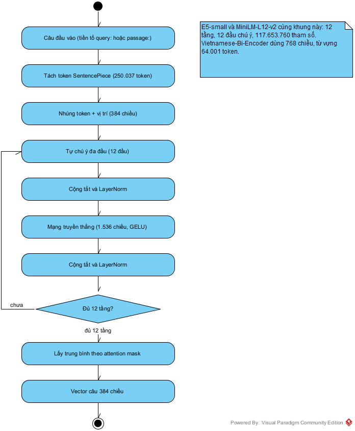

*Hình 3.1. Luồng xử lý của một encoder Transformer trong các mô hình được so sánh.*

### 3.3.6. Ba biến thể kiến trúc

| Biến thể | Đại diện | Cơ chế chú ý | Phù hợp với |
| :--- | :--- | :--- | :--- |
| Encoder-only | BERT, RoBERTa, E5 | Hai chiều (bidirectional) | Biểu diễn câu, phân loại, embedding |
| Decoder-only | GPT, Llama, Gemini | Nhân quả (causal) | Sinh văn bản, hội thoại |
| Encoder–decoder | T5, BART | Encoder hai chiều + decoder nhân quả | Dịch, tóm tắt, sinh có điều kiện |

Hệ thống EAKWP dùng **encoder-only** cho embedding và reranker, **decoder-only** (qua API) cho sinh câu trả lời. Lý do: encoder-only tạo biểu diễn hai chiều tốt cho toàn bộ đoạn văn, trong khi decoder-only tối ưu cho việc dự đoán token tiếp theo.

### 3.3.7. Độ phức tạp và giới hạn

Self-attention có độ phức tạp $O(n^2 d)$ theo số token $n$, vì phải tính ma trận $QK^T$ kích thước $n \times n$. Với đoạn văn dài (hàng nghìn token), chi phí bộ nhớ tăng bình phương. Các giải pháp như sliding window, sparse attention, hoặc chia nhỏ đoạn được dùng trong thực tế. Trong hệ thống này, chunking giữ mỗi đoạn khoảng 1.200 ký tự (~300 token), nằm trong giới hạn tối ưu của các mô hình encoder nhỏ.

---

## 3.4. Bi-encoder và học tương phản

### 3.4.1. Kiến trúc bi-encoder

Bi-encoder dùng **một encoder dùng chung** (shared encoder) để mã hóa độc lập câu hỏi và đoạn văn:

> **Công thức 3.13.** $e_q = f_\theta(q)$, $e_d = f_\theta(d)$

Sau đó so sánh hai vector bằng cosine. Ưu điểm lớn nhất là **tách rời pha mã hóa**: toàn bộ đoạn văn có thể được mã hóa trước và lưu trong vector database; khi có câu hỏi, chỉ cần mã hóa câu hỏi rồi tìm kiếm. Chi phí truy vấn không phụ thuộc số lượng tài liệu.

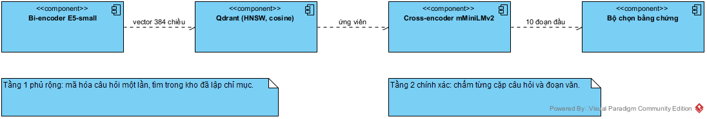

*Hình 3.2. Truy xuất hai tầng: bi-encoder lấy ứng viên, cross-encoder chấm lại.*

Nhược điểm: câu hỏi và đoạn văn không được “nhìn thấy” nhau trong lúc mã hóa, nên mô hình không thể so sánh chi tiết từng từ. Đó là lý do cần **cross-encoder reranker** ở bước sau.

### 3.4.2. Hàm mất mát tương phản InfoNCE

Mục tiêu huấn luyện: câu hỏi $q$ phải gần đoạn trả lời đúng $d^+$ và xa các đoạn không liên quan $d^-$. Với một batch gồm $N$ cặp, InfoNCE xem bài toán là phân loại $N$ lớp: đoạn đúng là lớp mục tiêu, các đoạn còn lại là negative:

> **Công thức 3.14.** $\mathcal{L}_{InfoNCE} = -\frac{1}{N}\sum_{i=1}^{N}\log\frac{\exp\left(\text{sim}(e_{q_i}, e_{d_i^+})/\tau\right)}{\sum_{j=1}^{N}\exp\left(\text{sim}(e_{q_i}, e_{d_j})/\tau\right)}$

Trong đó $\tau$ là nhiệt độ (temperature) điều chỉnh độ sắc của phân phối. Công thức này khuyến khích mô hình tăng tương đồng với positive và giảm tương đồng với negative trong cùng batch. Các negative “khó” (hard negatives) — đoạn có từ khóa giống nhưng ngữ cảnh khác — giúp mô hình học ranh giới tốt hơn.

### 3.4.3. Negative sampling

Có ba loại negative:

- **In-batch negatives:** dùng các đoạn của câu hỏi khác trong cùng batch. Rẻ và hiệu quả, nhưng có thể trùng ngẫu nhiên với positive.
- **Hard negatives:** các đoạn được retriever hiện tại xếp hạng cao nhưng không phải đáp án. Giúp mô hình sửa lỗi cụ thể.
- **Random negatives:** đoạn ngẫu nhiên trong kho. Dễ nhưng ít thông tin.

Trong thực tế, E5 được huấn luyện trên dữ liệu yếu (weakly supervised) quy mô lớn, với nhiều cặp câu hỏi–đoạn văn từ web và các bộ dữ liệu QA. Vì vậy nó có khả năng tổng quát hóa tốt ngay cả khi không fine-tune trên dữ liệu doanh nghiệp.

### 3.4.4. Chuẩn hóa vector và cosine

Để cosine ổn định, vector được chuẩn hóa L2:

> **Công thức 3.15.** $\hat{e} = \frac{e}{\|e\|_2}$

Khi đó:

> **Công thức 3.16.** $\cos(e_q, e_d) = \hat{e}_q \cdot \hat{e}_d = \sum_{i=1}^{m}\hat{e}_{q,i}\hat{e}_{d,i}$

Giá trị nằm trong $[-1, 1]$. Với embedding văn bản, các giá trị thường dương và tập trung trong một khoảng hẹp; vì vậy cần chuẩn hóa và hiệu chỉnh ngưỡng theo từng mô hình (xem mục 4.9.3).

### 3.4.5. Cross-encoder reranker

Cross-encoder nhận đồng thời câu hỏi và đoạn văn, đưa qua encoder để tạo biểu diễn chung, rồi xuất một điểm liên quan:

> **Công thức 3.17.** $s(q, d) = \sigma\left(W \cdot f_\theta([q; d]) + b\right)$

Vì câu hỏi và đoạn văn được xử lý cùng nhau, cross-encoder nắm được tương tác từng từ và thường chính xác hơn bi-encoder. Nhược điểm là phải chạy mô hình cho từng cặp, không thể precompute. Vì vậy kiến trúc chuẩn là:

1. Bi-encoder lấy top-$N$ ứng viên (nhanh, phủ rộng).
2. Cross-encoder chấm lại top-$N$ (chậm nhưng chính xác).
3. Lấy top-$k$ cuối cùng.

Hệ thống dùng `cross-encoder/mmarco-mMiniLMv2-L12-H384-v1` cho bước rerank, với $N$ mặc định 10 ứng viên.

---

## 3.5. Mô hình nhúng cho tiếng Việt

### 3.5.1. Đặc thù của văn bản tiếng Việt

Tiếng Việt đặt ra một số thách thức riêng cho embedding:

1. **Dấu thanh và dấu phụ:** “nghỉ” khác “nghi”, “phép” khác “phep”. Nếu chuẩn hóa sai, nghĩa thay đổi hoàn toàn.
2. **Từ ghép và khoảng trắng:** “người lao động” là một khái niệm nhưng gồm ba âm tiết; tokenizer có thể tách rời làm mất nghĩa.
3. **Nhiễu OCR:** tài liệu scan thường mất dấu, nhầm dấu, hoặc lẫn ký tự Latin (ví dụ “Điều” thành “Diều”). Mô hình cần bền với lỗi bề mặt.
4. **Thuật ngữ pháp lý:** “điều”, “khoản”, “điểm”, “nghị quyết”, “đại hội đồng cổ đông” là các thực thể có cấu trúc, không chỉ là từ thông thường.
5. **Hiện tượng đa ngữ:** văn bản doanh nghiệp có thể chứa tiếng Anh (tên chức danh, mã chứng khoán, tên hệ thống).

Vì vậy, một mô hình tốt cho tiếng Việt không chỉ cần “biết tiếng Việt” mà còn cần **ổn định trước nhiễu OCR** và **hiểu cấu trúc điều khoản**.

### 3.5.2. Ba mô hình ứng viên

| Tiêu chí | MiniLM-L12-v2 | Vietnamese-Bi-Encoder | Multilingual-E5-Small |
| :--- | :--- | :--- | :--- |
| Mã mô hình | `sentence-transformers/paraphrase-multilingual-MiniLM-L12-v2` | `bkai-foundation-models/vietnamese-bi-encoder` | `intfloat/multilingual-e5-small` |
| Đơn vị phát triển | Hugging Face / SentenceTransformers | BKAI — ĐH Bách Khoa Hà Nội | Microsoft Research |
| Kiến trúc | MiniLM đa ngữ | RoBERTa tiếng Việt | E5 (encoder-only) |
| Số chiều | 384 | 768 | 384 |
| Dung lượng ước tính | ~470 MB | ~540 MB | ~470 MB |
| Ngôn ngữ | 50+ ngôn ngữ | Tiếng Việt | 100+ ngôn ngữ |
| Tiền tố | Không | Không | `query: ` / `passage: ` |
| Điểm mạnh | Nhanh, nhẹ, phổ biến | Hiểu tiếng Việt chuyên sâu | Cân bằng đa ngữ, huấn luyện tương phản quy mô lớn |
| Điểm yếu | Yếu với câu hỏi pháp lý dài | Vector lớn, chậm hơn | Cần tiền tố đúng cách |

### 3.5.3. Tiêu chí lựa chọn

Nhóm nghiên cứu đặt ra năm tiêu chí, theo thứ tự ưu tiên:

1. **Độ chính xác truy xuất:** Recall@1, Recall@3, MRR trên bộ câu hỏi ground truth.
2. **Chi phí lưu trữ:** số chiều vector quyết định dung lượng Qdrant và băng thông khi tìm kiếm.
3. **Độ trễ truy vấn:** phải đủ nhanh để người dùng không phải chờ.
4. **Thông lượng mã hóa:** số chunk/giây khi nạp tài liệu.
5. **Khả năng chạy trên CPU:** hệ thống triển khai trong Docker, không giả định GPU rời.

Tiêu chí 1 là điều kiện tiên quyết; các tiêu chí còn lại là ràng buộc tài nguyên. Một mô hình chính xác hơn 20% nhưng chậm gấp 10 lần có thể vẫn chấp nhận được nếu chỉ dùng offline; ngược lại, mô hình chạy online phải đáp ứng ngân sách độ trễ.

<!-- LANDSCAPE:START -->

<div class="landscape">

### 3.5.4. Bảng so sánh kiến trúc và cấu hình huấn luyện (in ngang)

**Bảng 3.1. So sánh kiến trúc, cấu hình huấn luyện và kết quả của các mô hình**

| MÔ HÌNH | ĐẶC TRƯNG | KIẾN TRÚC | SỐ LAYER | HIDDEN / HEAD | FFN | THAM SỐ | MAX TOKEN | TỪ VỰNG | LEARNING RATE | EPOCH | BATCH | HÀM MẤT MÁT | RECALL @1/@3/@5 (%) | MRR |
| :--- | :--- | :--- | ---: | :---: | ---: | ---: | ---: | ---: | :--- | :---: | :---: | :--- | :---: | :---: |
| **MiniLM-L12-v2** (paraphrase-multilingual) | 384 chiều; mean pooling; không tiền tố; đa ngôn ngữ | `BertModel` (MiniLM) | 12 | 384 / 12 | 1.536 | 117.653.760 | 128 | 250.037 | Không nêu | Không nêu | 32 | Không nêu | 60 / 80 / 80 | 0,6667 |
| **Vietnamese-Bi-Encoder** (BKAI) | 768 chiều; mean pooling; không tiền tố; tiếng Việt | `RobertaModel` (PhoBERT) | 12 | 768 / 12 | 3.072 | 134.998.272 | 256 | 64.001 | 2e-5 (AdamW, weight decay 0,01, warmup 1.000 bước) | 15 | 32 | MultipleNegativesRanking, scale 20 | 80 / 80 / 80 | 0,8000 |
| **Multilingual-E5-Small** (đã chọn) | 384 chiều; mean pooling; tiền tố `query:`, `passage:`; đa ngôn ngữ | `BertModel` (E5) | 12 | 384 / 12 | 1.536 | 117.653.760 | 512 | 250.037 | Không nêu | Không nêu | 32 | InfoNCE, τ = 0,01 | 80 / 100 / 100 | 0,9000 |
| **Reranker** mMiniLMv2-L12-H384 | Chấm cặp câu hỏi, đoạn văn; đầu ra 1 điểm | `XLMRobertaForSequence-Classification` | 12 | 384 / 12 | 1.536 | 117.641.089 | 512 | 250.002 | Không nêu | Không nêu | 10 cặp/câu hỏi | Không nêu | — | — |

*Nguồn: số layer, hidden, head, FFN và từ vựng đọc từ `config.json`; max token từ `sentence_bert_config.json`; tham số đếm trực tiếp bằng `sum(p.numel() for p in model.parameters())` trên mô hình đã tải; learning rate, epoch, hàm mất mát lấy từ model card đi kèm. “Không nêu” nghĩa là tệp phát hành không công bố giá trị đó. Các giá trị này là của nhà phát triển mô hình: đồ án dùng trọng số có sẵn và **không huấn luyện lại**, nên learning rate và epoch của riêng đồ án là không áp dụng. Cột BATCH là batch khi mã hóa trong thực nghiệm, trừ Vietnamese-Bi-Encoder là batch huấn luyện công bố và cũng trùng với batch mã hóa 32. Kết quả đo trên 152 chunk và 5 câu hỏi.*

</div>

<!-- LANDSCAPE:END -->

---

## 3.6. Thiết kế thực nghiệm

### 3.6.1. Dữ liệu thực nghiệm

Bộ dữ liệu là toàn văn **Điều lệ Công ty** (bản 41 trang), được xử lý qua pipeline mô tả ở Chương 4 và phân đoạn thành **152 chunk ngữ nghĩa**. Đây là tài liệu thật của doanh nghiệp, có đặc điểm:

- Nhiều chương, điều, khoản; cấu trúc phân cấp rõ nhưng không đồng nhất giữa các phần.
- Có bảng, danh sách, tiêu đề viết hoa, và một số trang scan/OCR.
- Nội dung pháp lý dày đặc, nhiều câu dài, nhiều tham chiếu chéo.

Sau khi qua pipeline, corpus có các thống kê:

| Chỉ số | Giá trị |
| :--- | ---: |
| Số trang của tài liệu | 41 |
| Số chunk | 152 |
| Tổng số ký tự | 111.241 |
| Độ dài trung bình | 731,8 ký tự |
| Trung vị | 795 ký tự |
| Ngắn nhất | 52 ký tự |
| Dài nhất | 1.353 ký tự |
| Số section path khác nhau | 33 |

Các chunk ngắn (52 ký tự) thường là tiêu đề hoặc dòng danh sách; các chunk dài (1.353 ký tự) là điều khoản có nhiều khoản con. Việc giữ cả hai loại là có chủ đích: chunk ngắn cung cấp ngữ cảnh tiêu đề, chunk dài cung cấp nội dung đầy đủ.

### 3.6.2. Bộ câu hỏi ground truth

Năm câu hỏi được chọn để bao phủ các dạng truy vấn khác nhau: quyền hạn, thời hạn, quy trình, điều kiện, và báo cáo. Mỗi câu được gán nhãn thủ công với một hoặc nhiều chunk chứa đáp án:

| ID | Câu hỏi | Chunk đáp án | Nội dung nghiệp vụ |
| :--- | :--- | :--- | :--- |
| TC-01 | Chủ tịch Hội đồng Quản trị có quyền và nghĩa vụ gì? | 0093, 0096, 0097 | Quyền hạn Chủ tịch HĐQT (Điều 39) |
| TC-02 | Thời hạn hoạt động của Công ty là bao lâu và bắt đầu từ khi nào? | 0003, 0005, 0006 | Thời hạn và ngày thành lập (Điều 2) |
| TC-03 | Con dấu của Công ty bao gồm những hình thức nào và ai có thẩm quyền quyết định? | 0145 | Con dấu và chữ ký số (Điều 50) |
| TC-04 | Việc chỉ định công ty kiểm toán độc lập cho năm tài chính tiếp theo diễn ra như thế nào? | 0144 | Đơn vị kiểm toán độc lập (Điều 49) |
| TC-05 | Báo cáo tài chính năm của công ty phải bao gồm những gì và được công bố ra sao? | 0143 | Báo cáo tài chính và công bố thông tin (Điều 47) |

Bộ câu hỏi tuy nhỏ nhưng có chủ đích: TC-01 và TC-05 yêu cầu tổng hợp nhiều ý; TC-02 yêu cầu phân biệt “thời hạn hoạt động” với các mốc thời gian khác; TC-03 và TC-04 yêu cầu xác định đúng điều khoản chuyên biệt. Đây là các dạng lỗi phổ biến của RAG: trả lời đúng chủ đề nhưng sai điều khoản.

### 3.6.3. Quy trình thực nghiệm

Thực nghiệm được chạy trong Docker container, chế độ CPU, bằng script `benchmark_embeddings.py`. Quy trình:

1. Nạp 152 chunk từ `05_enriched_chunks.json`.
2. Với mỗi mô hình, mã hóa toàn bộ passage (có tiền tố nếu mô hình yêu cầu).
3. Với mỗi câu hỏi, mã hóa query, tính cosine với toàn bộ vector passage.
4. Lấy top-5, xác định thứ hạng đầu tiên của chunk đúng.
5. Tính Recall@1, Recall@3, Recall@5, MRR, độ trễ trung bình, thông lượng.
6. Lặp lại cho ba mô hình, giữ nguyên dữ liệu, tham số batch, và môi trường.

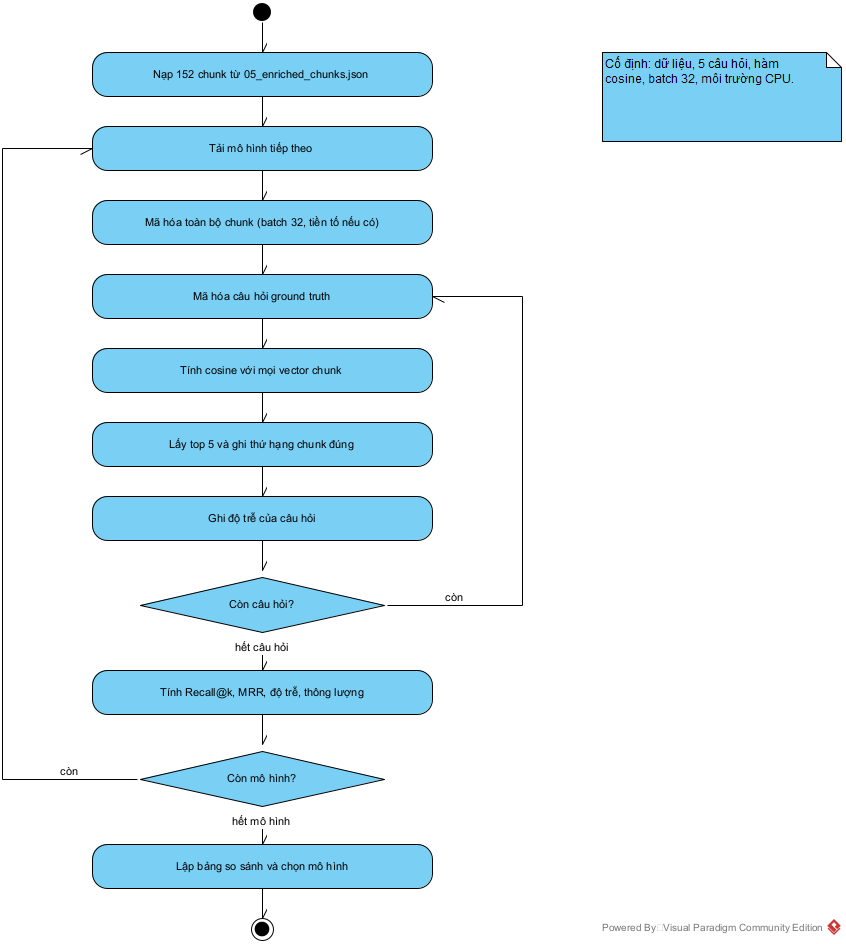

*Hình 3.3. Quy trình đo và so sánh các mô hình embedding.*

Vòng đo chính trong `ai-service/scripts/benchmark_embeddings.py`, dòng 122–147:

```python
for idx, tc in enumerate(TEST_CASES, start=1):
    q_text = f"{model_cfg['prefix_query']}{tc['query']}"
    gt_ids = set(tc["ground_truth_chunks"])

    q_start = time.time()
    q_vec = model.encode(q_text, convert_to_numpy=True)
    scores = compute_cosine_similarity(q_vec, doc_vectors)
    q_latency_ms = (time.time() - q_start) * 1000
    query_latencies.append(q_latency_ms)

    # Sort descending
    top_indices = np.argsort(scores)[::-1][:5]
    top_chunks = [(chunk_ids[i], float(scores[i])) for i in top_indices]

    # Calculate Rank of first Hit
    first_rank = None
    for rank, (cid, sc) in enumerate(top_chunks, start=1):
        if cid in gt_ids:
            first_rank = rank
            break

    # Check hits
    hit_1 = 1 if (first_rank is not None and first_rank <= 1) else 0
    hit_3 = 1 if (first_rank is not None and first_rank <= 3) else 0
    hit_5 = 1 if (first_rank is not None and first_rank <= 5) else 0
    reciprocal_rank = 1.0 / first_rank if first_rank is not None else 0.0
```

Điểm quan trọng: cùng một hàm cosine, cùng batch 32, cùng tập chunk và cùng cách xác định hạng; chỉ mô hình thay đổi. Nếu mỗi mô hình dùng một cách chuẩn hóa hoặc một tập chunk khác, bảng so sánh sẽ mất ý nghĩa.

### 3.6.4. Chỉ số đánh giá

**Recall@k** đo tỷ lệ câu hỏi có ít nhất một chunk đúng trong top-$k$:

> **Công thức 3.18.** $\text{Recall}@k = \frac{1}{|Q|}\sum_{i=1}^{|Q|}\mathbb{1}\left[\text{rank}_i \le k\right]$

**MRR** (Mean Reciprocal Rank) đo thứ hạng trung bình của đáp án đúng đầu tiên:

> **Công thức 3.19.** $\text{MRR} = \frac{1}{|Q|}\sum_{i=1}^{|Q|}\frac{1}{\text{rank}_i}$

Nếu đáp án đúng ở top-1, điểm là 1; top-2 là 0,5; top-3 là 0,333. MRR nhạy với việc đáp án đúng nằm càng cao càng tốt, phù hợp với RAG vì LLM chỉ nhận một vài đoạn ngữ cảnh.

**Độ trễ truy vấn** là thời gian mã hóa câu hỏi và tính cosine trên toàn bộ corpus, đo bằng mili-giây. **Thông lượng** là số chunk được mã hóa trong một giây khi nạp corpus.

### 3.6.5. Kiểm soát yếu tố gây nhiễu

Để so sánh công bằng, nhóm giữ cố định:

- Cùng một corpus 152 chunk, cùng thứ tự.
- Cùng hàm cosine và cùng cách chuẩn hóa vector.
- Cùng batch size 32 khi mã hóa passage.
- Cùng môi trường CPU, cùng phiên bản thư viện.
- Cùng cách tính rank: chunk đúng đầu tiên trong top-5.

Các yếu tố không kiểm soát được: nhiệt độ CPU, tải nền của máy, trạng thái cache của mô hình. Vì vậy độ trễ chỉ có ý nghĩa tương đối; các chỉ số chất lượng (Recall, MRR) mới là căn cứ chính.

---

## 3.7. Kết quả và phân tích

### 3.7.1. Bảng tổng hợp

| Xếp hạng | Mô hình | Số chiều | Recall@1 | Recall@3 | Recall@5 | MRR | Độ trễ (ms) | Thông lượng (chunk/s) |
| :---: | :--- | :---: | :---: | :---: | :---: | :---: | :---: | :---: |
| 1 | **Multilingual-E5-Small** | 384 | 80,0% | 100,0% | 100,0% | 0,9000 | 298,36 | 4,9 |
| 2 | Vietnamese-Bi-Encoder | 768 | 80,0% | 80,0% | 80,0% | 0,8000 | 493,94 | 2,2 |
| 3 | MiniLM-L12-v2 | 384 | 60,0% | 80,0% | 80,0% | 0,6667 | 351,27 | 9,2 |

*Nguồn: `ai-service/debug/embedding_benchmark_results.json`.*

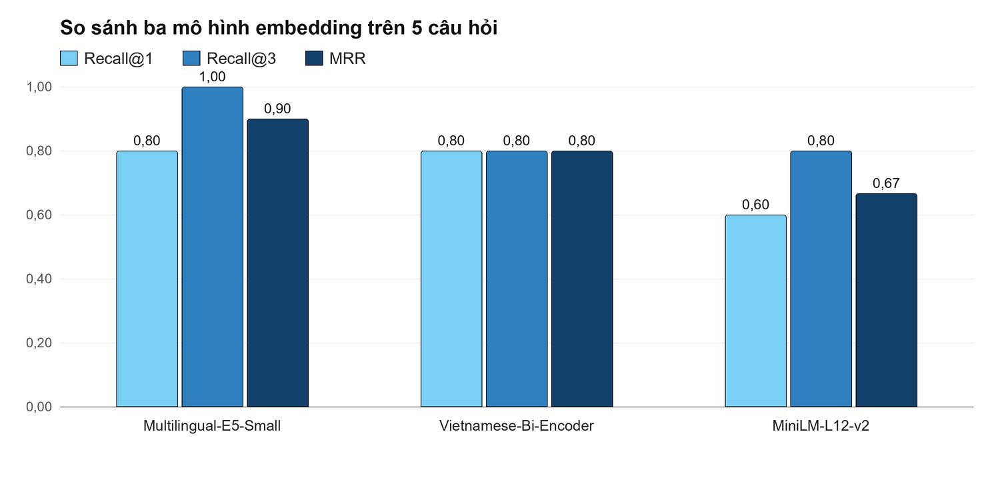

*Hình 3.4. So sánh định lượng ba mô hình embedding trên 152 chunk Điều lệ Công ty.*

### 3.7.2. Phân tích định lượng

**Multilingual-E5-Small** đạt Recall@3 = 100%, nghĩa là cả 5 câu hỏi đều có đáp án đúng trong top-3. Đây là ngưỡng quan trọng vì pipeline RAG lấy top-3 đến top-5 để đưa vào ngữ cảnh. MRR = 0,9 cho thấy 4/5 câu đạt top-1, 1 câu đạt top-2. Điểm cosine của top-1 dao động từ 0,8596 đến 0,9146, đủ tách biệt so với các đoạn nhiễu.

**Vietnamese-Bi-Encoder** đạt Recall@1 = 80% nhưng Recall@3 chỉ 80%, tức là một câu hỏi không có đáp án trong top-3 (TC-02). Điều này cho thấy mô hình mạnh với từ vựng tiếng Việt nhưng chưa xử lý tốt câu hỏi có nhiều mệnh đề thời gian. Vector 768 chiều cũng làm chi phí lưu trữ và tìm kiếm tăng gấp đôi.

**MiniLM-L12-v2** chỉ đạt Recall@1 = 60%, MRR = 0,6667; TC-02 và TC-04 bị xếp hạng sai. Đây là minh chứng cho việc mô hình nhỏ, huấn luyện trên dữ liệu đa ngữ chung không đủ nhạy với cấu trúc pháp lý tiếng Việt.

### 3.7.3. Phân tích theo từng câu hỏi

| Câu hỏi | E5-Small | Vietnamese-Bi-Encoder | MiniLM |
| :--- | :---: | :---: | :---: |
| TC-01 — Quyền Chủ tịch HĐQT | 1 | 1 | 1 |
| TC-02 — Thời hạn hoạt động | 2 | >5 | >5 |
| TC-03 — Con dấu | 1 | 1 | 1 |
| TC-04 — Kiểm toán độc lập | 1 | 1 | 3 |
| TC-05 — Báo cáo tài chính | 1 | 1 | 1 |

TC-02 là câu khó nhất: câu hỏi chứa hai ý (“bao lâu” và “bắt đầu từ khi nào”), trong khi đáp án nằm ở câu mở đầu Điều 2 và có thể bị tách bởi chunking. E5 vẫn đưa đáp án vào top-2 nhờ học tương phản đa ngữ; hai mô hình còn lại trượt khỏi top-5. Đây là lý do nhóm không chọn mô hình có Recall@1 cao nhất một cách máy móc, mà ưu tiên **độ phủ top-3** — yếu tố quyết định chất lượng RAG.

### 3.7.4. Độ trễ và thông lượng

Trong lượt đo được lưu, E5 có độ trễ truy vấn thấp nhất (298,36 ms), tiếp theo là MiniLM (351,27 ms) và Vietnamese-Bi-Encoder (493,94 ms). Về thông lượng mã hóa, MiniLM nhanh nhất (9,2 chunk/s), E5 đạt 4,9 chunk/s và Vietnamese-Bi-Encoder đạt 2,2 chunk/s.

Độ trễ phụ thuộc mạnh vào tải máy. Một lượt đo khác ghi trong `docs/evaluation_embedding_benchmark.md` cho 283,66 ms, 277,30 ms và 86,54 ms theo cùng thứ tự E5, Bi-Encoder, MiniLM, trong khi Recall và MRR không đổi. Vì vậy đồ án chỉ dùng độ trễ như điều kiện đủ (dưới 1 giây) và lấy Recall, MRR làm căn cứ chọn mô hình.

### 3.7.5. Thảo luận

Kết quả cho thấy ba bài học thiết kế:

1. **Không có mô hình tốt nhất tuyệt đối, chỉ có mô hình phù hợp với ràng buộc.** MiniLM thắng về tốc độ, BKAI thắng về tiếng Việt thuần, E5 thắng về độ phủ top-3 và cân bằng tài nguyên.
2. **Recall@3 quan trọng hơn Recall@1 trong RAG.** Một đáp án ở top-2 vẫn được đưa vào ngữ cảnh; một đáp án ngoài top-5 thì mất hoàn toàn.
3. **Kích thước vector là quyết định kiến trúc, không chỉ là tham số.** 384 chiều giảm 50% dung lượng so với 768 chiều, cho phép chạy trên CPU và mở rộng kho tri thức mà không cần nâng cấp hạ tầng.

---

## 3.8. Ứng dụng trong hệ thống EAKWP

### 3.8.1. Embedding Service

Module `embedding_service.py` triển khai ba phương thức:

- `embed_query(query)`: mã hóa câu hỏi thành vector 384 chiều.
- `embed_documents(texts, batch_size=32)`: mã hóa danh sách đoạn văn theo batch.
- `embed_chunks(chunks)`: nhận danh sách chunk từ pipeline, bổ sung trường `vector`.

Hai phương thức chính, trích `ai-service/app/embedding_service.py`, dòng 43–60:

```python
def _prepare(self, text: str, prefix: str) -> str:
    # Giữ dấu: đo trên bộ nhãn (docs/evaluation_graphrag.md) cho thấy bỏ dấu
    # làm E5 mất phần lớn tín hiệu tiếng Việt. fold_text chỉ dùng khớp từ khóa.
    prepared = fold_text(text) if settings.EMBEDDING_FOLD_TEXT else " ".join(text.split())
    return f"{prefix}{prepared}" if prefix else prepared

def embed_query(self, query: str) -> List[float]:
    """
    Nhúng 1 câu hỏi từ người dùng thành vector phục vụ tìm kiếm.
    """
    if not query or not query.strip():
        return [0.0] * self.vector_dim

    vector = self.model.encode(
        self._prepare(query, self.query_prefix),
        convert_to_numpy=True,
    )
    return vector.tolist()
```

Một quyết định quan trọng là **giữ dấu tiếng Việt khi nhúng**. Thiết kế ban đầu bỏ dấu cả câu hỏi và tài liệu để chịu được lỗi OCR. Đo lại bằng cosine thuần trên 18 câu có nhãn, 321 chunk cho thấy việc bỏ dấu làm mô hình mất phần lớn tín hiệu tiếng Việt:

| Tiền xử lý | MRR | Recall@1 | Recall@3 | Recall@10 |
| :--- | ---: | ---: | ---: | ---: |
| Bỏ dấu (cách cũ) | 0.169 | 6% | 22% | 39% |
| **Giữ dấu (hiện tại)** | **0.806** | **72%** | **89%** | **100%** |

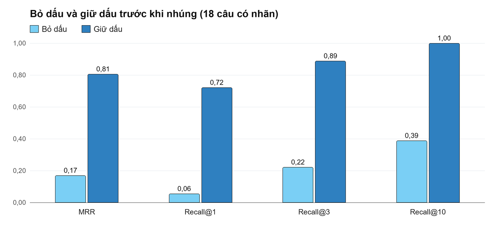

*Hình 3.5. Ảnh hưởng của việc giữ dấu tiếng Việt trước khi nhúng.*

Hệ thống đã chuyển sang giữ dấu (`EMBEDDING_FOLD_TEXT = false`). Hàm `fold_text` chỉ còn dùng để khớp từ khóa, nơi việc chịu lỗi OCR thực sự có ích.

### 3.8.2. Reranker

Module `reranker_service.py` dùng cross-encoder `mmarco-mMiniLMv2-L12-H384-v1`. Cấu hình:

- `RERANK_CANDIDATES = 10`: số ứng viên đưa vào cross-encoder.
- `RERANK_PASSAGE_CHARS = 800`: cắt đoạn văn trước khi chấm để giới hạn độ dài.
- `RERANK_GATE = -1.5`: ngưỡng tin cậy; điểm cross-encoder dưới ngưỡng bị coi là nhiễu.

```python
def rerank(self, query: str, hits: List[Dict[str, Any]]) -> List[Dict[str, Any]]:
    if not self.enabled or not hits:
        return hits
    pairs = [(query, hit["content"][: settings.RERANK_PASSAGE_CHARS]) for hit in hits]
    scores = self.model.predict(pairs, show_progress_bar=False)
    for hit, score in zip(hits, scores):
        hit["rerank_score"] = round(float(score), 4)
    return sorted(hits, key=lambda hit: hit["rerank_score"], reverse=True)
```

Reranker không thay thế bi-encoder mà bổ sung tín hiệu tương tác từng từ. Trong bộ đánh giá 26 câu ở mục 4.11, bỏ cross-encoder làm MRR giảm từ 0,713 xuống 0,530.

---

## 3.9. Hạn chế và hướng phát triển

### 3.9.1. Hạn chế của thực nghiệm

1. **Kích thước mẫu nhỏ:** 5 câu hỏi trên một tài liệu. Kết quả có tính minh chứng nhưng chưa đủ để kết luận thống kê. Cần mở rộng lên 50–100 câu hỏi, nhiều loại tài liệu, và báo cáo khoảng tin cậy (bootstrap confidence interval).
2. **Thiếu baseline từ khóa:** thực nghiệm chưa so sánh với BM25 hoặc hybrid retrieval. Một baseline BM25 sẽ cho thấy đóng góp thực sự của embedding.
3. **Chưa đánh giá sau fine-tune:** các mô hình được dùng zero-shot. Fine-tune với hard negatives từ chính corpus có thể cải thiện đáng kể.
4. **Nhiễu OCR chưa được đo tách biệt:** cần một bộ thử nghiệm riêng với các mức nhiễu khác nhau để đánh giá độ bền.

### 3.9.2. Hạn chế của mô hình

- **Mô hình nhỏ:** E5-small chỉ 384 chiều, không thể biểu diễn đầy đủ các quan hệ pháp lý phức tạp như mô hình lớn.
- **Cửa sổ ngữ cảnh hữu hạn:** đoạn quá dài bị cắt, có thể mất ngoại lệ hoặc điều kiện đi kèm.
- **Không hiểu bảng biểu:** embedding văn bản thuần không nắm được quan hệ hàng–cột; bảng cần được xử lý riêng.
- **Thiên lệch ngôn ngữ:** E5 đa ngữ nhưng không tối ưu riêng cho tiếng Việt; các mô hình chuyên biệt có thể tốt hơn sau khi fine-tune.

### 3.9.3. Hướng phát triển

1. **Mở rộng bộ đánh giá:** 100+ câu hỏi, nhiều tài liệu, nhiều miền (nhân sự, tài chính, IT), có ground truth do chuyên gia gán.
2. **Fine-tune với hard negatives:** lấy các đoạn sai do retriever hiện tại xếp hạng cao, tạo cặp huấn luyện, fine-tune E5 hoặc BKAI.
3. **Hybrid retrieval:** kết hợp BM25 và vector, dùng reciprocal rank fusion; sau đó rerank.
4. **Lượng tử hóa và ONNX:** giảm dung lượng, tăng tốc trên CPU, phục vụ triển khai biên.
5. **Đánh giá đa ngôn ngữ:** bổ sung tài liệu tiếng Anh để kiểm chứng khả năng đa ngữ của E5.
6. **Graph embedding:** kết hợp embedding văn bản với embedding thực thể trong đồ thị tri thức (Chương 4).

---

## 3.10. Kết luận chương

Chương này đã trình bày con đường từ bài toán biểu diễn ngữ nghĩa đến một quyết định kỹ thuật có căn cứ:

- **Về lý thuyết:** hệ thống hóa kiến trúc Transformer, cơ chế self-attention, bi-encoder, học tương phản và cross-encoder. Đây là nền tảng để hiểu vì sao embedding có thể thay thế tìm kiếm từ khóa trong văn bản pháp lý.
- **Về thực nghiệm:** thiết kế so sánh ba mô hình trên 152 chunk thật, với 5 câu hỏi ground truth và các chỉ số Recall@k, MRR, độ trễ, thông lượng.
- **Về kết quả:** `Multilingual-E5-Small` đạt Recall@3 = 100%, MRR = 0,9, vector 384 chiều, độ trễ dưới 300 ms — là lựa chọn cân bằng nhất cho hệ thống chạy CPU.
- **Về ứng dụng:** mô hình được tích hợp vào Embedding Service, kết hợp với reranker cross-encoder và Qdrant để tạo thành pipeline truy xuất hai tầng.

Kết quả này là tiền đề cho Chương 4, nơi vector được tổ chức thành cơ sở tri thức có cấu trúc, có trích dẫn và có cơ chế từ chối khi không đủ căn cứ. Nói cách khác, chương này trả lời câu hỏi **“biểu diễn tri thức bằng vector như thế nào?”**; chương tiếp theo trả lời câu hỏi **“tổ chức tri thức thành KB và khai thác trong RAG như thế nào?”**.

<!-- PAGEBREAK -->
<div class="pb"></div>

# CHƯƠNG 4. XÂY DỰNG CƠ SỞ TRI THỨC VÀ KẾT NỐI VỚI RAG

Chương này trình bày cách hệ thống EAKWP biến 35 tệp PDF và 10 trang web công khai thành một cơ sở tri thức (Knowledge Base, KB) trên Neo4j, cách RAG khai thác KB đó, và cách cập nhật KB khi tài liệu thay đổi. Mọi số liệu trong chương được đọc từ hệ thống đang chạy ngày 09/11/2026; mọi đoạn code được trích nguyên văn từ mã nguồn của đồ án.

## 4.1. Bài toán xây dựng cơ sở tri thức

### 4.1.1. Từ tài liệu đến tri thức

Một tệp PDF chỉ là dữ liệu. Sau khi đọc được chữ, ta có thông tin. Thông tin trở thành tri thức khi nó được gắn với cấu trúc (thuộc Chương, Điều nào), với quan hệ (Điều này viện dẫn Điều nào, nói về chủ thể nào) và với nguồn gốc (tài liệu nào, trang nào, phiên bản nào). KB của đồ án lưu cả ba yếu tố đó dưới dạng đồ thị.

| Mức | Ví dụ trong đồ án |
| :--- | :--- |
| Dữ liệu | Tệp `Dieu_le_cong_ty_2021.pdf`, 38 trang |
| Thông tin | Văn bản trang 11 có đoạn “Hội đồng Quản trị phải triệu tập Đại Hội đồng Cổ đông bất thường...” |
| Tri thức | Đoạn đó thuộc Điều 13, nhắc đến Hội đồng Quản trị, viện dẫn Điều 11 của cùng tài liệu, thuộc phiên bản 6 |

### 4.1.2. Yêu cầu đối với KB

KB phải bảo đảm ba yêu cầu. Thứ nhất, **truy vết được**: mỗi câu trả lời dẫn ngược về đúng đoạn, trang và tài liệu. Thứ hai, **nạp lại an toàn**: chạy lại không sinh bản trùng. Thứ ba, **cập nhật được**: khi tài liệu đổi, KB biết bản nào còn hiệu lực.

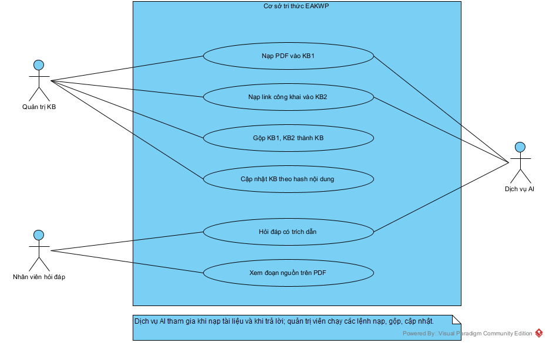

*Hình 4.1. Các ca sử dụng chính của cơ sở tri thức.*

## 4.2. Kiến trúc KB1, KB2 và KB hợp nhất

Tri thức được chia thành hai kho nguồn và một kho hợp nhất:

- **KB1** chứa 35 tệp PDF nội bộ, gồm điều lệ, phụ lục sửa đổi, quy chế, quy trình và chính sách nhân sự.
- **KB2** chứa 10 trang web công khai của doanh nghiệp.
- **KB** là kho dùng để khai thác. Nó nhận toàn bộ tài liệu của KB1, KB2 qua phép gộp, và nhận thêm 7 tài liệu người dùng tải lên qua giao diện.

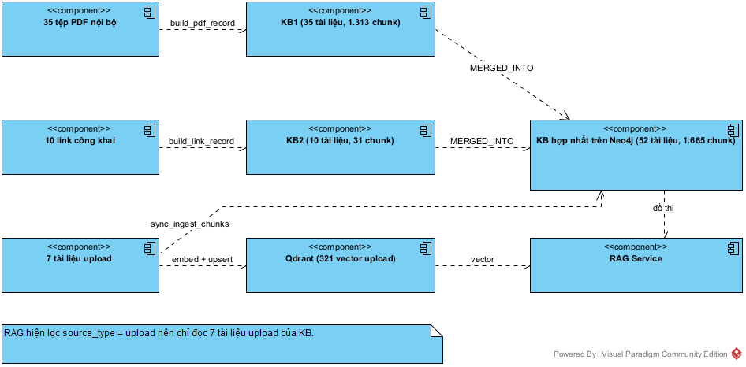

*Hình 4.2. Kiến trúc nguồn dữ liệu, các kho tri thức và điểm nối với RAG.*

Số liệu đọc trực tiếp từ Neo4j bằng hàm `store.stats`:

**Bảng 4.1. Quy mô các kho tri thức trên Neo4j**

| Kho | Nguồn | Tài liệu | Chunk | Thực thể | REFERENCES | APPLIES_TO |
| :--- | :--- | ---: | ---: | ---: | ---: | ---: |
| **KB1** | 35 tệp PDF nội bộ | 35 | 1.313 | 299 | 177 | 1.041 |
| **KB2** | 10 link công khai | 10 | 31 | 14 | 0 | 4 |
| **KB** | KB1 + KB2 + 7 tài liệu tải lên | 52 | 1.665 | 314 | 204 | 1.346 |

Kho KB có 52 tài liệu vì 35 + 10 + 7 = 52. Số chunk cũng cộng đúng: 1.313 + 31 + 321 = 1.665. Điều này xác nhận phép gộp không nhân bản nút nào.

## 4.3. Nguồn dữ liệu đã thu thập

### 4.3.1. Danh mục link của KB2

Danh sách nằm trong tệp `ai-service/data/kb_sources/links.json`. Cột ký tự và chunk là số liệu thực tế của từng tài liệu trong Neo4j, sau khi đã bỏ menu, script và chân trang. KB2 được nạp ngày 07/11/2026.

**Bảng 4.2. Mười link công khai của KB2**

| # | Nhóm | Tên | Link | Ký tự | Chunk |
| ---: | :--- | :--- | :--- | ---: | ---: |
| 1 | Doanh nghiệp | Giới thiệu chung về Masan Consumer | <https://masanconsumer.com/ve-masan-consumer/gioi-thieu-chung/> | 9.557 | 11 |
| 2 | Quản trị | Quan hệ cổ đông - giới thiệu | <https://masanconsumer.com/quan-he-co-dong/gioi-thieu/> | 3.355 | 5 |
| 3 | Quản trị | Công bố thông tin | <https://masanconsumer.com/quan-he-co-dong/cong-bo-thong-tin/thong-tin-cong-bo/> | 1.762 | 1 |
| 4 | Quản trị | Báo cáo thường niên | <https://masanconsumer.com/quan-he-co-dong/bao-cao-thuong-nien/> | 450 | 1 |
| 5 | Quản trị | Đại hội đồng cổ đông | <https://masanconsumer.com/quan-he-co-dong/dai-hoi-dong-co-dong/> | 3.004 | 3 |
| 6 | Tài chính | Thông tin tài chính | <https://masanconsumer.com/quan-he-co-dong/thong-tin-tai-chinh/> | 1.583 | 1 |
| 7 | Tài liệu | Tài liệu doanh nghiệp | <https://masanconsumer.com/tai-lieu-doanh-nghiep/> | 786 | 4 |
| 8 | Bền vững | Phát triển bền vững - quản trị | <https://masanconsumer.com/phat-trien-ben-vung/quan-tri/> | 917 | 1 |
| 9 | Tin tức | Thông cáo báo chí | <https://masanconsumer.com/tin-tuc/thong-cao-bao-chi/> | 1.896 | 3 |
| 10 | Tài liệu | Tài liệu | <https://masanconsumer.com/tai-lieu/> | 971 | 1 |
| | | **Tổng** | | **24.281** | **31** |

### 4.3.2. Danh mục tệp PDF của KB1

Các tệp nằm trong `ai-service/data/documents/`. Số trang được đọc từ chính tệp PDF bằng PyMuPDF.

**Bảng 4.3. Tổng hợp PDF theo nhóm**

| Nhóm | Số tệp | Số trang | Dung lượng (MB) | Ký tự trích được | Chunk |
| :--- | ---: | ---: | ---: | ---: | ---: |
| Điều lệ công ty | 3 | 121 | 30,46 | 314.909 | 474 |
| Phụ lục sửa đổi điều lệ | 22 | 72 | 9,86 | 164.493 | 242 |
| Nhân sự và lao động | 3 | 53 | 20,26 | 135.928 | 182 |
| Quy chế và quy trình | 7 | 149 | 51,60 | 316.631 | 415 |
| **Tổng** | **35** | **395** | **112,19** | **931.961** | **1.313** |

**Bảng 4.4. Danh mục 35 tệp PDF đã thu thập**

| # | Tệp | Nhóm | Trang | Chunk |
| ---: | :--- | :--- | ---: | ---: |
| 1 | `Dieu_le_cong_ty_2021.pdf` | Điều lệ công ty | 38 | 147 |
| 2 | `Dieu_le_cong_ty_2025.pdf` | Điều lệ công ty | 41 | 156 |
| 3 | `Dieu_le_cong_ty_2026.pdf` | Điều lệ công ty | 42 | 171 |
| 4 | `Phu_luc_sua_doi_dieu_le_lan_1.pdf` | Phụ lục sửa đổi điều lệ | 2 | 7 |
| 5 | `Phu_luc_sua_doi_dieu_le_lan_10.pdf` | Phụ lục sửa đổi điều lệ | 2 | 7 |
| 6 | `Phu_luc_sua_doi_dieu_le_lan_1_1.pdf` | Phụ lục sửa đổi điều lệ | 1 | 2 |
| 7 | `Phu_luc_sua_doi_dieu_le_lan_1_2.pdf` | Phụ lục sửa đổi điều lệ | 1 | 1 |
| 8 | `Phu_luc_sua_doi_dieu_le_lan_2.pdf` | Phụ lục sửa đổi điều lệ | 1 | 2 |
| 9 | `Phu_luc_sua_doi_dieu_le_lan_2_1.pdf` | Phụ lục sửa đổi điều lệ | 1 | 2 |
| 10 | `Phu_luc_sua_doi_dieu_le_lan_2_2.pdf` | Phụ lục sửa đổi điều lệ | 1 | 3 |
| 11 | `Phu_luc_sua_doi_dieu_le_lan_3.pdf` | Phụ lục sửa đổi điều lệ | 1 | 2 |
| 12 | `Phu_luc_sua_doi_dieu_le_lan_3_1.pdf` | Phụ lục sửa đổi điều lệ | 3 | 7 |
| 13 | `Phu_luc_sua_doi_dieu_le_lan_3_2.pdf` | Phụ lục sửa đổi điều lệ | 1 | 2 |
| 14 | `Phu_luc_sua_doi_dieu_le_lan_4.pdf` | Phụ lục sửa đổi điều lệ | 1 | 3 |
| 15 | `Phu_luc_sua_doi_dieu_le_lan_4_1.pdf` | Phụ lục sửa đổi điều lệ | 5 | 14 |
| 16 | `Phu_luc_sua_doi_dieu_le_lan_5.pdf` | Phụ lục sửa đổi điều lệ | 1 | 3 |
| 17 | `Phu_luc_sua_doi_dieu_le_lan_5_1.pdf` | Phụ lục sửa đổi điều lệ | 1 | 3 |
| 18 | `Phu_luc_sua_doi_dieu_le_lan_6.pdf` | Phụ lục sửa đổi điều lệ | 1 | 4 |
| 19 | `Phu_luc_sua_doi_dieu_le_lan_7.pdf` | Phụ lục sửa đổi điều lệ | 3 | 9 |
| 20 | `Phu_luc_sua_doi_dieu_le_lan_7_1.pdf` | Phụ lục sửa đổi điều lệ | 1 | 4 |
| 21 | `Phu_luc_sua_doi_dieu_le_lan_8.pdf` | Phụ lục sửa đổi điều lệ | 1 | 4 |
| 22 | `Phu_luc_sua_doi_dieu_le_lan_8_1.pdf` | Phụ lục sửa đổi điều lệ | 1 | 5 |
| 23 | `Phu_luc_sua_doi_dieu_le_lan_9.pdf` | Phụ lục sửa đổi điều lệ | 2 | 7 |
| 24 | `Phu_luc_sua_doi_dieu_le_lan_khac.pdf` | Phụ lục sửa đổi điều lệ | 38 | 145 |
| 25 | `Phu_luc_sua_doi_dieu_le_lan_khac_1.pdf` | Phụ lục sửa đổi điều lệ | 3 | 6 |
| 26 | `Chinh_sach_nhan_quyen.pdf` | Nhân sự và lao động | 4 | 10 |
| 27 | `Noi_quy_lao_dong.pdf` | Nhân sự và lao động | 34 | 124 |
| 28 | `Thoa_uoc_lao_dong_tap_the.pdf` | Nhân sự và lao động | 15 | 48 |
| 29 | `Chinh_sach_an_ninh_thong_tin.pdf` | Quy chế và quy trình | 22 | 69 |
| 30 | `Quy_che_hoat_dong_HDQT.pdf` | Quy chế và quy trình | 15 | 55 |
| 31 | `Quy_che_quan_tri_cong_ty.pdf` | Quy chế và quy trình | 28 | 101 |
| 32 | `Quy_che_quan_tri_rui_ro.pdf` | Quy chế và quy trình | 22 | 54 |
| 33 | `Quy_trinh_danh_gia_nha_cung_cap.pdf` | Quy chế và quy trình | 13 | 31 |
| 34 | `Quy_trinh_giai_quyet_khieu_nai.pdf` | Quy chế và quy trình | 40 | 87 |
| 35 | `Quy_trinh_xu_ly_vu_viec.pdf` | Quy chế và quy trình | 9 | 18 |

### 4.3.3. Tài liệu tải lên qua giao diện

Ngoài hai kho trên, 7 tài liệu được quản trị viên tải lên qua giao diện web. Đây là phần duy nhất có đồng thời vector trong Qdrant và nút trong Neo4j, nên cũng là phần mà RAG đang đọc (mục 4.9.5).

**Bảng 4.5. Bảy tài liệu tải lên**

| Tài liệu | Danh mục | Phiên bản | Trang | Chunk |
| :--- | :--- | ---: | ---: | ---: |
| Chính sách an ninh thông tin | Chính sách IT | 1 | 19 | 63 |
| Chính sách nhân quyền | Quy chế | 1 | 4 | 14 |
| Quy chế hoạt động Hội đồng Quản trị | Quy chế | 1 | 15 | 53 |
| Quy trình xử lý vụ việc | Quy chế | 1 | 9 | 19 |
| Quy trình đánh giá nhà cung cấp | Quy chế | 1 | 8 | 22 |
| Thỏa ước lao động tập thể | Nội quy | 1 | 15 | 42 |
| Điều lệ công ty - 2021 | Nội quy | 6 | 38 | 108 |
| **Tổng** | | | | **321** |

## 4.4. Mô hình đồ thị trên Neo4j

### 4.4.1. Lược đồ

Đồ án dùng mô hình đồ thị thuộc tính có nhãn. Có 4 loại nút và 8 loại cạnh.

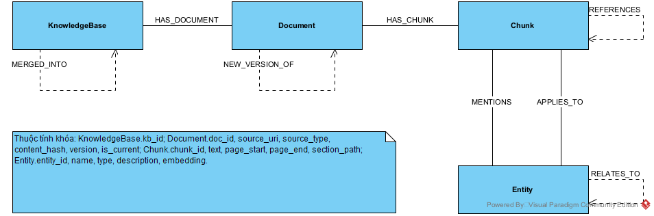

*Hình 4.3. Lược đồ nút và cạnh của cơ sở tri thức.*

**Bảng 4.6. Các loại cạnh và số lượng thực tế**

| Cạnh | Từ → Đến | Ý nghĩa | Số cạnh |
| :--- | :--- | :--- | ---: |
| `HAS_DOCUMENT` | KnowledgeBase → Document | Tài liệu thuộc kho nào | 97 |
| `MERGED_INTO` | KnowledgeBase → KnowledgeBase | KB nguồn đã gộp vào KB đích | 2 |
| `HAS_CHUNK` | Document → Chunk | Đoạn thuộc tài liệu | 1.665 |
| `MENTIONS` | Chunk → Entity | Đoạn nhắc đến thực thể | 3.738 |
| `APPLIES_TO` | Chunk → Entity | Thực thể là chủ đề của mục chứa đoạn | 1.346 |
| `REFERENCES` | Chunk → Chunk | Đoạn viện dẫn một Điều của cùng tài liệu | 204 |
| `RELATES_TO` | Entity — Entity | Hai thực thể cùng xuất hiện trong một đoạn | 537 |
| `NEW_VERSION_OF` | Document → Document | Bản mới thay thế bản cũ | 0 |

Cạnh `NEW_VERSION_OF` hiện bằng 0 vì chưa tài liệu offline nào có bản sửa. Luồng tạo cạnh này đã được kiểm chứng riêng ở mục 4.10.3.

314 thực thể được chia thành 6 loại: 168 tiêu đề mục (`tieu_de`), 70 điều khoản (`dieu_khoan`), 37 mốc thời gian (`moc_thoi_gian`), 14 chủ đề (`chu_de`), 14 văn bản pháp luật (`van_ban`) và 11 chức danh (`chuc_danh`).

### 4.4.2. Ràng buộc và chỉ mục

Khóa của mỗi loại nút được ràng buộc duy nhất. Thực thể còn có chỉ mục vector 384 chiều để câu hỏi tìm được thực thể mà nó không gọi đúng tên.

*Trích `ai-service/app/knowledge_graph/schema.py`, dòng 13–30:*

```python
CONSTRAINTS = [
    "CREATE CONSTRAINT kb_id IF NOT EXISTS FOR (k:KnowledgeBase) REQUIRE k.kb_id IS UNIQUE",
    "CREATE CONSTRAINT doc_id IF NOT EXISTS FOR (d:Document) REQUIRE d.doc_id IS UNIQUE",
    "CREATE CONSTRAINT chunk_id IF NOT EXISTS FOR (c:Chunk) REQUIRE c.chunk_id IS UNIQUE",
    "CREATE CONSTRAINT entity_id IF NOT EXISTS FOR (e:Entity) REQUIRE e.entity_id IS UNIQUE",
]

INDEXES = [
    "CREATE INDEX doc_title IF NOT EXISTS FOR (d:Document) ON (d.title)",
    "CREATE INDEX doc_source IF NOT EXISTS FOR (d:Document) ON (d.source_uri)",
    "CREATE INDEX entity_name IF NOT EXISTS FOR (e:Entity) ON (e.name)",
    "CREATE INDEX chunk_version IF NOT EXISTS FOR (c:Chunk) ON (c.version_id)",
    """
    CREATE VECTOR INDEX entity_embedding IF NOT EXISTS
    FOR (e:Entity) ON (e.embedding)
    OPTIONS {indexConfig: {`vector.dimensions`: 384, `vector.similarity_function`: 'cosine'}}
    """,
]
```

### 4.4.3. Định danh theo nội dung

ID được băm từ nội dung, không phụ thuộc thứ tự nạp. Đây là cơ sở của tính nạp lại an toàn và của phép gộp không nhân bản.

*Trích `ai-service/app/knowledge_graph/ids.py`, dòng 31–40:*

```python
def document_id(content_hash: str, title: str) -> str:
    return "doc-" + digest(content_hash, fold(title))


def chunk_id(doc_id: str, index: int, content: str) -> str:
    return "chk-" + digest(doc_id, str(index), sha1_text(content))


def entity_id(name: str, kind: str) -> str:
    return "ent-" + digest(fold(name), kind)
```

## 4.5. Nạp PDF vào Neo4j để tạo KB1

### 4.5.1. Quy trình

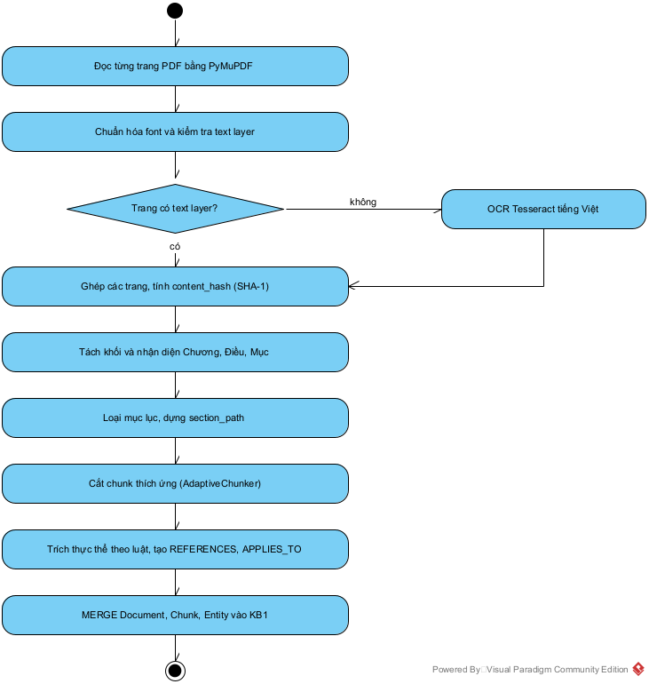

*Hình 4.4. Quy trình chuyển một tệp PDF thành dữ liệu của KB1.*

Lệnh thực hiện:

```text
python scripts/10_build_neo4j_kb.py --init
python scripts/10_build_neo4j_kb.py --pdf data/documents --kb KB1
```

### 4.5.2. Đọc PDF và OCR

Trang có text layer được đọc trực tiếp và chuẩn hóa font cũ. Trang scan được chuyển sang Tesseract tiếng Việt ở 300 DPI.

*Trích `ai-service/app/document_parser.py`, dòng 131–143:*

```python
with pymupdf.open(file_path) as document:
    for page_number, page in enumerate(document, start=1):
        raw_text = page.get_text("text").strip()

        words_data = []
        rects = page.rect
        page_width, page_height = rects.width, rects.height
        ref_width, ref_height = page_width, page_height

        # 1. Nhánh xử lý lớp văn bản (Text Layer)
        if len(raw_text) >= min_text_len:
            text = normalize_vietnamese_text(raw_text)
            source = "native"
```

*Trích `ai-service/app/document_parser.py`, dòng 162–180:*

```python
        # 2. Nhánh dự phòng OCR (PDF Scan)
        else:
            ocr_result = ocr_page(page)
            text = ocr_result["text"]
            words_data = ocr_result["words"]
            source = "ocr"
            ref_width, ref_height = ocr_result.get("pixel_size", (page_width, page_height))

        if not text:
            continue

        pages.append({
            "page": page_number,
            "text": text,
            "source": source,
            "words": _normalize_words(words_data, ref_width, ref_height)
        })

return pages
```

### 4.5.3. Nhận diện cấu trúc và loại mục lục

Hàm `pages_to_nodes` tách khối văn bản, loại vùng mục lục và duy trì đường dẫn phân cấp `section_path`. Khi gặp tiêu đề cấp $k$, mọi mục có cấp từ $k$ trở xuống bị loại khỏi đường dẫn.

*Trích `ai-service/app/knowledge_graph/extract.py`, dòng 138–188:*

```python
def pages_to_nodes(pages: Iterable[Dict[str, Any]]) -> List[Dict[str, Any]]:
    """Build the structure-aware nodes consumed by AdaptiveChunker."""
    pages = list(pages)
    # A document with Chương/Điều keeps numbered clauses as body text.
    use_numbered = not any(
        _is_heading(line.strip())
        for page in pages
        for line in (page.get("text") or "").splitlines()
    )
    nodes: List[Dict[str, Any]] = []
    section: List[tuple] = []  # (level, title), shallowest first
    in_toc = False
    for page in pages:
        for block in _blocks(page.get("text", "")):
            # Phát hiện Mục lục (TOC) và chuỗi chấm dẫn trang để loại bỏ
            is_toc_item = bool(re.search(r"(?:\.{4,}|…{2,}|_{4,}|-{4,})", block))
            has_toc_keyword = bool(re.search(r"(?i)\b(?:mục lục|table of contents|muc luc)\b", block))

            if has_toc_keyword or is_toc_item:
                in_toc = True

            if in_toc:
                # Thoát khỏi vùng TOC nếu gặp Điều 1 hoặc Chương chính thức và không có chuỗi chấm
                if not is_toc_item and re.match(r"(?i)^(chương\s+[i1vxlcdm\d]|phần\s+[i1vxlcdm\d]|điều\s+1[\.\:\-])", block):
                    in_toc = False

            if in_toc or is_toc_item or has_toc_keyword:
                nodes.append(
                    {
                        "text": block,
                        "page": int(page.get("page", 1)),
                        "section_path": [title for _, title in section],
                        "block_type": "TOC",
                        "is_garbage": True,
                    }
                )
                continue

            level = _level_of(page.get("text", ""), use_numbered, block)
            if level is not None:
                section = [item for item in section if item[0] < level] + [(level, block[:160])]
            nodes.append(
                {
                    "text": block,
                    "page": int(page.get("page", 1)),
                    "section_path": [title for _, title in section],
                    "block_type": "TEXT",
                    "is_garbage": False,
                }
            )
    return nodes
```

### 4.5.4. Cắt chunk thích ứng

`AdaptiveChunker` gom các khối cùng mục. Khi đổi mục hoặc đạt 1.200 ký tự, khối được đóng lại. Đoạn quá dài được cắt theo đoạn văn, rồi theo câu, với phần chồng lấn 200 ký tự. Đoạn dưới 50 ký tự bị bỏ. Nhờ vậy một chunk không trộn nội dung của hai Điều.

*Trích `ai-service/app/adaptive_chunker.py`, dòng 30–72:*

```python
def chunk_nodes(self, nodes: List[Dict[str, Any]]) -> List[TextChunk]:
    all_chunks = []
    current_group_text = []
    current_pages = []
    current_section_path = None

    for node in nodes:
        # LỌC RÁC & MỤC LỤC: Không đưa vào RAG
        if node.get("block_type") == "TOC" or node.get("is_garbage"):
            continue

        text = node.get("text", "").strip()
        if not text:
            continue

        section_path = node.get("section_path", [])
        page = node.get("page", 1)

        # NGUYÊN TẮC 1: STRUCTURE-AWARE (Gom theo section_path)
        # Nếu node này thuộc về một mục khác (khác section_path) -> Đóng gói khối hiện tại
        if current_group_text and section_path != current_section_path:
            self._flush_group(current_group_text, current_section_path, current_pages, all_chunks)
            current_group_text = []
            current_pages = []

        current_section_path = section_path
        current_group_text.append(text)
        current_pages.append(page)

        # Kiểm tra kích thước đang gom.
        # Nếu dồn lại đã bắt đầu vượt chunk_size -> Đóng gói khối hiện tại sớm để tránh bị đầy quá
        temp_len = sum(len(t) for t in current_group_text) + (len(current_group_text) - 1) * 2
        if temp_len >= self.chunk_size:
            self._flush_group(current_group_text, current_section_path, current_pages, all_chunks)
            current_group_text = []
            current_pages = []

    # Xử lý đoạn cuối cùng còn sót lại
    if current_group_text:
        self._flush_group(current_group_text, current_section_path, current_pages, all_chunks)

    # Lọc bỏ các chunk quá ngắn không mang lại ngữ nghĩa
    return [c for c in all_chunks if len(c.content.strip()) >= self.min_chunk_size]
```

### 4.5.5. Trích thực thể và quan hệ

Thực thể được trích bằng luật và danh mục bí danh, không dùng LLM. Lựa chọn này cho kết quả lặp lại được và không tốn chi phí gọi mô hình, đổi lại độ phủ phụ thuộc vào danh mục đã khai báo.

*Trích `ai-service/app/knowledge_graph/extract.py`, dòng 191–225:*

```python
def extract_entities(text: str) -> List[Dict[str, str]]:
    """Baseline rule-based NER: articles, roles and explicit dates."""
    found: Dict[str, Dict[str, str]] = {}

    for match in ARTICLE_RE.finditer(text or ""):
        name = f"Điều {match.group(1)}"
        eid = entity_id(name, "dieu_khoan")
        found[eid] = {"entity_id": eid, "name": name, "type": "dieu_khoan"}

    for canonical, (kind, aliases) in ENTITY_ALIASES.items():
        if any(alias.casefold() in (text or "").casefold() for alias in aliases):
            eid = entity_id(canonical, kind)
            found[eid] = {"entity_id": eid, "name": canonical, "type": kind}

    for match in DATE_RE.finditer(text or ""):
        name = f"{match.group(1)}/{match.group(2)}/{match.group(3)}"
        eid = entity_id(name, "moc_thoi_gian")
        found[eid] = {"entity_id": eid, "name": name, "type": "moc_thoi_gian"}

    for match in LAW_RE.finditer(text or ""):
        words = match.group(2).split()
        if not words[0][0].isupper() or words[0].casefold() in LAW_STOPWORDS:
            continue
        if len(words) > 1 and words[1].casefold() in LAW_STOPWORDS:
            words = words[:1]
        name = " ".join([match.group(1), *words])
        eid = entity_id(name, "van_ban")
        found[eid] = {"entity_id": eid, "name": name, "type": "van_ban"}

    for match in DECREE_RE.finditer(text or ""):
        name = f"{match.group(1).capitalize()} {match.group(2)}"
        eid = entity_id(name, "van_ban")
        found[eid] = {"entity_id": eid, "name": name, "type": "van_ban"}

    return sorted(found.values(), key=lambda item: (item["type"], item["name"]))
```

Hàm `link_chunks` tạo hai quan hệ giữa các đoạn. `APPLIES_TO` nối đoạn với chủ đề của mục chứa nó. `REFERENCES` nối đoạn với Điều được viện dẫn trong cùng tài liệu, và bỏ qua trường hợp như “Điều 5 Luật Doanh nghiệp” vì đó là Điều của văn bản khác.

*Trích `ai-service/app/knowledge_graph/extract.py`, dòng 258–295:*

```python
def link_chunks(chunks: List[Dict[str, Any]]) -> None:
    """Add heading topics, APPLIES_TO targets and same-document REFERENCES."""
    articles: Dict[str, List[str]] = {}
    for chunk in chunks:
        number = own_article(chunk["section_path"], chunk["text"])
        chunk["own_article"] = number
        if number:
            articles.setdefault(number, []).append(chunk["chunk_id"])

    for chunk in chunks:
        topic = heading_entity(chunk["section_path"])
        if topic and all(e["entity_id"] != topic["entity_id"] for e in chunk["entities"]):
            chunk["entities"] = [*chunk["entities"], topic]

        heading = " ".join(str(item) for item in chunk["section_path"][-1:])
        applies = {
            entity["entity_id"]
            for entity in extract_entities(heading)
            if entity["type"] not in LOCAL_ENTITY_TYPES
        }
        if topic:
            applies.add(topic["entity_id"])
        chunk["applies_to"] = sorted(applies)

        references: Dict[str, str] = {}
        for match in ARTICLE_RE.finditer(chunk["text"]):
            number = match.group(1)
            if number == chunk["own_article"]:
                continue
            if EXTERNAL_LAW_RE.search(chunk["text"][match.end():match.end() + 40]):
                continue  # "Điều 5 Luật Doanh nghiệp" is not this document's Điều 5
            for target in articles.get(number, [])[:2]:
                if target != chunk["chunk_id"]:
                    references[target] = f"Điều {number}"
        chunk["references"] = [
            {"target": target, "article": article}
            for target, article in sorted(references.items())
        ]
```

### 4.5.6. Dựng bản ghi

Cả PDF và link đều đi qua một hàm dựng bản ghi duy nhất, nên hai nguồn có cùng cấu trúc đầu ra.

*Trích `ai-service/app/knowledge_graph/extract.py`, dòng 298–352:*

```python
def build_record_from_pages(
    title: str,
    source_uri: str,
    source_type: str,
    pages: List[Dict[str, Any]],
    chunker: Optional[AdaptiveChunker] = None,
) -> Dict[str, Any]:
    """Pure builder used by both the PDF and the link ingestion paths."""
    pages = [p for p in pages if (p.get("text") or "").strip()]
    full_text = "\n".join(p.get("text", "") for p in pages)
    content_hash = sha1_text(full_text)
    doc_id = document_id(content_hash, title)

    chunker = chunker or AdaptiveChunker()
    chunks = chunker.chunk_nodes(pages_to_nodes(pages))

    chunk_records: List[Dict[str, Any]] = []
    all_entities: Dict[str, Dict[str, str]] = {}
    for index, chunk in enumerate(chunks, start=1):
        entities = extract_entities(chunk.content)
        for entity in entities:
            all_entities[entity["entity_id"]] = entity
        chunk_records.append(
            {
                "chunk_id": chunk_id(doc_id, index, chunk.content),
                "chunk_index": index,
                "text": chunk.content,
                "page_start": int(chunk.metadata.get("page_start", 1)),
                "page_end": int(chunk.metadata.get("page_end", 1)),
                "section_path": list(chunk.metadata.get("section_path") or []),
                "content_hash": sha1_text(chunk.content),
                "entities": entities,
            }
        )

    link_chunks(chunk_records)
    for chunk in chunk_records:
        for entity in chunk["entities"]:
            all_entities[entity["entity_id"]] = entity

    return {
        "doc": {
            "doc_id": doc_id,
            "title": title,
            "source_uri": source_uri,
            "source_type": source_type,
            "content_hash": content_hash,
            "page_count": len(pages),
            "char_count": len(full_text),
            "is_current": True,
            "version": 1,
        },
        "chunks": chunk_records,
        "entities": list(all_entities.values()),
    }
```

*Trích `ai-service/app/knowledge_graph/extract.py`, dòng 474–485:*

```python
def build_pdf_record(path, title: Optional[str] = None) -> Dict[str, Any]:
    """Read a PDF with the existing hybrid parser (text layer + OCR fallback)."""
    path_obj = Path(path)
    pages = extract_text_from_pdf(str(path_obj))
    if not pages:
        raise ValueError(f"Không trích xuất được nội dung: {path_obj}")
    return build_record_from_pages(
        title=title or path_obj.stem.replace("_", " "),
        source_uri=str(path_obj),
        source_type="pdf",
        pages=pages,
    )
```

### 4.5.7. Ghi vào Neo4j

*Trích `ai-service/app/knowledge_graph/pipeline.py`, dòng 23–45:*

```python
def load_pdf(
    store,
    path,
    kb_id: str = KB1,
    title: Optional[str] = None,
    update: bool = False,
) -> Dict[str, Any]:
    record = build_pdf_record(path, title=title)
    doc = record["doc"]
    current = store.find_current(doc["source_uri"]) if update else None
    action = plan_update(current, doc["content_hash"]) if update else "insert"
    if action == "skip":
        return {"action": "skip", "doc_id": current["doc_id"], "chunks": 0}

    old_id = None
    if action == "new_version":
        old_id = store.supersede(doc["source_uri"])
        doc["version"] = int(current.get("version", 1)) + 1

    result = store.upsert_record(kb_id, f"Kho {kb_id}", record)
    if old_id:
        store.link_version(old_id, doc["doc_id"])
    return {"action": action, "doc_id": doc["doc_id"], "chunks": len(record["chunks"])}
```

*Trích `ai-service/app/knowledge_graph/store.py`, dòng 35–46:*

```python
def upsert_record(self, kb_id: str, kb_name: str, record: Dict[str, Any]) -> Dict[str, Any]:
    rows = self._run(
        schema.UPSERT_DOCUMENT,
        kb_id=kb_id,
        kb_name=kb_name,
        doc=record["doc"],
        chunks=record["chunks"],
    )
    self._run(schema.UPSERT_ENTITIES, chunks=record["chunks"])
    self._run(schema.UPSERT_REFERENCES, chunks=record["chunks"])
    self._run(schema.UPSERT_APPLIES_TO, chunks=record["chunks"])
    return rows[0] if rows else {"doc_id": record["doc"]["doc_id"], "chunks": 0}
```

Câu lệnh Cypher dùng `MERGE` trên khóa nội dung, nên chạy lại không tạo thêm nút:

*Trích `ai-service/app/knowledge_graph/schema.py`, dòng 32–52:*

```python
UPSERT_DOCUMENT = """
MERGE (kb:KnowledgeBase {kb_id: $kb_id})
  ON CREATE SET kb.name = $kb_name, kb.created_at = datetime()
WITH kb
MERGE (d:Document {doc_id: $doc.doc_id})
SET d += $doc
MERGE (kb)-[:HAS_DOCUMENT]->(d)
WITH d
UNWIND $chunks AS c
MERGE (ch:Chunk {chunk_id: c.chunk_id})
SET ch.text = c.text,
    ch.chunk_index = c.chunk_index,
    ch.page_start = c.page_start,
    ch.page_end = c.page_end,
    ch.section_path = c.section_path,
    ch.content_hash = c.content_hash,
    ch.version_id = c.version_id
MERGE (d)-[:HAS_CHUNK]->(ch)
WITH DISTINCT d
RETURN d.doc_id AS doc_id, size($chunks) AS chunks
"""
```

## 4.6. Nạp link vào Neo4j để tạo KB2

### 4.6.1. Quy trình

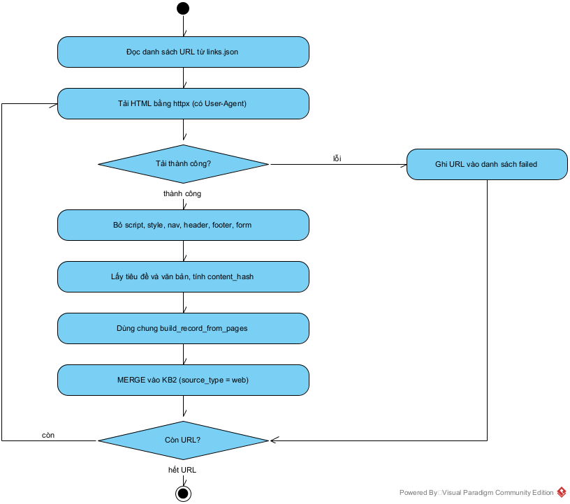

*Hình 4.5. Quy trình chuyển các link công khai thành dữ liệu của KB2.*

Lệnh thực hiện:

```text
python scripts/10_build_neo4j_kb.py --links data/kb_sources/links.json --kb KB2
```

### 4.6.2. Tải trang và lọc nội dung

Một số trang từ chối yêu cầu không có User-Agent nên hàm tải gửi kèm tiêu đề của trình duyệt. Bộ phân tích bỏ qua các thẻ không mang nội dung.

*Trích `ai-service/app/knowledge_graph/extract.py`, dòng 526–547:*

```python
def html_to_text(html: str) -> tuple[str, str]:
    parser = _TextExtractor()
    parser.feed(html)
    title = re.sub(r"\s+", " ", "".join(parser.title_parts)).strip()
    text = re.sub(r"\n{3,}", "\n\n", "".join(parser.parts))
    text = re.sub(r"[ \t]{2,}", " ", text).strip()
    return title, text


def fetch_html(url: str, timeout: int = 30) -> str:
    import httpx

    headers = {
        "User-Agent": (
            "Mozilla/5.0 (Windows NT 10.0; Win64; x64) AppleWebKit/537.36 "
            "(KHTML, like Gecko) Chrome/124.0 Safari/537.36"
        ),
        "Accept-Language": "vi-VN,vi;q=0.9,en;q=0.5",
    }
    response = httpx.get(url, headers=headers, follow_redirects=True, timeout=timeout)
    response.raise_for_status()
    return response.text
```

### 4.6.3. Dựng bản ghi từ trang web

Mỗi trang là một `Document` với `source_type = "web"` và `source_uri` là URL.

*Trích `ai-service/app/knowledge_graph/extract.py`, dòng 550–560:*

```python
def build_link_record(url: str, html: Optional[str] = None, title: Optional[str] = None) -> Dict[str, Any]:
    html = html if html is not None else fetch_html(url)
    page_title, text = html_to_text(html)
    if not text:
        raise ValueError(f"Trang không có nội dung văn bản: {url}")
    return build_record_from_pages(
        title=title or page_title or url.rstrip("/").rsplit("/", 1)[-1],
        source_uri=url,
        source_type="web",
        pages=[{"page": 1, "text": text}],
    )
```

### 4.6.4. Nạp cả danh sách

Lỗi của một URL được ghi lại và không dừng cả lô.

*Trích `ai-service/app/knowledge_graph/pipeline.py`, dòng 48–74:*

```python
def load_links(
    store,
    urls: Iterable[str],
    kb_id: str = KB2,
    update: bool = False,
) -> Dict[str, Any]:
    loaded, failed = [], []
    for url in urls:
        try:
            record = build_link_record(url)
            doc = record["doc"]
            current = store.find_current(doc["source_uri"]) if update else None
            action = plan_update(current, doc["content_hash"]) if update else "insert"
            if action == "skip":
                loaded.append({"url": url, "action": "skip", "doc_id": current["doc_id"]})
                continue
            old_id = None
            if action == "new_version":
                old_id = store.supersede(doc["source_uri"])
                doc["version"] = int(current.get("version", 1)) + 1
            store.upsert_record(kb_id, f"Kho {kb_id}", record)
            if old_id:
                store.link_version(old_id, doc["doc_id"])
            loaded.append({"url": url, "action": action, "doc_id": doc["doc_id"]})
        except Exception as exc:
            failed.append({"url": url, "error": str(exc)})
    return {"loaded": loaded, "failed": failed}
```

## 4.7. Gộp KB1 và KB2 thành KB

Phép gộp không sao chép dữ liệu. Nó tạo nút `KB`, thêm cạnh `MERGED_INTO` từ kho nguồn, và thêm cạnh `HAS_DOCUMENT` từ `KB` đến từng tài liệu. Tài liệu xuất hiện ở cả hai nguồn chỉ có một nút.

Lệnh thực hiện:

```text
python scripts/10_build_neo4j_kb.py --merge KB1 KB2 --target KB
```

*Trích `ai-service/app/knowledge_graph/pipeline.py`, dòng 77–80:*

```python
def merge(store, sources: Sequence[str] = (KB1, KB2), target: str = KB) -> Dict[str, Any]:
    """Link all documents from KB1/KB2 into KB; content IDs dedupe automatically."""
    documents = store.merge_kbs(sources=sources, target=target, target_name="EAKWP Knowledge Base")
    return {"target": target, "sources": list(sources), "documents": documents, "stats": store.stats(target)}
```

*Trích `ai-service/app/knowledge_graph/store.py`, dòng 48–55:*

```python
def merge_kbs(self, sources: Iterable[str], target: str, target_name: str = "KB hợp nhất") -> int:
    rows = self._run(
        schema.MERGE_KBS,
        sources=list(sources),
        target=target,
        target_name=target_name,
    )
    return int(rows[0]["documents"]) if rows else 0
```

*Trích `ai-service/app/knowledge_graph/schema.py`, dòng 91–103:*

```python
MERGE_KBS = """
MERGE (target:KnowledgeBase {kb_id: $target})
  ON CREATE SET target.name = $target_name, target.created_at = datetime()
WITH target
UNWIND $sources AS sid
MATCH (src:KnowledgeBase {kb_id: sid})
MERGE (src)-[:MERGED_INTO]->(target)
WITH DISTINCT target
MATCH (src:KnowledgeBase)-[:HAS_DOCUMENT]->(d:Document)
WHERE src.kb_id IN $sources
MERGE (target)-[:HAS_DOCUMENT]->(d)
RETURN count(DISTINCT d) AS documents
"""
```

Tài liệu tải lên qua giao diện đi thẳng vào `KB`, không qua KB1 hay KB2. Sau khi vector được ghi vào Qdrant, cùng các chunk đó được đồng bộ sang Neo4j với **đúng `chunk_id`**:

*Trích `ai-service/app/knowledge_graph/service.py`, dòng 68–103:*

```python
def sync_ingest_chunks(
    chunks: Iterable[Dict[str, Any]],
    store: Optional[Neo4jStore] = None,
    force: bool = False,
) -> int:
    """Upsert backend chunks into Neo4j using the same chunk_id as Qdrant."""
    chunks = list(chunks)
    if not chunks:
        return 0
    if store is None and not force and not _graph_enabled():
        return 0

    records = build_record_from_ingest_chunks(chunks)
    if not records:
        return 0

    owns_store = store is None
    synced = 0
    try:
        store = store or get_store()
        for record in records:
            try:
                store.upsert_record(KB, "EAKWP Knowledge Base", record)
                synced += len(record["chunks"])
            except Exception as exc:  # one bad document must not drop the batch
                logger.warning(
                    "Graph sync failed for document %s: %s",
                    record["doc"].get("doc_id"),
                    exc,
                )
    except Exception as exc:
        if owns_store:
            _mark_unavailable(exc)
        else:
            logger.warning("Graph sync skipped: %s", exc)
    return synced
```

## 4.8. Dạng KB output một trang

Dưới đây là một đơn vị tri thức thật, lấy ra từ KB ngày 09/11/2026 bằng truy vấn trên chunk `c33` của “Điều lệ công ty - 2021”. Văn bản được giữ nguyên, kể cả lỗi OCR như “Cô đông” thay cho “Cổ đông”, chỉ rút gọn phần giữa bằng dấu “…”.

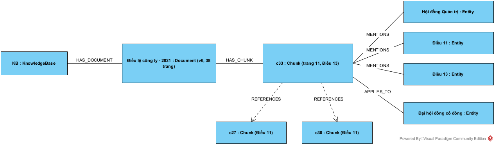

*Hình 4.6. Một chunk và các nút, cạnh liên quan trong KB.*

```json
{
  "knowledge_base": [
    "KB"
  ],
  "document": {
    "doc_id": "84202bc4-4a22-46fa-8e7c-2ba11e857b68",
    "title": "Điều lệ công ty - 2021",
    "source_uri": "upload:84202bc4-4a22-46fa-8e7c-2ba11e857b68",
    "source_type": "upload",
    "document_code": "DLCT-2021",
    "document_type": "Nội quy",
    "version": 6,
    "version_id": "99e27449-ec5e-470f-be69-670784f2f717",
    "is_current": true,
    "page_count": 38,
    "content_hash": "a75f56f0e45a8ab95f4c4da925cbd5cbc3aadddb",
    "allowed_roles": [
      "*"
    ]
  },
  "chunk": {
    "chunk_id": "doc-84202bc4-4a22-46fa-8e7c-2ba11e857b68-v6-c33",
    "chunk_index": 33,
    "page_start": 11,
    "page_end": 11,
    "section_path": [
      "CHƯƠNG VI CỎ ĐÔNG VÀ ĐẠI HỘI ĐÒNG CỎ ĐÔNG",
      "Điều 13. Đại Hội đồng Cổ đông"
    ],
    "text": "ững vân đề theo quy định của Pháp luật và Điều lệ Công ty. Các kiểm toán viên độc lập có thể được mời tham dự cuộc họp Đại Hội đồng Cô đông để tư vấn cho việc thông qua các báo cáo tài chính hàng năm. Hội đồng … ng Quản trị còn lại ít hơn số lượng thành viên tối thiêu theo quy định của Pháp luật, hoặc nhận được yêu cầu triệu tập họp quy định tại điểm c khoản 4 Điều 13 của Điều lệ này. Trường hợp Hội đồng Quản trị không",
    "content_hash": "02443a936434a727c5ca1d5fa1194d9066440519"
  },
  "MENTIONS": [
    {
      "name": "Điều 11",
      "entity_id": "ent-efad7bc24fed051b",
      "type": "dieu_khoan"
    },
    {
      "name": "Hội đồng Quản trị",
      "entity_id": "ent-e53282ff5868350e",
      "type": "chuc_danh"
    },
    {
      "name": "Điều 13",
      "entity_id": "ent-6bf60646ac1f3a23",
      "type": "dieu_khoan"
    }
  ],
  "APPLIES_TO": [
    "Đại hội đồng cổ đông"
  ],
  "REFERENCES": [
    {
      "article": "Điều 11",
      "target": "doc-84202bc4-4a22-46fa-8e7c-2ba11e857b68-v6-c27"
    },
    {
      "article": "Điều 11",
      "target": "doc-84202bc4-4a22-46fa-8e7c-2ba11e857b68-v6-c30"
    }
  ]
}
```

**Bảng 4.7. Giải thích các thành phần của KB output**

| Thành phần | Trường chính | Ý nghĩa | Được dùng để |
| :--- | :--- | :--- | :--- |
| `knowledge_base` | `KB` | Kho chứa tài liệu | Giới hạn phạm vi truy vấn |
| `document` | `doc_id`, `title`, `source_type`, `version`, `version_id`, `is_current`, `allowed_roles` | Thông tin tài liệu và phiên bản | Hiển thị nguồn, lọc theo quyền |
| `document` | `content_hash` | Dấu vân tay nội dung | Quyết định cập nhật |
| `chunk` | `chunk_id` | Khóa của đoạn, trùng với payload Qdrant | Nối vector với đồ thị |
| `chunk` | `text`, `page_start`, `page_end`, `section_path` | Nội dung và vị trí | Làm ngữ cảnh cho LLM, tạo trích dẫn |
| `MENTIONS` | Danh sách thực thể | Các đối tượng đoạn nhắc đến | Tìm đoạn từ thực thể trong câu hỏi |
| `APPLIES_TO` | Chủ đề của mục | Đoạn này quy định về chủ thể nào | Tăng trọng số đoạn đúng chủ đề |
| `REFERENCES` | `target`, `article` | Điều khoản được viện dẫn | Mở rộng sang đoạn liên quan |

Với KB2, một chunk có cùng cấu trúc, chỉ khác `source_type = "web"` và `source_uri` là URL:

```json
{
  "knowledge_base": [
    "KB2",
    "KB"
  ],
  "document": {
    "doc_id": "doc-af12d377163e5384",
    "title": "Đại hội đồng cổ đông - Masan Consumer",
    "source_uri": "https://masanconsumer.com/quan-he-co-dong/dai-hoi-dong-co-dong/",
    "source_type": "web",
    "content_hash": "96c91ca0c465107f7122a5d572c19aed4e1db411",
    "version": 1,
    "is_current": true,
    "char_count": 3004
  },
  "chunk": {
    "chunk_id": "chk-1912a346139758f3",
    "chunk_index": 1,
    "page_start": 1,
    "section_path": [],
    "text": "Nghị quyết và Biên bản họp ĐHĐCĐ thường niên năm 2026 Đại hội đồng cổ đông 2026 2025 2024 2023 2022 2021 2020 2019 2018 2017 2016 2015 2014 2012 2013 2009 2008 Xem thêm Ngày Nội dung 24/04/2026 Nghị quyết và Biên bản h …"
  },
  "MENTIONS": [
    "Đại hội đồng cổ đông",
    "Hội đồng Quản trị",
    "Cổ tức"
  ]
}
```

## 4.9. RAG kết nối với KB như thế nào

### 4.9.1. Điểm nối

RAG dùng hai kho song song: Qdrant tìm theo nghĩa, Neo4j tìm theo quan hệ. Hai kho nói chung một ngôn ngữ nhờ `chunk_id`: cùng một đoạn văn có cùng khóa ở cả hai nơi, nên kết quả từ hai phía hợp nhất được và cùng dẫn về một trích dẫn.

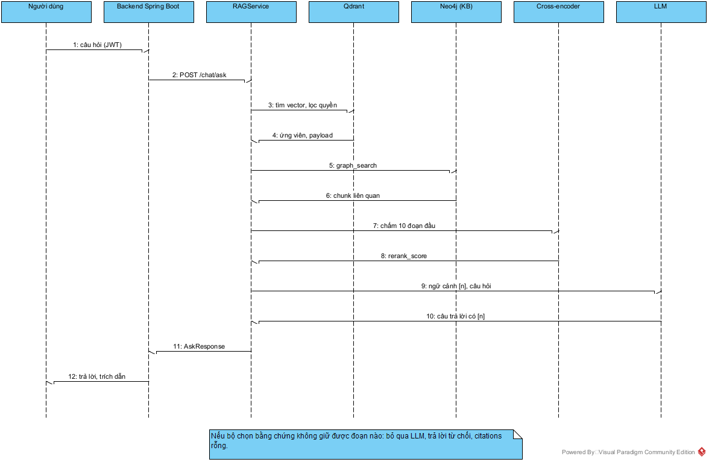

*Hình 4.7. Trình tự xử lý một câu hỏi từ người dùng qua Qdrant, Neo4j, reranker và LLM.*

### 4.9.2. Truy xuất song song và hợp nhất

*Trích `ai-service/app/rag_service.py`, dòng 95–127:*

```python
with timer.step("embed"):
    query_vector = self.retriever.embedding.embed_query(cleaned_query)

if retrieval_mode in ("flat_rag", "hybrid_rag"):
    with timer.step("vector_search"):
        vector_hits = self.retriever.search(
            query=cleaned_query,
            top_k=candidate_k,
            document_id=document_id,
            # Không lọc cosine trước: một đoạn đúng có thể chỉ đạt 0.24
            # nhưng khớp chính xác "cổ tức", trong khi nhiễu đạt 0.8.
            min_score=0.0,
            use_reranker=False,
            query_vector=query_vector,
            allowed_roles=allowed_roles,
        )
if retrieval_mode in ("graph_rag", "hybrid_rag"):
    with timer.step("graph"):
        graph_hits = graph_search(
            cleaned_query,
            limit=max(settings.GRAPH_SEARCH_LIMIT, top_k * 4),
            document_id=document_id,
            source_type="upload",
            query_vector=query_vector,
            seed_chunk_ids=[
                hit["chunk_id"]
                for hit in vector_hits[: settings.GRAPH_EXPAND_SEEDS]
                if hit.get("chunk_id")
            ],
            allowed_roles=allowed_roles,
        )

hits = self._fuse_hits(vector_hits, graph_hits, graph_weight=graph_weight)
```

Điểm vector được cộng thêm tín hiệu từ khóa và số Điều trước khi hợp nhất:

*Trích `ai-service/app/retriever.py`, dòng 160–170:*

```python
# Hybrid rerank: điểm cuối = cosine + trọng số × overlap từ khóa.
# Giữ nguyên vector_score để bộ fallback còn so với ngưỡng tin cậy.
lexical = lexical_score(query, content)
folded_content = fold_text(content)
article_match = any(
    re.search(rf"\bdieu\s+{number}\b", folded_content)
    for number in article_numbers
)
combined = score + LEXICAL_WEIGHT * lexical
if article_match:
    combined += ARTICLE_BOOST
```

Phía đồ thị đi theo hai đường. Đường thứ nhất lấy thực thể trong câu hỏi, gồm thực thể khớp tên và thực thể gần nghĩa theo vector. Đường thứ hai mở rộng 1–2 bước từ các chunk mà vector đã tìm thấy.

*Trích `ai-service/app/knowledge_graph/service.py`, dòng 195–233:*

```python
names = {entity["name"] for entity in extract_entities(question)}
owns_store = store is None
rows: List[Dict[str, Any]] = []
try:
    store = store or get_store()
    lookup = getattr(store, "entity_names", None)
    if lookup is not None:
        folded_question = fold_text(question)
        for name in lookup(KB):
            folded_name = fold_text(name)
            if len(folded_name) < 3:
                continue
            if re.search(
                rf"(?<!\w){re.escape(folded_name)}(?!\w)",
                folded_question,
            ):
                names.add(name)
    similar = getattr(store, "similar_entities", None)
    if similar is not None and query_vector is not None:
        names.update(similar(query_vector, settings.GRAPH_ENTITY_MIN_SCORE))
    if names:
        rows.extend(
            store.graph_candidates(
                names=sorted(names),
                kb_ids=(KB,),
                limit=limit,
                **filters,
            )
        )
    expand = getattr(store, "expand_from_chunks", None)
    if expand is not None and seed_chunk_ids:
        rows.extend(
            expand(
                seed_chunk_ids,
                limit=limit,
                max_entity_df=settings.GRAPH_MAX_ENTITY_DF,
                **filters,
            )
        )
```

Truy vấn Cypher của đường thứ nhất:

*Trích `ai-service/app/knowledge_graph/schema.py`, dòng 146–166:*

```python
GRAPH_CANDIDATES = f"""
MATCH (seed:Entity)
WHERE seed.name IN $names
MATCH (seed)-[:RELATES_TO*0..1]-(e:Entity)<-[:MENTIONS]-(c:Chunk)<-[:HAS_CHUNK]-(d:Document)
MATCH (kb:KnowledgeBase)-[:HAS_DOCUMENT]->(d)
WHERE kb.kb_id IN $kb_ids
  AND (seed = e OR NOT seed.type IN ['dieu_khoan', 'moc_thoi_gian'])
  AND {_ACCESS_FILTER}
WITH c, d,
     count(DISTINCT CASE WHEN seed = e THEN seed END) AS matched,
     count(DISTINCT CASE WHEN seed <> e THEN e END) AS related,
     count {{ (c)-[:APPLIES_TO]->(x:Entity) WHERE x.name IN $names }} AS heading_matches
WITH c, d, matched + heading_matches AS matched, related
WHERE matched > 0 OR related > 0
RETURN {_HIT_COLUMNS},
       matched,
       related,
       'entity' AS via
ORDER BY matched DESC, related ASC, c.chunk_index
LIMIT $limit
"""
```

Hai danh sách được hợp nhất bằng Reciprocal Rank Fusion, với trọng số đồ thị $w = 0{,}2$:

$$\text{RRF}(c) = \sum_{\text{vector}} \frac{1}{60 + r_v(c)} + w \sum_{\text{đồ thị}} \frac{1}{60 + r_g(c)}$$

*Trích `ai-service/app/knowledge_graph/pipeline.py`, dòng 83–121:*

```python
def rrf_fuse(
    vector_hits: List[Dict[str, Any]],
    graph_hits: List[Dict[str, Any]],
    k: int = 60,
    graph_weight: float = 0.2,
) -> List[Dict[str, Any]]:
    """Reciprocal Rank Fusion of dense/lexical hits and graph hits."""
    merged: Dict[str, Dict[str, Any]] = {}
    scores: Dict[str, float] = {}

    def add(hits: List[Dict[str, Any]], weight: float) -> None:
        for rank, hit in enumerate(hits, start=1):
            cid = hit.get("chunk_id")
            if not cid:
                continue
            target = merged.setdefault(
                cid,
                {**hit, "metadata": dict(hit.get("metadata") or {})},
            )
            for key, value in hit.items():
                if value is None:
                    continue
                if key == "metadata" and isinstance(value, dict):
                    metadata = target.setdefault("metadata", {})
                    for meta_key, meta_value in value.items():
                        if metadata.get(meta_key) in (None, "", []):
                            metadata[meta_key] = meta_value
                elif isinstance(value, bool) and key in ("from_graph", "article_match"):
                    target[key] = bool(target.get(key)) or value
                elif target.get(key) in (None, "", []):
                    # Keep the vector score/rank when both sources agree.
                    target[key] = value
            scores[cid] = scores.get(cid, 0.0) + weight / (k + rank)

    add(vector_hits, 1.0)
    add(graph_hits, graph_weight)
    for cid, score in scores.items():
        merged[cid]["rrf_score"] = round(score, 6)
    return sorted(merged.values(), key=lambda item: item["rrf_score"], reverse=True)
```

### 4.9.3. Quyết định trả lời hay từ chối

Bộ chọn bằng chứng chia chunk thành các cửa sổ 1–4 câu, kiểm tra dạng câu trả lời, tính độ phủ từ khóa, rồi chấm lại bằng cross-encoder. Một đoạn chỉ được dùng khi điểm thô đạt ngưỡng $-1{,}5$. Nếu không còn đoạn nào, hệ thống từ chối mà không gọi LLM.

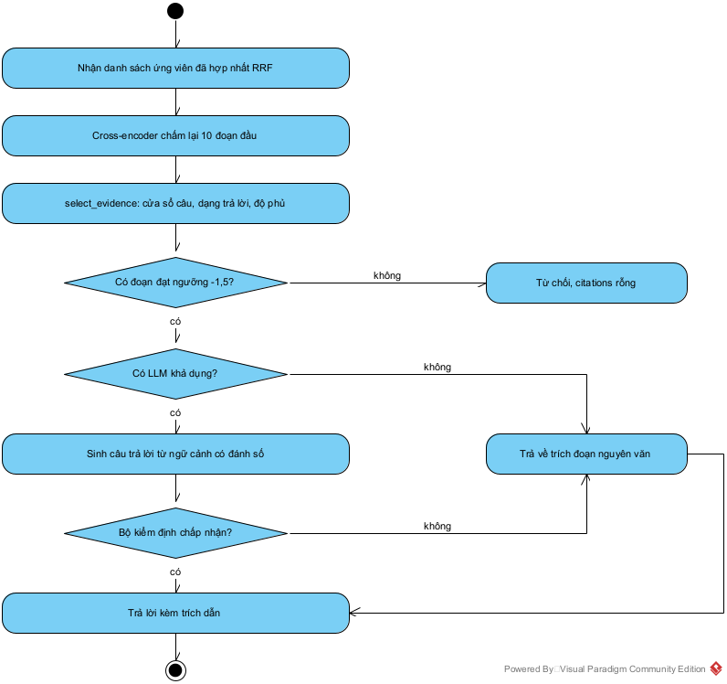

*Hình 4.8. Các cổng kiểm soát trước khi trả lời.*

*Trích `ai-service/app/answer_policy.py`, dòng 526–553:*

```python
gate_active = use_reranker and reranker is not None and reranker.enabled

def passes_gate(candidate: Tuple[Any, ...]) -> bool:
    # Raw cross-encoder score: the bonuses in final_score only rank windows.
    return not gate_active or candidate[5] >= settings.RERANK_GATE

candidates.sort(key=final_score, reverse=True)

if any(marker in folded_query for marker in ("gom nhung", "tieu chi", "cac buoc", "bao gom", "gom")):
    list_candidates = [
        candidate for candidate in candidates
        if candidate[1] == "default"
        and candidate[8]
        and passes_gate(candidate)
    ]
    if list_candidates:
        first = list_candidates[0]
        candidates = [first] + [
            candidate for candidate in candidates if candidate is not first
        ]

if not candidates:
    return []
best = candidates[0]
intent = best[1]
best_score = final_score(best)
if not passes_gate(best):
    return []
```

*Trích `ai-service/app/rag_service.py`, dòng 334–358:*

```python
with timer.step("answer_policy"):
    selected_hits = select_evidence(
        cleaned_query,
        hits,
        top_k=top_k,
        reranker=self.retriever.reranker,
        use_reranker=use_reranker,
    )
trusted = bool(selected_hits)

context_text, citations = (
    self._build_context_and_citations(selected_hits, cleaned_query)
    if trusted
    else ("", [])
)

llm = resolve_llm() if use_llm else None
model_name = llm.model if llm else "extractive-fallback"
verified: Optional[bool] = None

if not trusted:
    answer = REFUSAL_TEXT
    model_name = "guardrail-refusal"
elif llm is None:
    answer = self._generate_extractive_fallback(cleaned_query, citations, selected_hits)
```

### 4.9.4. Ví dụ IN – OUT thật

Các ví dụ sau được gọi trực tiếp vào API đang chạy ngày 09/11/2026. Lúc chạy, Gemini trả lỗi 429 do hết hạn mức gói miễn phí, nên hệ thống tự chuyển sang chế độ trả về trích đoạn nguyên văn. Đó là lý do `model_used` có đuôi `-fallback`. Khi LLM hoạt động, trường `answer` là câu văn do LLM viết lại, các trường còn lại giữ nguyên cấu trúc.

**Ví dụ 1. Câu hỏi có căn cứ trong KB**

IN:

```json
{
  "query": "Hội đồng Quản trị họp ít nhất bao nhiêu lần trong một năm?",
  "top_k": 3
}
```

OUT:

```json
{
  "success": true,
  "query": "Hội đồng Quản trị họp ít nhất bao nhiêu lần trong một năm?",
  "answer": "Theo quy định tại **Điều l6. Cuộc họp của Hội đồng Quản trị (Trang 10 → 11)** [1]:\n\n> Các cuộc họp thường kỳ: Chủ tịch Hội đồng Quản trị triệu tập các cuộc họp Hội đồng Quản trị, lập chương trình nghị sự, quyết định thời gian và địa điểm họp. Chủ tịch Hội đồng Quản trị có thê triệu tập họp bất kỳ khi nào thấy cần thiết, nhưng ít nhất là mỗi quý phải họp một lần.\n\n*(Thông tin được trích xuất trực tiếp từ tài liệu đã lập chỉ mục)*",
  "citations": [
    {
      "index": 1,
      "chunk_id": "doc-1cb5c2d8-7a56-46b0-b65f-4c3650a27fb7-v1-c32",
      "score": 1.636,
      "document_id": "1cb5c2d8-7a56-46b0-b65f-4c3650a27fb7",
      "section_path": [
        "CHƯƠNG IV. CUỘC HỌP CỦA HỘI ĐỎNG QUẢN TRỊ",
        "Điều l6. Cuộc họp của Hội đồng Quản trị"
      ],
      "pages": "Trang 10 → 11",
      "snippet": "Các cuộc họp thường kỳ: Chủ tịch Hội đồng Quản trị triệu tập các cuộc họp Hội đồng Quản trị, lập chương trình nghị sự, quyết định thời gian và địa điểm họp. Chủ tịch Hội đồng Quản trị có thê triệu tập họp bất kỳ khi nào thấy cần thiết, nhưng ít nhất là mỗi quý phải họp một lần."
    }
  ],
  "execution_time_ms": 7212.17,
  "model_used": "gemini-3.5-flash-fallback",
  "graph_candidates": 12,
  "verified": null,
  "timings_ms": {
    "embed": 31.32,
    "vector_search": 120.79,
    "graph": 48.22,
    "rerank": 708.44,
    "answer_policy": 2245.14,
    "llm_generate": 4049.78
  }
}
```

Trường `graph_candidates` cho biết đồ thị đã đóng góp 12 ứng viên vào danh sách trước khi xếp hạng lại.

**Ví dụ 2. Vết truy xuất đồ thị.** Với câu hỏi “Chủ tịch Hội đồng Quản trị có quyền và nghĩa vụ gì?”, bước trích thực thể cho hai tên: “Chủ tịch Hội đồng Quản trị” và “Hội đồng Quản trị”. Truy vấn Cypher trả về các chunk sau:

| Chunk | Tài liệu | Trang | Mục | matched | related |
| :--- | :--- | :--- | :--- | ---: | ---: |
| `…7-v1-c14` | Quy chế hoạt động Hội đồng Quản trị | 5–6 | Điều 8. Chủ tịch, Phó Chủ tịch Hội đồng Quản trị | 4 | 3 |
| `…7-v1-c15` | Quy chế hoạt động Hội đồng Quản trị | 5–6 | Điều 8. Chủ tịch, Phó Chủ tịch Hội đồng Quản trị | 4 | 3 |
| `…8-v6-c56` | Điều lệ công ty - 2021 | 25–25 | Điều 28. Chủ tịch, Phó Chủ tịch Hội đồng Quản trị | 4 | 3 |
| `…7-v1-c13` | Quy chế hoạt động Hội đồng Quản trị | 5–6 | Điều 8. Chủ tịch, Phó Chủ tịch Hội đồng Quản trị | 4 | 4 |

**Ví dụ 3. Câu hỏi ngoài phạm vi**

IN:

```json
{
  "query": "Giá cổ phiếu hôm nay là bao nhiêu?",
  "top_k": 3
}
```

OUT:

```json
{
  "success": true,
  "query": "Giá cổ phiếu hôm nay là bao nhiêu?",
  "answer": "Dựa trên các tài liệu nội bộ hiện tại, tôi chưa tìm thấy thông tin phù hợp với câu hỏi này.",
  "citations": [],
  "execution_time_ms": 1581.36,
  "model_used": "guardrail-refusal",
  "graph_candidates": 21,
  "verified": null,
  "timings_ms": {
    "embed": 83.36,
    "vector_search": 117.15,
    "graph": 54.67,
    "rerank": 1021.49,
    "answer_policy": 296.3
  }
}
```

Đồ thị và vector vẫn trả về ứng viên, nhưng không đoạn nào qua được cổng kiểm soát nên `citations` rỗng và LLM không được gọi.

### 4.9.5. Phạm vi hiện tại của kết nối

Cần nêu rõ một giới hạn. Trong `retrieve_hits`, truy vấn đồ thị đang lọc `source_type="upload"`, và Qdrant chỉ chứa 321 vector của 7 tài liệu tải lên. Do đó chatbot hiện đọc 7 tài liệu này, chưa đọc 1.344 chunk của KB1 và KB2.

Bộ lọc này giúp mọi trích dẫn đều mở được PDF gốc qua phân hệ quản lý tài liệu. Muốn mở rộng cho KB1 và KB2 cần ba bước: nhúng 1.344 chunk đó vào Qdrant với cùng `chunk_id`, bỏ bộ lọc `source_type="upload"`, rồi chạy lại bộ đánh giá ở mục 4.11 vì kho lớn hơn sẽ làm thay đổi kết quả. Với nguồn web, trích dẫn cần mở URL thay vì trang PDF.

## 4.10. Cập nhật cơ sở tri thức

### 4.10.1. Ý tưởng

**Bảng 4.8. Ba chiến lược cập nhật**

| Chiến lược | Cách làm | Ưu điểm | Hạn chế | Phù hợp khi |
| :--- | :--- | :--- | :--- | :--- |
| Dựng lại toàn bộ | Xóa kho, nạp lại từ đầu | Đơn giản, trạng thái sạch | Mất nhiều thời gian, gián đoạn | Kho nhỏ, cập nhật theo đợt |
| So sánh hash nội dung | Hash giống thì bỏ qua, khác thì tạo phiên bản mới | Nhanh, giữ lịch sử | Phải lưu hash và phiên bản | Cập nhật định kỳ |
| Theo sự kiện | Mỗi lần tải lên phát sự kiện, worker đồng bộ | Gần thời gian thực | Cần hàng đợi và giám sát | Nhiều nguồn, cập nhật liên tục |

Đồ án dùng chiến lược thứ hai cho nguồn offline và đồng bộ ngay khi nạp cho tài liệu tải lên. Hash được tính trên **văn bản đã trích**, không phải trên byte của tệp, nên tệp được lưu lại mà nội dung không đổi sẽ không tạo phiên bản mới.

### 4.10.2. Thực hiện

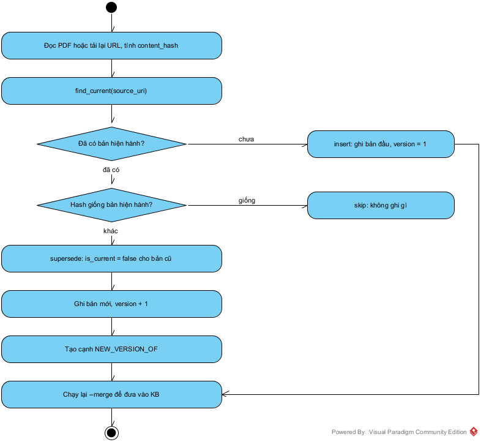

*Hình 4.9. Quy trình cập nhật một tài liệu trong KB.*

Lệnh cập nhật chỉ thêm cờ `--update`:

```text
python scripts/10_build_neo4j_kb.py --pdf data/documents --kb KB1 --update
python scripts/10_build_neo4j_kb.py --links data/kb_sources/links.json --kb KB2 --update
python scripts/10_build_neo4j_kb.py --merge KB1 KB2 --target KB
```

*Trích `ai-service/app/knowledge_graph/pipeline.py`, dòng 14–20:*

```python
def plan_update(current: Optional[Dict[str, Any]], content_hash: str) -> str:
    """Decide insert / skip / new_version from the current document hash."""
    if not current:
        return "insert"
    if current.get("content_hash") == content_hash:
        return "skip"
    return "new_version"
```

Bản cũ không bị xóa. Nó được đánh dấu hết hiệu lực và nối với bản mới:

*Trích `ai-service/app/knowledge_graph/schema.py`, dòng 105–124:*

```python
SUPERSEDE_DOCUMENT = """
MATCH (d:Document {source_uri: $source_uri, is_current: true})
SET d.is_current = false, d.superseded_at = datetime()
RETURN d.doc_id AS old_doc_id
ORDER BY d.version DESC
LIMIT 1
"""

LINK_VERSION = """
MATCH (old:Document {doc_id: $old_doc_id})
MATCH (new:Document {doc_id: $new_doc_id})
MERGE (new)-[:NEW_VERSION_OF]->(old)
"""

FIND_CURRENT = """
MATCH (d:Document {source_uri: $source_uri, is_current: true})
RETURN d { .doc_id, .content_hash, .version } AS doc
ORDER BY d.version DESC
LIMIT 1
"""
```

Với tài liệu tải lên, phía backend tạo phiên bản mới và gọi lại API nạp. Khi một phiên bản hoặc tài liệu bị xóa, `delete_graph_document` xóa đúng các chunk liên quan rồi dọn các thực thể không còn đoạn nào nhắc đến.

### 4.10.3. Kiểm chứng

Trên KB thật, chạy so sánh với `Quy_che_hoat_dong_HDQT.pdf` mà không ghi dữ liệu cho kết quả: hash mới `6a83376d2079…` trùng với `content_hash` đang lưu của `doc-7f1b79827f293a3f`, nên `plan_update` trả về `skip`.

Luồng phiên bản mới được kiểm chứng trên một Neo4j 5.26 tạm, tách biệt với dữ liệu thật, bằng hai phiên bản của một văn bản mẫu chỉ khác số ngày nghỉ (12 và 14):

| Bước | Kết quả `action` | `doc_id` | Số chunk ghi |
| :--- | :--- | :--- | ---: |
| Nạp lần 1 (V1) | `insert` (Ghi mới) | `doc-b1d922121f90d823` | 1 |
| Nạp lại, nội dung không đổi | `skip` (Bỏ qua, không ghi) | `doc-b1d922121f90d823` | 0 |
| Nạp bản đã sửa (V2) | `new_version` (Tạo phiên bản mới) | `doc-4a46ef372e4177b1` | 1 |

Kết quả trên Neo4j: bản `doc-b1d922121f90d823` có `version = 1`, `is_current = false`; bản `doc-4a46ef372e4177b1` có `version = 2`, `is_current = true` và có cạnh `NEW_VERSION_OF` trỏ về bản cũ.

Phép thử này cũng phát hiện một hạn chế. Sau khi cập nhật, truy vấn `Điều 12` trả về **cả hai** đoạn, “nghỉ 12 ngày” của bản cũ và “nghỉ 14 ngày” của bản mới, vì `GRAPH_CANDIDATES` chưa lọc `is_current`. Với tài liệu tải lên, số chunk trên Neo4j hiện khớp số vector trên Qdrant (321), tức đồ thị chỉ giữ dữ liệu đang được dùng. Với nguồn offline, cần thêm điều kiện `d.is_current = true` trước khi đưa KB1, KB2 vào phục vụ hỏi đáp.

## 4.11. Đánh giá

### 4.11.1. Thiết kế đánh giá

Bộ đánh giá `ai-service/data/eval/eval_questions.json` gồm 26 câu trên kho 7 tài liệu, 321 chunk: 18 câu có chunk đúng gán nhãn thủ công và 8 câu phải từ chối. Lệnh chạy lại:

```text
docker compose exec ai-service python scripts/15_run_eval.py --with-llm
```

### 4.11.2. Kết quả

**Bảng 4.9. Kết quả theo cấu hình truy xuất**

| Cấu hình | MRR | R@1 | R@3 | Trích đúng | Đủ sự kiện | Từ chối đúng | Từ chối oan | Đạt |
| :--- | ---: | ---: | ---: | ---: | ---: | ---: | ---: | ---: |
| Vector | 0,676 | 61% | 78% | 78% | 83% | 63% | 6% | 73% |
| Đồ thị | 0,556 | 50% | 61% | 67% | 67% | 75% | 28% | 69% |
| **Kết hợp, cấu hình mặc định** | **0,713** | **67%** | **78%** | **78%** | **83%** | **63%** | **6%** | **73%** |
| Kết hợp, thêm luật theo chủ đề | 0,713 | 67% | 78% | 72% | 81% | 75% | 11% | 73% |
| Kết hợp, có luật, không cross-encoder | 0,530 | 39% | 61% | 72% | 64% | 38% | 6% | 54% |
| Kết hợp + LLM cục bộ `qwen2.5:3b` | 0,713 | 67% | 78% | 67% | 67% | 100% | 33% | 77% |

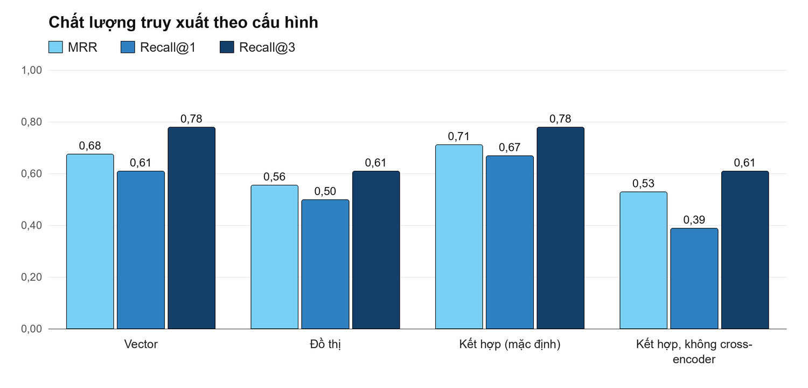

*Hình 4.10. MRR, Recall@1 và Recall@3 của các cấu hình truy xuất.*

Ba nhận xét rút ra từ bảng:

1. Kết hợp vector và đồ thị cho MRR cao nhất (0,713), nhưng phần tăng so với vector thuần (0,676) chỉ tương ứng một câu ở Recall@1 trên 18 câu, chưa đủ để khẳng định có ý nghĩa thống kê.
2. Đóng góp lớn nhất đến từ cross-encoder: bỏ thành phần này làm MRR giảm từ 0,713 xuống 0,530.
3. Đồ thị dùng riêng kém hơn vector (MRR 0,556), phù hợp với việc quan hệ được trích bằng luật. Vai trò hiện tại của đồ thị là kênh bổ sung.

Độ trễ trung bình trên CPU khoảng 4 giây khi không có LLM và 11 giây với LLM cục bộ, đo khi máy đang bận nên chỉ có giá trị tham khảo.

### 4.11.3. Kiểm thử tự động

Toàn bộ kiểm thử của AI Service được chạy lại ngày 09/11/2026 trong container: **105 test đạt**, gồm định danh theo nội dung, trích thực thể, dựng bản ghi, phân tích HTML, kế hoạch cập nhật, RRF, đồng bộ đồ thị và các quy tắc trả lời.

### 4.11.4. Hạn chế

| Hạn chế | Biểu hiện thực tế | Hướng xử lý |
| :--- | :--- | :--- |
| Mẫu đánh giá nhỏ | 18 câu có nhãn; mỗi câu tương ứng khoảng 5,6 điểm phần trăm | Mở rộng bộ câu hỏi và lập bộ độc lập |
| Điều chỉnh trên chính bộ đánh giá | Một số quyết định được đưa ra sau khi xem kết quả trên bộ này | Dùng bộ kiểm tra chưa từng xem |
| Lỗi OCR | “Cô đông” thay cho “Cổ đông”, “Điều l6” thay cho “Điều 16” | Hậu xử lý OCR tiếng Việt |
| Mục lục lọt vào `section_path` | Một số chunk của Nội quy lao động có đường dẫn chứa dòng mục lục nhiễu | Bổ sung nhận diện mục lục khi OCR làm hỏng dấu chấm dẫn |
| Trích đoạn dừng ở câu dẫn | Câu hỏi “có quyền và nghĩa vụ gì” chỉ trả về câu “...có quyền và nghĩa vụ sau đây:” khi không có LLM | Mở rộng cửa sổ cho danh sách liệt kê |
| Kết nối mới phủ tài liệu upload | RAG chưa đọc KB1, KB2 | Theo mục 4.9.5 |
| Truy vấn đồ thị chưa lọc phiên bản | Bản cũ vẫn được trả về | Theo mục 4.10.3 |
| Trích quan hệ bằng luật | Chưa có quan hệ ngữ nghĩa sâu | Thử LLM hoặc mô hình NER có kiểm định |

## 4.12. Kết luận chương

Chương này đã xây dựng cơ sở tri thức thật trên Neo4j với 52 tài liệu, 1.665 chunk và 314 thực thể, từ 35 tệp PDF, 10 link công khai và 7 tài liệu tải lên. Code nạp PDF, nạp link, gộp kho và cập nhật theo hash đều đã được trình bày và chạy thực tế. Dạng KB output và các ví dụ IN – OUT được lấy từ hệ thống đang chạy.

Kết quả cho thấy cấu hình kết hợp vector, đồ thị và cross-encoder đạt MRR 0,713 trên kho 321 chunk; ở chế độ không LLM, hệ thống từ chối đúng 5 trong 8 câu ngoài phạm vi, nên cổng kiểm soát còn cần cải thiện. Hai việc cần làm tiếp theo về kết nối là mở rộng phạm vi RAG sang toàn bộ KB và thêm điều kiện lọc phiên bản hiện hành trong truy vấn đồ thị.

