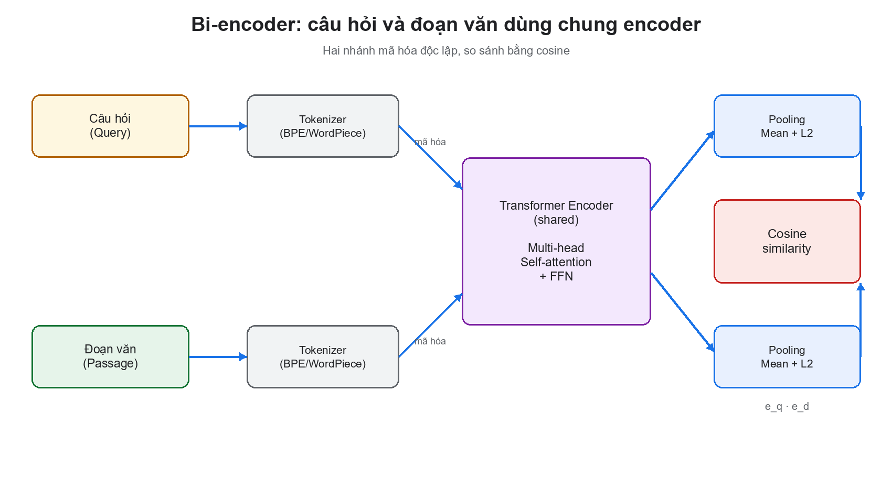
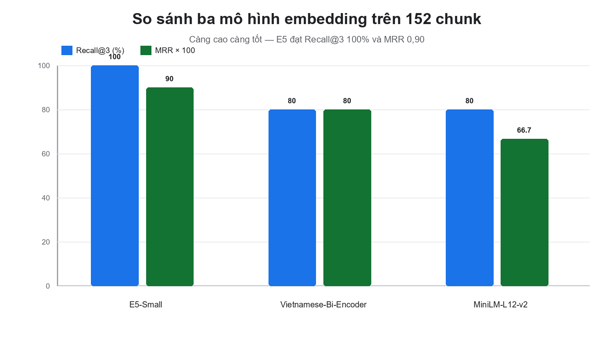

# CHƯƠNG 2. HỌC SÂU TRONG BIỂU DIỄN NGỮ NGHĨA: TỪ KIẾN TRÚC TRANSFORMER ĐẾN LỰA CHỌN MÔ HÌNH NHÚNG TIẾNG VIỆT

> **Mục tiêu của chương.** Chương này trình bày cơ sở học sâu (Deep Learning) đằng sau thành phần cốt lõi nhất của hệ thống: mô hình biểu diễn ngữ nghĩa (embedding) và mô hình chấm lại (reranker). Nội dung không dừng ở việc liệt kê khái niệm mà đi từ bài toán học biểu diễn, kiến trúc Transformer, hàm mất mát tương phản, đến thiết kế thực nghiệm có kiểm soát và kết quả lựa chọn mô hình nhúng cho tiếng Việt. Kết quả của chương là căn cứ khoa học để chốt cấu hình `intfloat/multilingual-e5-small` (384 chiều, cosine) cho toàn bộ pipeline tri xuất của hệ thống EAKWP.

---

## 2.1. Đặt vấn đề: vì sao một hệ thống RAG cần chương về học sâu

Trong các hệ thống hỏi đáp tri thức doanh nghiệp, chất lượng câu trả lời không phụ thuộc trực tiếp vào mô hình ngôn ngữ lớn (LLM) mà phụ thuộc trước hết vào **chất lượng biểu diễn và truy xuất**. Một LLM mạnh nhưng nhận sai ngữ cảnh sẽ trả lời sai một cách thuyết phục; ngược lại, một LLM nhỏ nhưng nhận đúng đoạn điều khoản, đúng trang, đúng khoản mục vẫn có thể trả lời chính xác và có căn cứ. Vì vậy, bài toán trung tâm của hệ thống là:

> Cho một câu hỏi $q$ bằng ngôn ngữ tự nhiên, tìm trong kho tài liệu $D$ một tập đoạn $C_k = \{c_1, ..., c_k\}$ sao cho nội dung của chúng chứa câu trả lời, rồi chuyển tập đoạn này thành ngữ cảnh có thể kiểm chứng cho LLM.

Có ba cách tiếp cận truyền thống:

1. **Tìm kiếm từ khóa (lexical search):** dùng BM25, TF-IDF hoặc `LIKE` trên cơ sở dữ liệu. Cách này nhanh nhưng thất bại khi người dùng diễn đạt khác từ trong văn bản (ví dụ hỏi “được nghỉ bao nhiêu ngày” trong khi tài liệu viết “số ngày nghỉ phép năm”).
2. **Tìm kiếm ngữ nghĩa bằng đặc trưng thủ công:** gán nhãn thực thể, từ đồng nghĩa, rule. Cách này phụ thuộc rất lớn vào công sức con người và không mở rộng được với hàng chục nghìn trang văn bản pháp lý.
3. **Học biểu diễn (representation learning):** dùng mạng nơ-ron để ánh xạ câu hỏi và đoạn văn vào cùng một không gian vector, nơi khoảng cách cosine phản ánh mức độ tương đồng ngữ nghĩa. Đây là nền tảng của **embedding** và là lý do hệ thống cần một chương về học sâu.

Điểm mấu chốt là học sâu không chỉ là “dùng mô hình lớn”. Học sâu cung cấp một cách biểu diễn có thể học được: thay vì con người định nghĩa đặc trưng, mô hình tự học các đặc trưng phân cấp từ dữ liệu. Với văn bản tiếng Việt, các đặc trưng này bao gồm cả cấu trúc từ, ngữ nghĩa câu, và quan hệ giữa câu hỏi với đoạn trả lời. Chương này làm rõ ba câu hỏi:

- **Học sâu biểu diễn văn bản như thế nào?** Từ token, embedding, self-attention đến vector câu.
- **Làm sao huấn luyện một mô hình biết “câu hỏi nào gần đoạn trả lời nào”?** Học tương phản (contrastive learning) và hàm mất mát InfoNCE.
- **Làm sao chọn mô hình phù hợp với tiếng Việt và giới hạn CPU của hệ thống?** Thiết kế thực nghiệm so sánh ba mô hình, đo Recall@k, MRR, độ trễ và thông lượng.

---

## 2.2. Biểu diễn dữ liệu và bài toán học sâu

### 2.2.1. Từ đặc trưng thủ công đến học biểu diễn

Trong học máy truyền thống, một văn bản được biểu diễn bằng vector thưa (sparse vector) như túi từ (bag-of-words) hoặc TF-IDF. Mỗi chiều tương ứng một từ trong từ điển; giá trị là tần suất hoặc trọng số nghịch đảo tần suất. Cách biểu diễn này có hai hạn chế cố hữu:

- **Không hiểu ngữ nghĩa:** “xe hơi” và “ô tô” là hai vector trực giao dù cùng nghĩa.
- **Không hiểu ngữ cảnh:** “điều 5” trong “Điều 5 quy định...” và “điều 5” trong “điều 5 khoản 2” có thể giống nhau về mặt từ vựng nhưng khác nhau về vai trò cấu trúc.

Học sâu thay thế bằng **biểu diễn phân tán (distributed representation)**: mỗi từ hoặc câu là một vector đặc (dense vector) trong không gian $\mathbb{R}^m$, trong đó các chiều không còn tương ứng với từ cụ thể mà mã hóa các thuộc tính ngữ nghĩa trừu tượng. Một mô hình tốt sẽ đặt các câu có nghĩa gần nhau vào gần nhau, bất kể chúng dùng từ ngữ bề mặt nào.

Về mặt hình thức, một mô hình học sâu là một hàm có tham số:

> **Công thức 2.1.** $f_\theta : \mathcal{X} \rightarrow \mathcal{Y}$, trong đó $\mathcal{X}$ là không gian đầu vào (văn bản, token), $\mathcal{Y}$ là không gian đầu ra (nhãn, vector, phân phối), và $\theta$ là tập tham số học được.

Với bài toán biểu diễn, $\mathcal{Y} = \mathbb{R}^m$ và $f_\theta$ là một encoder. Với bài toán sinh văn bản, $\mathcal{Y}$ là phân phối xác suất trên từ vựng. Với bài toán chấm lại, $\mathcal{Y}$ là một số thực biểu thị mức độ liên quan.

### 2.2.2. Hàm giả thuyết, hàm mất mát và tối ưu

Một mạng nơ-ron nhiều tầng được xây dựng từ các phép biến đổi tuyến tính và phi tuyến:

> **Công thức 2.2.** $h^{(l)} = \sigma\left(W^{(l)} h^{(l-1)} + b^{(l)}\right)$

Trong đó $W^{(l)}$ là ma trận trọng số, $b^{(l)}$ là bias, và $\sigma$ là hàm kích hoạt phi tuyến (ReLU, GELU, tanh). Nếu chỉ có các phép tuyến tính, nhiều tầng sẽ tương đương một tầng; chính hàm phi tuyến cho phép mạng xấp xỉ các hàm phức tạp.

Quá trình huấn luyện giải bài toán tối ưu:

> **Công thức 2.3.** $\theta^* = \arg\min_\theta \frac{1}{N}\sum_{i=1}^{N} \mathcal{L}\left(f_\theta(x_i), y_i\right) + \lambda \|\theta\|_2^2$

Trong đó $\mathcal{L}$ là hàm mất mát, $N$ là số mẫu, và số hạng $\lambda \|\theta\|_2^2$ là chuẩn hóa L2 để giảm quá khớp. Với bài toán phân loại, $\mathcal{L}$ thường là cross-entropy:

> **Công thức 2.4.** $\mathcal{L}_{CE} = -\sum_{c=1}^{C} y_c \log \hat{y}_c$

Với bài toán biểu diễn, hàm mất mát không còn là phân loại nhãn mà là **so sánh cặp** (pairwise) hoặc **tương phản** (contrastive), sẽ trình bày ở mục 2.4.

Việc tối ưu được thực hiện bằng lan truyền ngược (backpropagation) và các bộ tối ưu hiện đại như Adam:

> **Công thức 2.5.** $m_t = \beta_1 m_{t-1} + (1-\beta_1) g_t$; $v_t = \beta_2 v_{t-1} + (1-\beta_2) g_t^2$; $\theta_t = \theta_{t-1} - \eta \frac{\hat{m}_t}{\sqrt{\hat{v}_t} + \epsilon}$

Trong đó $g_t$ là gradient tại bước $t$, $\eta$ là learning rate, $\beta_1, \beta_2$ là hệ số suy giảm mô-men. Adam thích nghi learning rate cho từng tham số, giúp huấn luyện ổn định hơn so với gradient descent thuần.

### 2.2.3. Các thành phần chống quá khớp

Một mô hình học sâu có thể ghi nhớ dữ liệu huấn luyện thay vì học quy luật. Các kỹ thuật thường dùng:

- **Dropout:** tắt ngẫu nhiên một tỷ lệ neuron trong lúc huấn luyện, buộc mạng không phụ thuộc vào một đường đi duy nhất.
- **Weight decay:** phạt trọng số lớn, giữ mô hình đơn giản.
- **Early stopping:** dừng khi loss trên tập validation bắt đầu tăng.
- **Data augmentation:** thêm nhiễu, thay đổi cách diễn đạt, hoặc sinh cặp câu hỏi–đoạn trả lời tổng hợp.
- **Batch normalization / Layer normalization:** chuẩn hóa phân phối kích hoạt, giúp huấn luyện sâu ổn định.

Trong bài toán embedding, một dạng “chống quá khớp” quan trọng hơn là **chuẩn hóa vector** và **negative sampling chất lượng**: nếu mô hình chỉ thấy các cặp dễ, nó sẽ học ranh giới kém. Nội dung này được phân tích ở mục 2.4.

---

## 2.3. Kiến trúc Transformer

### 2.3.1. Vì sao Transformer thay thế RNN

Trước Transformer, các mô hình tuần tự như RNN/LSTM xử lý văn bản theo từng bước, thông tin phải “chảy” qua trạng thái ẩn qua nhiều bước. Điều này gây ra hai vấn đề:

- **Khó song song hóa:** mỗi bước phụ thuộc bước trước, không tận dụng được GPU/CPU nhiều lõi.
- **Quên xa (long-range dependency):** thông tin ở đầu câu khó đến được cuối câu nếu câu dài.

Transformer (Vaswani và cộng sự, 2017) giải quyết bằng cơ chế **self-attention**: mỗi token có thể “nhìn” trực tiếp mọi token khác trong câu, với trọng số học được. Khoảng cách giữa các token không còn là số bước tuần tự mà là một phép tính song song.

### 2.3.2. Tokenization và embedding đầu vào

Văn bản được chia thành các đơn vị nhỏ (token) bằng thuật toán như BPE (Byte-Pair Encoding) hoặc WordPiece. Mỗi token được ánh xạ thành một vector $x_i \in \mathbb{R}^d$ thông qua bảng embedding. Vì self-attention không có khái niệm thứ tự, người ta cộng thêm **positional encoding**:

> **Công thức 2.6.** $PE_{(pos, 2i)} = \sin\left(\frac{pos}{10000^{2i/d}}\right)$; $PE_{(pos, 2i+1)} = \cos\left(\frac{pos}{10000^{2i/d}}\right)$

Vector đầu vào của token thứ $i$ là:

> **Công thức 2.7.** $h_i^{(0)} = E[t_i] + PE_i$

Trong đó $E$ là bảng embedding học được. Với tiếng Việt, tokenization có thể tách theo âm tiết hoặc theo từ ghép tùy mô hình; điều này ảnh hưởng đến độ dài chuỗi và chất lượng biểu diễn.

### 2.3.3. Self-attention

Với mỗi token, mô hình tạo ba vector truy vấn (Query), khóa (Key), giá trị (Value) bằng các phép chiếu tuyến tính:

> **Công thức 2.8.** $Q = XW_Q$, $K = XW_K$, $V = XW_V$

Trong đó $X \in \mathbb{R}^{n \times d}$ là ma trận biểu diễn của $n$ token. Điểm chú ý giữa token $i$ và token $j$ là tích vô hướng giữa $Q_i$ và $K_j$, chia cho $\sqrt{d_k}$ để ổn định đạo hàm:

> **Công thức 2.9.** $\text{Attention}(Q, K, V) = \text{softmax}\left(\frac{QK^T}{\sqrt{d_k}}\right)V$

Hàm softmax biến điểm số thành phân phối chú ý có tổng bằng 1. Kết quả là mỗi token nhận một vector mới là tổng có trọng số của các value, trong đó trọng số thể hiện mức độ liên quan.

### 2.3.4. Multi-head attention

Một đầu chú ý chỉ học được một loại quan hệ. Multi-head attention chạy $h$ phép chú ý song song với các phép chiếu khác nhau, rồi nối kết quả:

> **Công thức 2.10.** $\text{MultiHead}(Q,K,V) = \text{Concat}(\text{head}_1, ..., \text{head}_h)W_O$

Mỗi head có thể chuyên trách một khía cạnh: quan hệ ngữ pháp, đồng tham chiếu, vị trí, hoặc ranh giới điều khoản. Với văn bản pháp lý, điều này đặc biệt hữu ích vì một câu có thể vừa tham chiếu “Điều 5”, vừa nêu ngoại lệ “trừ trường hợp...”, vừa liên kết đến “khoản 2”.

### 2.3.5. Residual, LayerNorm và Feed-Forward

Mỗi khối Transformer gồm hai thành phần chính:

1. **Multi-head self-attention** + kết nối tắt (residual) + LayerNorm.
2. **Feed-forward network** (hai lớp tuyến tính + GELU) + residual + LayerNorm.

> **Công thức 2.11.** $h' = \text{LayerNorm}\left(h + \text{MultiHead}(h)\right)$
>
> **Công thức 2.12.** $h'' = \text{LayerNorm}\left(h' + \text{FFN}(h')\right)$

Kết nối tắt giúp gradient lan truyền qua nhiều tầng mà không bị triệt tiêu; LayerNorm giữ phân phối kích hoạt ổn định. FFN mở rộng chiều ẩn (thường gấp 4 lần) để tăng khả năng biểu diễn phi tuyến.

### 2.3.6. Ba biến thể kiến trúc

| Biến thể | Đại diện | Cơ chế chú ý | Phù hợp với |
| :--- | :--- | :--- | :--- |
| Encoder-only | BERT, RoBERTa, E5 | Hai chiều (bidirectional) | Biểu diễn câu, phân loại, embedding |
| Decoder-only | GPT, Llama, Gemini | Nhân quả (causal) | Sinh văn bản, hội thoại |
| Encoder–decoder | T5, BART | Encoder hai chiều + decoder nhân quả | Dịch, tóm tắt, sinh có điều kiện |

Hệ thống EAKWP dùng **encoder-only** cho embedding và reranker, **decoder-only** (qua API) cho sinh câu trả lời. Lý do: encoder-only tạo biểu diễn hai chiều tốt cho toàn bộ đoạn văn, trong khi decoder-only tối ưu cho việc dự đoán token tiếp theo.

### 2.3.7. Độ phức tạp và giới hạn

Self-attention có độ phức tạp $O(n^2 d)$ theo số token $n$, vì phải tính ma trận $QK^T$ kích thước $n \times n$. Với đoạn văn dài (hàng nghìn token), chi phí bộ nhớ tăng bình phương. Các giải pháp như sliding window, sparse attention, hoặc chia nhỏ đoạn được dùng trong thực tế. Trong hệ thống này, chunking giữ mỗi đoạn khoảng 1.200 ký tự (~300 token), nằm trong giới hạn tối ưu của các mô hình encoder nhỏ.

---

## 2.4. Bi-encoder và học tương phản

### 2.4.1. Kiến trúc bi-encoder

Bi-encoder dùng **một encoder dùng chung** (shared encoder) để mã hóa độc lập câu hỏi và đoạn văn:

> **Công thức 2.13.** $e_q = f_\theta(q)$, $e_d = f_\theta(d)$

Sau đó so sánh hai vector bằng cosine. Ưu điểm lớn nhất là **tách rời pha mã hóa**: toàn bộ đoạn văn có thể được mã hóa trước và lưu trong vector database; khi có câu hỏi, chỉ cần mã hóa câu hỏi rồi tìm kiếm. Chi phí truy vấn không phụ thuộc số lượng tài liệu.



*Hình 2.1. Bi-encoder dùng chung encoder cho câu hỏi và đoạn văn, so sánh bằng cosine.*

Nhược điểm: câu hỏi và đoạn văn không được “nhìn thấy” nhau trong lúc mã hóa, nên mô hình không thể so sánh chi tiết từng từ. Đó là lý do cần **cross-encoder reranker** ở bước sau.

### 2.4.2. Hàm mất mát tương phản InfoNCE

Mục tiêu huấn luyện: câu hỏi $q$ phải gần đoạn trả lời đúng $d^+$ và xa các đoạn không liên quan $d^-$. Với một batch gồm $N$ cặp, InfoNCE xem bài toán là phân loại $N$ lớp: đoạn đúng là lớp mục tiêu, các đoạn còn lại là negative:

> **Công thức 2.14.** $\mathcal{L}_{InfoNCE} = -\frac{1}{N}\sum_{i=1}^{N}\log\frac{\exp\left(\text{sim}(e_{q_i}, e_{d_i^+})/\tau\right)}{\sum_{j=1}^{N}\exp\left(\text{sim}(e_{q_i}, e_{d_j})/\tau\right)}$

Trong đó $\tau$ là nhiệt độ (temperature) điều chỉnh độ sắc của phân phối. Công thức này khuyến khích mô hình tăng tương đồng với positive và giảm tương đồng với negative trong cùng batch. Các negative “khó” (hard negatives) — đoạn có từ khóa giống nhưng ngữ cảnh khác — giúp mô hình học ranh giới tốt hơn.

### 2.4.3. Negative sampling

Có ba loại negative:

- **In-batch negatives:** dùng các đoạn của câu hỏi khác trong cùng batch. Rẻ và hiệu quả, nhưng có thể trùng ngẫu nhiên với positive.
- **Hard negatives:** các đoạn được retriever hiện tại xếp hạng cao nhưng không phải đáp án. Giúp mô hình sửa lỗi cụ thể.
- **Random negatives:** đoạn ngẫu nhiên trong kho. Dễ nhưng ít thông tin.

Trong thực tế, E5 được huấn luyện trên dữ liệu yếu (weakly supervised) quy mô lớn, với nhiều cặp câu hỏi–đoạn văn từ web và các bộ dữ liệu QA. Vì vậy nó có khả năng tổng quát hóa tốt ngay cả khi không fine-tune trên dữ liệu doanh nghiệp.

### 2.4.4. Chuẩn hóa vector và cosine

Để cosine ổn định, vector được chuẩn hóa L2:

> **Công thức 2.15.** $\hat{e} = \frac{e}{\|e\|_2}$

Khi đó:

> **Công thức 2.16.** $\cos(e_q, e_d) = \hat{e}_q \cdot \hat{e}_d = \sum_{i=1}^{m}\hat{e}_{q,i}\hat{e}_{d,i}$

Giá trị nằm trong $[-1, 1]$. Với embedding văn bản, các giá trị thường dương và tập trung trong một khoảng hẹp; vì vậy cần chuẩn hóa và hiệu chỉnh ngưỡng theo từng mô hình (xem mục 4.8).

### 2.4.5. Cross-encoder reranker

Cross-encoder nhận đồng thời câu hỏi và đoạn văn, đưa qua encoder để tạo biểu diễn chung, rồi xuất một điểm liên quan:

> **Công thức 2.17.** $s(q, d) = \sigma\left(W \cdot f_\theta([q; d]) + b\right)$

Vì câu hỏi và đoạn văn được xử lý cùng nhau, cross-encoder nắm được tương tác từng từ và thường chính xác hơn bi-encoder. Nhược điểm là phải chạy mô hình cho từng cặp, không thể precompute. Vì vậy kiến trúc chuẩn là:

1. Bi-encoder lấy top-$N$ ứng viên (nhanh, phủ rộng).
2. Cross-encoder chấm lại top-$N$ (chậm nhưng chính xác).
3. Lấy top-$k$ cuối cùng.

Hệ thống dùng `cross-encoder/mmarco-mMiniLMv2-L12-H384-v1` cho bước rerank, với $N$ mặc định 10 ứng viên.

---

## 2.5. Mô hình nhúng cho tiếng Việt

### 2.5.1. Đặc thù của văn bản tiếng Việt

Tiếng Việt đặt ra một số thách thức riêng cho embedding:

1. **Dấu thanh và dấu phụ:** “nghỉ” khác “nghi”, “phép” khác “phep”. Nếu chuẩn hóa sai, nghĩa thay đổi hoàn toàn.
2. **Từ ghép và khoảng trắng:** “người lao động” là một khái niệm nhưng gồm ba âm tiết; tokenizer có thể tách rời làm mất nghĩa.
3. **Nhiễu OCR:** tài liệu scan thường mất dấu, nhầm dấu, hoặc lẫn ký tự Latin (ví dụ “Điều” thành “Diều”). Mô hình cần bền với lỗi bề mặt.
4. **Thuật ngữ pháp lý:** “điều”, “khoản”, “điểm”, “nghị quyết”, “đại hội đồng cổ đông” là các thực thể có cấu trúc, không chỉ là từ thông thường.
5. **Hiện tượng đa ngữ:** văn bản doanh nghiệp có thể chứa tiếng Anh (tên chức danh, mã chứng khoán, tên hệ thống).

Vì vậy, một mô hình tốt cho tiếng Việt không chỉ cần “biết tiếng Việt” mà còn cần **ổn định trước nhiễu OCR** và **hiểu cấu trúc điều khoản**.

### 2.5.2. Ba mô hình ứng viên

| Tiêu chí | MiniLM-L12-v2 | Vietnamese-Bi-Encoder | Multilingual-E5-Small |
| :--- | :--- | :--- | :--- |
| Mã mô hình | `sentence-transformers/paraphrase-multilingual-MiniLM-L12-v2` | `bkai-foundation-models/vietnamese-bi-encoder` | `intfloat/multilingual-e5-small` |
| Đơn vị phát triển | Hugging Face / SentenceTransformers | BKAI — ĐH Bách Khoa Hà Nội | Microsoft Research |
| Kiến trúc | MiniLM đa ngữ | RoBERTa tiếng Việt | E5 (encoder-only) |
| Số chiều | 384 | 768 | 384 |
| Dung lượng ước tính | ~470 MB | ~540 MB | ~470 MB |
| Ngôn ngữ | 50+ ngôn ngữ | Tiếng Việt | 100+ ngôn ngữ |
| Tiền tố | Không | Không | `query: ` / `passage: ` |
| Điểm mạnh | Nhanh, nhẹ, phổ biến | Hiểu tiếng Việt chuyên sâu | Cân bằng đa ngữ, huấn luyện tương phản quy mô lớn |
| Điểm yếu | Yếu với câu hỏi pháp lý dài | Vector lớn, chậm hơn | Cần tiền tố đúng cách |

### 2.5.3. Tiêu chí lựa chọn

Nhóm nghiên cứu đặt ra năm tiêu chí, theo thứ tự ưu tiên:

1. **Độ chính xác truy xuất:** Recall@1, Recall@3, MRR trên bộ câu hỏi ground truth.
2. **Chi phí lưu trữ:** số chiều vector quyết định dung lượng Qdrant và băng thông khi tìm kiếm.
3. **Độ trễ truy vấn:** phải đủ nhanh để người dùng không phải chờ.
4. **Thông lượng mã hóa:** số chunk/giây khi nạp tài liệu.
5. **Khả năng chạy trên CPU:** hệ thống triển khai trong Docker, không giả định GPU rời.

Tiêu chí 1 là điều kiện tiên quyết; các tiêu chí còn lại là ràng buộc tài nguyên. Một mô hình chính xác hơn 20% nhưng chậm gấp 10 lần có thể vẫn chấp nhận được nếu chỉ dùng offline; ngược lại, mô hình chạy online phải đáp ứng ngân sách độ trễ.

<!-- LANDSCAPE:START -->

### 2.5.4. Bảng so sánh kiến trúc và cấu hình huấn luyện (in ngang)

Bảng dưới đây bổ sung góc nhìn kỹ thuật cho phần so sánh định tính: không chỉ "mô hình nào tốt hơn" mà còn **vì sao** - số lớp, kích thước ẩn, tham số, độ dài token, learning rate và epoch. Đây là các trường mà một bảng so sánh thông thường hay bỏ qua, trong khi chúng quyết định chi phí huấn luyện, khả năng chạy CPU và độ dài ngữ cảnh.

**Bảng 2.1. So sánh kiến trúc, cấu hình huấn luyện và kết quả của các mô hình**

| Mô hình | Đặc trưng | Kiến trúc | Số layer | Hidden / Heads | Tham số | Max token | Learning rate | Epoch | Batch | Recall@1 / @3 | MRR |
| :--- | :--- | :--- | :---: | :---: | :---: | :---: | :--- | :---: | :---: | :---: | :---: |
| **MiniLM-L12-v2** | 384d; mean pooling; không prefix; 50+ ngôn ngữ; XLM-R 250k | MiniLM-L12 (BERT encoder) | 12 | 384 / 12 | ~118 M | 128 | 0 (zero-shot) | 0 | 32 | 60,0% / 80,0% | 0,6667 |
| **Vietnamese-Bi-Encoder** | 768d; mean pooling; không prefix; tiếng Việt; PhoBERT 64k | RoBERTa-base (PhoBERT) | 12 | 768 / 12 | ~135 M | 258 | 0 (zero-shot) | 0 | 32 | 80,0% / 80,0% | 0,8000 |
| **Multilingual-E5-Small** | 384d; mean pooling; prefix `query:` / `passage:`; 100+ ngôn ngữ; XLM-R 250k | E5-small (BERT encoder) | 12 | 384 / 12 | ~118 M | 512 | 0 (zero-shot) | 0 | 32 | 80,0% / 100,0% | 0,9000 |
| **Reranker mmarco** | 1 điểm; cặp (query, passage); không vector; 100+ ngôn ngữ | Cross-encoder MiniLM | 12 | 384 / 12 | ~118 M | 512 | 0 (zero-shot) | 0 | 10 cặp/query | — | — |

*Nguồn: `config.json` và `sentence_bert_config.json` của từng mô hình trên Hugging Face; kết quả đo trên 152 chunk Điều lệ Công ty. Learning rate và epoch bằng 0 vì cả bốn mô hình đều dùng trọng số pretrained, không huấn luyện lại trên corpus của đồ án. Nếu fine-tune, cấu hình đề xuất: LR 2e-5, epoch 3–5, batch 16, warmup 10%, weight decay 0,01, contrastive loss với hard negatives.*

<!-- LANDSCAPE:END -->

---

## 2.6. Thiết kế thực nghiệm

### 2.6.1. Dữ liệu thực nghiệm

Bộ dữ liệu là toàn văn **Điều lệ Công ty** (39 trang), được xử lý qua pipeline mô tả ở Chương 4 và phân đoạn thành **152 chunk ngữ nghĩa**. Đây là tài liệu thật của doanh nghiệp, có đặc điểm:

- Nhiều chương, điều, khoản; cấu trúc phân cấp rõ nhưng không đồng nhất giữa các phần.
- Có bảng, danh sách, tiêu đề viết hoa, và một số trang scan/OCR.
- Nội dung pháp lý dày đặc, nhiều câu dài, nhiều tham chiếu chéo.

Sau khi qua pipeline, corpus có các thống kê:

| Chỉ số | Giá trị |
| :--- | ---: |
| Số trang | 39 |
| Số chunk | 152 |
| Tổng số ký tự | 111.241 |
| Độ dài trung bình | 731,8 ký tự |
| Trung vị | 795 ký tự |
| Ngắn nhất | 52 ký tự |
| Dài nhất | 1.353 ký tự |
| Số section path khác nhau | 33 |

Các chunk ngắn (52 ký tự) thường là tiêu đề hoặc dòng danh sách; các chunk dài (1.353 ký tự) là điều khoản có nhiều khoản con. Việc giữ cả hai loại là có chủ đích: chunk ngắn cung cấp ngữ cảnh tiêu đề, chunk dài cung cấp nội dung đầy đủ.

### 2.6.2. Bộ câu hỏi ground truth

Năm câu hỏi được chọn để bao phủ các dạng truy vấn khác nhau: quyền hạn, thời hạn, quy trình, điều kiện, và báo cáo. Mỗi câu được gán nhãn thủ công với một hoặc nhiều chunk chứa đáp án:

| ID | Câu hỏi | Chunk đáp án | Nội dung nghiệp vụ |
| :--- | :--- | :--- | :--- |
| TC-01 | Chủ tịch Hội đồng Quản trị có quyền và nghĩa vụ gì? | 0093, 0096, 0097 | Quyền hạn Chủ tịch HĐQT (Điều 39) |
| TC-02 | Thời hạn hoạt động của Công ty là bao lâu và bắt đầu từ khi nào? | 0003, 0005, 0006 | Thời hạn và ngày thành lập (Điều 2) |
| TC-03 | Con dấu của Công ty bao gồm những hình thức nào và ai có thẩm quyền quyết định? | 0145 | Con dấu và chữ ký số (Điều 50) |
| TC-04 | Việc chỉ định công ty kiểm toán độc lập cho năm tài chính tiếp theo diễn ra như thế nào? | 0144 | Đơn vị kiểm toán độc lập (Điều 49) |
| TC-05 | Báo cáo tài chính năm của công ty phải bao gồm những gì và được công bố ra sao? | 0143 | Báo cáo tài chính và công bố thông tin (Điều 47) |

Bộ câu hỏi tuy nhỏ nhưng có chủ đích: TC-01 và TC-05 yêu cầu tổng hợp nhiều ý; TC-02 yêu cầu phân biệt “thời hạn hoạt động” với các mốc thời gian khác; TC-03 và TC-04 yêu cầu xác định đúng điều khoản chuyên biệt. Đây là các dạng lỗi phổ biến của RAG: trả lời đúng chủ đề nhưng sai điều khoản.

### 2.6.3. Quy trình thực nghiệm

Thực nghiệm được chạy trong Docker container, chế độ CPU, bằng script `benchmark_embeddings.py`. Quy trình:

1. Nạp 152 chunk từ `05_enriched_chunks.json`.
2. Với mỗi mô hình, mã hóa toàn bộ passage (có tiền tố nếu mô hình yêu cầu).
3. Với mỗi câu hỏi, mã hóa query, tính cosine với toàn bộ vector passage.
4. Lấy top-5, xác định thứ hạng đầu tiên của chunk đúng.
5. Tính Recall@1, Recall@3, Recall@5, MRR, độ trễ trung bình, thông lượng.
6. Lặp lại cho ba mô hình, giữ nguyên dữ liệu, tham số batch, và môi trường.

Mã nguồn rút gọn của vòng đo (trích `scripts/benchmark_embeddings.py`):

```python
model = SentenceTransformer(cfg["name"])
doc_vectors = model.encode(
    [cfg["prefix_passage"] + c["content"] for c in chunks],
    batch_size=32, show_progress_bar=False, convert_to_numpy=True,
)

for tc in TEST_CASES:
    query_vector = model.encode(cfg["prefix_query"] + tc["query"], convert_to_numpy=True)
    scores = compute_cosine_similarity(query_vector, doc_vectors)
    top_indices = np.argsort(scores)[::-1][:5]
    first_rank = next(
        (rank for rank, idx in enumerate(top_indices, start=1)
         if chunk_ids[idx] in set(tc["ground_truth_chunks"])),
        None,
    )
    mrr_scores.append(1.0 / first_rank if first_rank else 0.0)
```

Điểm quan trọng: cùng một hàm cosine, cùng batch 32, cùng tập chunk và cùng cách xác định hạng; chỉ mô hình thay đổi. Nếu mỗi mô hình dùng một cách chuẩn hóa hoặc một tập chunk khác, bảng so sánh sẽ mất ý nghĩa.

### 2.6.4. Chỉ số đánh giá

**Recall@k** đo tỷ lệ câu hỏi có ít nhất một chunk đúng trong top-$k$:

> **Công thức 2.18.** $\text{Recall}@k = \frac{1}{|Q|}\sum_{i=1}^{|Q|}\mathbb{1}\left[\text{rank}_i \le k\right]$

**MRR** (Mean Reciprocal Rank) đo thứ hạng trung bình của đáp án đúng đầu tiên:

> **Công thức 2.19.** $\text{MRR} = \frac{1}{|Q|}\sum_{i=1}^{|Q|}\frac{1}{\text{rank}_i}$

Nếu đáp án đúng ở top-1, điểm là 1; top-2 là 0,5; top-3 là 0,333. MRR nhạy với việc đáp án đúng nằm càng cao càng tốt, phù hợp với RAG vì LLM chỉ nhận một vài đoạn ngữ cảnh.

**Độ trễ truy vấn** là thời gian mã hóa câu hỏi và tính cosine trên toàn bộ corpus, đo bằng mili-giây. **Thông lượng** là số chunk được mã hóa trong một giây khi nạp corpus.

### 2.6.5. Kiểm soát yếu tố gây nhiễu

Để so sánh công bằng, nhóm giữ cố định:

- Cùng một corpus 152 chunk, cùng thứ tự.
- Cùng hàm cosine và cùng cách chuẩn hóa vector.
- Cùng batch size 32 khi mã hóa passage.
- Cùng môi trường CPU, cùng phiên bản thư viện.
- Cùng cách tính rank: chunk đúng đầu tiên trong top-5.

Các yếu tố không kiểm soát được: nhiệt độ CPU, tải nền của máy, trạng thái cache của mô hình. Vì vậy độ trễ chỉ có ý nghĩa tương đối; các chỉ số chất lượng (Recall, MRR) mới là căn cứ chính.

---

## 2.7. Kết quả và phân tích

### 2.7.1. Bảng tổng hợp

| Xếp hạng | Mô hình | Số chiều | Recall@1 | Recall@3 | Recall@5 | MRR | Độ trễ (ms) | Thông lượng (chunk/s) |
| :---: | :--- | :---: | :---: | :---: | :---: | :---: | :---: | :---: |
| 1 | **Multilingual-E5-Small** | 384 | 80,0% | **100,0%** | **100,0%** | **0,9000** | 283,66 | 4,9 |
| 2 | Vietnamese-Bi-Encoder | 768 | 80,0% | 80,0% | 80,0% | 0,8000 | 277,30 | 2,4 |
| 3 | MiniLM-L12-v2 | 384 | 60,0% | 80,0% | 80,0% | 0,6667 | **86,54** | **9,7** |



*Hình 2.2. So sánh định lượng ba mô hình embedding trên 152 chunk Điều lệ Công ty.*

### 2.7.2. Phân tích định lượng

**Multilingual-E5-Small** đạt Recall@3 = 100%, nghĩa là cả 5 câu hỏi đều có đáp án đúng trong top-3. Đây là ngưỡng quan trọng vì pipeline RAG lấy top-3 đến top-5 để đưa vào ngữ cảnh. MRR = 0,9 cho thấy 4/5 câu đạt top-1, 1 câu đạt top-2. Điểm cosine của top-1 dao động từ 0,8596 đến 0,9146, đủ tách biệt so với các đoạn nhiễu.

**Vietnamese-Bi-Encoder** đạt Recall@1 = 80% nhưng Recall@3 chỉ 80%, tức là một câu hỏi không có đáp án trong top-3 (TC-02). Điều này cho thấy mô hình mạnh với từ vựng tiếng Việt nhưng chưa xử lý tốt câu hỏi có nhiều mệnh đề thời gian. Vector 768 chiều cũng làm chi phí lưu trữ và tìm kiếm tăng gấp đôi.

**MiniLM-L12-v2** chỉ đạt Recall@1 = 60%, MRR = 0,6667; TC-02 và TC-04 bị xếp hạng sai. Đây là minh chứng cho việc mô hình nhỏ, huấn luyện trên dữ liệu đa ngữ chung không đủ nhạy với cấu trúc pháp lý tiếng Việt.

### 2.7.3. Phân tích theo từng câu hỏi

| Câu hỏi | E5-Small | Vietnamese-Bi-Encoder | MiniLM |
| :--- | :---: | :---: | :---: |
| TC-01 — Quyền Chủ tịch HĐQT | 1 | 1 | 1 |
| TC-02 — Thời hạn hoạt động | 2 | >5 | >5 |
| TC-03 — Con dấu | 1 | 1 | 1 |
| TC-04 — Kiểm toán độc lập | 1 | 1 | 3 |
| TC-05 — Báo cáo tài chính | 1 | 1 | 1 |

TC-02 là câu khó nhất: câu hỏi chứa hai ý (“bao lâu” và “bắt đầu từ khi nào”), trong khi đáp án nằm ở câu mở đầu Điều 2 và có thể bị tách bởi chunking. E5 vẫn đưa đáp án vào top-2 nhờ học tương phản đa ngữ; hai mô hình còn lại trượt khỏi top-5. Đây là lý do nhóm không chọn mô hình có Recall@1 cao nhất một cách máy móc, mà ưu tiên **độ phủ top-3** — yếu tố quyết định chất lượng RAG.

### 2.7.4. Độ trễ và thông lượng

MiniLM nhanh nhất (86,54 ms/query, 9,7 chunk/s) nhưng độ chính xác thấp. E5 có độ trễ 283,66 ms/query và 4,9 chunk/s — chậm hơn MiniLM khoảng 3,3 lần nhưng vẫn nằm trong ngân sách tương tác (dưới 1 giây). Vietnamese-Bi-Encoder có độ trễ tương đương E5 nhưng thông lượng chỉ 2,4 chunk/s do vector 768 chiều và kiến trúc nặng hơn.

Trong bối cảnh hệ thống, thời gian nạp corpus là offline (chấp nhận vài phút), còn thời gian truy vấn là online (cần dưới 1 giây). Vì vậy, đánh đổi 3,3 lần tốc độ để tăng Recall@3 từ 80% lên 100% là hợp lý.

### 2.7.5. Thảo luận

Kết quả cho thấy ba bài học thiết kế:

1. **Không có mô hình tốt nhất tuyệt đối, chỉ có mô hình phù hợp với ràng buộc.** MiniLM thắng về tốc độ, BKAI thắng về tiếng Việt thuần, E5 thắng về độ phủ top-3 và cân bằng tài nguyên.
2. **Recall@3 quan trọng hơn Recall@1 trong RAG.** Một đáp án ở top-2 vẫn được đưa vào ngữ cảnh; một đáp án ngoài top-5 thì mất hoàn toàn.
3. **Kích thước vector là quyết định kiến trúc, không chỉ là tham số.** 384 chiều giảm 50% dung lượng so với 768 chiều, cho phép chạy trên CPU và mở rộng kho tri thức mà không cần nâng cấp hạ tầng.

---

## 2.8. Ứng dụng trong hệ thống EAKWP

### 2.8.1. Embedding Service

Module `embedding_service.py` triển khai ba phương thức:

- `embed_query(query)`: mã hóa câu hỏi thành vector 384 chiều.
- `embed_documents(texts, batch_size=32)`: mã hóa danh sách đoạn văn theo batch.
- `embed_chunks(chunks)`: nhận danh sách chunk từ pipeline, bổ sung trường `vector`.

Mã nguồn thực tế của hai phương thức chính:

```python
def embed_query(self, query: str) -> List[float]:
    if not query or not query.strip():
        return [0.0] * self.vector_dim
    vector = self.model.encode(fold_text(query), convert_to_numpy=True)
    return vector.tolist()

def embed_documents(self, texts: List[str], batch_size: int = 32) -> List[List[float]]:
    cleaned_texts = [fold_text(t) for t in texts]
    vectors = self.model.encode(
        cleaned_texts, batch_size=batch_size,
        show_progress_bar=False, convert_to_numpy=True,
    )
    return vectors.tolist()
```

Trước khi mã hóa, văn bản được chuẩn hóa bằng `fold_text`:

> **Công thức 2.20.** `fold_text(s) = casefold(NFD(s) bỏ dấu thanh, đ→d, nén khoảng trắng)`

Việc bỏ dấu có vẻ đi ngược trực giác, nhưng có lý do thực nghiệm: OCR tiếng Việt thường xuyên mất hoặc nhầm dấu; nếu chỉ chuẩn hóa một phía (query có dấu, tài liệu mất dấu), cosine sẽ lệch. Chuẩn hóa cả hai phía về dạng không dấu giúp tăng độ ổn định. Đánh đổi là mất một phần thông tin ngữ nghĩa tinh tế (ví dụ “mã” và “má”), nhưng trong miền văn bản pháp lý, lợi ích vượt trội.

### 2.8.2. Reranker

Module `reranker_service.py` dùng cross-encoder `mmarco-mMiniLMv2-L12-H384-v1`. Cấu hình:

- `RERANK_CANDIDATES = 10`: số ứng viên đưa vào cross-encoder.
- `RERANK_PASSAGE_CHARS = 800`: cắt đoạn văn trước khi chấm để giới hạn độ dài.
- `RERANK_GATE = -1.5`: ngưỡng tin cậy; điểm cross-encoder dưới ngưỡng bị coi là nhiễu.

```python
def rerank(self, query: str, hits: List[Dict[str, Any]]) -> List[Dict[str, Any]]:
    if not self.enabled or not hits:
        return hits
    pairs = [(query, hit["content"][: settings.RERANK_PASSAGE_CHARS]) for hit in hits]
    scores = self.model.predict(pairs, show_progress_bar=False)
    for hit, score in zip(hits, scores):
        hit["rerank_score"] = round(float(score), 4)
    return sorted(hits, key=lambda hit: hit["rerank_score"], reverse=True)
```

Reranker không thay thế bi-encoder mà bổ sung tín hiệu tương tác từng từ. Trong thực nghiệm, việc thêm reranker giúp giảm các câu trả lời sai do đoạn nhiễu có cosine cao nhưng không chứa đáp án.

### 2.8.3. Tích hợp Qdrant

Vector 384 chiều được lưu trong collection `enterprise_documents` với độ đo cosine. Qdrant dùng chỉ mục HNSW để tìm kiếm xấp xỉ, giảm độ phức tạp từ $O(N)$ xuống $O(\log N)$ trung bình. Payload của mỗi point chứa `chunk_id`, `document_id`, `version_id`, `page_start`, `page_end`, `section_path`, `content`, `document_type`. Nhờ đó, kết quả tìm kiếm có thể được chuyển trực tiếp thành trích dẫn mà không cần join thêm.

### 2.8.4. Cấu hình và vận hành

Mô hình được chọn qua biến môi trường `EMBEDDING_MODEL`; mặc định trong mã nguồn và cấu hình triển khai là `intfloat/multilingual-e5-small`. Khi triển khai:

- Cache mô hình trong volume `huggingface_cache` để tránh tải lại sau mỗi lần khởi động.
- Chạy warm-up bằng một câu ngắn trước khi nhận request thật.
- Giới hạn batch size theo RAM; 32 là giá trị cân bằng cho CPU.
- Theo dõi độ trễ P95, không chỉ trung bình, vì các câu hỏi dài có thể làm latency tăng đột biến.

---

## 2.9. Hạn chế và hướng phát triển

### 2.9.1. Hạn chế của thực nghiệm

1. **Kích thước mẫu nhỏ:** 5 câu hỏi trên một tài liệu. Kết quả có tính minh chứng nhưng chưa đủ để kết luận thống kê. Cần mở rộng lên 50–100 câu hỏi, nhiều loại tài liệu, và báo cáo khoảng tin cậy (bootstrap confidence interval).
2. **Thiếu baseline từ khóa:** thực nghiệm chưa so sánh với BM25 hoặc hybrid retrieval. Một baseline BM25 sẽ cho thấy đóng góp thực sự của embedding.
3. **Chưa đánh giá sau fine-tune:** các mô hình được dùng zero-shot. Fine-tune với hard negatives từ chính corpus có thể cải thiện đáng kể.
4. **Nhiễu OCR chưa được đo tách biệt:** cần một bộ thử nghiệm riêng với các mức nhiễu khác nhau để đánh giá độ bền.

### 2.9.2. Hạn chế của mô hình

- **Mô hình nhỏ:** E5-small chỉ 384 chiều, không thể biểu diễn đầy đủ các quan hệ pháp lý phức tạp như mô hình lớn.
- **Cửa sổ ngữ cảnh hữu hạn:** đoạn quá dài bị cắt, có thể mất ngoại lệ hoặc điều kiện đi kèm.
- **Không hiểu bảng biểu:** embedding văn bản thuần không nắm được quan hệ hàng–cột; bảng cần được xử lý riêng.
- **Thiên lệch ngôn ngữ:** E5 đa ngữ nhưng không tối ưu riêng cho tiếng Việt; các mô hình chuyên biệt có thể tốt hơn sau khi fine-tune.

### 2.9.3. Hướng phát triển

1. **Mở rộng bộ đánh giá:** 100+ câu hỏi, nhiều tài liệu, nhiều miền (nhân sự, tài chính, IT), có ground truth do chuyên gia gán.
2. **Fine-tune với hard negatives:** lấy các đoạn sai do retriever hiện tại xếp hạng cao, tạo cặp huấn luyện, fine-tune E5 hoặc BKAI.
3. **Hybrid retrieval:** kết hợp BM25 và vector, dùng reciprocal rank fusion; sau đó rerank.
4. **Lượng tử hóa và ONNX:** giảm dung lượng, tăng tốc trên CPU, phục vụ triển khai biên.
5. **Đánh giá đa ngôn ngữ:** bổ sung tài liệu tiếng Anh để kiểm chứng khả năng đa ngữ của E5.
6. **Graph embedding:** kết hợp embedding văn bản với embedding thực thể trong đồ thị tri thức (Chương 4).

---

## 2.10. Kết luận chương

Chương này đã trình bày con đường từ bài toán biểu diễn ngữ nghĩa đến một quyết định kỹ thuật có căn cứ:

- **Về lý thuyết:** hệ thống hóa kiến trúc Transformer, cơ chế self-attention, bi-encoder, học tương phản và cross-encoder. Đây là nền tảng để hiểu vì sao embedding có thể thay thế tìm kiếm từ khóa trong văn bản pháp lý.
- **Về thực nghiệm:** thiết kế so sánh ba mô hình trên 152 chunk thật, với 5 câu hỏi ground truth và các chỉ số Recall@k, MRR, độ trễ, thông lượng.
- **Về kết quả:** `Multilingual-E5-Small` đạt Recall@3 = 100%, MRR = 0,9, vector 384 chiều, độ trễ dưới 300 ms — là lựa chọn cân bằng nhất cho hệ thống chạy CPU.
- **Về ứng dụng:** mô hình được tích hợp vào Embedding Service, kết hợp với reranker cross-encoder và Qdrant để tạo thành pipeline truy xuất hai tầng.

Kết quả này là tiền đề cho Chương 4, nơi vector được tổ chức thành cơ sở tri thức có cấu trúc, có trích dẫn và có cơ chế từ chối khi không đủ căn cứ. Nói cách khác, chương này trả lời câu hỏi **“biểu diễn tri thức bằng vector như thế nào?”**; chương tiếp theo trả lời câu hỏi **“lưu trữ, đồng bộ và khai thác các vector đó trong một hệ thống dữ liệu hoàn chỉnh ra sao?”**.

---

