# CHƯƠNG 2. PHÂN TÍCH VÀ THIẾT KẾ HỆ THỐNG THEO KIẾN TRÚC MICROSERVICE

## 2.1. Vấn đề đặt ra và phạm vi giải quyết

Trước khi đi vào mô hình học sâu (Chương 3) và cơ sở tri thức (Chương 4), hệ thống cần một bản thiết kế chung: gồm những dịch vụ nào, ai dùng, làm được gì, các thành phần trao đổi với nhau theo trình tự nào và dữ liệu nằm ở đâu. Khi phân tích, nhóm gặp các vấn đề sau:

| Mã | Vấn đề | Câu hỏi cần trả lời |
| :--- | :--- | :--- |
| P1 | Phân rã hệ thống | Chia hệ thống thành những dịch vụ nào, theo ranh giới nào, để phần nghiệp vụ (Java) và phần AI (Python) phát triển, triển khai độc lập? |
| P2 | Tác nhân và chức năng | Ai sử dụng hệ thống, mỗi vai trò được làm gì, chức năng nào thuộc module nào? |
| P3 | Hành vi của chức năng | Luồng chuẩn và luồng ngoại lệ của từng chức năng chính diễn ra thế nào? |
| P4 | Tương tác giữa thành phần | Các lớp và dịch vụ gọi nhau theo trình tự nào? Xử lý thế nào với tác vụ chạy lâu như nạp một PDF vài chục trang? |
| P5 | Thiết kế dữ liệu | Dữ liệu nghiệp vụ, vector và đồ thị lưu ở đâu; giữ nhất quán giữa các kho bằng cách nào? |
| P6 | Hợp đồng giao tiếp | Các dịch vụ công bố API nào, ai được gọi, lỗi trả về theo quy ước nào? |

Chương này giải quyết P1–P6 như sau:

- **P1:** kiến trúc microservice gồm tám container, mỗi kho dữ liệu chỉ có một dịch vụ sở hữu (mục 2.3).
- **P2:** phân rã thành năm module và 28 chức năng; biểu đồ use case tổng quan và theo từng module (mục 2.4–2.6).
- **P3:** kịch bản chuẩn và ngoại lệ cho tám use case chính, lấy đúng thông báo lỗi trong mã nguồn (mục 2.7).
- **P4:** biểu đồ tuần tự cho ba luồng quan trọng nhất, biểu đồ hoạt động cho vòng đời phiên bản tài liệu, biểu đồ lớp của backend (mục 2.8–2.10).
- **P5:** thiết kế cơ sở dữ liệu quan hệ theo đúng lược đồ Flyway, cấu trúc payload vector và nguyên tắc đồng bộ giữa các kho (mục 2.11).
- **P6:** danh mục API công khai và nội bộ (mục 2.12).

Mọi biểu đồ trong chương được vẽ bằng Visual Paradigm (tệp `assets/vp/EAKWP_chuong_2.vpp`) và bám mã nguồn đang chạy. Việc các module được nối với nhau bằng đoạn mã cụ thể nào được trình bày ở Chương 5.

**Ngoài phạm vi.** Giao diện có thêm ba phân hệ mẫu là Nghỉ phép, Phê duyệt và Yêu cầu IT. Ba phân hệ này chỉ chạy trên dữ liệu giả lập trong trình duyệt (MSW), backend chưa có API tương ứng, nên chương này không thiết kế chúng.

## 2.2. Yêu cầu hệ thống

### 2.2.1. Tác nhân

| Tác nhân | Vai trò trong hệ thống | Quyền chính |
| :--- | :--- | :--- |
| Người dùng | `EMPLOYEE`, `MANAGER`, `IT_SUPPORT` | Đăng nhập, xem tài liệu được phép, hỏi đáp có trích dẫn, tìm kiếm ngữ nghĩa, xem PDF và trạng thái dịch vụ AI |
| Quản trị viên | `ADMIN`, kế thừa Người dùng | Thêm quản lý người dùng, tải lên và quản lý phiên bản tài liệu, theo dõi nạp, xem nhật ký truy vấn AI, quản trị cơ sở tri thức; thấy mọi tài liệu |
| Dịch vụ AI | Tác nhân hệ thống (`ai-service`) | Trích xuất, phân đoạn, nhúng, lưu vector và đồ thị; truy xuất và trả lời |
| Mô hình ngôn ngữ (LLM) | Hệ thống ngoài (Gemini, Ollama, OpenAI) | Sinh câu trả lời từ ngữ cảnh có đánh số trích dẫn |

*Bảng 2.1. Các tác nhân của hệ thống EAKWP.*

Ba vai trò `EMPLOYEE`, `MANAGER`, `IT_SUPPORT` có cùng quyền trên các API đã triển khai; chúng khác nhau ở **quyền đọc tài liệu**. Mỗi tài liệu có cột `allowed_roles` (ví dụ `EMPLOYEE,MANAGER` hoặc `*`), và một người dùng chỉ thấy tài liệu có vai trò của mình hoặc `*` (`DocumentService.canRead`). Quy tắc này được áp dụng cả ở danh sách tài liệu lẫn khi truy xuất cho hỏi đáp.

### 2.2.2. Yêu cầu chức năng

Yêu cầu chức năng được gom thành năm module (chi tiết ở Bảng 2.4):

1. **M1. Xác thực và người dùng:** đăng nhập, đăng ký, quản lý tài khoản và vai trò.
2. **M2. Quản lý tài liệu:** xem, lọc, tải lên, tạo phiên bản, đặt phiên bản hiện hành, xóa, xem PDF và đoạn trích.
3. **M3. Nạp và xử lý tài liệu:** đưa PDF qua 5 bước để thành tri thức truy xuất được; theo dõi, thử lại, nạp lại.
4. **M4. Hỏi đáp và tìm kiếm:** hỏi đáp có trích dẫn, tìm kiếm ngữ nghĩa, xem bằng chứng trên PDF, xem vết xử lý của tác tử.
5. **M5. Giám sát và tri thức:** trạng thái dịch vụ AI, nhật ký truy vấn, quản trị cơ sở tri thức đồ thị, đánh giá truy xuất.

### 2.2.3. Yêu cầu phi chức năng

| Nhóm | Yêu cầu | Cách đáp ứng trong thiết kế |
| :--- | :--- | :--- |
| Bảo mật | Chỉ người đã xác thực được gọi API; mật khẩu không lưu dạng rõ | JWT ký HMAC, hết hạn 1 giờ (`jwt.expiration=3600000`); mật khẩu băm BCrypt; API quản trị yêu cầu `ROLE_ADMIN` (`SecurityConfig`) |
| Bảo mật | Dịch vụ AI không bị gọi trực tiếp từ ngoài | `ai-service` chỉ gắn cổng `127.0.0.1` và kiểm tra header `X-Internal-Token` |
| Phân quyền dữ liệu | Không lộ tài liệu ngoài quyền, kể cả qua câu trả lời AI | Backend tự gắn `user_roles` từ JWT; Qdrant và Neo4j lọc theo `allowed_roles` ngay trong truy vấn |
| Đáp ứng | Tải lên không làm treo giao diện | Trả `202 Accepted` kèm `taskId`; nạp chạy bất đồng bộ (`@Async`), giao diện hỏi tiến trình |
| Chống lạm dụng | Một người không chiếm hết tài nguyên AI | Giới hạn 30 yêu cầu/phút/người qua Redis (`AiRateLimiter`), vượt ngưỡng trả `429` |
| Tin cậy | Lỗi một bước không làm hỏng dữ liệu | Phiên bản lỗi chuyển `FAILED` kèm thông báo; có thử lại; ai-service lỗi trích xuất thì backend dùng PDFBox |
| Truy vết | Biết ai hỏi gì, câu trả lời dựa vào đâu | Bảng `ai_audit_logs`; mỗi câu trả lời có trích dẫn trang và `agent_trace` |
| Giới hạn đầu vào | Tránh tệp quá lớn | Chỉ nhận PDF, tối đa 25 MB |
| Triển khai | Dựng lại được trên máy khác | Toàn bộ chạy bằng `docker compose up -d`; lược đồ CSDL do Flyway quản lý (`ddl-auto=validate`) |

*Bảng 2.2. Yêu cầu phi chức năng và cách đáp ứng.*

## 2.3. Kiến trúc microservice

### 2.3.1. Nguyên tắc phân rã

Hệ thống được tách theo **trách nhiệm và hệ sinh thái công nghệ**:

1. **Phần nghiệp vụ (Java) tách khỏi phần AI (Python).** Xác thực, phân quyền, quản lý tài liệu cần giao dịch và kiểu dữ liệu chặt chẽ, phù hợp Spring Boot. Trích xuất PDF, OCR, nhúng, đồ thị, tác tử cần thư viện học máy của Python. Hai phần có nhịp phát triển và tài nguyên (CPU, RAM cho mô hình) khác hẳn nhau.
2. **Mỗi kho dữ liệu có đúng một dịch vụ sở hữu.** PostgreSQL và kho tệp PDF thuộc backend. Qdrant và Neo4j thuộc ai-service. Không dịch vụ nào đọc thẳng kho của dịch vụ khác; muốn dữ liệu thì gọi API.
3. **Backend là cổng duy nhất của người dùng (API Gateway).** Trình duyệt chỉ gọi `/api/*` của backend. Backend xác thực, giới hạn tần suất, gắn quyền, ghi nhật ký rồi mới chuyển yêu cầu sang ai-service.
4. **Nguồn sự thật nằm ở PostgreSQL.** Qdrant và Neo4j là chỉ mục dẫn xuất, dựng lại được từ bảng `document_chunks` và tệp PDF gốc.

Giao tiếp giữa các dịch vụ là REST đồng bộ. Tác vụ dài (nạp tài liệu) không dùng hàng đợi thông điệp mà chạy bất đồng bộ trong backend, tiến trình được ghi vào bảng `ingestion_tasks`. Cách này đủ cho quy mô hiện tại và tránh thêm một broker; khi cần mở rộng ngang, `ingestion_tasks` có thể được thay bằng hàng đợi mà không đổi API.

### 2.3.2. Các dịch vụ

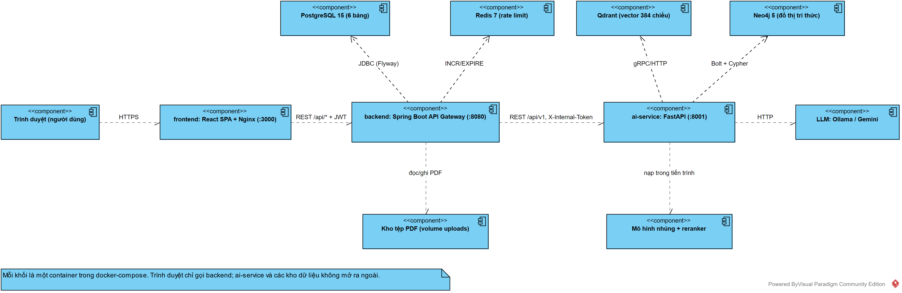

*Hình 2.1. Kiến trúc microservice: tám container và giao thức kết nối.*

| Dịch vụ | Công nghệ | Cổng | Dữ liệu sở hữu | Giao tiếp ra ngoài |
| :--- | :--- | :--- | :--- | :--- |
| `frontend` | React 19, TypeScript, Nginx | 3000 | Phiên đăng nhập và lịch sử chat trong `localStorage` của trình duyệt | REST `/api/*` tới backend |
| `backend` | Spring Boot, Java 17 | 8080 | PostgreSQL, kho tệp PDF (`app.upload-dir`) | REST `/api/v1/*` tới ai-service; JDBC; Redis |
| `ai-service` | FastAPI, Python 3.11 | 8001 (nội bộ) | Qdrant, Neo4j, mô hình nhúng và reranker trong tiến trình | HTTP tới LLM |
| `postgres` | PostgreSQL 15 | 5432 (nội bộ) | 6 bảng (mục 2.11) | — |
| `redis` | Redis 7 | 6379 (nội bộ) | Bộ đếm giới hạn tần suất | — |
| `qdrant` | Qdrant | 6333 (nội bộ) | Collection `enterprise_documents`, vector 384 chiều, cosine | — |
| `neo4j` | Neo4j 5.26 Community | 7687 (nội bộ) | Đồ thị KB1, KB2, KB (Chương 4) | — |
| `ollama` | Ollama 0.12 (tùy chọn) | 11434 (nội bộ) | Mô hình cục bộ | — |

*Bảng 2.3. Các dịch vụ, dữ liệu sở hữu và giao tiếp.*

### 2.3.3. Lý do không chọn kiến trúc nguyên khối

Một ứng dụng nguyên khối viết bằng Python đơn giản hơn khi triển khai, nhưng có ba bất lợi với bài toán này. Thứ nhất, mô hình nhúng và reranker chiếm hàng GB RAM và khởi động lâu; gộp chung khiến mỗi lần sửa một API quản trị cũng phải nạp lại mô hình. Thứ hai, ranh giới bảo mật rõ hơn khi dịch vụ AI không mở ra Internet và không giữ dữ liệu người dùng. Thứ ba, hai nhóm thành viên (nghiệp vụ và AI) làm việc song song trên hai mã nguồn với hợp đồng API cố định. Cái giá phải trả là thêm một bước gọi mạng và phải đồng bộ dữ liệu giữa các kho (mục 2.11.5).

## 2.4. Phân rã module và chức năng

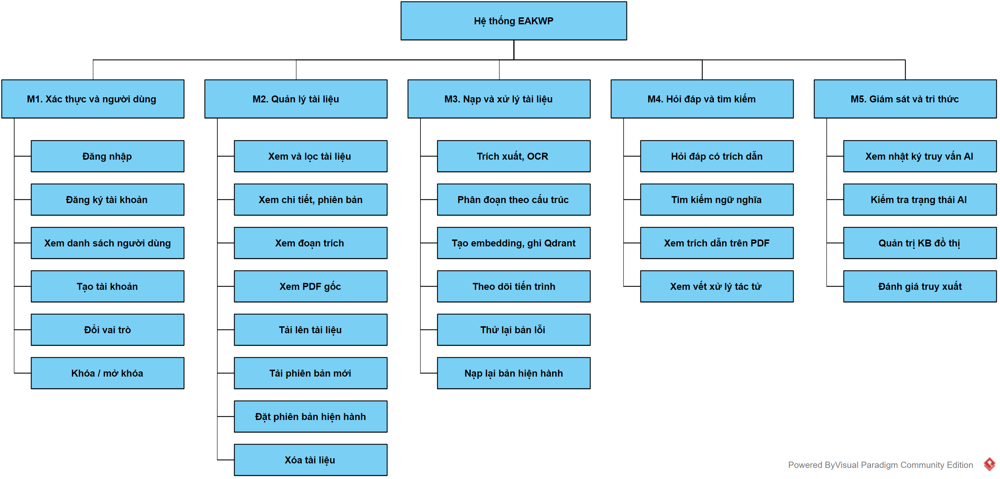

*Hình 2.2. Phân rã hệ thống thành 5 module và 28 chức năng.*

| Module | Mã | Chức năng | Dịch vụ thực hiện | Tác nhân |
| :--- | :--- | :--- | :--- | :--- |
| M1. Xác thực và người dùng | CN1.1 | Đăng nhập | backend | Người dùng |
| | CN1.2 | Đăng ký tài khoản | backend | Khách |
| | CN1.3 | Xem danh sách người dùng | backend | Quản trị viên |
| | CN1.4 | Tạo tài khoản | backend | Quản trị viên |
| | CN1.5 | Đổi vai trò | backend | Quản trị viên |
| | CN1.6 | Khóa / mở khóa tài khoản | backend | Quản trị viên |
| M2. Quản lý tài liệu | CN2.1 | Xem và lọc tài liệu | backend | Người dùng |
| | CN2.2 | Xem chi tiết, lịch sử phiên bản | backend | Người dùng |
| | CN2.3 | Xem đoạn trích (chunk) | backend | Người dùng |
| | CN2.4 | Xem PDF gốc | backend | Người dùng |
| | CN2.5 | Tải lên tài liệu mới | backend, ai-service | Quản trị viên |
| | CN2.6 | Tải lên phiên bản mới | backend, ai-service | Quản trị viên |
| | CN2.7 | Đặt phiên bản hiện hành | backend | Quản trị viên |
| | CN2.8 | Xóa tài liệu | backend, ai-service | Quản trị viên |
| M3. Nạp và xử lý tài liệu | CN3.1 | Trích xuất văn bản, OCR | ai-service (dự phòng PDFBox ở backend) | Dịch vụ AI |
| | CN3.2 | Phân đoạn theo cấu trúc | ai-service | Dịch vụ AI |
| | CN3.3 | Tạo embedding, ghi Qdrant và Neo4j | ai-service | Dịch vụ AI |
| | CN3.4 | Theo dõi tiến trình nạp | backend | Quản trị viên |
| | CN3.5 | Thử lại phiên bản lỗi | backend | Quản trị viên |
| | CN3.6 | Nạp lại phiên bản hiện hành | backend | Quản trị viên |
| M4. Hỏi đáp và tìm kiếm | CN4.1 | Hỏi đáp có trích dẫn | backend, ai-service, LLM | Người dùng |
| | CN4.2 | Tìm kiếm ngữ nghĩa | backend, ai-service | Người dùng |
| | CN4.3 | Xem trích dẫn trên PDF (tô vàng) | backend | Người dùng |
| | CN4.4 | Xem vết xử lý của tác tử | frontend | Người dùng |
| M5. Giám sát và tri thức | CN5.1 | Xem nhật ký truy vấn AI | backend | Quản trị viên |
| | CN5.2 | Kiểm tra trạng thái dịch vụ AI | backend, ai-service | Người dùng |
| | CN5.3 | Quản trị cơ sở tri thức đồ thị | ai-service | Quản trị viên |
| | CN5.4 | Đánh giá cấu hình truy xuất | ai-service | Quản trị viên |

*Bảng 2.4. Bảng phân rã chức năng.*

## 2.5. Biểu đồ use case tổng quan

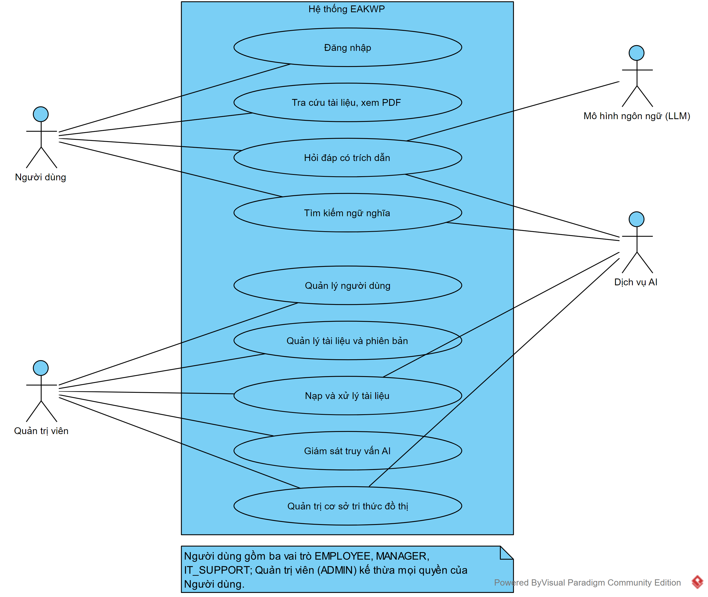

*Hình 2.3. Biểu đồ use case tổng quan của hệ thống EAKWP.*

Biểu đồ tổng quan gom 28 chức năng thành 9 use case mức cao. Bốn use case phía trên phục vụ Người dùng; năm use case phía dưới dành cho Quản trị viên. Quản trị viên kế thừa toàn bộ use case của Người dùng. Dịch vụ AI tham gia vào nạp tài liệu, hỏi đáp, tìm kiếm và quản trị đồ thị; LLM chỉ tham gia vào hỏi đáp và có thể vắng mặt (khi đó hệ thống trả lời bằng trích đoạn nguyên văn, xem Chương 5).

## 2.6. Use case chi tiết theo module

### 2.6.1. M1. Xác thực và quản lý người dùng

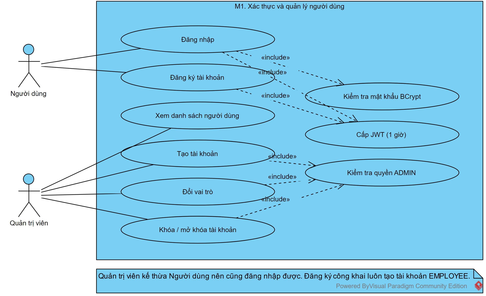

*Hình 2.4. Use case của module Xác thực và quản lý người dùng.*

| Use case | Mô tả |
| :--- | :--- |
| Đăng nhập | Người dùng nhập email, mật khẩu; hệ thống kiểm tra BCrypt, kiểm tra tài khoản đang hoạt động, cấp JWT có vai trò |
| Đăng ký tài khoản | Khách tự đăng ký; tài khoản mới luôn có vai trò `EMPLOYEE` và được cấp JWT ngay |
| Xem danh sách người dùng | Quản trị viên xem danh sách phân trang (20 dòng, mới nhất trước) |
| Tạo tài khoản | Quản trị viên tạo tài khoản với vai trò bất kỳ trong bốn vai trò |
| Đổi vai trò | Quản trị viên đổi vai trò; vai trò ngoài danh sách bị từ chối |
| Khóa / mở khóa tài khoản | Tài khoản bị khóa không đăng nhập được |
| Kiểm tra quyền ADMIN | Được `SecurityConfig` áp dụng cho mọi API ghi của module |

*Bảng 2.5. Mô tả use case module M1.*

### 2.6.2. M2. Quản lý tài liệu

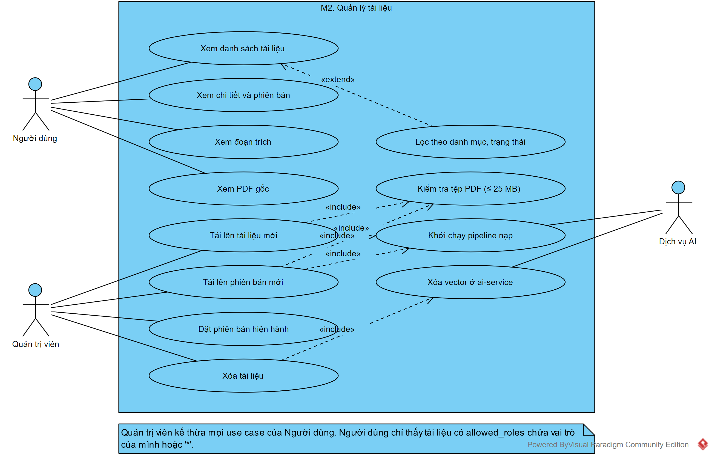

*Hình 2.5. Use case của module Quản lý tài liệu.*

| Use case | Mô tả |
| :--- | :--- |
| Xem danh sách tài liệu | Danh sách tài liệu người dùng được phép đọc; mở rộng bởi lọc theo từ khóa, danh mục, trạng thái |
| Xem chi tiết và phiên bản | Thông tin tài liệu, các phiên bản kèm trạng thái, số trang, số chunk, phiên bản hiện hành |
| Xem đoạn trích | Danh sách chunk của một phiên bản với trang và đường dẫn mục (Chương/Điều) |
| Xem PDF gốc | Mở tệp PDF của phiên bản hiện hành ngay trong giao diện |
| Tải lên tài liệu mới | Quản trị viên nhập mã, tiêu đề, danh mục, vai trò được đọc và chọn tệp PDF; bao gồm kiểm tra tệp và khởi chạy nạp |
| Tải lên phiên bản mới | Thêm phiên bản cho tài liệu đã có; bị chặn khi phiên bản trước đang nạp |
| Đặt phiên bản hiện hành | Chỉ phiên bản đã nạp xong (`INGESTED`) mới được chọn làm hiện hành |
| Xóa tài liệu | Xóa nhiều tài liệu một lần; bao gồm xóa vector ở ai-service trước khi xóa dữ liệu quan hệ |

*Bảng 2.6. Mô tả use case module M2.*

### 2.6.3. M3. Nạp và xử lý tài liệu

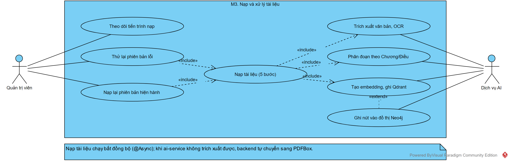

*Hình 2.6. Use case của module Nạp và xử lý tài liệu.*

| Use case | Mô tả |
| :--- | :--- |
| Nạp tài liệu (5 bước) | Use case trung tâm, chạy bất đồng bộ: (1) đọc và OCR PDF, (2) chia đoạn, (3) lưu `document_chunks`, (4) tạo embedding và ghi kho vector, (5) đánh dấu `INGESTED`, đặt hiện hành |
| Trích xuất văn bản, OCR | ai-service đọc lớp văn bản, OCR trang quét, trả về trang, chunk và tọa độ tô vàng |
| Phân đoạn theo Chương/Điều | Chia theo cấu trúc văn bản pháp quy; không có cấu trúc thì chia theo trang |
| Tạo embedding, ghi Qdrant | Nhúng bằng E5-Small (384 chiều), ghi kèm payload và quyền đọc |
| Ghi nút vào đồ thị Neo4j | Mở rộng của bước trên: cùng `chunk_id` được ghi vào đồ thị (Chương 4) |
| Theo dõi tiến trình nạp | Giao diện hỏi trạng thái theo `taskId`: bước hiện tại (1–5), số chunk, thông điệp |
| Thử lại phiên bản lỗi | Chạy lại toàn bộ pipeline cho phiên bản `FAILED` từ tệp gốc đã lưu |
| Nạp lại phiên bản hiện hành | Phân đoạn và nhúng lại phiên bản đang dùng, ví dụ sau khi đổi bộ chia đoạn |

*Bảng 2.7. Mô tả use case module M3.*

### 2.6.4. M4. Hỏi đáp và tìm kiếm

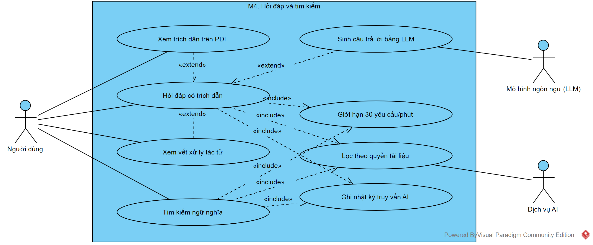

*Hình 2.7. Use case của module Hỏi đáp và tìm kiếm.*

| Use case | Mô tả |
| :--- | :--- |
| Hỏi đáp có trích dẫn | Người dùng đặt câu hỏi tự nhiên, nhận câu trả lời có số trích dẫn [n] trỏ đến đoạn và trang cụ thể |
| Tìm kiếm ngữ nghĩa | Trả về danh sách đoạn văn gần nghĩa nhất, có điểm liên quan |
| Giới hạn 30 yêu cầu/phút | Bao gồm trong cả hai use case trên, đếm theo email bằng Redis |
| Lọc theo quyền tài liệu | Bao gồm trong cả hai; quyền lấy từ JWT, không lấy từ trình duyệt |
| Ghi nhật ký truy vấn AI | Bao gồm trong cả hai, kể cả khi lỗi hoặc bị giới hạn |
| Sinh câu trả lời bằng LLM | Mở rộng của hỏi đáp: chỉ chạy khi có LLM và có đủ bằng chứng |
| Xem trích dẫn trên PDF | Mở rộng: mở PDF gốc tại trang trích dẫn, đoạn dẫn chứng được tô vàng |
| Xem vết xử lý tác tử | Mở rộng: xem tác tử đã chọn luật và công cụ nào ở từng bước |

*Bảng 2.8. Mô tả use case module M4.*

### 2.6.5. M5. Giám sát và quản trị tri thức

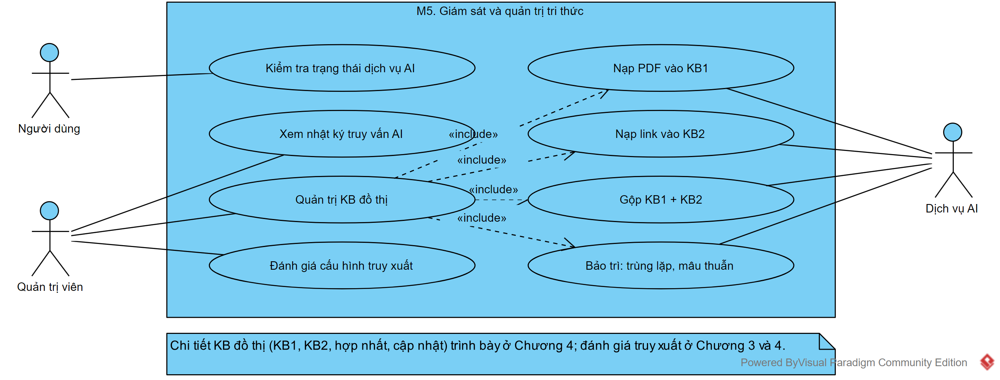

*Hình 2.8. Use case của module Giám sát và quản trị tri thức.*

| Use case | Mô tả |
| :--- | :--- |
| Kiểm tra trạng thái dịch vụ AI | Thanh trạng thái hiển thị dịch vụ AI ổn định hay không, độ trễ, số vector |
| Xem nhật ký truy vấn AI | Quản trị viên xem tối đa 200 lời gọi gần nhất: người hỏi, vai trò, trạng thái, mô hình, độ trễ |
| Quản trị KB đồ thị | Nạp PDF vào KB1, nạp link vào KB2, gộp thành KB, bảo trì trùng lặp và mâu thuẫn (Chương 4) |
| Đánh giá cấu hình truy xuất | Chạy bộ câu hỏi chuẩn với các cấu hình `flat_rag`, `graph_rag`, `hybrid_rag` (Chương 3, 4, 5) |

*Bảng 2.9. Mô tả use case module M5.*

## 2.7. Kịch bản use case

Mỗi kịch bản gồm tác nhân, điều kiện trước, điều kiện sau, luồng chuẩn và luồng ngoại lệ. Thông báo lỗi lấy nguyên văn từ mã nguồn backend; mọi lỗi được trả theo dạng `{"message": "..."}` (`ApiExceptionHandler`).

### 2.7.1. Kịch bản Đăng nhập

| Mục | Nội dung |
| :--- | :--- |
| Tác nhân | Người dùng |
| Điều kiện trước | Có tài khoản; chưa đăng nhập |
| Điều kiện sau | Trình duyệt giữ JWT còn hạn 1 giờ; giao diện mở trang mặc định theo vai trò |
| Luồng chuẩn | 1. Người dùng nhập email, mật khẩu và bấm Đăng nhập. 2. Giao diện gửi `POST /api/auth/login`. 3. `AuthService` tìm người dùng theo email. 4. So khớp mật khẩu bằng BCrypt. 5. Kiểm tra tài khoản đang hoạt động. 6. `JwtService` sinh JWT có claim `role`. 7. Backend trả `token`, `role`, `fullName`. 8. Giao diện lưu phiên và chuyển trang. |
| Ngoại lệ | 3a/4a. Không có email hoặc sai mật khẩu: `401` "Email hoặc mật khẩu không đúng." (cùng một thông báo để không lộ email nào tồn tại). 5a. Tài khoản bị khóa: `403` "Tài khoản đã bị khóa." 8a. JWT hết hạn ở lần gọi sau: `401`, giao diện đưa về trang đăng nhập. |

*Bảng 2.10. Kịch bản Đăng nhập.*

### 2.7.2. Kịch bản Quản lý người dùng (tạo tài khoản, đổi vai trò, khóa)

| Mục | Nội dung |
| :--- | :--- |
| Tác nhân | Quản trị viên |
| Điều kiện trước | Đã đăng nhập với vai trò `ADMIN` |
| Điều kiện sau | Tài khoản được tạo hoặc cập nhật; thay đổi vai trò có hiệu lực từ lần đăng nhập sau |
| Luồng chuẩn | 1. Quản trị viên mở trang Người dùng; hệ thống tải danh sách phân trang. 2. Chọn Thêm người dùng, nhập họ tên, email, mật khẩu, vai trò. 3. Hệ thống chuẩn hóa vai trò, kiểm tra email chưa tồn tại, băm mật khẩu, lưu với `active = true`. 4. Để đổi vai trò, chọn vai trò mới (`PATCH /api/users/{id}/role`). 5. Để khóa, tắt trạng thái hoạt động (`PATCH /api/users/{id}/status`). |
| Ngoại lệ | 3a. Email đã có: `409` "Email đã tồn tại." 3b/4a. Vai trò ngoài `EMPLOYEE, MANAGER, ADMIN, IT_SUPPORT`: `400` "Vai trò không hợp lệ." *. Người gọi không phải `ADMIN`: `403`. |

*Bảng 2.11. Kịch bản Quản lý người dùng.*

### 2.7.3. Kịch bản Tải lên tài liệu mới

| Mục | Nội dung |
| :--- | :--- |
| Tác nhân | Quản trị viên; Dịch vụ AI |
| Điều kiện trước | Đã đăng nhập `ADMIN`; có tệp PDF |
| Điều kiện sau | Có bản ghi `documents`, phiên bản 1 và một nhiệm vụ nạp; khi nạp xong, phiên bản là `INGESTED`, hiện hành, tìm được qua hỏi đáp |
| Luồng chuẩn | 1. Quản trị viên nhập mã tài liệu, tiêu đề, danh mục, vai trò được đọc (bỏ trống là `*`) và chọn tệp. 2. Giao diện gửi `POST /api/documents/upload` (multipart). 3. Backend kiểm tra mã chưa tồn tại. 4. Kiểm tra tệp: có tệp, đuôi `.pdf`, đúng chữ ký PDF, không quá 25 MB; lưu với tên UUID, tính SHA-256. 5. Lưu `documents`, `document_versions` (số 1, `PROCESSING`, hiện hành) và `ingestion_tasks`. 6. Gọi `IngestionService.process` bất đồng bộ và trả ngay `202 Accepted` kèm `taskId`. 7. Giao diện hỏi tiến trình định kỳ và hiển thị bước 1–5. 8. Khi xong, trạng thái là `INGESTED`. |
| Ngoại lệ | 3a. Trùng mã: `409` "Mã tài liệu đã tồn tại." 4a. Không có tệp: `400` "Vui lòng chọn tệp PDF." 4b. Sai đuôi: `400` "Chỉ hỗ trợ tệp PDF." 4c. Nội dung không phải PDF: `400` "Tệp tải lên không phải PDF hợp lệ." 4d. Quá 25 MB: `413` "Tệp vượt quá 25 MB." 5a. Lỗi khi lưu: tệp vừa ghi bị xóa. 7a. Lỗi trong pipeline: phiên bản `FAILED`, `error_message` có lý do, chuyển sang kịch bản Thử lại. |

*Bảng 2.12. Kịch bản Tải lên tài liệu mới.*

### 2.7.4. Kịch bản Tải lên phiên bản mới và đặt hiện hành

| Mục | Nội dung |
| :--- | :--- |
| Tác nhân | Quản trị viên |
| Điều kiện trước | Tài liệu đã tồn tại; không có phiên bản nào đang `PROCESSING` |
| Điều kiện sau | Phiên bản mới (số thứ tự tăng 1) được nạp và trở thành hiện hành; vector của phiên bản cũ bị xóa khỏi Qdrant, bản ghi phiên bản cũ vẫn được giữ |
| Luồng chuẩn | 1. Quản trị viên mở chi tiết tài liệu, chọn Tải phiên bản mới, chọn tệp. 2. Backend kiểm tra không có phiên bản đang nạp, lưu tệp, tạo phiên bản `PROCESSING`. 3. Pipeline chạy như kịch bản 2.7.3. 4. Khi `INGESTED`, backend đặt phiên bản này hiện hành và xóa vector các phiên bản khác (`dropSupersededVectors`). 5. Nếu muốn quay về bản cũ, quản trị viên chọn phiên bản và bấm Đặt hiện hành (`PATCH /api/documents/versions/{id}/current`). |
| Ngoại lệ | 2a. Phiên bản trước đang nạp: `409` "Vui lòng đợi phiên bản trước nạp xong." 5a. Phiên bản chưa nạp xong: `409` "Chỉ đặt phiên bản đã nạp làm hiện hành." |

*Bảng 2.13. Kịch bản Tải lên phiên bản mới và đặt hiện hành.*

### 2.7.5. Kịch bản Thử lại và nạp lại

| Mục | Nội dung |
| :--- | :--- |
| Tác nhân | Quản trị viên |
| Điều kiện trước | Thử lại: phiên bản ở trạng thái `FAILED`. Nạp lại: phiên bản hiện hành ở trạng thái `INGESTED` |
| Điều kiện sau | Phiên bản được nạp lại từ tệp gốc; chunk và vector cũ của phiên bản được thay thế |
| Luồng chuẩn | 1. Quản trị viên bấm Thử lại (`POST /api/documents/versions/{id}/retry`) hoặc Nạp lại (`.../reindex`). 2. Backend kiểm tra trạng thái và tệp gốc còn trên đĩa. 3. Chuyển phiên bản về `PROCESSING`, tạo nhiệm vụ mới. 4. Pipeline chạy với cờ thay thế: xóa chunk và vector cũ của phiên bản trước khi ghi mới. |
| Ngoại lệ | 2a. Thử lại phiên bản không lỗi: `409` "Chỉ có thể nạp lại phiên bản đang lỗi." 2b. Nạp lại phiên bản không phải hiện hành: `409` "Chỉ nạp lại được phiên bản hiện hành đã nạp xong." 2c. Mất tệp gốc: `400` "Tệp gốc không còn trên máy chủ, vui lòng tải phiên bản mới." |

*Bảng 2.14. Kịch bản Thử lại và nạp lại.*

### 2.7.6. Kịch bản Hỏi đáp có trích dẫn

| Mục | Nội dung |
| :--- | :--- |
| Tác nhân | Người dùng; Dịch vụ AI; LLM |
| Điều kiện trước | Đã đăng nhập; có ít nhất một tài liệu `INGESTED` mà người dùng được đọc |
| Điều kiện sau | Người dùng nhận câu trả lời có trích dẫn hoặc lời từ chối; một dòng được ghi vào `ai_audit_logs` |
| Luồng chuẩn | 1. Người dùng nhập câu hỏi (tối đa 2.000 ký tự). 2. Giao diện gửi câu hỏi kèm 4 lượt hội thoại gần nhất tới `POST /api/ai/chat`. 3. Backend tăng bộ đếm Redis của người dùng. 4. Backend xóa `user_roles` do trình duyệt gửi (nếu có) và gắn vai trò từ JWT (ADMIN không bị lọc). 5. ai-service giao câu hỏi cho tác tử: nhận thức câu hỏi, chọn luật, chọn công cụ. 6. Công cụ truy xuất tìm Qdrant và Neo4j có lọc quyền, chấm lại bằng cross-encoder, chọn bằng chứng. 7. LLM sinh câu trả lời có [n]; bộ kiểm định đối chiếu với ngữ cảnh. 8. Backend ghi nhật ký `OK` kèm mô hình, số trích dẫn, độ trễ. 9. Giao diện hiển thị câu trả lời, thẻ trích dẫn và vết xử lý của tác tử. 10. Người dùng bấm một trích dẫn để mở PDF tại đoạn tô vàng. |
| Ngoại lệ | 3a. Quá 30 yêu cầu/phút: `429` "Bạn gửi quá nhiều yêu cầu, vui lòng thử lại sau một phút.", nhật ký `RATE_LIMITED`. 6a. Không đủ bằng chứng: tác tử từ chối, không gọi LLM, trả "chưa tìm thấy thông tin phù hợp". 7a. Không có LLM hoặc LLM lỗi: trả trích đoạn nguyên văn có trích dẫn. 5a/6b. ai-service không phản hồi: `502`, nhật ký `ERROR`. |

*Bảng 2.15. Kịch bản Hỏi đáp có trích dẫn.*

### 2.7.7. Kịch bản Tìm kiếm ngữ nghĩa

| Mục | Nội dung |
| :--- | :--- |
| Tác nhân | Người dùng; Dịch vụ AI |
| Điều kiện trước | Đã đăng nhập |
| Điều kiện sau | Danh sách đoạn văn xếp theo độ liên quan; một dòng nhật ký `SEARCH` |
| Luồng chuẩn | 1. Người dùng nhập từ khóa hoặc câu hỏi, có thể chọn một tài liệu và số kết quả. 2. Backend áp dụng giới hạn tần suất và quyền như kịch bản 2.7.6. 3. ai-service nhúng truy vấn, tìm Qdrant có lọc quyền và lọc tài liệu, trả đoạn kèm điểm, trang, đường dẫn mục. 4. Giao diện tô đậm từ khớp và cho mở đoạn trên PDF. |
| Ngoại lệ | 2a. Như 3a của kịch bản 2.7.6. 3a. Không có đoạn đạt ngưỡng: danh sách rỗng và gợi ý từ khóa khác. |

*Bảng 2.16. Kịch bản Tìm kiếm ngữ nghĩa.*

### 2.7.8. Kịch bản Xóa tài liệu

| Mục | Nội dung |
| :--- | :--- |
| Tác nhân | Quản trị viên; Dịch vụ AI |
| Điều kiện trước | Đã đăng nhập `ADMIN`; đã chọn ít nhất một tài liệu |
| Điều kiện sau | Vector, chunk, phiên bản, nhiệm vụ, tài liệu và tệp PDF của các tài liệu được chọn đều bị xóa |
| Luồng chuẩn | 1. Quản trị viên chọn tài liệu và bấm Xóa, xác nhận. 2. Backend kiểm tra không tài liệu nào đang nạp. 3. Gọi ai-service xóa vector (và nút đồ thị) theo `document_id`. 4. Xóa tệp PDF của mọi phiên bản. 5. Xóa dữ liệu quan hệ trong một giao dịch. 6. Trả số tài liệu đã xóa. |
| Ngoại lệ | 1a. Không chọn gì: `400` "Vui lòng chọn tài liệu cần xóa." 2a. Có tài liệu đang nạp: `409` "Không thể xóa ... khi đang nạp." 3a. ai-service lỗi: `502` "Không xóa được vector của tài liệu...", **không xóa gì trong PostgreSQL** để tránh để lại vector mồ côi mà không còn bản ghi gốc. |

*Bảng 2.17. Kịch bản Xóa tài liệu.*

## 2.8. Biểu đồ tuần tự

### 2.8.1. Đăng nhập

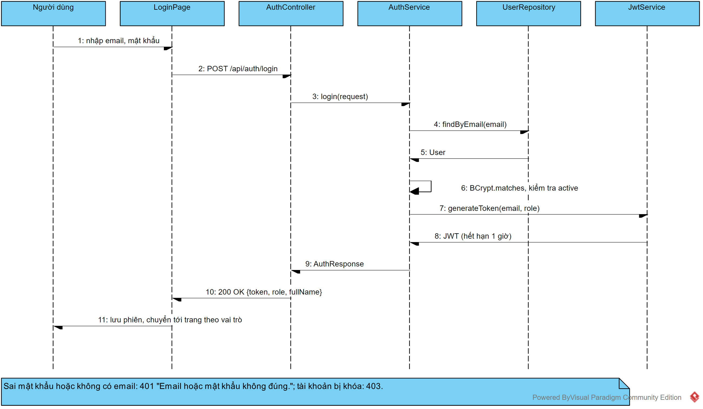

*Hình 2.9. Biểu đồ tuần tự chức năng Đăng nhập.*

Luồng đăng nhập là đồng bộ và chỉ chạm PostgreSQL. Kiểm tra mật khẩu và trạng thái hoạt động nằm trong cùng một phương thức `AuthService.login`, nên không có trạng thái nào để tài khoản bị khóa vẫn nhận được token.

### 2.8.2. Tải lên và nạp tài liệu

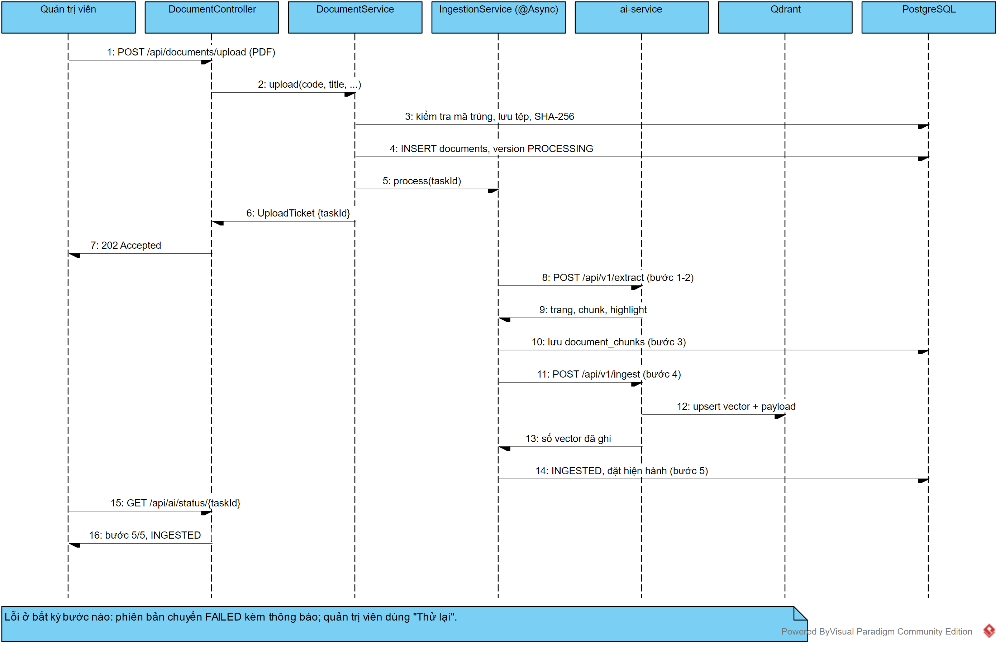

*Hình 2.10. Biểu đồ tuần tự chức năng Tải lên và nạp tài liệu.*

Biểu đồ cho thấy điểm thiết kế quan trọng nhất của P4: thông điệp 7 (`202 Accepted`) trả về **trước** khi pipeline bắt đầu. Phần từ thông điệp 8 chạy trên luồng `@Async` của `IngestionService`; mỗi bước cập nhật một dòng trong `ingestion_tasks`, và giao diện đọc dòng đó qua `GET /api/ai/status/{taskId}` (thông điệp 15–16). Nhờ vậy một PDF 40 trang có OCR không giữ kết nối HTTP hàng phút.

### 2.8.3. Hỏi đáp có trích dẫn

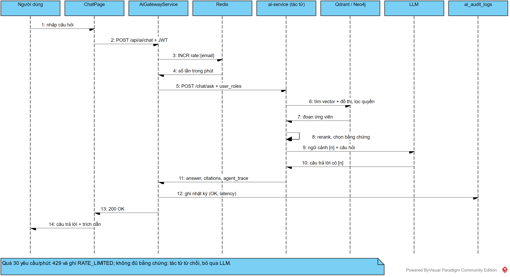

*Hình 2.11. Biểu đồ tuần tự chức năng Hỏi đáp có trích dẫn.*

`AiGatewayService` là điểm duy nhất áp dụng ba chính sách cắt ngang: giới hạn tần suất (thông điệp 3–4), gắn quyền (thông điệp 5) và kiểm toán (thông điệp 12). Bên trong ai-service, tác tử quyết định dùng công cụ nào; chi tiết bảng luật và vòng lặp của tác tử ở Chương 5, chi tiết truy xuất lai ở Chương 4.

## 2.9. Biểu đồ hoạt động: vòng đời phiên bản tài liệu

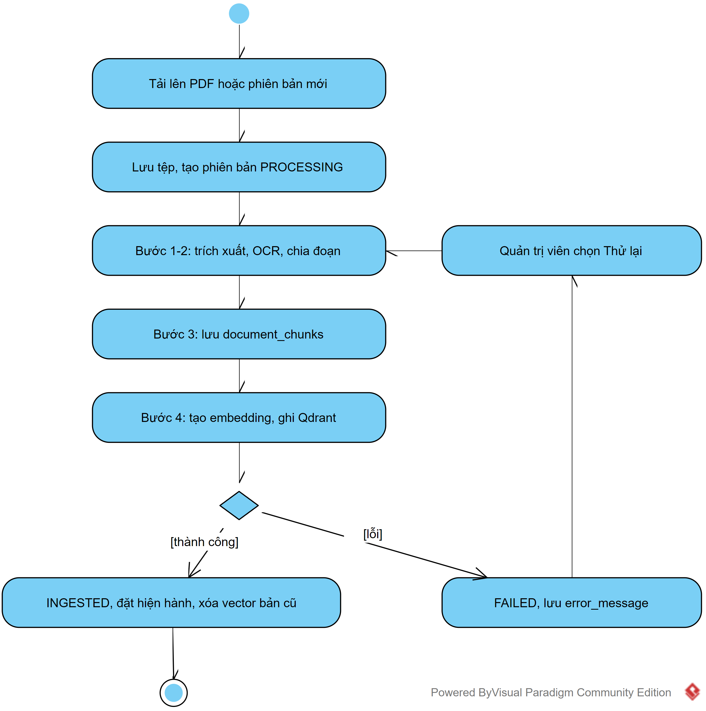

*Hình 2.12. Biểu đồ hoạt động vòng đời của một phiên bản tài liệu.*

Một phiên bản chỉ có ba trạng thái: `PROCESSING`, `INGESTED`, `FAILED`. Nhiệm vụ nạp đi kèm có thêm số bước để giao diện hiển thị tiến trình:

| Bước | Trạng thái nhiệm vụ | Thông điệp hiển thị (rút gọn) |
| ---: | :--- | :--- |
| 1 | `PROCESSING` | Đang đọc và OCR tệp PDF |
| 2 | `PROCESSING` | Đã trích xuất N trang (OCR k trang), đang chia đoạn |
| 3 | `PROCESSING` | Đã tạo M đoạn trích, đang tạo embedding |
| 4 | `PROCESSING` | Đang ghi kho vector |
| 5 | `INGESTED` | Đã tạo M đoạn trích và đưa tài liệu vào kho vector |
| giữ nguyên | `FAILED` | Lý do lỗi thân thiện với người dùng |

*Bảng 2.18. Các bước của nhiệm vụ nạp (`IngestionService`).*

Thứ tự ở bước 5 có chủ ý: phiên bản được lưu `INGESTED` trước, rồi mới đánh dấu hiện hành và xóa vector bản cũ. Nếu làm ngược lại, luồng bất đồng bộ có thể ghi đè cờ hiện hành bằng một bản sao cũ của thực thể.

## 2.10. Thiết kế lớp

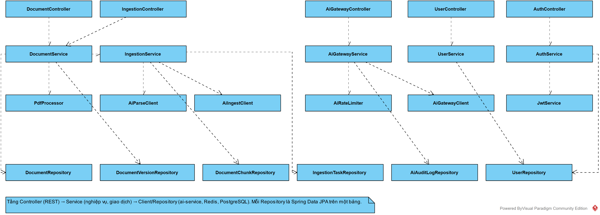

*Hình 2.13. Biểu đồ lớp thiết kế của backend theo ba tầng.*

Backend tổ chức theo gói chức năng (`auth`, `user`, `document`, `ai`, `security`, `config`), mỗi gói chia ba tầng: Controller nhận REST, Service chứa nghiệp vụ và giao dịch, Repository/Client truy cập dữ liệu hoặc dịch vụ khác.

| Lớp | Tầng | Trách nhiệm |
| :--- | :--- | :--- |
| `DocumentController` | Controller | 13 endpoint tài liệu: danh sách, chi tiết, phiên bản, chunk, tệp, ảnh và PDF tô vàng, tải lên, thử lại, nạp lại, đặt hiện hành, xóa |
| `DocumentService` | Service | Kiểm tra đầu vào, lưu tệp và băm SHA-256, phân quyền đọc (`canRead`), điều phối xóa |
| `IngestionService` | Service | Pipeline nạp 5 bước, chạy `@Async`; dự phòng PDFBox; cập nhật `ingestion_tasks` |
| `AiParseClient`, `AiIngestClient` | Client | Gọi `POST /api/v1/extract`, `POST /api/v1/ingest`, `DELETE /api/v1/ingest/documents/{id}` |
| `PdfProcessor` | Tiện ích | Trích văn bản bằng PDFBox, vẽ trang và PDF có vùng tô vàng |
| `AiGatewayService` | Service | Giới hạn tần suất, gắn quyền, chuyển tiếp, ghi kiểm toán cho mọi lời gọi AI |
| `AiRateLimiter` | Service | Cửa sổ cố định 1 phút theo email trên Redis; Redis lỗi thì cho qua |
| `AuthService`, `JwtService` | Service | Đăng ký, đăng nhập, sinh và kiểm tra JWT |
| `JwtAuthenticationFilter` | Bảo mật | Đọc JWT ở mỗi yêu cầu, gắn `ROLE_<vai trò>` cho Spring Security |
| `*Repository` | Repository | Spring Data JPA, mỗi lớp ứng với một bảng |

*Bảng 2.19. Trách nhiệm các lớp chính của backend.*

Phía ai-service, các lớp chính là `RAGService` (truy xuất và sinh), `RuleBasedAgent` (tác tử), `EmbeddingService`, `RerankerService`, `QdrantService` và gói `knowledge_graph`. Các lớp này được trình bày cùng thuật toán ở Chương 3, 4 và 5.

## 2.11. Thiết kế cơ sở dữ liệu

### 2.11.1. Mô hình dữ liệu đa kho

| Kho | Vai trò | Dữ liệu | Khóa liên kết |
| :--- | :--- | :--- | :--- |
| PostgreSQL | Nguồn sự thật, giao dịch | Người dùng, tài liệu, phiên bản, chunk, nhiệm vụ nạp, nhật ký AI | `documents.id`, `document_versions.id`, `document_chunks.chunk_id` |
| Kho tệp | Bản gốc | Tệp PDF của mọi phiên bản, tên UUID | `document_versions.storage_path` |
| Qdrant | Chỉ mục vector dẫn xuất | Vector 384 chiều + payload của từng chunk | point id = UUIDv5(`chunk_id`) |
| Neo4j | Đồ thị dẫn xuất | Tài liệu, chunk, thực thể, quan hệ (Chương 4) | `Chunk.chunk_id`, `Document.doc_id` = `documents.id` |

*Bảng 2.20. Phân vai các kho dữ liệu.*

Một định danh `chunk_id` sinh ở backend đi xuyên qua ba kho. Nhờ vậy, khi Qdrant hoặc Neo4j trả về một đoạn, backend tìm được đúng dòng `document_chunks`, đúng phiên bản và đúng tệp PDF để mở và tô vàng.

### 2.11.2. Sơ đồ thực thể – quan hệ

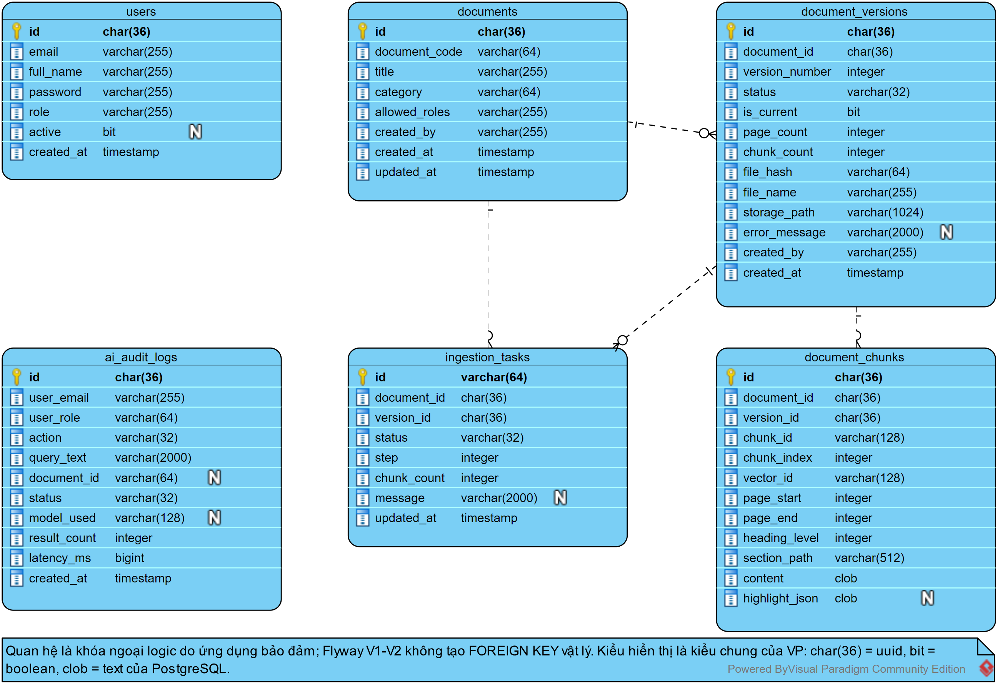

*Hình 2.14. Sơ đồ thực thể – quan hệ của cơ sở dữ liệu PostgreSQL (Flyway V1–V2).*

Lược đồ do Flyway quản lý: `V1__baseline.sql` tạo năm bảng gốc, `V2__document_access_and_ai_audit.sql` thêm cột `documents.allowed_roles` và bảng `ai_audit_logs`. Hibernate chạy ở chế độ `validate`, tức chỉ kiểm tra thực thể khớp lược đồ chứ không tự sửa lược đồ.

Các quan hệ một – nhiều trên hình là **khóa ngoại logic**: lược đồ không khai báo `FOREIGN KEY` vật lý, toàn vẹn tham chiếu do `DocumentService` bảo đảm (ví dụ xóa theo thứ tự nhiệm vụ → chunk → phiên bản → tài liệu trong một giao dịch). Lựa chọn này giữ cho thao tác xóa hàng loạt và nạp lại đơn giản; cái giá là ràng buộc nằm ở mã nguồn chứ không ở CSDL. Bổ sung khóa ngoại vật lý là một bước cải tiến được nêu ở mục 2.13.

### 2.11.3. Từ điển dữ liệu

| Cột | Kiểu | Ràng buộc | Ý nghĩa |
| :--- | :--- | :--- | :--- |
| `id` | `uuid` | PK | Định danh |
| `email` | `varchar(255)` | NOT NULL, UNIQUE | Tên đăng nhập |
| `full_name` | `varchar(255)` | NOT NULL | Họ tên |
| `password` | `varchar(255)` | NOT NULL | Mật khẩu đã băm BCrypt |
| `role` | `varchar(255)` | NOT NULL | `EMPLOYEE`, `MANAGER`, `IT_SUPPORT`, `ADMIN` |
| `active` | `boolean` | | `false` là bị khóa |
| `created_at` | `timestamp` | NOT NULL | Thời điểm tạo |

*Bảng 2.21. Bảng `users`.*

| Cột | Kiểu | Ràng buộc | Ý nghĩa |
| :--- | :--- | :--- | :--- |
| `id` | `uuid` | PK | Định danh, cũng là `document_id` trong Qdrant và Neo4j |
| `document_code` | `varchar(64)` | NOT NULL, UNIQUE | Mã tài liệu do quản trị viên đặt |
| `title` | `varchar(255)` | NOT NULL | Tiêu đề |
| `category` | `varchar(64)` | NOT NULL | Danh mục (Nội quy, Quy chế, Chính sách IT, Hướng dẫn) |
| `allowed_roles` | `varchar(255)` | NOT NULL, mặc định `'*'` | Các vai trò được đọc, phân tách bằng dấu phẩy |
| `created_by` | `varchar(255)` | NOT NULL | Người tạo |
| `created_at`, `updated_at` | `timestamp` | NOT NULL | Thời điểm tạo, cập nhật |

*Bảng 2.22. Bảng `documents`.*

| Cột | Kiểu | Ràng buộc | Ý nghĩa |
| :--- | :--- | :--- | :--- |
| `id` | `uuid` | PK | Định danh phiên bản |
| `document_id` | `uuid` | NOT NULL, index | Tài liệu sở hữu |
| `version_number` | `integer` | NOT NULL | Số thứ tự phiên bản, bắt đầu từ 1 |
| `status` | `varchar(32)` | NOT NULL | `PROCESSING`, `INGESTED`, `FAILED` |
| `is_current` | `boolean` | NOT NULL, index cùng `document_id` | Phiên bản hiện hành, mỗi tài liệu một bản |
| `page_count`, `chunk_count` | `integer` | NOT NULL | Số trang, số chunk |
| `file_hash` | `varchar(64)` | NOT NULL | SHA-256 của tệp |
| `file_name` | `varchar(255)` | NOT NULL | Tên tệp gốc |
| `storage_path` | `varchar(1024)` | NOT NULL | Đường dẫn tệp trên máy chủ |
| `error_message` | `varchar(2000)` | | Lý do lỗi khi `FAILED` |
| `created_by`, `created_at` | `varchar(255)`, `timestamp` | NOT NULL | Người tải lên, thời điểm |

*Bảng 2.23. Bảng `document_versions`.*

| Cột | Kiểu | Ràng buộc | Ý nghĩa |
| :--- | :--- | :--- | :--- |
| `id` | `uuid` | PK | Định danh dòng |
| `document_id`, `version_id` | `uuid` | NOT NULL, index | Tài liệu và phiên bản |
| `chunk_id` | `varchar(128)` | NOT NULL, UNIQUE | Định danh chunk dùng chung với Qdrant, Neo4j |
| `chunk_index` | `integer` | NOT NULL | Thứ tự trong phiên bản |
| `vector_id` | `varchar(128)` | NOT NULL | Định danh điểm trong Qdrant |
| `page_start`, `page_end` | `integer` | NOT NULL | Khoảng trang |
| `heading_level` | `integer` | NOT NULL | Cấp đề mục (Phần, Chương, Điều, ...) |
| `section_path` | `varchar(512)` | NOT NULL | Đường dẫn mục, ví dụ "Chương IV > Điều 16" |
| `content` | `text` | NOT NULL | Nội dung chunk |
| `highlight_json` | `text` | | Tọa độ dòng để tô vàng trên PDF |

*Bảng 2.24. Bảng `document_chunks`.*

| Cột | Kiểu | Ràng buộc | Ý nghĩa |
| :--- | :--- | :--- | :--- |
| `id` | `varchar(64)` | PK | `taskId` trả cho giao diện |
| `document_id`, `version_id` | `uuid` | NOT NULL, index `document_id` | Tài liệu và phiên bản đang nạp |
| `status` | `varchar(32)` | NOT NULL | `PROCESSING`, `INGESTED`, `FAILED` |
| `step` | `integer` | NOT NULL | Bước 1–5 |
| `chunk_count` | `integer` | NOT NULL | Số chunk đã tạo |
| `message` | `varchar(2000)` | | Thông điệp tiến trình hoặc lỗi |
| `updated_at` | `timestamp` | NOT NULL | Lần cập nhật cuối |

*Bảng 2.25. Bảng `ingestion_tasks`.*

| Cột | Kiểu | Ràng buộc | Ý nghĩa |
| :--- | :--- | :--- | :--- |
| `id` | `uuid` | PK | Định danh |
| `user_email`, `user_role` | `varchar(255)`, `varchar(64)` | NOT NULL | Người gọi và vai trò lúc gọi |
| `action` | `varchar(32)` | NOT NULL | `CHAT` hoặc `SEARCH` |
| `query_text` | `varchar(2000)` | NOT NULL | Câu hỏi hoặc từ khóa |
| `document_id` | `varchar(64)` | | Tài liệu được lọc (nếu có) |
| `status` | `varchar(32)` | NOT NULL | `OK`, `ERROR`, `RATE_LIMITED` |
| `model_used` | `varchar(128)` | | Mô hình đã trả lời |
| `result_count` | `integer` | NOT NULL | Số trích dẫn hoặc kết quả |
| `latency_ms` | `bigint` | NOT NULL | Độ trễ đầu–cuối tại backend |
| `created_at` | `timestamp` | NOT NULL, index giảm dần | Thời điểm gọi |

*Bảng 2.26. Bảng `ai_audit_logs`.*

### 2.11.4. Cấu trúc payload trong Qdrant

Mỗi chunk là một điểm trong collection `enterprise_documents` (vector 384 chiều, khoảng cách cosine). Payload do `AiIngestClient` dựng và được dùng để lọc ngay trong truy vấn:

| Trường | Nguồn | Dùng để |
| :--- | :--- | :--- |
| `chunk_id`, `content` | `document_chunks` | Trả về đoạn và nối lại với PostgreSQL |
| `document_id`, `document_code`, `title`, `document_type` | `documents` | Lọc theo tài liệu, hiển thị nguồn |
| `version_id`, `version_number` | `document_versions` | Xóa vector của một phiên bản |
| `allowed_roles` | `documents.allowed_roles` | Lọc quyền trong truy vấn |
| `page_start`, `page_end`, `chunk_index`, `section_path` | `document_chunks` | Trích dẫn trang và mục |

*Bảng 2.27. Payload của một điểm trong Qdrant.*

### 2.11.5. Nhất quán giữa các kho

Hệ thống không dùng giao dịch phân tán. Nhất quán giữa PostgreSQL, Qdrant và Neo4j được giữ bằng bốn quy tắc:

1. **Ghi idempotent.** Point id trong Qdrant là UUIDv5 của `chunk_id`, nên nạp lại cùng một chunk ghi đè chứ không nhân bản.
2. **Thứ tự xóa an toàn.** Khi xóa tài liệu, vector và nút đồ thị bị xóa trước; chỉ khi ai-service xác nhận mới xóa dữ liệu quan hệ. Nếu bước đầu lỗi, không có gì bị xóa (kịch bản 2.7.8).
3. **Phiên bản cũ rời chỉ mục khi bản mới sẵn sàng.** Vector của phiên bản cũ chỉ bị xóa sau khi phiên bản mới đã `INGESTED`, nên không có khoảng thời gian tài liệu "biến mất" khỏi hỏi đáp.
4. **Dựng lại được.** Qdrant và Neo4j là dữ liệu dẫn xuất: nạp lại (CN3.6) hoặc các script ở Chương 4 dựng lại chỉ mục từ PostgreSQL và tệp PDF.

## 2.12. Thiết kế giao diện lập trình (API)

### 2.12.1. API công khai của backend

| Nhóm | Phương thức và đường dẫn | Quyền | Chức năng |
| :--- | :--- | :--- | :--- |
| Xác thực | `POST /api/auth/register`, `POST /api/auth/login` | Công khai | CN1.2, CN1.1 |
| Người dùng | `GET /api/users` | Đã đăng nhập | CN1.3 |
| | `POST /api/users`, `PATCH /api/users/{id}/role`, `PATCH /api/users/{id}/status` | ADMIN | CN1.4–CN1.6 |
| Tài liệu | `GET /api/documents?q=&category=&status=`, `GET /api/documents/{id}`, `GET /api/documents/{id}/versions`, `GET /api/documents/{id}/chunks` | Đã đăng nhập, lọc theo `allowed_roles` | CN2.1–CN2.3 |
| | `GET /api/documents/{id}/file` | Đã đăng nhập | CN2.4 |
| | `GET /api/documents/{id}/chunks/{chunkId}/preview`, `.../highlighted` | Đã đăng nhập | CN4.3 |
| | `POST /api/documents/upload`, `POST /api/documents/{id}/versions` | ADMIN, trả `202` | CN2.5, CN2.6 |
| | `PATCH /api/documents/versions/{id}/current` | ADMIN | CN2.7 |
| | `POST /api/documents/versions/{id}/retry`, `.../reindex` | ADMIN, trả `202` | CN3.5, CN3.6 |
| | `DELETE /api/documents` (thân là danh sách id) | ADMIN | CN2.8 |
| AI | `POST /api/ai/chat`, `POST /api/ai/search` | Đã đăng nhập, 30 lần/phút | CN4.1, CN4.2 |
| | `GET /api/ai/status/{taskId}` | Đã đăng nhập | CN3.4 |
| | `GET /api/ai/health` | Đã đăng nhập | CN5.2 |
| | `GET /api/ai/audit?limit=` | ADMIN | CN5.1 |

*Bảng 2.28. API công khai của backend.*

### 2.12.2. API nội bộ của ai-service

Mọi endpoint dưới đây (trừ `/health`) yêu cầu header `X-Internal-Token`; chỉ backend và công cụ quản trị nội bộ gọi được.

| Phương thức và đường dẫn | Bên gọi | Chức năng |
| :--- | :--- | :--- |
| `POST /api/v1/extract` | `AiParseClient` | Đọc, OCR, chia đoạn, trả tọa độ tô vàng |
| `POST /api/v1/ingest` | `AiIngestClient` | Nhúng, ghi Qdrant và đồng bộ Neo4j |
| `DELETE /api/v1/ingest/documents/{id}?version_id=` | `AiIngestClient` | Xóa vector và nút đồ thị của tài liệu hoặc một phiên bản |
| `POST /api/v1/chat/ask` | `AiGatewayService` | Hỏi đáp qua tác tử |
| `GET /api/v1/chat/agent/rules` | Quản trị | Bảng luật của tác tử (Chương 5) |
| `POST /api/v1/search`, `GET /api/v1/search/stats` | `AiGatewayService` | Tìm kiếm ngữ nghĩa, thống kê collection |
| `/api/v1/knowledge-graph/*` | Quản trị | Khởi tạo lược đồ, nạp KB1, KB2, gộp, thống kê (Chương 4) |
| `/api/v1/eval/*` | Quản trị | Chạy và so sánh cấu hình truy xuất |
| `GET /health`, `/health/dependencies`, `/api/v1/metrics/latency` | Docker, vận hành | Sức khỏe, phụ thuộc, độ trễ p50/p95 từng bước |

*Bảng 2.29. API nội bộ của ai-service.*

### 2.12.3. Quy ước chung

- Dữ liệu trao đổi là JSON UTF-8; tải tệp dùng `multipart/form-data`.
- Xác thực bằng `Authorization: Bearer <JWT>`, trừ `/api/auth/**`.
- Lỗi luôn có dạng `{"message": "..."}` với thông điệp tiếng Việt hiển thị thẳng cho người dùng; mã HTTP phản ánh loại lỗi (`400` đầu vào, `401` chưa xác thực, `403` không đủ quyền, `404` không tìm thấy, `409` xung đột trạng thái, `413` tệp quá lớn, `429` quá tần suất, `502` dịch vụ AI lỗi).
- Tác vụ dài trả `202 Accepted` kèm `taskId`; kết quả đọc qua `GET /api/ai/status/{taskId}`.

## 2.13. KẾT LUẬN

Chương 2 đã trả lời sáu vấn đề đặt ra ở đầu chương:

- **P1:** hệ thống được phân rã thành tám container theo kiến trúc microservice. Backend Spring Boot là cổng duy nhất của người dùng và sở hữu PostgreSQL. ai-service FastAPI sở hữu Qdrant và Neo4j và không mở ra ngoài.
- **P2:** bốn tác nhân, năm module, 28 chức năng được đặc tả bằng một biểu đồ use case tổng quan và năm biểu đồ use case chi tiết có quan hệ `include` và `extend`.
- **P3:** tám kịch bản chuẩn và ngoại lệ, với thông điệp lỗi trùng với mã nguồn, làm căn cứ cho kiểm thử chấp nhận.
- **P4:** ba biểu đồ tuần tự (đăng nhập, tải lên và nạp, hỏi đáp), một biểu đồ hoạt động cho vòng đời phiên bản và một biểu đồ lớp ba tầng. Tác vụ nạp dài được tách khỏi yêu cầu HTTP bằng `202 Accepted` và bảng `ingestion_tasks`.
- **P5:** cơ sở dữ liệu quan hệ gồm 6 bảng theo đúng lược đồ Flyway, kèm từ điển dữ liệu; payload Qdrant mang sẵn quyền đọc; một `chunk_id` xuyên suốt ba kho và bốn quy tắc giữ nhất quán khi không có giao dịch phân tán.
- **P6:** 24 endpoint công khai và các nhóm endpoint nội bộ, cùng một quy ước lỗi thống nhất.

Thiết kế còn ba hạn chế được ghi nhận. Thứ nhất, toàn vẹn tham chiếu do mã nguồn bảo đảm, chưa có khóa ngoại vật lý. Thứ hai, nạp tài liệu chạy bất đồng bộ trong một tiến trình backend, chưa có hàng đợi nên chưa mở rộng ngang được. Thứ ba, lịch sử hỏi đáp chỉ lưu trong trình duyệt. Ba hướng cải tiến tương ứng là thêm `FOREIGN KEY` bằng một migration Flyway mới, chuyển `ingestion_tasks` sang một hàng đợi thông điệp, và thêm bảng hội thoại phía máy chủ.

Các chương sau đi sâu vào từng khối của kiến trúc này: Chương 3 chọn mô hình nhúng cho bước "tạo embedding", Chương 4 xây dựng cơ sở tri thức đồ thị phía sau ai-service, và Chương 5 trình bày cách các module được nối với nhau bằng mã nguồn cùng tác tử hỏi đáp.
