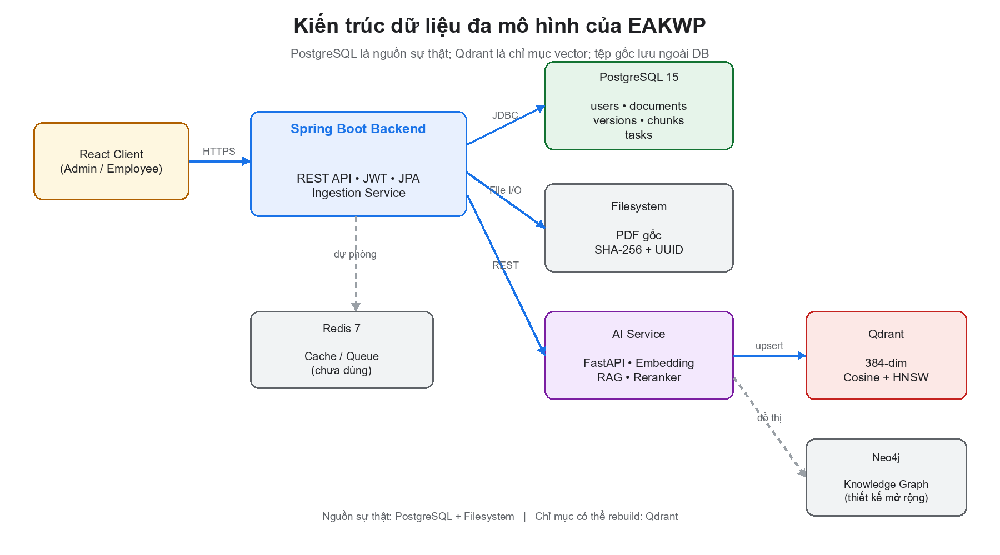
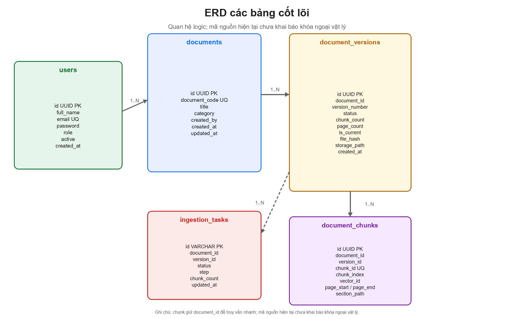
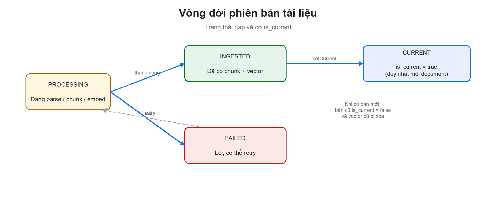

# CHƯƠNG 3. THIẾT KẾ CƠ SỞ DỮ LIỆU ĐA MÔ HÌNH CHO NỀN TẢNG QUẢN LÝ TRI THỨC DOANH NGHIỆP

> **Mục tiêu của chương.** Chương này trình bày thiết kế dữ liệu của hệ thống EAKWP theo hướng **đa mô hình (polyglot persistence)**: PostgreSQL làm nguồn sự thật cho dữ liệu nghiệp vụ, Qdrant làm chỉ mục vector cho truy xuất ngữ nghĩa, hệ thống tệp lưu bản gốc PDF, và Redis/Neo4j là các thành phần hạ tầng dự phòng hoặc mở rộng. Trọng tâm không chỉ là “vẽ bảng” mà là giải thích **vì sao** từng quyết định mô hình dữ liệu được chọn, **cách** các kho dữ liệu đồng bộ, và **những đánh đổi** về nhất quán, hiệu năng, bảo mật, khả năng mở rộng.

---

## 3.1. Vai trò của dữ liệu trong hệ thống EAKWP

EAKWP xử lý hai loại dữ liệu có bản chất khác nhau:

1. **Dữ liệu nghiệp vụ có cấu trúc:** người dùng, vai trò, tài liệu, phiên bản, đoạn trích, trạng thái nạp. Loại này cần giao dịch ACID, ràng buộc toàn vẹn, truy vấn theo khóa, và khả năng truy vết.
2. **Dữ liệu tri thức phi cấu trúc:** nội dung PDF, văn bản đã bóc tách, vector embedding, quan hệ ngữ nghĩa. Loại này cần tìm kiếm tương đồng, lưu trữ dung lượng lớn, và truy xuất theo ngữ cảnh.

Dùng một cơ sở dữ liệu duy nhất cho cả hai sẽ dẫn đến một trong hai cực đoan:

- **Nhồi vector vào PostgreSQL:** dùng extension `pgvector` có thể làm được, nhưng phải đánh đổi hiệu năng tìm kiếm xấp xỉ, quản lý chỉ mục HNSW, và vận hành một cụm PostgreSQL chịu tải cả OLTP lẫn vector search.
- **Nhồi dữ liệu nghiệp vụ vào Qdrant:** Qdrant không có giao dịch quan hệ, không phù hợp với ràng buộc khóa ngoại, báo cáo, hay truy vấn nhiều bảng.

Vì vậy hệ thống chọn kiến trúc **đa mô hình**, trong đó mỗi kho dữ liệu giải quyết một bài toán và có hợp đồng dữ liệu rõ ràng với các kho còn lại.

---

## 3.2. Yêu cầu thiết kế

### 3.2.1. Yêu cầu chức năng dữ liệu

Từ các ca sử dụng của hệ thống, có thể rút ra các yêu cầu dữ liệu sau:

| Mã | Yêu cầu | Mô tả |
| :--- | :--- | :--- |
| F-DB-01 | Quản lý người dùng | Lưu hồ sơ, email duy nhất, mật khẩu băm, vai trò, trạng thái hoạt động |
| F-DB-02 | Quản lý tài liệu | Lưu mã tài liệu, tiêu đề, danh mục, người tạo, thời điểm tạo/cập nhật |
| F-DB-03 | Quản lý phiên bản | Mỗi tài liệu có nhiều phiên bản; xác định phiên bản hiện hành |
| F-DB-04 | Quản lý đoạn trích | Lưu chunk, thứ tự, trang, đường dẫn mục, nội dung, tọa độ highlight |
| F-DB-05 | Theo dõi nạp | Lưu trạng thái, bước, số chunk, thông điệp lỗi của tác vụ nạp |
| F-DB-06 | Truy xuất ngữ nghĩa | Lưu vector và metadata để tìm kiếm tương đồng |
| F-DB-07 | Trích dẫn nguồn | Từ chunk truy ngược được tài liệu, phiên bản, trang, mục |
| F-DB-08 | Xóa và dọn dẹp | Xóa tài liệu phải xóa cả tệp, chunk, vector, tác vụ liên quan |

### 3.2.2. Yêu cầu phi chức năng

| Mã | Yêu cầu | Chỉ tiêu định hướng |
| :--- | :--- | :--- |
| NF-DB-01 | Toàn vẹn | Không mồ côi chunk/version; mỗi tài liệu có tối đa một phiên bản hiện hành |
| NF-DB-02 | Nhất quán | PostgreSQL nhất quán mạnh; Qdrant nhất quán cuối (eventual) |
| NF-DB-03 | Hiệu năng | Truy vấn danh sách tài liệu < 200 ms với 10.000 tài liệu; tìm kiếm vector < 100 ms |
| NF-DB-04 | Khả năng mở rộng | Hỗ trợ 100.000 tài liệu, 1 triệu chunk mà không đổi kiến trúc |
| NF-DB-05 | Bảo mật | Mật khẩu băm; phân quyền theo vai trò; không lộ dữ liệu giữa các tài liệu |
| NF-DB-06 | Truy vết | Mọi chunk truy ngược được tài liệu, phiên bản, trang, mục |
| NF-DB-07 | Vận hành | Sao lưu, phục hồi, migration có kiểm soát |
| NF-DB-08 | Khả dụng | Nạp tài liệu chạy nền, không chặn request; có retry khi lỗi |

### 3.2.3. Các thực thể và quan hệ chính

Mô hình khái niệm gồm năm thực thể cốt lõi:

- **User** — người dùng hệ thống.
- **Document** — tài liệu logic, ổn định qua các phiên bản.
- **DocumentVersion** — một lần ban hành/tải lên của tài liệu.
- **DocumentChunk** — đơn vị nội dung được đánh chỉ mục.
- **IngestionTask** — tác vụ nạp bất đồng bộ.

Quan hệ:

- Một `User` tạo nhiều `Document` (1–N logic).
- Một `Document` có nhiều `DocumentVersion` (1–N).
- Một `DocumentVersion` có nhiều `DocumentChunk` (1–N).
- Một `DocumentVersion` có nhiều `IngestionTask` theo thời gian (1–N logic).
- Mỗi `DocumentChunk` ánh xạ 1–1 với một point trong Qdrant qua `vector_id`.

---

## 3.3. Kiến trúc dữ liệu đa mô hình

### 3.3.1. Tổng quan các kho dữ liệu



*Hình 3.1. Kiến trúc dữ liệu đa mô hình: PostgreSQL là nguồn sự thật, Qdrant là chỉ mục vector, hệ thống tệp lưu bản gốc.*

| Kho dữ liệu | Vai trò | Dữ liệu lưu | Tính chất nhất quán |
| :--- | :--- | :--- | :--- |
| PostgreSQL 15 | Nguồn sự thật nghiệp vụ | users, documents, document_versions, document_chunks, ingestion_tasks | ACID, nhất quán mạnh |
| Qdrant | Chỉ mục vector | 384-dim vector + payload metadata | Nhất quán cuối, có thể rebuild |
| Hệ thống tệp | Lưu bản gốc | PDF gốc theo UUID, hash SHA-256 | Bền vững, không giao dịch |
| Redis 7 | Hạ tầng dự phòng | Cache, hàng đợi, session (chưa dùng trong mã hiện tại) | In-memory, có thể mất |
| Neo4j | Mở rộng đồ thị tri thức | Thực thể, quan hệ (chưa triển khai) | Thiết kế mở rộng |

### 3.3.2. Vai trò từng kho và lý do lựa chọn

**PostgreSQL** được chọn vì:

- Hỗ trợ giao dịch ACID, khóa ngoại, ràng buộc duy nhất, chỉ mục phức hợp.
- Kiểu dữ liệu phong phú: `UUID`, `JSONB`, `TEXT`, `TIMESTAMP`, `BOOLEAN`.
- Hệ sinh thái trưởng thành: Spring Data JPA, Flyway, `pg_dump`, `pg_stat_statements`.
- Miễn phí, chạy tốt trong Docker, phù hợp đồ án và triển khai on-premise.

**Qdrant** được chọn vì:

- Tối ưu cho vector search với chỉ mục HNSW.
- Hỗ trợ payload filter theo metadata (ví dụ `document_id`, `version_id`).
- API đơn giản, có dashboard, chạy nhẹ trong Docker.
- Hỗ trợ snapshot và tái tạo collection.

**Hệ thống tệp** được chọn thay vì lưu PDF vào database vì:

- PDF có thể lên đến 25 MB; lưu trong PostgreSQL làm phình bảng, chậm backup.
- Cần serve file trực tiếp cho trình xem PDF, có hỗ trợ `Range` request.
- Có thể chuyển sang object storage (S3/MinIO) mà không đổi schema.

**Redis** được khai báo trong `docker-compose.yml` với vai trò dự phòng cho cache/session/hàng đợi. Trong phạm vi mã nguồn hiện tại, Redis chưa được dùng trực tiếp; đây là quyết định có chủ đích để tránh thêm phụ thuộc khi chưa có nhu cầu. Khi hệ thống tăng tải, Redis có thể dùng cho:

- Cache kết quả tìm kiếm theo câu hỏi (cache-aside).
- Hàng đợi tác vụ nạp thay cho `@Async` trong JVM.
- Lưu trạng thái tác vụ để nhiều instance backend cùng đọc.

**Neo4j** là thiết kế mở rộng cho đồ thị tri thức, chưa được triển khai trong phiên bản hiện tại. Chương 4 sẽ trình bày mô hình và lý do.

### 3.3.3. Luồng dữ liệu end-to-end

Luồng nạp một tài liệu mới:

1. **Client → Backend:** gửi PDF kèm mã, tiêu đề, danh mục.
2. **Backend → Filesystem:** kiểm tra magic bytes, giới hạn 25 MB, ghi tệp với tên UUID, tính SHA-256.
3. **Backend → PostgreSQL:** tạo `documents`, `document_versions` (PROCESSING), `ingestion_tasks` (PROCESSING, step 1).
4. **Backend → AI Service:** gọi parse PDF (PyMuPDF/OCR), nhận danh sách trang và bounding box.
5. **Backend:** tạo `document_chunks`, lưu nội dung, trang, highlight.
6. **Backend → AI Service:** gửi từng batch 32 chunk để nhúng.
7. **AI Service → Qdrant:** upsert point với `point_id = uuid5(chunk_id)`, payload metadata.
8. **Backend → PostgreSQL:** cập nhật version `INGESTED`, đặt `is_current = true`, xóa vector phiên bản cũ.
9. **Client:** poll `/api/ai/status/{taskId}` để biết tiến độ.

Luồng đọc:

1. **Client → AI Service:** gửi câu hỏi.
2. **AI Service → Qdrant:** tìm top-N vector tương đồng, lọc theo `document_id` nếu có.
3. **AI Service:** rerank, chọn answer window, sinh câu trả lời kèm citation.
4. **Client → Backend:** dùng `document_id` + `chunk_id` trong citation để mở PDF đã tô vàng.

Điểm quan trọng: **PostgreSQL không tham gia trực tiếp vào truy vấn ngữ nghĩa**, nhưng vẫn là nguồn sự thật để xác thực tài liệu, phiên bản, quyền truy cập và hiển thị trích dẫn. Qdrant có thể bị xóa và rebuild từ PostgreSQL + tệp gốc mà không mất dữ liệu nghiệp vụ.

---

## 3.4. Thiết kế cơ sở dữ liệu quan hệ PostgreSQL

### 3.4.1. Mô hình khái niệm và ERD



*Hình 3.2. ERD các bảng cốt lõi của hệ thống EAKWP.*

Mô hình dùng khóa chính `UUID` thay cho số tự tăng. Lý do:

- Không lộ thứ tự và quy mô dữ liệu ra API.
- Có thể sinh ID ở client hoặc nhiều instance mà không cần sequence trung tâm.
- Thuận lợi khi hợp nhất dữ liệu từ nhiều môi trường.

Đánh đổi: UUID ngẫu nhiên (v4) làm phân mảnh chỉ mục B-tree và tốn 16 byte/khóa. Với hệ thống nhỏ, điều này không đáng kể; với bảng hàng chục triệu dòng, nên dùng UUIDv7/ULID (có thứ tự thời gian) để cải thiện locality.

### 3.4.2. Từ điển dữ liệu

#### Bảng `users`

| Cột | Kiểu | Null | Ý nghĩa | Ràng buộc |
| :--- | :--- | :---: | :--- | :--- |
| `id` | UUID | Không | Khóa chính | PK |
| `full_name` | VARCHAR(255) | Không | Họ tên |  |
| `email` | VARCHAR(255) | Không | Email đăng nhập | UNIQUE |
| `password` | VARCHAR(255) | Không | Mật khẩu băm BCrypt |  |
| `role` | VARCHAR(255) | Không | Vai trò: ADMIN, MANAGER, EMPLOYEE | Kiểm soát ở tầng ứng dụng |
| `active` | BOOLEAN | Có | Trạng thái hoạt động; null được hiểu là true |  |
| `created_at` | TIMESTAMP | Không | Thời điểm tạo |  |

Ghi chú thiết kế:

- `password` không bao giờ lưu plaintext; `AuthService` dùng `BCryptPasswordEncoder`.
- `role` là chuỗi thay vì bảng `roles` để giảm phức tạp. Khi cần phân quyền chi tiết (permission), nên tách `roles` và `role_permissions`.
- `active` nên là `NOT NULL DEFAULT TRUE`; hiện tại cho phép null và hàm `isActive()` xử lý null như true. Đây là điểm cần siết chặt.

#### Bảng `documents`

| Cột | Kiểu | Null | Ý nghĩa | Ràng buộc |
| :--- | :--- | :---: | :--- | :--- |
| `id` | UUID | Không | Khóa chính | PK |
| `document_code` | VARCHAR(64) | Không | Mã tài liệu nghiệp vụ | UNIQUE `uk_documents_code` |
| `title` | VARCHAR(255) | Không | Tiêu đề |  |
| `category` | VARCHAR(64) | Không | Danh mục |  |
| `created_by` | VARCHAR(255) | Không | Tên người tạo (snapshot) |  |
| `created_at` | TIMESTAMP | Không | Thời điểm tạo |  |
| `updated_at` | TIMESTAMP | Không | Thời điểm cập nhật gần nhất |  |

Ghi chú:

- `document_code` là mã nghiệp vụ ổn định, dùng để tham chiếu bên ngoài (ví dụ `NQLD-2026`). `id` là định danh kỹ thuật.
- `created_by` lưu tên thay vì `user_id` để giữ lịch sử khi người dùng đổi tên hoặc bị xóa. Tuy nhiên, cách này không cho phép join để phân quyền; nên bổ sung `created_by_id UUID` tham chiếu `users(id)` và giữ `created_by` như snapshot.
- `updated_at` được cập nhật khi thêm phiên bản mới hoặc đổi phiên bản hiện hành.

#### Bảng `document_versions`

| Cột | Kiểu | Null | Ý nghĩa | Ràng buộc |
| :--- | :--- | :---: | :--- | :--- |
| `id` | UUID | Không | Khóa chính | PK |
| `document_id` | UUID | Không | Tài liệu cha | Index `idx_versions_document` |
| `version_number` | INT | Không | Số phiên bản, tăng dần |  |
| `status` | VARCHAR(32) | Không | PROCESSING, INGESTED, FAILED | Kiểm soát ở ứng dụng |
| `chunk_count` | INT | Không | Số chunk (cache) |  |
| `page_count` | INT | Không | Số trang |  |
| `is_current` | BOOLEAN | Không | Phiên bản hiện hành | Index `idx_versions_current` |
| `file_hash` | VARCHAR(64) | Không | SHA-256 của PDF |  |
| `file_name` | VARCHAR(255) | Không | Tên tệp gốc |  |
| `storage_path` | VARCHAR(1024) | Không | Đường dẫn tệp |  |
| `created_by` | VARCHAR(255) | Không | Người tạo phiên bản |  |
| `created_at` | TIMESTAMP | Không | Thời điểm tạo |  |
| `error_message` | VARCHAR(2000) | Có | Thông điệp lỗi |  |

Ghi chú:

- `status` nên được kiểm tra bằng `CHECK (status IN ('PROCESSING','INGESTED','FAILED'))` hoặc PostgreSQL enum. Hiện tại chỉ kiểm soát ở tầng ứng dụng.
- `(document_id, version_number)` chưa có ràng buộc UNIQUE. Hai request đồng thời có thể tạo cùng số phiên bản. Cần bổ sung `UNIQUE (document_id, version_number)`.
- `is_current` chưa có ràng buộc “tối đa một true cho mỗi document”. Cần partial unique index:
  `CREATE UNIQUE INDEX uk_versions_one_current ON document_versions(document_id) WHERE is_current;`
- `chunk_count` là thuộc tính dẫn xuất được cache để tránh `COUNT(*)` trên bảng chunk lớn. Cần cơ chế cập nhật nhất quán (trigger hoặc transaction).
- `storage_path` đang lưu đường dẫn tuyệt đối; khi chuyển môi trường hoặc container, path có thể không còn đúng. Nên lưu key tương đối (ví dụ `documents/{document_id}/{version_id}.pdf`) và cấu hình gốc lưu trữ.

#### Bảng `document_chunks`

| Cột | Kiểu | Null | Ý nghĩa | Ràng buộc |
| :--- | :--- | :---: | :--- | :--- |
| `id` | UUID | Không | Khóa chính | PK |
| `document_id` | UUID | Không | Tài liệu | Index `idx_chunks_document` |
| `version_id` | UUID | Không | Phiên bản | Index `idx_chunks_version` |
| `chunk_id` | VARCHAR(128) | Không | Mã chunk nghiệp vụ | UNIQUE |
| `chunk_index` | INT | Không | Thứ tự trong phiên bản |  |
| `vector_id` | VARCHAR(128) | Không | ID point trong Qdrant |  |
| `page_start` | INT | Không | Trang bắt đầu |  |
| `page_end` | INT | Không | Trang kết thúc |  |
| `heading_level` | INT | Không | Cấp tiêu đề |  |
| `section_path` | VARCHAR(512) | Không | Đường dẫn mục |  |
| `content` | TEXT | Không | Nội dung chunk |  |
| `highlight_json` | TEXT | Có | Tọa độ highlight JSON |  |

Ghi chú:

- `chunk_id` có dạng `doc-{documentId}-v{version}-c{index}` trong luồng upload, hoặc `DOC-001-CHUNK-0001` trong pipeline offline. Cần thống nhất quy ước để tránh trùng.
- `vector_id` hiện bằng `chunk_id`; có thể bỏ và suy ra, nhưng giữ lại để ánh xạ rõ ràng sang Qdrant và hỗ trợ đổi chiến lược ID sau này.
- `section_path` là `VARCHAR(512)`, trong khi pipeline offline tạo danh sách nhiều cấp. Nên đổi sang `JSONB` hoặc chuẩn hóa thành bảng `document_sections` (xem 3.4.9).
- `highlight_json` là JSON dạng text; nên đổi sang `JSONB` để kiểm tra hợp lệ và truy vấn.
- `(version_id, chunk_index)` chưa UNIQUE; cần bổ sung để tránh trùng thứ tự khi retry.

#### Bảng `ingestion_tasks`

| Cột | Kiểu | Null | Ý nghĩa | Ràng buộc |
| :--- | :--- | :---: | :--- | :--- |
| `id` | VARCHAR(64) | Không | ID tác vụ (`task-{uuid}`) | PK |
| `document_id` | UUID | Không | Tài liệu | Index `idx_tasks_document` |
| `version_id` | UUID | Không | Phiên bản |  |
| `status` | VARCHAR(32) | Không | PROCESSING, INGESTED, FAILED |  |
| `step` | INT | Không | Bước 1–5 |  |
| `chunk_count` | INT | Không | Số chunk đã xử lý |  |
| `message` | VARCHAR(2000) | Có | Thông điệp tiến độ/lỗi |  |
| `updated_at` | TIMESTAMP | Không | Cập nhật gần nhất |  |

Ghi chú:

- `step` nên có `CHECK (step BETWEEN 1 AND 5)`.
- `status` nên có CHECK constraint.
- Bảng này là log trạng thái; có thể giữ nhiều task cho một version (retry). Cần index `(document_id, status)` để kiểm tra “đang xử lý”.

### 3.4.3. DDL tham chiếu

```sql
CREATE TABLE users (
    id           UUID PRIMARY KEY,
    full_name    VARCHAR(255) NOT NULL,
    email        VARCHAR(255) NOT NULL,
    password     VARCHAR(255) NOT NULL,
    role         VARCHAR(255) NOT NULL,
    active       BOOLEAN,
    created_at   TIMESTAMP NOT NULL,
    CONSTRAINT uk_users_email UNIQUE (email)
);

CREATE TABLE documents (
    id             UUID PRIMARY KEY,
    document_code  VARCHAR(64) NOT NULL,
    title          VARCHAR(255) NOT NULL,
    category       VARCHAR(64) NOT NULL,
    created_by     VARCHAR(255) NOT NULL,
    created_at     TIMESTAMP NOT NULL,
    updated_at     TIMESTAMP NOT NULL,
    CONSTRAINT uk_documents_code UNIQUE (document_code)
);

CREATE TABLE document_versions (
    id             UUID PRIMARY KEY,
    document_id    UUID NOT NULL,
    version_number INT NOT NULL,
    status         VARCHAR(32) NOT NULL,
    chunk_count    INT NOT NULL,
    page_count     INT NOT NULL,
    is_current     BOOLEAN NOT NULL,
    file_hash      VARCHAR(64) NOT NULL,
    file_name      VARCHAR(255) NOT NULL,
    storage_path   VARCHAR(1024) NOT NULL,
    created_by     VARCHAR(255) NOT NULL,
    created_at     TIMESTAMP NOT NULL,
    error_message  VARCHAR(2000)
);

CREATE INDEX idx_versions_document ON document_versions(document_id);
CREATE INDEX idx_versions_current  ON document_versions(document_id, is_current);

CREATE TABLE document_chunks (
    id             UUID PRIMARY KEY,
    document_id    UUID NOT NULL,
    version_id     UUID NOT NULL,
    chunk_id       VARCHAR(128) NOT NULL,
    chunk_index    INT NOT NULL,
    vector_id      VARCHAR(128) NOT NULL,
    page_start     INT NOT NULL,
    page_end       INT NOT NULL,
    heading_level  INT NOT NULL,
    section_path   VARCHAR(512) NOT NULL,
    content        TEXT NOT NULL,
    highlight_json TEXT,
    CONSTRAINT uk_chunks_chunk_id UNIQUE (chunk_id)
);

CREATE INDEX idx_chunks_document ON document_chunks(document_id);
CREATE INDEX idx_chunks_version  ON document_chunks(version_id);

CREATE TABLE ingestion_tasks (
    id           VARCHAR(64) PRIMARY KEY,
    document_id  UUID NOT NULL,
    version_id   UUID NOT NULL,
    status       VARCHAR(32) NOT NULL,
    step         INT NOT NULL,
    chunk_count  INT NOT NULL,
    message      VARCHAR(2000),
    updated_at   TIMESTAMP NOT NULL
);

CREATE INDEX idx_tasks_document ON ingestion_tasks(document_id);
```

Các ràng buộc nên bổ sung cho production:

```sql
ALTER TABLE document_versions
    ADD CONSTRAINT uk_versions_number UNIQUE (document_id, version_number);

CREATE UNIQUE INDEX uk_versions_one_current
    ON document_versions(document_id)
    WHERE is_current;

ALTER TABLE document_chunks
    ADD CONSTRAINT uk_chunks_order UNIQUE (version_id, chunk_index);

ALTER TABLE document_versions
    ADD CONSTRAINT ck_versions_status
    CHECK (status IN ('PROCESSING', 'INGESTED', 'FAILED'));

ALTER TABLE ingestion_tasks
    ADD CONSTRAINT ck_tasks_status
    CHECK (status IN ('PROCESSING', 'INGESTED', 'FAILED'));

ALTER TABLE ingestion_tasks
    ADD CONSTRAINT ck_tasks_step CHECK (step BETWEEN 1 AND 5);
```

### 3.4.4. Chuẩn hóa và các quyết định phi chuẩn hóa

#### Phân tích dạng chuẩn

Xét các phụ thuộc hàm chính:

- `users`: `id → {full_name, email, password, role, active, created_at}`; `email → id` (khóa ứng viên).
- `documents`: `id → {document_code, title, category, created_by, created_at, updated_at}`; `document_code → id`.
- `document_versions`: `id → {document_id, version_number, status, chunk_count, page_count, is_current, file_hash, file_name, storage_path, created_by, created_at, error_message}`; `(document_id, version_number) → id`.
- `document_chunks`: `id → {document_id, version_id, chunk_id, chunk_index, vector_id, page_start, page_end, heading_level, section_path, content, highlight_json}`; `chunk_id → id`; `(version_id, chunk_index) → id`.
- `ingestion_tasks`: `id → {document_id, version_id, status, step, chunk_count, message, updated_at}`.

Tất cả các bảng đều ở **3NF**: không có thuộc tính không khóa phụ thuộc bắc cầu vào khóa chính. Một số thuộc tính là dẫn xuất có chủ đích:

| Thuộc tính | Nguồn dẫn xuất | Lý do giữ | Rủi ro |
| :--- | :--- | :--- | :--- |
| `document_versions.chunk_count` | `COUNT(document_chunks)` | Tránh count trên bảng lớn mỗi lần hiển thị | Có thể lệch nếu pipeline lỗi giữa chừng |
| `document_versions.is_current` | Quyết định nghiệp vụ | Thể hiện “phiên bản được ban hành” | Có thể có hai true nếu không có ràng buộc |
| `document_chunks.vector_id` | `chunk_id` | Ánh xạ rõ sang Qdrant, hỗ trợ đổi chiến lược | Dư thừa dữ liệu |
| `documents.updated_at` | Thời điểm thay đổi | Tránh join khi sắp xếp danh sách | Có thể lệch nếu cập nhật thủ công |

Các quyết định này là **phi chuẩn hóa có kiểm soát**, không phải lỗi thiết kế. Điều kiện để chấp nhận là phải có cơ chế cập nhật nhất quán và kiểm tra định kỳ.

#### Vì sao tách `documents` và `document_versions`?

Nếu gộp phiên bản vào `documents`, mỗi lần ban hành mới sẽ phải cập nhật cùng một dòng, làm mất lịch sử và gây tranh chấp ghi. Tách ra cho phép:

- Giữ nhiều phiên bản bất biến (immutable).
- Chỉ một phiên bản là hiện hành.
- Truy vết trích dẫn đến đúng phiên bản tại thời điểm trả lời.
- Xóa/archived phiên bản cũ mà không ảnh hưởng tài liệu logic.

Đây là mô hình **slowly changing dimension type 2** thu gọn: mỗi phiên bản là một “dòng lịch sử”, `is_current` đánh dấu bản mới nhất được chọn.

#### Vì sao `document_chunks` lưu cả `document_id` và `version_id`?

Về chuẩn hóa, `document_id` có thể suy ra từ `version_id`. Tuy nhiên, lưu cả hai mang lại:

- Truy vấn theo tài liệu (xóa, thống kê, hiển thị) không cần join.
- Chỉ mục `idx_chunks_document` phục vụ xóa theo tài liệu nhanh.
- Giảm rủi ro mồ côi nếu `version_id` bị xóa nhưng chunk còn.

Đánh đổi là nguy cơ không nhất quán nếu `document_id` trong chunk khác với `document_id` của version. Cần ràng buộc ứng dụng hoặc composite FK `(version_id, document_id)` tham chiếu `document_versions(id, document_id)` (cần unique trên cặp này).

### 3.4.5. Khóa, ràng buộc và chỉ mục

#### Khóa

- **Khóa chính:** UUID cho tất cả bảng nghiệp vụ; `ingestion_tasks.id` là chuỗi vì cần prefix `task-` và dễ đọc trên log.
- **Khóa tự nhiên:** `users.email`, `documents.document_code`, `document_chunks.chunk_id`.
- **Khóa tổng hợp tiềm năng:** `(document_id, version_number)`, `(version_id, chunk_index)` — cần UNIQUE.

#### Ràng buộc toàn vẹn

Mã nguồn hiện tại **không khai báo khóa ngoại vật lý** trong JPA. Quan hệ được giữ ở tầng ứng dụng. Điều này có ưu điểm:

- Giảm ma sát khi migration, seed dữ liệu, hoặc xóa hàng loạt.
- Tránh khóa chéo khi nhiều service cùng ghi.

Nhược điểm:

- Có thể tạo chunk mồ côi nếu code lỗi.
- Không có `ON DELETE CASCADE`; phải xóa thủ công theo thứ tự.
- Khó đảm bảo toàn vẹn khi có nhiều ứng dụng cùng truy cập.

Khuyến nghị cho production: thêm khóa ngoại với `ON DELETE CASCADE` cho `document_versions.document_id`, `document_chunks.version_id`, `ingestion_tasks.document_id`; giữ `created_by_id` tham chiếu `users(id)` với `ON DELETE SET NULL`.

#### Chỉ mục và truy vấn điển hình

| Truy vấn | Câu lệnh điển hình | Chỉ mục hiện có | Đánh giá |
| :--- | :--- | :--- | :--- |
| Đăng nhập | `WHERE email = ?` | UNIQUE(email) | Tốt |
| Danh sách tài liệu | `LOWER(title) LIKE '%q%'` + EXISTS version | `idx_versions_current` | `LIKE '%...%'` không dùng B-tree; cần trigram |
| Phiên bản hiện hành | `WHERE document_id = ? AND is_current = true` | `idx_versions_current` | Tốt |
| Danh sách phiên bản | `WHERE document_id = ? ORDER BY version_number DESC` | `idx_versions_document` | Cần composite `(document_id, version_number DESC)` |
| Chunk theo phiên bản | `WHERE version_id = ? ORDER BY chunk_index` | `idx_chunks_version` | Nên composite `(version_id, chunk_index)` |
| Chunk theo mã | `WHERE chunk_id = ?` | UNIQUE(chunk_id) | Tốt |
| Chunk lịch sử | `WHERE document_id = ? AND chunk_id = ?` | `idx_chunks_document` + UNIQUE | Tốt |
| Trạng thái tác vụ | `WHERE id = ?` | PK | Tốt |
| Kiểm tra đang xử lý | `WHERE document_id = ? AND status = 'PROCESSING'` | `idx_tasks_document` | Nên composite `(document_id, status)` |
| Đếm chunk | `COUNT(*) WHERE version_id = ?` | `idx_chunks_version` | Tốt |

**Vấn đề N+1 trong danh sách tài liệu.** `DocumentService.list()` lấy danh sách `documents`, sau đó gọi `currentVersion(documentId)` cho từng dòng. Với 1.000 tài liệu, đó là 1.001 truy vấn. Giải pháp:

- Dùng một câu JPQL join giữa `documents` và `document_versions` với điều kiện `is_current = true`, chiếu thẳng sang DTO.
- Hoặc dùng `@EntityGraph` / `JOIN FETCH` và phân trang.
- Hoặc duy trì `current_version_id` trên `documents` (denormalization có kiểm soát) để đọc một lần.

**Vấn đề tìm kiếm chuỗi.** `LOWER(title) LIKE '%keyword%'` buộc full scan. Với PostgreSQL, có ba lựa chọn:

1. **pg_trgm:** `CREATE EXTENSION pg_trgm; CREATE INDEX idx_documents_title_trgm ON documents USING gin (title gin_trgm_ops);` hỗ trợ `ILIKE '%...%'`.
2. **Full-text search:** `tsvector` + GIN, phù hợp tìm theo từ, nhưng cần xử lý tiếng Việt (unaccent, dictionary).
3. **Elasticsearch/OpenSearch:** nếu cần tìm kiếm phức tạp, nhưng thêm một kho dữ liệu.

Với quy mô đồ án, pg_trgm là lựa chọn tối thiểu đủ tốt.

### 3.4.6. Mô hình phiên bản tài liệu

#### Trạng thái và vòng đời



*Hình 3.3. Vòng đời phiên bản và tác vụ nạp.*

Một phiên bản đi qua các trạng thái:

1. **PROCESSING:** vừa tạo, đang bóc tách/nhúng.
2. **INGESTED:** đã có chunk và vector, sẵn sàng làm hiện hành.
3. **FAILED:** lỗi; có thể retry.

Quy tắc nghiệp vụ:

- Chỉ phiên bản `INGESTED` mới được đặt `is_current = true` (hàm `setCurrent` kiểm tra).
- Khi tạo phiên bản đầu tiên, `is_current = true` ngay từ đầu để UI có dữ liệu hiển thị; nếu nạp lỗi, UI thấy trạng thái FAILED. Đây là đánh đổi giữa “có dữ liệu sớm” và “chỉ công bố khi thành công”.
- Khi tạo phiên bản mới, `is_current = false`; sau khi nạp xong, `markCurrent` đặt true và các phiên bản khác false.
- Không cho upload phiên bản mới nếu đang có phiên bản `PROCESSING` (tránh chồng chéo).
- Khi xóa tài liệu, không cho xóa nếu có version/task đang `PROCESSING`.

#### Bất biến quan trọng

| Mã | Bất biến | Cách thực thi |
| :--- | :--- | :--- |
| INV-01 | Mỗi document có tối đa một version `is_current = true` | Partial unique index + transaction |
| INV-02 | `(document_id, version_number)` duy nhất | UNIQUE constraint |
| INV-03 | `(version_id, chunk_index)` duy nhất | UNIQUE constraint |
| INV-04 | `chunk_count` bằng số chunk thực tế | Transaction + job đối soát |
| INV-05 | Không có chunk mồ côi | FK hoặc job đối soát |
| INV-06 | `status` chỉ nhận giá trị hợp lệ | CHECK constraint |
| INV-07 | `step` trong 1–5 | CHECK constraint |

Hiện tại INV-01, INV-02, INV-03, INV-06, INV-07 chưa được thực thi ở tầng DB; đây là các điểm cần bổ sung trước khi production.

### 3.4.7. Truy vấn và giao dịch

#### Biên giao dịch hiện tại

- `DocumentService.upload()` **không** có `@Transactional`. Nó lưu document, version, task bằng ba lần `save` riêng. Nếu lần thứ hai hoặc thứ ba lỗi, dữ liệu trước đó vẫn tồn tại.
- `DocumentService.delete()` có `@Transactional`, nhưng gọi AI service (xóa vector) trước khi xóa DB. Nếu DB rollback sau khi vector đã xóa, dữ liệu mất không thể phục hồi từ Qdrant (có thể rebuild từ DB + file, nhưng tốn thời gian).
- `DocumentService.setCurrent()` **không** có `@Transactional`; vòng lặp cập nhật nhiều version có thể để lại trạng thái trung gian nếu lỗi giữa chừng.
- `IngestionService.process()` chạy `@Async`, không chia sẻ session với request gốc; các thao tác `save` là những transaction riêng.

#### Khuyến nghị

1. Bọc `upload()` trong một transaction tạo document + version + task; chỉ sau khi commit mới gửi tác vụ async.
2. Bọc `setCurrent()` trong transaction và dùng một câu `UPDATE` để đặt tất cả `is_current = false`, sau đó đặt true cho target.
3. Với `delete()`, xóa DB trước (hoặc đánh dấu `DELETING`), sau đó xóa vector; nếu xóa vector lỗi, có job retry. Tránh xóa vector trước DB.
4. Thêm bảng `outbox` để ghi sự kiện “cần xóa vector” / “cần nạp vector”, đảm bảo không mất sự kiện khi service AI chết.

### 3.4.8. Mô hình mở rộng: sections và workflow

#### Bảng `document_sections`

Để tránh lưu `section_path` dạng chuỗi và hỗ trợ truy vấn theo cấp, có thể chuẩn hóa:

```sql
CREATE TABLE document_sections (
    id          UUID PRIMARY KEY,
    version_id  UUID NOT NULL REFERENCES document_versions(id) ON DELETE CASCADE,
    parent_id   UUID REFERENCES document_sections(id) ON DELETE CASCADE,
    level       INT NOT NULL,
    title       TEXT NOT NULL,
    order_index INT NOT NULL,
    page_start  INT,
    page_end    INT,
    UNIQUE (version_id, parent_id, order_index)
);

ALTER TABLE document_chunks
    ADD COLUMN section_id UUID REFERENCES document_sections(id) ON DELETE SET NULL;
```

Lợi ích:

- Truy vấn “tất cả điều khoản trong Chương III” bằng `parent_id`/`level`.
- Không parse chuỗi `section_path`.
- Hỗ trợ hiển thị cây tài liệu trên UI.
- Là nền tảng cho đồ thị tri thức (Chương 4).

Đánh đổi: thêm bảng, thêm join, pipeline phải sinh section ID. Với đồ án hiện tại, `section_path` dạng text là đủ; bảng sections là hướng mở rộng có căn cứ.

#### Các bảng nghiệp vụ mở rộng

Hệ thống định hướng có thêm quy trình nghỉ phép và IT support. Các bảng dưới đây **chưa triển khai trong mã nguồn hiện tại**, nhưng được thiết kế để không phá vỡ mô hình hiện có:

```sql
CREATE TABLE chat_sessions (
    id         UUID PRIMARY KEY,
    user_id    UUID NOT NULL REFERENCES users(id) ON DELETE CASCADE,
    title      VARCHAR(255),
    created_at TIMESTAMP NOT NULL
);

CREATE TABLE chat_messages (
    id         UUID PRIMARY KEY,
    session_id UUID NOT NULL REFERENCES chat_sessions(id) ON DELETE CASCADE,
    role       VARCHAR(16) NOT NULL CHECK (role IN ('user', 'assistant', 'system')),
    content    TEXT NOT NULL,
    citations  JSONB,
    created_at TIMESTAMP NOT NULL
);

CREATE TABLE leave_requests (
    id          UUID PRIMARY KEY,
    user_id     UUID NOT NULL REFERENCES users(id),
    start_date  DATE NOT NULL,
    end_date    DATE NOT NULL,
    total_days  INT NOT NULL CHECK (total_days > 0),
    reason      TEXT,
    status      VARCHAR(16) NOT NULL CHECK (status IN ('PENDING','APPROVED','REJECTED','CANCELLED')),
    created_at  TIMESTAMP NOT NULL,
    updated_at  TIMESTAMP NOT NULL
);

CREATE TABLE it_requests (
    id            UUID PRIMARY KEY,
    ticket_code   VARCHAR(32) NOT NULL UNIQUE,
    requester_id  UUID NOT NULL REFERENCES users(id),
    assignee_id   UUID REFERENCES users(id),
    title         VARCHAR(255) NOT NULL,
    description   TEXT,
    category      VARCHAR(64),
    priority      VARCHAR(16) CHECK (priority IN ('LOW','MEDIUM','HIGH','URGENT')),
    status        VARCHAR(16) NOT NULL CHECK (status IN ('OPEN','IN_PROGRESS','RESOLVED','CLOSED')),
    ai_confidence REAL,
    resolution_note TEXT,
    created_at    TIMESTAMP NOT NULL,
    resolved_at   TIMESTAMP
);

CREATE TABLE approvals (
    id           UUID PRIMARY KEY,
    request_type VARCHAR(16) NOT NULL CHECK (request_type IN ('LEAVE','IT')),
    request_id   UUID NOT NULL,
    approver_id  UUID NOT NULL REFERENCES users(id),
    decision     VARCHAR(16) NOT NULL CHECK (decision IN ('APPROVED','REJECTED')),
    comment      TEXT,
    decided_at   TIMESTAMP NOT NULL
);
```

Quan hệ `approvals` → `leave_requests`/`it_requests` là **khóa ngoại đa hình logic** (`request_type` + `request_id`), không thể khai báo FK vật lý trong PostgreSQL. Cần kiểm tra ở tầng service hoặc dùng trigger. Đây là đánh đổi phổ biến của mô hình đa hình; nếu muốn ràng buộc vật lý, có thể tách `leave_approvals` và `it_approvals`.

---

## 3.5. Thiết kế cơ sở dữ liệu vector Qdrant

### 3.5.1. Collection và không gian vector

Collection `enterprise_documents` được tạo với cấu hình:

| Tham số | Giá trị | Ý nghĩa |
| :--- | :--- | :--- |
| `size` | 384 | Số chiều vector, khớp mô hình E5-Small |
| `distance` | Cosine | Độ đo tương đồng, phù hợp embedding văn bản |
| `hnsw_config` | Mặc định | Chỉ mục xấp xỉ HNSW |
| `on_disk_payload` | Mặc định | Payload lưu cùng point |
| `shard_number` | Mặc định (1) | Một shard cho quy mô đồ án |

Việc chọn cosine thay vì Euclidean hay dot product xuất phát từ đặc điểm embedding: các vector đã được chuẩn hóa L2, khi đó cosine và dot product tương đương; cosine còn ổn định khi độ lớn vector thay đổi. Công thức:

> **Công thức 3.1.** $\text{cosine}(e_q, e_d) = \frac{e_q \cdot e_d}{\|e_q\|_2 \|e_d\|_2}$

Qdrant chuẩn hóa nội bộ khi dùng `Distance.COSINE`, nên không cần chuẩn hóa thủ công trước khi upsert.

### 3.5.2. Payload schema

Payload là phần dữ liệu phi vector gắn với mỗi point. Nó đóng vai trò “bản sao metadata” để kết quả tìm kiếm có thể hiển thị và trích dẫn mà không cần join sang PostgreSQL.

| Trường payload | Kiểu | Bắt buộc | Mục đích |
| :--- | :--- | :---: | :--- |
| `chunk_id` | keyword | Có | Định danh chunk, khớp `document_chunks.chunk_id` |
| `content` | text | Có | Nội dung đoạn, dùng cho rerank và hiển thị |
| `document_id` | keyword | Có | Lọc theo tài liệu, xóa theo tài liệu |
| `version_id` | keyword | Có | Lọc theo phiên bản, xóa phiên bản cũ |
| `page_start` | integer | Có | Trang bắt đầu để mở PDF đúng trang |
| `page_end` | integer | Có | Trang kết thúc |
| `section_path` | array/keyword | Có | Đường dẫn mục, hiển thị citation |
| `document_type` | keyword | Không | Loại tài liệu (regulation, policy, …) |
| `language` | keyword | Không | Ngôn ngữ |
| `is_current` | bool | Không | Đánh dấu phiên bản hiện hành |
| `access_level` | keyword | Không | Mức truy cập (dự kiến) |
| `allowed_roles` | array | Không | Vai trò được phép (dự kiến) |
| `char_count` | integer | Không | Thống kê độ dài |
| `token_count` | integer | Không | Thống kê token |

Payload không nên chứa toàn bộ nội dung nếu dung lượng là mối lo. Với 152 chunk, nội dung trung bình 732 ký tự, tổng payload khoảng 150–200 KB — không đáng kể. Với 1 triệu chunk, payload có thể lên hàng GB; khi đó có thể chỉ lưu `chunk_id` và join sang PostgreSQL, hoặc dùng `on_disk_payload`.

### 3.5.3. Point ID và tính lũy đẳng

Mỗi point có ID:

> **Công thức 3.2.** $\text{point\_id} = \text{UUIDv5}(\text{NAMESPACE\_DNS}, \text{chunk\_id})$

UUIDv5 là hash của namespace và tên, đảm bảo cùng một `chunk_id` luôn sinh cùng point ID. Đây là cơ chế **idempotency**: khi retry nạp một phiên bản, các point được ghi đè thay vì nhân bản. Nếu dùng UUID ngẫu nhiên, mỗi lần retry sẽ tạo point mới và kho vector phình ra.

Điều kiện để idempotency hoạt động là `chunk_id` ổn định. Trong luồng upload, `chunk_id` được sinh từ `document_id`, `version_number`, và `chunk_index`; ba thành phần này không đổi khi retry cùng một phiên bản. Trong pipeline offline, `chunk_id` có dạng `DOC-001-CHUNK-0001`, cũng ổn định theo thứ tự chunk.

### 3.5.4. HNSW và tìm kiếm xấp xỉ

Qdrant dùng HNSW (Hierarchical Navigable Small World) — một đồ thị nhiều tầng để tìm kiếm láng giềng gần nhất. Ý tưởng:

- Tầng trên cùng thưa, kết nối xa; tầng dưới dày, kết nối gần.
- Tìm kiếm bắt đầu từ tầng trên, đi theo cạnh gần nhất, rồi đi xuống tầng dưới.
- Tham số `M` (số cạnh mỗi node) và `ef_construct` (độ rộng tìm kiếm khi xây) quyết định chất lượng/chi phí.

Độ phức tạp trung bình của tìm kiếm là $O(\log N)$, so với $O(N)$ khi quét toàn bộ. Đánh đổi là kết quả **xấp xỉ**: có thể bỏ sót một vài láng giềng đúng, nhưng với dữ liệu văn bản và top-k lớn (10–60), tỷ lệ bỏ sót thấp.

Với 152 point, HNSW gần như không cần thiết; Qdrant vẫn dùng chỉ mục này. Với 1 triệu point, HNSW là yếu tố quyết định khả năng mở rộng.

### 3.5.5. Lọc theo metadata và chỉ mục payload

Truy vấn có thể lọc theo `document_id`, `version_id`, `document_type`, `is_current`. Qdrant hỗ trợ filter trước hoặc sau khi tìm kiếm; để hiệu quả, cần tạo **payload index**:

```http
PUT /collections/enterprise_documents/index
{
  "field_name": "document_id",
  "field_schema": "keyword"
}
```

Các index nên tạo:

| Trường | Kiểu index | Lý do |
| :--- | :--- | :--- |
| `document_id` | keyword | Lọc theo tài liệu, xóa theo tài liệu |
| `version_id` | keyword | Lọc theo phiên bản |
| `document_type` | keyword | Lọc theo loại tài liệu |
| `is_current` | bool | Chỉ tìm phiên bản hiện hành |
| `access_level` | keyword | Lọc theo quyền (khi triển khai RBAC) |

Nếu không tạo index, Qdrant vẫn lọc được nhưng phải quét payload, chậm dần theo số point. Đây là điểm khác biệt giữa “chạy được” và “chạy nhanh”.

### 3.5.6. Dung lượng và mở rộng

Ước lượng dung lượng vector:

> **Công thức 3.3.** $S_{vector} = N \times d \times 4$ byte (float32)

Với $d = 384$:

| Số vector | Dung lượng vector thô | HNSW + payload (ước tính 2–3×) | Ghi chú |
| ---: | ---: | ---: | :--- |
| 152 | 228 KB | ~0,5–0,9 MB | Đúng với thực tế: `storage.sqlite` ~852 KB |
| 10.000 | 15 MB | ~35–50 MB | Chạy tốt trên một node |
| 100.000 | 150 MB | ~350–500 MB | Cần theo dõi RAM |
| 1.000.000 | 1,5 GB | ~3,5–5 GB | Nên dùng quantization/sharding |

Các chiến lược mở rộng:

1. **Quantization:** scalar quantization (int8) giảm 4 lần dung lượng, chấp nhận giảm nhẹ độ chính xác.
2. **Sharding:** chia collection theo `document_type` hoặc tenant.
3. **On-disk payload:** giảm RAM, tăng I/O.
4. **Collection theo phiên bản:** mỗi phiên bản lớn có collection riêng, dùng alias để chuyển; xóa collection cũ sau khi chuyển. Cách này giải quyết bài toán “xóa vector cũ” sạch hơn filter.

---

## 3.6. Lưu trữ tệp và siêu dữ liệu

### 3.6.1. Mô hình lưu trữ

Tệp PDF được lưu ngoài database, với tên UUID:

```
data/uploads/
  └── {document_id}/
        └── {version_id}.pdf
```

Thông tin trong `document_versions`:

- `file_name`: tên gốc do người dùng tải lên (để hiển thị).
- `storage_path`: đường dẫn tới tệp (hiện là tuyệt đối; khuyến nghị tương đối).
- `file_hash`: SHA-256 của nội dung tệp.
- `page_count`: số trang.

### 3.6.2. Kiểm tra toàn vẹn

Trước khi lưu, backend kiểm tra:

1. **Kích thước:** tối đa 25 MB (`spring.servlet.multipart.max-file-size`).
2. **Magic bytes:** bốn byte đầu phải là `%PDF` (0x25 0x50 0x44 0x46). Đây là kiểm tra quan trọng vì `Content-Type` do client gửi có thể bị giả.
3. **Tên tệp:** không dùng trực tiếp để tạo path; dùng UUID để tránh path traversal (`../`).
4. **Hash:** tính SHA-256 để phát hiện trùng lặp và kiểm tra toàn vẹn sau khi lưu.

Hash SHA-256:

> **Công thức 3.4.** $h = \text{SHA256}(bytes)$

Hash có thể dùng để:

- Phát hiện tải lên trùng (cùng tài liệu, cùng nội dung).
- Kiểm tra tệp không bị hỏng sau khi copy/backup.
- Làm khóa deduplication nếu muốn tiết kiệm dung lượng.

Hiện tại `file_hash` chưa có UNIQUE; hai phiên bản có cùng nội dung vẫn được lưu riêng. Đây là quyết định hợp lý vì cùng nội dung có thể thuộc hai tài liệu khác nhau; nếu muốn dedupe, cần bảng `file_blobs` riêng.

### 3.6.3. Serve tệp và Range request

API `GET /api/documents/{id}/file` trả về `FileSystemResource` với `Content-Disposition: inline`. Trình duyệt PDF cần hỗ trợ **Range request** để tải từng phần; Spring Boot hỗ trợ sẵn khi trả `Resource`. Đây là lý do không nên đọc toàn bộ PDF vào memory rồi trả về.

Bảo mật:

- Chỉ người dùng đã xác thực mới được gọi API (JWT).
- Kiểm tra quyền theo tài liệu (hiện chưa có ACL chi tiết; xem 3.9).
- Không cho phép đoán ID tuần tự; UUID giảm rủi ro liệt kê.
- Đặt `X-Content-Type-Options: nosniff` để tránh trình duyệt đoán sai loại tệp.

---

## 3.7. Nhất quán và đồng bộ giữa các kho

### 3.7.1. Mô hình nhất quán

Hệ thống có ba mức nhất quán:

| Cặp kho | Mô hình | Hệ quả |
| :--- | :--- | :--- |
| PostgreSQL nội bộ | ACID, nhất quán mạnh | Giao dịch nhìn thấy hoặc không nhìn thấy toàn bộ |
| PostgreSQL → Qdrant | Nhất quán cuối | Có khoảng thời gian vector chưa/không khớp DB |
| PostgreSQL → Filesystem | Nhất quán cuối | Tệp có thể tồn tại trước khi DB commit hoặc ngược lại |

Không có giao dịch phân tán (2PC) giữa PostgreSQL và Qdrant. Vì vậy, thiết kế phải chấp nhận **eventual consistency** và có cơ chế bù trừ.

### 3.7.2. Luồng ghi và các điểm thất bại

Giả sử luồng nạp:

1. Lưu tệp.
2. `INSERT documents`.
3. `INSERT document_versions` (PROCESSING).
4. `INSERT ingestion_tasks`.
5. Async: parse → `INSERT chunks` → gọi AI service → Qdrant upsert.
6. `UPDATE version` (INGESTED).
7. `setCurrent`.
8. Xóa vector phiên bản cũ.

Các điểm thất bại và cách xử lý:

| Điểm lỗi | Trạng thái còn lại | Tác động | Cách xử lý |
| :--- | :--- | :--- | :--- |
| Lưu tệp lỗi | Không có DB | Không có tài liệu | Trả lỗi 500; không tạo DB |
| DB insert document lỗi | Tệp mồ côi | Tốn dung lượng | Xóa tệp trong `catch` |
| DB insert version/task lỗi | Document không version | Tài liệu “rỗng” | Transaction cho 3 insert |
| Parse/OCR lỗi | Version PROCESSING/FAILED | Không có chunk | Đánh FAILED, cho retry |
| Insert chunk lỗi giữa chừng | Một phần chunk | `chunk_count` lệch | Transaction theo batch hoặc xóa theo version trước khi retry |
| AI service lỗi giữa batch | Một phần vector | Qdrant thiếu point | Retry idempotent; chỉ INGESTED khi tất cả batch xong |
| Qdrant upsert xong, DB update lỗi | Vector có, version PROCESSING | Truy vấn thấy vector dù version chưa INGESTED | Retry; hoặc lọc `is_current` ở payload |
| `setCurrent` lỗi | Version INGESTED nhưng không current | Không truy vấn được bản mới | Retry; transaction |
| Xóa vector cũ lỗi | Vector cũ còn | Kết quả trùng lặp | Retry; dedupe ở retriever |
| Xóa DB xong, xóa vector lỗi | Vector mồ côi | Tốn dung lượng, có thể trả kết quả cũ | Outbox/reconciliation |

### 3.7.3. Idempotency và retry

Ba yếu tố đảm bảo retry an toàn:

1. **Point ID xác định:** UUIDv5 từ `chunk_id`, nên upsert lặp lại không tạo bản sao.
2. **Chunk ID xác định:** sinh từ document + version + index, không đổi giữa các lần retry.
3. **Xóa theo version trước khi retry:** `retry()` xóa toàn bộ chunk của version trong DB và gọi AI service xóa vector theo `version_id`, sau đó nạp lại.

Đoạn code hiện tại:

```java
// IngestionService.retry
chunkRepository.deleteByVersionId(versionId);
version.setStatus(PROCESSING);
version.setErrorMessage(null);
version.setChunkCount(0);
versionRepository.save(version);
aiIngestClient.deleteByVersion(documentId.toString(), versionId.toString());
process(task.getId());
```

Điểm mạnh: xóa cả hai phía trước khi nạp lại. Điểm yếu: nếu xóa vector lỗi, hàm `deleteByVersion` trả 0 nhưng không ném exception; quá trình vẫn tiếp tục và có thể để lại vector cũ. Cần kiểm tra kết quả trả về và ghi log/retry.

### 3.7.4. Đồng bộ phiên bản

Khi một phiên bản mới được chấp nhận:

1. Vector phiên bản mới được upsert.
2. `markCurrent` đặt `is_current = true` cho bản mới, false cho bản cũ.
3. Xóa vector phiên bản cũ.

Thứ tự này đảm bảo không có khoảng thời gian “không có bản nào” (availability), nhưng có khoảng thời gian “có cả hai bản” (duplicate). Retriever xử lý bằng cách:

- Lọc `is_current = true` nếu payload có trường này.
- Dedupe theo `(page_start, content)` hoặc theo `chunk_id`.
- Nếu vẫn trùng, ưu tiên phiên bản có `version_id` mới hơn.

Cách sạch hơn là dùng **Qdrant alias**:

1. Tạo collection `enterprise_documents_v{version}`.
2. Upsert toàn bộ vector vào collection mới.
3. Chuyển alias `enterprise_documents` sang collection mới (atomic).
4. Xóa collection cũ sau một khoảng thời gian.

Khi đó, người đọc luôn thấy một phiên bản nhất quán; không có trạng thái trùng lặp. Đánh đổi: tốn dung lượng gấp đôi trong lúc chuyển, và phải quản lý nhiều collection. Với quy mô đồ án, filter + dedupe là đủ; alias là hướng production.

### 3.7.5. Đề xuất outbox và reconciliation

**Transactional outbox** giải quyết bài toán “DB commit nhưng không gửi được sự kiện”:

```sql
CREATE TABLE ingestion_outbox (
    id           UUID PRIMARY KEY,
    aggregate_id UUID NOT NULL,
    event_type   VARCHAR(64) NOT NULL,
    payload      JSONB NOT NULL,
    status       VARCHAR(16) NOT NULL DEFAULT 'PENDING',
    attempts     INT NOT NULL DEFAULT 0,
    last_error   TEXT,
    created_at   TIMESTAMPTZ NOT NULL DEFAULT now(),
    processed_at TIMESTAMPTZ
);

CREATE INDEX idx_outbox_pending ON ingestion_outbox(status, created_at);
```

Luồng:

1. Trong cùng transaction với `INSERT version/chunk`, ghi một dòng outbox `INGEST_VECTORS`.
2. Worker đọc `PENDING`, gọi AI service/Qdrant, đánh `DONE`.
3. Nếu lỗi, tăng `attempts`, ghi `last_error`, thử lại với backoff.
4. Job đối soát định kỳ so sánh số point trong Qdrant với `document_chunks`; phát hiện thiếu/thừa.

**Reconciliation job** nên chạy:

- Đếm `COUNT(*)` chunk theo version trong PostgreSQL.
- Đếm point trong Qdrant theo `version_id`.
- Nếu lệch, ghi cảnh báo và re-ingest version đó.
- Kiểm tra `is_current` có đúng một bản mỗi document.

Đây là những thành phần “không nhìn thấy” trong demo nhưng quyết định độ tin cậy khi vận hành thật.

---

## 3.8. Hiệu năng và khả năng mở rộng

### 3.8.1. Phân tích truy vấn

Các truy vấn nóng:

1. **Danh sách tài liệu** (mỗi lần mở trang chủ): join documents + current version, lọc keyword/category.
2. **Chi tiết tài liệu**: document + versions + chunk count.
3. **Mở PDF**: đọc file theo `storage_path`.
4. **Chat**: vector search + rerank (không chạm PostgreSQL trừ citation).
5. **Status polling**: đọc task theo PK.

Với 10.000 tài liệu và 1 triệu chunk:

- Danh sách có phân trang 20 dòng: nếu dùng join đúng, < 50 ms.
- Nếu N+1: 20 truy vấn con, ~200 ms hoặc hơn.
- Nếu `LIKE '%q%'` không index: full scan 10.000 dòng, ~50–200 ms; với 1 triệu dòng, không chấp nhận được.

### 3.8.2. Ước lượng dung lượng

| Thành phần | Đơn vị | 10.000 tài liệu | 100.000 tài liệu | 1 triệu tài liệu |
| :--- | :--- | ---: | ---: | ---: |
| `documents` | ~300 B/dòng | 3 MB | 30 MB | 300 MB |
| `document_versions` | ~700 B/dòng | 7 MB (1 version) | 70 MB | 700 MB |
| `document_chunks` | ~1,3 KB/dòng | 13 GB (10 chunk) | 130 GB | 1,3 TB |
| Vector Qdrant | 1,5 KB/vector | 15 GB | 150 GB | 1,5 TB |
| Tệp PDF | ~5 MB/tài liệu | 50 GB | 500 GB | 5 TB |

Bảng trên cho thấy **chunk và vector là chi phí chính**, không phải bảng documents. Vì vậy, các quyết định quan trọng là:

- Kích thước chunk (1200 ký tự) và số chunk/tài liệu.
- Số chiều vector (384 vs 768).
- Chính sách lưu trữ phiên bản cũ (archive/xóa).
- Nén và dedupe tệp.

Với quy mô đồ án (vài chục tài liệu, vài nghìn chunk), mọi thứ nằm trong một node. Kiến trúc vẫn đúng hướng khi mở rộng.

### 3.8.3. Nút thắt và giải pháp

| Nút thắt | Triệu chứng | Giải pháp |
| :--- | :--- | :--- |
| N+1 khi list | Nhiều truy vấn nhỏ | Join/projection, `@EntityGraph`, phân trang |
| `LIKE '%q%'` | Full scan | pg_trgm GIN, full-text search |
| Insert chunk từng dòng | Nạp chậm | Batch insert (`hibernate.jdbc.batch_size`), `saveAll` theo batch |
| Vector search chậm | P95 tăng | Payload index, HNSW tuning, quantization |
| Xóa tài liệu lớn | Khóa bảng lâu | Xóa theo batch, `ON DELETE CASCADE` có kiểm soát |
| Async queue đầy | Task chờ | Tăng pool, Redis queue, backpressure |
| Backup lâu | RPO/RTO xấu | Incremental backup, object storage |

### 3.8.4. Kế hoạch mở rộng

1. **Giai đoạn 1 (hiện tại):** một PostgreSQL, một Qdrant, filesystem.
2. **Giai đoạn 2:** thêm read replica PostgreSQL; tách worker nạp; Redis queue.
3. **Giai đoạn 3:** object storage (MinIO/S3); Qdrant cluster; partition bảng chunk theo `document_id` hash.
4. **Giai đoạn 4:** multi-tenant với `tenant_id` + row-level security; cách ly vector theo tenant.

---

## 3.9. Bảo mật và toàn vẹn dữ liệu

### 3.9.1. Xác thực và phân quyền

**Xác thực:**

- Mật khẩu băm bằng BCrypt (salt tự sinh, cost mặc định 10). BCrypt chậm có chủ đích, chống brute-force.
- JWT ký HMAC-SHA, thời hạn 1 giờ (`jwt.expiration`). Token chứa email (subject) và role (claim).
- Filter `JwtAuthenticationFilter` kiểm tra chữ ký và hạn, nạp user từ DB, gán authority `ROLE_{role}`.

**Phân quyền:**

- `POST /api/users`, `PATCH /api/users/**`: ADMIN.
- `POST /api/documents/upload`, `POST /api/documents/*/versions`: ADMIN.
- `PATCH/DELETE /api/documents/**`: ADMIN.
- Các API đọc/chat: yêu cầu đã xác thực.

**Khoảng trống cần xử lý:**

1. **Không kiểm tra `active` trong filter:** user bị vô hiệu hóa vẫn dùng token cũ đến khi hết hạn. Cần kiểm tra `user.isActive()` trong `isTokenValid` hoặc trước khi gán authority.
2. **Không có refresh token/revocation:** token bị lộ có hiệu lực đến 1 giờ. Cần refresh token ngắn hạn + blacklist hoặc token version.
3. **Không có ACL theo tài liệu:** mọi user đã đăng nhập có thể đọc mọi tài liệu. Trường `access_level`/`allowed_roles` có trong payload nhưng chưa được dùng để lọc. Cần:
   - Lưu ACL trong PostgreSQL (`document_acl(document_id, role, permission)`).
   - Truyền role/tenant vào filter Qdrant khi search.
   - Kiểm tra quyền ở API mở file.
4. **Role dạng chuỗi:** dễ sai chính tả; nên dùng enum hoặc bảng roles.

### 3.9.2. Bảo vệ dữ liệu nhạy cảm

- **SQL injection:** JPA dùng parameter binding; các truy vấn `@Query` cũng dùng `:param`. Không nối chuỗi SQL. Tuy nhiên, `LIKE` với input người dùng cần escape `%` và `_` để tránh mở rộng tìm kiếm ngoài ý muốn.
- **Path traversal:** tên tệp lưu bằng UUID, không dùng tên gốc để tạo path. API mở file nhận UUID, không nhận path.
- **XSS:** nội dung trả về JSON, frontend render text; không dùng `dangerouslySetInnerHTML`. Nếu render Markdown, cần sanitize.
- **Dữ liệu cá nhân:** `users.full_name`, `email`; `chat_messages.content` có thể chứa PII. Cần chính sách retention, masking log, và quyền xóa.
- **Mã hóa at-rest:** PostgreSQL/Qdrant volumes không tự mã hóa; cần disk encryption hoặc TDE ở hạ tầng.
- **Secrets:** `JWT_SECRET`, `DB_PASSWORD`, API key LLM để trong biến môi trường, không commit. Kiểm tra `.env` không nằm trong git.

### 3.9.3. Sao lưu và phục hồi

Chiến lược đề xuất:

| Thành phần | Công cụ | Tần suất | RPO | RTO |
| :--- | :--- | :--- | :--- | :--- |
| PostgreSQL | `pg_dump` / WAL archiving | Ngày / liên tục | 24h / 5 phút | 1–4h |
| Qdrant | Snapshot API | Ngày | 24h | 1h (hoặc rebuild) |
| Tệp PDF | Rsync/object storage versioning | Liên tục | ~0 | 1h |
| Cấu hình | Git + secret manager | Mỗi thay đổi | 0 | 15 phút |

Điểm quan trọng: **Qdrant có thể rebuild từ PostgreSQL + tệp gốc**. Vì vậy, backup Qdrant là tùy chọn; backup PostgreSQL và tệp là bắt buộc. Khi rebuild, chạy lại pipeline nhúng cho toàn bộ chunk hiện hành.

### 3.9.4. Migration và tiến hóa schema

Hiện tại `spring.jpa.hibernate.ddl-auto=update`. Đây là cấu hình **chỉ dùng cho phát triển**:

- Hibernate có thể thêm cột/bảng nhưng không xóa hoặc đổi kiểu an toàn.
- Không có lịch sử thay đổi.
- Không kiểm soát được thứ tự migration giữa các môi trường.

Khuyến nghị:

1. Chuyển sang `ddl-auto=validate`.
2. Dùng Flyway hoặc Liquibase với thư mục `db/migration`.
3. Baseline schema hiện tại thành `V1__init.sql`.
4. Mọi thay đổi tiếp theo là migration có version.
5. Áp dụng expand/contract cho thay đổi phá vỡ: thêm cột mới → dual-write → migrate → bỏ cột cũ.

Ví dụ migration thêm ràng buộc:

```sql
-- V2__add_version_invariants.sql
ALTER TABLE document_versions
    ADD CONSTRAINT uk_versions_number UNIQUE (document_id, version_number);

CREATE UNIQUE INDEX uk_versions_one_current
    ON document_versions(document_id)
    WHERE is_current;

ALTER TABLE document_chunks
    ADD CONSTRAINT uk_chunks_order UNIQUE (version_id, chunk_index);
```

Trước khi thêm ràng buộc, cần chạy truy vấn kiểm tra dữ liệu vi phạm:

```sql
SELECT document_id, COUNT(*)
FROM document_versions
WHERE is_current
GROUP BY document_id
HAVING COUNT(*) > 1;
```

---

## 3.10. Đánh giá thiết kế

### 3.10.1. Đối chiếu yêu cầu

| Yêu cầu | Mức đáp ứng | Ghi chú |
| :--- | :---: | :--- |
| F-DB-01 Quản lý người dùng | Đạt | BCrypt, email unique, role |
| F-DB-02 Quản lý tài liệu | Đạt | documents + metadata |
| F-DB-03 Quản lý phiên bản | Đạt | version + is_current |
| F-DB-04 Quản lý đoạn trích | Đạt | chunk + highlight |
| F-DB-05 Theo dõi nạp | Đạt | ingestion_tasks |
| F-DB-06 Truy xuất ngữ nghĩa | Đạt | Qdrant + payload |
| F-DB-07 Trích dẫn nguồn | Đạt | chunk → document/version/page |
| F-DB-08 Xóa và dọn dẹp | Một phần | Có xóa DB + vector; thiếu outbox/reconciliation |
| NF-DB-01 Toàn vẹn | Một phần | Thiếu FK và một số UNIQUE |
| NF-DB-02 Nhất quán | Đạt | ACID + eventual rõ ràng |
| NF-DB-03 Hiệu năng | Một phần | Thiếu index trigram, N+1 |
| NF-DB-04 Mở rộng | Một phần | Kiến trúc đúng, chưa có sharding |
| NF-DB-05 Bảo mật | Một phần | Thiếu ACL, kiểm tra active |
| NF-DB-06 Truy vết | Đạt | chunk_id + version + page |
| NF-DB-07 Vận hành | Một phần | Thiếu migration, backup tự động |
| NF-DB-08 Khả dụng | Đạt | Async + retry |

### 3.10.2. Kiểm thử và kiểm chứng

Các kiểm thử hiện có:

- `PdfProcessorTest`: 7 test, pass — kiểm tra bóc tách trang, chunk, highlight.
- `EnterpriseAiPlatformApplicationTests`: 1 test — kiểm tra Spring context (có thể fail nếu thiếu DB/env, không phải lỗi logic).
- Chưa có integration test cho schema PostgreSQL/Qdrant.

Đề xuất bổ sung:

1. **Testcontainers PostgreSQL:** kiểm tra migration, ràng buộc UNIQUE, partial index, cascade.
2. **Testcontainers Qdrant:** kiểm tra upsert idempotent, filter theo version, xóa theo document.
3. **Test đồng thời:** hai request upload cùng document/version; đảm bảo UNIQUE chặn.
4. **Test retry:** giả lập AI service lỗi giữa batch; kiểm tra không nhân bản point.
5. **Test xóa:** xóa tài liệu có nhiều version; kiểm tra không còn chunk/vector/tệp.

### 3.10.3. Hạn chế

- Chưa có khóa ngoại vật lý; toàn vẹn phụ thuộc ứng dụng.
- Chưa có migration; schema tiến hóa bằng `ddl-auto`.
- Chưa có ACL theo tài liệu; mọi user đọc được mọi tài liệu.
- Chưa có audit log; không biết ai đọc/sửa/xóa.
- Chưa có multi-tenant.
- Chưa có outbox/reconciliation; lỗi đồng bộ chỉ được xử lý thủ công.
- Chưa có phân trang danh sách tài liệu.
- Chưa có backup tự động trong repo.

---

## 3.11. Kết luận chương

Chương này đã thiết kế và phân tích cơ sở dữ liệu của EAKWP trên ba trục:

1. **Mô hình dữ liệu quan hệ:** năm bảng cốt lõi, khóa UUID, quan hệ document–version–chunk, mô hình phiên bản bất biến, các quyết định chuẩn hóa/phi chuẩn hóa có kiểm soát.
2. **Mô hình dữ liệu vector:** collection Qdrant 384 chiều, payload metadata, point ID xác định, HNSW, payload index, ước lượng dung lượng.
3. **Mô hình nhất quán và vận hành:** luồng ghi, các điểm thất bại, idempotency, retry, outbox/reconciliation, bảo mật, backup, migration.

Điểm mạnh của thiết kế là **tách bạch trách nhiệm**: PostgreSQL giữ sự thật nghiệp vụ, Qdrant giữ khả năng truy xuất, filesystem giữ bản gốc. Nhờ đó, Qdrant có thể rebuild, filesystem có thể chuyển sang object storage, và PostgreSQL có thể mở rộng độc lập.

Điểm cần hoàn thiện trước production là **ràng buộc toàn vẹn ở tầng DB** (FK, UNIQUE, partial index), **đồng bộ bằng outbox**, **ACL theo tài liệu**, và **migration có version**. Những điểm này đã được phân tích kèm DDL/giải pháp, không chỉ nêu tên.

Chương tiếp theo sẽ khai thác dữ liệu này để xây dựng **cơ sở tri thức**: từ cấu trúc tài liệu, phân đoạn thích ứng, metadata, embedding, đến truy xuất lai và trích dẫn.

---


