## 4.13. Đồ thị tri thức Neo4j: KB1, KB2 và KB hợp nhất

### 4.13.1. Vì sao cần đồ thị tri thức

Kho vector trả lời tốt câu hỏi "đoạn nào nói về X". Nó yếu ở bốn loại yêu cầu mà văn bản quản trị doanh nghiệp đặt ra:

- **Quan hệ giữa điều khoản:** "Điều 27 dẫn chiếu những điều nào?"
- **Thực thể xuyên tài liệu:** "Những tài liệu nào quy định về Ủy ban Kiểm toán?"
- **Lịch sử và phiên bản:** "Vốn điều lệ thay đổi qua những lần sửa đổi nào, giá trị hiện hành là bao nhiêu?"
- **Nguồn gốc và độ tin cậy:** "Thông tin này đến từ văn bản chính thức hay trang web công khai, có mâu thuẫn với nguồn khác không?"

Đồ thị tri thức (Knowledge Graph, KG) biểu diễn thực thể và quan hệ một cách tường minh, nên trả lời được bốn loại yêu cầu trên bằng cách duyệt đường đi [Neo4j, *How to Build a Knowledge Graph*]. Trong EAKWP, đồ thị không thay thế kho vector mà là đường truy xuất thứ hai: vector tìm đoạn văn giống câu hỏi, đồ thị tìm đoạn văn có cùng thực thể, cùng quan hệ, và biết đoạn nào còn hiệu lực.

### 4.13.2. Kiến trúc KB1, KB2 và KB hợp nhất

Tri thức được chia thành hai kho nguồn và một kho hợp nhất:

- **KB1, kho tài liệu nghiệp vụ:** 35 tệp PDF (Điều lệ, phụ lục sửa đổi, quy chế, quy trình, chính sách nhân sự), nạp offline bằng script.
- **KB2, kho nguồn công khai:** 10 trang web chính thức của doanh nghiệp, nạp offline bằng script.
- **Tài liệu upload:** 7 tài liệu người dùng tải lên qua giao diện, đồng bộ trực tiếp vào KB khi nạp (mục 5.3.3).
- **KB, kho hợp nhất:** gom tất cả tài liệu trên dưới một nút `KnowledgeBase`. KB không sao chép dữ liệu, chỉ thêm cạnh thành viên `HAS_DOCUMENT`.

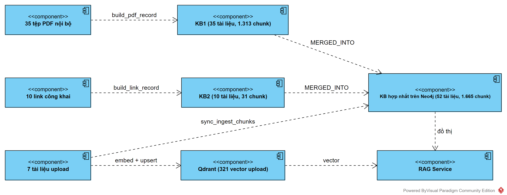

*Hình 4.5. Hai đường nạp PDF/link vào KB1/KB2, tài liệu upload đồng bộ vào KB; KB1, KB2 gộp thành KB và nối vào RAG.*

Toàn cảnh ba kho trong Neo4j cho thấy đúng kiến trúc trên: KB1 giữ 35 tài liệu PDF, KB2 giữ 10 trang web, KB hợp nhất giữ 52 tài liệu (35 + 10 + 7 tài liệu tải lên qua backend). KB1 và KB2 nối vào KB bằng cạnh `MERGED_INTO` do truy vấn `MERGE_KBS` trong `03_merge_and_resolve.cypher` tạo ra.

```cypher
MATCH p=(:KnowledgeBase)-[:HAS_DOCUMENT]->(:Document) RETURN p
UNION
MATCH p=(:KnowledgeBase)-[:MERGED_INTO]->(:KnowledgeBase) RETURN p
```

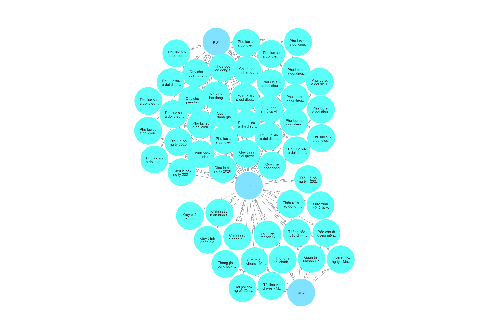

*Hình 4.6. Toàn cảnh KB1, KB2 và KB hợp nhất trong Neo4j Browser: 3 nút KnowledgeBase, 52 nút Document, 99 cạnh.*


| Thành phần | Nguồn | Tài liệu | Chunk | Ghi chú |
| :--- | :--- | ---: | ---: | :--- |
| KB1 | PDF nội bộ (395 trang, 112,2 MB) | 35 | 1.313 | Nạp bằng `10_build_neo4j_kb.py --pdf` |
| KB2 | 10 link công khai | 10 | 31 | Nạp bằng `10_build_neo4j_kb.py --links` |
| Upload | Tài liệu người dùng tải lên | 7 | 321 | Đồng bộ qua `POST /api/v1/ingest` |
| **KB** | **Hợp nhất** | **52** | **1.665** | 291 thực thể; đếm bằng `06_quality.cypher` ngày 15/11/2026 |

*Bảng 4.10. Quy mô các kho tri thức trong Neo4j.*

ID của Document, Chunk và Entity được sinh từ **nội dung** (băm SHA-1), không từ thứ tự nạp. Nạp lại cùng tài liệu không tạo node mới, và một tài liệu thuộc cả KB1 lẫn KB vẫn chỉ có một node.

### 4.13.3. Nguồn dữ liệu

#### a) Tổng hợp PDF theo nhóm

| Nhóm | Số tệp | Số trang | Dung lượng | Nội dung chính |
| :--- | ---: | ---: | ---: | :--- |
| Điều lệ công ty | 3 | 121 | 29,05 MB | Điều lệ 2021, 2025, 2026 |
| Phụ lục sửa đổi điều lệ | 22 | 72 | 9,41 MB | Các lần sửa đổi 2012–2024 |
| Nhân sự và lao động | 3 | 53 | 19,32 MB | Chính sách nhân quyền, nội quy, thỏa ước lao động |
| Quy chế và quy trình | 7 | 149 | 49,21 MB | Quản trị công ty, quản trị rủi ro, an ninh thông tin, HĐQT, nhà cung cấp, khiếu nại, xử lý vụ việc |
| **Tổng** | **35** | **395** | **112,2 MB** | |

*Bảng 4.11. Kho PDF của KB1. Danh mục đầy đủ 35 tệp ở Phụ lục và `assets/source_inventory.json`.*

#### b) Mười link của KB2

| # | Nhóm | Link |
| ---: | :--- | :--- |
| 1 | Doanh nghiệp | `masanconsumer.com/ve-masan-consumer/gioi-thieu-chung/` |
| 2 | Quản trị | `masanconsumer.com/quan-he-co-dong/gioi-thieu/` |
| 3 | Quản trị | `masanconsumer.com/quan-he-co-dong/cong-bo-thong-tin/thong-tin-cong-bo/` |
| 4 | Quản trị | `masanconsumer.com/quan-he-co-dong/bao-cao-thuong-nien/` |
| 5 | Quản trị | `masanconsumer.com/quan-he-co-dong/dai-hoi-dong-co-dong/` |
| 6 | Tài chính | `masanconsumer.com/quan-he-co-dong/thong-tin-tai-chinh/` |
| 7 | Tài liệu | `masanconsumer.com/tai-lieu-doanh-nghiep/` |
| 8 | Bền vững | `masanconsumer.com/phat-trien-ben-vung/quan-tri/` |
| 9 | Tin tức | `masanconsumer.com/tin-tuc/thong-cao-bao-chi/` |
| 10 | Tài liệu | `masanconsumer.com/tai-lieu/` |

*Bảng 4.12. Nguồn web của KB2 (`ai-service/data/kb_sources/links.json`).*

### 4.13.4. Mô hình đồ thị

Mô hình là **đồ thị thuộc tính có nhãn** (Labeled Property Graph, LPG): node có nhãn và thuộc tính, cạnh có kiểu, hướng và thuộc tính. So với RDF, LPG gắn được thuộc tính lên cạnh, nên lưu được trực tiếp độ tin cậy của một phép trích xuất (`MENTIONS.confidence`) hay lý do giải quyết mâu thuẫn (`CONFLICTS_WITH.reason`).

| Nhãn node | Thuộc tính chính | Ý nghĩa |
| :--- | :--- | :--- |
| `KnowledgeBase` | `kb_id`, `name`, `updated_at` | KB1, KB2, KB |
| `Document` | `doc_id`, `title`, `source_uri`, `source_type`, `content_hash`, `version`, `is_current`, `source_trust`, `effective_date`, `duplicate_of` | Một tệp PDF, một trang web hoặc một tài liệu upload |
| `Chunk` | `chunk_id`, `text`, `page_start`, `page_end`, `section_path`, `content_hash` | Đơn vị truy xuất và trích dẫn |
| `Entity` | `entity_id`, `name`, `type`, `description`, `embedding` | Điều khoản, chức danh, chủ đề, văn bản pháp luật, mốc thời gian, tiêu đề mục |
| `Claim` | `attribute`, `value`, `status`, `confidence`, `flags` | Một dữ kiện số do một đoạn văn khẳng định |
| `IngestRun` | `run_id`, `source`, `inserted`, `skipped`, `new_version`, `retired` | Nhật ký một lần cập nhật KB |

*Bảng 4.13. Các nhãn node.*

| Cạnh | Từ → Đến | Ý nghĩa |
| :--- | :--- | :--- |
| `HAS_DOCUMENT`, `HAS_CHUNK` | KB → Document → Chunk | Cấu trúc chứa |
| `MERGED_INTO` | KB nguồn → KB đích | Nguồn gốc của kho hợp nhất |
| `MENTIONS {confidence, method}` | Chunk → Entity | Đoạn nhắc thực thể, kèm độ tin cậy |
| `APPLIES_TO` | Chunk → Entity | Thực thể là chủ đề của mục chứa đoạn |
| `REFERENCES` | Chunk → Chunk | Điều khoản dẫn chiếu điều khoản khác |
| `RELATES_TO {weight, confidence}` | Entity – Entity | Hai thực thể cùng xuất hiện trong đoạn |
| `SAME_AS`, `POSSIBLY_SAME_AS {score, membership}` | Entity – Entity | Hợp nhất thực thể mờ (mục 4.15.6) |
| `NEW_VERSION_OF` | Document → Document | Phiên bản mới thay bản cũ |
| `DUPLICATE_OF`, `SIMILAR_TO {overlap}` | Document → Document | Trùng lặp, gần trùng (mục 4.15.2) |
| `ASSERTS`, `ABOUT`, `CONFLICTS_WITH {reason}` | Chunk → Claim → Entity, Claim → Claim | Dữ kiện và mâu thuẫn (mục 4.15.7) |
| `UPDATED` | IngestRun → KB | Lần cập nhật nào đã sửa kho nào |

*Bảng 4.14. Các kiểu cạnh.*

Hình 4.7 là lược đồ do chính Neo4j sinh ra (`CALL db.schema.visualization()`) trên cơ sở dữ liệu sau khi đã xử lý tích hợp: sáu nhãn node và mười bốn kiểu quan hệ.

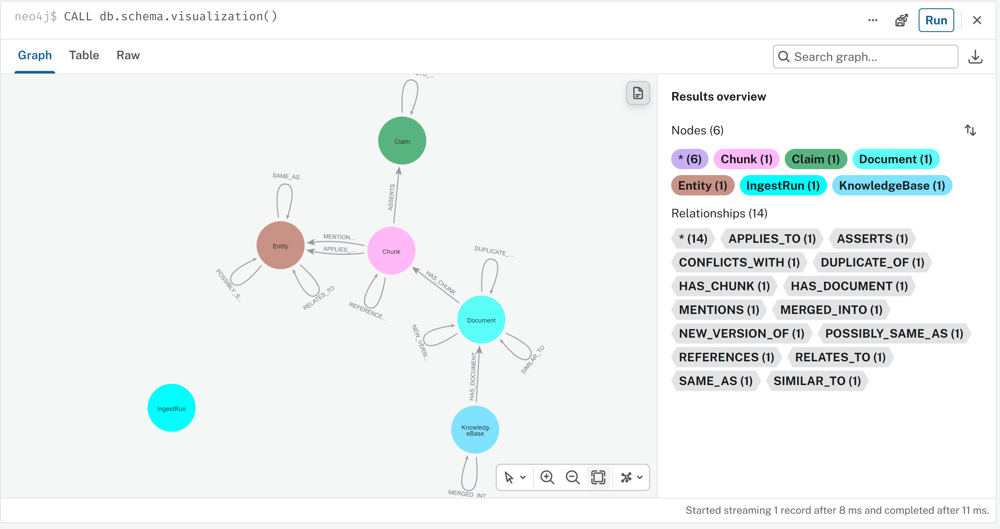

*Hình 4.7. Lược đồ đồ thị tri thức trong Neo4j Browser: 6 nhãn node, 14 kiểu quan hệ.*

Áp lược đồ này lên một tài liệu cụ thể: Quy chế hoạt động Hội đồng Quản trị (tài liệu tải lên) có 53 chunk, 194 cạnh `MENTIONS` tới 51 thực thể. Hình dưới lấy 24 chunk đầu; các thực thể như "Hội đồng Quản trị", "Đại hội đồng cổ đông", "Luật Doanh nghiệp" nằm giữa vì được nhiều chunk cùng nhắc tới, còn các nút "Điều N" nằm ở rìa vì mỗi điều chỉ được một hai chunk dẫn chiếu.

```cypher
MATCH p=(d:Document {doc_id:'1cb5c2d8-7a56-46b0-b65f-4c3650a27fb7'})-[:HAS_CHUNK]->(c:Chunk)-[:MENTIONS]->(e:Entity)
WHERE c.chunk_index < 24 AND NOT e.type IN ['moc_thoi_gian']
RETURN p
```

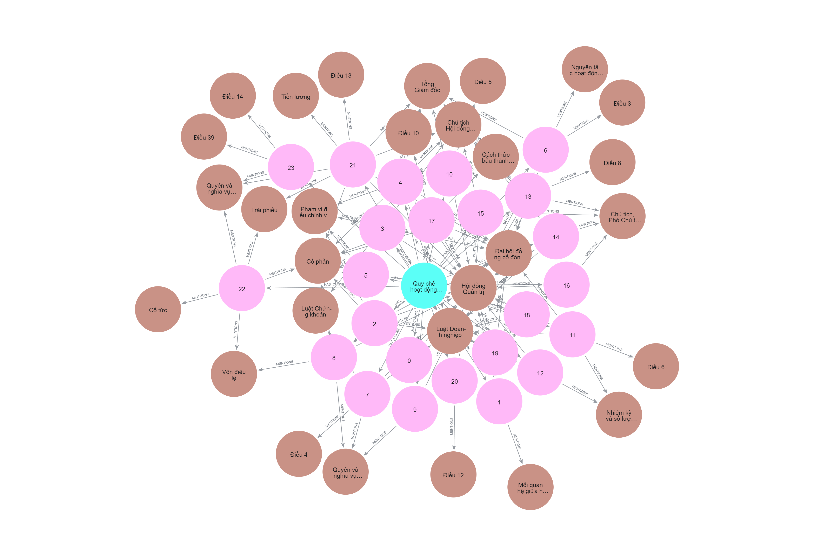

*Hình 4.8. Document → Chunk → Entity của Quy chế hoạt động HĐQT: 54 nút, 122 cạnh.*

## 4.14. Mã Cypher của KB và đường nạp dữ liệu

### 4.14.1. Tổ chức mã Cypher thành tệp .cypher

Toàn bộ truy vấn của KB được viết trong bảy tệp `.cypher`, tách khỏi mã Python, theo đúng thứ tự vòng đời của dữ liệu:

| Tệp | Số truy vấn | Nội dung |
| :--- | ---: | :--- |
| `01_schema.cypher` | 2 khối | 6 ràng buộc duy nhất, 7 chỉ mục (gồm chỉ mục vector 384 chiều cho Entity) |
| `02_ingest.cypher` | 5 | Ghi Document, Chunk, Entity, MENTIONS, REFERENCES, APPLIES_TO; lan truyền sang KB đã gộp |
| `03_merge_and_resolve.cypher` | 17 | Gộp KB; trùng lặp; chuỗi phiên bản; hợp nhất thực thể; trọng số quan hệ; dữ kiện và mâu thuẫn |
| `04_update.cypher` | 10 | Tìm bản hiện hành, thay thế, nối phiên bản, loại nguồn đã xóa, nhật ký, xóa |
| `05_retrieval.cypher` | 9 | Truy xuất cho RAG, tra dữ kiện, thống kê |
| `06_quality.cypher` | 7 | Chỉ số đánh giá KB (mục 4.18) |
| `07_explore.cypher` | 9 (không đặt tên) | Truy vấn minh họa để chạy trong Neo4j Browser |

*Bảng 4.15. Các tệp Cypher trong `ai-service/app/knowledge_graph/cypher/`.*

Mỗi truy vấn mở đầu bằng dòng đánh dấu tên và kết thúc bằng dấu `;`, nên cùng một tệp vừa chạy được trong `cypher-shell` hay Neo4j Browser, vừa được Python nạp theo tên:

```cypher
// ai-service/app/knowledge_graph/cypher/01_schema.cypher (dòng 20-26)
// :name CONSTRAINTS
CREATE CONSTRAINT kb_id IF NOT EXISTS FOR (k:KnowledgeBase) REQUIRE k.kb_id IS UNIQUE;
CREATE CONSTRAINT doc_id IF NOT EXISTS FOR (d:Document) REQUIRE d.doc_id IS UNIQUE;
CREATE CONSTRAINT chunk_id IF NOT EXISTS FOR (c:Chunk) REQUIRE c.chunk_id IS UNIQUE;
CREATE CONSTRAINT entity_id IF NOT EXISTS FOR (e:Entity) REQUIRE e.entity_id IS UNIQUE;
CREATE CONSTRAINT claim_id IF NOT EXISTS FOR (c:Claim) REQUIRE c.claim_id IS UNIQUE;
CREATE CONSTRAINT run_id IF NOT EXISTS FOR (r:IngestRun) REQUIRE r.run_id IS UNIQUE;
```

Bộ nạp đọc các khối theo dòng đánh dấu. Một tên trùng hoặc một truy vấn bắt buộc bị thiếu sẽ làm dịch vụ dừng ngay khi khởi động, thay vì lỗi lúc chạy:

```python
# ai-service/app/knowledge_graph/cypher_loader.py (hàm parse, dòng 26-37)
markers = list(_MARKER.finditer(text))                  # "// :name TEN_TRUY_VAN"
for index, marker in enumerate(markers):
    end = markers[index + 1].start() if index + 1 < len(markers) else len(text)
    body = _strip_comments(text[marker.end():end])
    name = marker.group(1)
    if name in queries:
        raise ValueError(f"Duplicate Cypher query name: {name}")
    queries[name] = body.rstrip().rstrip(";").rstrip()
```

### 4.14.2. Nạp PDF vào KB1

Đường nạp PDF gồm bốn bước: trích văn bản (lớp văn bản, OCR khi là bản quét), dựng cây mục theo Chương/Điều, phân đoạn bằng `AdaptiveChunker` (mục 4.6), rồi trích thực thể và ghi vào Neo4j.

```python
# ai-service/app/knowledge_graph/extract.py (build_record_from_pages, rút gọn)
full_text = "\n".join(p.get("text", "") for p in pages)
content_hash = sha1_text(full_text)                       # nhận diện phiên bản
doc_id = document_id(content_hash, title)                 # ID theo nội dung
date, date_source = effective_date(title, full_text)      # ngày hiệu lực (mục 4.15.3)
chunks = chunker.chunk_nodes(pages_to_nodes(pages))       # cây mục -> chunk
for index, chunk in enumerate(chunks, start=1):
    entities = extract_entities(chunk.content)            # kèm confidence, method
link_chunks(chunk_records)                                # APPLIES_TO, REFERENCES
```

Mỗi tài liệu được ghi bằng một truy vấn `MERGE`, nên nạp lại không tạo node trùng:

```cypher
// ai-service/app/knowledge_graph/cypher/02_ingest.cypher (UPSERT_DOCUMENT, rút gọn)
MERGE (kb:KnowledgeBase {kb_id: $kb_id})
MERGE (d:Document {doc_id: $doc.doc_id}) ON CREATE SET d.ingested_at = datetime()
SET d += $doc
MERGE (kb)-[:HAS_DOCUMENT]->(d)
WITH d UNWIND $chunks AS c
MERGE (ch:Chunk {chunk_id: c.chunk_id})
SET ch.text = c.text, ch.page_start = c.page_start, ch.section_path = c.section_path
MERGE (d)-[:HAS_CHUNK]->(ch);
```

Lệnh chạy: `python scripts/10_build_neo4j_kb.py --pdf data/documents --kb KB1 --update --prune`.

### 4.14.3. Nạp link vào KB2

Trang web đi qua cùng bộ phân đoạn và trích thực thể như PDF, nên hai nguồn có **cùng một lược đồ đầu ra**. Khác biệt duy nhất là bước lấy văn bản:

```python
# ai-service/app/knowledge_graph/extract.py (build_link_record)
def build_link_record(url, html=None, title=None):
    html = html if html is not None else fetch_html(url)   # requests + header trình duyệt
    page_title, text = html_to_text(html)                  # bỏ nav, header, footer, script
    if not text:
        raise ValueError(f"Trang không có nội dung văn bản: {url}")
    return build_record_from_pages(title=title or page_title, source_uri=url,
                                   source_type="web", pages=[{"page": 1, "text": text}])
```

Trang `masanconsumer.com` chặn thư viện `httpx` và User-Agent đơn lẻ (HTTP 403), nên `fetch_html` dùng `requests` với bộ header trình duyệt đầy đủ. Lần nạp đầu khai báo nén `br` mà `requests` không giải mã được, khiến 267 chunk KB2 là dữ liệu nhị phân. Lỗi được phát hiện nhờ đọc thử nội dung chunk sau khi nạp, không phải nhờ đếm số lượng. Lệnh chạy: `python scripts/10_build_neo4j_kb.py --links data/kb_sources/links.json --kb KB2`.

Trong Neo4j, KB2 gồm 10 trang web, 31 chunk và 11 thực thể. Dù nhỏ, KB2 dùng chung thực thể với KB1: "Cổ phần", "Cổ tức", "Hội đồng Quản trị" trên trang quan hệ cổ đông chính là các nút đã có từ Điều lệ, vì `entity_id` được băm từ tên đã chuẩn hóa (`ids.entity_id`).

```cypher
MATCH p=(:KnowledgeBase {kb_id:'KB2'})-[:HAS_DOCUMENT]->(:Document)-[:HAS_CHUNK]->(:Chunk)-[:MENTIONS]->(:Entity)
RETURN p
```

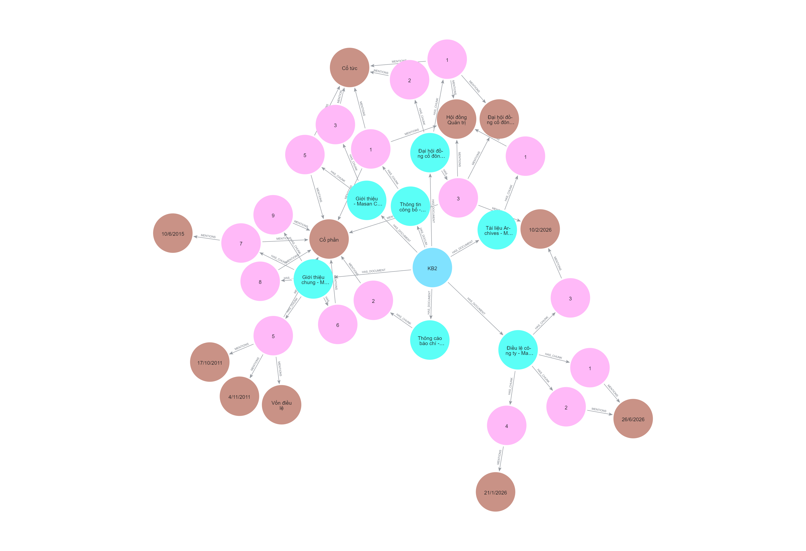

*Hình 4.9. KB2 trong Neo4j Browser: trang web → chunk → thực thể dùng chung với KB1.*

### 4.14.4. Gộp KB1 và KB2 thành KB

Gộp không sao chép node mà chỉ thêm cạnh thành viên. Vì ID theo nội dung, một tài liệu có trong cả KB1 và KB2 vẫn chỉ có một cạnh tới KB:

```cypher
// ai-service/app/knowledge_graph/cypher/03_merge_and_resolve.cypher (MERGE_KBS)
MERGE (target:KnowledgeBase {kb_id: $target})
WITH target UNWIND $sources AS sid
MATCH (src:KnowledgeBase {kb_id: sid})
MERGE (src)-[:MERGED_INTO]->(target)
WITH DISTINCT target
MATCH (src:KnowledgeBase)-[:HAS_DOCUMENT]->(d:Document) WHERE src.kb_id IN $sources
MERGE (target)-[:HAS_DOCUMENT]->(d)
RETURN count(DISTINCT d) AS documents;
```

Sau khi gộp, tài liệu mới nạp vào KB1 hoặc KB2 tự xuất hiện trong KB nhờ truy vấn `PROPAGATE_TO_MERGED` chạy cuối mỗi lần ghi: nó đi theo cạnh `MERGED_INTO` để nối tài liệu vào mọi KB đích. Không cần chạy gộp lại sau mỗi lần cập nhật.

### 4.14.5. Trực quan hóa trên Neo4j Browser

Kết quả gộp được kiểm tra trực tiếp trên Neo4j Browser. Hình 4.10 cho thấy KB hợp nhất có 52 tài liệu, trong đó 44 tài liệu đang được truy xuất (đã loại 7 bản trùng và 1 phiên bản cũ của Điều lệ). Cột `dang_dung` là kết quả của các bước xử lý ở mục 4.15.

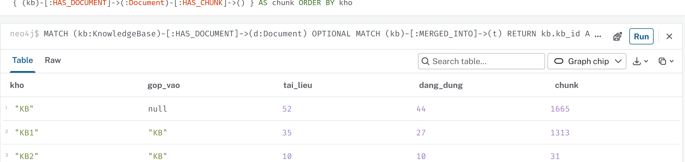

*Hình 4.10. Số tài liệu và chunk của KB1, KB2 và KB hợp nhất (truy vấn trên Neo4j Browser).*

Ba hình tiếp theo cho thấy phần "đồ thị" thực sự của KB: quan hệ giữa các thực thể. Bước nạp tạo cạnh `RELATES_TO` giữa hai thực thể cùng xuất hiện trong một chunk, trọng số là số chunk chung (truy vấn `LINK_ENTITIES` trong `02_ingest.cypher`). KB có 581 cạnh như vậy, trọng số lớn nhất 281. Lọc các cạnh có trọng số từ 6 trở lên, bỏ mốc thời gian và số điều, còn 53 thực thể và 167 quan hệ; hai cụm hiện rõ là quản trị công ty (Hội đồng Quản trị, Đại hội đồng cổ đông, Cổ phần, Vốn điều lệ) và lao động (Người lao động, Hợp đồng lao động, Tiền lương, Kỷ luật), nối nhau qua Tổng Giám đốc.

```cypher
MATCH (a:Entity)-[r:RELATES_TO]->(b:Entity)
WHERE r.weight >= 6
  AND NOT a.type IN ['moc_thoi_gian','dieu_khoan'] AND NOT b.type IN ['moc_thoi_gian','dieu_khoan']
RETURN a, r, b
```

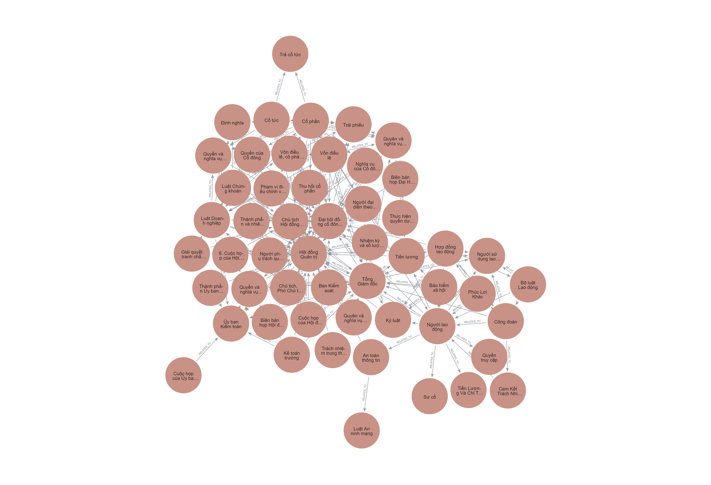

*Hình 4.11. Mạng quan hệ RELATES_TO giữa các thực thể có trọng số ≥ 6: 53 nút, 167 cạnh.*

"Hội đồng Quản trị" là thực thể trung tâm của KB: được 612 chunk nhắc tới và có 76 cạnh `RELATES_TO`. Hình dưới lấy 25 quan hệ mạnh nhất của nó, rồi lần ngược mỗi thực thể láng giềng về 2 chunk và tài liệu chứa chunk đó. Đây chính là đường mà `graph_search` đi khi mở rộng một câu hỏi về Hội đồng Quản trị sang các đoạn liên quan (mục 4.16).

```cypher
MATCH p1=(e:Entity {name:'Hội đồng Quản trị'})-[r:RELATES_TO]-(n:Entity)
WITH p1, n, r ORDER BY r.weight DESC LIMIT 25
MATCH p2=(:Document)-[:HAS_CHUNK]->(:Chunk)-[:MENTIONS]->(n)
WITH p1, n, collect(p2)[0..2] AS ps UNWIND ps AS p2
RETURN p1, p2
```

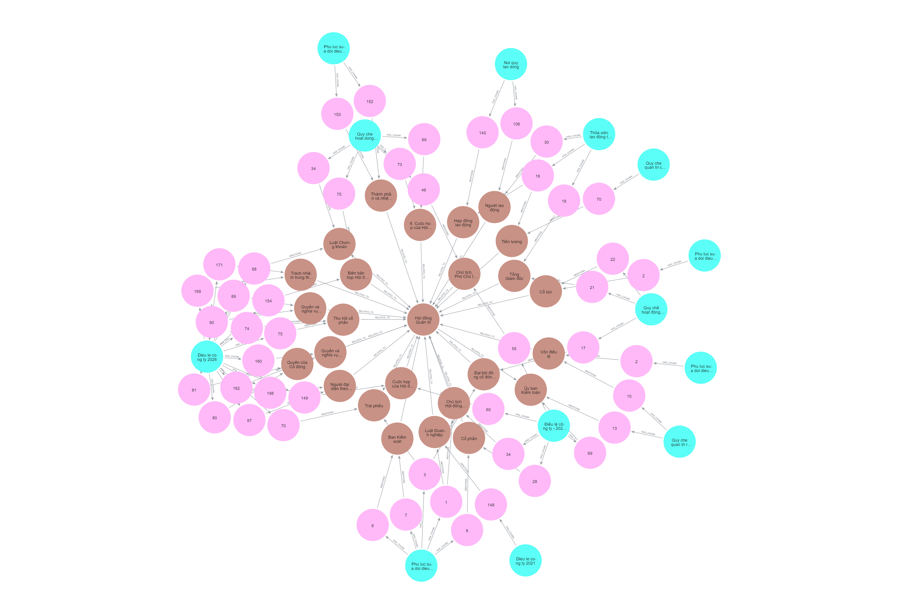

*Hình 4.12. Thực thể "Hội đồng Quản trị", 25 láng giềng mạnh nhất và chunk, tài liệu nguồn: 86 nút, 122 cạnh.*

Cạnh `REFERENCES` nối chunk chứa câu "theo quy định tại Điều N" tới chunk của Điều N trong cùng văn bản (truy vấn `LINK_REFERENCES`, chỉ nối trong cùng tài liệu nên chỉ số dẫn chiếu chéo tài liệu bằng 0 ở Bảng 4.24). KB có 204 cạnh như vậy; riêng Điều lệ 2021 (tải lên) có 23 và Điều lệ 2025 có 35. Các nút "Điều N" là thực thể loại `dieu_khoan` mà chunk nhắc tới.

```cypher
MATCH p=(d:Document)-[:HAS_CHUNK]->(:Chunk)-[:REFERENCES]->(:Chunk)
WHERE d.doc_id = '84202bc4-4a22-46fa-8e7c-2ba11e857b68' OR d.title = 'Dieu le cong ty 2025'
RETURN p
UNION
MATCH (d:Document)-[:HAS_CHUNK]->(a:Chunk)-[:REFERENCES]->(:Chunk)
WHERE d.doc_id = '84202bc4-4a22-46fa-8e7c-2ba11e857b68' OR d.title = 'Dieu le cong ty 2025'
MATCH p=(a)-[:MENTIONS]->(:Entity {type:'dieu_khoan'})
RETURN p
```

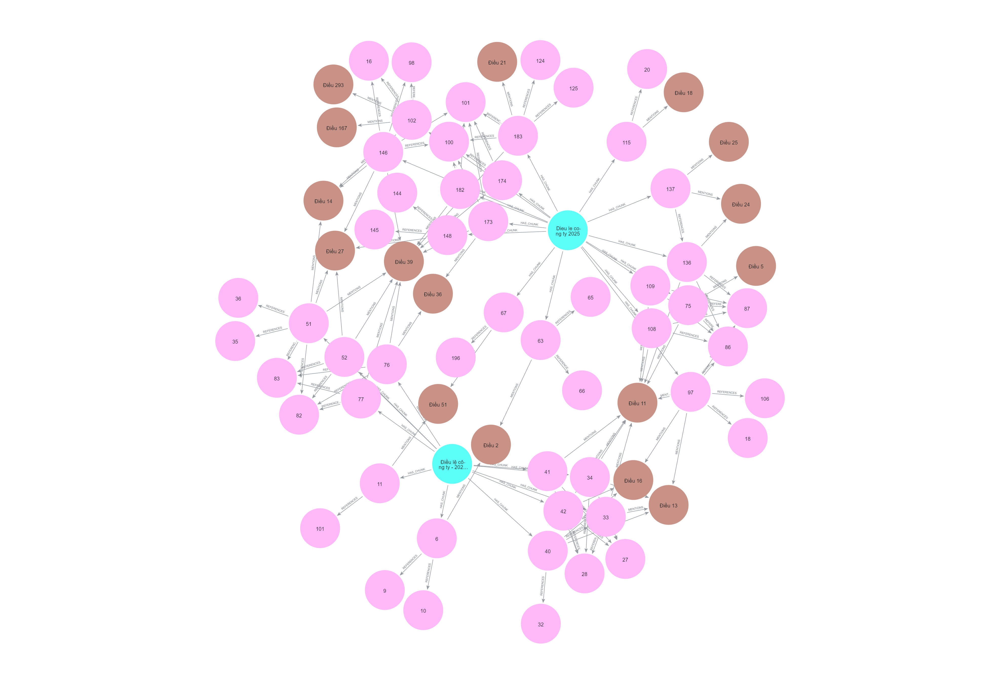

*Hình 4.13. Dẫn chiếu REFERENCES giữa các chunk của Điều lệ 2021 và 2025: 71 nút, 131 cạnh.*

## 4.15. Các vấn đề khi tích hợp nhiều nguồn và cách đồ án xử lý

### 4.15.1. Tổng quan

Khi gộp 35 PDF, 10 trang web và 7 tài liệu upload vào một KB, nhóm gặp bảy vấn đề. Cả bảy đều được phát hiện trên dữ liệu thật, không phải giả định:

| Vấn đề | Ví dụ thật trong kho | Cơ chế xử lý | Mã nguồn | Kết quả |
| :--- | :--- | :--- | :--- | :--- |
| Trùng lặp tài liệu | `Dieu le cong ty 2021` (PDF) và `Điều lệ công ty - 2021` (upload) | So độ chồng lấn shingle, hai ngưỡng | `consistency.find_duplicates` | 7 bản trùng bị ẩn, 10 cặp gần trùng được ghi nhận |
| Nhiều phiên bản | Điều lệ 2021, 2025, 2026 là ba tệp riêng | Khóa chuỗi văn bản + ngày hiệu lực | `consistency.find_series` | 2 cạnh `NEW_VERSION_OF`, 2 bản cũ hết hiệu lực |
| Song ngữ Anh–Việt | "Board of Directors", "employees", "Information Security" trong chính sách an ninh thông tin | Alias tiếng Anh ánh xạ về thực thể tiếng Việt | `extract.ENGLISH_ALIASES` | 47 lượt nhắc tiếng Anh, 9 thực thể |
| Nhiễu OCR | "Vôn Điều Lệ", "cô phân", "Tông Giám đốc" | Khớp không dấu, độ tin cậy thấp hơn | `extract._ALIAS_RULES` | 558 lượt nhắc khớp không dấu, độ tin cậy 0,6 |
| Không chắc chắn | Viết tắt "TGĐ", tiêu đề rút từ mục lục | Độ tin cậy theo phương pháp trích xuất | `extract.CONFIDENCE` | Mọi cạnh `MENTIONS` có `confidence` |
| Mờ | "Vẫn điều lệ, cổ phần…" và "Vôn điều lệ, cô phân…" | Hợp nhất thực thể bằng hàm thuộc | `resolve.resolve_pairs` | 8 cặp `SAME_AS`, 13 cặp chờ duyệt |
| Mâu thuẫn | Vốn điều lệ: 13 giá trị khác nhau từ 2012 đến 2026 | Trích dữ kiện + 4 luật ưu tiên | `consistency.resolve_conflicts` | Chọn đúng giá trị Điều lệ 2026, 0 dữ kiện chưa phân định |

*Bảng 4.16. Bảy vấn đề tích hợp và cách xử lý.*

Toàn bộ các bước xử lý chạy bằng một lệnh, có thể chạy lại nhiều lần mà không tạo trùng (mỗi bước xóa kết quả cũ của chính nó rồi ghi lại, trừ các quyết định do người duyệt):

```python
# ai-service/app/knowledge_graph/pipeline.py (hàm maintain, rút gọn)
docs = store.document_texts()
store.write_duplicates(consistency.find_duplicates(docs))          # (1) trùng lặp
store.write_series(consistency.find_series(docs))                  # (2) phiên bản
entities = store.resolution_candidates(resolve.RESOLVABLE_TYPES)
store.write_entity_resolution(resolve.resolve_pairs(entities, manual=store.manual_decisions()))
store.recompute_relation_weights()                                 # độ tin cậy quan hệ
claims = [c for chunk in chunks for c in consistency.extract_claims(chunk)]
store.write_claims(*consistency.resolve_conflicts(claims))         # (7) mâu thuẫn
```

Lệnh chạy: `python scripts/10_build_neo4j_kb.py --maintain`. Báo cáo chi tiết được ghi ra `debug/kb_maintenance.json`.

### 4.15.2. Trùng lặp tài liệu

Cùng một văn bản có thể vào KB hai lần: một lần qua kho PDF offline (KB1), một lần do người dùng tải lên. Hai bản có `doc_id` khác nhau vì đi qua hai bộ phân tích khác nhau, nên ID theo nội dung không phát hiện được.

Mỗi tài liệu được biểu diễn bằng tập **shingle**, tức các cụm 5 từ liên tiếp sau khi bỏ dấu. Độ chồng lấn đo bằng tỷ lệ chứa của tập nhỏ hơn:

> **Công thức 4.10.** $\text{overlap}(A, B) = \dfrac{|S(A) \cap S(B)|}{\min(|S(A)|, |S(B)|)}$

Phân loại dùng hai ngưỡng:

- $\text{overlap} \ge 0{,}95$: **trùng lặp** (`DUPLICATE_OF`). Bản bị trùng được ẩn khỏi truy xuất (`duplicate_of` khác rỗng). Bản được giữ lại theo thứ tự: bản upload (mở được trong trình xem PDF) → bản hiện hành → nguồn tin cậy hơn → bản dài hơn.
- $0{,}8 \le \text{overlap} < 0{,}95$: **gần trùng** (`SIMILAR_TO`). Chỉ ghi nhận, hai tài liệu vẫn được truy xuất.

Ngưỡng 0,95 được chọn sau một lần chạy sai: với ngưỡng đơn 0,8, Điều lệ 2025 (0,884) và Điều lệ 2026 (0,861) bị coi là bản trùng của Điều lệ 2021 và bị ẩn. Thực ra đây là các phiên bản khác nhau, chung phần lớn điều khoản. Hậu quả là vốn điều lệ 10.623 tỷ của Điều lệ 2025 không được trích ra. Tách thành hai ngưỡng sửa được lỗi này.

Kết quả trên KB: 7 cặp trùng lặp, đều là cặp "PDF offline – bản upload" của cùng một văn bản, độ chồng lấn từ 0,989 đến 1,0. Ngoài ra có 10 cặp gần trùng, đều thuộc nhóm Điều lệ và phụ lục (0,83–0,91).

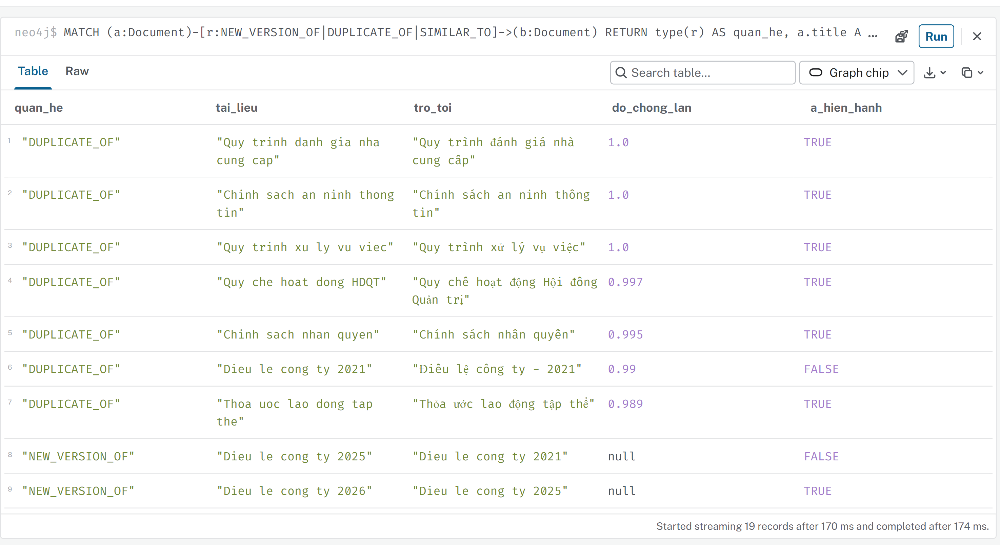

*Hình 4.14. Các cạnh `DUPLICATE_OF` và `NEW_VERSION_OF` sau bước xử lý tích hợp.*

### 4.15.3. Nhiều phiên bản của cùng một văn bản

Điều lệ 2021, 2025, 2026 là ba tệp có `source_uri` khác nhau, nên cơ chế phiên bản theo nguồn (mục 4.17) không nhận ra chúng là một văn bản. Đồ án dùng **khóa chuỗi văn bản**: tên tài liệu bỏ năm và dấu câu (`Dieu le cong ty 2025` → `dieu le cong ty`). Các tài liệu cùng khóa được sắp theo **ngày hiệu lực**, bản sau nối tới bản trước bằng `NEW_VERSION_OF`, bản trước được đánh dấu `is_current = false`.

Ngày hiệu lực lấy từ năm trong tên tài liệu nếu có. Nếu không có, nó là **ngày muộn nhất** trong 5.000 ký tự đầu. Quy tắc "muộn nhất" có lý do: một phụ lục sửa đổi luôn mở đầu bằng việc liệt kê các lần sửa đổi trước theo thứ tự thời gian ("Điều lệ ký ngày 23/4/2012, Bản điều chỉnh lần thứ hai ký ngày 18/02/2013… Hôm nay, ngày 22 tháng 4 năm 2013"). Lần chạy đầu dùng ngày đầu tiên tìm thấy nên gán ngày 23/4/2012 cho gần một nửa số phụ lục. Đổi sang ngày muộn nhất cho kết quả nhất quán, và được kiểm chứng ở mục 4.15.7: dãy vốn điều lệ theo ngày hiệu lực tăng đều qua các năm.

```python
# ai-service/app/knowledge_graph/extract.py (effective_date, rút gọn)
match = YEAR_RE.search(title or "")
if match:
    return f"{match.group(1)}-01-01", "title"
dates = [f"{y:04d}-{m:02d}-{d:02d}" for pattern in (LONG_DATE_RE, DATE_RE)
         for d, m, y in (map(int, f.groups()) for f in pattern.finditer(text[:5000]))
         if 1 <= m <= 12 and 1 <= d <= 31]
return (max(dates), "text") if dates else (None, None)
```

Kết quả xử lý trùng lặp và phiên bản nhìn trên toàn KB: 7 cạnh `DUPLICATE_OF` (bản PDF trùng bản tải lên), 10 cạnh `SIMILAR_TO` (độ chồng lấn cao nhưng chưa đủ ngưỡng trùng) và 2 cạnh `NEW_VERSION_OF` trong chuỗi Điều lệ 2021 → 2025 → 2026, cùng 52 tài liệu treo vào KB hợp nhất.

```cypher
MATCH p=(:Document)-[:NEW_VERSION_OF|DUPLICATE_OF|SIMILAR_TO]->(:Document) RETURN p
UNION
MATCH p=(:KnowledgeBase {kb_id:'KB'})-[:HAS_DOCUMENT]->(:Document) RETURN p
```

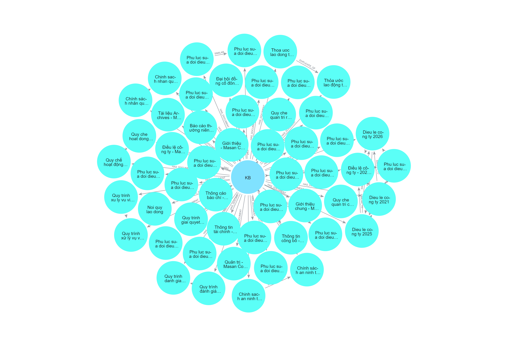

*Hình 4.15. KB hợp nhất với các cạnh DUPLICATE_OF, SIMILAR_TO, NEW_VERSION_OF: 53 nút, 71 cạnh.*

### 4.15.4. Song ngữ Anh–Việt và biến thể tên gọi

Chính sách an ninh thông tin là văn bản song ngữ, trang web có cả thuật ngữ tiếng Anh. Nếu không xử lý, "Board of Directors" và "Hội đồng Quản trị" thành hai thực thể rời nhau, và câu hỏi tiếng Việt không đến được đoạn tiếng Anh. Đồ án ánh xạ mỗi tên tiếng Anh về **thực thể chuẩn tiếng Việt**, nên hai cách gọi dùng chung một node:

```python
# ai-service/app/knowledge_graph/extract.py (ENGLISH_ALIASES, trích)
ENGLISH_ALIASES = {
    "Hội đồng Quản trị": ["Board of Directors"],
    "Tổng Giám đốc": ["General Director", "Chief Executive Officer", "CEO"],
    "Vốn điều lệ": ["charter capital"],
    "An toàn thông tin": ["information security"],
    "Dữ liệu cá nhân": ["personal data"],
    "Người lao động": ["Employee", "Employees"],
}
```

Mọi alias được khớp có ranh giới từ (`(?<!\w)…(?!\w)`), nên "bond" không khớp nhầm trong "bonding". Các biến thể khác cũng được chuẩn hóa về một tên: viết tắt ("HĐQT", "TGĐ", "BHXH"), số có số 0 đứng đầu ("Điều 07" thành "Điều 7"), ngày ("05/03/2020" thành "5/3/2020"), và tên văn bản pháp luật dài theo một danh mục (gazetteer). Danh mục này giúp "Luật An toàn thông tin mạng" không bị cắt thành "Luật An toàn".

### 4.15.5. Không chắc chắn: độ tin cậy của mỗi phép trích xuất

Trích xuất theo luật không đúng như nhau. "Điều 15" gần như chắc chắn là một điều khoản, còn "cong doan" sau khi bỏ dấu có thể là "Công đoàn" nhưng cũng có thể là "công đoạn". Đồ án biểu diễn sự không chắc chắn này bằng **độ tin cậy gắn trên cạnh** `MENTIONS`, theo phương pháp đã trích ra nó:

| Phương pháp | Ví dụ | Độ tin cậy | Lý do |
| :--- | :--- | ---: | :--- |
| `regex_article`, `regex_date`, `regex_decree` | "Điều 15", "ngày 22/4/2013", "Nghị định 155/2020/NĐ-CP" | 0,95 | Mẫu có số, gần như không mơ hồ |
| `alias_full`, `gazetteer_law` | "Hội đồng Quản trị", "Luật Doanh nghiệp" | 0,90 | Khớp nguyên cụm có dấu |
| `alias_en` | "Board of Directors" | 0,85 | Khớp đúng nhưng qua ánh xạ ngôn ngữ |
| `alias_abbrev` | "HĐQT", "TGĐ" | 0,75 | Viết tắt có thể trùng ý khác |
| `regex_law` | "Luật Lao động" ngoài danh mục | 0,70 | Ranh giới tên dựa vào heuristic |
| `alias_folded` | "Vôn điều lệ" → Vốn điều lệ | 0,60 | Khớp sau khi bỏ dấu, có thể nhầm từ khác |
| `heading` | Tiêu đề mục làm chủ đề | 0,60 | Tiêu đề có thể là rác OCR hoặc mục lục |

*Bảng 4.17. Độ tin cậy theo phương pháp trích xuất.*

Đây là các giá trị tiên nghiệm do nhóm đặt. Mục 4.18 đo độ chính xác thực tế của từng phương pháp, và kết quả đo khớp với thứ tự này: các phương pháp có độ tin cậy cao cũng có độ chính xác cao. Khi một thực thể được tìm thấy bằng nhiều phương pháp, độ tin cậy cao nhất được giữ.

Độ tin cậy được dùng ở hai chỗ. Khi truy xuất, cạnh có độ tin cậy dưới `GRAPH_MIN_MENTION_CONFIDENCE` bị bỏ qua (`05_retrieval.cypher`). Khi đánh giá dữ kiện, dữ kiện trích từ chữ bị mất dấu có độ tin cậy thấp hơn và mang cờ `khop_khong_dau`.

Với quan hệ đồng xuất hiện `RELATES_TO`, độ tin cậy là hệ số Jaccard giữa tập chunk nhắc hai thực thể:

> **Công thức 4.11.** $\text{conf}(a, b) = \dfrac{|C(a) \cap C(b)|}{|C(a) \cup C(b)|}$

Quan hệ chỉ xuất hiện một lần trong một đoạn dài có độ tin cậy gần 0; quan hệ luôn đi cùng nhau có độ tin cậy gần 1.

### 4.15.6. Mờ: hợp nhất thực thể bằng hàm thuộc

Tiêu đề mục là văn bản tự do, nên cùng một khái niệm có thể xuất hiện dưới nhiều dạng: khác nhau vì lỗi OCR ("Ngưửi nhụ trách quản trị Công ty" và "Người phụ trách quản trị Công ty"), vì bị cắt dòng ("Nghị định 155/2020/NĐ-" và "Nghị định 155/2020/NĐ-CP"), vì dấu câu. So khớp chính xác coi chúng là các thực thể khác nhau; so khớp theo một ngưỡng cứng lại dễ gộp nhầm.

Đồ án dùng **logic mờ**. Độ giống $s \in [0, 1]$ là giá trị lớn hơn giữa tỷ lệ ký tự chung và hệ số Jaccard của các từ nội dung, tính trên tên đã bỏ dấu. Mức độ thuộc về tập "cùng một thực thể" được cho bởi hàm thuộc tuyến tính từng khúc:

> **Công thức 4.12.** $\mu(s) = \begin{cases} 0 & s \le 0{,}80 \\ \dfrac{s - 0{,}80}{0{,}12} & 0{,}80 < s < 0{,}92 \\ 1 & s \ge 0{,}92 \end{cases}$

- $\mu = 1$: tạo cạnh `SAME_AS`. Khi truy xuất, tên đồng nghĩa được dùng thay cho nhau (`ALIASES_OF`).
- $0 < \mu < 1$: tạo cạnh `POSSIBLY_SAME_AS` với giá trị $\mu$. Hai thực thể vẫn tách rời, cặp này được đưa vào danh sách chờ người duyệt.
- $\mu = 0$: hai thực thể khác nhau.

Ba luật rõ (crisp) chạy trước hàm thuộc, vì hai chuỗi giống nhau chưa chắc cùng nghĩa:

1. **Khác số thì khác thực thể:** "Nghị định 155/2020" và "Nghị định 156/2020" giống nhau 96% về ký tự nhưng có $s = 0$.
2. **Thực thể đánh số không được hợp nhất mờ:** "Điều 7" và "Điều 17" không bao giờ được so.
3. **Khác nhau ở từ phủ định thì phải người duyệt:** "Quy trình xử lý vụ việc **chưa** xác định người vi phạm" và "…**đã** xác định…" có $s = 0{,}96$, nhưng bị hạ xuống `POSSIBLY_SAME_AS`. Luật này được thêm sau khi lần chạy đầu gộp nhầm đúng cặp này.

```python
# ai-service/app/knowledge_graph/resolve.py (rút gọn)
def membership(score, low=0.80, high=0.92):
    return 0.0 if score <= low else 1.0 if score >= high else (score - low) / (high - low)

score = similarity(first["name"], second["name"])          # 0 nếu khác số
relation = decide(score)                                   # SAME_AS / POSSIBLY_SAME_AS / None
if relation == "SAME_AS" and polarity_differs(first["name"], second["name"]):
    relation, guard = "POSSIBLY_SAME_AS", "phu_dinh"       # "đã" vs "chưa"
```

Quyết định của người duyệt được lưu thành cạnh có `method = 'manual'` (truy vấn mẫu số 8 trong `07_explore.cypher`). Mỗi lần chạy lại `--maintain` bỏ qua các cặp đã có quyết định thủ công, nên máy không bao giờ ghi đè người duyệt.

Kết quả trên 184 thực thể thuộc bốn loại được phép hợp nhất (145 tiêu đề, 14 chủ đề, 12 chức danh, 13 văn bản pháp luật):

| Quan hệ | Độ giống | Thực thể A | Thực thể B | Nguyên nhân khác biệt |
| :--- | ---: | :--- | :--- | :--- |
| `SAME_AS` | 0,979 | Vẫn điều lệ, cổ phần, các loại chứng khoán khác | Vôn điều lệ, cô phân, các loại chứng khoán khác | OCR sai dấu ở hai bản Điều lệ |
| `SAME_AS` | 0,963 | Công nhãn viên và cũng đoàn | Công nhân viên và công đoàn | OCR |
| `SAME_AS` | 0,960 | Ngưửi nhụ trách quản trị Công ty và Thư ký Công ty | Người phụ trách quản trị Công ty và Thư ký Công ty | OCR |
| `SAME_AS` | 0,940 | Báo cáo tài chính, bảo cáo thường niên và trách | Báo cáo tài chính, báo cáo thường niên và trách nhiệm | Tiêu đề bị cắt dòng |
| `POSSIBLY_SAME_AS` | 0,960 | Quy trình xử lý vụ việc chưa xác định người vi phạm | Quy trình xử lý vụ việc đã xác định người vi phạm | Luật phủ định chặn gộp tự động |
| `POSSIBLY_SAME_AS` | 0,897 | Bộ luật Lao động | Luật Lao Động | Tên chính thức và tên gọi tắt; cần người xác nhận |
| `POSSIBLY_SAME_AS` | 0,876 | Quyền và nghĩa vụ của Hội đồng Quản trị | Quyền và nghĩa vụ của thành viên Hội đồng Quản trị | Hai khái niệm khác nhau; người duyệt nên bác bỏ |
| `POSSIBLY_SAME_AS` | 0,820 | Mối quan hệ với Ủy ban Kiểm toán | Mối quan hệ với Ban điều hành | Khác nhau; ở sát ngưỡng dưới |

*Bảng 4.18a. Một số cặp hợp nhất mờ trên KB (đầy đủ trong `debug/kb_maintenance.json`).*

Cả 8 cặp `SAME_AS` đều đúng khi kiểm tra bằng mắt. Trong 13 cặp chờ duyệt có cả cặp nên gộp ("Bộ luật Lao động") lẫn cặp nên bác bỏ (HĐQT và thành viên HĐQT). Đây là lý do vùng giữa của hàm thuộc phải giao cho người quyết định, không để máy gộp.

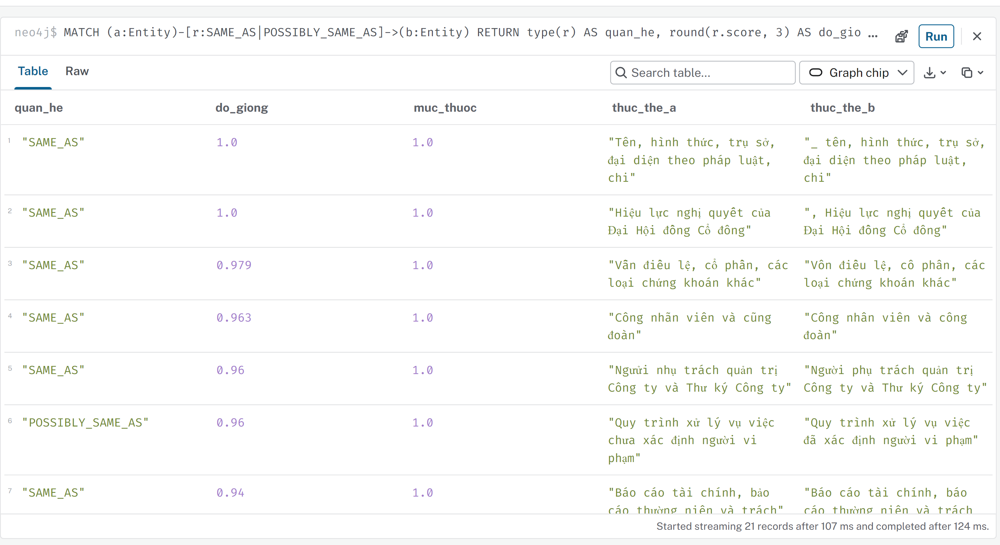

*Hình 4.16. Cạnh `SAME_AS` và `POSSIBLY_SAME_AS` với độ giống và mức thuộc.*

Hình dưới đặt các cặp hợp nhất vào ngữ cảnh: mỗi thực thể có cạnh `SAME_AS` hoặc `POSSIBLY_SAME_AS` được lần về tối đa 3 chunk nhắc tới nó và tài liệu chứa chunk. Hai tên gọi được hợp nhất thường đến từ hai tài liệu khác nhau (bản PDF có lỗi OCR và bản tải lên sạch), nên cạnh hợp nhất chính là cầu nối giữa các nguồn.

```cypher
MATCH p=(:Entity)-[:SAME_AS|POSSIBLY_SAME_AS]->(:Entity) RETURN p
UNION
MATCH (e:Entity) WHERE EXISTS { (e)-[:SAME_AS|POSSIBLY_SAME_AS]-() }
MATCH p=(:Document)-[:HAS_CHUNK]->(:Chunk)-[:MENTIONS]->(e)
WITH e, collect(p)[0..3] AS ps UNWIND ps AS p
RETURN p
```

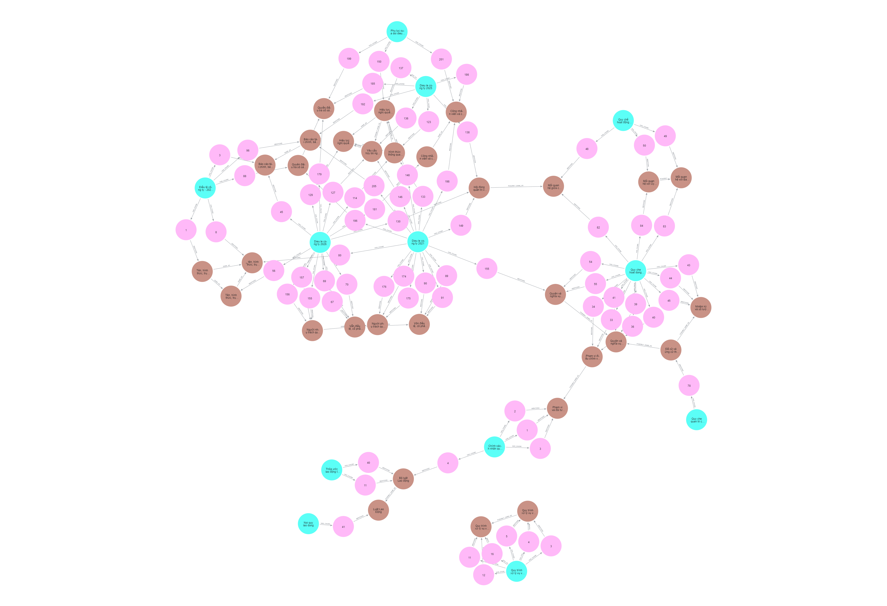

*Hình 4.17. Thực thể đã hợp nhất (SAME_AS, POSSIBLY_SAME_AS) cùng chunk và tài liệu nguồn: 118 nút, 171 cạnh.*

### 4.15.7. Mâu thuẫn dữ kiện

Văn bản cũ không mất đi khi có văn bản mới, nên kho chứa nhiều khẳng định khác nhau về cùng một thuộc tính. Thuộc tính khó nhất là **vốn điều lệ**: tại một thời điểm công ty chỉ có một giá trị, nhưng kho có mười ba con số.

**Trích dữ kiện.** Với mỗi thuộc tính chỉ có một giá trị (vốn điều lệ, mệnh giá cổ phần), hàm `extract_claims` tìm câu chứa tên thuộc tính, khớp không dấu để không bỏ sót "Vôn Điều Lệ", rồi lấy số tiền đứng sau trong vòng 160 ký tự. Mỗi khẳng định thành một node `Claim`, nối về đoạn nguồn bằng `ASSERTS` để vẫn trích dẫn được.

**Kiểm tra tính hợp lý.** Nếu trong cùng đoạn có số cổ phần và mệnh giá, hệ thống kiểm tra *vốn = số cổ phần × mệnh giá*. Phép kiểm tra này bắt được một lỗi OCR thật trong phụ lục lần 5.1: "7.355.531.790.000 đồng chia thành 135.553.179 cổ phần × 10.000 đồng". Tích bằng 1.355 tỷ, không khớp. Số tiền viết bằng chữ xác nhận 7.355 tỷ là đúng, còn số cổ phần bị OCR đọc sai chữ số đầu. Dữ kiện mang cờ `lech_so_co_phan_x_menh_gia` và bị giảm một nửa độ tin cậy.

**Giải quyết.** Các khẳng định khác giá trị được xếp hạng theo bốn luật ưu tiên, luật trước quan trọng hơn luật sau:

| Luật | Nội dung | Lý do |
| :--- | :--- | :--- |
| R1 | Tài liệu hiện hành thắng tài liệu đã bị thay thế | Phiên bản cũ không còn hiệu lực pháp lý |
| R2 | Ngày hiệu lực mới hơn thắng | Văn bản sau sửa đổi văn bản trước |
| R3 | Nguồn tin cậy hơn thắng (PDF nội bộ, upload 1,0; web 0,6) | Văn bản gốc có giá trị pháp lý, trang web chỉ tóm tắt |
| R4 | Giá trị hợp lý thắng giá trị bị gắn cờ | Ưu tiên số liệu nhất quán nội tại |

*Bảng 4.18. Luật giải quyết mâu thuẫn.*

Giá trị thắng có trạng thái `accepted`. Giá trị thua có trạng thái `superseded` và một cạnh `CONFLICTS_WITH` ghi luật đã quyết định. Khi không luật nào phân định được, cả hai có trạng thái `unresolved` và được đưa ra cho người duyệt. Câu trả lời không bao giờ tự chọn ngẫu nhiên.

| Ngày hiệu lực | Nguồn | Vốn điều lệ (đồng) | Trạng thái | Luật quyết định | Cờ |
| :--- | :--- | ---: | :--- | :--- | :--- |
| (không có) | Trang web "Giới thiệu chung" | 28.500.000.000 | superseded | R2 | |
| 12/06/2012 | Phụ lục sửa đổi lần 1.2 | 5.025.000.000.000 | superseded | R2 | |
| 18/02/2013 | Phụ lục sửa đổi lần 2.2 | 5.253.409.090.000 | superseded | R2 | khớp không dấu |
| 27/06/2014 | Phụ lục sửa đổi lần 6 | 5.313.263.220.000 | superseded | R2 | |
| 26/04/2016 | Phụ lục sửa đổi lần 1.1 | 5.381.601.170.000 | superseded | R2 | khớp không dấu |
| 23/06/2017 | Phụ lục sửa đổi lần 3.2 | 5.431.327.770.000 | superseded | R2 | |
| 28/08/2019 | Phụ lục sửa đổi lần 8.1 | 7.229.246.040.000 | superseded | R2 | |
| 17/06/2020 | Phụ lục sửa đổi (lần khác) | 7.267.938.180.000 | superseded | R2 | |
| 2021 | Điều lệ công ty 2021 (upload) | 7.267.938.180.000 | superseded | R2 | |
| 15/08/2022 | Phụ lục sửa đổi lần 2 | 7.274.618.790.000 | superseded | R2 | |
| 05/09/2024 | Phụ lục sửa đổi lần 5.1 | 7.355.531.790.000 | superseded | R2 | lệch số cổ phần × mệnh giá |
| 2025 | Điều lệ công ty 2025 | 10.623.648.220.000 | superseded | R1 | |
| **2026** | **Điều lệ công ty 2026** | **13.074.049.490.000** | **accepted** | | |

*Bảng 4.19a. Mười bốn khẳng định về vốn điều lệ trong KB và kết quả giải quyết mâu thuẫn.*

Điều lệ 2025 bị loại theo R1 vì đã bị Điều lệ 2026 thay thế ở bước chuỗi phiên bản (mục 4.15.3). Các khẳng định còn lại bị loại theo R2. Giá trị được chọn có thể kiểm tra chéo: Điều lệ 2026 (trang 8) ghi 1.307.404.949 cổ phần × 10.000 đồng = 13.074.049.490.000 đồng, khớp đúng.

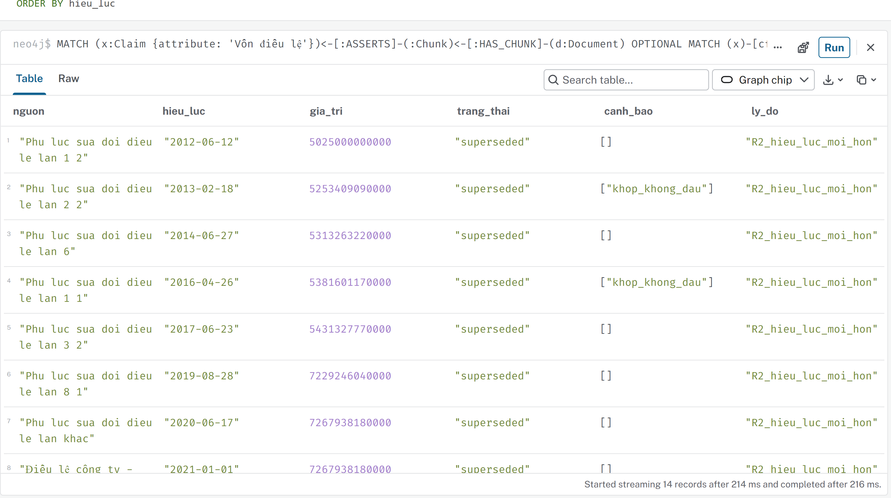

*Hình 4.18. Các khẳng định về vốn điều lệ, trạng thái và lý do (truy vấn số 6 trong `07_explore.cypher`).*

Nhìn dưới dạng đồ thị, 14 khẳng định về vốn điều lệ tạo thành một hình sao: khẳng định được chấp nhận (Điều lệ 2026) ở giữa, 13 khẳng định cũ hơn nối vào bằng cạnh `CONFLICTS_WITH`, và mỗi khẳng định lần ngược được về chunk (`ASSERTS`) và tài liệu (`HAS_CHUNK`) đã nêu ra nó. Đây là bằng chứng truy vết mà công cụ `kb_attribute` của tác tử dùng để trích dẫn (Chương 5).

```cypher
MATCH p=(:Document)-[:HAS_CHUNK]->(:Chunk)-[:ASSERTS]->(:Claim {attribute:'Vốn điều lệ'}) RETURN p
UNION
MATCH p=(:Claim {attribute:'Vốn điều lệ'})-[:CONFLICTS_WITH]->(:Claim) RETURN p
```

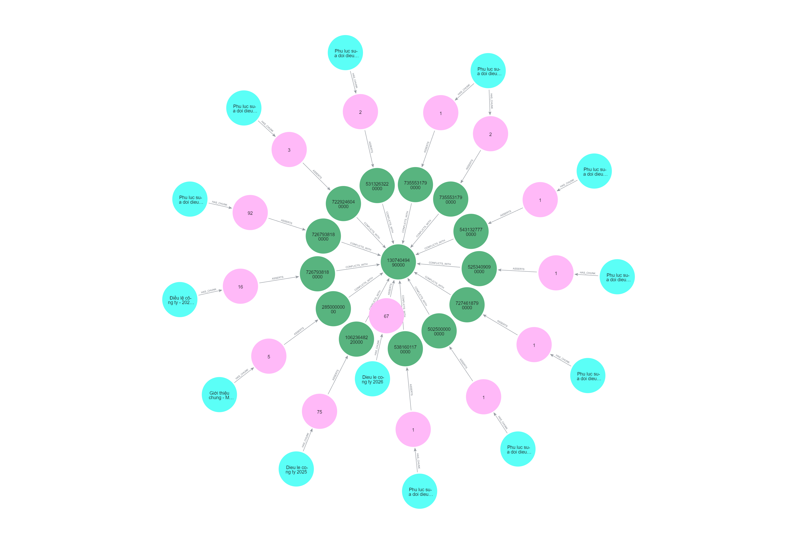

*Hình 4.19. Khẳng định vốn điều lệ: Claim, chunk, tài liệu và cạnh CONFLICTS_WITH: 41 nút, 41 cạnh.*


Dãy giá trị tăng đều theo ngày hiệu lực là bằng chứng độc lập cho thấy quy tắc ngày hiệu lực ở mục 4.15.3 đúng. Nếu ngày bị gán sai, dãy sẽ không đơn điệu. Giá trị 28,5 tỷ trên trang giới thiệu là dữ kiện lịch sử năm 2003 nằm trong một đoạn kể lại quá trình hình thành công ty. Khẳng định này không có ngày hiệu lực nên được xếp cũ nhất và bị loại theo R2. Nếu không bị R2 loại, nó cũng thua theo R3 vì đến từ nguồn web. Mệnh giá cổ phần (10.000 đồng) xuất hiện ở 18 đoạn và không có mâu thuẫn, nên mọi khẳng định đều được chấp nhận.

Tác tử hỏi đáp (Chương 5) dùng trực tiếp kết quả này. Câu hỏi "Vốn điều lệ hiện nay là bao nhiêu?" được trả lời từ `Claim` đã chấp nhận, kèm trích dẫn và các giá trị cũ đã bị thay thế, thay vì để truy xuất văn bản chọn ngẫu nhiên một phụ lục cũ.

## 4.16. Luồng RAG kết hợp KB

### 4.16.1. Ba bước

RAG kết nối KB qua ba bước, cài trong `RAGService.retrieve_hits` (`ai-service/app/rag_service.py`):

1. **Truy xuất vector:** câu hỏi được nhúng (E5-Small), tìm 60 ứng viên trong Qdrant.
2. **Truy xuất đồ thị:** tìm thực thể trong câu hỏi, cộng tên đồng nghĩa (`SAME_AS`) và thực thể gần nghĩa theo vector; lấy các đoạn nhắc đến chúng; mở rộng từ 5 đoạn vector tốt nhất theo cạnh `REFERENCES` và thực thể chung.
3. **Trộn và lọc:** trộn hai danh sách bằng Reciprocal Rank Fusion (RRF, trọng số đồ thị 0,2), chấm lại bằng cross-encoder, rồi qua cổng bằng chứng. Không đủ căn cứ thì từ chối.

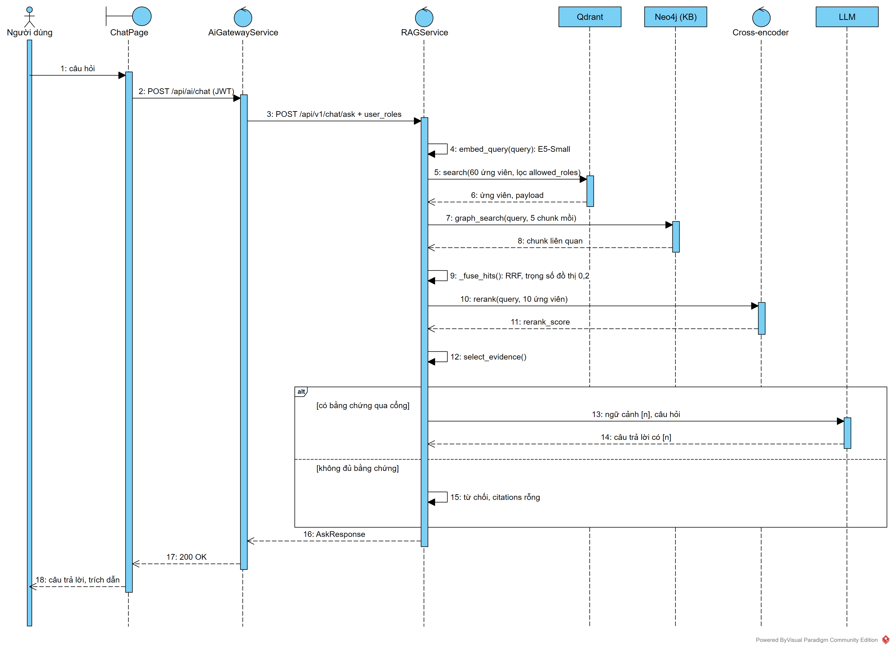

*Hình 4.20. Biểu đồ tuần tự RAG nối KB: truy xuất vector và đồ thị, trộn RRF, chấm lại, cổng bằng chứng.*

### 4.16.2. Mã nguồn gắn với luồng

```python
# ai-service/app/rag_service.py (retrieve_hits, dòng 98-127, rút gọn)
vector_hits = self.retriever.search(query=cleaned_query, top_k=candidate_k, min_score=0.0,
                                    query_vector=query_vector, allowed_roles=allowed_roles)
graph_hits = graph_search(cleaned_query, limit=max(settings.GRAPH_SEARCH_LIMIT, top_k * 4),
                          query_vector=query_vector,
                          seed_chunk_ids=[h["chunk_id"] for h in vector_hits[:settings.GRAPH_EXPAND_SEEDS]],
                          allowed_roles=allowed_roles)
hits = self._fuse_hits(vector_hits, graph_hits, graph_weight=graph_weight)   # RRF
head = reranker.rerank(cleaned_query, hits[: settings.RERANK_CANDIDATES])    # cross-encoder
```

Phía đồ thị, `graph_search` (`ai-service/app/knowledge_graph/service.py`) gom tên thực thể từ ba nguồn rồi gọi truy vấn `GRAPH_CANDIDATES`:

```python
# ai-service/app/knowledge_graph/service.py (graph_search, rút gọn)
names = {entity["name"] for entity in extract_entities(question)}          # theo luật
names |= {n for n in store.entity_names(KB) if fold_text(n) in fold_text(question)}
names.update(store.similar_entities(query_vector, settings.GRAPH_ENTITY_MIN_SCORE))  # theo vector
names.update(store.aliases_of(sorted(names)))                               # SAME_AS
rows = store.graph_candidates(names=sorted(names), kb_ids=(KB,), limit=limit,
                              min_confidence=settings.GRAPH_MIN_MENTION_CONFIDENCE)
```

Truy vấn `GRAPH_CANDIDATES` áp dụng mọi kết quả xử lý tích hợp ở mục 4.15 ngay trong điều kiện lọc:

```cypher
// ai-service/app/knowledge_graph/cypher/05_retrieval.cypher (GRAPH_CANDIDATES, phần lọc)
MATCH (seed)-[:RELATES_TO*0..1]-(e:Entity)<-[m:MENTIONS]-(c:Chunk)<-[:HAS_CHUNK]-(d:Document)
MATCH (kb:KnowledgeBase)-[:HAS_DOCUMENT]->(d)
WHERE kb.kb_id IN $kb_ids
  AND coalesce(m.confidence, 1.0) >= $min_confidence          // không chắc chắn
  AND coalesce(d.is_current, true) AND d.duplicate_of IS NULL  // phiên bản, trùng lặp
  AND ($roles IS NULL OR any(role IN coalesce(d.allowed_roles, [])
       WHERE role IN $roles OR role = '*'))                    // phân quyền
```

Đồ thị là kênh bổ sung. Khi Neo4j không chạy hoặc câu hỏi không có thực thể nào, `graph_search` trả về danh sách rỗng và RAG chạy bằng vector (graceful degradation). Đoạn nào lấy từ đồ thị cũng phải qua cùng cổng bằng chứng như đoạn lấy từ vector: **có trích dẫn mới trả lời, không có thì từ chối**.

### 4.16.3. Dạng đầu ra của KB

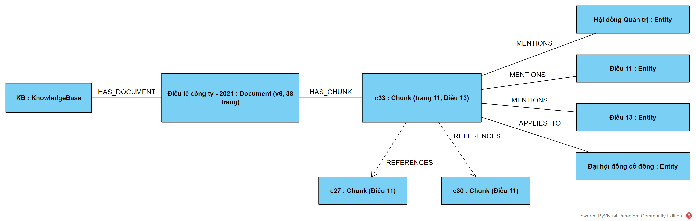

*Hình 4.21. Bản ghi KB của một tài liệu dạng đối tượng: KnowledgeBase → Document → Chunk → Entity và các quan hệ.*

Bản ghi này là hợp đồng dữ liệu giữa tầng nạp và tầng RAG. Mọi trường cần cho trích dẫn (`page_start`, `page_end`, `section_path`, `source_uri`) và cho kiểm soát chất lượng (`content_hash`, `version`, `is_current`, `confidence`) đều nằm trong cùng một bản ghi.

## 4.17. Cơ chế cập nhật KB

### 4.17.1. Bốn tình huống

KB thay đổi theo hai cách: **nguồn thay đổi** (tài liệu mới, sửa, xóa) và **bộ trích xuất thay đổi** (sửa luật, thêm alias). Đồ án xử lý cả hai:

| Tình huống | Phát hiện | Hành động trên đồ thị | Mã nguồn |
| :--- | :--- | :--- | :--- |
| Nguồn mới | Không có `Document` hiện hành cùng `source_uri` | Ghi mới (`insert`) | `pipeline.apply_record` |
| Nguồn không đổi | Cùng `source_uri`, cùng `content_hash` | Bỏ qua (`skip`), không ghi gì | `pipeline.plan_update` |
| Nguồn bị sửa | Cùng `source_uri`, khác `content_hash` | Bản cũ `is_current=false`; bản mới `version+1`, cạnh `NEW_VERSION_OF` | `SUPERSEDE_DOCUMENT`, `LINK_VERSION` |
| Nguồn bị xóa | Có trong KB nhưng không còn trong thư mục | `is_current=false`, `superseded_reason='source_removed'`; giữ lịch sử | `RETIRE_MISSING` |
| Bộ trích xuất thay đổi | Người vận hành chạy lại | Dựng lại mọi thực thể và cạnh dẫn xuất từ chunk đã lưu, không OCR lại; giữ quyết định thủ công | `scripts/13_reindex_graph_entities.py` |

*Bảng 4.19. Cơ chế cập nhật KB.*

Hash được tính trên **văn bản đã trích**, không trên byte của tệp. Một PDF được quét lại nhưng nội dung không đổi không tạo phiên bản mới.

```python
# ai-service/app/knowledge_graph/pipeline.py (apply_record, dòng 23-36)
current = store.find_current(doc["source_uri"]) if update else None
action = plan_update(current, doc["content_hash"]) if update else "insert"
if action == "skip":
    return {"action": "skip", "doc_id": current["doc_id"], "chunks": 0}
if action == "new_version":
    old_id = store.supersede(doc["source_uri"])        # bản cũ: is_current = false
    doc["version"] = int(current.get("version", 1)) + 1
store.upsert_record(kb_id, f"Kho {kb_id}", record)      # + lan truyền sang KB đã gộp
if old_id:
    store.link_version(old_id, doc["doc_id"])          # (mới)-[:NEW_VERSION_OF]->(cũ)
```

Sau mỗi lần nạp, hệ thống ghi một node `IngestRun` (số tài liệu thêm mới, bỏ qua, phiên bản mới, bị loại, lỗi). Đây là nhật ký kiểm toán của KB. Các bước xử lý tích hợp ở mục 4.15 chạy lại sau mỗi lần cập nhật bằng `--maintain`, vì một tài liệu mới có thể tạo trùng lặp hoặc mâu thuẫn mới.

Một lần cập nhật đầy đủ là một lệnh: `python scripts/10_build_neo4j_kb.py --pdf data/documents --kb KB1 --update --prune --maintain`.

### 4.17.2. Kiểm chứng trên Neo4j thật

Script `ai-service/scripts/19_demo_kb_update.py` chạy đủ bốn tình huống trên một KB thử (`KB_DEMO`, không gộp vào KB chính) với một tệp `Phu_luc_demo.pdf` có nội dung thay đổi theo thời gian:

| Bước | Thao tác | Kết quả ghi nhận trên Neo4j |
| ---: | :--- | :--- |
| 1 | Đặt tệp = phụ lục lần 2 (2022), nạp | `insert`; v1 hiện hành, 2 chunk |
| 2 | Nạp lại, không đổi tệp | `skip`; không có node mới |
| 3 | Thay tệp bằng phụ lục lần 5.1 (2024), nạp | `new_version`; v1 `is_current=false` (`content_changed`), v2 hiện hành, cạnh v2 → v1 |
| 4 | Truy xuất "Vốn điều lệ" trên `KB_DEMO` | Chỉ trả về chunk của v2 |
| 5 | Xóa tệp, nạp với `--prune` | v2 `is_current=false` (`source_removed`); lịch sử v1, v2 vẫn còn |
| | Nhật ký | 4 node `IngestRun`: (1,0,0,0), (0,1,0,0), (0,0,1,0), (0,0,0,1) theo thứ tự thêm mới, bỏ qua, phiên bản mới, bị loại |

*Bảng 4.20. Kết quả chạy thử cơ chế cập nhật ngày 15/11/2026.*

Khi bộ trích xuất được sửa sau đánh giá ở mục 4.18, script 13 dựng lại toàn bộ thực thể và cạnh của 1.665 chunk mà không cần OCR lại 395 trang PDF.

## 4.18. Đánh giá cơ sở tri thức

### 4.18.1. Đánh giá KB khác đánh giá mô hình thế nào

Mô hình nhúng được đánh giá bằng một con số trên một bộ câu hỏi (MRR, Recall@k). KB là một cấu trúc dữ liệu, nên cần nhiều góc nhìn. Đồ án đánh giá KB theo sáu nhóm chỉ số, đều tính được bằng truy vấn Cypher trong `06_quality.cypher` hoặc bằng nhãn thủ công:

| Nhóm | Câu hỏi | Chỉ số | Cách đo |
| :--- | :--- | :--- | :--- |
| Quy mô | KB có những gì? | Số node theo nhãn, số cạnh theo kiểu | `Q_SIZE` |
| Độ phủ | Tri thức có được trích ra không? | Tỷ lệ chunk có ít nhất một thực thể | `Q_COVERAGE` |
| Toàn vẹn | Cấu trúc có hỏng không? | Chunk mồ côi, tài liệu rỗng, dẫn chiếu chéo tài liệu, phiên bản cũ vẫn hiện hành | `Q_INTEGRITY` |
| Nhất quán | Các nguồn có khớp nhau không? | Số bản trùng, cặp hợp nhất, cặp chờ duyệt, dữ kiện chưa phân định | `Q_CONSISTENCY` |
| Độ chính xác | Thực thể trích ra có đúng không? | Precision theo phương pháp trích xuất | Mẫu phân tầng, gán nhãn thủ công |
| Hữu ích | KB có giúp trả lời tốt hơn không? | MRR, Recall@k, tỷ lệ đạt của RAG có và không có đồ thị | `15_run_eval.py` |

*Bảng 4.21. Khung đánh giá KB.*

Lệnh chạy: `python scripts/18_evaluate_kb.py`. Kết quả ghi ra `data/eval/results/kb_quality.json`.

### 4.18.2. Quy mô, độ phủ, toàn vẹn và nhất quán

**Quy mô.** KB hợp nhất có 1.665 nút `Chunk`, 291 nút `Entity`, 52 nút `Document`, 32 nút `Claim`, 3 nút `KnowledgeBase`; tổng cộng 8.402 cạnh thuộc 14 kiểu:

| Kiểu cạnh | Số lượng | Kiểu cạnh | Số lượng |
| :--- | ---: | :--- | ---: |
| `MENTIONS` | 4.374 | `POSSIBLY_SAME_AS` | 13 |
| `HAS_CHUNK` | 1.665 | `CONFLICTS_WITH` | 13 |
| `APPLIES_TO` | 1.394 | `SIMILAR_TO` | 10 |
| `RELATES_TO` | 581 | `SAME_AS` | 8 |
| `REFERENCES` | 204 | `DUPLICATE_OF` | 7 |
| `HAS_DOCUMENT` | 97 | `MERGED_INTO` | 2 |
| `ASSERTS` | 32 | `NEW_VERSION_OF` | 2 |

*Bảng 4.22. Quy mô KB hợp nhất (đếm bằng `Q_SIZE`, 15/11/2026).*

**Độ phủ theo nguồn.** Độ phủ thực thể là tỷ lệ chunk có ít nhất một cạnh `MENTIONS`; độ phủ ngữ nghĩa chỉ tính thực thể mang nghĩa (bỏ số điều, ngày tháng).

| Nguồn | Tài liệu | Chunk | Độ phủ thực thể | Độ phủ ngữ nghĩa | Thực thể/chunk |
| :--- | ---: | ---: | ---: | ---: | ---: |
| PDF nội bộ (KB1) | 35 | 1.313 | 81,7% | 77,9% | 2,63 |
| Trang web (KB2) | 10 | 31 | 54,8% | 41,9% | 0,94 |
| Tài liệu tải lên | 7 | 321 | 84,4% | 83,8% | 2,78 |

*Bảng 4.23. Độ phủ thực thể theo nguồn (`Q_COVERAGE`).*

Nguồn web có độ phủ thấp nhất (54,8%) vì các trang giới thiệu viết văn xuôi, ít dẫn chiếu "Điều N", ít chức danh và tên văn bản mà bộ trích xuất theo luật nhận ra. Hai nguồn văn bản quy phạm đạt trên 80%.

**Toàn vẹn và nhất quán.**

| Chỉ số | Giá trị | Ý nghĩa |
| :--- | ---: | :--- |
| Chunk mồ côi, tài liệu rỗng, tài liệu không thuộc KB nào | 0, 0, 0 | Cấu trúc tài liệu → chunk → KB không đứt gãy |
| Thực thể mồ côi, dữ kiện mồ côi | 0, 0 | Mọi thực thể và dữ kiện đều có chunk làm nguồn |
| Dẫn chiếu `REFERENCES` sang tài liệu khác | 0 | "Điều 11" chỉ nối tới Điều 11 của cùng văn bản |
| Phiên bản cũ vẫn hiện hành | 0 | Cơ chế cập nhật (mục 4.17) không để sót bản cũ |
| Tài liệu trùng (`DUPLICATE_OF`) | 7 | Bản PDF trùng bản upload, chỉ giữ một bản cho truy xuất |
| Cặp thực thể đã hợp nhất (`SAME_AS`) / chờ duyệt (`POSSIBLY_SAME_AS`) | 8 / 13 | Hợp nhất mờ, mục 4.15.6 |
| Dữ kiện: chấp nhận / bị thay thế / nghi vấn / chưa phân định | 19 / 13 / 0 / 0 | Mọi mâu thuẫn số liệu đều đã có kết luận, mục 4.15.7 |

*Bảng 4.24. Toàn vẹn và nhất quán của KB (`Q_INTEGRITY`, `Q_CONSISTENCY`).*

Một điểm cần lưu ý: trong 581 cạnh `RELATES_TO` giữa các thực thể, 553 cạnh (95,2%) có độ tin cậy dưới 0,2, tức chỉ dựa trên một hai lần cùng xuất hiện. Đây là lý do truy xuất đồ thị dùng ngưỡng độ tin cậy (`GRAPH_MIN_MENTION_CONFIDENCE`) thay vì đi theo mọi cạnh.

### 4.18.3. Độ chính xác trích xuất

Precision được đo trên **mẫu phân tầng**: rút ngẫu nhiên tối đa 15 cạnh `MENTIONS` cho mỗi phương pháp trích xuất (hạt giống 13), kèm 140 ký tự ngữ cảnh quanh vị trí khớp. Mỗi mẫu được gán nhãn đúng hoặc sai. Precision chung được tính có trọng số theo số lượng cạnh của từng phương pháp trong KB, vì phương pháp phổ biến ảnh hưởng nhiều hơn.

| Phương pháp | Cách nhận | Độ tin cậy gán | Lượt nhắc trong KB | Mẫu gán nhãn | Precision |
| :--- | :--- | ---: | ---: | ---: | ---: |
| `alias_full` | Khớp đủ tên hoặc bí danh có dấu | 0,90 | 1.994 | 15 | 1,000 |
| `heading` | Tiêu đề mục (Chương, Điều có tên) | 0,60 | 768 | 15 | 0,867 |
| `regex_article` | Mẫu "Điều N" | 0,95 | 654 | 15 | 1,000 |
| `alias_folded` | Khớp không dấu (chữ OCR lỗi) | 0,60 | 558 | 15 | 1,000 |
| `gazetteer_law` | Danh mục tên luật | 0,90 | 208 | 15 | 1,000 |
| `regex_date` | Ngày tháng | 0,95 | 78 | 15 | 1,000 |
| `alias_abbrev` | Từ viết tắt (HĐQT, ĐHĐCĐ) | 0,75 | 55 | 15 | 1,000 |
| `alias_en` | Bí danh tiếng Anh | 0,85 | 47 | 15 | 1,000 |
| `regex_decree` | Số hiệu nghị định | 0,95 | 7 | 4 | 1,000 |
| `regex_law` | Số hiệu luật | 0,70 | 5 | 3 | 0,667 |
| **Tổng** | | | **4.374** | **127** | **0,976** |

*Bảng 4.25. Precision trích xuất theo phương pháp (mẫu `kb_entity_sample_v2.json`, precision chung có trọng số).*

Precision chung đạt **0,976**. Lần gán nhãn đầu (trước khi sửa bộ trích xuất) cho 0,911; mười lỗi tìm được khi gán nhãn đã được sửa (ví dụ "Công ty Cổ phần" bị nhận nhầm là chủ đề cổ phần, "Kỷ luật lao động" bị nhận là tên luật, tiêu đề rác từ mục lục), rồi rút một mẫu mới để đo lại. Trên mẫu mới, 127 lượt nhắc được gán nhãn; sau khi sửa vẫn trích ra đủ 127, không mất lượt nhắc đúng nào (0).

Hai phương pháp dưới mức tuyệt đối có lý do rõ ràng. `heading` đạt 0,867: còn sót tiêu đề chung chung như "Nội dung" và câu văn bị nhận nhầm thành tiêu đề. `regex_law` đạt 0,667 nhưng chỉ có 3 lượt nhắc, nên một lỗi đã kéo con số xuống. Độ tin cậy gán sẵn cho từng phương pháp phản ánh đúng thứ tự này: `heading` và `alias_folded` được gán 0,6, thấp hơn các phương pháp theo mẫu cứng (0,9–0,95). Riêng `alias_folded` (khớp không dấu cho chữ OCR lỗi) đạt precision 1,0 trên mẫu, cho thấy hạ độ tin cậy để thận trọng là đúng nhưng chưa cần loại bỏ phương pháp này.

### 4.18.4. Đóng góp của KB cho hỏi đáp

Bộ 26 câu hỏi (18 câu có đoạn đúng, 8 câu phải từ chối) được chạy với ba chiến lược truy xuất, ở hai ngưỡng độ tin cậy lượt nhắc của đồ thị:

| Cấu hình | Ngưỡng tin cậy | MRR | Recall@1 | Recall@3 | Tỷ lệ đạt |
| :--- | ---: | ---: | ---: | ---: | ---: |
| Chỉ vector (`flat_rag`) | — | 0,676 | 0,611 | 0,778 | 73,1% |
| Chỉ đồ thị (`graph_rag`) | 0 | 0,222 | 0,167 | 0,278 | 38,5% |
| Chỉ đồ thị (`graph_rag`) | 0,7 | 0,296 | 0,222 | 0,389 | 50,0% |
| Lai vector + đồ thị (`hybrid_rag`) | 0 | 0,668 | 0,611 | 0,722 | 69,2% |
| Lai vector + đồ thị (`hybrid_rag`) | 0,7 | 0,745 | 0,667 | 0,833 | 69,2% |

*Bảng 4.26. Đóng góp của đồ thị cho truy xuất (`15_run_eval.py`, 15/11/2026, chế độ trích đoạn không LLM).*

Ba nhận xét. Thứ nhất, **đồ thị đứng một mình yếu** (MRR 0,296): truy xuất qua thực thể bỏ lỡ các câu hỏi không chứa thực thể, và nhãn đoạn đúng chỉ trỏ vào tài liệu upload (mục 4.18.5). Thứ hai, **ghép đồ thị với vector có ích cho xếp hạng**: MRR tăng từ 0,676 lên 0,745, Recall@1 từ 0,611 lên 0,667, Recall@3 từ 0,778 lên 0,833. Tỷ lệ đạt đầu–cuối của cấu hình lai (69,2%) vẫn thấp hơn vector (73,1%) một câu, nên lợi ích chủ yếu nằm ở thứ hạng đoạn đúng. Thứ ba, **xử lý không chắc chắn có tác dụng đo được**: chỉ dùng lượt nhắc có độ tin cậy từ 0,7 nâng MRR của đồ thị từ 0,222 lên 0,296 và của cấu hình lai từ 0,668 lên 0,745. Đây là bằng chứng định lượng cho việc gắn độ tin cậy vào từng phép trích xuất ở mục 4.15.5.

### 4.18.5. Hạn chế của đánh giá

- **Nhãn do nhóm tự gán.** Nhãn precision và nhãn đoạn đúng của bộ câu hỏi do nhóm gán, chưa có người gán thứ hai để đo độ đồng thuận.
- **Mẫu nhỏ.** 15 mẫu mỗi phương pháp cho khoảng tin cậy rộng (±15–25 điểm phần trăm).
- **Chưa đo độ bao phủ (recall) của trích xuất.** Đo recall cần gán nhãn toàn bộ thực thể trong một tập đoạn, chưa làm.
- **Bộ câu hỏi gắn với tài liệu upload.** Nhãn đoạn đúng chỉ trỏ vào chunk của 7 tài liệu upload. Đoạn đúng nội dung nhưng thuộc tài liệu KB1 vẫn bị tính là sai, nên đóng góp của đồ thị bị đánh giá thấp.

## 4.19. KẾT LUẬN

Chương 4 đã trả lời bảy vấn đề đặt ra ở mục 4.1:

- **T1 (tài liệu thô thành tri thức):** pipeline thu nhận, phân tích cấu trúc, phân đoạn thích ứng, làm giàu metadata và nhúng (mục 4.2–4.8) biến PDF quét và văn bản pháp quy thành chunk có đường dẫn mục và trang để trích dẫn.
- **T2 (biểu diễn):** tri thức được lưu song song ở Qdrant (tìm theo nghĩa) và Neo4j (duyệt theo quan hệ). KB hợp nhất có 52 tài liệu, 1.665 chunk, 291 thực thể; toàn bộ Cypher nằm trong 7 tệp `.cypher` có tên truy vấn (mục 4.13–4.14).
- **T3, T4 (tích hợp, không chắc chắn, mờ):** 7 tài liệu trùng được đánh dấu `DUPLICATE_OF`; 8 cặp thực thể được hợp nhất và 13 cặp chờ duyệt bằng hàm thuộc; 32 dữ kiện số được phân định thành 19 chấp nhận và 13 bị thay thế, không còn dữ kiện chưa phân định (mục 4.15).
- **T5 (nối KB với RAG):** truy xuất lai vector + đồ thị nâng MRR từ 0,676 lên 0,745 trên cùng bộ câu hỏi (mục 4.16, Bảng 4.26).
- **T6 (cập nhật):** cập nhật theo hash nội dung với bốn tình huống thêm, sửa, xóa và trích xuất lại, đã chạy thật trên Neo4j (mục 4.17, Bảng 4.20).
- **T7 (đánh giá):** KB được đánh giá theo sáu nhóm chỉ số; mọi chỉ số toàn vẹn bằng 0 và precision trích xuất đạt 0,976 (mục 4.18).

Hạn chế chính là truy xuất chỉ bằng đồ thị còn yếu, bộ trích xuất theo luật chưa đo được độ bao phủ, và nhãn đánh giá do nhóm tự gán. Kết quả của chương là một cơ sở tri thức có nguồn gốc rõ ràng, nhất quán và cập nhật được; Chương 5 trình bày cách tác tử khai thác nó, chẳng hạn đọc thẳng giá trị vốn điều lệ hiện hành đã được phân định thay vì đoán từ văn bản.
