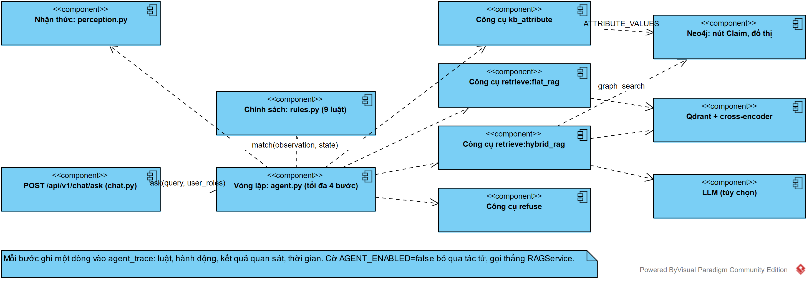
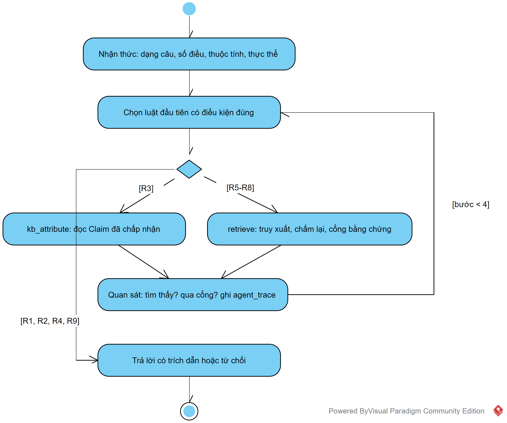

# CHƯƠNG 5. KIẾN TRÚC HỆ THỐNG VÀ TÁC TỬ HỎI ĐÁP TRI THỨC

## 5.1. Vấn đề đặt ra và phạm vi giải quyết

Chương 3 chọn mô hình biểu diễn, Chương 4 xây dựng cơ sở tri thức. Hai phần này chỉ tạo ra giá trị khi được ghép thành một hệ thống mà người dùng thật sử dụng được. Khi ghép, nhóm gặp các vấn đề sau:

| Mã | Vấn đề | Câu hỏi cần trả lời |
| :--- | :--- | :--- |
| K1 | Nhiều module viết bằng nhiều ngôn ngữ | Giao diện React, cổng nghiệp vụ Java, dịch vụ AI Python và bốn kho dữ liệu kết nối với nhau qua đâu, theo hợp đồng nào? |
| K2 | Bảo mật và phân quyền | Ai được hỏi, được xem tài liệu nào; làm sao dịch vụ AI không bị gọi trực tiếp từ ngoài? |
| K3 | Chọn chiến lược trả lời cho từng câu hỏi | Lúc nào dùng vector, lúc nào dùng đồ thị, lúc nào đọc thẳng dữ kiện trong KB, lúc nào phải từ chối? |
| K4 | Tác tử: luật hay học? | Chính sách chọn chiến lược nên viết bằng luật hay học từ phản hồi (học tăng cường)? |
| K5 | Nhiều mô hình cùng chạy | Triển khai đồng thời nhiều mô hình (nhúng, chấm lại, sinh) và thay thế mà không sửa mã nguồn |
| K6 | Kiểm chứng toàn hệ thống | Đo chất lượng và độ trễ của cả luồng, không chỉ từng module |

Chương này giải quyết K1–K6 như sau:

- **K1, K2:** kiến trúc nhiều dịch vụ trong Docker Compose, mỗi kết nối được trình bày bằng đoạn mã thật (mục 5.2–5.4).
- **K3:** tác tử hỏi đáp dựa trên luật (rule-based agent) gồm bốn bước nhận thức, chọn luật, hành động, quan sát, có ghi vết từng quyết định (mục 5.5).
- **K4:** học lại chính sách chọn chiến lược bằng contextual bandit, một dạng học tăng cường, rồi so sánh với tác tử luật (mục 5.6).
- **K5:** cấu hình mô hình qua biến môi trường, ba backend LLM có thứ tự dự phòng (mục 5.7).
- **K6:** đánh giá đầu–cuối trên cùng bộ 26 câu hỏi (mục 5.8).

Ngoài phạm vi: hệ đa tác tử có nhiều tác tử tự trị cộng tác, và học tăng cường trực tuyến từ phản hồi người dùng thật. Hai hướng này được nêu ở mục 5.9.

## 5.2. Kiến trúc tổng thể

### 5.2.1. Các thành phần

Hệ thống gồm tám dịch vụ, khai báo trong `docker-compose.yml` và khởi động bằng một lệnh `docker compose up -d`:

| Dịch vụ | Công nghệ | Cổng | Trách nhiệm |
| :--- | :--- | :--- | :--- |
| `frontend` | React 19, Vite, TypeScript, Nginx | 3000 | Giao diện hỏi đáp, quản lý tài liệu, xem trích dẫn trên PDF |
| `backend` | Spring Boot 4, Java 17 | 8080 | Xác thực JWT, phân quyền, quản lý tài liệu và phiên bản, cổng gọi AI, nhật ký kiểm toán |
| `ai-service` | FastAPI, Python 3.11 | 8001 | Trích xuất PDF, OCR, phân đoạn, nhúng, truy xuất, tác tử, sinh câu trả lời |
| `postgres` | PostgreSQL 15 | 5432 | Người dùng, tài liệu, phiên bản, chunk, nhiệm vụ nạp, nhật ký AI |
| `redis` | Redis 7 | 6379 | Bộ đệm và giới hạn tần suất |
| `qdrant` | Qdrant | 6333 | Chỉ mục vector 384 chiều (HNSW, cosine) |
| `neo4j` | Neo4j 5.26 Community | 7474/7687 | Đồ thị tri thức KB1, KB2, KB (Chương 4) |
| `ollama` | Ollama 0.12 (tùy chọn) | 11434 | LLM cục bộ `qwen2.5:3b` |

*Bảng 5.1. Các dịch vụ của hệ thống EAKWP.*

Sơ đồ kết nối tám dịch vụ và giao thức giữa chúng đã được trình bày ở Hình 2.1 (Chương 2); chương này đi vào mã nguồn của từng mối nối.

### 5.2.2. Nguyên tắc phân lớp

1. **Người dùng chỉ nói chuyện với backend.** Chỉ frontend và backend mở cổng ra ngoài. Dịch vụ AI và bốn kho dữ liệu chỉ gắn cổng vào `127.0.0.1`; ngoài ra dịch vụ AI còn kiểm tra header `X-Internal-Token` (`ai-service/app/main.py`), nên không thể bị gọi trực tiếp từ ngoài.
2. **Backend quyết định danh tính và quyền.** Backend tự gắn `user_roles` từ JWT vào yêu cầu gửi sang AI; trình duyệt không thể tự khai quyền.
3. **Dịch vụ AI không lưu trạng thái nghiệp vụ.** Mọi dữ liệu gốc (tài liệu, phiên bản, chunk) nằm trong PostgreSQL; Qdrant và Neo4j là chỉ mục dẫn xuất, có thể dựng lại từ PostgreSQL bằng script.
4. **Một định danh chunk xuyên suốt.** `chunk_id` sinh ở backend được giữ nguyên trong PostgreSQL, Qdrant và Neo4j. Nhờ đó trích dẫn từ đồ thị mở được đúng trang PDF.

## 5.3. Kết nối các module qua mã nguồn

### 5.3.1. Giao diện → cổng nghiệp vụ

Câu hỏi được gửi từ trang hỏi đáp tới backend, kèm 4 lượt hội thoại gần nhất:

```typescript
// frontend/src/api/chat.ts (dòng 14-23)
const { data } = await api.post<AskResponse>(
  '/api/ai/chat',
  {
    query: input.question,
    top_k: 3,
    min_score: 0.25,
    history: input.history?.slice(-4) ?? [],
  },
  { timeout: AI_TIMEOUT_MS },
)
```

`api` là một thể hiện axios đã gắn JWT vào header `Authorization` (`frontend/src/api/client.ts`). Giao diện không biết dịch vụ AI nằm ở đâu.

### 5.3.2. Cổng nghiệp vụ → dịch vụ AI

Backend nhận câu hỏi tại `AiGatewayController` (`POST /api/ai/chat`) rồi chuyển qua `AiGatewayService.forward`, nơi áp dụng giới hạn tần suất, gắn quyền và ghi nhật ký:

```java
// backend/src/main/java/com/tho/enterpriseai/ai/AiGatewayService.java (dòng 77-91)
if (!rateLimiter.allow(email)) {
    audit(email, role, action, query, documentId, "RATE_LIMITED", null, 0, started);
    throw new ResponseStatusException(HttpStatus.TOO_MANY_REQUESTS, "...");
}
Map<String, Object> body = new HashMap<>(request);
body.remove("user_roles");                       // trình duyệt không được tự khai quyền
if (!"ADMIN".equals(role)) {
    body.put("user_roles", List.of(role));       // quyền lấy từ JWT
}
Map<String, Object> response = client.post(path, body);   // path = /api/v1/chat/ask
```

`client` là `AiGatewayClient`, một `RestClient` có địa chỉ `app.ai-service-url` và header `X-Internal-Token`. Mỗi lời gọi, kể cả lời gọi lỗi, được ghi vào bảng `ai_audit_logs` (người hỏi, vai trò, câu hỏi, mô hình, số trích dẫn, độ trễ).

### 5.3.3. Luồng nạp tài liệu: từ tải lên đến hai chỉ mục

Khi người dùng tải PDF lên, `IngestionService.process` (backend) chạy bất đồng bộ: gọi dịch vụ AI để trích văn bản và tọa độ (`AiParseClient` → `POST /api/v1/extract`), phân đoạn, lưu chunk vào PostgreSQL, rồi gửi chunk sang dịch vụ AI theo lô:

```java
// backend/src/main/java/com/tho/enterpriseai/document/AiIngestClient.java (dòng 64-70, 82-93)
metadata.put("document_id", document.getId().toString());
metadata.put("version_id", version.getId().toString());
metadata.put("allowed_roles", document.allowedRoleList());
metadata.put("page_start", chunk.getPageStart());
item.put("chunk_id", chunk.getChunkId());
item.put("content", chunk.getContent());
client.post().uri("/api/v1/ingest")
      .body(Map.of("chunks", payload)).retrieve().toBodilessEntity();
```

Phía dịch vụ AI, một lời gọi `POST /api/v1/ingest` cập nhật cả chỉ mục vector lẫn đồ thị tri thức:

```python
# ai-service/app/api/v1/ingest.py (dòng 33-39)
raw_chunks = [chunk.model_dump() for chunk in payload.chunks]
embedded_chunks = embedder.embed_chunks(raw_chunks)        # E5-Small, 384 chiều
upserted_count = qdrant.upsert_chunks(embedded_chunks)     # -> Qdrant
graph_synced_count = sync_ingest_chunks(raw_chunks)        # -> Neo4j, cùng chunk_id
if graph_synced_count:
    enrich_new_entities(embedder)                          # mô tả + vector cho thực thể mới
```

Đây là điểm nối giữa Chương 3 (mô hình nhúng) và Chương 4 (đồ thị): cùng một lô chunk đi vào hai chỉ mục với cùng `chunk_id`.

### 5.3.4. Dịch vụ AI → tác tử → kho dữ liệu

Endpoint hỏi đáp của dịch vụ AI không gọi thẳng pipeline RAG mà giao cho tác tử:

```python
# ai-service/app/api/v1/chat.py (dòng 49-57)
answerer = get_agent() if settings.AGENT_ENABLED else rag_service
return answerer.ask(
    query=cleaned_query,
    top_k=payload.top_k,
    document_id=payload.document_id,
    min_score=payload.min_score,
    history=payload.history,
    allowed_roles=payload.user_roles,
)
```

Tác tử dùng ba công cụ: `RetrieveTool` gọi `RAGService.ask` (Qdrant + Neo4j + cross-encoder + LLM), `KBAttributeTool` đọc dữ kiện đã giải quyết mâu thuẫn trong Neo4j (nút `Claim`), và công cụ từ chối. Cờ `AGENT_ENABLED=false` đưa hệ thống về đường cũ để so sánh.

### 5.3.5. Luồng hỏi đáp đầu–cuối

| Bước | Thành phần | Việc làm | Mã nguồn |
| ---: | :--- | :--- | :--- |
| 1 | Frontend | Gửi câu hỏi + lịch sử | `frontend/src/api/chat.ts` |
| 2 | Backend | Xác thực JWT, giới hạn tần suất, gắn quyền, ghi nhật ký | `AiGatewayService.forward` |
| 3 | AI – tác tử | Nhận thức câu hỏi, chọn luật | `app/agent/perception.py`, `rules.py` |
| 4 | AI – công cụ KB | (nếu hỏi thuộc tính) đọc `Claim` đã chấp nhận | `app/agent/tools.py`, `05_retrieval.cypher: ATTRIBUTE_VALUES` |
| 5 | AI – RAG | Nhúng câu hỏi, tìm Qdrant, tìm Neo4j, trộn RRF | `RAGService.retrieve_hits` |
| 6 | AI – RAG | Cross-encoder chấm lại, cổng bằng chứng | `reranker_service.py`, `answer_policy.select_evidence` |
| 7 | AI – RAG | Sinh câu trả lời (LLM) hoặc trích đoạn; kiểm định | `RAGService.ask` |
| 8 | AI – tác tử | Quan sát: đủ căn cứ thì trả lời, chưa đủ thì thử lại hoặc từ chối | `app/agent/agent.py` |
| 9 | Frontend | Hiển thị câu trả lời, trích dẫn, mở PDF tại vùng tô sáng | `ChatPage.tsx`, `components/citations` |

*Bảng 5.2. Luồng hỏi đáp đầu–cuối và mã nguồn tương ứng.*

## 5.4. Bảo mật, phân quyền và vận hành

- **Xác thực:** JWT ký HMAC, lọc bởi `JwtAuthenticationFilter`; token hết hạn hoặc sai chữ ký bị từ chối (HTTP 401).
- **Phân quyền tài liệu:** mỗi tài liệu có `allowed_roles`. Quyền được lọc ngay trong truy vấn: payload filter của Qdrant và điều kiện `allowed_roles` trong Cypher (`05_retrieval.cypher`), nên đoạn không được phép không bao giờ đến tay LLM.
- **Chỉ trích dẫn tài liệu mở được:** đồ thị Neo4j chứa cả kho nghiên cứu KB1, KB2 (PDF và trang web không có trong backend) lẫn tài liệu tải lên. API hỏi đáp của người dùng chỉ lấy đoạn từ tài liệu tải lên (`CHAT_GRAPH_SOURCE_TYPE=upload`, áp dụng cho cả truy xuất đồ thị và công cụ `kb_attribute`), để mọi trích dẫn đều mở được PDF gốc trong backend. Các script đánh giá dùng toàn bộ đồ thị.
- **Bảo vệ dịch vụ nội bộ:** dịch vụ AI chỉ lắng nghe trên `127.0.0.1` và kiểm tra `X-Internal-Token`.
- **Giới hạn tần suất:** `AiRateLimiter` theo email, trả HTTP 429 khi vượt ngưỡng.
- **Kiểm toán:** bảng `ai_audit_logs` ghi mọi lời gọi AI. Trang quản trị đọc qua `GET /api/ai/audit`.
- **Quan sát:** `GET /api/v1/metrics/latency` trả p50/p95 từng bước (nhúng, tìm vector, đồ thị, chấm lại, sinh, kiểm định). Mỗi câu trả lời kèm `timings_ms` và `agent_trace`.

## 5.5. Tác tử hỏi đáp dựa trên luật

### 5.5.1. Vì sao cần tác tử

Đường RAG ở Chương 4 luôn chạy cùng một chuỗi bước cho mọi câu hỏi. Dữ liệu thực nghiệm cho thấy cách làm này không tối ưu:

- Câu hỏi "Vốn điều lệ hiện nay là bao nhiêu?" có mười ba giá trị khác nhau trong kho (mục 4.15). Truy xuất văn bản có thể trả về một phụ lục cũ có cosine cao. KB đã giải quyết mâu thuẫn và biết giá trị hiện hành, nên nên đọc thẳng từ KB.
- Câu hỏi không chứa thực thể nào không được lợi gì từ đồ thị mà vẫn phải chịu thêm thời gian truy vấn Neo4j.
- Khi vector search bị cổng bằng chứng từ chối, thử lại bằng truy xuất lai có thể tìm được đoạn đúng qua quan hệ đồ thị.

Một tác tử (agent) là thành phần **nhận thức** môi trường, **chọn hành động** theo chính sách và **quan sát** kết quả để quyết định bước tiếp theo [Russell & Norvig]. Ở đây môi trường là câu hỏi và kho tri thức; hành động là các công cụ truy xuất; chính sách là bảng luật.

### 5.5.2. Kiến trúc tác tử

| Thành phần | Tệp | Vai trò |
| :--- | :--- | :--- |
| Nhận thức | `ai-service/app/agent/perception.py` | Chuyển câu hỏi thành sự kiện: dạng câu hỏi (đếm, thời gian, có/không, liệt kê, điều khoản), số điều, thuộc tính một giá trị, các thực thể KB |
| Chính sách | `ai-service/app/agent/rules.py` | Bảng 9 luật IF–THEN có thứ tự ưu tiên |
| Công cụ | `ai-service/app/agent/tools.py` | `kb_attribute`, `retrieve:flat_rag`, `retrieve:hybrid_rag`, `refuse` |
| Vòng lặp | `ai-service/app/agent/agent.py` | Nhận thức → chọn luật → hành động → quan sát, tối đa 4 bước, ghi `agent_trace` |



*Hình 5.1. Kiến trúc tác tử: nhận thức, chính sách, vòng lặp và bốn công cụ.*

Nhận thức không dùng mô hình học máy mà dùng lại chính bộ trích thực thể của KB, nên tác tử "nhìn" câu hỏi bằng cùng từ vựng với đồ thị:

```python
# ai-service/app/agent/perception.py (hàm perceive, rút gọn)
for shape, pattern in _SHAPES:                       # đếm / thời gian / có-không / liệt kê
    if re.search(pattern, folded):
        observation.shape = shape
        break
article = re.search(r"\bdieu\s+(\d{1,3})\b", folded)  # "Điều 15" -> article = "15"
for attribute, spec in SINGLE_VALUED.items():          # "vốn điều lệ ... bao nhiêu"
    if fold_text(spec["phrase"]) in folded and any(cue in folded for cue in _VALUE_CUES):
        observation.attribute = attribute
observation.entities = [e["name"] for e in extract_entities(question) if e["type"] not in LOCAL_ENTITY_TYPES]
```

### 5.5.3. Bảng luật

Luật được viết dưới dạng dữ liệu (`Rule(name, description, condition, action)`), duyệt theo thứ tự; luật đầu tiên có điều kiện đúng được kích hoạt. Bảng dưới được sinh tự động từ mã nguồn qua `GET /api/v1/chat/agent/rules`.

| Ưu tiên | Luật | NẾU | THÌ |
| ---: | :--- | :--- | :--- |
| 1 | R1_cau_hoi_rong | Câu hỏi dưới 2 từ có nghĩa | từ chối |
| 2 | R2_tra_loi_xong | Lần truy xuất trước đã qua cổng bằng chứng | trả lời |
| 3 | R3_thuoc_tinh_mot_gia_tri | Hỏi giá trị thuộc tính một giá trị (vốn điều lệ, mệnh giá), đồ thị khả dụng, chưa tra | `kb_attribute` |
| 4 | R4_thuoc_tinh_da_co | KB có giá trị được chấp nhận | trả lời |
| 5 | R5_dan_chieu_dieu_khoan | Câu hỏi nêu "Điều N", đồ thị khả dụng | `retrieve:hybrid_rag` |
| 6 | R6_co_thuc_the_trong_kb | Câu hỏi nhắc thực thể KB, đồ thị khả dụng, cờ `AGENT_ENTITY_HYBRID` bật (mặc định tắt, xem mục 5.6.2) | `retrieve:hybrid_rag` |
| 7 | R7_mac_dinh_vector | Chưa thử công cụ nào | `retrieve:flat_rag` |
| 8 | R8_thu_lai_mo_rong | Lần trước bị cổng từ chối, chưa thử truy xuất lai | `retrieve:hybrid_rag` |
| 9 | R9_tu_choi | Mọi trường hợp còn lại | từ chối |

*Bảng 5.3. Chính sách của tác tử hỏi đáp.*

Hai tính chất được kiểm thử tự động (`ai-service/tests/test_agent.py`, 9 ca): bảng luật luôn kết thúc bằng luật bắt-tất-cả nên tác tử luôn dừng; và khi Neo4j không khả dụng, tác tử không bao giờ chọn công cụ cần đồ thị.

### 5.5.4. Vòng lặp và ghi vết



*Hình 5.2. Vòng lặp nhận thức – chọn luật – hành động – quan sát của tác tử.*

```python
# ai-service/app/agent/agent.py (vòng lặp chính, rút gọn)
while state.steps < MAX_STEPS:
    state.steps += 1
    rule = match(observation, state)                 # luật đầu tiên thỏa mãn
    if rule.action in ("respond", "refuse"):
        break
    if rule.action == "kb_attribute":
        response = self.kb_attribute(observation.attribute, query)
        state.attribute_found = response is not None
    elif rule.action.startswith("retrieve:"):
        response = self.retrieve(query, rule.action.split(":", 1)[1], **kwargs)
        state.last_answered = bool(response.citations)     # quan sát kết quả
```

Mỗi bước được ghi vào `AskResponse.agent_trace`. Ví dụ ghi vết thật của câu "Vốn điều lệ hiện nay của công ty là bao nhiêu?":

Nhận thức (bước 0): dạng câu hỏi: hỏi số lượng; thuộc tính một giá trị: Vốn điều lệ; thực thể KB: Vốn điều lệ.

| Bước | Luật kích hoạt | Hành động | Kết quả quan sát | Thời gian |
| ---: | :--- | :--- | :--- | ---: |
| 1 | `R3_thuoc_tinh_mot_gia_tri` | tra dữ kiện trong KB | tìm thấy giá trị được chấp nhận | 2,2 s |
| 2 | `R4_thuoc_tinh_da_co` | trả lời |  |  |

*Bảng 5.4. Vết xử lý của câu hỏi vốn điều lệ (chạy lại ngày 16/11/2026).*

Tác tử không truy xuất văn bản: luật R3 thấy câu hỏi về một thuộc tính một giá trị nên gọi `kb_attribute`, đọc nút `Claim` đã được phân định ở mục 4.15.7 và trả lời "13.074.049.490.000 đồng, theo Điều lệ năm 2026", kèm các giá trị cũ hơn đã bị thay thế. Ví dụ này chạy ở chế độ toàn đồ thị, chế độ dùng cho đánh giá (`CHAT_GRAPH_SOURCE_TYPE` để trống), vì Điều lệ 2025 và 2026 nằm trong KB1. Trong API hỏi đáp của người dùng, tác tử chỉ trích dẫn tài liệu tải lên (`CHAT_GRAPH_SOURCE_TYPE=upload`, mục 5.4) để mọi trích dẫn đều mở được PDF gốc.

Và của một câu hỏi không có thực thể, vector bị từ chối nên tác tử thử lại bằng truy xuất lai:

Nhận thức (bước 0): dạng câu hỏi: liệt kê; thực thể KB: không có.

| Bước | Luật kích hoạt | Hành động | Kết quả quan sát | Thời gian |
| ---: | :--- | :--- | :--- | ---: |
| 1 | `R7_mac_dinh_vector` | truy xuất vector | cổng bằng chứng từ chối | 10,0 s |
| 2 | `R8_thu_lai_mo_rong` | truy xuất lai | có bằng chứng, có trích dẫn (1 trích dẫn) | 11,5 s |
| 3 | `R2_tra_loi_xong` | trả lời |  |  |

*Bảng 5.5. Vết xử lý của một câu hỏi phải thử lại.*

Câu hỏi không chứa thực thể nên luật R7 chọn vector. Cổng bằng chứng từ chối kết quả, luật R8 thử lại bằng truy xuất lai và tìm được Điều 22 về an toàn, bảo mật thông tin. Với câu ngoài phạm vi "Công ty có bao nhiêu nhân viên?", chuỗi luật là `R7_mac_dinh_vector` → `R8_thu_lai_mo_rong` → `R9_tu_choi`: cả hai lần truy xuất đều bị cổng từ chối, tác tử từ chối thay vì đoán.

Trên 27 câu (26 câu của bộ đánh giá và câu vốn điều lệ), tác tử đi theo các chuỗi luật sau:

| Chuỗi luật | Số câu |
| :--- | ---: |
| `R7_mac_dinh_vector → R2_tra_loi_xong` | 19 |
| `R7_mac_dinh_vector → R8_thu_lai_mo_rong → R9_tu_choi` | 5 |
| `R3_thuoc_tinh_mot_gia_tri → R4_thuoc_tinh_da_co` | 1 |
| `R7_mac_dinh_vector → R8_thu_lai_mo_rong → R2_tra_loi_xong` | 1 |
| `R5_dan_chieu_dieu_khoan → R2_tra_loi_xong` | 1 |

*Bảng 5.6. Tần suất các chuỗi luật của tác tử.*

## 5.6. Học chính sách bằng học tăng cường

### 5.6.1. Bài toán

Luật R5–R8 do con người viết dựa trên quan sát. Câu hỏi đặt ra (K4) là: nếu để hệ thống **tự học** nên dùng chiến lược truy xuất nào cho loại câu hỏi nào, kết quả có tốt hơn luật không?

Bài toán được mô hình hóa thành **contextual multi-armed bandit**, dạng đơn giản nhất của học tăng cường (một bước quyết định cho mỗi câu hỏi, không có chuỗi trạng thái):

- **Ngữ cảnh** $x$: đặc trưng do bước nhận thức của tác tử sinh ra: dạng câu hỏi, có thực thể KB hay không, có số điều hay không.
- **Hành động (nhánh)** $a \in \{\text{flat\_rag}, \text{graph\_rag}, \text{hybrid\_rag}\}$.
- **Phần thưởng**: $r = \mathbb{1}[\text{câu trả lời đạt}] - \lambda \cdot t$, với $t$ là độ trễ (giây) và $\lambda = 0{,}02$. Phạt độ trễ để chính sách không chọn chiến lược đắt khi chiến lược rẻ cho kết quả như nhau.

Thuật toán **UCB1** chọn nhánh theo

> **Công thức 5.1.** $a_t = \arg\max_a \left[\bar r_{x,a} + \sqrt{\dfrac{2\ln n_x}{n_{x,a}}}\right]$

trong đó $\bar r_{x,a}$ là phần thưởng trung bình của nhánh $a$ trong ngữ cảnh $x$, $n_x$ là số lần gặp ngữ cảnh $x$ và $n_{x,a}$ là số lần chọn nhánh $a$ trong ngữ cảnh đó. Số hạng thứ hai khuyến khích thử nhánh ít được chọn (khám phá), số hạng thứ nhất khai thác nhánh tốt đã biết.

### 5.6.2. Thực nghiệm

Phần thưởng của mỗi nhánh lấy từ lần chạy đánh giá thật (mục 5.8): mỗi câu hỏi đã được trả lời bằng cả ba chiến lược. UCB1 học qua 200 lượt phát lại ngẫu nhiên. Để không "nhìn trộm" đáp án, chính sách được đánh giá bằng leave-one-out: mỗi câu được chấm bởi chính sách học từ 25 câu còn lại. Script: `ai-service/scripts/20_bandit_policy.py`.

| Chính sách | Phần thưởng trung bình |
| :--- | ---: |
| Luôn dùng vector | 0,595 |
| Luôn dùng đồ thị | 0,458 |
| Luôn dùng truy xuất lai | 0,599 |
| **Tác tử luật (mục 5.5)** | **0,618** |
| Bandit UCB1, leave-one-out | 0,432 |
| Cận trên: biết trước nhánh tốt nhất | 0,749 |

*Bảng 5.7. Phần thưởng trung bình của các chính sách chọn chiến lược (26 câu, 200 lượt học).*

Chính sách mà bandit học được trên toàn bộ dữ liệu, theo từng ngữ cảnh:

| Ngữ cảnh (dạng câu, có thực thể, có số điều) | Số câu | Nhánh được chọn | Thưởng vector / đồ thị / lai |
| :--- | ---: | :--- | :--- |
| điều khoản, có thực thể, có số điều | 1 | `graph_rag` | 0,89 / 0,95 / 0,92 |
| hỏi số lượng, không thực thể, không số điều | 2 | `graph_rag` | 0,89 / 0,98 / 0,92 |
| hỏi số lượng, có thực thể, không số điều | 6 | `hybrid_rag` | 0,49 / 0,36 / 0,53 |
| liệt kê, không thực thể, không số điều | 2 | `hybrid_rag` | 0,15 / -0,04 / 0,47 |
| liệt kê, có thực thể, không số điều | 2 | `graph_rag` | 0,45 / 0,72 / 0,33 |
| mở, không thực thể, không số điều | 3 | `hybrid_rag` | 0,90 / 0,62 / 0,92 |
| mở, có thực thể, không số điều | 2 | `hybrid_rag` | 0,82 / 0,55 / 0,90 |
| thời gian, không thực thể, không số điều | 1 | `hybrid_rag` | 0,88 / -0,07 / 0,90 |
| thời gian, có thực thể, không số điều | 2 | `graph_rag` | 0,63 / 0,97 / 0,58 |
| có/không, không thực thể, không số điều | 2 | `flat_rag` | 0,53 / -0,04 / 0,12 |
| có/không, có thực thể, không số điều | 3 | `flat_rag` | 0,64 / 0,15 / 0,30 |

*Bảng 5.8. Chính sách bandit học được theo ngữ cảnh.*

Tác tử luật đạt phần thưởng cao nhất trong các chính sách thực tế (0,618), nhỉnh hơn "luôn dùng truy xuất lai" (0,599) và "luôn dùng vector" (0,595). Bandit học bằng leave-one-out chỉ đạt 0,432, thấp hơn cả chính sách cố định đơn giản nhất. Nguyên nhân là dữ liệu quá ít: 26 câu chia vào 11 ngữ cảnh, nhiều ngữ cảnh chỉ có 1–2 câu, nên khi bỏ một câu ra để chấm thì ngữ cảnh đó gần như không còn dữ liệu học (Bảng 5.8).

Khoảng cách tới cận trên (0,749) cho thấy việc chọn chiến lược theo câu hỏi vẫn còn dư địa. Học tăng cường cũng đã góp phần sửa luật: bandit cho thấy với câu hỏi có thực thể, truy xuất lai không vượt trội rõ so với vector. Kiểm chứng trên tác tử: bật luật R6 (đưa mọi câu có thực thể sang truy xuất lai) cho tỷ lệ đạt 69,2%, tắt R6 cho 73,1%. Vì vậy R6 được giữ trong bảng luật nhưng tắt mặc định (`AGENT_ENTITY_HYBRID=false`). Kết luận thực tế: với quy mô dữ liệu hiện tại, luật do con người viết dựa trên quan sát vẫn tốt hơn chính sách học; học tăng cường trở nên có ích khi thu được phản hồi thật của người dùng (mục 5.9).

## 5.7. Triển khai nhiều mô hình

Theo vấn đề K5 và hạn chế V4 của Chương 3 (không tự huấn luyện mô hình), hệ thống triển khai nhiều mô hình ở cả ba tầng. Mô hình được chọn bằng biến môi trường, không sửa mã nguồn:

| Tầng | Mô hình đang dùng | Mô hình thay thế đã đo | Biến cấu hình |
| :--- | :--- | :--- | :--- |
| Nhúng (A) | `intfloat/multilingual-e5-small` | E5-Base, BKAI bi-encoder, MiniLM-L12 (Bảng 3.1, 3.2) | `EMBEDDING_MODEL`, `EMBEDDING_QUERY_PREFIX` |
| Chấm lại (B) | `cross-encoder/mmarco-mMiniLMv2-L12-H384-v1` | tắt chấm lại (Bảng 5.10) | `RERANKER_MODEL`, `RERANK_GATE` |
| Sinh câu trả lời | Gemini (`gemini-3.5-flash`) | OpenAI; `qwen2.5:3b` cục bộ qua Ollama; trích đoạn không LLM | `GEMINI_MODEL`, `LLM_BASE_URL`, `LLM_MODEL` |

*Bảng 5.9. Các mô hình được triển khai và cách thay thế.*

Tầng sinh có thứ tự dự phòng rõ ràng:

```python
# ai-service/app/llm_client.py (resolve_llm, rút gọn)
if settings.LLM_BASE_URL.strip() and settings.LLM_MODEL.strip():
    return LLM(client=_client(settings.LLM_API_KEY or "local", settings.LLM_BASE_URL),
               model=settings.LLM_MODEL, provider="openai-compatible")   # Ollama / vLLM
if _usable(settings.GEMINI_API_KEY):
    return LLM(client=_client(settings.GEMINI_API_KEY, GEMINI_BASE_URL),
               model=settings.GEMINI_MODEL, provider="gemini")
if _usable(settings.OPENAI_API_KEY):
    return LLM(client=_client(settings.OPENAI_API_KEY), model=settings.OPENAI_MODEL, provider="openai")
return None                                    # -> câu trả lời trích đoạn có trích dẫn
```

Khi không có LLM hoặc LLM lỗi, hệ thống vẫn trả lời bằng trích đoạn nguyên văn có trích dẫn. Khi LLM sinh câu trả lời mà bộ kiểm định không xác nhận được bằng ngữ cảnh, hệ thống cũng quay về trích đoạn (`RAGService.ask`).

## 5.8. Đánh giá toàn hệ thống

### 5.8.1. Thiết lập

Bộ đánh giá `ai-service/data/eval/eval_questions.json` có 26 câu: 18 câu có đoạn đúng được gán nhãn thủ công và 8 câu nằm ngoài phạm vi, phải từ chối. Mọi cấu hình chạy trên cùng dữ liệu (7 tài liệu upload trong Qdrant, KB 52 tài liệu trong Neo4j), cùng câu hỏi, ở chế độ trích đoạn (không LLM) để kết quả không lẫn với cách diễn đạt của LLM. Script: `ai-service/scripts/15_run_eval.py`.

### 5.8.2. Kết quả

| Cấu hình | Tỷ lệ đạt | MRR | Recall@3 | Trích dẫn đúng | Từ chối đúng | Từ chối nhầm | Độ trễ TB |
| :--- | ---: | ---: | ---: | ---: | ---: | ---: | ---: |
| Chỉ vector | 73,1% | 0,676 | 0,778 | 77,8% | 62,5% | 5,6% | 6,8 s |
| Chỉ đồ thị | 50,0% | 0,296 | 0,389 | 33,3% | 87,5% | 27,8% | 2,1 s |
| Truy xuất lai | 69,2% | 0,745 | 0,833 | 72,2% | 62,5% | 0,0% | 4,7 s |
| Truy xuất lai, tắt chấm lại | 57,7% | 0,516 | 0,611 | 77,8% | 37,5% | 5,6% | 0,9 s |
| **Tác tử luật** | 73,1% | 0,690 | 0,778 | 77,8% | 62,5% | 0,0% | 5,6 s |

*Bảng 5.10. Đánh giá đầu–cuối trên 26 câu hỏi (15/11/2026, chế độ trích đoạn, không LLM).*

Tác tử đạt tỷ lệ đạt cao nhất (73,1%, bằng cấu hình chỉ vector) và là cấu hình duy nhất vừa không từ chối nhầm câu có đáp án (0,0%) vừa giữ trích dẫn đúng ở mức cao nhất (77,8%, bằng cấu hình chỉ vector). So với chỉ vector, tác tử loại được lần từ chối nhầm (5,6% → 0,0%) nhờ luật R8 thử lại bằng truy xuất lai, và trả lời câu hỏi thuộc tính từ KB đã phân định.

Bộ chấm lại cross-encoder là thành phần đóng góp lớn nhất: tắt nó, MRR giảm từ 0,745 xuống 0,516 và tỷ lệ đạt giảm xuống 57,7%; đổi lại độ trễ giảm còn 0,9 s. Từ chối đúng của tác tử, vector và truy xuất lai chỉ ở mức 62,5% (5/8 câu ngoài phạm vi): ba câu ngoài phạm vi vẫn tìm được đoạn có điểm vượt cổng. Cấu hình chỉ đồ thị từ chối đúng 87,5% nhưng chủ yếu vì nó từ chối nhiều, kể cả 27,8% câu có đáp án. Đây là hạn chế chính cần cải thiện, ví dụ bằng cổng bằng chứng theo ngưỡng riêng cho từng dạng câu hỏi.

Độ trễ đo trên máy cá nhân chạy CPU, dao động giữa các lần chạy, nên chỉ dùng để so sánh tương đối.

## 5.9. Hạn chế và hướng phát triển

- **Tác tử đơn:** hệ thống có một tác tử điều phối các công cụ. Hướng phát triển là hệ đa tác tử, ví dụ một tác tử truy xuất, một tác tử kiểm định, một tác tử cập nhật KB, giao tiếp qua hàng đợi thông điệp.
- **Học tăng cường ngoại tuyến, mẫu nhỏ:** chính sách bandit học từ 26 câu đã chấm sẵn. Hướng phát triển là thu phản hồi người dùng (nút "hữu ích/không hữu ích" trên giao diện) làm phần thưởng trực tuyến.
- **Luật viết tay:** luật R5–R8 và ngưỡng phần thưởng dựa trên quan sát của nhóm. Khi bộ đánh giá lớn hơn, nên để chính sách học thay cho các luật này, giữ luật an toàn (R1, R9) làm ràng buộc cứng.
- **Đánh giá với LLM chưa đầy đủ:** quota miễn phí của Gemini không đủ cho một lượt đánh giá đầy đủ (khoảng 50 yêu cầu); số liệu sinh câu trả lời bằng LLM chưa được báo cáo.

## 5.10. KẾT LUẬN

Chương 5 đã trả lời sáu vấn đề đặt ra ở mục 5.1:

- **K1, K2 (kết nối module, bảo mật):** tám dịch vụ kết nối qua REST theo hợp đồng cố định; mỗi mối nối được chỉ ra bằng đoạn mã thật (mục 5.3). Backend là cổng duy nhất, tự gắn quyền từ JWT; dịch vụ AI chỉ nhận yêu cầu có `X-Internal-Token`; quyền được lọc ngay trong truy vấn Qdrant và Cypher (mục 5.4).
- **K3 (chọn chiến lược):** tác tử dựa trên luật với chín luật, bốn bước nhận thức – chọn luật – hành động – quan sát, ghi vết từng quyết định. Tác tử đạt tỷ lệ đạt 73,1%, không từ chối nhầm câu nào và đọc được dữ kiện đã phân định trong KB (mục 5.5, 5.8).
- **K4 (luật hay học):** contextual bandit UCB1 đạt 0,432 so với 0,618 của tác tử luật trên 26 câu; học tăng cường chưa thắng luật vì thiếu dữ liệu, nhưng đã giúp điều chỉnh luật R6 (mục 5.6).
- **K5 (nhiều mô hình):** ba tầng mô hình (nhúng, chấm lại, sinh) thay được bằng biến môi trường; tầng sinh có thứ tự dự phòng và luôn có đường trích đoạn khi không có LLM (mục 5.7).
- **K6 (kiểm chứng toàn hệ thống):** năm cấu hình được đo trên cùng bộ 26 câu với các chỉ số truy xuất, trích dẫn, từ chối và độ trễ (mục 5.8).

Kết quả của chương là một hệ thống chạy đầu–cuối, trong đó mô hình của Chương 3 và cơ sở tri thức của Chương 4 được một tác tử điều phối, mọi câu trả lời đều truy vết được tới trang PDF gốc. Hướng phát triển là hệ đa tác tử và học tăng cường trực tuyến từ phản hồi người dùng.
