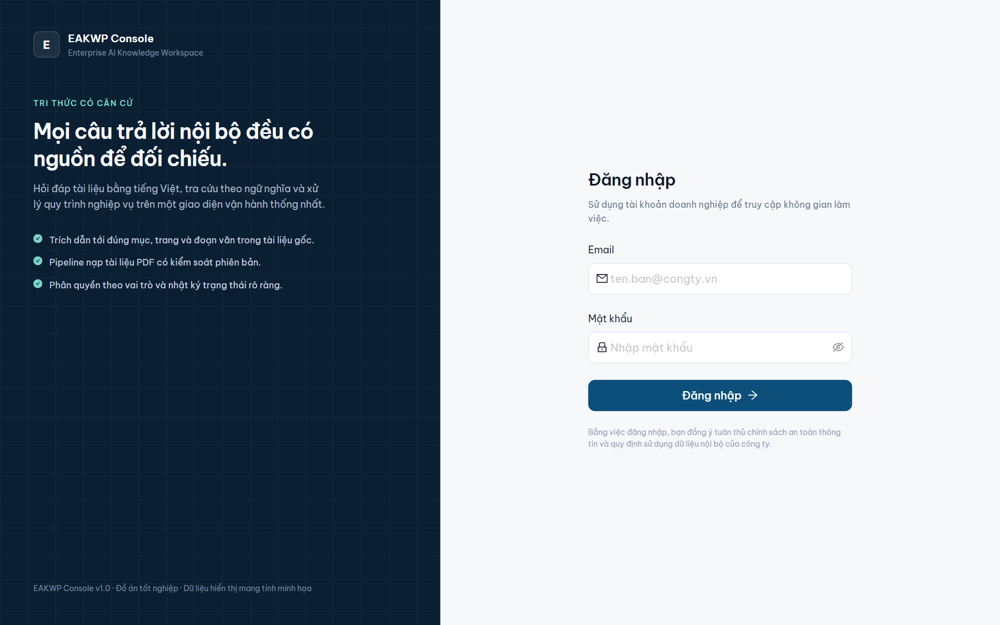
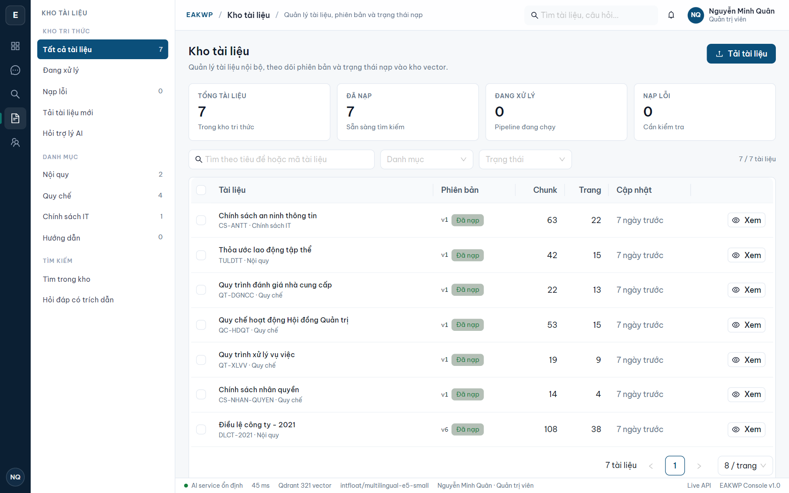
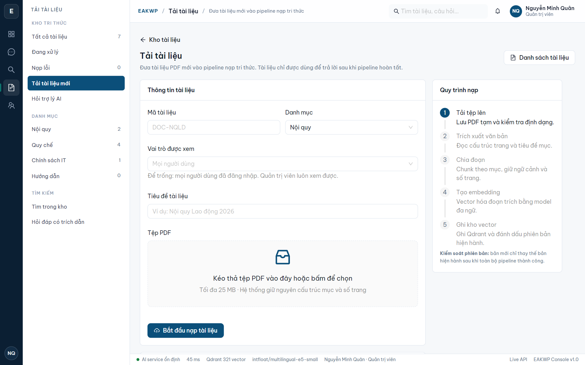
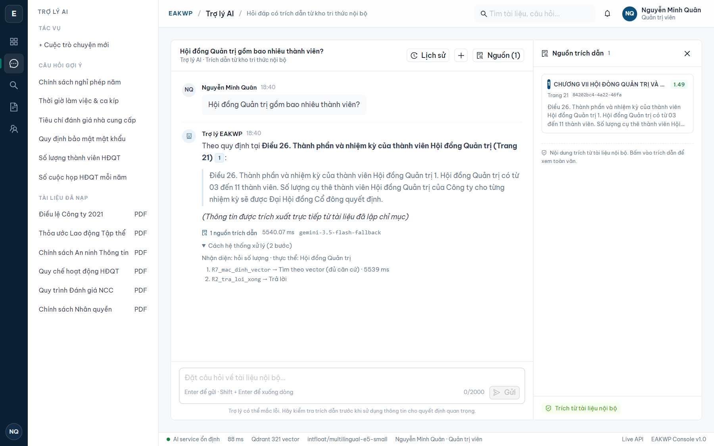
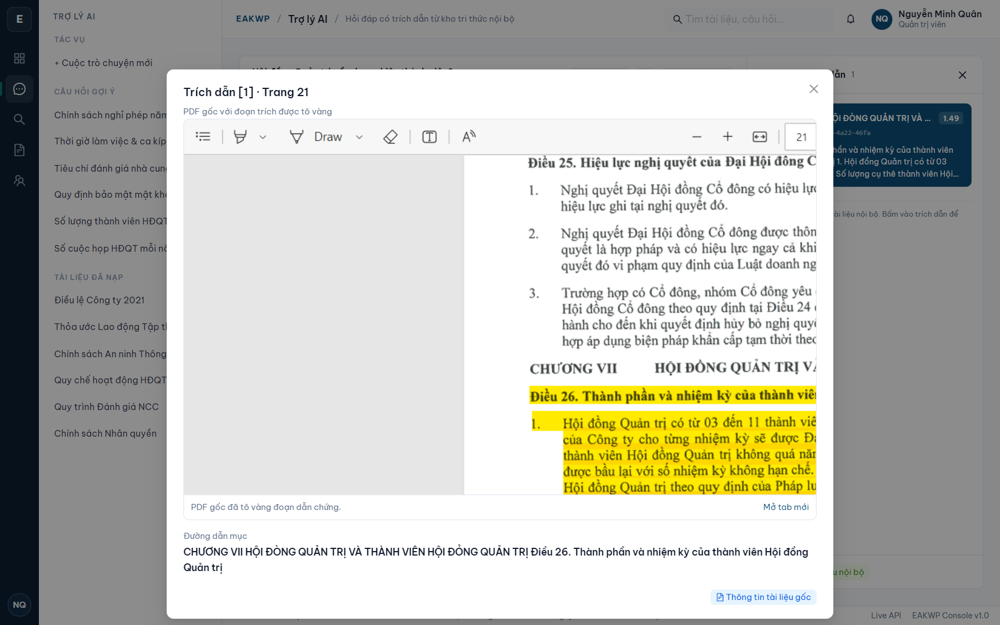
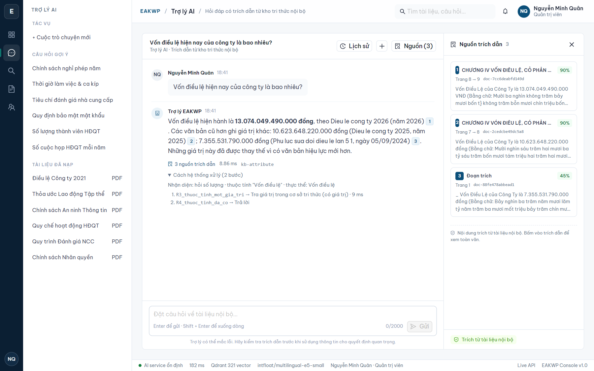
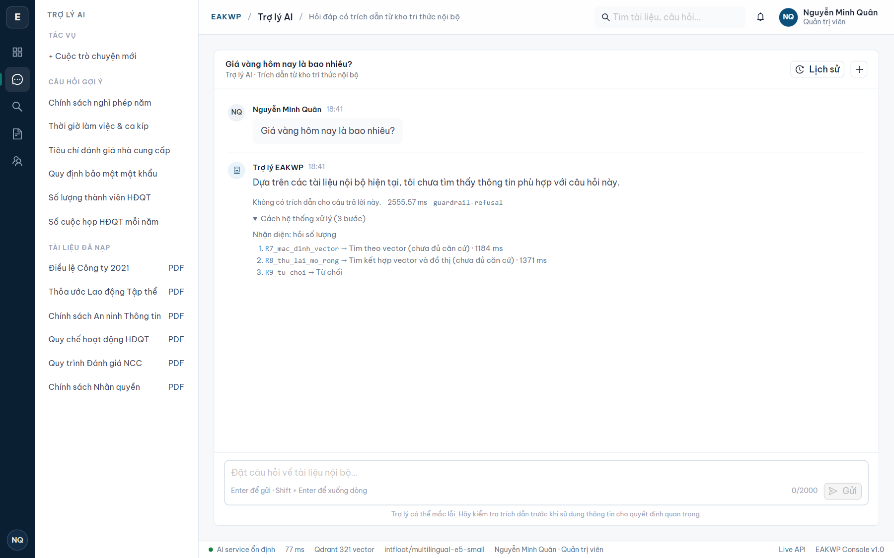
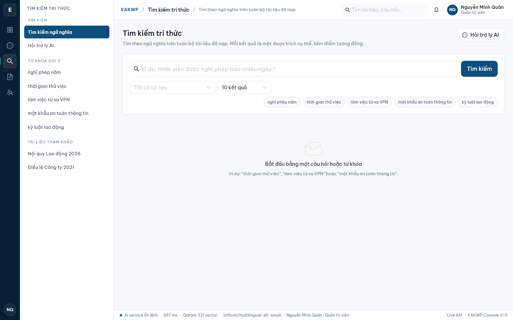
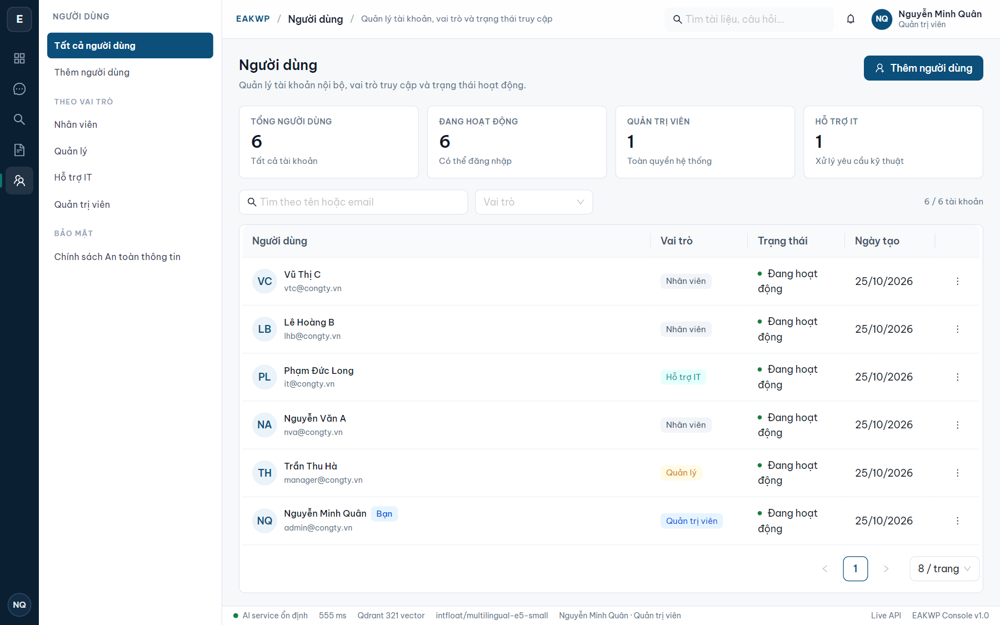

# CHƯƠNG 6. KẾT QUẢ TRIỂN KHAI HỆ THỐNG

## 6.1. Môi trường triển khai

Hệ thống được triển khai bằng Docker Compose trên một máy cá nhân (Windows 10, Docker Desktop, CPU, không dùng GPU). Toàn bộ tám dịch vụ ở Bảng 5.1 khởi động bằng lệnh `docker compose up -d`. Dữ liệu dùng để chụp các màn hình dưới đây là dữ liệu thật của đồ án: 7 tài liệu đã tải lên qua giao diện, KB hợp nhất 52 tài liệu trong Neo4j. Tài khoản đăng nhập là các tài khoản mẫu do `DemoDataInitializer` tạo. Mọi màn hình được chụp tự động bằng script `docs/thesis/submission/tools/capture_ui.cjs`, nên có thể chụp lại khi hệ thống thay đổi.

## 6.2. Đăng nhập và phân quyền

*Hình 6.1. Màn hình đăng nhập. Mỗi vai trò (quản trị, quản lý, nhân viên, hỗ trợ IT) được đưa tới trang chủ riêng sau khi đăng nhập.*

## 6.3. Quản lý tài liệu

*Hình 6.2. Kho tài liệu: danh sách tài liệu, loại, quyền truy cập, phiên bản và trạng thái lập chỉ mục.*

*Hình 6.3. Tải lên tài liệu mới. Sau khi tải lên, backend tự trích xuất, phân đoạn, nhúng và đồng bộ sang Qdrant và Neo4j (mục 5.3.3).*

## 6.4. Hỏi đáp có trích dẫn

*Hình 6.4. Câu hỏi "Hội đồng Quản trị gồm bao nhiêu thành viên?": câu trả lời kèm số thứ tự nguồn, danh sách trích dẫn bên phải và vết xử lý của tác tử bên dưới câu trả lời.*

*Hình 6.5. Bấm vào một trích dẫn mở đúng trang PDF gốc, đoạn dẫn chứng được tô vàng theo tọa độ OCR.*

## 6.5. Tác tử trả lời từ cơ sở tri thức

*Hình 6.6. Câu hỏi "Vốn điều lệ hiện nay của công ty là bao nhiêu?". Tác tử nhận ra đây là câu hỏi về thuộc tính một giá trị (luật R3), đọc giá trị đã được giải quyết mâu thuẫn trong KB và trích dẫn cả các giá trị cũ đã bị thay thế.*

## 6.6. Từ chối khi không đủ căn cứ

*Hình 6.7. Câu hỏi ngoài phạm vi tài liệu nội bộ bị từ chối, không có trích dẫn. Vết xử lý cho thấy tác tử đã thử vector rồi thử lại bằng truy xuất lai trước khi từ chối (luật R7 → R8 → R9).*

## 6.7. Tìm kiếm và quản trị

*Hình 6.8. Tìm kiếm ngữ nghĩa trên kho tài liệu.*

*Hình 6.9. Quản lý người dùng và vai trò (chỉ quản trị viên).*

## 6.8. KẾT LUẬN

Các màn hình trên cho thấy hệ thống chạy được đầu–cuối trên dữ liệu thật: tài liệu tải lên được lập chỉ mục; câu hỏi được trả lời kèm trích dẫn mở được tới đúng vùng trên PDF gốc; câu hỏi về dữ kiện có nhiều phiên bản được trả lời từ giá trị đã giải quyết mâu thuẫn trong KB; câu hỏi ngoài phạm vi bị từ chối có kiểm soát. Mỗi câu trả lời hiển thị cách tác tử đã xử lý, giúp người dùng biết câu trả lời đến từ đâu và vì sao hệ thống chọn cách đó.
