# CHƯƠNG 2. PHÂN TÍCH VÀ THIẾT KẾ HỆ THỐNG THEO KIẾN TRÚC MICROSERVICE

## 2.1. Vấn đề đặt ra và phạm vi giải quyết

Trước khi đi vào mô hình học sâu (Chương 3) và cơ sở tri thức (Chương 4), hệ thống cần một bản thiết kế chung: gồm những dịch vụ nào, ai dùng, làm được gì, các thành phần trao đổi với nhau theo trình tự nào và dữ liệu nằm ở đâu. Khi phân tích, nhóm gặp các vấn đề sau:

| Mã | Vấn đề | Câu hỏi cần trả lời |
| :--- | :--- | :--- |
| P1 | Phân rã hệ thống | Chia hệ thống thành những dịch vụ nào, theo ranh giới nào, để phần nghiệp vụ (Java) và phần AI (Python) phát triển, triển khai độc lập? |
| P2 | Tác nhân và chức năng | Ai sử dụng hệ thống, mỗi vai trò được làm gì, chức năng nào thuộc module nào? |
| P3 | Hành vi của chức năng | Luồng chuẩn và luồng ngoại lệ của từng chức năng chính diễn ra thế nào? |
| P4 | Tương tác giữa thành phần | Các lớp và dịch vụ gọi nhau theo trình tự nào? Xử lý thế nào với tác vụ chạy lâu như nạp một PDF vài chục trang? |
| P5 | Thiết kế dữ liệu | Dữ liệu nghiệp vụ, vector và đồ thị lưu ở đâu; giữ nhất quán giữa các kho bằng cách nào? |
| P6 | Hợp đồng giao tiếp | Các dịch vụ công bố API nào, ai được gọi, lỗi trả về theo quy ước nào? |

Chương này giải quyết P1–P6 như sau:

- **P1:** kiến trúc microservice gồm tám container, mỗi kho dữ liệu chỉ có một dịch vụ sở hữu (mục 2.3).
- **P2:** phân rã thành năm module và 28 chức năng; biểu đồ use case tổng quan và theo từng module (mục 2.4–2.6).
- **P3:** kịch bản chuẩn và ngoại lệ cho tám use case chính, lấy đúng thông báo lỗi trong mã nguồn (mục 2.7).
- **P4:** biểu đồ tuần tự cho ba luồng quan trọng nhất, biểu đồ hoạt động cho vòng đời phiên bản tài liệu, biểu đồ lớp của backend (mục 2.8–2.10).
- **P5:** thiết kế cơ sở dữ liệu quan hệ theo đúng lược đồ Flyway, cấu trúc payload vector và nguyên tắc đồng bộ giữa các kho (mục 2.11).
- **P6:** danh mục API công khai và nội bộ (mục 2.12).

Mọi biểu đồ trong chương được vẽ bằng Visual Paradigm (tệp `assets/vp/EAKWP_chuong_2.vpp`) và bám mã nguồn đang chạy. Việc các module được nối với nhau bằng đoạn mã cụ thể nào được trình bày ở Chương 5.

**Ngoài phạm vi.** Giao diện có thêm ba phân hệ mẫu là Nghỉ phép, Phê duyệt và Yêu cầu IT. Ba phân hệ này chỉ chạy trên dữ liệu giả lập trong trình duyệt (MSW), backend chưa có API tương ứng, nên chương này không thiết kế chúng.

## 2.2. Yêu cầu hệ thống

### 2.2.1. Tác nhân

| Tác nhân | Vai trò trong hệ thống | Quyền chính |
| :--- | :--- | :--- |
| Người dùng | `EMPLOYEE`, `MANAGER`, `IT_SUPPORT` | Đăng nhập, xem tài liệu được phép, hỏi đáp có trích dẫn, tìm kiếm ngữ nghĩa, xem PDF và trạng thái dịch vụ AI |
| Quản trị viên | `ADMIN`, kế thừa Người dùng | Thêm quản lý người dùng, tải lên và quản lý phiên bản tài liệu, theo dõi nạp, xem nhật ký truy vấn AI, quản trị cơ sở tri thức; thấy mọi tài liệu |
| Dịch vụ AI | Tác nhân hệ thống (`ai-service`) | Trích xuất, phân đoạn, nhúng, lưu vector và đồ thị; truy xuất và trả lời |
| Mô hình ngôn ngữ (LLM) | Hệ thống ngoài (Gemini, Ollama, OpenAI) | Sinh câu trả lời từ ngữ cảnh có đánh số trích dẫn |

*Bảng 2.1. Các tác nhân của hệ thống EAKWP.*

Ba vai trò `EMPLOYEE`, `MANAGER`, `IT_SUPPORT` có cùng quyền trên các API đã triển khai; chúng khác nhau ở **quyền đọc tài liệu**. Mỗi tài liệu có cột `allowed_roles` (ví dụ `EMPLOYEE,MANAGER` hoặc `*`), và một người dùng chỉ thấy tài liệu có vai trò của mình hoặc `*` (`DocumentService.canRead`). Quy tắc này được áp dụng cả ở danh sách tài liệu lẫn khi truy xuất cho hỏi đáp.

### 2.2.2. Yêu cầu chức năng

Yêu cầu chức năng được gom thành năm module (chi tiết ở Bảng 2.4):

1. **M1. Xác thực và người dùng:** đăng nhập, đăng ký, quản lý tài khoản và vai trò.
2. **M2. Quản lý tài liệu:** xem, lọc, tải lên, tạo phiên bản, đặt phiên bản hiện hành, xóa, xem PDF và đoạn trích.
3. **M3. Nạp và xử lý tài liệu:** đưa PDF qua 5 bước để thành tri thức truy xuất được; theo dõi, thử lại, nạp lại.
4. **M4. Hỏi đáp và tìm kiếm:** hỏi đáp có trích dẫn, tìm kiếm ngữ nghĩa, xem bằng chứng trên PDF, xem vết xử lý của tác tử.
5. **M5. Giám sát và tri thức:** trạng thái dịch vụ AI, nhật ký truy vấn, quản trị cơ sở tri thức đồ thị, đánh giá truy xuất.

### 2.2.3. Yêu cầu phi chức năng

| Nhóm | Yêu cầu | Cách đáp ứng trong thiết kế |
| :--- | :--- | :--- |
| Bảo mật | Chỉ người đã xác thực được gọi API; mật khẩu không lưu dạng rõ | JWT ký HMAC, hết hạn 1 giờ (`jwt.expiration=3600000`); mật khẩu băm BCrypt; API quản trị yêu cầu `ROLE_ADMIN` (`SecurityConfig`) |
| Bảo mật | Dịch vụ AI không bị gọi trực tiếp từ ngoài | `ai-service` chỉ gắn cổng `127.0.0.1` và kiểm tra header `X-Internal-Token` |
| Phân quyền dữ liệu | Không lộ tài liệu ngoài quyền, kể cả qua câu trả lời AI | Backend tự gắn `user_roles` từ JWT; Qdrant và Neo4j lọc theo `allowed_roles` ngay trong truy vấn |
| Đáp ứng | Tải lên không làm treo giao diện | Trả `202 Accepted` kèm `taskId`; nạp chạy bất đồng bộ (`@Async`), giao diện hỏi tiến trình |
| Chống lạm dụng | Một người không chiếm hết tài nguyên AI | Giới hạn 30 yêu cầu/phút/người qua Redis (`AiRateLimiter`), vượt ngưỡng trả `429` |
| Tin cậy | Lỗi một bước không làm hỏng dữ liệu | Phiên bản lỗi chuyển `FAILED` kèm thông báo; có thử lại; ai-service lỗi trích xuất thì backend dùng PDFBox |
| Truy vết | Biết ai hỏi gì, câu trả lời dựa vào đâu | Bảng `ai_audit_logs`; mỗi câu trả lời có trích dẫn trang và `agent_trace` |
| Giới hạn đầu vào | Tránh tệp quá lớn | Chỉ nhận PDF, tối đa 25 MB |
| Triển khai | Dựng lại được trên máy khác | Toàn bộ chạy bằng `docker compose up -d`; lược đồ CSDL do Flyway quản lý (`ddl-auto=validate`) |

*Bảng 2.2. Yêu cầu phi chức năng và cách đáp ứng.*

## 2.3. Kiến trúc microservice

### 2.3.1. Nguyên tắc phân rã

Hệ thống được tách theo **trách nhiệm và hệ sinh thái công nghệ**:

1. **Phần nghiệp vụ (Java) tách khỏi phần AI (Python).** Xác thực, phân quyền, quản lý tài liệu cần giao dịch và kiểu dữ liệu chặt chẽ, phù hợp Spring Boot. Trích xuất PDF, OCR, nhúng, đồ thị, tác tử cần thư viện học máy của Python. Hai phần có nhịp phát triển và tài nguyên (CPU, RAM cho mô hình) khác hẳn nhau.
2. **Mỗi kho dữ liệu có đúng một dịch vụ sở hữu.** PostgreSQL và kho tệp PDF thuộc backend. Qdrant và Neo4j thuộc ai-service. Không dịch vụ nào đọc thẳng kho của dịch vụ khác; muốn dữ liệu thì gọi API.
3. **Backend là cổng duy nhất của người dùng (API Gateway).** Trình duyệt chỉ gọi `/api/*` của backend. Backend xác thực, giới hạn tần suất, gắn quyền, ghi nhật ký rồi mới chuyển yêu cầu sang ai-service.
4. **Nguồn sự thật nằm ở PostgreSQL.** Qdrant và Neo4j là chỉ mục dẫn xuất, dựng lại được từ bảng `document_chunks` và tệp PDF gốc.

Giao tiếp giữa các dịch vụ là REST đồng bộ. Tác vụ dài (nạp tài liệu) không dùng hàng đợi thông điệp mà chạy bất đồng bộ trong backend, tiến trình được ghi vào bảng `ingestion_tasks`. Cách này đủ cho quy mô hiện tại và tránh thêm một broker; khi cần mở rộng ngang, `ingestion_tasks` có thể được thay bằng hàng đợi mà không đổi API.

### 2.3.2. Các dịch vụ

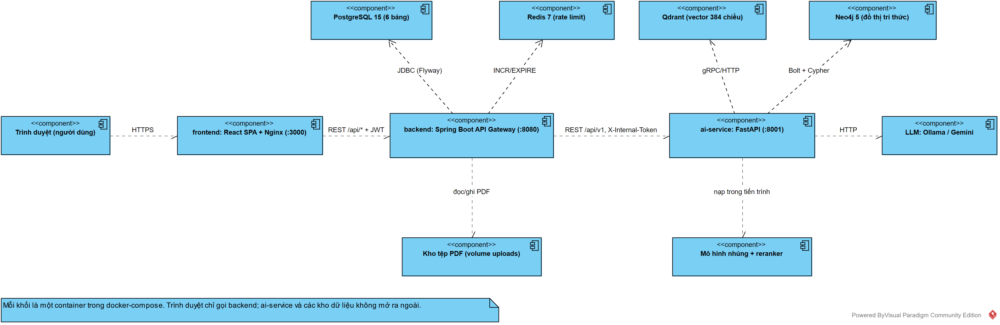

*Hình 2.1. Kiến trúc microservice: tám container và giao thức kết nối.*

| Dịch vụ | Công nghệ | Cổng | Dữ liệu sở hữu | Giao tiếp ra ngoài |
| :--- | :--- | :--- | :--- | :--- |
| `frontend` | React 19, TypeScript, Nginx | 3000 | Phiên đăng nhập và lịch sử chat trong `localStorage` của trình duyệt | REST `/api/*` tới backend |
| `backend` | Spring Boot, Java 17 | 8080 | PostgreSQL, kho tệp PDF (`app.upload-dir`) | REST `/api/v1/*` tới ai-service; JDBC; Redis |
| `ai-service` | FastAPI, Python 3.11 | 8001 (nội bộ) | Qdrant, Neo4j, mô hình nhúng và reranker trong tiến trình | HTTP tới LLM |
| `postgres` | PostgreSQL 15 | 5432 (nội bộ) | 6 bảng (mục 2.11) | — |
| `redis` | Redis 7 | 6379 (nội bộ) | Bộ đếm giới hạn tần suất | — |
| `qdrant` | Qdrant | 6333 (nội bộ) | Collection `enterprise_documents`, vector 384 chiều, cosine | — |
| `neo4j` | Neo4j 5.26 Community | 7687 (nội bộ) | Đồ thị KB1, KB2, KB (Chương 4) | — |
| `ollama` | Ollama 0.12 (tùy chọn) | 11434 (nội bộ) | Mô hình cục bộ | — |

*Bảng 2.3. Các dịch vụ, dữ liệu sở hữu và giao tiếp.*

### 2.3.3. Lý do không chọn kiến trúc nguyên khối

Một ứng dụng nguyên khối viết bằng Python đơn giản hơn khi triển khai, nhưng có ba bất lợi với bài toán này. Thứ nhất, mô hình nhúng và reranker chiếm hàng GB RAM và khởi động lâu; gộp chung khiến mỗi lần sửa một API quản trị cũng phải nạp lại mô hình. Thứ hai, ranh giới bảo mật rõ hơn khi dịch vụ AI không mở ra Internet và không giữ dữ liệu người dùng. Thứ ba, hai nhóm thành viên (nghiệp vụ và AI) làm việc song song trên hai mã nguồn với hợp đồng API cố định. Cái giá phải trả là thêm một bước gọi mạng và phải đồng bộ dữ liệu giữa các kho (mục 2.11.5).

## 2.4. Phân rã module và chức năng

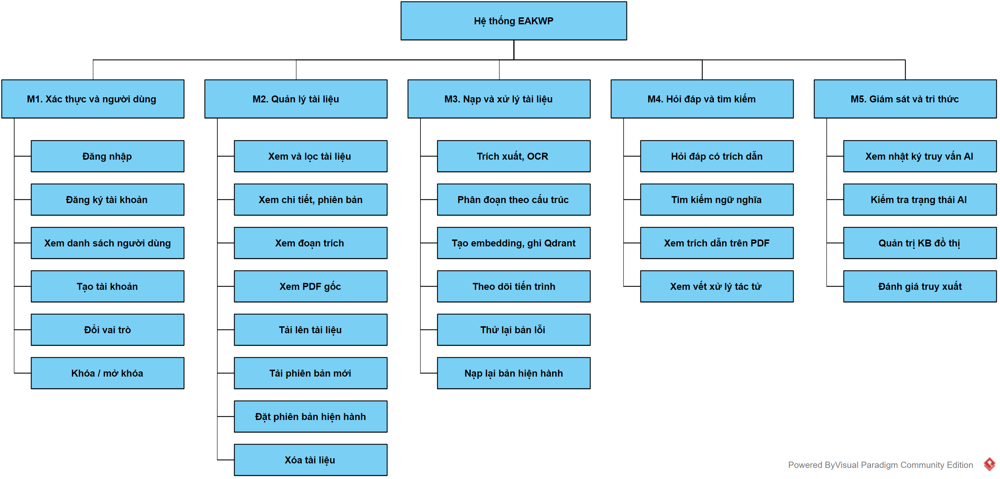

*Hình 2.2. Phân rã hệ thống thành 5 module và 28 chức năng.*

| Module | Mã | Chức năng | Dịch vụ thực hiện | Tác nhân |
| :--- | :--- | :--- | :--- | :--- |
| M1. Xác thực và người dùng | CN1.1 | Đăng nhập | backend | Người dùng |
| | CN1.2 | Đăng ký tài khoản | backend | Khách |
| | CN1.3 | Xem danh sách người dùng | backend | Quản trị viên |
| | CN1.4 | Tạo tài khoản | backend | Quản trị viên |
| | CN1.5 | Đổi vai trò | backend | Quản trị viên |
| | CN1.6 | Khóa / mở khóa tài khoản | backend | Quản trị viên |
| M2. Quản lý tài liệu | CN2.1 | Xem và lọc tài liệu | backend | Người dùng |
| | CN2.2 | Xem chi tiết, lịch sử phiên bản | backend | Người dùng |
| | CN2.3 | Xem đoạn trích (chunk) | backend | Người dùng |
| | CN2.4 | Xem PDF gốc | backend | Người dùng |
| | CN2.5 | Tải lên tài liệu mới | backend, ai-service | Quản trị viên |
| | CN2.6 | Tải lên phiên bản mới | backend, ai-service | Quản trị viên |
| | CN2.7 | Đặt phiên bản hiện hành | backend | Quản trị viên |
| | CN2.8 | Xóa tài liệu | backend, ai-service | Quản trị viên |
| M3. Nạp và xử lý tài liệu | CN3.1 | Trích xuất văn bản, OCR | ai-service (dự phòng PDFBox ở backend) | Dịch vụ AI |
| | CN3.2 | Phân đoạn theo cấu trúc | ai-service | Dịch vụ AI |
| | CN3.3 | Tạo embedding, ghi Qdrant và Neo4j | ai-service | Dịch vụ AI |
| | CN3.4 | Theo dõi tiến trình nạp | backend | Quản trị viên |
| | CN3.5 | Thử lại phiên bản lỗi | backend | Quản trị viên |
| | CN3.6 | Nạp lại phiên bản hiện hành | backend | Quản trị viên |
| M4. Hỏi đáp và tìm kiếm | CN4.1 | Hỏi đáp có trích dẫn | backend, ai-service, LLM | Người dùng |
| | CN4.2 | Tìm kiếm ngữ nghĩa | backend, ai-service | Người dùng |
| | CN4.3 | Xem trích dẫn trên PDF (tô vàng) | backend | Người dùng |
| | CN4.4 | Xem vết xử lý của tác tử | frontend | Người dùng |
| M5. Giám sát và tri thức | CN5.1 | Xem nhật ký truy vấn AI | backend | Quản trị viên |
| | CN5.2 | Kiểm tra trạng thái dịch vụ AI | backend, ai-service | Người dùng |
| | CN5.3 | Quản trị cơ sở tri thức đồ thị | ai-service | Quản trị viên |
| | CN5.4 | Đánh giá cấu hình truy xuất | ai-service | Quản trị viên |

*Bảng 2.4. Bảng phân rã chức năng.*

## 2.5. Biểu đồ use case tổng quan

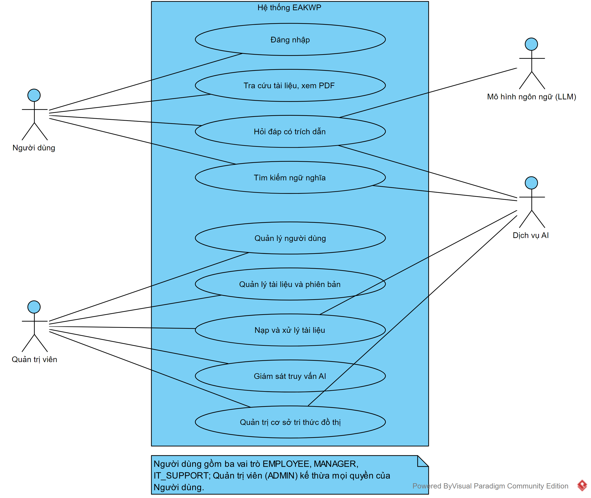

*Hình 2.3. Biểu đồ use case tổng quan của hệ thống EAKWP.*

Biểu đồ tổng quan gom 28 chức năng thành 9 use case mức cao. Bốn use case phía trên phục vụ Người dùng; năm use case phía dưới dành cho Quản trị viên. Quản trị viên kế thừa toàn bộ use case của Người dùng. Dịch vụ AI tham gia vào nạp tài liệu, hỏi đáp, tìm kiếm và quản trị đồ thị; LLM chỉ tham gia vào hỏi đáp và có thể vắng mặt (khi đó hệ thống trả lời bằng trích đoạn nguyên văn, xem Chương 5).

## 2.6. Use case chi tiết theo module

### 2.6.1. M1. Xác thực và quản lý người dùng

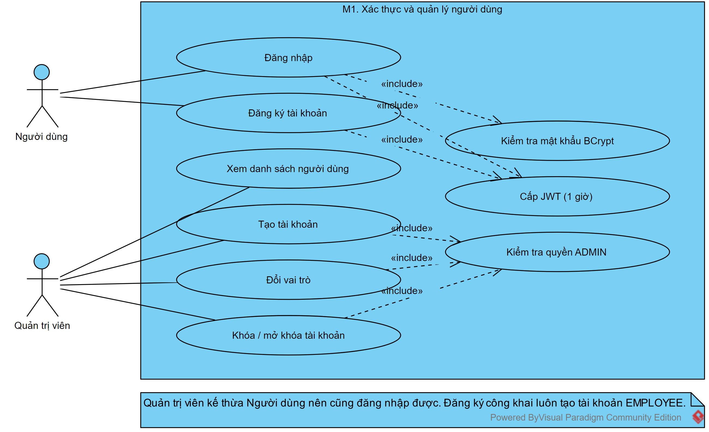

*Hình 2.4. Use case của module Xác thực và quản lý người dùng.*

| Use case | Mô tả |
| :--- | :--- |
| Đăng nhập | Người dùng nhập email, mật khẩu; hệ thống kiểm tra BCrypt, kiểm tra tài khoản đang hoạt động, cấp JWT có vai trò |
| Đăng ký tài khoản | Khách tự đăng ký; tài khoản mới luôn có vai trò `EMPLOYEE` và được cấp JWT ngay |
| Xem danh sách người dùng | Quản trị viên xem danh sách phân trang (20 dòng, mới nhất trước) |
| Tạo tài khoản | Quản trị viên tạo tài khoản với vai trò bất kỳ trong bốn vai trò |
| Đổi vai trò | Quản trị viên đổi vai trò; vai trò ngoài danh sách bị từ chối |
| Khóa / mở khóa tài khoản | Tài khoản bị khóa không đăng nhập được |
| Kiểm tra quyền ADMIN | Được `SecurityConfig` áp dụng cho mọi API ghi của module |

*Bảng 2.5. Mô tả use case module M1.*

### 2.6.2. M2. Quản lý tài liệu

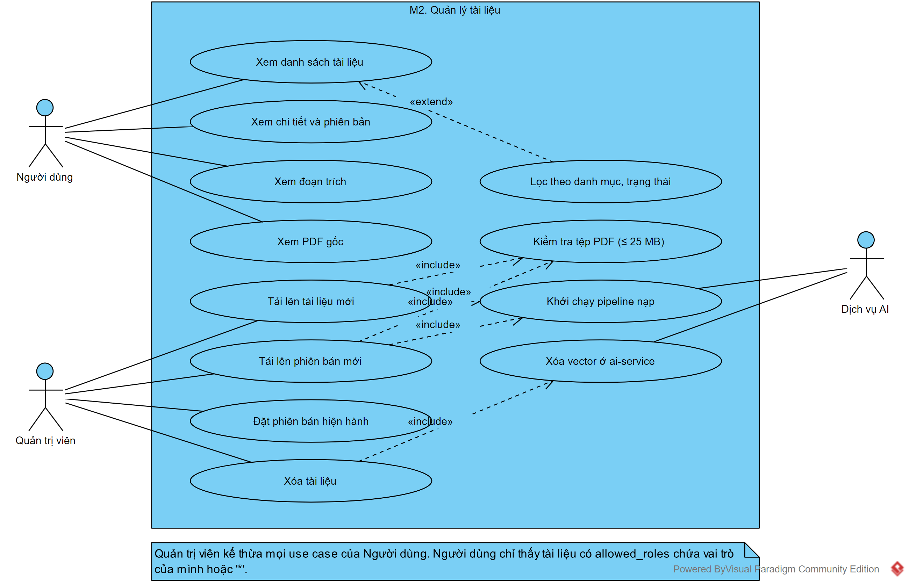

*Hình 2.5. Use case của module Quản lý tài liệu.*

| Use case | Mô tả |
| :--- | :--- |
| Xem danh sách tài liệu | Danh sách tài liệu người dùng được phép đọc; mở rộng bởi lọc theo từ khóa, danh mục, trạng thái |
| Xem chi tiết và phiên bản | Thông tin tài liệu, các phiên bản kèm trạng thái, số trang, số chunk, phiên bản hiện hành |
| Xem đoạn trích | Danh sách chunk của một phiên bản với trang và đường dẫn mục (Chương/Điều) |
| Xem PDF gốc | Mở tệp PDF của phiên bản hiện hành ngay trong giao diện |
| Tải lên tài liệu mới | Quản trị viên nhập mã, tiêu đề, danh mục, vai trò được đọc và chọn tệp PDF; bao gồm kiểm tra tệp và khởi chạy nạp |
| Tải lên phiên bản mới | Thêm phiên bản cho tài liệu đã có; bị chặn khi phiên bản trước đang nạp |
| Đặt phiên bản hiện hành | Chỉ phiên bản đã nạp xong (`INGESTED`) mới được chọn làm hiện hành |
| Xóa tài liệu | Xóa nhiều tài liệu một lần; bao gồm xóa vector ở ai-service trước khi xóa dữ liệu quan hệ |

*Bảng 2.6. Mô tả use case module M2.*

### 2.6.3. M3. Nạp và xử lý tài liệu

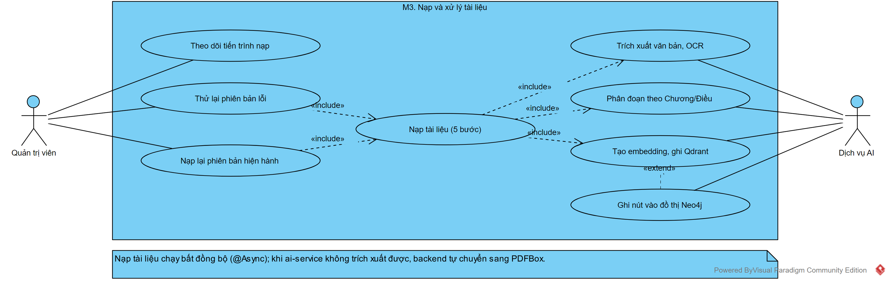

*Hình 2.6. Use case của module Nạp và xử lý tài liệu.*

| Use case | Mô tả |
| :--- | :--- |
| Nạp tài liệu (5 bước) | Use case trung tâm, chạy bất đồng bộ: (1) đọc và OCR PDF, (2) chia đoạn, (3) lưu `document_chunks`, (4) tạo embedding và ghi kho vector, (5) đánh dấu `INGESTED`, đặt hiện hành |
| Trích xuất văn bản, OCR | ai-service đọc lớp văn bản, OCR trang quét, trả về trang, chunk và tọa độ tô vàng |
| Phân đoạn theo Chương/Điều | Chia theo cấu trúc văn bản pháp quy; không có cấu trúc thì chia theo trang |
| Tạo embedding, ghi Qdrant | Nhúng bằng E5-Small (384 chiều), ghi kèm payload và quyền đọc |
| Ghi nút vào đồ thị Neo4j | Mở rộng của bước trên: cùng `chunk_id` được ghi vào đồ thị (Chương 4) |
| Theo dõi tiến trình nạp | Giao diện hỏi trạng thái theo `taskId`: bước hiện tại (1–5), số chunk, thông điệp |
| Thử lại phiên bản lỗi | Chạy lại toàn bộ pipeline cho phiên bản `FAILED` từ tệp gốc đã lưu |
| Nạp lại phiên bản hiện hành | Phân đoạn và nhúng lại phiên bản đang dùng, ví dụ sau khi đổi bộ chia đoạn |

*Bảng 2.7. Mô tả use case module M3.*

### 2.6.4. M4. Hỏi đáp và tìm kiếm

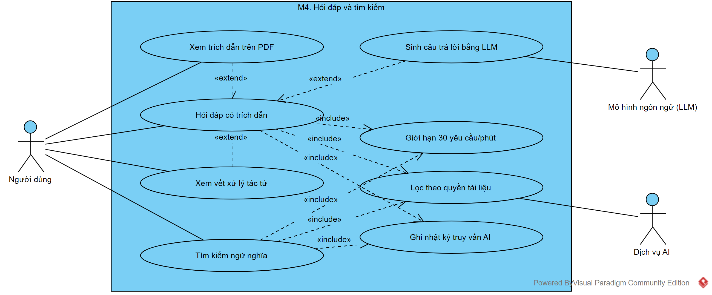

*Hình 2.7. Use case của module Hỏi đáp và tìm kiếm.*

| Use case | Mô tả |
| :--- | :--- |
| Hỏi đáp có trích dẫn | Người dùng đặt câu hỏi tự nhiên, nhận câu trả lời có số trích dẫn [n] trỏ đến đoạn và trang cụ thể |
| Tìm kiếm ngữ nghĩa | Trả về danh sách đoạn văn gần nghĩa nhất, có điểm liên quan |
| Giới hạn 30 yêu cầu/phút | Bao gồm trong cả hai use case trên, đếm theo email bằng Redis |
| Lọc theo quyền tài liệu | Bao gồm trong cả hai; quyền lấy từ JWT, không lấy từ trình duyệt |
| Ghi nhật ký truy vấn AI | Bao gồm trong cả hai, kể cả khi lỗi hoặc bị giới hạn |
| Sinh câu trả lời bằng LLM | Mở rộng của hỏi đáp: chỉ chạy khi có LLM và có đủ bằng chứng |
| Xem trích dẫn trên PDF | Mở rộng: mở PDF gốc tại trang trích dẫn, đoạn dẫn chứng được tô vàng |
| Xem vết xử lý tác tử | Mở rộng: xem tác tử đã chọn luật và công cụ nào ở từng bước |

*Bảng 2.8. Mô tả use case module M4.*

### 2.6.5. M5. Giám sát và quản trị tri thức

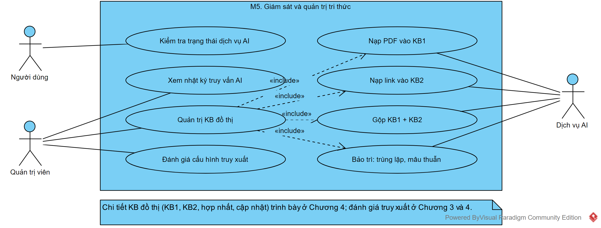

*Hình 2.8. Use case của module Giám sát và quản trị tri thức.*

| Use case | Mô tả |
| :--- | :--- |
| Kiểm tra trạng thái dịch vụ AI | Thanh trạng thái hiển thị dịch vụ AI ổn định hay không, độ trễ, số vector |
| Xem nhật ký truy vấn AI | Quản trị viên xem tối đa 200 lời gọi gần nhất: người hỏi, vai trò, trạng thái, mô hình, độ trễ |
| Quản trị KB đồ thị | Nạp PDF vào KB1, nạp link vào KB2, gộp thành KB, bảo trì trùng lặp và mâu thuẫn (Chương 4) |
| Đánh giá cấu hình truy xuất | Chạy bộ câu hỏi chuẩn với các cấu hình `flat_rag`, `graph_rag`, `hybrid_rag` (Chương 3, 4, 5) |

*Bảng 2.9. Mô tả use case module M5.*

## 2.7. Kịch bản use case

Mỗi kịch bản gồm tác nhân, điều kiện trước, điều kiện sau, luồng chuẩn và luồng ngoại lệ. Thông báo lỗi lấy nguyên văn từ mã nguồn backend; mọi lỗi được trả theo dạng `{"message": "..."}` (`ApiExceptionHandler`).

### 2.7.1. Kịch bản Đăng nhập

| Mục | Nội dung |
| :--- | :--- |
| Tác nhân | Người dùng |
| Điều kiện trước | Có tài khoản; chưa đăng nhập |
| Điều kiện sau | Trình duyệt giữ JWT còn hạn 1 giờ; giao diện mở trang mặc định theo vai trò |
| Luồng chuẩn | 1. Người dùng nhập email, mật khẩu và bấm Đăng nhập. 2. Giao diện gửi `POST /api/auth/login`. 3. `AuthService` tìm người dùng theo email. 4. So khớp mật khẩu bằng BCrypt. 5. Kiểm tra tài khoản đang hoạt động. 6. `JwtService` sinh JWT có claim `role`. 7. Backend trả `token`, `role`, `fullName`. 8. Giao diện lưu phiên và chuyển trang. |
| Ngoại lệ | 3a/4a. Không có email hoặc sai mật khẩu: `401` "Email hoặc mật khẩu không đúng." (cùng một thông báo để không lộ email nào tồn tại). 5a. Tài khoản bị khóa: `403` "Tài khoản đã bị khóa." 8a. JWT hết hạn ở lần gọi sau: `401`, giao diện đưa về trang đăng nhập. |

*Bảng 2.10. Kịch bản Đăng nhập.*

### 2.7.2. Kịch bản Quản lý người dùng (tạo tài khoản, đổi vai trò, khóa)

| Mục | Nội dung |
| :--- | :--- |
| Tác nhân | Quản trị viên |
| Điều kiện trước | Đã đăng nhập với vai trò `ADMIN` |
| Điều kiện sau | Tài khoản được tạo hoặc cập nhật; thay đổi vai trò có hiệu lực từ lần đăng nhập sau |
| Luồng chuẩn | 1. Quản trị viên mở trang Người dùng; hệ thống tải danh sách phân trang. 2. Chọn Thêm người dùng, nhập họ tên, email, mật khẩu, vai trò. 3. Hệ thống chuẩn hóa vai trò, kiểm tra email chưa tồn tại, băm mật khẩu, lưu với `active = true`. 4. Để đổi vai trò, chọn vai trò mới (`PATCH /api/users/{id}/role`). 5. Để khóa, tắt trạng thái hoạt động (`PATCH /api/users/{id}/status`). |
| Ngoại lệ | 3a. Email đã có: `409` "Email đã tồn tại." 3b/4a. Vai trò ngoài `EMPLOYEE, MANAGER, ADMIN, IT_SUPPORT`: `400` "Vai trò không hợp lệ." *. Người gọi không phải `ADMIN`: `403`. |

*Bảng 2.11. Kịch bản Quản lý người dùng.*

### 2.7.3. Kịch bản Tải lên tài liệu mới

| Mục | Nội dung |
| :--- | :--- |
| Tác nhân | Quản trị viên; Dịch vụ AI |
| Điều kiện trước | Đã đăng nhập `ADMIN`; có tệp PDF |
| Điều kiện sau | Có bản ghi `documents`, phiên bản 1 và một nhiệm vụ nạp; khi nạp xong, phiên bản là `INGESTED`, hiện hành, tìm được qua hỏi đáp |
| Luồng chuẩn | 1. Quản trị viên nhập mã tài liệu, tiêu đề, danh mục, vai trò được đọc (bỏ trống là `*`) và chọn tệp. 2. Giao diện gửi `POST /api/documents/upload` (multipart). 3. Backend kiểm tra mã chưa tồn tại. 4. Kiểm tra tệp: có tệp, đuôi `.pdf`, đúng chữ ký PDF, không quá 25 MB; lưu với tên UUID, tính SHA-256. 5. Lưu `documents`, `document_versions` (số 1, `PROCESSING`, hiện hành) và `ingestion_tasks`. 6. Gọi `IngestionService.process` bất đồng bộ và trả ngay `202 Accepted` kèm `taskId`. 7. Giao diện hỏi tiến trình định kỳ và hiển thị bước 1–5. 8. Khi xong, trạng thái là `INGESTED`. |
| Ngoại lệ | 3a. Trùng mã: `409` "Mã tài liệu đã tồn tại." 4a. Không có tệp: `400` "Vui lòng chọn tệp PDF." 4b. Sai đuôi: `400` "Chỉ hỗ trợ tệp PDF." 4c. Nội dung không phải PDF: `400` "Tệp tải lên không phải PDF hợp lệ." 4d. Quá 25 MB: `413` "Tệp vượt quá 25 MB." 5a. Lỗi khi lưu: tệp vừa ghi bị xóa. 7a. Lỗi trong pipeline: phiên bản `FAILED`, `error_message` có lý do, chuyển sang kịch bản Thử lại. |

*Bảng 2.12. Kịch bản Tải lên tài liệu mới.*

### 2.7.4. Kịch bản Tải lên phiên bản mới và đặt hiện hành

| Mục | Nội dung |
| :--- | :--- |
| Tác nhân | Quản trị viên |
| Điều kiện trước | Tài liệu đã tồn tại; không có phiên bản nào đang `PROCESSING` |
| Điều kiện sau | Phiên bản mới (số thứ tự tăng 1) được nạp và trở thành hiện hành; vector của phiên bản cũ bị xóa khỏi Qdrant, bản ghi phiên bản cũ vẫn được giữ |
| Luồng chuẩn | 1. Quản trị viên mở chi tiết tài liệu, chọn Tải phiên bản mới, chọn tệp. 2. Backend kiểm tra không có phiên bản đang nạp, lưu tệp, tạo phiên bản `PROCESSING`. 3. Pipeline chạy như kịch bản 2.7.3. 4. Khi `INGESTED`, backend đặt phiên bản này hiện hành và xóa vector các phiên bản khác (`dropSupersededVectors`). 5. Nếu muốn quay về bản cũ, quản trị viên chọn phiên bản và bấm Đặt hiện hành (`PATCH /api/documents/versions/{id}/current`). |
| Ngoại lệ | 2a. Phiên bản trước đang nạp: `409` "Vui lòng đợi phiên bản trước nạp xong." 5a. Phiên bản chưa nạp xong: `409` "Chỉ đặt phiên bản đã nạp làm hiện hành." |

*Bảng 2.13. Kịch bản Tải lên phiên bản mới và đặt hiện hành.*

### 2.7.5. Kịch bản Thử lại và nạp lại

| Mục | Nội dung |
| :--- | :--- |
| Tác nhân | Quản trị viên |
| Điều kiện trước | Thử lại: phiên bản ở trạng thái `FAILED`. Nạp lại: phiên bản hiện hành ở trạng thái `INGESTED` |
| Điều kiện sau | Phiên bản được nạp lại từ tệp gốc; chunk và vector cũ của phiên bản được thay thế |
| Luồng chuẩn | 1. Quản trị viên bấm Thử lại (`POST /api/documents/versions/{id}/retry`) hoặc Nạp lại (`.../reindex`). 2. Backend kiểm tra trạng thái và tệp gốc còn trên đĩa. 3. Chuyển phiên bản về `PROCESSING`, tạo nhiệm vụ mới. 4. Pipeline chạy với cờ thay thế: xóa chunk và vector cũ của phiên bản trước khi ghi mới. |
| Ngoại lệ | 2a. Thử lại phiên bản không lỗi: `409` "Chỉ có thể nạp lại phiên bản đang lỗi." 2b. Nạp lại phiên bản không phải hiện hành: `409` "Chỉ nạp lại được phiên bản hiện hành đã nạp xong." 2c. Mất tệp gốc: `400` "Tệp gốc không còn trên máy chủ, vui lòng tải phiên bản mới." |

*Bảng 2.14. Kịch bản Thử lại và nạp lại.*

### 2.7.6. Kịch bản Hỏi đáp có trích dẫn

| Mục | Nội dung |
| :--- | :--- |
| Tác nhân | Người dùng; Dịch vụ AI; LLM |
| Điều kiện trước | Đã đăng nhập; có ít nhất một tài liệu `INGESTED` mà người dùng được đọc |
| Điều kiện sau | Người dùng nhận câu trả lời có trích dẫn hoặc lời từ chối; một dòng được ghi vào `ai_audit_logs` |
| Luồng chuẩn | 1. Người dùng nhập câu hỏi (tối đa 2.000 ký tự). 2. Giao diện gửi câu hỏi kèm 4 lượt hội thoại gần nhất tới `POST /api/ai/chat`. 3. Backend tăng bộ đếm Redis của người dùng. 4. Backend xóa `user_roles` do trình duyệt gửi (nếu có) và gắn vai trò từ JWT (ADMIN không bị lọc). 5. ai-service giao câu hỏi cho tác tử: nhận thức câu hỏi, chọn luật, chọn công cụ. 6. Công cụ truy xuất tìm Qdrant và Neo4j có lọc quyền, chấm lại bằng cross-encoder, chọn bằng chứng. 7. LLM sinh câu trả lời có [n]; bộ kiểm định đối chiếu với ngữ cảnh. 8. Backend ghi nhật ký `OK` kèm mô hình, số trích dẫn, độ trễ. 9. Giao diện hiển thị câu trả lời, thẻ trích dẫn và vết xử lý của tác tử. 10. Người dùng bấm một trích dẫn để mở PDF tại đoạn tô vàng. |
| Ngoại lệ | 3a. Quá 30 yêu cầu/phút: `429` "Bạn gửi quá nhiều yêu cầu, vui lòng thử lại sau một phút.", nhật ký `RATE_LIMITED`. 6a. Không đủ bằng chứng: tác tử từ chối, không gọi LLM, trả "chưa tìm thấy thông tin phù hợp". 7a. Không có LLM hoặc LLM lỗi: trả trích đoạn nguyên văn có trích dẫn. 5a/6b. ai-service không phản hồi: `502`, nhật ký `ERROR`. |

*Bảng 2.15. Kịch bản Hỏi đáp có trích dẫn.*

### 2.7.7. Kịch bản Tìm kiếm ngữ nghĩa

| Mục | Nội dung |
| :--- | :--- |
| Tác nhân | Người dùng; Dịch vụ AI |
| Điều kiện trước | Đã đăng nhập |
| Điều kiện sau | Danh sách đoạn văn xếp theo độ liên quan; một dòng nhật ký `SEARCH` |
| Luồng chuẩn | 1. Người dùng nhập từ khóa hoặc câu hỏi, có thể chọn một tài liệu và số kết quả. 2. Backend áp dụng giới hạn tần suất và quyền như kịch bản 2.7.6. 3. ai-service nhúng truy vấn, tìm Qdrant có lọc quyền và lọc tài liệu, trả đoạn kèm điểm, trang, đường dẫn mục. 4. Giao diện tô đậm từ khớp và cho mở đoạn trên PDF. |
| Ngoại lệ | 2a. Như 3a của kịch bản 2.7.6. 3a. Không có đoạn đạt ngưỡng: danh sách rỗng và gợi ý từ khóa khác. |

*Bảng 2.16. Kịch bản Tìm kiếm ngữ nghĩa.*

### 2.7.8. Kịch bản Xóa tài liệu

| Mục | Nội dung |
| :--- | :--- |
| Tác nhân | Quản trị viên; Dịch vụ AI |
| Điều kiện trước | Đã đăng nhập `ADMIN`; đã chọn ít nhất một tài liệu |
| Điều kiện sau | Vector, chunk, phiên bản, nhiệm vụ, tài liệu và tệp PDF của các tài liệu được chọn đều bị xóa |
| Luồng chuẩn | 1. Quản trị viên chọn tài liệu và bấm Xóa, xác nhận. 2. Backend kiểm tra không tài liệu nào đang nạp. 3. Gọi ai-service xóa vector (và nút đồ thị) theo `document_id`. 4. Xóa tệp PDF của mọi phiên bản. 5. Xóa dữ liệu quan hệ trong một giao dịch. 6. Trả số tài liệu đã xóa. |
| Ngoại lệ | 1a. Không chọn gì: `400` "Vui lòng chọn tài liệu cần xóa." 2a. Có tài liệu đang nạp: `409` "Không thể xóa ... khi đang nạp." 3a. ai-service lỗi: `502` "Không xóa được vector của tài liệu...", **không xóa gì trong PostgreSQL** để tránh để lại vector mồ côi mà không còn bản ghi gốc. |

*Bảng 2.17. Kịch bản Xóa tài liệu.*

## 2.8. Biểu đồ tuần tự

### 2.8.1. Đăng nhập

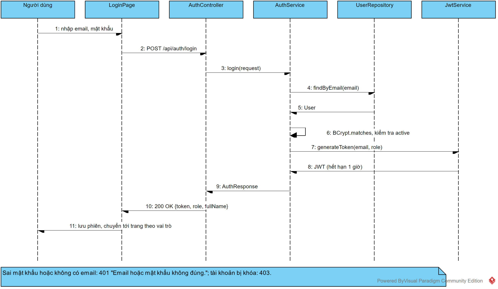

*Hình 2.9. Biểu đồ tuần tự chức năng Đăng nhập.*

Luồng đăng nhập là đồng bộ và chỉ chạm PostgreSQL. Kiểm tra mật khẩu và trạng thái hoạt động nằm trong cùng một phương thức `AuthService.login`, nên không có trạng thái nào để tài khoản bị khóa vẫn nhận được token.

### 2.8.2. Tải lên và nạp tài liệu

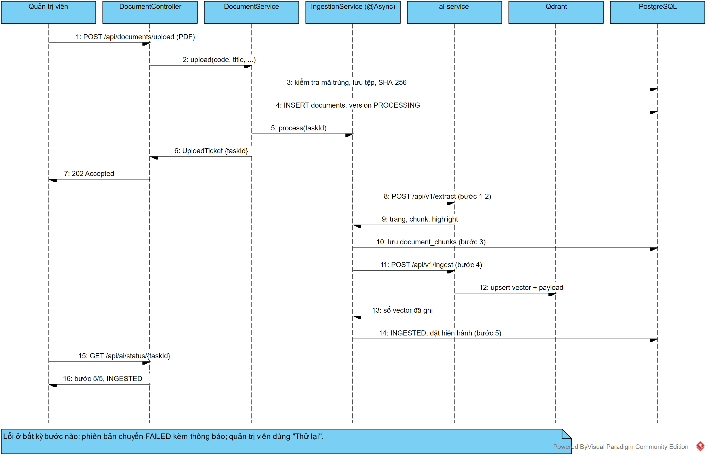

*Hình 2.10. Biểu đồ tuần tự chức năng Tải lên và nạp tài liệu.*

Biểu đồ cho thấy điểm thiết kế quan trọng nhất của P4: thông điệp 7 (`202 Accepted`) trả về **trước** khi pipeline bắt đầu. Phần từ thông điệp 8 chạy trên luồng `@Async` của `IngestionService`; mỗi bước cập nhật một dòng trong `ingestion_tasks`, và giao diện đọc dòng đó qua `GET /api/ai/status/{taskId}` (thông điệp 15–16). Nhờ vậy một PDF 40 trang có OCR không giữ kết nối HTTP hàng phút.

### 2.8.3. Hỏi đáp có trích dẫn

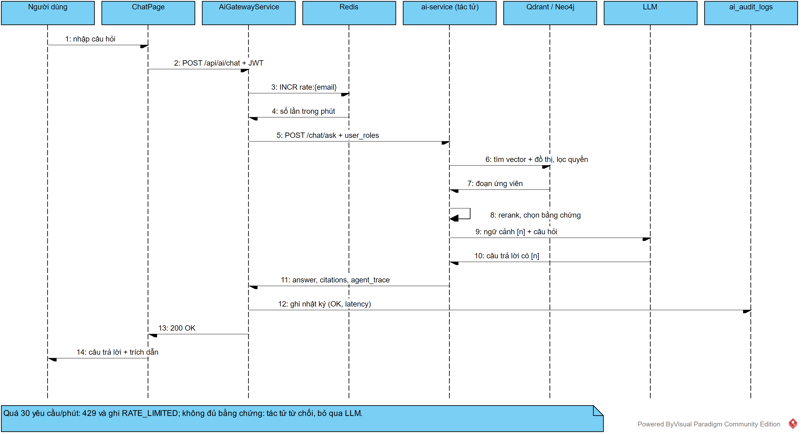

*Hình 2.11. Biểu đồ tuần tự chức năng Hỏi đáp có trích dẫn.*

`AiGatewayService` là điểm duy nhất áp dụng ba chính sách cắt ngang: giới hạn tần suất (thông điệp 3–4), gắn quyền (thông điệp 5) và kiểm toán (thông điệp 12). Bên trong ai-service, tác tử quyết định dùng công cụ nào; chi tiết bảng luật và vòng lặp của tác tử ở Chương 5, chi tiết truy xuất lai ở Chương 4.

## 2.9. Biểu đồ hoạt động: vòng đời phiên bản tài liệu

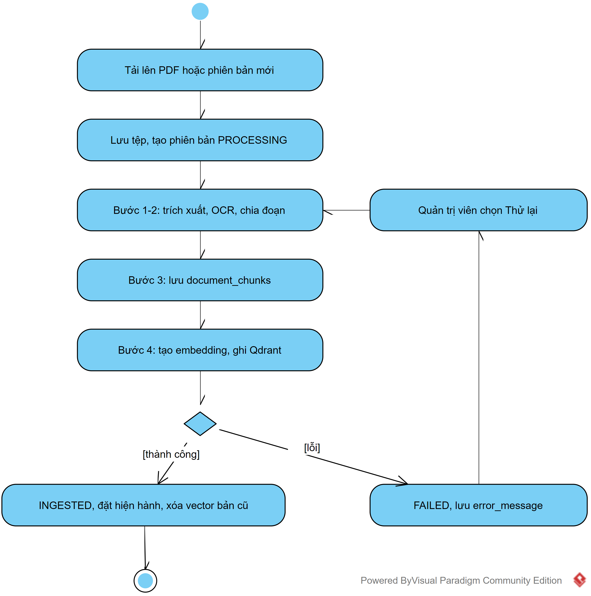

*Hình 2.12. Biểu đồ hoạt động vòng đời của một phiên bản tài liệu.*

Một phiên bản chỉ có ba trạng thái: `PROCESSING`, `INGESTED`, `FAILED`. Nhiệm vụ nạp đi kèm có thêm số bước để giao diện hiển thị tiến trình:

| Bước | Trạng thái nhiệm vụ | Thông điệp hiển thị (rút gọn) |
| ---: | :--- | :--- |
| 1 | `PROCESSING` | Đang đọc và OCR tệp PDF |
| 2 | `PROCESSING` | Đã trích xuất N trang (OCR k trang), đang chia đoạn |
| 3 | `PROCESSING` | Đã tạo M đoạn trích, đang tạo embedding |
| 4 | `PROCESSING` | Đang ghi kho vector |
| 5 | `INGESTED` | Đã tạo M đoạn trích và đưa tài liệu vào kho vector |
| giữ nguyên | `FAILED` | Lý do lỗi thân thiện với người dùng |

*Bảng 2.18. Các bước của nhiệm vụ nạp (`IngestionService`).*

Thứ tự ở bước 5 có chủ ý: phiên bản được lưu `INGESTED` trước, rồi mới đánh dấu hiện hành và xóa vector bản cũ. Nếu làm ngược lại, luồng bất đồng bộ có thể ghi đè cờ hiện hành bằng một bản sao cũ của thực thể.

## 2.10. Thiết kế lớp

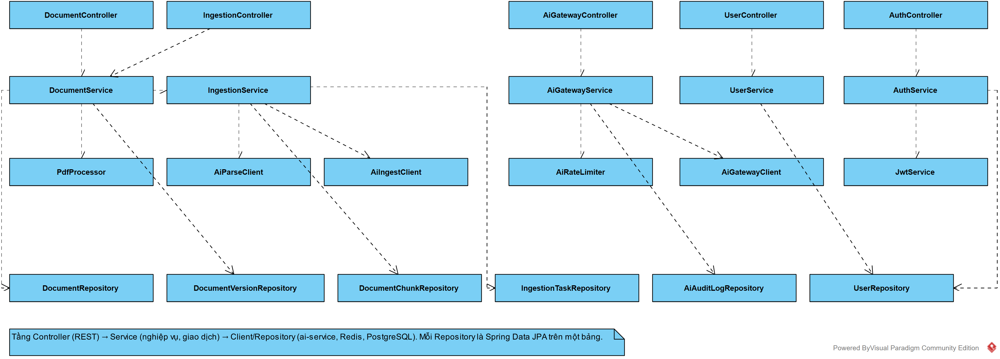

*Hình 2.13. Biểu đồ lớp thiết kế của backend theo ba tầng.*

Backend tổ chức theo gói chức năng (`auth`, `user`, `document`, `ai`, `security`, `config`), mỗi gói chia ba tầng: Controller nhận REST, Service chứa nghiệp vụ và giao dịch, Repository/Client truy cập dữ liệu hoặc dịch vụ khác.

| Lớp | Tầng | Trách nhiệm |
| :--- | :--- | :--- |
| `DocumentController` | Controller | 13 endpoint tài liệu: danh sách, chi tiết, phiên bản, chunk, tệp, ảnh và PDF tô vàng, tải lên, thử lại, nạp lại, đặt hiện hành, xóa |
| `DocumentService` | Service | Kiểm tra đầu vào, lưu tệp và băm SHA-256, phân quyền đọc (`canRead`), điều phối xóa |
| `IngestionService` | Service | Pipeline nạp 5 bước, chạy `@Async`; dự phòng PDFBox; cập nhật `ingestion_tasks` |
| `AiParseClient`, `AiIngestClient` | Client | Gọi `POST /api/v1/extract`, `POST /api/v1/ingest`, `DELETE /api/v1/ingest/documents/{id}` |
| `PdfProcessor` | Tiện ích | Trích văn bản bằng PDFBox, vẽ trang và PDF có vùng tô vàng |
| `AiGatewayService` | Service | Giới hạn tần suất, gắn quyền, chuyển tiếp, ghi kiểm toán cho mọi lời gọi AI |
| `AiRateLimiter` | Service | Cửa sổ cố định 1 phút theo email trên Redis; Redis lỗi thì cho qua |
| `AuthService`, `JwtService` | Service | Đăng ký, đăng nhập, sinh và kiểm tra JWT |
| `JwtAuthenticationFilter` | Bảo mật | Đọc JWT ở mỗi yêu cầu, gắn `ROLE_<vai trò>` cho Spring Security |
| `*Repository` | Repository | Spring Data JPA, mỗi lớp ứng với một bảng |

*Bảng 2.19. Trách nhiệm các lớp chính của backend.*

Phía ai-service, các lớp chính là `RAGService` (truy xuất và sinh), `RuleBasedAgent` (tác tử), `EmbeddingService`, `RerankerService`, `QdrantService` và gói `knowledge_graph`. Các lớp này được trình bày cùng thuật toán ở Chương 3, 4 và 5.

## 2.11. Thiết kế cơ sở dữ liệu

### 2.11.1. Mô hình dữ liệu đa kho

| Kho | Vai trò | Dữ liệu | Khóa liên kết |
| :--- | :--- | :--- | :--- |
| PostgreSQL | Nguồn sự thật, giao dịch | Người dùng, tài liệu, phiên bản, chunk, nhiệm vụ nạp, nhật ký AI | `documents.id`, `document_versions.id`, `document_chunks.chunk_id` |
| Kho tệp | Bản gốc | Tệp PDF của mọi phiên bản, tên UUID | `document_versions.storage_path` |
| Qdrant | Chỉ mục vector dẫn xuất | Vector 384 chiều + payload của từng chunk | point id = UUIDv5(`chunk_id`) |
| Neo4j | Đồ thị dẫn xuất | Tài liệu, chunk, thực thể, quan hệ (Chương 4) | `Chunk.chunk_id`, `Document.doc_id` = `documents.id` |

*Bảng 2.20. Phân vai các kho dữ liệu.*

Một định danh `chunk_id` sinh ở backend đi xuyên qua ba kho. Nhờ vậy, khi Qdrant hoặc Neo4j trả về một đoạn, backend tìm được đúng dòng `document_chunks`, đúng phiên bản và đúng tệp PDF để mở và tô vàng.

### 2.11.2. Sơ đồ thực thể – quan hệ

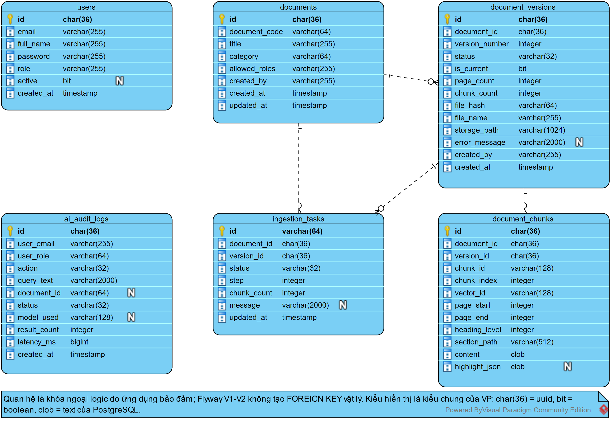

*Hình 2.14. Sơ đồ thực thể – quan hệ của cơ sở dữ liệu PostgreSQL (Flyway V1–V2).*

Lược đồ do Flyway quản lý: `V1__baseline.sql` tạo năm bảng gốc, `V2__document_access_and_ai_audit.sql` thêm cột `documents.allowed_roles` và bảng `ai_audit_logs`. Hibernate chạy ở chế độ `validate`, tức chỉ kiểm tra thực thể khớp lược đồ chứ không tự sửa lược đồ.

Các quan hệ một – nhiều trên hình là **khóa ngoại logic**: lược đồ không khai báo `FOREIGN KEY` vật lý, toàn vẹn tham chiếu do `DocumentService` bảo đảm (ví dụ xóa theo thứ tự nhiệm vụ → chunk → phiên bản → tài liệu trong một giao dịch). Lựa chọn này giữ cho thao tác xóa hàng loạt và nạp lại đơn giản; cái giá là ràng buộc nằm ở mã nguồn chứ không ở CSDL. Bổ sung khóa ngoại vật lý là một bước cải tiến được nêu ở mục 2.13.

### 2.11.3. Từ điển dữ liệu

| Cột | Kiểu | Ràng buộc | Ý nghĩa |
| :--- | :--- | :--- | :--- |
| `id` | `uuid` | PK | Định danh |
| `email` | `varchar(255)` | NOT NULL, UNIQUE | Tên đăng nhập |
| `full_name` | `varchar(255)` | NOT NULL | Họ tên |
| `password` | `varchar(255)` | NOT NULL | Mật khẩu đã băm BCrypt |
| `role` | `varchar(255)` | NOT NULL | `EMPLOYEE`, `MANAGER`, `IT_SUPPORT`, `ADMIN` |
| `active` | `boolean` | | `false` là bị khóa |
| `created_at` | `timestamp` | NOT NULL | Thời điểm tạo |

*Bảng 2.21. Bảng `users`.*

| Cột | Kiểu | Ràng buộc | Ý nghĩa |
| :--- | :--- | :--- | :--- |
| `id` | `uuid` | PK | Định danh, cũng là `document_id` trong Qdrant và Neo4j |
| `document_code` | `varchar(64)` | NOT NULL, UNIQUE | Mã tài liệu do quản trị viên đặt |
| `title` | `varchar(255)` | NOT NULL | Tiêu đề |
| `category` | `varchar(64)` | NOT NULL | Danh mục (Nội quy, Quy chế, Chính sách IT, Hướng dẫn) |
| `allowed_roles` | `varchar(255)` | NOT NULL, mặc định `'*'` | Các vai trò được đọc, phân tách bằng dấu phẩy |
| `created_by` | `varchar(255)` | NOT NULL | Người tạo |
| `created_at`, `updated_at` | `timestamp` | NOT NULL | Thời điểm tạo, cập nhật |

*Bảng 2.22. Bảng `documents`.*

| Cột | Kiểu | Ràng buộc | Ý nghĩa |
| :--- | :--- | :--- | :--- |
| `id` | `uuid` | PK | Định danh phiên bản |
| `document_id` | `uuid` | NOT NULL, index | Tài liệu sở hữu |
| `version_number` | `integer` | NOT NULL | Số thứ tự phiên bản, bắt đầu từ 1 |
| `status` | `varchar(32)` | NOT NULL | `PROCESSING`, `INGESTED`, `FAILED` |
| `is_current` | `boolean` | NOT NULL, index cùng `document_id` | Phiên bản hiện hành, mỗi tài liệu một bản |
| `page_count`, `chunk_count` | `integer` | NOT NULL | Số trang, số chunk |
| `file_hash` | `varchar(64)` | NOT NULL | SHA-256 của tệp |
| `file_name` | `varchar(255)` | NOT NULL | Tên tệp gốc |
| `storage_path` | `varchar(1024)` | NOT NULL | Đường dẫn tệp trên máy chủ |
| `error_message` | `varchar(2000)` | | Lý do lỗi khi `FAILED` |
| `created_by`, `created_at` | `varchar(255)`, `timestamp` | NOT NULL | Người tải lên, thời điểm |

*Bảng 2.23. Bảng `document_versions`.*

| Cột | Kiểu | Ràng buộc | Ý nghĩa |
| :--- | :--- | :--- | :--- |
| `id` | `uuid` | PK | Định danh dòng |
| `document_id`, `version_id` | `uuid` | NOT NULL, index | Tài liệu và phiên bản |
| `chunk_id` | `varchar(128)` | NOT NULL, UNIQUE | Định danh chunk dùng chung với Qdrant, Neo4j |
| `chunk_index` | `integer` | NOT NULL | Thứ tự trong phiên bản |
| `vector_id` | `varchar(128)` | NOT NULL | Định danh điểm trong Qdrant |
| `page_start`, `page_end` | `integer` | NOT NULL | Khoảng trang |
| `heading_level` | `integer` | NOT NULL | Cấp đề mục (Phần, Chương, Điều, ...) |
| `section_path` | `varchar(512)` | NOT NULL | Đường dẫn mục, ví dụ "Chương IV > Điều 16" |
| `content` | `text` | NOT NULL | Nội dung chunk |
| `highlight_json` | `text` | | Tọa độ dòng để tô vàng trên PDF |

*Bảng 2.24. Bảng `document_chunks`.*

| Cột | Kiểu | Ràng buộc | Ý nghĩa |
| :--- | :--- | :--- | :--- |
| `id` | `varchar(64)` | PK | `taskId` trả cho giao diện |
| `document_id`, `version_id` | `uuid` | NOT NULL, index `document_id` | Tài liệu và phiên bản đang nạp |
| `status` | `varchar(32)` | NOT NULL | `PROCESSING`, `INGESTED`, `FAILED` |
| `step` | `integer` | NOT NULL | Bước 1–5 |
| `chunk_count` | `integer` | NOT NULL | Số chunk đã tạo |
| `message` | `varchar(2000)` | | Thông điệp tiến trình hoặc lỗi |
| `updated_at` | `timestamp` | NOT NULL | Lần cập nhật cuối |

*Bảng 2.25. Bảng `ingestion_tasks`.*

| Cột | Kiểu | Ràng buộc | Ý nghĩa |
| :--- | :--- | :--- | :--- |
| `id` | `uuid` | PK | Định danh |
| `user_email`, `user_role` | `varchar(255)`, `varchar(64)` | NOT NULL | Người gọi và vai trò lúc gọi |
| `action` | `varchar(32)` | NOT NULL | `CHAT` hoặc `SEARCH` |
| `query_text` | `varchar(2000)` | NOT NULL | Câu hỏi hoặc từ khóa |
| `document_id` | `varchar(64)` | | Tài liệu được lọc (nếu có) |
| `status` | `varchar(32)` | NOT NULL | `OK`, `ERROR`, `RATE_LIMITED` |
| `model_used` | `varchar(128)` | | Mô hình đã trả lời |
| `result_count` | `integer` | NOT NULL | Số trích dẫn hoặc kết quả |
| `latency_ms` | `bigint` | NOT NULL | Độ trễ đầu–cuối tại backend |
| `created_at` | `timestamp` | NOT NULL, index giảm dần | Thời điểm gọi |

*Bảng 2.26. Bảng `ai_audit_logs`.*

### 2.11.4. Cấu trúc payload trong Qdrant

Mỗi chunk là một điểm trong collection `enterprise_documents` (vector 384 chiều, khoảng cách cosine). Payload do `AiIngestClient` dựng và được dùng để lọc ngay trong truy vấn:

| Trường | Nguồn | Dùng để |
| :--- | :--- | :--- |
| `chunk_id`, `content` | `document_chunks` | Trả về đoạn và nối lại với PostgreSQL |
| `document_id`, `document_code`, `title`, `document_type` | `documents` | Lọc theo tài liệu, hiển thị nguồn |
| `version_id`, `version_number` | `document_versions` | Xóa vector của một phiên bản |
| `allowed_roles` | `documents.allowed_roles` | Lọc quyền trong truy vấn |
| `page_start`, `page_end`, `chunk_index`, `section_path` | `document_chunks` | Trích dẫn trang và mục |

*Bảng 2.27. Payload của một điểm trong Qdrant.*

### 2.11.5. Nhất quán giữa các kho

Hệ thống không dùng giao dịch phân tán. Nhất quán giữa PostgreSQL, Qdrant và Neo4j được giữ bằng bốn quy tắc:

1. **Ghi idempotent.** Point id trong Qdrant là UUIDv5 của `chunk_id`, nên nạp lại cùng một chunk ghi đè chứ không nhân bản.
2. **Thứ tự xóa an toàn.** Khi xóa tài liệu, vector và nút đồ thị bị xóa trước; chỉ khi ai-service xác nhận mới xóa dữ liệu quan hệ. Nếu bước đầu lỗi, không có gì bị xóa (kịch bản 2.7.8).
3. **Phiên bản cũ rời chỉ mục khi bản mới sẵn sàng.** Vector của phiên bản cũ chỉ bị xóa sau khi phiên bản mới đã `INGESTED`, nên không có khoảng thời gian tài liệu "biến mất" khỏi hỏi đáp.
4. **Dựng lại được.** Qdrant và Neo4j là dữ liệu dẫn xuất: nạp lại (CN3.6) hoặc các script ở Chương 4 dựng lại chỉ mục từ PostgreSQL và tệp PDF.

## 2.12. Thiết kế giao diện lập trình (API)

### 2.12.1. API công khai của backend

| Nhóm | Phương thức và đường dẫn | Quyền | Chức năng |
| :--- | :--- | :--- | :--- |
| Xác thực | `POST /api/auth/register`, `POST /api/auth/login` | Công khai | CN1.2, CN1.1 |
| Người dùng | `GET /api/users` | Đã đăng nhập | CN1.3 |
| | `POST /api/users`, `PATCH /api/users/{id}/role`, `PATCH /api/users/{id}/status` | ADMIN | CN1.4–CN1.6 |
| Tài liệu | `GET /api/documents?q=&category=&status=`, `GET /api/documents/{id}`, `GET /api/documents/{id}/versions`, `GET /api/documents/{id}/chunks` | Đã đăng nhập, lọc theo `allowed_roles` | CN2.1–CN2.3 |
| | `GET /api/documents/{id}/file` | Đã đăng nhập | CN2.4 |
| | `GET /api/documents/{id}/chunks/{chunkId}/preview`, `.../highlighted` | Đã đăng nhập | CN4.3 |
| | `POST /api/documents/upload`, `POST /api/documents/{id}/versions` | ADMIN, trả `202` | CN2.5, CN2.6 |
| | `PATCH /api/documents/versions/{id}/current` | ADMIN | CN2.7 |
| | `POST /api/documents/versions/{id}/retry`, `.../reindex` | ADMIN, trả `202` | CN3.5, CN3.6 |
| | `DELETE /api/documents` (thân là danh sách id) | ADMIN | CN2.8 |
| AI | `POST /api/ai/chat`, `POST /api/ai/search` | Đã đăng nhập, 30 lần/phút | CN4.1, CN4.2 |
| | `GET /api/ai/status/{taskId}` | Đã đăng nhập | CN3.4 |
| | `GET /api/ai/health` | Đã đăng nhập | CN5.2 |
| | `GET /api/ai/audit?limit=` | ADMIN | CN5.1 |

*Bảng 2.28. API công khai của backend.*

### 2.12.2. API nội bộ của ai-service

Mọi endpoint dưới đây (trừ `/health`) yêu cầu header `X-Internal-Token`; chỉ backend và công cụ quản trị nội bộ gọi được.

| Phương thức và đường dẫn | Bên gọi | Chức năng |
| :--- | :--- | :--- |
| `POST /api/v1/extract` | `AiParseClient` | Đọc, OCR, chia đoạn, trả tọa độ tô vàng |
| `POST /api/v1/ingest` | `AiIngestClient` | Nhúng, ghi Qdrant và đồng bộ Neo4j |
| `DELETE /api/v1/ingest/documents/{id}?version_id=` | `AiIngestClient` | Xóa vector và nút đồ thị của tài liệu hoặc một phiên bản |
| `POST /api/v1/chat/ask` | `AiGatewayService` | Hỏi đáp qua tác tử |
| `GET /api/v1/chat/agent/rules` | Quản trị | Bảng luật của tác tử (Chương 5) |
| `POST /api/v1/search`, `GET /api/v1/search/stats` | `AiGatewayService` | Tìm kiếm ngữ nghĩa, thống kê collection |
| `/api/v1/knowledge-graph/*` | Quản trị | Khởi tạo lược đồ, nạp KB1, KB2, gộp, thống kê (Chương 4) |
| `/api/v1/eval/*` | Quản trị | Chạy và so sánh cấu hình truy xuất |
| `GET /health`, `/health/dependencies`, `/api/v1/metrics/latency` | Docker, vận hành | Sức khỏe, phụ thuộc, độ trễ p50/p95 từng bước |

*Bảng 2.29. API nội bộ của ai-service.*

### 2.12.3. Quy ước chung

- Dữ liệu trao đổi là JSON UTF-8; tải tệp dùng `multipart/form-data`.
- Xác thực bằng `Authorization: Bearer <JWT>`, trừ `/api/auth/**`.
- Lỗi luôn có dạng `{"message": "..."}` với thông điệp tiếng Việt hiển thị thẳng cho người dùng; mã HTTP phản ánh loại lỗi (`400` đầu vào, `401` chưa xác thực, `403` không đủ quyền, `404` không tìm thấy, `409` xung đột trạng thái, `413` tệp quá lớn, `429` quá tần suất, `502` dịch vụ AI lỗi).
- Tác vụ dài trả `202 Accepted` kèm `taskId`; kết quả đọc qua `GET /api/ai/status/{taskId}`.

## 2.13. KẾT LUẬN

Chương 2 đã trả lời sáu vấn đề đặt ra ở đầu chương:

- **P1:** hệ thống được phân rã thành tám container theo kiến trúc microservice. Backend Spring Boot là cổng duy nhất của người dùng và sở hữu PostgreSQL. ai-service FastAPI sở hữu Qdrant và Neo4j và không mở ra ngoài.
- **P2:** bốn tác nhân, năm module, 28 chức năng được đặc tả bằng một biểu đồ use case tổng quan và năm biểu đồ use case chi tiết có quan hệ `include` và `extend`.
- **P3:** tám kịch bản chuẩn và ngoại lệ, với thông điệp lỗi trùng với mã nguồn, làm căn cứ cho kiểm thử chấp nhận.
- **P4:** ba biểu đồ tuần tự (đăng nhập, tải lên và nạp, hỏi đáp), một biểu đồ hoạt động cho vòng đời phiên bản và một biểu đồ lớp ba tầng. Tác vụ nạp dài được tách khỏi yêu cầu HTTP bằng `202 Accepted` và bảng `ingestion_tasks`.
- **P5:** cơ sở dữ liệu quan hệ gồm 6 bảng theo đúng lược đồ Flyway, kèm từ điển dữ liệu; payload Qdrant mang sẵn quyền đọc; một `chunk_id` xuyên suốt ba kho và bốn quy tắc giữ nhất quán khi không có giao dịch phân tán.
- **P6:** 24 endpoint công khai và các nhóm endpoint nội bộ, cùng một quy ước lỗi thống nhất.

Thiết kế còn ba hạn chế được ghi nhận. Thứ nhất, toàn vẹn tham chiếu do mã nguồn bảo đảm, chưa có khóa ngoại vật lý. Thứ hai, nạp tài liệu chạy bất đồng bộ trong một tiến trình backend, chưa có hàng đợi nên chưa mở rộng ngang được. Thứ ba, lịch sử hỏi đáp chỉ lưu trong trình duyệt. Ba hướng cải tiến tương ứng là thêm `FOREIGN KEY` bằng một migration Flyway mới, chuyển `ingestion_tasks` sang một hàng đợi thông điệp, và thêm bảng hội thoại phía máy chủ.

Các chương sau đi sâu vào từng khối của kiến trúc này: Chương 3 chọn mô hình nhúng cho bước "tạo embedding", Chương 4 xây dựng cơ sở tri thức đồ thị phía sau ai-service, và Chương 5 trình bày cách các module được nối với nhau bằng mã nguồn cùng tác tử hỏi đáp.

<!-- PAGEBREAK -->

# CHƯƠNG 3. HỌC SÂU CHO BIỂU DIỄN NGỮ NGHĨA VĂN BẢN TIẾNG VIỆT

## 3.1. Vấn đề đặt ra và phạm vi giải quyết

### 3.1.1. Các vấn đề của chương

Hệ thống EAKWP chỉ trả lời đúng khi tìm đúng đoạn văn bản chứa câu trả lời. Việc tìm kiếm này do hai mô hình học sâu đảm nhận: mô hình nhúng (bi-encoder) chọn ứng viên và mô hình chấm lại (cross-encoder) sắp xếp lại ứng viên. Khi áp dụng vào kho văn bản quản trị doanh nghiệp tiếng Việt, nhóm gặp các vấn đề sau:

| Mã | Vấn đề | Biểu hiện trong dữ liệu của đồ án |
| :--- | :--- | :--- |
| V1 | Chọn mô hình nhúng nào cho tiếng Việt khi chỉ có CPU | Ba họ mô hình ứng viên khác nhau về số chiều, tốc độ và mức hỗ trợ tiếng Việt |
| V2 | Một mô hình nhúng (mô hình A) chưa đủ chính xác | Đoạn nhiễu có cosine cao hơn đoạn chứa đáp án, nhất là với câu hỏi về số lượng |
| V3 | Nhiễu OCR và dấu tiếng Việt | Văn bản quét bị mất dấu, nhầm dấu ("Vôn điều lệ", "cô phân") |
| V4 | Có nên tự huấn luyện, tinh chỉnh mô hình không | Không có bộ dữ liệu cặp câu hỏi–đoạn văn đủ lớn để fine-tune |
| V5 | Đánh giá thế nào để lựa chọn có sức thuyết phục | Cần cùng dữ liệu, cùng câu hỏi, cùng nhãn cho mọi mô hình |

Đồ án tập trung giải quyết V1, V2, V3 và V5:

- **V1:** so sánh bốn mô hình nhúng trên cùng 321 chunk và 18 câu hỏi có nhãn (mục 3.7).
- **V2:** cải tiến mô hình A thành **mô hình AB**, tức bi-encoder cộng thêm cross-encoder chấm lại, và đo mức cải thiện của B trên cả bốn mô hình A (mục 3.7.6).
- **V3:** đo ảnh hưởng của việc bỏ dấu và giữ dấu trước khi nhúng, rồi chọn cách tốt hơn (mục 3.8.1).
- **V5:** dùng một kịch bản thực nghiệm duy nhất, có thể chạy lại bằng script.

V4 nằm ngoài phạm vi. Đồ án không tự huấn luyện trọng số mới mà dùng các mô hình đã huấn luyện sẵn và chứng minh lựa chọn bằng thực nghiệm. Hạn chế này được nêu ở mục 3.9. Để bù lại, hệ thống được thiết kế để thay mô hình bằng cấu hình mà không sửa mã nguồn, và triển khai đồng thời nhiều mô hình ở tầng sinh câu trả lời (Chương 5).

### 3.1.2. Vì sao hệ thống RAG cần học sâu

Trong các hệ thống hỏi đáp tri thức doanh nghiệp, chất lượng câu trả lời không phụ thuộc trực tiếp vào mô hình ngôn ngữ lớn (LLM) mà phụ thuộc trước hết vào **chất lượng biểu diễn và truy xuất**. Một LLM mạnh nhưng nhận sai ngữ cảnh sẽ trả lời sai một cách thuyết phục; ngược lại, một LLM nhỏ nhưng nhận đúng đoạn điều khoản, đúng trang, đúng khoản mục vẫn có thể trả lời chính xác và có căn cứ. Vì vậy, bài toán trung tâm của hệ thống là:

> Cho một câu hỏi $q$ bằng ngôn ngữ tự nhiên, tìm trong kho tài liệu $D$ một tập đoạn $C_k = \{c_1, ..., c_k\}$ sao cho nội dung của chúng chứa câu trả lời, rồi chuyển tập đoạn này thành ngữ cảnh có thể kiểm chứng cho LLM.

Có ba cách tiếp cận truyền thống:

1. **Tìm kiếm từ khóa (lexical search):** dùng BM25, TF-IDF hoặc `LIKE` trên cơ sở dữ liệu. Cách này nhanh nhưng thất bại khi người dùng diễn đạt khác từ trong văn bản (ví dụ hỏi “được nghỉ bao nhiêu ngày” trong khi tài liệu viết “số ngày nghỉ phép năm”).
2. **Tìm kiếm ngữ nghĩa bằng đặc trưng thủ công:** gán nhãn thực thể, từ đồng nghĩa, rule. Cách này phụ thuộc rất lớn vào công sức con người và không mở rộng được với hàng chục nghìn trang văn bản pháp lý.
3. **Học biểu diễn (representation learning):** dùng mạng nơ-ron để ánh xạ câu hỏi và đoạn văn vào cùng một không gian vector, nơi khoảng cách cosine phản ánh mức độ tương đồng ngữ nghĩa. Đây là nền tảng của **embedding** và là lý do hệ thống cần một chương về học sâu.

Điểm mấu chốt là học sâu không chỉ là “dùng mô hình lớn”. Học sâu cung cấp một cách biểu diễn có thể học được: thay vì con người định nghĩa đặc trưng, mô hình tự học các đặc trưng phân cấp từ dữ liệu. Với văn bản tiếng Việt, các đặc trưng này bao gồm cả cấu trúc từ, ngữ nghĩa câu, và quan hệ giữa câu hỏi với đoạn trả lời. Chương này làm rõ ba câu hỏi:

- **Học sâu biểu diễn văn bản như thế nào?** Từ token, embedding, self-attention đến vector câu.
- **Làm sao huấn luyện một mô hình biết “câu hỏi nào gần đoạn trả lời nào”?** Học tương phản (contrastive learning) và hàm mất mát InfoNCE.
- **Làm sao chọn mô hình phù hợp với tiếng Việt và giới hạn CPU của hệ thống?** Thiết kế thực nghiệm so sánh ba mô hình, đo Recall@k, MRR, độ trễ và thông lượng.

---

## 3.2. Biểu diễn dữ liệu và bài toán học sâu

### 3.2.1. Từ đặc trưng thủ công đến học biểu diễn

Trong học máy truyền thống, một văn bản được biểu diễn bằng vector thưa (sparse vector) như túi từ (bag-of-words) hoặc TF-IDF. Mỗi chiều tương ứng một từ trong từ điển; giá trị là tần suất hoặc trọng số nghịch đảo tần suất. Cách biểu diễn này có hai hạn chế cố hữu:

- **Không hiểu ngữ nghĩa:** “xe hơi” và “ô tô” là hai vector trực giao dù cùng nghĩa.
- **Không hiểu ngữ cảnh:** “điều 5” trong “Điều 5 quy định...” và “điều 5” trong “điều 5 khoản 2” có thể giống nhau về mặt từ vựng nhưng khác nhau về vai trò cấu trúc.

Học sâu thay thế bằng **biểu diễn phân tán (distributed representation)**: mỗi từ hoặc câu là một vector đặc (dense vector) trong không gian $\mathbb{R}^m$, trong đó các chiều không còn tương ứng với từ cụ thể mà mã hóa các thuộc tính ngữ nghĩa trừu tượng. Một mô hình tốt sẽ đặt các câu có nghĩa gần nhau vào gần nhau, bất kể chúng dùng từ ngữ bề mặt nào.

Về mặt hình thức, một mô hình học sâu là một hàm có tham số:

> **Công thức 3.1.** $f_\theta : \mathcal{X} \rightarrow \mathcal{Y}$, trong đó $\mathcal{X}$ là không gian đầu vào (văn bản, token), $\mathcal{Y}$ là không gian đầu ra (nhãn, vector, phân phối), và $\theta$ là tập tham số học được.

Với bài toán biểu diễn, $\mathcal{Y} = \mathbb{R}^m$ và $f_\theta$ là một encoder. Với bài toán sinh văn bản, $\mathcal{Y}$ là phân phối xác suất trên từ vựng. Với bài toán chấm lại, $\mathcal{Y}$ là một số thực biểu thị mức độ liên quan.

### 3.2.2. Hàm giả thuyết, hàm mất mát và tối ưu

Một mạng nơ-ron nhiều tầng được xây dựng từ các phép biến đổi tuyến tính và phi tuyến:

> **Công thức 3.2.** $h^{(l)} = \sigma\left(W^{(l)} h^{(l-1)} + b^{(l)}\right)$

Trong đó $W^{(l)}$ là ma trận trọng số, $b^{(l)}$ là bias, và $\sigma$ là hàm kích hoạt phi tuyến (ReLU, GELU, tanh). Nếu chỉ có các phép tuyến tính, nhiều tầng sẽ tương đương một tầng; chính hàm phi tuyến cho phép mạng xấp xỉ các hàm phức tạp.

Quá trình huấn luyện giải bài toán tối ưu:

> **Công thức 3.3.** $\theta^* = \arg\min_\theta \frac{1}{N}\sum_{i=1}^{N} \mathcal{L}\left(f_\theta(x_i), y_i\right) + \lambda \|\theta\|_2^2$

Trong đó $\mathcal{L}$ là hàm mất mát, $N$ là số mẫu, và số hạng $\lambda \|\theta\|_2^2$ là chuẩn hóa L2 để giảm quá khớp. Với bài toán phân loại, $\mathcal{L}$ thường là cross-entropy:

> **Công thức 3.4.** $\mathcal{L}_{CE} = -\sum_{c=1}^{C} y_c \log \hat{y}_c$

Với bài toán biểu diễn, hàm mất mát không còn là phân loại nhãn mà là **so sánh cặp** (pairwise) hoặc **tương phản** (contrastive), sẽ trình bày ở mục 3.4.

Việc tối ưu được thực hiện bằng lan truyền ngược (backpropagation) và các bộ tối ưu hiện đại như Adam:

> **Công thức 3.5.** $m_t = \beta_1 m_{t-1} + (1-\beta_1) g_t$; $v_t = \beta_2 v_{t-1} + (1-\beta_2) g_t^2$; $\theta_t = \theta_{t-1} - \eta \frac{\hat{m}_t}{\sqrt{\hat{v}_t} + \epsilon}$

Trong đó $g_t$ là gradient tại bước $t$, $\eta$ là learning rate, $\beta_1, \beta_2$ là hệ số suy giảm mô-men. Adam thích nghi learning rate cho từng tham số, giúp huấn luyện ổn định hơn so với gradient descent thuần.

### 3.2.3. Các thành phần chống quá khớp

Một mô hình học sâu có thể ghi nhớ dữ liệu huấn luyện thay vì học quy luật. Các kỹ thuật thường dùng:

- **Dropout:** tắt ngẫu nhiên một tỷ lệ neuron trong lúc huấn luyện, buộc mạng không phụ thuộc vào một đường đi duy nhất.
- **Weight decay:** phạt trọng số lớn, giữ mô hình đơn giản.
- **Early stopping:** dừng khi loss trên tập validation bắt đầu tăng.
- **Data augmentation:** thêm nhiễu, thay đổi cách diễn đạt, hoặc sinh cặp câu hỏi–đoạn trả lời tổng hợp.
- **Batch normalization / Layer normalization:** chuẩn hóa phân phối kích hoạt, giúp huấn luyện sâu ổn định.

Trong bài toán embedding, một dạng “chống quá khớp” quan trọng hơn là **chuẩn hóa vector** và **negative sampling chất lượng**: nếu mô hình chỉ thấy các cặp dễ, nó sẽ học ranh giới kém. Nội dung này được phân tích ở mục 3.4.

---

## 3.3. Kiến trúc Transformer

### 3.3.1. Vì sao Transformer thay thế RNN

Trước Transformer, các mô hình tuần tự như RNN/LSTM xử lý văn bản theo từng bước, thông tin phải “chảy” qua trạng thái ẩn qua nhiều bước. Điều này gây ra hai vấn đề:

- **Khó song song hóa:** mỗi bước phụ thuộc bước trước, không tận dụng được GPU/CPU nhiều lõi.
- **Quên xa (long-range dependency):** thông tin ở đầu câu khó đến được cuối câu nếu câu dài.

Transformer (Vaswani và cộng sự, 2017) giải quyết bằng cơ chế **self-attention**: mỗi token có thể “nhìn” trực tiếp mọi token khác trong câu, với trọng số học được. Khoảng cách giữa các token không còn là số bước tuần tự mà là một phép tính song song.

### 3.3.2. Tokenization và embedding đầu vào

Văn bản được chia thành các đơn vị nhỏ (token) bằng thuật toán như BPE (Byte-Pair Encoding) hoặc WordPiece. Mỗi token được ánh xạ thành một vector $x_i \in \mathbb{R}^d$ thông qua bảng embedding. Vì self-attention không có khái niệm thứ tự, người ta cộng thêm **positional encoding**:

> **Công thức 3.6.** $PE_{(pos, 2i)} = \sin\left(\frac{pos}{10000^{2i/d}}\right)$; $PE_{(pos, 2i+1)} = \cos\left(\frac{pos}{10000^{2i/d}}\right)$

Vector đầu vào của token thứ $i$ là:

> **Công thức 3.7.** $h_i^{(0)} = E[t_i] + PE_i$

Trong đó $E$ là bảng embedding học được. Với tiếng Việt, tokenization có thể tách theo âm tiết hoặc theo từ ghép tùy mô hình; điều này ảnh hưởng đến độ dài chuỗi và chất lượng biểu diễn.

### 3.3.3. Self-attention

Với mỗi token, mô hình tạo ba vector truy vấn (Query), khóa (Key), giá trị (Value) bằng các phép chiếu tuyến tính:

> **Công thức 3.8.** $Q = XW_Q$, $K = XW_K$, $V = XW_V$

Trong đó $X \in \mathbb{R}^{n \times d}$ là ma trận biểu diễn của $n$ token. Điểm chú ý giữa token $i$ và token $j$ là tích vô hướng giữa $Q_i$ và $K_j$, chia cho $\sqrt{d_k}$ để ổn định đạo hàm:

> **Công thức 3.9.** $\text{Attention}(Q, K, V) = \text{softmax}\left(\frac{QK^T}{\sqrt{d_k}}\right)V$

Hàm softmax biến điểm số thành phân phối chú ý có tổng bằng 1. Kết quả là mỗi token nhận một vector mới là tổng có trọng số của các value, trong đó trọng số thể hiện mức độ liên quan.

### 3.3.4. Multi-head attention

Một đầu chú ý chỉ học được một loại quan hệ. Multi-head attention chạy $h$ phép chú ý song song với các phép chiếu khác nhau, rồi nối kết quả:

> **Công thức 3.10.** $\text{MultiHead}(Q,K,V) = \text{Concat}(\text{head}_1, ..., \text{head}_h)W_O$

Mỗi head có thể chuyên trách một khía cạnh: quan hệ ngữ pháp, đồng tham chiếu, vị trí, hoặc ranh giới điều khoản. Với văn bản pháp lý, điều này đặc biệt hữu ích vì một câu có thể vừa tham chiếu “Điều 5”, vừa nêu ngoại lệ “trừ trường hợp...”, vừa liên kết đến “khoản 2”.

### 3.3.5. Residual, LayerNorm và Feed-Forward

Mỗi khối Transformer gồm hai thành phần chính:

1. **Multi-head self-attention** + kết nối tắt (residual) + LayerNorm.
2. **Feed-forward network** (hai lớp tuyến tính + GELU) + residual + LayerNorm.

> **Công thức 3.11.** $h' = \text{LayerNorm}\left(h + \text{MultiHead}(h)\right)$
>
> **Công thức 3.12.** $h'' = \text{LayerNorm}\left(h' + \text{FFN}(h')\right)$

Kết nối tắt giúp gradient lan truyền qua nhiều tầng mà không bị triệt tiêu; LayerNorm giữ phân phối kích hoạt ổn định. FFN mở rộng chiều ẩn (thường gấp 4 lần) để tăng khả năng biểu diễn phi tuyến.

### 3.3.6. Ba biến thể kiến trúc

| Biến thể | Đại diện | Cơ chế chú ý | Phù hợp với |
| :--- | :--- | :--- | :--- |
| Encoder-only | BERT, RoBERTa, E5 | Hai chiều (bidirectional) | Biểu diễn câu, phân loại, embedding |
| Decoder-only | GPT, Llama, Gemini | Nhân quả (causal) | Sinh văn bản, hội thoại |
| Encoder–decoder | T5, BART | Encoder hai chiều + decoder nhân quả | Dịch, tóm tắt, sinh có điều kiện |

Hệ thống EAKWP dùng **encoder-only** cho embedding và reranker, **decoder-only** (qua API) cho sinh câu trả lời. Lý do: encoder-only tạo biểu diễn hai chiều tốt cho toàn bộ đoạn văn, trong khi decoder-only tối ưu cho việc dự đoán token tiếp theo.

### 3.3.7. Độ phức tạp và giới hạn

Self-attention có độ phức tạp $O(n^2 d)$ theo số token $n$, vì phải tính ma trận $QK^T$ kích thước $n \times n$. Với đoạn văn dài (hàng nghìn token), chi phí bộ nhớ tăng bình phương. Các giải pháp như sliding window, sparse attention, hoặc chia nhỏ đoạn được dùng trong thực tế. Trong hệ thống này, chunking giữ mỗi đoạn khoảng 1.200 ký tự (~300 token), nằm trong giới hạn tối ưu của các mô hình encoder nhỏ.

---

## 3.4. Bi-encoder và học tương phản

### 3.4.1. Kiến trúc bi-encoder

Bi-encoder dùng **một encoder dùng chung** (shared encoder) để mã hóa độc lập câu hỏi và đoạn văn:

> **Công thức 3.13.** $e_q = f_\theta(q)$, $e_d = f_\theta(d)$

Sau đó so sánh hai vector bằng cosine. Ưu điểm lớn nhất là **tách rời pha mã hóa**: toàn bộ đoạn văn có thể được mã hóa trước và lưu trong vector database; khi có câu hỏi, chỉ cần mã hóa câu hỏi rồi tìm kiếm. Chi phí truy vấn không phụ thuộc số lượng tài liệu.

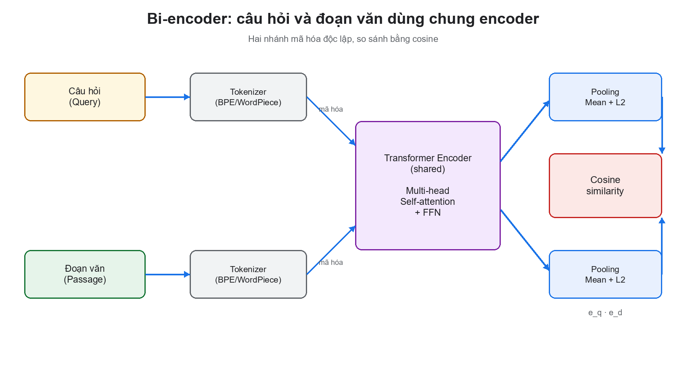

*Hình 3.1. Bi-encoder dùng chung encoder cho câu hỏi và đoạn văn, so sánh bằng cosine.*

Nhược điểm: câu hỏi và đoạn văn không được “nhìn thấy” nhau trong lúc mã hóa, nên mô hình không thể so sánh chi tiết từng từ. Đó là lý do cần **cross-encoder reranker** ở bước sau.

### 3.4.2. Hàm mất mát tương phản InfoNCE

Mục tiêu huấn luyện: câu hỏi $q$ phải gần đoạn trả lời đúng $d^+$ và xa các đoạn không liên quan $d^-$. Với một batch gồm $N$ cặp, InfoNCE xem bài toán là phân loại $N$ lớp: đoạn đúng là lớp mục tiêu, các đoạn còn lại là negative:

> **Công thức 3.14.** $\mathcal{L}_{InfoNCE} = -\frac{1}{N}\sum_{i=1}^{N}\log\frac{\exp\left(\text{sim}(e_{q_i}, e_{d_i^+})/\tau\right)}{\sum_{j=1}^{N}\exp\left(\text{sim}(e_{q_i}, e_{d_j})/\tau\right)}$

Trong đó $\tau$ là nhiệt độ (temperature) điều chỉnh độ sắc của phân phối. Công thức này khuyến khích mô hình tăng tương đồng với positive và giảm tương đồng với negative trong cùng batch. Các negative “khó” (hard negatives) — đoạn có từ khóa giống nhưng ngữ cảnh khác — giúp mô hình học ranh giới tốt hơn.

### 3.4.3. Negative sampling

Có ba loại negative:

- **In-batch negatives:** dùng các đoạn của câu hỏi khác trong cùng batch. Rẻ và hiệu quả, nhưng có thể trùng ngẫu nhiên với positive.
- **Hard negatives:** các đoạn được retriever hiện tại xếp hạng cao nhưng không phải đáp án. Giúp mô hình sửa lỗi cụ thể.
- **Random negatives:** đoạn ngẫu nhiên trong kho. Dễ nhưng ít thông tin.

Trong thực tế, E5 được huấn luyện trên dữ liệu yếu (weakly supervised) quy mô lớn, với nhiều cặp câu hỏi–đoạn văn từ web và các bộ dữ liệu QA. Vì vậy nó có khả năng tổng quát hóa tốt ngay cả khi không fine-tune trên dữ liệu doanh nghiệp.

### 3.4.4. Chuẩn hóa vector và cosine

Để cosine ổn định, vector được chuẩn hóa L2:

> **Công thức 3.15.** $\hat{e} = \frac{e}{\|e\|_2}$

Khi đó:

> **Công thức 3.16.** $\cos(e_q, e_d) = \hat{e}_q \cdot \hat{e}_d = \sum_{i=1}^{m}\hat{e}_{q,i}\hat{e}_{d,i}$

Giá trị nằm trong $[-1, 1]$. Với embedding văn bản, các giá trị thường dương và tập trung trong một khoảng hẹp; vì vậy cần chuẩn hóa và hiệu chỉnh ngưỡng theo từng mô hình (xem mục 4.9).

### 3.4.5. Cross-encoder reranker

Cross-encoder nhận đồng thời câu hỏi và đoạn văn, đưa qua encoder để tạo biểu diễn chung, rồi xuất một điểm liên quan:

> **Công thức 3.17.** $s(q, d) = \sigma\left(W \cdot f_\theta([q; d]) + b\right)$

Vì câu hỏi và đoạn văn được xử lý cùng nhau, cross-encoder nắm được tương tác từng từ và thường chính xác hơn bi-encoder. Nhược điểm là phải chạy mô hình cho từng cặp, không thể precompute. Vì vậy kiến trúc chuẩn là:

1. Bi-encoder lấy top-$N$ ứng viên (nhanh, phủ rộng).
2. Cross-encoder chấm lại top-$N$ (chậm nhưng chính xác).
3. Lấy top-$k$ cuối cùng.

Hệ thống dùng `cross-encoder/mmarco-mMiniLMv2-L12-H384-v1` cho bước rerank, với $N$ mặc định 10 ứng viên.

---

## 3.5. Mô hình nhúng cho tiếng Việt

### 3.5.1. Đặc thù của văn bản tiếng Việt

Tiếng Việt đặt ra một số thách thức riêng cho embedding:

1. **Dấu thanh và dấu phụ:** “nghỉ” khác “nghi”, “phép” khác “phep”. Nếu chuẩn hóa sai, nghĩa thay đổi hoàn toàn.
2. **Từ ghép và khoảng trắng:** “người lao động” là một khái niệm nhưng gồm ba âm tiết; tokenizer có thể tách rời làm mất nghĩa.
3. **Nhiễu OCR:** tài liệu scan thường mất dấu, nhầm dấu, hoặc lẫn ký tự Latin (ví dụ “Điều” thành “Diều”). Mô hình cần bền với lỗi bề mặt.
4. **Thuật ngữ pháp lý:** “điều”, “khoản”, “điểm”, “nghị quyết”, “đại hội đồng cổ đông” là các thực thể có cấu trúc, không chỉ là từ thông thường.
5. **Hiện tượng đa ngữ:** văn bản doanh nghiệp có thể chứa tiếng Anh (tên chức danh, mã chứng khoán, tên hệ thống).

Vì vậy, một mô hình tốt cho tiếng Việt không chỉ cần “biết tiếng Việt” mà còn cần **ổn định trước nhiễu OCR** và **hiểu cấu trúc điều khoản**.

### 3.5.2. Ba mô hình ứng viên

| Tiêu chí | MiniLM-L12-v2 | Vietnamese-Bi-Encoder | Multilingual-E5-Small |
| :--- | :--- | :--- | :--- |
| Mã mô hình | `sentence-transformers/paraphrase-multilingual-MiniLM-L12-v2` | `bkai-foundation-models/vietnamese-bi-encoder` | `intfloat/multilingual-e5-small` |
| Đơn vị phát triển | Hugging Face / SentenceTransformers | BKAI — ĐH Bách Khoa Hà Nội | Microsoft Research |
| Kiến trúc | MiniLM đa ngữ | RoBERTa tiếng Việt | E5 (encoder-only) |
| Số chiều | 384 | 768 | 384 |
| Dung lượng ước tính | ~470 MB | ~540 MB | ~470 MB |
| Ngôn ngữ | 50+ ngôn ngữ | Tiếng Việt | 100+ ngôn ngữ |
| Tiền tố | Không | Không | `query: ` / `passage: ` |
| Điểm mạnh | Nhanh, nhẹ, phổ biến | Hiểu tiếng Việt chuyên sâu | Cân bằng đa ngữ, huấn luyện tương phản quy mô lớn |
| Điểm yếu | Yếu với câu hỏi pháp lý dài | Vector lớn, chậm hơn | Cần tiền tố đúng cách |

### 3.5.3. Tiêu chí lựa chọn

Nhóm nghiên cứu đặt ra năm tiêu chí, theo thứ tự ưu tiên:

1. **Độ chính xác truy xuất:** Recall@1, Recall@3, MRR trên bộ câu hỏi ground truth.
2. **Chi phí lưu trữ:** số chiều vector quyết định dung lượng Qdrant và băng thông khi tìm kiếm.
3. **Độ trễ truy vấn:** phải đủ nhanh để người dùng không phải chờ.
4. **Thông lượng mã hóa:** số chunk/giây khi nạp tài liệu.
5. **Khả năng chạy trên CPU:** hệ thống triển khai trong Docker, không giả định GPU rời.

Tiêu chí 1 là điều kiện tiên quyết; các tiêu chí còn lại là ràng buộc tài nguyên. Một mô hình chính xác hơn 20% nhưng chậm gấp 10 lần có thể vẫn chấp nhận được nếu chỉ dùng offline; ngược lại, mô hình chạy online phải đáp ứng ngân sách độ trễ.

<!-- LANDSCAPE:START -->

### 3.5.4. Bảng so sánh kiến trúc và cấu hình huấn luyện (in ngang)

Bảng dưới đây bổ sung góc nhìn kỹ thuật cho phần so sánh định tính: không chỉ "mô hình nào tốt hơn" mà còn **vì sao** - số lớp, kích thước ẩn, tham số, độ dài token, learning rate và epoch. Đây là các trường mà một bảng so sánh thông thường hay bỏ qua, trong khi chúng quyết định chi phí huấn luyện, khả năng chạy CPU và độ dài ngữ cảnh.

**Bảng 3.1. So sánh kiến trúc, cấu hình huấn luyện và kết quả của các mô hình**

| Mô hình | Đặc trưng | Kiến trúc | Số layer | Hidden / Heads | Tham số | Max token | Learning rate | Epoch | Batch | Recall@1 / @3 | MRR |
| :--- | :--- | :--- | :---: | :---: | :---: | :---: | :--- | :---: | :---: | :---: | :---: |
| **MiniLM-L12-v2** | 384d; mean pooling; không prefix; 50+ ngôn ngữ; XLM-R 250k | MiniLM-L12 (BERT encoder) | 12 | 384 / 12 | ~118 M | 128 | 0 (zero-shot) | 0 | 32 | 60,0% / 80,0% | 0,6667 |
| **Vietnamese-Bi-Encoder** | 768d; mean pooling; không prefix; tiếng Việt; PhoBERT 64k | RoBERTa-base (PhoBERT) | 12 | 768 / 12 | ~135 M | 258 | 0 (zero-shot) | 0 | 32 | 80,0% / 80,0% | 0,8000 |
| **Multilingual-E5-Small** | 384d; mean pooling; prefix `query:` / `passage:`; 100+ ngôn ngữ; XLM-R 250k | E5-small (BERT encoder) | 12 | 384 / 12 | ~118 M | 512 | 0 (zero-shot) | 0 | 32 | 80,0% / 100,0% | 0,9000 |
| **Reranker mmarco** | 1 điểm; cặp (query, passage); không vector; 100+ ngôn ngữ | Cross-encoder MiniLM | 12 | 384 / 12 | ~118 M | 512 | 0 (zero-shot) | 0 | 10 cặp/query | — | — |

*Nguồn: `config.json` và `sentence_bert_config.json` của từng mô hình trên Hugging Face; kết quả đo trên 152 chunk Điều lệ Công ty. Learning rate và epoch bằng 0 vì cả bốn mô hình đều dùng trọng số pretrained, không huấn luyện lại trên corpus của đồ án. Nếu fine-tune, cấu hình đề xuất: LR 2e-5, epoch 3–5, batch 16, warmup 10%, weight decay 0,01, contrastive loss với hard negatives.*

<!-- LANDSCAPE:END -->

---

## 3.6. Thiết kế thực nghiệm

### 3.6.1. Dữ liệu thực nghiệm

Bộ dữ liệu là toàn văn **Điều lệ Công ty** (39 trang), được xử lý qua pipeline mô tả ở Chương 4 và phân đoạn thành **152 chunk ngữ nghĩa**. Đây là tài liệu thật của doanh nghiệp, có đặc điểm:

- Nhiều chương, điều, khoản; cấu trúc phân cấp rõ nhưng không đồng nhất giữa các phần.
- Có bảng, danh sách, tiêu đề viết hoa, và một số trang scan/OCR.
- Nội dung pháp lý dày đặc, nhiều câu dài, nhiều tham chiếu chéo.

Sau khi qua pipeline, corpus có các thống kê:

| Chỉ số | Giá trị |
| :--- | ---: |
| Số trang | 39 |
| Số chunk | 152 |
| Tổng số ký tự | 111.241 |
| Độ dài trung bình | 731,8 ký tự |
| Trung vị | 795 ký tự |
| Ngắn nhất | 52 ký tự |
| Dài nhất | 1.353 ký tự |
| Số section path khác nhau | 33 |

Các chunk ngắn (52 ký tự) thường là tiêu đề hoặc dòng danh sách; các chunk dài (1.353 ký tự) là điều khoản có nhiều khoản con. Việc giữ cả hai loại là có chủ đích: chunk ngắn cung cấp ngữ cảnh tiêu đề, chunk dài cung cấp nội dung đầy đủ.

### 3.6.2. Bộ câu hỏi ground truth

Năm câu hỏi được chọn để bao phủ các dạng truy vấn khác nhau: quyền hạn, thời hạn, quy trình, điều kiện, và báo cáo. Mỗi câu được gán nhãn thủ công với một hoặc nhiều chunk chứa đáp án:

| ID | Câu hỏi | Chunk đáp án | Nội dung nghiệp vụ |
| :--- | :--- | :--- | :--- |
| TC-01 | Chủ tịch Hội đồng Quản trị có quyền và nghĩa vụ gì? | 0093, 0096, 0097 | Quyền hạn Chủ tịch HĐQT (Điều 39) |
| TC-02 | Thời hạn hoạt động của Công ty là bao lâu và bắt đầu từ khi nào? | 0003, 0005, 0006 | Thời hạn và ngày thành lập (Điều 2) |
| TC-03 | Con dấu của Công ty bao gồm những hình thức nào và ai có thẩm quyền quyết định? | 0145 | Con dấu và chữ ký số (Điều 50) |
| TC-04 | Việc chỉ định công ty kiểm toán độc lập cho năm tài chính tiếp theo diễn ra như thế nào? | 0144 | Đơn vị kiểm toán độc lập (Điều 49) |
| TC-05 | Báo cáo tài chính năm của công ty phải bao gồm những gì và được công bố ra sao? | 0143 | Báo cáo tài chính và công bố thông tin (Điều 47) |

Bộ câu hỏi tuy nhỏ nhưng có chủ đích: TC-01 và TC-05 yêu cầu tổng hợp nhiều ý; TC-02 yêu cầu phân biệt “thời hạn hoạt động” với các mốc thời gian khác; TC-03 và TC-04 yêu cầu xác định đúng điều khoản chuyên biệt. Đây là các dạng lỗi phổ biến của RAG: trả lời đúng chủ đề nhưng sai điều khoản.

### 3.6.3. Quy trình thực nghiệm

Thực nghiệm được chạy trong Docker container, chế độ CPU, bằng script `benchmark_embeddings.py`. Quy trình:

1. Nạp 152 chunk từ `05_enriched_chunks.json`.
2. Với mỗi mô hình, mã hóa toàn bộ passage (có tiền tố nếu mô hình yêu cầu).
3. Với mỗi câu hỏi, mã hóa query, tính cosine với toàn bộ vector passage.
4. Lấy top-5, xác định thứ hạng đầu tiên của chunk đúng.
5. Tính Recall@1, Recall@3, Recall@5, MRR, độ trễ trung bình, thông lượng.
6. Lặp lại cho ba mô hình, giữ nguyên dữ liệu, tham số batch, và môi trường.

Mã nguồn rút gọn của vòng đo (trích `scripts/benchmark_embeddings.py`):

```python
model = SentenceTransformer(cfg["name"])
doc_vectors = model.encode(
    [cfg["prefix_passage"] + c["content"] for c in chunks],
    batch_size=32, show_progress_bar=False, convert_to_numpy=True,
)

for tc in TEST_CASES:
    query_vector = model.encode(cfg["prefix_query"] + tc["query"], convert_to_numpy=True)
    scores = compute_cosine_similarity(query_vector, doc_vectors)
    top_indices = np.argsort(scores)[::-1][:5]
    first_rank = next(
        (rank for rank, idx in enumerate(top_indices, start=1)
         if chunk_ids[idx] in set(tc["ground_truth_chunks"])),
        None,
    )
    mrr_scores.append(1.0 / first_rank if first_rank else 0.0)
```

Điểm quan trọng: cùng một hàm cosine, cùng batch 32, cùng tập chunk và cùng cách xác định hạng; chỉ mô hình thay đổi. Nếu mỗi mô hình dùng một cách chuẩn hóa hoặc một tập chunk khác, bảng so sánh sẽ mất ý nghĩa.

### 3.6.4. Chỉ số đánh giá

**Recall@k** đo tỷ lệ câu hỏi có ít nhất một chunk đúng trong top-$k$:

> **Công thức 3.18.** $\text{Recall}@k = \frac{1}{|Q|}\sum_{i=1}^{|Q|}\mathbb{1}\left[\text{rank}_i \le k\right]$

**MRR** (Mean Reciprocal Rank) đo thứ hạng trung bình của đáp án đúng đầu tiên:

> **Công thức 3.19.** $\text{MRR} = \frac{1}{|Q|}\sum_{i=1}^{|Q|}\frac{1}{\text{rank}_i}$

Nếu đáp án đúng ở top-1, điểm là 1; top-2 là 0,5; top-3 là 0,333. MRR nhạy với việc đáp án đúng nằm càng cao càng tốt, phù hợp với RAG vì LLM chỉ nhận một vài đoạn ngữ cảnh.

**Độ trễ truy vấn** là thời gian mã hóa câu hỏi và tính cosine trên toàn bộ corpus, đo bằng mili-giây. **Thông lượng** là số chunk được mã hóa trong một giây khi nạp corpus.

### 3.6.5. Kiểm soát yếu tố gây nhiễu

Để so sánh công bằng, nhóm giữ cố định:

- Cùng một corpus 152 chunk, cùng thứ tự.
- Cùng hàm cosine và cùng cách chuẩn hóa vector.
- Cùng batch size 32 khi mã hóa passage.
- Cùng môi trường CPU, cùng phiên bản thư viện.
- Cùng cách tính rank: chunk đúng đầu tiên trong top-5.

Các yếu tố không kiểm soát được: nhiệt độ CPU, tải nền của máy, trạng thái cache của mô hình. Vì vậy độ trễ chỉ có ý nghĩa tương đối; các chỉ số chất lượng (Recall, MRR) mới là căn cứ chính.

---

## 3.7. Kết quả và phân tích

### 3.7.1. Bảng tổng hợp

| Xếp hạng | Mô hình | Số chiều | Recall@1 | Recall@3 | Recall@5 | MRR | Độ trễ (ms) | Thông lượng (chunk/s) |
| :---: | :--- | :---: | :---: | :---: | :---: | :---: | :---: | :---: |
| 1 | **Multilingual-E5-Small** | 384 | 80,0% | **100,0%** | **100,0%** | **0,9000** | 283,66 | 4,9 |
| 2 | Vietnamese-Bi-Encoder | 768 | 80,0% | 80,0% | 80,0% | 0,8000 | 277,30 | 2,4 |
| 3 | MiniLM-L12-v2 | 384 | 60,0% | 80,0% | 80,0% | 0,6667 | **86,54** | **9,7** |

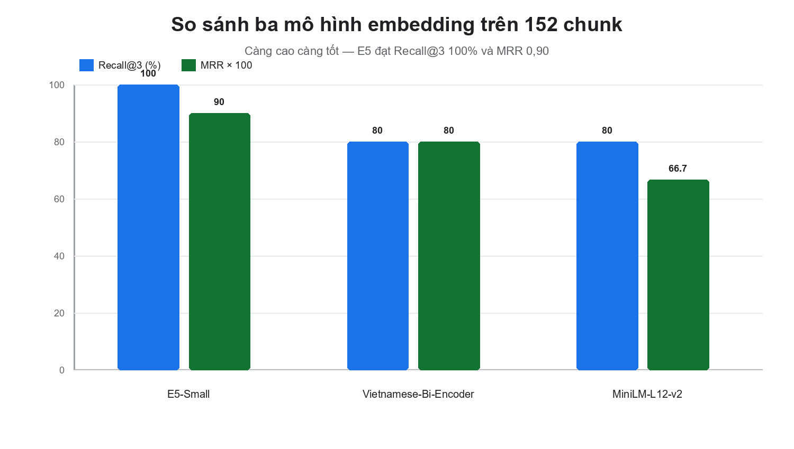

*Hình 3.2. So sánh định lượng ba mô hình embedding trên 152 chunk Điều lệ Công ty.*

### 3.7.2. Phân tích định lượng

**Multilingual-E5-Small** đạt Recall@3 = 100%, nghĩa là cả 5 câu hỏi đều có đáp án đúng trong top-3. Đây là ngưỡng quan trọng vì pipeline RAG lấy top-3 đến top-5 để đưa vào ngữ cảnh. MRR = 0,9 cho thấy 4/5 câu đạt top-1, 1 câu đạt top-2. Điểm cosine của top-1 dao động từ 0,8596 đến 0,9146, đủ tách biệt so với các đoạn nhiễu.

**Vietnamese-Bi-Encoder** đạt Recall@1 = 80% nhưng Recall@3 chỉ 80%, tức là một câu hỏi không có đáp án trong top-3 (TC-02). Điều này cho thấy mô hình mạnh với từ vựng tiếng Việt nhưng chưa xử lý tốt câu hỏi có nhiều mệnh đề thời gian. Vector 768 chiều cũng làm chi phí lưu trữ và tìm kiếm tăng gấp đôi.

**MiniLM-L12-v2** chỉ đạt Recall@1 = 60%, MRR = 0,6667; TC-02 và TC-04 bị xếp hạng sai. Đây là minh chứng cho việc mô hình nhỏ, huấn luyện trên dữ liệu đa ngữ chung không đủ nhạy với cấu trúc pháp lý tiếng Việt.

### 3.7.3. Phân tích theo từng câu hỏi

| Câu hỏi | E5-Small | Vietnamese-Bi-Encoder | MiniLM |
| :--- | :---: | :---: | :---: |
| TC-01 — Quyền Chủ tịch HĐQT | 1 | 1 | 1 |
| TC-02 — Thời hạn hoạt động | 2 | >5 | >5 |
| TC-03 — Con dấu | 1 | 1 | 1 |
| TC-04 — Kiểm toán độc lập | 1 | 1 | 3 |
| TC-05 — Báo cáo tài chính | 1 | 1 | 1 |

TC-02 là câu khó nhất: câu hỏi chứa hai ý (“bao lâu” và “bắt đầu từ khi nào”), trong khi đáp án nằm ở câu mở đầu Điều 2 và có thể bị tách bởi chunking. E5 vẫn đưa đáp án vào top-2 nhờ học tương phản đa ngữ; hai mô hình còn lại trượt khỏi top-5. Đây là lý do nhóm không chọn mô hình có Recall@1 cao nhất một cách máy móc, mà ưu tiên **độ phủ top-3** — yếu tố quyết định chất lượng RAG.

### 3.7.4. Độ trễ và thông lượng

MiniLM nhanh nhất (86,54 ms/query, 9,7 chunk/s) nhưng độ chính xác thấp. E5 có độ trễ 283,66 ms/query và 4,9 chunk/s — chậm hơn MiniLM khoảng 3,3 lần nhưng vẫn nằm trong ngân sách tương tác (dưới 1 giây). Vietnamese-Bi-Encoder có độ trễ tương đương E5 nhưng thông lượng chỉ 2,4 chunk/s do vector 768 chiều và kiến trúc nặng hơn.

Trong bối cảnh hệ thống, thời gian nạp corpus là offline (chấp nhận vài phút), còn thời gian truy vấn là online (cần dưới 1 giây). Vì vậy, đánh đổi 3,3 lần tốc độ để tăng Recall@3 từ 80% lên 100% là hợp lý.

### 3.7.5. Thảo luận

Kết quả cho thấy ba bài học thiết kế:

1. **Không có mô hình tốt nhất tuyệt đối, chỉ có mô hình phù hợp với ràng buộc.** MiniLM thắng về tốc độ, BKAI thắng về tiếng Việt thuần, E5 thắng về độ phủ top-3 và cân bằng tài nguyên.
2. **Recall@3 quan trọng hơn Recall@1 trong RAG.** Một đáp án ở top-2 vẫn được đưa vào ngữ cảnh; một đáp án ngoài top-5 thì mất hoàn toàn.
3. **Kích thước vector là quyết định kiến trúc, không chỉ là tham số.** 384 chiều giảm 50% dung lượng so với 768 chiều, cho phép chạy trên CPU và mở rộng kho tri thức mà không cần nâng cấp hạ tầng.

### 3.7.6. Cải tiến mô hình A thành mô hình AB

Vấn đề V2 đặt ra ở mục 3.1 là một mô hình nhúng (mô hình **A**, bi-encoder) chưa đủ chính xác. Đồ án cải tiến A thành **AB** bằng cách thêm mô hình **B** là cross-encoder `cross-encoder/mmarco-mMiniLMv2-L12-H384-v1`: A lấy 20 đoạn có cosine cao nhất, B đọc đồng thời câu hỏi và từng đoạn rồi chấm lại thứ tự. Để đánh giá cải tiến một cách thuyết phục, cùng một B được ghép với cả bốn mô hình A, trên cùng 18 câu hỏi có nhãn và 321 chunk của 7 tài liệu upload (script `ai-service/scripts/21_benchmark_models_ab.py`, kết quả `data/eval/results/models_ab.json`).

| Mô hình A | Chiều | MRR (A → AB) | Recall@1 (A → AB) | Recall@3 (A → AB) | ms/câu (A → AB) |
| :--- | ---: | :---: | :---: | :---: | :---: |
| MiniLM-L12 (đa ngữ) | 384 | 0,556 → 0,713 | 0,389 → 0,611 | 0,722 → 0,778 | 67 → 1995 |
| BKAI Vietnamese bi-encoder | 768 | 0,631 → 0,732 | 0,500 → 0,611 | 0,778 → 0,778 | 138 → 2163 |
| **Multilingual-E5-Small** | 384 | **0,806 → 0,829** | 0,722 → 0,722 | 0,889 → 0,944 | 59 → 1926 |
| Multilingual-E5-Base | 768 | 0,787 → 0,770 | 0,722 → 0,667 | 0,833 → 0,778 | 152 → 2156 |

*Bảng 3.2. Mô hình A (chỉ bi-encoder) so với mô hình AB (bi-encoder + cross-encoder chấm lại).*

Ba kết luận rút ra từ Bảng 3.2:

1. **B cải thiện mạnh các mô hình A yếu.** MRR của MiniLM tăng từ 0,556 lên 0,713, của BKAI từ 0,631 lên 0,732. Cross-encoder sửa được những đoạn nhiễu mà bi-encoder xếp nhầm lên đầu.
2. **Với mô hình A tốt nhất, B chỉ thêm ít nhưng vẫn có ích.** E5-Small tăng MRR từ 0,806 lên 0,829 và Recall@3 từ 0,889 lên 0,944. AB với E5-Small là cấu hình tốt nhất trong bảng và là cấu hình hệ thống đang dùng.
3. **Mô hình lớn hơn không tự động tốt hơn.** E5-Base (768 chiều, 278 triệu tham số, gấp đôi E5-Small) có MRR thấp hơn E5-Small ở cả A và AB; ghép B còn làm MRR của E5-Base giảm nhẹ (0,787 → 0,770). Lý do là cả hai mô hình đã xếp đúng phần lớn câu, phần còn lại là các câu khó mà B cũng chấm sai.

Cái giá của B là độ trễ: chấm lại 20 đoạn trên CPU mất khoảng 2 giây mỗi câu, so với 60–150 ms của A. Hệ thống giảm chi phí này bằng cách chỉ chấm lại 10 đoạn đầu (`RERANK_CANDIDATES=10`) và cắt mỗi đoạn còn 800 ký tự. Bộ đánh giá 18 câu là nhỏ, nên chênh lệch dưới khoảng 0,03 MRR (tức một câu đổi thứ hạng) chưa đủ để kết luận.

---

## 3.8. Ứng dụng trong hệ thống EAKWP

### 3.8.1. Embedding Service

Module `embedding_service.py` triển khai ba phương thức:

- `embed_query(query)`: mã hóa câu hỏi thành vector 384 chiều.
- `embed_documents(texts, batch_size=32)`: mã hóa danh sách đoạn văn theo batch.
- `embed_chunks(chunks)`: nhận danh sách chunk từ pipeline, bổ sung trường `vector`.

Mã nguồn (trích `ai-service/app/embedding_service.py`, hàm `_prepare` và `embed_query`):

```python
def _prepare(self, text: str, prefix: str) -> str:
    # Giữ dấu: bỏ dấu làm E5 mất phần lớn tín hiệu tiếng Việt.
    prepared = fold_text(text) if settings.EMBEDDING_FOLD_TEXT else " ".join(text.split())
    return f"{prefix}{prepared}" if prefix else prepared

def embed_query(self, query: str) -> List[float]:
    if not query or not query.strip():
        return [0.0] * self.vector_dim
    vector = self.model.encode(self._prepare(query, self.query_prefix), convert_to_numpy=True)
    return vector.tolist()
```

Giải thích: `_prepare` chỉ gom khoảng trắng rồi gắn tiền tố `query: ` cho câu hỏi hoặc `passage: ` cho đoạn văn, đúng cách E5 được huấn luyện. Văn bản được giữ nguyên dấu. Hàm `fold_text` (bỏ dấu, hạ chữ thường) chỉ dùng ở bước khớp từ khóa, không dùng khi nhúng.

**Vấn đề V3: bỏ dấu hay giữ dấu?** Phiên bản đầu của hệ thống bỏ dấu cả câu hỏi lẫn tài liệu trước khi nhúng, với lập luận rằng OCR hay làm mất dấu. Nhóm đo lại giả thuyết này bằng script `ai-service/scripts/17_benchmark_folding.py`: cùng mô hình E5-Small, cùng 321 chunk, 18 câu hỏi có nhãn, chỉ xếp hạng bằng cosine.

| Tiền xử lý | MRR | R@1 | R@3 | R@10 |
| :--- | ---: | ---: | ---: | ---: |
| Bỏ dấu (cách cũ) | 0,169 | 6% | 22% | 39% |
| **Giữ dấu (hiện tại)** | **0,806** | **72%** | **89%** | **100%** |

*Bảng 3.3. Ảnh hưởng của việc bỏ dấu tiếng Việt trước khi nhúng.*

Giả thuyết ban đầu sai: bỏ dấu biến "Hội đồng" và "hội đông", "cổ phần" và "có phần" thành cùng một chuỗi, và E5 vốn được huấn luyện trên văn bản có dấu nên mất gần hết tín hiệu. Hệ thống chuyển sang giữ dấu khi nhúng. Nhiễu OCR được xử lý ở tầng khác: khớp từ khóa và khớp thực thể không dấu với độ tin cậy thấp hơn (Chương 4, mục 4.15.4 và 4.15.5).

### 3.8.2. Reranker

Module `reranker_service.py` dùng cross-encoder `mmarco-mMiniLMv2-L12-H384-v1`. Cấu hình:

- `RERANK_CANDIDATES = 10`: số ứng viên đưa vào cross-encoder.
- `RERANK_PASSAGE_CHARS = 800`: cắt đoạn văn trước khi chấm để giới hạn độ dài.
- `RERANK_GATE = -1.5`: ngưỡng tin cậy; điểm cross-encoder dưới ngưỡng bị coi là nhiễu.

```python
def rerank(self, query: str, hits: List[Dict[str, Any]]) -> List[Dict[str, Any]]:
    if not self.enabled or not hits:
        return hits
    pairs = [(query, hit["content"][: settings.RERANK_PASSAGE_CHARS]) for hit in hits]
    scores = self.model.predict(pairs, show_progress_bar=False)
    for hit, score in zip(hits, scores):
        hit["rerank_score"] = round(float(score), 4)
    return sorted(hits, key=lambda hit: hit["rerank_score"], reverse=True)
```

Reranker không thay thế bi-encoder mà bổ sung tín hiệu tương tác từng từ. Trong thực nghiệm, việc thêm reranker giúp giảm các câu trả lời sai do đoạn nhiễu có cosine cao nhưng không chứa đáp án.

### 3.8.3. Tích hợp Qdrant

Vector 384 chiều được lưu trong collection `enterprise_documents` với độ đo cosine. Qdrant dùng chỉ mục HNSW để tìm kiếm xấp xỉ, giảm độ phức tạp từ $O(N)$ xuống $O(\log N)$ trung bình. Payload của mỗi point chứa `chunk_id`, `document_id`, `version_id`, `page_start`, `page_end`, `section_path`, `content`, `document_type`. Nhờ đó, kết quả tìm kiếm có thể được chuyển trực tiếp thành trích dẫn mà không cần join thêm.

### 3.8.4. Cấu hình và vận hành

Mô hình được chọn qua biến môi trường `EMBEDDING_MODEL`; mặc định trong mã nguồn và cấu hình triển khai là `intfloat/multilingual-e5-small`. Khi triển khai:

- Cache mô hình trong volume `huggingface_cache` để tránh tải lại sau mỗi lần khởi động.
- Chạy warm-up bằng một câu ngắn trước khi nhận request thật.
- Giới hạn batch size theo RAM; 32 là giá trị cân bằng cho CPU.
- Theo dõi độ trễ P95, không chỉ trung bình, vì các câu hỏi dài có thể làm latency tăng đột biến.

---

## 3.9. Hạn chế và hướng phát triển

### 3.9.1. Hạn chế của thực nghiệm

1. **Kích thước mẫu nhỏ:** 5 câu hỏi trên một tài liệu. Kết quả có tính minh chứng nhưng chưa đủ để kết luận thống kê. Cần mở rộng lên 50–100 câu hỏi, nhiều loại tài liệu, và báo cáo khoảng tin cậy (bootstrap confidence interval).
2. **Thiếu baseline từ khóa:** thực nghiệm chưa so sánh với BM25 hoặc hybrid retrieval. Một baseline BM25 sẽ cho thấy đóng góp thực sự của embedding.
3. **Chưa đánh giá sau fine-tune:** các mô hình được dùng zero-shot. Fine-tune với hard negatives từ chính corpus có thể cải thiện đáng kể.
4. **Nhiễu OCR chưa được đo tách biệt:** cần một bộ thử nghiệm riêng với các mức nhiễu khác nhau để đánh giá độ bền.

### 3.9.2. Hạn chế của mô hình

- **Mô hình nhỏ:** E5-small chỉ 384 chiều, không thể biểu diễn đầy đủ các quan hệ pháp lý phức tạp như mô hình lớn.
- **Cửa sổ ngữ cảnh hữu hạn:** đoạn quá dài bị cắt, có thể mất ngoại lệ hoặc điều kiện đi kèm.
- **Không hiểu bảng biểu:** embedding văn bản thuần không nắm được quan hệ hàng–cột; bảng cần được xử lý riêng.
- **Thiên lệch ngôn ngữ:** E5 đa ngữ nhưng không tối ưu riêng cho tiếng Việt; các mô hình chuyên biệt có thể tốt hơn sau khi fine-tune.

### 3.9.3. Hướng phát triển

1. **Mở rộng bộ đánh giá:** 100+ câu hỏi, nhiều tài liệu, nhiều miền (nhân sự, tài chính, IT), có ground truth do chuyên gia gán.
2. **Fine-tune với hard negatives:** lấy các đoạn sai do retriever hiện tại xếp hạng cao, tạo cặp huấn luyện, fine-tune E5 hoặc BKAI.
3. **Hybrid retrieval:** kết hợp BM25 và vector, dùng reciprocal rank fusion; sau đó rerank.
4. **Lượng tử hóa và ONNX:** giảm dung lượng, tăng tốc trên CPU, phục vụ triển khai biên.
5. **Đánh giá đa ngôn ngữ:** bổ sung tài liệu tiếng Anh để kiểm chứng khả năng đa ngữ của E5.
6. **Graph embedding:** kết hợp embedding văn bản với embedding thực thể trong đồ thị tri thức (Chương 4).

---

## 3.10. KẾT LUẬN

Chương này đã trình bày con đường từ bài toán biểu diễn ngữ nghĩa đến một quyết định kỹ thuật có căn cứ:

- **Về lý thuyết:** hệ thống hóa kiến trúc Transformer, cơ chế self-attention, bi-encoder, học tương phản và cross-encoder. Đây là nền tảng để hiểu vì sao embedding có thể thay thế tìm kiếm từ khóa trong văn bản pháp lý.
- **Về thực nghiệm:** thiết kế so sánh ba mô hình trên 152 chunk thật, với 5 câu hỏi ground truth và các chỉ số Recall@k, MRR, độ trễ, thông lượng.
- **Về kết quả:** `Multilingual-E5-Small` đạt Recall@3 = 100%, MRR = 0,9, vector 384 chiều, độ trễ dưới 300 ms — là lựa chọn cân bằng nhất cho hệ thống chạy CPU.
- **Về ứng dụng:** mô hình được tích hợp vào Embedding Service, kết hợp với reranker cross-encoder và Qdrant để tạo thành pipeline truy xuất hai tầng.

Kết quả này là tiền đề cho Chương 4, nơi vector được tổ chức thành cơ sở tri thức có cấu trúc, có trích dẫn và có cơ chế từ chối khi không đủ căn cứ. Nói cách khác, chương này trả lời câu hỏi **“biểu diễn tri thức bằng vector như thế nào?”**; chương tiếp theo trả lời câu hỏi **“lưu trữ, đồng bộ và khai thác các vector đó trong một hệ thống dữ liệu hoàn chỉnh ra sao?”**.

---

<!-- PAGEBREAK -->

# CHƯƠNG 4. XÂY DỰNG VÀ QUẢN TRỊ CƠ SỞ TRI THỨC ĐỒ THỊ

## 4.1. Vấn đề đặt ra và phạm vi giải quyết

Chương 3 cho hệ thống khả năng biểu diễn văn bản bằng vector. Để hỏi đáp có căn cứ, tri thức trong 35 tệp PDF, 10 trang web và các tài liệu người dùng tải lên còn phải được tổ chức thành một cơ sở tri thức (Knowledge Base, KB) có cấu trúc, truy vết được nguồn và cập nhật được. Khi xây dựng KB, nhóm gặp các vấn đề sau:

| Mã | Vấn đề | Câu hỏi cần trả lời |
| :--- | :--- | :--- |
| T1 | Biến tài liệu thô thành tri thức | PDF quét, OCR lỗi, cấu trúc Chương/Điều/Khoản: làm sao thành các đoạn có ngữ cảnh và trích dẫn được? |
| T2 | Biểu diễn KB | Lưu tri thức dưới dạng nào để vừa tìm theo nghĩa (vector) vừa duyệt theo quan hệ (đồ thị)? Mã truy vấn tổ chức ra sao? |
| T3 | Tích hợp nhiều nguồn (KB1 + KB2) | Trùng lặp, nhiều phiên bản, song ngữ Anh–Việt, nhiễu OCR, tên gọi khác nhau, dữ kiện mâu thuẫn được xử lý thế nào? |
| T4 | Không chắc chắn và mờ | Phép trích xuất nào đáng tin hơn? Hai tên gần giống nhau có phải một thực thể? |
| T5 | Nối KB với RAG | Câu hỏi đi qua KB như thế nào, đoạn mã nào thực hiện bước nào? |
| T6 | Cập nhật KB | Khi tài liệu được thêm, sửa, xóa, hoặc khi bộ trích xuất thay đổi thì làm gì? |
| T7 | Đánh giá KB | Mô hình có MRR và Recall@k; KB được đánh giá bằng gì? |

Chương này giải quyết lần lượt: T1 ở các mục 4.2–4.11 (pipeline thu nhận, cấu trúc, phân đoạn, metadata, vector, truy xuất, cổng trả lời); T2 ở mục 4.13–4.14 (đồ thị Neo4j, mã Cypher tổ chức thành tệp `.cypher`); T3 và T4 ở mục 4.15; T5 ở mục 4.16; T6 ở mục 4.17; T7 ở mục 4.18. Ngoài phạm vi: trích xuất quan hệ bằng mô hình ngôn ngữ lớn và suy luận logic trên đồ thị (ontology, luật suy diễn). Đồ án dùng trích xuất theo luật có độ tin cậy đo được.

---

## 4.2. Từ dữ liệu đến tri thức

### 4.2.1. Phân biệt dữ liệu, thông tin và tri thức

Một tài liệu PDF chỉ là **dữ liệu** ở dạng byte. Sau khi bóc tách, ta có **thông tin**: chuỗi ký tự, số trang, tọa độ dòng. Chỉ khi thông tin được tổ chức theo cấu trúc, gắn ngữ nghĩa và liên kết với bối cảnh sử dụng, ta mới có **tri thức**.

Ví dụ:

| Mức | Nội dung |
| :--- | :--- |
| Dữ liệu | Tệp `Dieu_le_cong_ty_2026.pdf`, 15 MB |
| Thông tin | Trang 12 có đoạn “Điều 39. Chủ tịch Hội đồng Quản trị có các quyền...” |
| Tri thức | “Chủ tịch HĐQT có quyền triệu tập họp HĐQT; quyền này thuộc Điều 39, Chương VII, trang 12, phiên bản 2026” |

Sự khác biệt nằm ở **cấu trúc** (điều/chương/trang), **ngữ nghĩa** (quyền hạn là gì), và **truy vết** (thông tin đến từ đâu, phiên bản nào). Một cơ sở tri thức tốt phải trả lời được cả ba.

### 4.2.2. Các lớp biểu diễn tri thức

EAKWP tổ chức tri thức thành năm lớp:

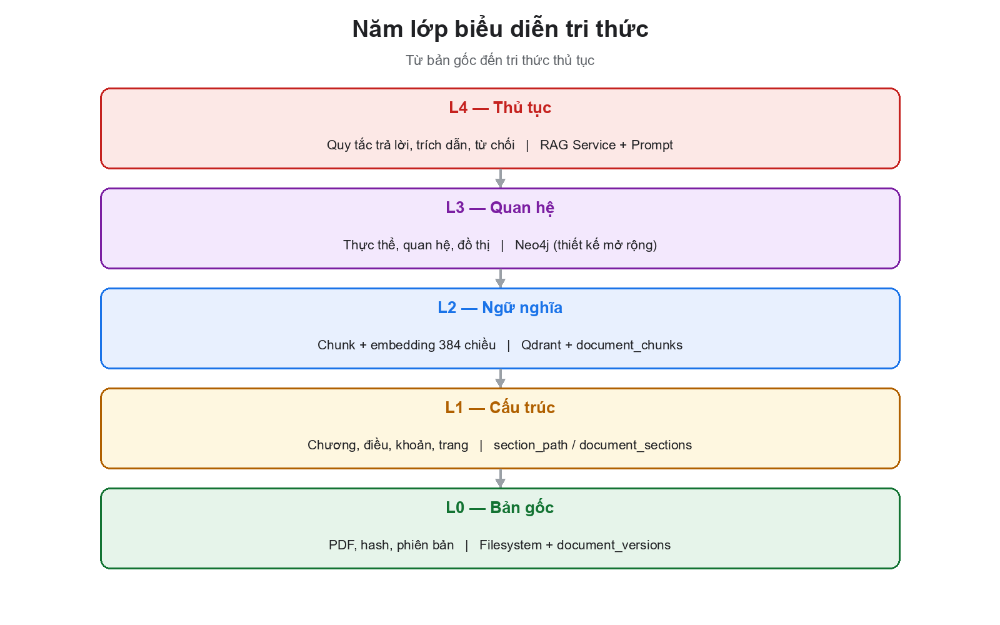

*Hình 4.1. Năm lớp biểu diễn tri thức, từ bản gốc đến tri thức thủ tục.*

| Lớp | Tên | Nội dung | Kho lưu |
| :--- | :--- | :--- | :--- |
| L0 | Bản gốc | PDF, hash, phiên bản | Filesystem + PostgreSQL |
| L1 | Cấu trúc | Chương, điều, khoản, trang, thứ tự | `section_path`, `document_sections` (mở rộng) |
| L2 | Ngữ nghĩa | Chunk + embedding 384 chiều | Qdrant + `document_chunks` |
| L3 | Quan hệ | Thực thể, quan hệ, đồ thị | Neo4j (prototype, chưa bật RAG) |
| L4 | Thủ tục | Quy tắc trả lời, trích dẫn, từ chối | RAG service + prompt |

Cách phân lớp này giúp tách biệt trách nhiệm:

- L0–L1 là **nguồn sự thật**; có thể kiểm tra bằng mắt.
- L2 là **chỉ mục**; có thể rebuild.
- L3 là **suy luận**; có thể mở rộng dần.
- L4 là **chính sách**; thay đổi mà không ảnh hưởng dữ liệu.

### 4.2.3. Yêu cầu của một KB doanh nghiệp

| Mã | Yêu cầu | Diễn giải |
| :--- | :--- | :--- |
| KB-01 | Đầy đủ | Không bỏ sót điều khoản do lỗi phân đoạn |
| KB-02 | Truy vết | Mỗi câu trả lời truy ngược được trang, mục, phiên bản |
| KB-03 | Nhất quán phiên bản | Không trộn nội dung của bản cũ và bản mới |
| KB-04 | Truy xuất ngữ nghĩa | Hiểu câu hỏi diễn đạt khác từ trong tài liệu |
| KB-05 | Chịu nhiễu OCR | Không sụp đổ khi tài liệu mất dấu hoặc sai ký tự |
| KB-06 | Chống ảo giác | Không trả lời khi không có căn cứ |
| KB-07 | Có trích dẫn | Mỗi khẳng định gắn với đoạn nguồn |
| KB-08 | Mở rộng | Thêm tài liệu, ngôn ngữ, miền mà không đổi kiến trúc |

Các yêu cầu này định hình toàn bộ pipeline bên dưới.

---

## 4.3. Kiến trúc tổng thể của cơ sở tri thức

### 4.3.1. Sơ đồ pipeline

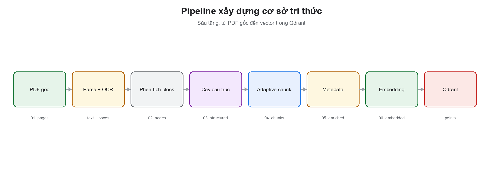

*Hình 4.2. Pipeline sáu tầng: thu nhận, phân tích cấu trúc, phân đoạn, làm giàu metadata, nhúng vector, lập chỉ mục.*

Pipeline gồm sáu tầng:

1. **Thu nhận (Acquisition):** đọc PDF, phát hiện scan, OCR nếu cần, chuẩn hóa font.
2. **Phân tích cấu trúc (Structure Analysis):** tách dòng, loại header/footer, nhận diện heading, loại mục lục, xây cây phân cấp.
3. **Phân đoạn (Chunking):** gom theo section, fallback theo đoạn/câu/ký tự.
4. **Làm giàu metadata (Enrichment):** gắn document_id, version_id, trang, section_path, loại tài liệu, ngôn ngữ.
5. **Nhúng vector (Embedding):** mã hóa chunk thành vector 384 chiều, chuẩn hóa văn bản.
6. **Lập chỉ mục (Indexing):** upsert vào Qdrant với point ID xác định, payload metadata.

### 4.3.2. Nguyên tắc thiết kế

1. **Structure-first:** cấu trúc tài liệu được khai thác trước khi cắt chunk. Điều này giữ nguyên ranh giới điều khoản — yếu tố quyết định câu trả lời pháp lý đúng.
2. **Provenance-preserving:** mọi chunk giữ trang bắt đầu/kết thúc, section_path, document_id, version_id. Không có chunk “vô danh”.
3. **Idempotent:** chunk_id và point_id xác định; nạp lại không nhân bản.
4. **Hybrid by design:** không phụ thuộc một tín hiệu. Vector bắt ngữ nghĩa; lexical bắt từ khóa chốt; article boost bắt số điều; cross-encoder bắt tương tác.
5. **Grounding-first:** câu trả lời chỉ được sinh khi có đoạn nguồn vượt qua kiểm tra dạng và ngưỡng tin cậy; nếu không, từ chối.
6. **Separation of concerns:** pipeline xây KB tách khỏi pipeline trả lời; có thể thay mô hình nhúng, reranker, LLM mà không đổi dữ liệu.

### 4.3.3. Hai đường nạp: offline corpus và online upload

Trong mã nguồn hiện tại có hai đường nạp:

| Đường nạp | Thành phần | Đơn vị | Mục đích |
| :--- | :--- | :--- | :--- |
| Offline corpus | Python pipeline (`document_parser` → `adaptive_chunker` → `metadata_enricher` → `embedding` → Qdrant) | Section-aware chunk | Xây corpus thử nghiệm, benchmark, kho tri thức nền |
| Online upload | Spring Boot (`IngestionService` → `PdfProcessor` → AI ingest) | Page-based chunk | Người dùng tải PDF lên, xem highlight, cập nhật phiên bản |

Hai đường dùng chung collection Qdrant và cùng hợp đồng payload (`chunk_id`, `content`, `document_id`, `version_id`, `page_start`, `page_end`, `section_path`). Sự khác biệt nằm ở độ mịn:

- Offline chunk theo **section** (điều/khoản), giữ ngữ nghĩa pháp lý.
- Online chunk theo **trang**, thuận lợi cho việc tô vàng chính xác trên trình xem PDF.

Đây là đánh đổi có chủ đích trong giai đoạn prototype. Hướng hoàn thiện là thống nhất về chunk theo section, đồng thời lưu `highlight_json` theo tọa độ từng từ để vẫn tô vàng được. Chương này mô tả pipeline section-aware vì đây là kiến trúc đích và là cơ sở của corpus 152 chunk dùng trong đánh giá.

---

## 4.4. Tầng thu nhận và chuẩn hóa

### 4.4.1. Phân loại PDF native và PDF scan

Không phải PDF nào cũng chứa text layer. Một tài liệu scan chỉ là ảnh; nếu đọc trực tiếp sẽ nhận chuỗi rỗng. Pipeline kiểm tra:

1. Dùng PyMuPDF (`fitz`) mở tài liệu.
2. Với mỗi trang, lấy `page.get_text("text")`.
3. Nếu tổng số ký tự text quá thấp so với diện tích trang, đánh dấu là trang scan.
4. Trang scan được render ở 300 DPI và đưa qua Tesseract với ngôn ngữ `vie`.

Ngưỡng “quá thấp” cần hiệu chỉnh theo loại tài liệu; trong mã hiện tại dùng heuristic dựa trên độ dài text và số từ. Mục tiêu là không OCR nhầm trang native (làm chậm và mất cấu trúc) và không bỏ sót trang scan.

### 4.4.2. OCR và tọa độ từ

OCR không chỉ trả text. Tesseract trả về **word boxes**: từng từ với tọa độ `(x, y, width, height)` và độ tin cậy. Pipeline chuẩn hóa tọa độ về khoảng `[0,1]` theo chiều rộng/chiều cao trang:

> **Công thức 4.1.** $x' = \frac{x}{W_{page}}$, $y' = \frac{y}{H_{page}}$

Tọa độ tương đối này được lưu trong `highlight_json`. Nhờ đó, frontend có thể tô vàng đúng vị trí trên PDF bất kể độ phân giải hiển thị. Đây là cầu nối giữa **tri thức** (chunk) và **bằng chứng** (vị trí vật lý).

### 4.4.3. Chuẩn hóa font tiếng Việt

Nhiều văn bản cũ dùng font TCVN3/ABC, khi bóc tách bị lẫn ký tự Latin:

- `\xa1` → `Ă`, `\xa2` → `Â`, `\xb5` → `à`, …
- Hoặc chữ “Điều” thành “Diều”, “đ” thành “d”.

Module `font_converter.py` ánh xạ các ký tự TCVN3 sang Unicode. Nếu không chuẩn hóa, embedding và tìm kiếm từ khóa đều sai. Đây là bước “không nhìn thấy” nhưng ảnh hưởng lớn đến chất lượng.

Sau khi chuyển font, văn bản được chuẩn hóa:

- Unicode NFC/NFD thống nhất.
- Xóa ký tự điều khiển.
- Nén khoảng trắng.
- Giữ dấu câu làm ranh giới câu.

### 4.4.4. Vì sao giữ bounding box?

Nếu chỉ lưu text, người dùng không thể kiểm chứng câu trả lời. Giữ bounding box cho phép:

- Mở đúng trang PDF.
- Tô vàng đúng đoạn trích.
- Hiển thị “bằng chứng” trực quan.
- Tính toán lại chunk nếu cần.

Đây là yêu cầu KB-02 (truy vết) và là điểm khác biệt giữa một chatbot “nói theo trí nhớ” và một trợ lý tri thức có căn cứ.

---

## 4.5. Tầng phân tích cấu trúc

### 4.5.1. Loại header/footer bằng tần suất

Header/footer là dòng lặp lại ở đầu/cuối trang: tên công ty, số trang, ngày ban hành, “Mã số: ...”. Nếu giữ lại, chúng sẽ:

- Làm nhiễu embedding (mọi chunk đều giống nhau ở phần đầu).
- Chiếm chỗ trong ngữ cảnh LLM.
- Tạo chunk rác.

Pipeline huấn luyện bộ phát hiện bằng **tần suất lặp**:

1. Với mỗi trang, lấy hai dòng đầu và hai dòng cuối.
2. Đếm số trang mà mỗi dòng xuất hiện.
3. Ngưỡng: `max(2, 15% tổng số trang)`.
4. Dòng nằm trong vùng đầu/cuối và vượt ngưỡng bị loại.

Ngoài ra, các pattern đặc thù như “Mã số:”, “Lần ban hành:”, “Ngày hiệu lực:”, “Số trang:” bị loại nếu ngắn. Quy tắc `^\d+/\d+$` hoặc `^\d+$` loại số trang.

Công thức ngưỡng:

> **Công thức 4.2.** $T = \max\left(2, \lfloor 0.15 \times P \rfloor\right)$

với $P$ là số trang. Với 39 trang, $T = 5$; một dòng phải xuất hiện ít nhất 5 trang mới bị coi là header/footer.

### 4.5.2. Tái tạo dòng bị ngắt

PDF/OCR thường ngắt một câu thành nhiều dòng. Nếu mỗi dòng là một block, heading detection và chunking sẽ sai. `LineReconstructor` gộp dòng khi:

- Dòng trước là số/chữ đơn độc (ví dụ “2.4.” hoặc “Điều 39”) — luôn gộp dòng sau.
- Dòng hiện tại không bắt đầu bằng cấu trúc (chương, điều, mục, số thứ tự, bullet).
- Dòng trước không kết thúc bằng dấu câu (`.`, `:`, `;`, `!`).
- Hoặc dòng hiện tại bắt đầu bằng chữ thường.

Quy tắc này dựa trên quan sát: dòng mới của một đoạn văn thường bắt đầu bằng chữ hoa; dòng nối tiếp thường bắt đầu bằng chữ thường hoặc không có dấu câu kết thúc. Đây là heuristic, không phải parser ngữ pháp, nhưng hiệu quả với văn bản hành chính.

### 4.5.3. Phát hiện rác

`GarbageDetector` gắn cờ (không xóa ngay) khi:

- Có ký tự lặp quá 5 lần: `EEEEEE`, `......`.
- Tỷ lệ ký tự đặc biệt trên tổng ký tự > 40%.

Cờ `is_garbage` được dùng ở tầng chunking để loại bỏ. Việc “gắn cờ thay vì xóa” giúp debug: vẫn có thể xem lại dữ liệu gốc.

### 4.5.4. Nhận diện heading

Heading là neo của toàn bộ cấu trúc. Pipeline dùng regex cho các cấp:

| Loại | Regex | Depth |
| :--- | :--- | :---: |
| PART | `^phần\s+[ivxlcdm\d]+` | 1 |
| CHAPTER | `^chương\s+[ivxlcdm\d]+` | 1 |
| ARTICLE | `^(điều\|diều\|điẽu\|đieu)\s+\d+` | 2 |
| SECTION | `^mục\s+\d+` | 2 |
| NUMBERED | `^[IVXLCDM]+\|\d+(\.\d+)*[\.\:]` | 2+ |

Điểm tin cậy dựa trên độ dài:

> **Công thức 4.3.** $c = 0.5 + 0.5 \times \ell$
>
> **Công thức 4.4.** $\ell = \begin{cases}0.5 & \text{nếu số từ} < 2\\ \max(0, 1 - \frac{\text{số từ}}{30}) & \text{ngược lại}\end{cases}$

Nếu heading là `Điều` và dài hơn 30 từ, $\ell = -1$ (coi là trích dẫn luật, không phải tiêu đề). Chỉ chấp nhận khi $c > 0.6$.

Ví dụ:

- “Điều 39” (2 từ): $\ell = 1 - 2/30 = 0.933$, $c = 0.967$ → heading.
- “Điều 39. Chủ tịch Hội đồng Quản trị có các quyền và nghĩa vụ sau đây:” (14 từ): $\ell = 0.533$, $c = 0.767$ → heading.
- Một câu dài 40 từ bắt đầu bằng “Điều 39”: $\ell = -1$, $c = 0$ → không heading.

Điểm mạnh: đơn giản, nhanh, không cần model. Điểm yếu: bỏ sót heading không theo pattern (ví dụ tiêu đề in hoa không có số) và nhầm câu trích dẫn ngắn. Hướng cải tiến: kết hợp font size/bold từ PDF native, hoặc classifier nhỏ.

### 4.5.5. Loại mục lục

Mục lục là “bẫy” lớn nhất của RAG văn bản pháp lý: nó chứa đầy đủ tên chương/điều nhưng không chứa nội dung. Nếu đưa vào KB, câu hỏi “Điều 39 quy định gì?” có thể trả về dòng mục lục “Điều 39 ... 12” thay vì nội dung.

Pipeline phát hiện mục lục bằng:

- Dấu chấm/gạch kéo dài: `....`, `____`, `……`.
- Từ khóa “Mục lục”, “Table of Contents”.
- Trạng thái `in_toc` được giữ cho đến khi gặp heading nội dung thật (Chương/Phần/Điều 1) và dòng đó không có dấu mục lục.

Tất cả node `TOC` bị loại khỏi cây cấu trúc và không vào chunk. Đây là quyết định “loại sớm để bảo vệ RAG” — nếu để lại, mọi bước sau đều bị nhiễu.

### 4.5.6. Cây cấu trúc động

`HierarchyResolver` duyệt danh sách node theo thứ tự và duy trì một **stack đường dẫn**:

```text
current_path = []
for node in nodes:
    if node is TOC: skip
    if node is HEADING:
        current_path = [p for p in current_path if p.depth < node.depth]
        current_path.append((node.depth, node.text))
        node.section_path = [p.text for p in current_path]
    else:
        node.section_path = [p.text for p in current_path]
```

Ví dụ:

| Node | Depth | current_path sau khi xử lý | section_path |
| :--- | :---: | :--- | :--- |
| CHƯƠNG VII | 1 | [(1, “CHƯƠNG VII”)] | [“CHƯƠNG VII”] |
| Điều 39 | 2 | [(1, “CHƯƠNG VII”), (2, “Điều 39”)] | [“CHƯƠNG VII”, “Điều 39”] |
| Điều 40 | 2 | [(1, “CHƯƠNG VII”), (2, “Điều 40”)] | [“CHƯƠNG VII”, “Điều 40”] |
| CHƯƠNG VIII | 1 | [(1, “CHƯƠNG VIII”)] | [“CHƯƠNG VIII”] |

Quy tắc `p.depth < node.depth` đảm bảo khi gặp heading cùng cấp, các mục cũ bị loại; khi gặp heading cấp cao hơn, toàn bộ nhánh cũ bị loại. Độ phức tạp $O(n \cdot d)$ với $d$ là độ sâu tối đa (thường ≤ 4), tương đương $O(n)$.

### 4.5.7. Hạn chế của tầng cấu trúc

- **Không có font/style:** pipeline hiện dùng text thuần, không dùng font size/bold từ PDF native. Heading in hoa không số có thể bị bỏ sót.
- **Heading giả:** câu trích dẫn bắt đầu bằng “Điều X” nhưng không phải tiêu đề có thể bị nhận nhầm; ngưỡng độ dài giảm rủi ro nhưng không loại bỏ hoàn toàn.
- **Bảng biểu:** bảng được coi là text; cấu trúc hàng/cột không được giữ. Với biểu mẫu, cần parser riêng.
- **Đa cột:** PDF hai cột có thể bị đọc xen kẽ; cần phân tích layout nâng cao.

---

## 4.6. Tầng phân đoạn thích ứng

### 4.6.1. Vì sao không dùng fixed-size chunking

Cách phổ biến là cắt văn bản thành các đoạn cố định 1.000–1.500 ký tự với overlap. Cách này:

- Không biết ranh giới điều khoản.
- Cắt giữa câu, giữa khoản, giữa bảng.
- Trộn nội dung của hai điều vào một chunk.
- Tạo chunk bắt đầu bằng đại từ “Điều này...” mà không biết “điều này” là điều nào.

Với văn bản pháp lý, một chunk trộn hai điều có thể khiến LLM trả lời sai điều khoản. Vì vậy, pipeline ưu tiên **cấu trúc** trước, chỉ fallback khi quá dài.

### 4.6.2. Thuật toán bốn mức

`AdaptiveChunker` triển khai bốn mức:

1. **Structure-aware:** gom các node cùng `section_path`. Khi section thay đổi, đóng gói chunk.
2. **Paragraph-aware:** nếu section dài hơn `chunk_size`, cắt theo đoạn văn (`\n\n`).
3. **Sentence-aware:** nếu một đoạn văn dài hơn `chunk_size`, cắt theo câu (`.`, `!`, `?`, `。`, `！`, `？`).
4. **Character-aware:** nếu một câu dài hơn `chunk_size` (hiếm), cắt cứng theo ký tự với overlap.

Mã giả:

```text
for node in nodes:
    if node is TOC or garbage: skip
    if current_group and node.section_path != current_section_path:
        flush(current_group)
    current_group.append(node)
    if length(current_group) >= chunk_size:
        flush(current_group)

flush(current_group)

flush(group):
    text = join(group)
    if length(text) <= chunk_size:
        emit(text, section_path, page_start, page_end)
    else:
        for paragraph in split(text, "\n\n"):
            if length(paragraph) <= chunk_size:
                append to current
            else:
                for sentence in split(paragraph):
                    if length(sentence) <= chunk_size:
                        append
                    else:
                        character_split(sentence, chunk_size, overlap)
```

### 4.6.3. Tham số và lý do

| Tham số | Giá trị | Lý do |
| :--- | ---: | :--- |
| `chunk_size` | 1.200 ký tự | ~300 token, nằm trong giới hạn 512 token của encoder nhỏ; đủ chứa một điều khoản trung bình |
| `chunk_overlap` | 200 ký tự | ~50 token, giữ ngữ cảnh ở ranh giới fallback |
| `min_chunk_size` | 50 ký tự | Loại chunk rác/tiêu đề trống, tránh vector vô nghĩa |

1.200 ký tự không phải con số tùy ý:

- Quá nhỏ (< 500): mất ngữ cảnh, nhiều chunk, tăng chi phí vector.
- Quá lớn (> 2.000): vượt cửa sổ mô hình, pha loãng embedding, giảm precision.
- 1.200 là điểm cân bằng cho văn bản hành chính tiếng Việt, nơi một điều khoản thường 500–1.500 ký tự.

### 4.6.4. Thực nghiệm so sánh với fixed-size

Để chứng minh hiệu quả, nhóm chạy một thực nghiệm trên cùng corpus 152 chunk:

- **Structure-aware:** pipeline hiện tại.
- **Fixed-size 1.200/200:** nối toàn bộ text theo thứ tự, cắt cố định 1.200 ký tự, overlap 200.
- **Fixed-size 1.000/200** và **1.500/200:** kiểm tra độ nhạy.

Tiêu chí:

1. **Tỷ lệ chunk trộn section:** chunk chứa nội dung từ > 1 `section_path`.
2. **Tỷ lệ kết thúc giữa câu:** ký tự cuối không phải dấu kết câu và không phải ranh giới heading.

Kết quả:

| Phương pháp | Số chunk | Chunk trộn section | Kết thúc giữa câu |
| :--- | ---: | ---: | ---: |
| Structure-aware | 152 | **0 (0%)** | 11 (7,2%) |
| Fixed 1.200/200 | 112 | 36 (32,1%) | 110 (98,2%) |
| Fixed 1.000/200 | 140 | 42 (30,0%) | 130 (92,9%) |
| Fixed 1.500/200 | 86 | 35 (40,7%) | 76 (88,4%) |

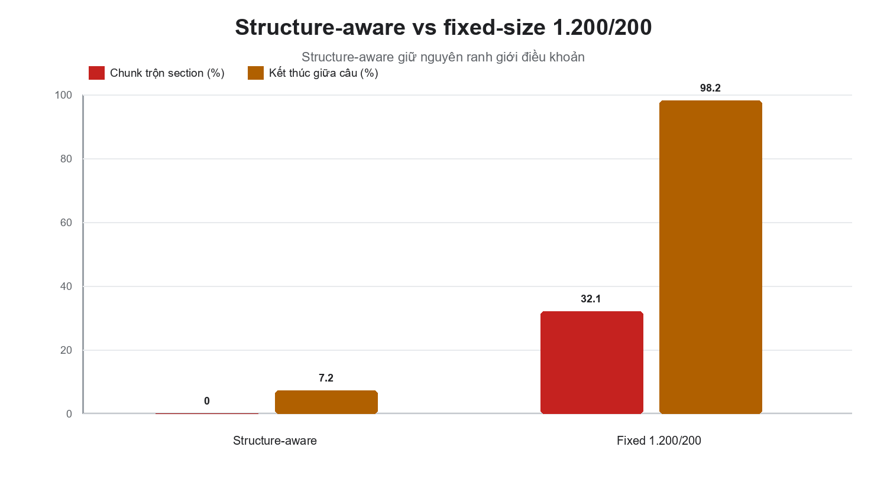

*Hình 4.3. Structure-aware giữ nguyên ranh giới section; fixed-size cắt giữa câu và trộn điều khoản.*

### 4.6.5. Phân tích kết quả

Kết quả cho thấy một điều quan trọng: **ít chunk hơn không có nghĩa là tốt hơn**.

- Fixed 1.200 tạo 112 chunk, ít hơn 40 chunk so với structure-aware, nhưng 32,1% chunk trộn hai section và 98,2% kết thúc giữa câu. Mỗi chunk “tiết kiệm” được vài trăm ký tự nhưng mất tính toàn vẹn pháp lý.
- Structure-aware tạo 152 chunk, nhiều hơn, nhưng **0% trộn section**. 7,2% kết thúc không phải dấu câu thường là chunk kết thúc bằng số thứ tự hoặc tiêu đề danh sách — chấp nhận được vì chunk kế tiếp bắt đầu cùng section.
- Fixed 1.500 tệ hơn 1.200 về cả hai tiêu chí: chunk dài hơn, trộn nhiều section hơn, và vẫn cắt giữa câu.

Đánh đổi: structure-aware tăng số vector (152 vs 112, +36%), nhưng cải thiện độ tinh khiết của ngữ cảnh. Trong RAG, một chunk nhiễu có thể làm sai toàn bộ câu trả lời; chi phí thêm 36% vector là chấp nhận được.

### 4.6.6. Hạn chế của thực nghiệm

- Chỉ đo trên một tài liệu; cần mở rộng nhiều loại văn bản.
- Tiêu chí “kết thúc giữa câu” là heuristic, không đo trực tiếp chất lượng câu trả lời.
- Chưa đo end-to-end retrieval/answer với fixed-size; đây là hướng tiếp theo.
- Chưa có ablation cho từng mức fallback (paragraph/sentence/character).

---

## 4.7. Tầng làm giàu metadata

### 4.7.1. Mô hình metadata ba nhóm

`MetadataEnricher` gắn metadata theo ba nhóm:

| Nhóm | Trường | Mục đích |
| :--- | :--- | :--- |
| A — Định danh & phả hệ | `document_id`, `version_id`, `page_start`, `page_end`, `section_path`, `section_type`, `chunk_type`, `is_current` | Truy vết, trích dẫn, lọc phiên bản |
| B — RAG | `document_type`, `language`, `char_count`, `token_count` | Lọc, thống kê, chọn ngữ cảnh |
| C — Doanh nghiệp/RBAC | `access_level`, `allowed_roles` | Phân quyền (dự kiến) |

### 4.7.2. Quy ước chunk ID

Offline:

> `DOC-001-CHUNK-0001`

Online:

> `doc-{documentId}-v{version}-c{index}`

Chunk ID cần:

- **Ổn định:** cùng một chunk qua các lần chạy phải cùng ID.
- **Duy nhất:** không trùng giữa tài liệu/phiên bản.
- **Có thể đọc:** nhìn vào biết thuộc tài liệu/phiên bản nào.

Đánh đổi: ID dài tốn dung lượng; nhưng với Qdrant, `chunk_id` là payload, không phải khóa chính, nên không ảnh hưởng nhiều.

### 4.7.3. Chuỗi truy vết

Từ một câu trả lời, có thể truy ngược:

```text
Answer
  → Citation (index, chunk_id, pages, section_path)
    → Qdrant point (payload: document_id, version_id, page_start, page_end)
      → PostgreSQL document_chunks (content, highlight_json)
        → document_versions (file_hash, storage_path)
          → PDF gốc (trang, tọa độ)
```

Đây là **provenance chain** — yếu tố biến một câu trả lời thành bằng chứng. Nếu thiếu bất kỳ mắt xích nào, người dùng không thể kiểm chứng.

### 4.7.4. Metadata chưa được khai thác

Hiện tại:

- `access_level` luôn `null`, `allowed_roles` luôn rỗng.
- `is_current` có trong payload nhưng retriever không lọc.
- `section_type` có thể null.

Đây là các điểm cần hoàn thiện:

1. Gán `access_level` theo tài liệu (public/internal/confidential).
2. Truyền role của người dùng vào filter Qdrant.
3. Lọc `is_current = true` mặc định.
4. Phân loại `section_type` (definition, procedure, policy, penalty).

---

## 4.8. Tầng biểu diễn vector

### 4.8.1. Mô hình nhúng

Mỗi chunk được mã hóa bằng `Multilingual-E5-Small` (384 chiều). Trước khi nhúng, văn bản được chuẩn hóa bằng `fold_text`:

- Chuẩn hóa Unicode NFD, bỏ dấu thanh.
- Chuyển `đ` → `d`.
- Chữ thường, nén khoảng trắng.

Lý do: OCR tiếng Việt thường mất dấu; chuẩn hóa cả query và tài liệu giúp cosine ổn định hơn. Đánh đổi: mất phân biệt một số cặp từ (“mã”/“má”), nhưng trong miền văn bản pháp lý, lợi ích lớn hơn.

### 4.8.2. Batch encoding

`EmbeddingService.embed_documents(texts, batch_size=32)` mã hóa theo batch:

- Giảm overhead gọi model.
- Kiểm soát RAM.
- Có thể chạy song song ở mức pipeline (nhiều worker) nhưng cần giới hạn CPU.

Với 152 chunk, thời gian nhúng khoảng vài giây đến vài chục giây trên CPU. Với 1 triệu chunk, cần pipeline phân tán hoặc GPU.

### 4.8.3. Lưu vector và payload

Qdrant point gồm:

- `id`: UUIDv5 từ `chunk_id`.
- `vector`: mảng 384 float.
- `payload`: metadata + content.

Point ID xác định đảm bảo idempotency. Payload chứa đủ thông tin để trả citation mà không cần join ngay.

### 4.8.4. Toán học tìm kiếm

Cosine:

> **Công thức 4.5.** $\text{cos}(q, d) = \frac{\sum_{i=1}^{384} q_i d_i}{\sqrt{\sum q_i^2}\sqrt{\sum d_i^2}}$

Qdrant dùng HNSW để tìm top-N xấp xỉ. Với 152 point, kết quả gần như chính xác; với hàng triệu point, HNSW đánh đổi một phần recall để giảm latency.

---

## 4.9. Tầng truy xuất lai

### 4.9.1. Vì sao không dùng vector search thuần

Vector search giỏi bắt ngữ nghĩa nhưng có ba điểm yếu trong miền pháp lý:

1. **Số điều không được embedding tốt.** Câu hỏi “Điều 43 quy định gì?” gần như không có tín hiệu ngữ nghĩa; model nhỏ có thể xếp đoạn nói về “quy định” lên trước đoạn thật.
2. **Từ khóa chốt bị chìm.** “mật khẩu”, “cổ tức”, “trẻ em” là các từ hiếm, quyết định đáp án; cosine của model nhỏ có thể làm chúng nằm ngoài top-60.
3. **Nhiễu OCR làm lệch vector.** Mất dấu, sai ký tự khiến embedding của đoạn đúng xa câu hỏi.

Vì vậy, kiến trúc dùng **truy xuất lai nhiều tầng**:

```text
Query
  → Embedding
  → Qdrant top-N (N = min(1000, max(top_k*20, 300)))
  → Dedup
  → Combined score = cosine + 0.9 × lexical + 0.45 × article_match
  → Cross-encoder rerank top-10
  → Answer windows + shape gate
  → IDF/bigram coverage
  → Window rerank
  → Selection + citation
```

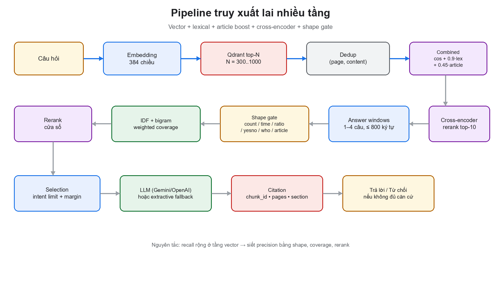

*Hình 4.4. Truy xuất lai: vector lo phần ngữ nghĩa, lexical/article boost giữ từ khóa chốt, cross-encoder và shape gate siết precision.*

### 4.9.2. Sinh ứng viên

`VectorRetriever.search` lấy:

> **Công thức 4.6.** $N = \min\left(1000, \max(20 \times k, 300)\right)$

với $k$ là số kết quả mong muốn. Với $k=3$, $N=300$; với $k=50$, $N=1000$. Lý do lấy dư:

- Cosine của model nhỏ có thể xếp đoạn đúng ngoài top-$k$.
- Bước rerank phía sau mới là nơi quyết định.
- Chi phí lấy 300 thay vì 30 không lớn với kho nhỏ.

### 4.9.3. Khử trùng lặp

Khóa dedup:

> **Công thức 4.7.** $\text{key} = (\text{page\_start}, \text{content})$

Nếu hai point có cùng trang bắt đầu và cùng nội dung (do overlap hoặc hai phiên bản), chỉ giữ point đầu. Cách này rẻ và xử lý được triệu chứng “top-5 toàn cùng một đoạn”. Hạn chế: hai đoạn khác nhau có thể cùng trang và cùng nội dung rất ngắn; hiếm.

### 4.9.4. Điểm lexical

Lexical score đo tỷ lệ token của query xuất hiện trong chunk:

> **Công thức 4.8.** $\text{lex}(q, d) = \frac{|\{t \in T(q) : t \in T(d)\}|}{|T(q)|}$

Trong đó $T(\cdot)$ là tập token duy nhất sau `fold_text`, chỉ giữ token dài ≥ 2 ký tự. Đây là **coverage**, không phải TF-IDF; nó thưởng cho chunk chứa nhiều từ khóa của câu hỏi, nhưng không phạt chunk dài.

Ví dụ:

- Query: “thời giờ làm việc của người lao động”
- Tokens: `{thoi, gio, lam, viec, cua, nguoi, lao, dong}` (sau khi bỏ stopwords? Trong retriever, `_tokens` không loại stopwords, chỉ loại token <2 ký tự; vì vậy “cua” vẫn được tính. Đây là điểm có thể cải tiến.)
- Chunk chứa 6/8 token → lex = 0.75.

### 4.9.5. Article boost

Nếu query chứa “Điều N” và chunk chứa “Điều N”, cộng thêm 0.45:

> **Công thức 4.9.** $\text{combined} = \cos(q,d) + 0.9 \times \text{lex}(q,d) + 0.45 \times \mathbb{1}[\text{article}(q,d)]$

Hệ số 0.9 và 0.45 được chọn thực nghiệm:

- 0.9 đủ để lexical lật thứ hạng khi cosine chênh lệch nhỏ, nhưng không át hoàn toàn ngữ nghĩa.
- 0.45 đủ để chunk đúng “Điều 43” vượt lên khi cosine của nó rất thấp (câu hỏi số điều gần như không có tín hiệu ngữ nghĩa).

Đây là **hybrid ở mức chunk**, trước khi rerank. Nó rẻ (chỉ cộng số) và giải quyết đúng điểm yếu của embedding nhỏ.

### 4.9.6. Cross-encoder rerank

Sau khi sắp xếp theo combined, lấy 10 ứng viên đầu và chấm lại bằng cross-encoder:

> **Công thức 4.10.** $s_{rerank}(q,d) = \text{CrossEncoder}(q, d[:800])$

Kết quả được sắp xếp lại theo `rerank_score`. Điểm combined vẫn được giữ trong `score` để dùng cho ngưỡng và chọn ứng viên.

Lưu ý: cross-encoder ở đây chấm **cả chunk** (tối đa 800 ký tự). Ở tầng sau, `RAGService` chấm lại **cửa sổ câu** (1–4 câu) để tránh nhiễu từ các phần không liên quan trong chunk dài. Đây là hai tầng rerank có mục đích khác nhau:

- Tầng 1: chọn chunk liên quan.
- Tầng 2: chọn câu trả lời trong chunk.

### 4.9.7. Ví dụ tính điểm

Giả sử query “Điều 43 quy định gì về cổ tức?”:

- Qdrant trả về chunk A (chứa “Điều 43. Trả cổ tức...”) với cosine 0.72.
- Lexical = 4/6 = 0.667.
- Article match = 1.
- Combined = 0.72 + 0.9×0.667 + 0.45 = 1.77.

Chunk B (nói chung về “quy định”, không có Điều 43) cosine 0.78, lexical 0.5, article 0:

- Combined = 0.78 + 0.45 = 1.23.

Nhờ article boost và lexical, chunk đúng vượt lên dù cosine thấp hơn. Đây chính là mục tiêu thiết kế.

### 4.9.8. Độ phức tạp và độ trễ

- Embedding query: $O(d \cdot L)$ với $L$ là độ dài query; thực tế vài ms đến vài chục ms trên CPU.
- Qdrant HNSW: $O(\log N)$ trung bình.
- Lexical: $O(|T(q)| \cdot |T(d)|)$ cho mỗi ứng viên; với 300 ứng viên, vài ms.
- Rerank 10 cặp: $O(10 \cdot L_q \cdot L_d)$; cross-encoder là phần tốn nhất, có thể 50–200 ms trên CPU.
- Tổng: thường dưới 1 giây cho kho nhỏ.

---

## 4.10. Tầng hiểu ý định và trích xuất câu trả lời

### 4.10.1. Vì sao cần answer shape

Một chunk có thể chứa từ khóa của câu hỏi nhưng không trả lời đúng **loại thông tin**. Ví dụ:

- Hỏi “Công ty có bao nhiêu cổ đông?” — chunk nói “cổ đông sở hữu ít nhất 10% có quyền ủy quyền...” có nhiều từ “cổ đông” nhưng không nêu số lượng.
- Hỏi “Nhiệm kỳ HĐQT bao lâu?” — chunk nói “cuộc họp đầu tiên trong bảy ngày” có “nhiệm kỳ” và “bảy ngày” nhưng trả lời sai ý.

`_answer_shape(query, content)` kiểm tra **dạng** câu trả lời. Đây là lớp chặn false-positive rẻ nhưng hiệu quả.

### 4.10.2. Các intent

| Intent | Khi nào | Kiểm tra |
| :--- | :--- | :--- |
| `meeting` | Query có “lần thứ nhất/hai/ba...” | Content phải có đúng ordinal |
| `article` | Query có “Điều N” | Content phải có “Điều N” |
| `ratio` | Query có “tỷ lệ”, “phần trăm”, “%” | Content có % gần anchor (cổ đông, biểu quyết, …) |
| `count` | Query có “bao nhiêu” + thực thể | Số đứng trước thực thể hoặc “số lượng ... là N” |
| `time` | Query có “bao lâu”, “khi nào”, “thời hạn” | Số + đơn vị thời gian gần anchor, hoặc “vô thời hạn” |
| `yesno` | Query có “có ... không”, “có phải”, “bắt buộc” | Động từ/trạng thái gần thực thể |
| `who` | Query có “ai”, “người nào” | Vai trò gần hành động (ký, quyết định, bổ nhiệm) |
| `default` | Câu hỏi mở | Độ phủ token ≥ 0.3 và có ít nhất một từ dài ≥ 4 ký tự |

Các intent đặc biệt:

- **`ratio` với nghị quyết ĐHĐCĐ:** phải lấy tỷ lệ thông thường (50%/65%), không lấy ngoại lệ “100% ngay cả khi trình tự vi phạm” hoặc tỷ lệ đề cử ứng viên.
- **`time` với “thời hạn hoạt động”:** phải là “vô thời hạn” hoặc số năm/tháng, không phải mọi câu có chữ “thời hạn”.
- **`count` với “cuộc họp”:** phải có “ít nhất/mỗi quý/mỗi năm” gần “họp”.
- **`yesno` với “kiểm toán”:** phải có “phải/bắt buộc kiểm toán”, không phải “thành viên Ủy ban Kiểm toán phải có kiến thức...”.

### 4.10.3. Cửa sổ câu trả lời

Một chunk 1.200 ký tự có thể chứa nhiều quy định. Chấm cả chunk làm câu đúng bị pha loãng. `_answer_windows` sinh các cửa sổ 1–4 câu:

> **Công thức 4.11.** $W = \{s_i \oplus s_{i+1} \oplus ... \oplus s_j : 1 \le j-i+1 \le 4, |W| \le 800\}$

Trong đó $s_i$ là câu thứ $i$ sau khi tách theo `.`, `!`, `?`, `;`, `:`. Mỗi cửa sổ được kiểm tra shape và độ phủ.

Ngoài ra, `_list_windows` sinh cửa sổ bắt đầu tại tiêu đề danh sách (ví dụ “QUY TRÌNH ĐÁNH GIÁ NHÀ CUNG CẤP”) để câu trả lời không chỉ trúng mục cuối.

### 4.10.4. Độ phủ có trọng số IDF

Không phải từ nào cũng quan trọng. “công ty”, “quy định” xuất hiện khắp nơi; “mật khẩu”, “cổ tức” hiếm và quyết định. Pipeline tính IDF thô trên tập ứng viên:

> **Công thức 4.12.** $w(t) = \log\left(\frac{N+1}{df(t)+1}\right) + 1$

với $N$ là số ứng viên, $df(t)$ là số ứng viên chứa $t$. Độ phủ có trọng số:

> **Công thức 4.13.** $\text{cov}_w(q, W) = \frac{\sum_{t \in T(q) \cap T(W)} w(t)}{\sum_{t \in T(q)} w(t)}$

Tương tự cho bigram:

> **Công thức 4.14.** $\text{cov}_{bigram}(q, W) = \frac{\sum_{b \in B(q) \cap B(W)} w(b)}{\sum_{b \in B(q)} w(b)}$

Bigram giúp phân biệt “thời giờ” với “thời hạn”, “cổ tức” với “cổ phần”. Đây là tín hiệu quan trọng trong tiếng Việt, nơi nhiều cụm hai âm tiết mang nghĩa khác hẳn từng từ.

### 4.10.5. Điểm trước rerank

> **Công thức 4.15.** $s_{pre} = 0.6 \times \text{cov}_w + 0.4 \times \text{cov}_{bigram} + 0.15 \times \min(\text{combined}, 1.2) + 0.10 \times \mathbb{1}[\text{shape} \ne \text{default}] + 0.20 \times \mathbb{1}[\text{list}]$

Ý nghĩa:

- 0.6/0.4: ưu tiên độ phủ từ và cụm từ.
- 0.15: tín hiệu vector/lexical, đã được chuẩn hóa.
- 0.10: thưởng cho câu trả lời đúng dạng (số, thời gian, có/không).
- 0.20: thưởng cho cửa sổ danh sách.

Mỗi chunk giữ tối đa 2 cửa sổ tốt nhất, cộng thêm cửa sổ danh sách. Sau đó lấy top 40 + tối đa 10 cửa sổ danh sách để rerank.

### 4.10.6. Điểm cuối và chọn lọc

Với câu hỏi có dạng rõ ràng (`intent != default`), điểm cuối là **rerank score**:

> **Công thức 4.16.** $s_{final} = s_{rerank}$

Với câu hỏi mở (`default`), cộng thêm tín hiệu cụm từ và vị trí:

> **Công thức 4.17.** $s_{final} = s_{rerank} + 1.2 \times \text{cov}_{bigram} + 0.4 \times \text{cov}_w + 1.5 \times \mathbb{1}[\text{list}] + 1.5 \times \mathbb{1}[\text{heading}]$

Trong đó `heading` = cửa sổ bắt đầu bằng “Điều/Chương/Mục + số”. Lý do: câu trả lời pháp lý thường bắt đầu bằng tiêu đề điều; ưu tiên cửa sổ này giúp citation đẹp và đúng ngữ cảnh.

Chọn lọc:

1. Nếu intent `default` và điểm tốt nhất < **-6.0** → không có ứng viên (từ chối).
2. Giới hạn số đoạn theo intent:

| Intent | Số đoạn tối đa |
| :--- | ---: |
| meeting, article, count, yesno, who | 1 |
| time, ratio | 2 |
| default | min(top_k, 3) |

3. “quyền hạn” → 1; “hoãn”/“thời hạn hoạt động” → 1.
4. Biên chọn: 2.5 cho default, 2.0 cho intent khác. Chỉ lấy các ứng viên có điểm ≥ best - margin.
5. Dedup theo `chunk_id`.

### 4.10.7. Ngưỡng và căn cứ thực nghiệm

Mã nguồn ghi nhận:

- Câu hỏi ngoài phạm vi có cosine 0.28–0.42; câu hỏi khớp thật thấp nhất ~0.53. Ngưỡng tham chiếu 0.5.
- Cross-encoder: câu hợp lệ -1.06..+9.86; câu ngoài phạm vi -1.68..-6.86. Ngưỡng -1.5 trong config; luồng `ask` dùng -6.0 cho câu mở.

Tuy nhiên, luồng hiện tại **không lọc cosine trước** (min_score=0.0) vì một đoạn đúng có thể chỉ đạt 0.24 nhưng khớp chính xác “cổ tức”. Thay vào đó:

- Lọc ứng viên yếu: `hit_score < 0.25` và không có article match → bỏ.
- Kiểm tra hình dạng câu trả lời.
- Kiểm tra độ phủ.
- Dùng rerank gate -6.0 cho câu mở.

Đây là triết lý **“recall trước, precision sau”**: lấy rộng ở tầng vector, siết ở tầng shape/rerank. Nếu lọc cosine sớm, đoạn đúng có cosine thấp sẽ mất trước khi có cơ hội được rerank.

### 4.10.8. Ví dụ: câu hỏi số lượng

Query: “Công ty có bao nhiêu thành viên Hội đồng Quản trị?”

1. Retrieval trả về nhiều chunk có “Hội đồng Quản trị”.
2. `_answer_shape` xác định `count`, yêu cầu số đứng trước “thành viên” hoặc “số lượng ... là N”.
3. Chunk đúng: “Hội đồng Quản trị có từ 03 đến 11 thành viên.” → count.
4. Chunk sai: “Cổ đông sở hữu ít nhất 10% ... có thể ủy quyền tối đa 03 Người đại diện.” → không có “thành viên” sau số → loại.
5. Cửa sổ đúng được chọn, citation trỏ đến điều khoản tương ứng.

Đây là ví dụ cho thấy **shape gate** giải quyết lỗi “đúng từ khóa, sai loại thông tin” mà vector search không giải quyết được.

---

## 4.11. Tầng sinh câu trả lời và trích dẫn

### 4.11.1. Prompt chống ảo giác

System prompt quy định:

1. Chỉ trả lời dựa trên ngữ cảnh được cung cấp.
2. Nếu không đủ thông tin, trả lời “chưa tìm thấy”.
3. Mọi khẳng định phải gắn nhãn `[1]`, `[2]` tương ứng đoạn nguồn.
4. Trình bày ngắn gọn, tiếng Việt chuẩn mực.

Prompt không đủ để chống ảo giác; nó chỉ là lớp cuối. Các lớp trước (retrieval gate, shape, rerank, extractive fallback) mới là yếu tố quyết định.

### 4.11.2. Định dạng ngữ cảnh

Mỗi đoạn trong context:

```text
[1] Vị trí: Trang 12 → 13 | Phả hệ: CHƯƠNG VII > Điều 39
Nội dung: ...
```

`Vị trí` giúp LLM biết trang; `Phả hệ` giúp biết điều/chương. Nếu section_path rỗng, dùng “Văn bản chung”.

### 4.11.3. Citation object

Mỗi citation gồm:

| Trường | Ý nghĩa |
| :--- | :--- |
| `index` | Số thứ tự [1], [2] |
| `chunk_id` | Mã chunk |
| `score` | Điểm chọn |
| `document_id` | Tài liệu |
| `section_path` | Đường dẫn mục |
| `pages` | “Trang X” hoặc “Trang X → Y” |
| `snippet` | Trích đoạn tối đa 500 ký tự |

Snippet được cắt tại khoảng trắng gần 500 ký tự nhất, thêm “…” để không cắt giữa từ.

### 4.11.4. Extractive fallback

Nếu không có LLM hoặc LLM lỗi:

- Nếu không có hit/citation → trả lời từ chối.
- Nếu có → trả về các đoạn trích tốt nhất, mỗi đoạn kèm vị trí và citation.

Ví dụ:

```text
Theo quy định tại **Trang 12** [1]:

> Điều 39. Chủ tịch Hội đồng Quản trị có các quyền...

*(Thông tin được trích xuất trực tiếp từ tài liệu đã lập chỉ mục)*
```

Fallback đảm bảo hệ thống vẫn hữu ích khi chưa cấu hình API key hoặc mất mạng. Nó cũng là “chốt an toàn” chống ảo giác: không có LLM thì không thể bịa.

### 4.11.5. Từ chối khi không đủ căn cứ

Điều kiện từ chối:

- Không có ứng viên sau shape/coverage.
- Câu mở có điểm < -6.0.
- Từ dài nhất của query không xuất hiện trong bất kỳ ứng viên nào (ví dụ “pizza”) → loại tất cả.
- Không có citation sau khi chọn.

Câu trả lời từ chối:

> “Dựa trên các tài liệu nội bộ hiện tại, tôi chưa tìm thấy thông tin phù hợp với câu hỏi này.”

Đây là hành vi đúng: thà từ chối còn hơn trả lời sai trong miền pháp lý.

---

## 4.12. Đánh giá truy xuất trên kho vector

### 4.12.1. Thống kê corpus

| Chỉ số | Giá trị |
| :--- | ---: |
| Tài liệu | Điều lệ Công ty (39 trang) |
| Số chunk | 152 |
| Tổng ký tự | 111.241 |
| Trung bình | 731,8 ký tự |
| Trung vị | 795 |
| Ngắn nhất | 52 |
| Dài nhất | 1.353 |
| Số section path | 33 |
| Khoảng trang | 4–40 |

Phân bố section path cho thấy chunk tập trung ở các chương lớn:

| Số chunk | Section path |
| ---: | :--- |
| 22 | CHƯƠNG VI CỔ ĐÔNG VÀ ĐẠI HỘI ĐỒNG CỔ ĐÔNG > Điều 39... |
| 21 | CHƯƠNG VII HỘI ĐỒNG QUẢN TRỊ... > Điều 39... |
| 16 | CHƯƠNG VI CỔ ĐÔNG VÀ ĐẠI HỘI ĐỒNG CỔ ĐÔNG |
| 15 | CHƯƠNG VI ... > C. Tạo điều kiện cho Cổ đông... |
| 11 | CHƯƠNG VII HỘI ĐỒNG QUẢN TRỊ... |

Điều này phản ánh đặc điểm văn bản: các chương về cổ đông và HĐQT dài, nhiều điều khoản; các chương khác ngắn hơn.

### 4.12.2. Kết quả truy xuất

Từ chương Học sâu:

| Mô hình | Recall@1 | Recall@3 | MRR |
| :--- | ---: | ---: | ---: |
| E5-Small | 80% | **100%** | **0,90** |
| Vietnamese-Bi-Encoder | 80% | 80% | 0,80 |
| MiniLM | 60% | 80% | 0,6667 |

Với 5 câu hỏi, E5 đưa đáp án vào top-3 cho cả 5. Đây là mức tối thiểu để RAG hoạt động: nếu đáp án ngoài top-3, LLM không có cơ hội thấy nó.

### 4.12.3. Kiểm thử answer gate

Bộ 15 test trong `tests/test_answer_gate.py` bao phủ:

- Từ chối khi không có hit.
- Trích xuất bắt đầu đúng câu, giữ tiêu đề điều, nối dòng OCR, dừng trước chương mới.
- Count: từ chối quyền cổ đông, chấp nhận số thành viên HĐQT.
- Time: chấp nhận nhiệm kỳ, từ chối thời hạn họp; chấp nhận thời gian hoãn đúng.
- Meeting: từ chối lần thứ hai khi hỏi lần thứ ba.
- Yes/no: từ chối kiểm toán ủy ban, chấp nhận bắt buộc kiểm toán; chấp nhận cho vay có phê duyệt.
- Who: chấp nhận Tổng Giám đốc ký hợp đồng.
- Default: từ chối câu ngoài phạm vi (“pizza”).

Các test này là **hồi quy logic**, không phải đánh giá end-to-end. Chúng đảm bảo các quy tắc shape không bị vô hiệu khi sửa code.

### 4.12.4. Phân tích lỗi

| Nhóm lỗi | Ví dụ | Nguyên nhân | Giảm thiểu |
| :--- | :--- | :--- | :--- |
| OCR mất dấu | “Điều” → “Diều” | Scan chất lượng thấp | Font converter, fold_text, regex biến thể |
| Section path sai | Điều 39 nằm dưới Chương VI thay vì VII | Heading detection nhầm | Cải thiện heading, kiểm tra thủ công |
| Trộn phiên bản | Hai bản cùng tài liệu | Chưa xóa vector cũ kịp | Dedup, filter is_current, alias |
| Cắt giữa câu | Chunk kết thúc “...trừ trường hợp” | Fallback character | Tăng chunk_size, ưu tiên sentence |
| Cosine nhiễu | Đoạn “quy định chung” điểm cao | Model nhỏ | Lexical, article boost, rerank |
| Intent sai | Hỏi “bao nhiêu” nhưng trả lời quyền | Shape gate chưa phủ | Bổ sung pattern, test |
| Cửa sổ cắt mất ngoại lệ | Chỉ lấy câu đầu | Max 4 câu/800 ký tự | Tăng cửa sổ, lấy câu sau |
| LLM bịa | Số liệu không có trong context | Prompt yếu | Temperature 0.2, extractive fallback, citation check |

### 4.12.5. Hạn chế của đánh giá

- **Mẫu nhỏ:** 5 câu hỏi, một tài liệu; chưa đủ kết luận thống kê.
- **Chưa có RAGAS/faithfulness:** chưa đo mức độ trung thành của câu trả lời với ngữ cảnh.
- **Chưa có người dùng thật:** chưa đo mức hài lòng, thời gian tiết kiệm.
- **Chưa có multi-hop:** câu hỏi cần tổng hợp nhiều điều khoản chưa được đánh giá.
- **Chưa có đánh giá đa ngôn ngữ:** corpus chỉ tiếng Việt.

---

## 4.13. Đồ thị tri thức Neo4j: KB1, KB2 và KB hợp nhất

### 4.13.1. Vì sao cần đồ thị tri thức

Kho vector trả lời tốt câu hỏi "đoạn nào nói về X". Nó yếu ở bốn loại yêu cầu mà văn bản quản trị doanh nghiệp đặt ra:

- **Quan hệ giữa điều khoản:** "Điều 27 dẫn chiếu những điều nào?"
- **Thực thể xuyên tài liệu:** "Những tài liệu nào quy định về Ủy ban Kiểm toán?"
- **Lịch sử và phiên bản:** "Vốn điều lệ thay đổi qua những lần sửa đổi nào, giá trị hiện hành là bao nhiêu?"
- **Nguồn gốc và độ tin cậy:** "Thông tin này đến từ văn bản chính thức hay trang web công khai, có mâu thuẫn với nguồn khác không?"

Đồ thị tri thức (Knowledge Graph, KG) biểu diễn thực thể và quan hệ một cách tường minh, nên trả lời được bốn loại yêu cầu trên bằng cách duyệt đường đi [Neo4j, *How to Build a Knowledge Graph*]. Trong EAKWP, đồ thị không thay thế kho vector mà là đường truy xuất thứ hai: vector tìm đoạn văn giống câu hỏi, đồ thị tìm đoạn văn có cùng thực thể, cùng quan hệ, và biết đoạn nào còn hiệu lực.

### 4.13.2. Kiến trúc KB1, KB2 và KB hợp nhất

Tri thức được chia thành hai kho nguồn và một kho hợp nhất:

- **KB1, kho tài liệu nghiệp vụ:** 35 tệp PDF (Điều lệ, phụ lục sửa đổi, quy chế, quy trình, chính sách nhân sự), nạp offline bằng script.
- **KB2, kho nguồn công khai:** 10 trang web chính thức của doanh nghiệp, nạp offline bằng script.
- **Tài liệu upload:** 7 tài liệu người dùng tải lên qua giao diện, đồng bộ trực tiếp vào KB khi nạp (mục 5.3.3).
- **KB, kho hợp nhất:** gom tất cả tài liệu trên dưới một nút `KnowledgeBase`. KB không sao chép dữ liệu, chỉ thêm cạnh thành viên `HAS_DOCUMENT`.

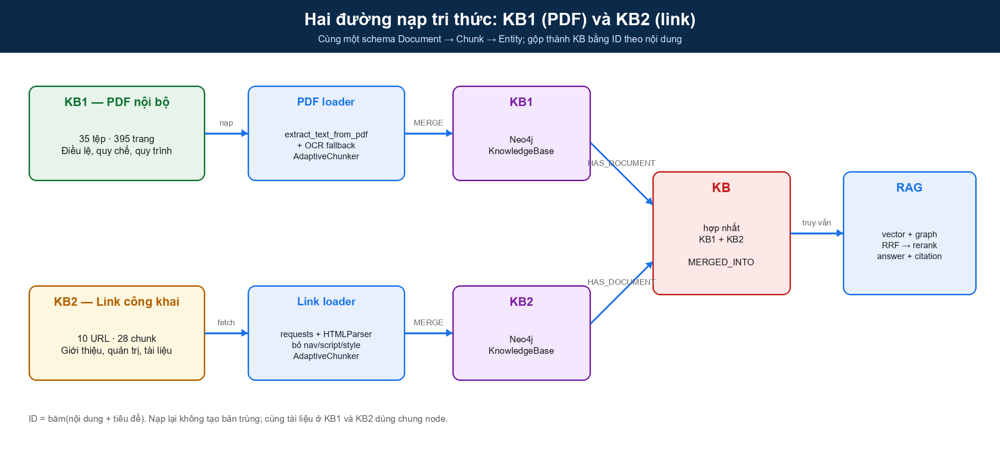

*Hình 4.5. Hai đường nạp PDF/link vào KB1/KB2, gộp thành KB và nối vào RAG.*

| Thành phần | Nguồn | Tài liệu | Chunk | Ghi chú |
| :--- | :--- | ---: | ---: | :--- |
| KB1 | PDF nội bộ (395 trang, 112,2 MB) | 35 | 1.313 | Nạp bằng `10_build_neo4j_kb.py --pdf` |
| KB2 | 10 link công khai | 10 | 31 | Nạp bằng `10_build_neo4j_kb.py --links` |
| Upload | Tài liệu người dùng tải lên | 7 | 321 | Đồng bộ qua `POST /api/v1/ingest` |
| **KB** | **Hợp nhất** | **52** | **1.665** | 291 thực thể; đếm bằng `06_quality.cypher` ngày 15/11/2026 |

*Bảng 4.10. Quy mô các kho tri thức trong Neo4j.*

ID của Document, Chunk và Entity được sinh từ **nội dung** (băm SHA-1), không từ thứ tự nạp. Nạp lại cùng tài liệu không tạo node mới, và một tài liệu thuộc cả KB1 lẫn KB vẫn chỉ có một node.

### 4.13.3. Nguồn dữ liệu

#### a) Tổng hợp PDF theo nhóm

| Nhóm | Số tệp | Số trang | Dung lượng | Nội dung chính |
| :--- | ---: | ---: | ---: | :--- |
| Điều lệ công ty | 3 | 121 | 29,05 MB | Điều lệ 2021, 2025, 2026 |
| Phụ lục sửa đổi điều lệ | 22 | 72 | 9,41 MB | Các lần sửa đổi 2012–2024 |
| Nhân sự và lao động | 3 | 53 | 19,32 MB | Chính sách nhân quyền, nội quy, thỏa ước lao động |
| Quy chế và quy trình | 7 | 149 | 49,21 MB | Quản trị công ty, quản trị rủi ro, an ninh thông tin, HĐQT, nhà cung cấp, khiếu nại, xử lý vụ việc |
| **Tổng** | **35** | **395** | **112,2 MB** | |

*Bảng 4.11. Kho PDF của KB1. Danh mục đầy đủ 35 tệp ở Phụ lục và `assets/source_inventory.json`.*

#### b) Mười link của KB2

| # | Nhóm | Link |
| ---: | :--- | :--- |
| 1 | Doanh nghiệp | `masanconsumer.com/ve-masan-consumer/gioi-thieu-chung/` |
| 2 | Quản trị | `masanconsumer.com/quan-he-co-dong/gioi-thieu/` |
| 3 | Quản trị | `masanconsumer.com/quan-he-co-dong/cong-bo-thong-tin/thong-tin-cong-bo/` |
| 4 | Quản trị | `masanconsumer.com/quan-he-co-dong/bao-cao-thuong-nien/` |
| 5 | Quản trị | `masanconsumer.com/quan-he-co-dong/dai-hoi-dong-co-dong/` |
| 6 | Tài chính | `masanconsumer.com/quan-he-co-dong/thong-tin-tai-chinh/` |
| 7 | Tài liệu | `masanconsumer.com/tai-lieu-doanh-nghiep/` |
| 8 | Bền vững | `masanconsumer.com/phat-trien-ben-vung/quan-tri/` |
| 9 | Tin tức | `masanconsumer.com/tin-tuc/thong-cao-bao-chi/` |
| 10 | Tài liệu | `masanconsumer.com/tai-lieu/` |

*Bảng 4.12. Nguồn web của KB2 (`ai-service/data/kb_sources/links.json`).*

### 4.13.4. Mô hình đồ thị

Mô hình là **đồ thị thuộc tính có nhãn** (Labeled Property Graph, LPG): node có nhãn và thuộc tính, cạnh có kiểu, hướng và thuộc tính. So với RDF, LPG gắn được thuộc tính lên cạnh, nên lưu được trực tiếp độ tin cậy của một phép trích xuất (`MENTIONS.confidence`) hay lý do giải quyết mâu thuẫn (`CONFLICTS_WITH.reason`).

| Nhãn node | Thuộc tính chính | Ý nghĩa |
| :--- | :--- | :--- |
| `KnowledgeBase` | `kb_id`, `name`, `updated_at` | KB1, KB2, KB |
| `Document` | `doc_id`, `title`, `source_uri`, `source_type`, `content_hash`, `version`, `is_current`, `source_trust`, `effective_date`, `duplicate_of` | Một tệp PDF, một trang web hoặc một tài liệu upload |
| `Chunk` | `chunk_id`, `text`, `page_start`, `page_end`, `section_path`, `content_hash` | Đơn vị truy xuất và trích dẫn |
| `Entity` | `entity_id`, `name`, `type`, `description`, `embedding` | Điều khoản, chức danh, chủ đề, văn bản pháp luật, mốc thời gian, tiêu đề mục |
| `Claim` | `attribute`, `value`, `status`, `confidence`, `flags` | Một dữ kiện số do một đoạn văn khẳng định |
| `IngestRun` | `run_id`, `source`, `inserted`, `skipped`, `new_version`, `retired` | Nhật ký một lần cập nhật KB |

*Bảng 4.13. Các nhãn node.*

| Cạnh | Từ → Đến | Ý nghĩa |
| :--- | :--- | :--- |
| `HAS_DOCUMENT`, `HAS_CHUNK` | KB → Document → Chunk | Cấu trúc chứa |
| `MERGED_INTO` | KB nguồn → KB đích | Nguồn gốc của kho hợp nhất |
| `MENTIONS {confidence, method}` | Chunk → Entity | Đoạn nhắc thực thể, kèm độ tin cậy |
| `APPLIES_TO` | Chunk → Entity | Thực thể là chủ đề của mục chứa đoạn |
| `REFERENCES` | Chunk → Chunk | Điều khoản dẫn chiếu điều khoản khác |
| `RELATES_TO {weight, confidence}` | Entity – Entity | Hai thực thể cùng xuất hiện trong đoạn |
| `SAME_AS`, `POSSIBLY_SAME_AS {score, membership}` | Entity – Entity | Hợp nhất thực thể mờ (mục 4.15.6) |
| `NEW_VERSION_OF` | Document → Document | Phiên bản mới thay bản cũ |
| `DUPLICATE_OF`, `SIMILAR_TO {overlap}` | Document → Document | Trùng lặp, gần trùng (mục 4.15.2) |
| `ASSERTS`, `ABOUT`, `CONFLICTS_WITH {reason}` | Chunk → Claim → Entity, Claim → Claim | Dữ kiện và mâu thuẫn (mục 4.15.7) |
| `UPDATED` | IngestRun → KB | Lần cập nhật nào đã sửa kho nào |

*Bảng 4.14. Các kiểu cạnh.*

Hình 4.6 là lược đồ do chính Neo4j sinh ra (`CALL db.schema.visualization()`) trên cơ sở dữ liệu sau khi đã xử lý tích hợp: sáu nhãn node và mười bốn kiểu quan hệ.

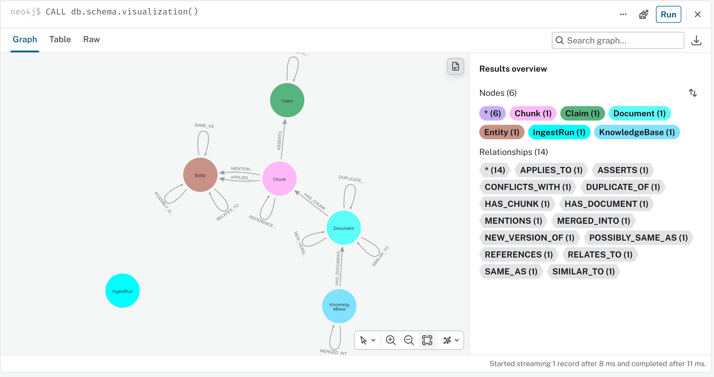

*Hình 4.6. Lược đồ đồ thị tri thức trong Neo4j Browser: 6 nhãn node, 14 kiểu quan hệ.*

## 4.14. Mã Cypher của KB và đường nạp dữ liệu

### 4.14.1. Tổ chức mã Cypher thành tệp .cypher

Toàn bộ truy vấn của KB được viết trong bảy tệp `.cypher`, tách khỏi mã Python, theo đúng thứ tự vòng đời của dữ liệu:

| Tệp | Số truy vấn | Nội dung |
| :--- | ---: | :--- |
| `01_schema.cypher` | 2 khối | 6 ràng buộc duy nhất, 7 chỉ mục (gồm chỉ mục vector 384 chiều cho Entity) |
| `02_ingest.cypher` | 5 | Ghi Document, Chunk, Entity, MENTIONS, REFERENCES, APPLIES_TO; lan truyền sang KB đã gộp |
| `03_merge_and_resolve.cypher` | 17 | Gộp KB; trùng lặp; chuỗi phiên bản; hợp nhất thực thể; trọng số quan hệ; dữ kiện và mâu thuẫn |
| `04_update.cypher` | 10 | Tìm bản hiện hành, thay thế, nối phiên bản, loại nguồn đã xóa, nhật ký, xóa |
| `05_retrieval.cypher` | 9 | Truy xuất cho RAG, tra dữ kiện, thống kê |
| `06_quality.cypher` | 7 | Chỉ số đánh giá KB (mục 4.18) |
| `07_explore.cypher` | 9 (không đặt tên) | Truy vấn minh họa để chạy trong Neo4j Browser |

*Bảng 4.15. Các tệp Cypher trong `ai-service/app/knowledge_graph/cypher/`.*

Mỗi truy vấn mở đầu bằng dòng đánh dấu tên và kết thúc bằng dấu `;`, nên cùng một tệp vừa chạy được trong `cypher-shell` hay Neo4j Browser, vừa được Python nạp theo tên:

```cypher
// ai-service/app/knowledge_graph/cypher/01_schema.cypher (dòng 20-26)
// :name CONSTRAINTS
CREATE CONSTRAINT kb_id IF NOT EXISTS FOR (k:KnowledgeBase) REQUIRE k.kb_id IS UNIQUE;
CREATE CONSTRAINT doc_id IF NOT EXISTS FOR (d:Document) REQUIRE d.doc_id IS UNIQUE;
CREATE CONSTRAINT chunk_id IF NOT EXISTS FOR (c:Chunk) REQUIRE c.chunk_id IS UNIQUE;
CREATE CONSTRAINT entity_id IF NOT EXISTS FOR (e:Entity) REQUIRE e.entity_id IS UNIQUE;
CREATE CONSTRAINT claim_id IF NOT EXISTS FOR (c:Claim) REQUIRE c.claim_id IS UNIQUE;
CREATE CONSTRAINT run_id IF NOT EXISTS FOR (r:IngestRun) REQUIRE r.run_id IS UNIQUE;
```

Bộ nạp đọc các khối theo dòng đánh dấu. Một tên trùng hoặc một truy vấn bắt buộc bị thiếu sẽ làm dịch vụ dừng ngay khi khởi động, thay vì lỗi lúc chạy:

```python
# ai-service/app/knowledge_graph/cypher_loader.py (hàm parse, dòng 26-37)
markers = list(_MARKER.finditer(text))                  # "// :name TEN_TRUY_VAN"
for index, marker in enumerate(markers):
    end = markers[index + 1].start() if index + 1 < len(markers) else len(text)
    body = _strip_comments(text[marker.end():end])
    name = marker.group(1)
    if name in queries:
        raise ValueError(f"Duplicate Cypher query name: {name}")
    queries[name] = body.rstrip().rstrip(";").rstrip()
```

### 4.14.2. Nạp PDF vào KB1

Đường nạp PDF gồm bốn bước: trích văn bản (lớp văn bản, OCR khi là bản quét), dựng cây mục theo Chương/Điều, phân đoạn bằng `AdaptiveChunker` (mục 4.6), rồi trích thực thể và ghi vào Neo4j.

```python
# ai-service/app/knowledge_graph/extract.py (build_record_from_pages, rút gọn)
full_text = "\n".join(p.get("text", "") for p in pages)
content_hash = sha1_text(full_text)                       # nhận diện phiên bản
doc_id = document_id(content_hash, title)                 # ID theo nội dung
date, date_source = effective_date(title, full_text)      # ngày hiệu lực (mục 4.15.3)
chunks = chunker.chunk_nodes(pages_to_nodes(pages))       # cây mục -> chunk
for index, chunk in enumerate(chunks, start=1):
    entities = extract_entities(chunk.content)            # kèm confidence, method
link_chunks(chunk_records)                                # APPLIES_TO, REFERENCES
```

Mỗi tài liệu được ghi bằng một truy vấn `MERGE`, nên nạp lại không tạo node trùng:

```cypher
// ai-service/app/knowledge_graph/cypher/02_ingest.cypher (UPSERT_DOCUMENT, rút gọn)
MERGE (kb:KnowledgeBase {kb_id: $kb_id})
MERGE (d:Document {doc_id: $doc.doc_id}) ON CREATE SET d.ingested_at = datetime()
SET d += $doc
MERGE (kb)-[:HAS_DOCUMENT]->(d)
WITH d UNWIND $chunks AS c
MERGE (ch:Chunk {chunk_id: c.chunk_id})
SET ch.text = c.text, ch.page_start = c.page_start, ch.section_path = c.section_path
MERGE (d)-[:HAS_CHUNK]->(ch);
```

Lệnh chạy: `python scripts/10_build_neo4j_kb.py --pdf data/documents --kb KB1 --update --prune`.

### 4.14.3. Nạp link vào KB2

Trang web đi qua cùng bộ phân đoạn và trích thực thể như PDF, nên hai nguồn có **cùng một lược đồ đầu ra**. Khác biệt duy nhất là bước lấy văn bản:

```python
# ai-service/app/knowledge_graph/extract.py (build_link_record)
def build_link_record(url, html=None, title=None):
    html = html if html is not None else fetch_html(url)   # requests + header trình duyệt
    page_title, text = html_to_text(html)                  # bỏ nav, header, footer, script
    if not text:
        raise ValueError(f"Trang không có nội dung văn bản: {url}")
    return build_record_from_pages(title=title or page_title, source_uri=url,
                                   source_type="web", pages=[{"page": 1, "text": text}])
```

Trang `masanconsumer.com` chặn thư viện `httpx` và User-Agent đơn lẻ (HTTP 403), nên `fetch_html` dùng `requests` với bộ header trình duyệt đầy đủ. Lần nạp đầu khai báo nén `br` mà `requests` không giải mã được, khiến 267 chunk KB2 là dữ liệu nhị phân. Lỗi được phát hiện nhờ đọc thử nội dung chunk sau khi nạp, không phải nhờ đếm số lượng. Lệnh chạy: `python scripts/10_build_neo4j_kb.py --links data/kb_sources/links.json --kb KB2`.

### 4.14.4. Gộp KB1 và KB2 thành KB

Gộp không sao chép node mà chỉ thêm cạnh thành viên. Vì ID theo nội dung, một tài liệu có trong cả KB1 và KB2 vẫn chỉ có một cạnh tới KB:

```cypher
// ai-service/app/knowledge_graph/cypher/03_merge_and_resolve.cypher (MERGE_KBS)
MERGE (target:KnowledgeBase {kb_id: $target})
WITH target UNWIND $sources AS sid
MATCH (src:KnowledgeBase {kb_id: sid})
MERGE (src)-[:MERGED_INTO]->(target)
WITH DISTINCT target
MATCH (src:KnowledgeBase)-[:HAS_DOCUMENT]->(d:Document) WHERE src.kb_id IN $sources
MERGE (target)-[:HAS_DOCUMENT]->(d)
RETURN count(DISTINCT d) AS documents;
```

Sau khi gộp, tài liệu mới nạp vào KB1 hoặc KB2 tự xuất hiện trong KB nhờ truy vấn `PROPAGATE_TO_MERGED` chạy cuối mỗi lần ghi: nó đi theo cạnh `MERGED_INTO` để nối tài liệu vào mọi KB đích. Không cần chạy gộp lại sau mỗi lần cập nhật.

### 4.14.5. Trực quan hóa trên Neo4j Browser

Kết quả gộp được kiểm tra trực tiếp trên Neo4j Browser. Hình 4.7 cho thấy KB hợp nhất có 52 tài liệu, trong đó 44 tài liệu đang được truy xuất (đã loại 7 bản trùng và 1 phiên bản cũ của Điều lệ). Cột `dang_dung` là kết quả của các bước xử lý ở mục 4.15.

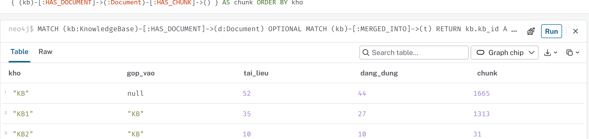

*Hình 4.7. Số tài liệu và chunk của KB1, KB2 và KB hợp nhất (truy vấn trên Neo4j Browser).*

Hình 4.8 là đồ thị một tài liệu cụ thể: nút xanh lá là Document, nút hồng là các Chunk 28–33 của Quy chế hoạt động HĐQT, nút nâu là các Entity mà những chunk đó nhắc đến.

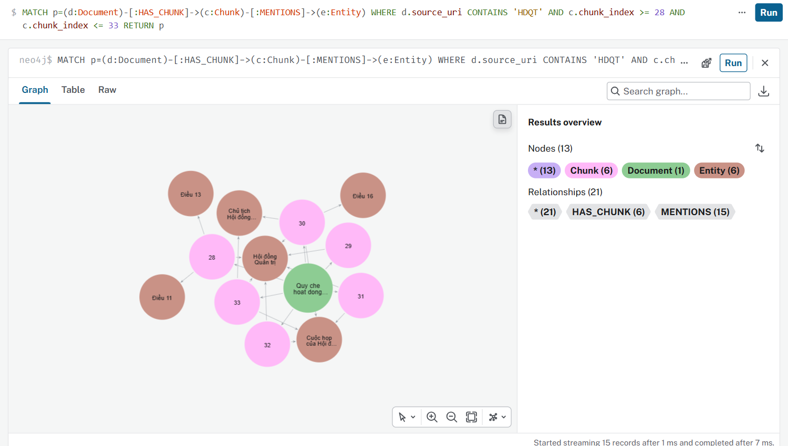

*Hình 4.8. Đồ thị Document → Chunk → Entity của Quy chế hoạt động HĐQT trong Neo4j Browser.*

## 4.15. Các vấn đề khi tích hợp nhiều nguồn và cách đồ án xử lý

### 4.15.1. Tổng quan

Khi gộp 35 PDF, 10 trang web và 7 tài liệu upload vào một KB, nhóm gặp bảy vấn đề. Cả bảy đều được phát hiện trên dữ liệu thật, không phải giả định:

| Vấn đề | Ví dụ thật trong kho | Cơ chế xử lý | Mã nguồn | Kết quả |
| :--- | :--- | :--- | :--- | :--- |
| Trùng lặp tài liệu | `Dieu le cong ty 2021` (PDF) và `Điều lệ công ty - 2021` (upload) | So độ chồng lấn shingle, hai ngưỡng | `consistency.find_duplicates` | 7 bản trùng bị ẩn, 10 cặp gần trùng được ghi nhận |
| Nhiều phiên bản | Điều lệ 2021, 2025, 2026 là ba tệp riêng | Khóa chuỗi văn bản + ngày hiệu lực | `consistency.find_series` | 2 cạnh `NEW_VERSION_OF`, 2 bản cũ hết hiệu lực |
| Song ngữ Anh–Việt | "Board of Directors", "employees", "Information Security" trong chính sách an ninh thông tin | Alias tiếng Anh ánh xạ về thực thể tiếng Việt | `extract.ENGLISH_ALIASES` | 47 lượt nhắc tiếng Anh, 9 thực thể |
| Nhiễu OCR | "Vôn Điều Lệ", "cô phân", "Tông Giám đốc" | Khớp không dấu, độ tin cậy thấp hơn | `extract._ALIAS_RULES` | 558 lượt nhắc khớp không dấu, độ tin cậy 0,6 |
| Không chắc chắn | Viết tắt "TGĐ", tiêu đề rút từ mục lục | Độ tin cậy theo phương pháp trích xuất | `extract.CONFIDENCE` | Mọi cạnh `MENTIONS` có `confidence` |
| Mờ | "Vẫn điều lệ, cổ phần…" và "Vôn điều lệ, cô phân…" | Hợp nhất thực thể bằng hàm thuộc | `resolve.resolve_pairs` | 8 cặp `SAME_AS`, 13 cặp chờ duyệt |
| Mâu thuẫn | Vốn điều lệ: 13 giá trị khác nhau từ 2012 đến 2026 | Trích dữ kiện + 4 luật ưu tiên | `consistency.resolve_conflicts` | Chọn đúng giá trị Điều lệ 2026, 0 dữ kiện chưa phân định |

*Bảng 4.16. Bảy vấn đề tích hợp và cách xử lý.*

Toàn bộ các bước xử lý chạy bằng một lệnh, có thể chạy lại nhiều lần mà không tạo trùng (mỗi bước xóa kết quả cũ của chính nó rồi ghi lại, trừ các quyết định do người duyệt):

```python
# ai-service/app/knowledge_graph/pipeline.py (hàm maintain, rút gọn)
docs = store.document_texts()
store.write_duplicates(consistency.find_duplicates(docs))          # (1) trùng lặp
store.write_series(consistency.find_series(docs))                  # (2) phiên bản
entities = store.resolution_candidates(resolve.RESOLVABLE_TYPES)
store.write_entity_resolution(resolve.resolve_pairs(entities, manual=store.manual_decisions()))
store.recompute_relation_weights()                                 # độ tin cậy quan hệ
claims = [c for chunk in chunks for c in consistency.extract_claims(chunk)]
store.write_claims(*consistency.resolve_conflicts(claims))         # (7) mâu thuẫn
```

Lệnh chạy: `python scripts/10_build_neo4j_kb.py --maintain`. Báo cáo chi tiết được ghi ra `debug/kb_maintenance.json`.

### 4.15.2. Trùng lặp tài liệu

Cùng một văn bản có thể vào KB hai lần: một lần qua kho PDF offline (KB1), một lần do người dùng tải lên. Hai bản có `doc_id` khác nhau vì đi qua hai bộ phân tích khác nhau, nên ID theo nội dung không phát hiện được.

Mỗi tài liệu được biểu diễn bằng tập **shingle**, tức các cụm 5 từ liên tiếp sau khi bỏ dấu. Độ chồng lấn đo bằng tỷ lệ chứa của tập nhỏ hơn:

> **Công thức 4.10.** $\text{overlap}(A, B) = \dfrac{|S(A) \cap S(B)|}{\min(|S(A)|, |S(B)|)}$

Phân loại dùng hai ngưỡng:

- $\text{overlap} \ge 0{,}95$: **trùng lặp** (`DUPLICATE_OF`). Bản bị trùng được ẩn khỏi truy xuất (`duplicate_of` khác rỗng). Bản được giữ lại theo thứ tự: bản upload (mở được trong trình xem PDF) → bản hiện hành → nguồn tin cậy hơn → bản dài hơn.
- $0{,}8 \le \text{overlap} < 0{,}95$: **gần trùng** (`SIMILAR_TO`). Chỉ ghi nhận, hai tài liệu vẫn được truy xuất.

Ngưỡng 0,95 được chọn sau một lần chạy sai: với ngưỡng đơn 0,8, Điều lệ 2025 (0,884) và Điều lệ 2026 (0,861) bị coi là bản trùng của Điều lệ 2021 và bị ẩn. Thực ra đây là các phiên bản khác nhau, chung phần lớn điều khoản. Hậu quả là vốn điều lệ 10.623 tỷ của Điều lệ 2025 không được trích ra. Tách thành hai ngưỡng sửa được lỗi này.

Kết quả trên KB: 7 cặp trùng lặp, đều là cặp "PDF offline – bản upload" của cùng một văn bản, độ chồng lấn từ 0,989 đến 1,0. Ngoài ra có 10 cặp gần trùng, đều thuộc nhóm Điều lệ và phụ lục (0,83–0,91).

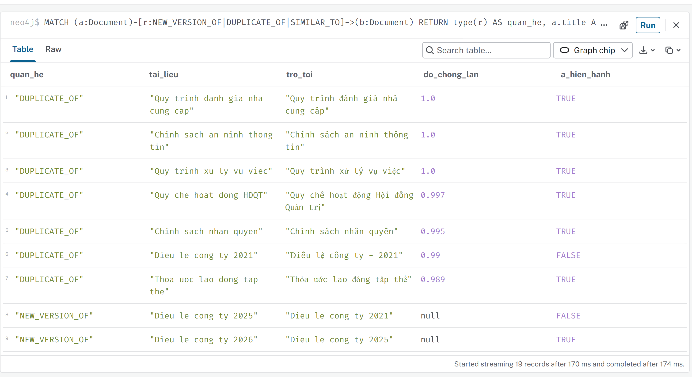

*Hình 4.9. Các cạnh `DUPLICATE_OF` và `NEW_VERSION_OF` sau bước xử lý tích hợp.*

### 4.15.3. Nhiều phiên bản của cùng một văn bản

Điều lệ 2021, 2025, 2026 là ba tệp có `source_uri` khác nhau, nên cơ chế phiên bản theo nguồn (mục 4.17) không nhận ra chúng là một văn bản. Đồ án dùng **khóa chuỗi văn bản**: tên tài liệu bỏ năm và dấu câu (`Dieu le cong ty 2025` → `dieu le cong ty`). Các tài liệu cùng khóa được sắp theo **ngày hiệu lực**, bản sau nối tới bản trước bằng `NEW_VERSION_OF`, bản trước được đánh dấu `is_current = false`.

Ngày hiệu lực lấy từ năm trong tên tài liệu nếu có. Nếu không có, nó là **ngày muộn nhất** trong 5.000 ký tự đầu. Quy tắc "muộn nhất" có lý do: một phụ lục sửa đổi luôn mở đầu bằng việc liệt kê các lần sửa đổi trước theo thứ tự thời gian ("Điều lệ ký ngày 23/4/2012, Bản điều chỉnh lần thứ hai ký ngày 18/02/2013… Hôm nay, ngày 22 tháng 4 năm 2013"). Lần chạy đầu dùng ngày đầu tiên tìm thấy nên gán ngày 23/4/2012 cho gần một nửa số phụ lục. Đổi sang ngày muộn nhất cho kết quả nhất quán, và được kiểm chứng ở mục 4.15.7: dãy vốn điều lệ theo ngày hiệu lực tăng đều qua các năm.

```python
# ai-service/app/knowledge_graph/extract.py (effective_date, rút gọn)
match = YEAR_RE.search(title or "")
if match:
    return f"{match.group(1)}-01-01", "title"
dates = [f"{y:04d}-{m:02d}-{d:02d}" for pattern in (LONG_DATE_RE, DATE_RE)
         for d, m, y in (map(int, f.groups()) for f in pattern.finditer(text[:5000]))
         if 1 <= m <= 12 and 1 <= d <= 31]
return (max(dates), "text") if dates else (None, None)
```

### 4.15.4. Song ngữ Anh–Việt và biến thể tên gọi

Chính sách an ninh thông tin là văn bản song ngữ, trang web có cả thuật ngữ tiếng Anh. Nếu không xử lý, "Board of Directors" và "Hội đồng Quản trị" thành hai thực thể rời nhau, và câu hỏi tiếng Việt không đến được đoạn tiếng Anh. Đồ án ánh xạ mỗi tên tiếng Anh về **thực thể chuẩn tiếng Việt**, nên hai cách gọi dùng chung một node:

```python
# ai-service/app/knowledge_graph/extract.py (ENGLISH_ALIASES, trích)
ENGLISH_ALIASES = {
    "Hội đồng Quản trị": ["Board of Directors"],
    "Tổng Giám đốc": ["General Director", "Chief Executive Officer", "CEO"],
    "Vốn điều lệ": ["charter capital"],
    "An toàn thông tin": ["information security"],
    "Dữ liệu cá nhân": ["personal data"],
    "Người lao động": ["Employee", "Employees"],
}
```

Mọi alias được khớp có ranh giới từ (`(?<!\w)…(?!\w)`), nên "bond" không khớp nhầm trong "bonding". Các biến thể khác cũng được chuẩn hóa về một tên: viết tắt ("HĐQT", "TGĐ", "BHXH"), số có số 0 đứng đầu ("Điều 07" thành "Điều 7"), ngày ("05/03/2020" thành "5/3/2020"), và tên văn bản pháp luật dài theo một danh mục (gazetteer). Danh mục này giúp "Luật An toàn thông tin mạng" không bị cắt thành "Luật An toàn".

### 4.15.5. Không chắc chắn: độ tin cậy của mỗi phép trích xuất

Trích xuất theo luật không đúng như nhau. "Điều 15" gần như chắc chắn là một điều khoản, còn "cong doan" sau khi bỏ dấu có thể là "Công đoàn" nhưng cũng có thể là "công đoạn". Đồ án biểu diễn sự không chắc chắn này bằng **độ tin cậy gắn trên cạnh** `MENTIONS`, theo phương pháp đã trích ra nó:

| Phương pháp | Ví dụ | Độ tin cậy | Lý do |
| :--- | :--- | ---: | :--- |
| `regex_article`, `regex_date`, `regex_decree` | "Điều 15", "ngày 22/4/2013", "Nghị định 155/2020/NĐ-CP" | 0,95 | Mẫu có số, gần như không mơ hồ |
| `alias_full`, `gazetteer_law` | "Hội đồng Quản trị", "Luật Doanh nghiệp" | 0,90 | Khớp nguyên cụm có dấu |
| `alias_en` | "Board of Directors" | 0,85 | Khớp đúng nhưng qua ánh xạ ngôn ngữ |
| `alias_abbrev` | "HĐQT", "TGĐ" | 0,75 | Viết tắt có thể trùng ý khác |
| `regex_law` | "Luật Lao động" ngoài danh mục | 0,70 | Ranh giới tên dựa vào heuristic |
| `alias_folded` | "Vôn điều lệ" → Vốn điều lệ | 0,60 | Khớp sau khi bỏ dấu, có thể nhầm từ khác |
| `heading` | Tiêu đề mục làm chủ đề | 0,60 | Tiêu đề có thể là rác OCR hoặc mục lục |

*Bảng 4.17. Độ tin cậy theo phương pháp trích xuất.*

Đây là các giá trị tiên nghiệm do nhóm đặt. Mục 4.18 đo độ chính xác thực tế của từng phương pháp, và kết quả đo khớp với thứ tự này: các phương pháp có độ tin cậy cao cũng có độ chính xác cao. Khi một thực thể được tìm thấy bằng nhiều phương pháp, độ tin cậy cao nhất được giữ.

Độ tin cậy được dùng ở hai chỗ. Khi truy xuất, cạnh có độ tin cậy dưới `GRAPH_MIN_MENTION_CONFIDENCE` bị bỏ qua (`05_retrieval.cypher`). Khi đánh giá dữ kiện, dữ kiện trích từ chữ bị mất dấu có độ tin cậy thấp hơn và mang cờ `khop_khong_dau`.

Với quan hệ đồng xuất hiện `RELATES_TO`, độ tin cậy là hệ số Jaccard giữa tập chunk nhắc hai thực thể:

> **Công thức 4.11.** $\text{conf}(a, b) = \dfrac{|C(a) \cap C(b)|}{|C(a) \cup C(b)|}$

Quan hệ chỉ xuất hiện một lần trong một đoạn dài có độ tin cậy gần 0; quan hệ luôn đi cùng nhau có độ tin cậy gần 1.

### 4.15.6. Mờ: hợp nhất thực thể bằng hàm thuộc

Tiêu đề mục là văn bản tự do, nên cùng một khái niệm có thể xuất hiện dưới nhiều dạng: khác nhau vì lỗi OCR ("Ngưửi nhụ trách quản trị Công ty" và "Người phụ trách quản trị Công ty"), vì bị cắt dòng ("Nghị định 155/2020/NĐ-" và "Nghị định 155/2020/NĐ-CP"), vì dấu câu. So khớp chính xác coi chúng là các thực thể khác nhau; so khớp theo một ngưỡng cứng lại dễ gộp nhầm.

Đồ án dùng **logic mờ**. Độ giống $s \in [0, 1]$ là giá trị lớn hơn giữa tỷ lệ ký tự chung và hệ số Jaccard của các từ nội dung, tính trên tên đã bỏ dấu. Mức độ thuộc về tập "cùng một thực thể" được cho bởi hàm thuộc tuyến tính từng khúc:

> **Công thức 4.12.** $\mu(s) = \begin{cases} 0 & s \le 0{,}80 \\ \dfrac{s - 0{,}80}{0{,}12} & 0{,}80 < s < 0{,}92 \\ 1 & s \ge 0{,}92 \end{cases}$

- $\mu = 1$: tạo cạnh `SAME_AS`. Khi truy xuất, tên đồng nghĩa được dùng thay cho nhau (`ALIASES_OF`).
- $0 < \mu < 1$: tạo cạnh `POSSIBLY_SAME_AS` với giá trị $\mu$. Hai thực thể vẫn tách rời, cặp này được đưa vào danh sách chờ người duyệt.
- $\mu = 0$: hai thực thể khác nhau.

Ba luật rõ (crisp) chạy trước hàm thuộc, vì hai chuỗi giống nhau chưa chắc cùng nghĩa:

1. **Khác số thì khác thực thể:** "Nghị định 155/2020" và "Nghị định 156/2020" giống nhau 96% về ký tự nhưng có $s = 0$.
2. **Thực thể đánh số không được hợp nhất mờ:** "Điều 7" và "Điều 17" không bao giờ được so.
3. **Khác nhau ở từ phủ định thì phải người duyệt:** "Quy trình xử lý vụ việc **chưa** xác định người vi phạm" và "…**đã** xác định…" có $s = 0{,}96$, nhưng bị hạ xuống `POSSIBLY_SAME_AS`. Luật này được thêm sau khi lần chạy đầu gộp nhầm đúng cặp này.

```python
# ai-service/app/knowledge_graph/resolve.py (rút gọn)
def membership(score, low=0.80, high=0.92):
    return 0.0 if score <= low else 1.0 if score >= high else (score - low) / (high - low)

score = similarity(first["name"], second["name"])          # 0 nếu khác số
relation = decide(score)                                   # SAME_AS / POSSIBLY_SAME_AS / None
if relation == "SAME_AS" and polarity_differs(first["name"], second["name"]):
    relation, guard = "POSSIBLY_SAME_AS", "phu_dinh"       # "đã" vs "chưa"
```

Quyết định của người duyệt được lưu thành cạnh có `method = 'manual'` (truy vấn mẫu số 8 trong `07_explore.cypher`). Mỗi lần chạy lại `--maintain` bỏ qua các cặp đã có quyết định thủ công, nên máy không bao giờ ghi đè người duyệt.

Kết quả trên 184 thực thể thuộc bốn loại được phép hợp nhất (145 tiêu đề, 14 chủ đề, 12 chức danh, 13 văn bản pháp luật):

| Quan hệ | Độ giống | Thực thể A | Thực thể B | Nguyên nhân khác biệt |
| :--- | ---: | :--- | :--- | :--- |
| `SAME_AS` | 0,979 | Vẫn điều lệ, cổ phần, các loại chứng khoán khác | Vôn điều lệ, cô phân, các loại chứng khoán khác | OCR sai dấu ở hai bản Điều lệ |
| `SAME_AS` | 0,963 | Công nhãn viên và cũng đoàn | Công nhân viên và công đoàn | OCR |
| `SAME_AS` | 0,960 | Ngưửi nhụ trách quản trị Công ty và Thư ký Công ty | Người phụ trách quản trị Công ty và Thư ký Công ty | OCR |
| `SAME_AS` | 0,940 | Báo cáo tài chính, bảo cáo thường niên và trách | Báo cáo tài chính, báo cáo thường niên và trách nhiệm | Tiêu đề bị cắt dòng |
| `POSSIBLY_SAME_AS` | 0,960 | Quy trình xử lý vụ việc chưa xác định người vi phạm | Quy trình xử lý vụ việc đã xác định người vi phạm | Luật phủ định chặn gộp tự động |
| `POSSIBLY_SAME_AS` | 0,897 | Bộ luật Lao động | Luật Lao Động | Tên chính thức và tên gọi tắt; cần người xác nhận |
| `POSSIBLY_SAME_AS` | 0,876 | Quyền và nghĩa vụ của Hội đồng Quản trị | Quyền và nghĩa vụ của thành viên Hội đồng Quản trị | Hai khái niệm khác nhau; người duyệt nên bác bỏ |
| `POSSIBLY_SAME_AS` | 0,820 | Mối quan hệ với Ủy ban Kiểm toán | Mối quan hệ với Ban điều hành | Khác nhau; ở sát ngưỡng dưới |

*Bảng 4.18a. Một số cặp hợp nhất mờ trên KB (đầy đủ trong `debug/kb_maintenance.json`).*

Cả 8 cặp `SAME_AS` đều đúng khi kiểm tra bằng mắt. Trong 13 cặp chờ duyệt có cả cặp nên gộp ("Bộ luật Lao động") lẫn cặp nên bác bỏ (HĐQT và thành viên HĐQT). Đây là lý do vùng giữa của hàm thuộc phải giao cho người quyết định, không để máy gộp.

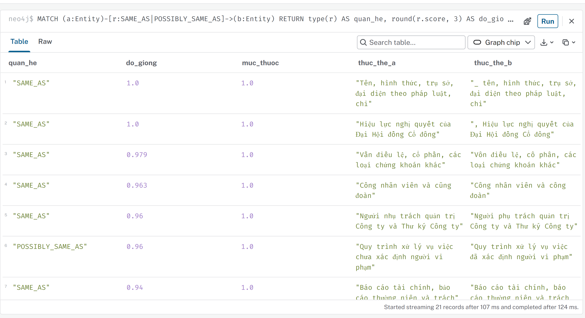

*Hình 4.10. Cạnh `SAME_AS` và `POSSIBLY_SAME_AS` với độ giống và mức thuộc.*

### 4.15.7. Mâu thuẫn dữ kiện

Văn bản cũ không mất đi khi có văn bản mới, nên kho chứa nhiều khẳng định khác nhau về cùng một thuộc tính. Thuộc tính khó nhất là **vốn điều lệ**: tại một thời điểm công ty chỉ có một giá trị, nhưng kho có mười ba con số.

**Trích dữ kiện.** Với mỗi thuộc tính chỉ có một giá trị (vốn điều lệ, mệnh giá cổ phần), hàm `extract_claims` tìm câu chứa tên thuộc tính, khớp không dấu để không bỏ sót "Vôn Điều Lệ", rồi lấy số tiền đứng sau trong vòng 160 ký tự. Mỗi khẳng định thành một node `Claim`, nối về đoạn nguồn bằng `ASSERTS` để vẫn trích dẫn được.

**Kiểm tra tính hợp lý.** Nếu trong cùng đoạn có số cổ phần và mệnh giá, hệ thống kiểm tra *vốn = số cổ phần × mệnh giá*. Phép kiểm tra này bắt được một lỗi OCR thật trong phụ lục lần 5.1: "7.355.531.790.000 đồng chia thành 135.553.179 cổ phần × 10.000 đồng". Tích bằng 1.355 tỷ, không khớp. Số tiền viết bằng chữ xác nhận 7.355 tỷ là đúng, còn số cổ phần bị OCR đọc sai chữ số đầu. Dữ kiện mang cờ `lech_so_co_phan_x_menh_gia` và bị giảm một nửa độ tin cậy.

**Giải quyết.** Các khẳng định khác giá trị được xếp hạng theo bốn luật ưu tiên, luật trước quan trọng hơn luật sau:

| Luật | Nội dung | Lý do |
| :--- | :--- | :--- |
| R1 | Tài liệu hiện hành thắng tài liệu đã bị thay thế | Phiên bản cũ không còn hiệu lực pháp lý |
| R2 | Ngày hiệu lực mới hơn thắng | Văn bản sau sửa đổi văn bản trước |
| R3 | Nguồn tin cậy hơn thắng (PDF nội bộ, upload 1,0; web 0,6) | Văn bản gốc có giá trị pháp lý, trang web chỉ tóm tắt |
| R4 | Giá trị hợp lý thắng giá trị bị gắn cờ | Ưu tiên số liệu nhất quán nội tại |

*Bảng 4.18. Luật giải quyết mâu thuẫn.*

Giá trị thắng có trạng thái `accepted`. Giá trị thua có trạng thái `superseded` và một cạnh `CONFLICTS_WITH` ghi luật đã quyết định. Khi không luật nào phân định được, cả hai có trạng thái `unresolved` và được đưa ra cho người duyệt. Câu trả lời không bao giờ tự chọn ngẫu nhiên.

| Ngày hiệu lực | Nguồn | Vốn điều lệ (đồng) | Trạng thái | Luật quyết định | Cờ |
| :--- | :--- | ---: | :--- | :--- | :--- |
| (không có) | Trang web "Giới thiệu chung" | 28.500.000.000 | superseded | R2 | |
| 12/06/2012 | Phụ lục sửa đổi lần 1.2 | 5.025.000.000.000 | superseded | R2 | |
| 18/02/2013 | Phụ lục sửa đổi lần 2.2 | 5.253.409.090.000 | superseded | R2 | khớp không dấu |
| 27/06/2014 | Phụ lục sửa đổi lần 6 | 5.313.263.220.000 | superseded | R2 | |
| 26/04/2016 | Phụ lục sửa đổi lần 1.1 | 5.381.601.170.000 | superseded | R2 | khớp không dấu |
| 23/06/2017 | Phụ lục sửa đổi lần 3.2 | 5.431.327.770.000 | superseded | R2 | |
| 28/08/2019 | Phụ lục sửa đổi lần 8.1 | 7.229.246.040.000 | superseded | R2 | |
| 17/06/2020 | Phụ lục sửa đổi (lần khác) | 7.267.938.180.000 | superseded | R2 | |
| 2021 | Điều lệ công ty 2021 (upload) | 7.267.938.180.000 | superseded | R2 | |
| 15/08/2022 | Phụ lục sửa đổi lần 2 | 7.274.618.790.000 | superseded | R2 | |
| 05/09/2024 | Phụ lục sửa đổi lần 5.1 | 7.355.531.790.000 | superseded | R2 | lệch số cổ phần × mệnh giá |
| 2025 | Điều lệ công ty 2025 | 10.623.648.220.000 | superseded | R1 | |
| **2026** | **Điều lệ công ty 2026** | **13.074.049.490.000** | **accepted** | | |

*Bảng 4.19a. Mười bốn khẳng định về vốn điều lệ trong KB và kết quả giải quyết mâu thuẫn.*

Điều lệ 2025 bị loại theo R1 vì đã bị Điều lệ 2026 thay thế ở bước chuỗi phiên bản (mục 4.15.3). Các khẳng định còn lại bị loại theo R2. Giá trị được chọn có thể kiểm tra chéo: Điều lệ 2026 (trang 8) ghi 1.307.404.949 cổ phần × 10.000 đồng = 13.074.049.490.000 đồng, khớp đúng.

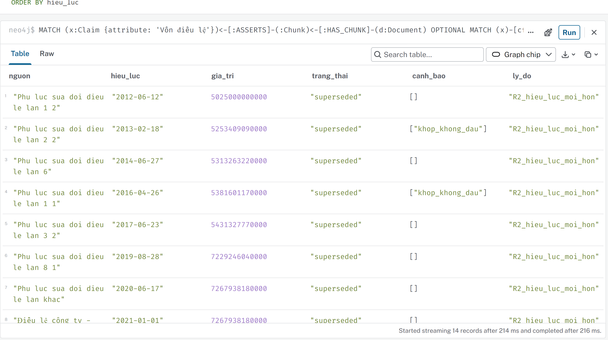

*Hình 4.11. Các khẳng định về vốn điều lệ, trạng thái và lý do (truy vấn số 6 trong `07_explore.cypher`).*

Dãy giá trị tăng đều theo ngày hiệu lực là bằng chứng độc lập cho thấy quy tắc ngày hiệu lực ở mục 4.15.3 đúng. Nếu ngày bị gán sai, dãy sẽ không đơn điệu. Giá trị 28,5 tỷ trên trang giới thiệu là dữ kiện lịch sử năm 2003 nằm trong một đoạn kể lại quá trình hình thành công ty. Khẳng định này không có ngày hiệu lực nên được xếp cũ nhất và bị loại theo R2. Nếu không bị R2 loại, nó cũng thua theo R3 vì đến từ nguồn web. Mệnh giá cổ phần (10.000 đồng) xuất hiện ở 18 đoạn và không có mâu thuẫn, nên mọi khẳng định đều được chấp nhận.

Tác tử hỏi đáp (Chương 5) dùng trực tiếp kết quả này. Câu hỏi "Vốn điều lệ hiện nay là bao nhiêu?" được trả lời từ `Claim` đã chấp nhận, kèm trích dẫn và các giá trị cũ đã bị thay thế, thay vì để truy xuất văn bản chọn ngẫu nhiên một phụ lục cũ.

## 4.16. Luồng RAG kết hợp KB

### 4.16.1. Ba bước

RAG kết nối KB qua ba bước, cài trong `RAGService.retrieve_hits` (`ai-service/app/rag_service.py`):

1. **Truy xuất vector:** câu hỏi được nhúng (E5-Small), tìm 60 ứng viên trong Qdrant.
2. **Truy xuất đồ thị:** tìm thực thể trong câu hỏi, cộng tên đồng nghĩa (`SAME_AS`) và thực thể gần nghĩa theo vector; lấy các đoạn nhắc đến chúng; mở rộng từ 5 đoạn vector tốt nhất theo cạnh `REFERENCES` và thực thể chung.
3. **Trộn và lọc:** trộn hai danh sách bằng Reciprocal Rank Fusion (RRF, trọng số đồ thị 0,2), chấm lại bằng cross-encoder, rồi qua cổng bằng chứng. Không đủ căn cứ thì từ chối.

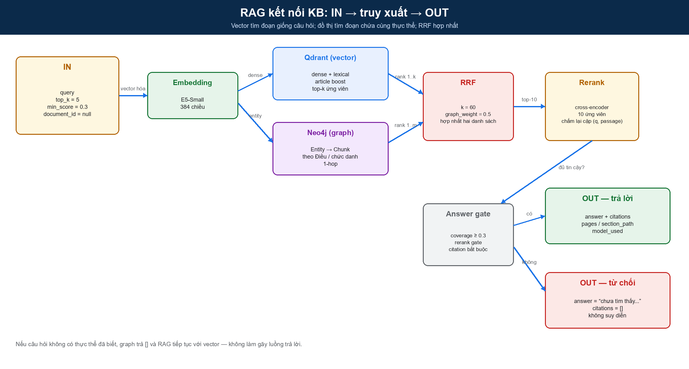

*Hình 4.12. Luồng vào và ra của RAG khi nối KB.*

### 4.16.2. Mã nguồn gắn với luồng

```python
# ai-service/app/rag_service.py (retrieve_hits, dòng 98-127, rút gọn)
vector_hits = self.retriever.search(query=cleaned_query, top_k=candidate_k, min_score=0.0,
                                    query_vector=query_vector, allowed_roles=allowed_roles)
graph_hits = graph_search(cleaned_query, limit=max(settings.GRAPH_SEARCH_LIMIT, top_k * 4),
                          query_vector=query_vector,
                          seed_chunk_ids=[h["chunk_id"] for h in vector_hits[:settings.GRAPH_EXPAND_SEEDS]],
                          allowed_roles=allowed_roles)
hits = self._fuse_hits(vector_hits, graph_hits, graph_weight=graph_weight)   # RRF
head = reranker.rerank(cleaned_query, hits[: settings.RERANK_CANDIDATES])    # cross-encoder
```

Phía đồ thị, `graph_search` (`ai-service/app/knowledge_graph/service.py`) gom tên thực thể từ ba nguồn rồi gọi truy vấn `GRAPH_CANDIDATES`:

```python
# ai-service/app/knowledge_graph/service.py (graph_search, rút gọn)
names = {entity["name"] for entity in extract_entities(question)}          # theo luật
names |= {n for n in store.entity_names(KB) if fold_text(n) in fold_text(question)}
names.update(store.similar_entities(query_vector, settings.GRAPH_ENTITY_MIN_SCORE))  # theo vector
names.update(store.aliases_of(sorted(names)))                               # SAME_AS
rows = store.graph_candidates(names=sorted(names), kb_ids=(KB,), limit=limit,
                              min_confidence=settings.GRAPH_MIN_MENTION_CONFIDENCE)
```

Truy vấn `GRAPH_CANDIDATES` áp dụng mọi kết quả xử lý tích hợp ở mục 4.15 ngay trong điều kiện lọc:

```cypher
// ai-service/app/knowledge_graph/cypher/05_retrieval.cypher (GRAPH_CANDIDATES, phần lọc)
MATCH (seed)-[:RELATES_TO*0..1]-(e:Entity)<-[m:MENTIONS]-(c:Chunk)<-[:HAS_CHUNK]-(d:Document)
MATCH (kb:KnowledgeBase)-[:HAS_DOCUMENT]->(d)
WHERE kb.kb_id IN $kb_ids
  AND coalesce(m.confidence, 1.0) >= $min_confidence          // không chắc chắn
  AND coalesce(d.is_current, true) AND d.duplicate_of IS NULL  // phiên bản, trùng lặp
  AND ($roles IS NULL OR any(role IN coalesce(d.allowed_roles, [])
       WHERE role IN $roles OR role = '*'))                    // phân quyền
```

Đồ thị là kênh bổ sung. Khi Neo4j không chạy hoặc câu hỏi không có thực thể nào, `graph_search` trả về danh sách rỗng và RAG chạy bằng vector (graceful degradation). Đoạn nào lấy từ đồ thị cũng phải qua cùng cổng bằng chứng như đoạn lấy từ vector: **có trích dẫn mới trả lời, không có thì từ chối**.

### 4.16.3. Dạng đầu ra của KB

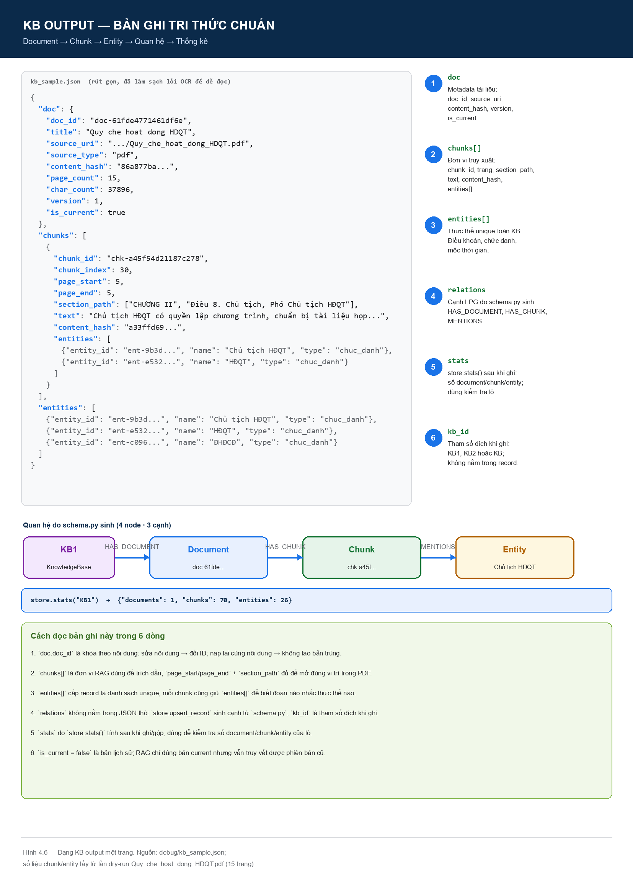

*Hình 4.13. Bản ghi KB của một tài liệu: Document → Chunk → Entity → quan hệ → thống kê.*

Bản ghi này là hợp đồng dữ liệu giữa tầng nạp và tầng RAG. Mọi trường cần cho trích dẫn (`page_start`, `page_end`, `section_path`, `source_uri`) và cho kiểm soát chất lượng (`content_hash`, `version`, `is_current`, `confidence`) đều nằm trong cùng một bản ghi.

## 4.17. Cơ chế cập nhật KB

### 4.17.1. Bốn tình huống

KB thay đổi theo hai cách: **nguồn thay đổi** (tài liệu mới, sửa, xóa) và **bộ trích xuất thay đổi** (sửa luật, thêm alias). Đồ án xử lý cả hai:

| Tình huống | Phát hiện | Hành động trên đồ thị | Mã nguồn |
| :--- | :--- | :--- | :--- |
| Nguồn mới | Không có `Document` hiện hành cùng `source_uri` | Ghi mới (`insert`) | `pipeline.apply_record` |
| Nguồn không đổi | Cùng `source_uri`, cùng `content_hash` | Bỏ qua (`skip`), không ghi gì | `pipeline.plan_update` |
| Nguồn bị sửa | Cùng `source_uri`, khác `content_hash` | Bản cũ `is_current=false`; bản mới `version+1`, cạnh `NEW_VERSION_OF` | `SUPERSEDE_DOCUMENT`, `LINK_VERSION` |
| Nguồn bị xóa | Có trong KB nhưng không còn trong thư mục | `is_current=false`, `superseded_reason='source_removed'`; giữ lịch sử | `RETIRE_MISSING` |
| Bộ trích xuất thay đổi | Người vận hành chạy lại | Dựng lại mọi thực thể và cạnh dẫn xuất từ chunk đã lưu, không OCR lại; giữ quyết định thủ công | `scripts/13_reindex_graph_entities.py` |

*Bảng 4.19. Cơ chế cập nhật KB.*

Hash được tính trên **văn bản đã trích**, không trên byte của tệp. Một PDF được quét lại nhưng nội dung không đổi không tạo phiên bản mới.

```python
# ai-service/app/knowledge_graph/pipeline.py (apply_record, dòng 23-36)
current = store.find_current(doc["source_uri"]) if update else None
action = plan_update(current, doc["content_hash"]) if update else "insert"
if action == "skip":
    return {"action": "skip", "doc_id": current["doc_id"], "chunks": 0}
if action == "new_version":
    old_id = store.supersede(doc["source_uri"])        # bản cũ: is_current = false
    doc["version"] = int(current.get("version", 1)) + 1
store.upsert_record(kb_id, f"Kho {kb_id}", record)      # + lan truyền sang KB đã gộp
if old_id:
    store.link_version(old_id, doc["doc_id"])          # (mới)-[:NEW_VERSION_OF]->(cũ)
```

Sau mỗi lần nạp, hệ thống ghi một node `IngestRun` (số tài liệu thêm mới, bỏ qua, phiên bản mới, bị loại, lỗi). Đây là nhật ký kiểm toán của KB. Các bước xử lý tích hợp ở mục 4.15 chạy lại sau mỗi lần cập nhật bằng `--maintain`, vì một tài liệu mới có thể tạo trùng lặp hoặc mâu thuẫn mới.

Một lần cập nhật đầy đủ là một lệnh: `python scripts/10_build_neo4j_kb.py --pdf data/documents --kb KB1 --update --prune --maintain`.

### 4.17.2. Kiểm chứng trên Neo4j thật

Script `ai-service/scripts/19_demo_kb_update.py` chạy đủ bốn tình huống trên một KB thử (`KB_DEMO`, không gộp vào KB chính) với một tệp `Phu_luc_demo.pdf` có nội dung thay đổi theo thời gian:

| Bước | Thao tác | Kết quả ghi nhận trên Neo4j |
| ---: | :--- | :--- |
| 1 | Đặt tệp = phụ lục lần 2 (2022), nạp | `insert`; v1 hiện hành, 2 chunk |
| 2 | Nạp lại, không đổi tệp | `skip`; không có node mới |
| 3 | Thay tệp bằng phụ lục lần 5.1 (2024), nạp | `new_version`; v1 `is_current=false` (`content_changed`), v2 hiện hành, cạnh v2 → v1 |
| 4 | Truy xuất "Vốn điều lệ" trên `KB_DEMO` | Chỉ trả về chunk của v2 |
| 5 | Xóa tệp, nạp với `--prune` | v2 `is_current=false` (`source_removed`); lịch sử v1, v2 vẫn còn |
| | Nhật ký | 4 node `IngestRun`: (1,0,0,0), (0,1,0,0), (0,0,1,0), (0,0,0,1) theo thứ tự thêm mới, bỏ qua, phiên bản mới, bị loại |

*Bảng 4.20. Kết quả chạy thử cơ chế cập nhật ngày 15/11/2026.*

Khi bộ trích xuất được sửa sau đánh giá ở mục 4.18, script 13 dựng lại toàn bộ thực thể và cạnh của 1.665 chunk mà không cần OCR lại 395 trang PDF.

## 4.18. Đánh giá cơ sở tri thức

### 4.18.1. Đánh giá KB khác đánh giá mô hình thế nào

Mô hình nhúng được đánh giá bằng một con số trên một bộ câu hỏi (MRR, Recall@k). KB là một cấu trúc dữ liệu, nên cần nhiều góc nhìn. Đồ án đánh giá KB theo sáu nhóm chỉ số, đều tính được bằng truy vấn Cypher trong `06_quality.cypher` hoặc bằng nhãn thủ công:

| Nhóm | Câu hỏi | Chỉ số | Cách đo |
| :--- | :--- | :--- | :--- |
| Quy mô | KB có những gì? | Số node theo nhãn, số cạnh theo kiểu | `Q_SIZE` |
| Độ phủ | Tri thức có được trích ra không? | Tỷ lệ chunk có ít nhất một thực thể | `Q_COVERAGE` |
| Toàn vẹn | Cấu trúc có hỏng không? | Chunk mồ côi, tài liệu rỗng, dẫn chiếu chéo tài liệu, phiên bản cũ vẫn hiện hành | `Q_INTEGRITY` |
| Nhất quán | Các nguồn có khớp nhau không? | Số bản trùng, cặp hợp nhất, cặp chờ duyệt, dữ kiện chưa phân định | `Q_CONSISTENCY` |
| Độ chính xác | Thực thể trích ra có đúng không? | Precision theo phương pháp trích xuất | Mẫu phân tầng, gán nhãn thủ công |
| Hữu ích | KB có giúp trả lời tốt hơn không? | MRR, Recall@k, tỷ lệ đạt của RAG có và không có đồ thị | `15_run_eval.py` |

*Bảng 4.21. Khung đánh giá KB.*

Lệnh chạy: `python scripts/18_evaluate_kb.py`. Kết quả ghi ra `data/eval/results/kb_quality.json`.

### 4.18.2. Quy mô, độ phủ, toàn vẹn và nhất quán

**Quy mô.** KB hợp nhất có 1.665 nút `Chunk`, 291 nút `Entity`, 52 nút `Document`, 32 nút `Claim`, 3 nút `KnowledgeBase`; tổng cộng 8.402 cạnh thuộc 14 kiểu:

| Kiểu cạnh | Số lượng | Kiểu cạnh | Số lượng |
| :--- | ---: | :--- | ---: |
| `MENTIONS` | 4.374 | `POSSIBLY_SAME_AS` | 13 |
| `HAS_CHUNK` | 1.665 | `CONFLICTS_WITH` | 13 |
| `APPLIES_TO` | 1.394 | `SIMILAR_TO` | 10 |
| `RELATES_TO` | 581 | `SAME_AS` | 8 |
| `REFERENCES` | 204 | `DUPLICATE_OF` | 7 |
| `HAS_DOCUMENT` | 97 | `MERGED_INTO` | 2 |
| `ASSERTS` | 32 | `NEW_VERSION_OF` | 2 |

*Bảng 4.22. Quy mô KB hợp nhất (đếm bằng `Q_SIZE`, 15/11/2026).*

**Độ phủ theo nguồn.** Độ phủ thực thể là tỷ lệ chunk có ít nhất một cạnh `MENTIONS`; độ phủ ngữ nghĩa chỉ tính thực thể mang nghĩa (bỏ số điều, ngày tháng).

| Nguồn | Tài liệu | Chunk | Độ phủ thực thể | Độ phủ ngữ nghĩa | Thực thể/chunk |
| :--- | ---: | ---: | ---: | ---: | ---: |
| PDF nội bộ (KB1) | 35 | 1.313 | 81,7% | 77,9% | 2,63 |
| Trang web (KB2) | 10 | 31 | 54,8% | 41,9% | 0,94 |
| Tài liệu tải lên | 7 | 321 | 84,4% | 83,8% | 2,78 |

*Bảng 4.23. Độ phủ thực thể theo nguồn (`Q_COVERAGE`).*

Nguồn web có độ phủ thấp nhất (54,8%) vì các trang giới thiệu viết văn xuôi, ít dẫn chiếu "Điều N", ít chức danh và tên văn bản mà bộ trích xuất theo luật nhận ra. Hai nguồn văn bản quy phạm đạt trên 80%.

**Toàn vẹn và nhất quán.**

| Chỉ số | Giá trị | Ý nghĩa |
| :--- | ---: | :--- |
| Chunk mồ côi, tài liệu rỗng, tài liệu không thuộc KB nào | 0, 0, 0 | Cấu trúc tài liệu → chunk → KB không đứt gãy |
| Thực thể mồ côi, dữ kiện mồ côi | 0, 0 | Mọi thực thể và dữ kiện đều có chunk làm nguồn |
| Dẫn chiếu `REFERENCES` sang tài liệu khác | 0 | "Điều 11" chỉ nối tới Điều 11 của cùng văn bản |
| Phiên bản cũ vẫn hiện hành | 0 | Cơ chế cập nhật (mục 4.17) không để sót bản cũ |
| Tài liệu trùng (`DUPLICATE_OF`) | 7 | Bản PDF trùng bản upload, chỉ giữ một bản cho truy xuất |
| Cặp thực thể đã hợp nhất (`SAME_AS`) / chờ duyệt (`POSSIBLY_SAME_AS`) | 8 / 13 | Hợp nhất mờ, mục 4.15.6 |
| Dữ kiện: chấp nhận / bị thay thế / nghi vấn / chưa phân định | 19 / 13 / 0 / 0 | Mọi mâu thuẫn số liệu đều đã có kết luận, mục 4.15.7 |

*Bảng 4.24. Toàn vẹn và nhất quán của KB (`Q_INTEGRITY`, `Q_CONSISTENCY`).*

Một điểm cần lưu ý: trong 581 cạnh `RELATES_TO` giữa các thực thể, 553 cạnh (95,2%) có độ tin cậy dưới 0,2, tức chỉ dựa trên một hai lần cùng xuất hiện. Đây là lý do truy xuất đồ thị dùng ngưỡng độ tin cậy (`GRAPH_MIN_MENTION_CONFIDENCE`) thay vì đi theo mọi cạnh.

### 4.18.3. Độ chính xác trích xuất

Precision được đo trên **mẫu phân tầng**: rút ngẫu nhiên tối đa 15 cạnh `MENTIONS` cho mỗi phương pháp trích xuất (hạt giống 13), kèm 140 ký tự ngữ cảnh quanh vị trí khớp. Mỗi mẫu được gán nhãn đúng hoặc sai. Precision chung được tính có trọng số theo số lượng cạnh của từng phương pháp trong KB, vì phương pháp phổ biến ảnh hưởng nhiều hơn.

| Phương pháp | Cách nhận | Độ tin cậy gán | Lượt nhắc trong KB | Mẫu gán nhãn | Precision |
| :--- | :--- | ---: | ---: | ---: | ---: |
| `alias_full` | Khớp đủ tên hoặc bí danh có dấu | 0,90 | 1.994 | 15 | 1,000 |
| `heading` | Tiêu đề mục (Chương, Điều có tên) | 0,60 | 768 | 15 | 0,867 |
| `regex_article` | Mẫu "Điều N" | 0,95 | 654 | 15 | 1,000 |
| `alias_folded` | Khớp không dấu (chữ OCR lỗi) | 0,60 | 558 | 15 | 1,000 |
| `gazetteer_law` | Danh mục tên luật | 0,90 | 208 | 15 | 1,000 |
| `regex_date` | Ngày tháng | 0,95 | 78 | 15 | 1,000 |
| `alias_abbrev` | Từ viết tắt (HĐQT, ĐHĐCĐ) | 0,75 | 55 | 15 | 1,000 |
| `alias_en` | Bí danh tiếng Anh | 0,85 | 47 | 15 | 1,000 |
| `regex_decree` | Số hiệu nghị định | 0,95 | 7 | 4 | 1,000 |
| `regex_law` | Số hiệu luật | 0,70 | 5 | 3 | 0,667 |
| **Tổng** | | | **4.374** | **127** | **0,976** |

*Bảng 4.25. Precision trích xuất theo phương pháp (mẫu `kb_entity_sample_v2.json`, precision chung có trọng số).*

Precision chung đạt **0,976**. Lần gán nhãn đầu (trước khi sửa bộ trích xuất) cho 0,911; mười lỗi tìm được khi gán nhãn đã được sửa (ví dụ "Công ty Cổ phần" bị nhận nhầm là chủ đề cổ phần, "Kỷ luật lao động" bị nhận là tên luật, tiêu đề rác từ mục lục), rồi rút một mẫu mới để đo lại. Trên mẫu mới, 127 lượt nhắc được gán nhãn; sau khi sửa vẫn trích ra đủ 127, không mất lượt nhắc đúng nào (0).

Hai phương pháp dưới mức tuyệt đối có lý do rõ ràng. `heading` đạt 0,867: còn sót tiêu đề chung chung như "Nội dung" và câu văn bị nhận nhầm thành tiêu đề. `regex_law` đạt 0,667 nhưng chỉ có 3 lượt nhắc, nên một lỗi đã kéo con số xuống. Độ tin cậy gán sẵn cho từng phương pháp phản ánh đúng thứ tự này: `heading` và `alias_folded` được gán 0,6, thấp hơn các phương pháp theo mẫu cứng (0,9–0,95). Riêng `alias_folded` (khớp không dấu cho chữ OCR lỗi) đạt precision 1,0 trên mẫu, cho thấy hạ độ tin cậy để thận trọng là đúng nhưng chưa cần loại bỏ phương pháp này.

### 4.18.4. Đóng góp của KB cho hỏi đáp

Bộ 26 câu hỏi (18 câu có đoạn đúng, 8 câu phải từ chối) được chạy với ba chiến lược truy xuất, ở hai ngưỡng độ tin cậy lượt nhắc của đồ thị:

| Cấu hình | Ngưỡng tin cậy | MRR | Recall@1 | Recall@3 | Tỷ lệ đạt |
| :--- | ---: | ---: | ---: | ---: | ---: |
| Chỉ vector (`flat_rag`) | — | 0,676 | 0,611 | 0,778 | 73,1% |
| Chỉ đồ thị (`graph_rag`) | 0 | 0,222 | 0,167 | 0,278 | 38,5% |
| Chỉ đồ thị (`graph_rag`) | 0,7 | 0,296 | 0,222 | 0,389 | 50,0% |
| Lai vector + đồ thị (`hybrid_rag`) | 0 | 0,668 | 0,611 | 0,722 | 69,2% |
| Lai vector + đồ thị (`hybrid_rag`) | 0,7 | 0,745 | 0,667 | 0,833 | 69,2% |

*Bảng 4.26. Đóng góp của đồ thị cho truy xuất (`15_run_eval.py`, 15/11/2026, chế độ trích đoạn không LLM).*

Ba nhận xét. Thứ nhất, **đồ thị đứng một mình yếu** (MRR 0,296): truy xuất qua thực thể bỏ lỡ các câu hỏi không chứa thực thể, và nhãn đoạn đúng chỉ trỏ vào tài liệu upload (mục 4.18.5). Thứ hai, **ghép đồ thị với vector có ích cho xếp hạng**: MRR tăng từ 0,676 lên 0,745, Recall@1 từ 0,611 lên 0,667, Recall@3 từ 0,778 lên 0,833. Tỷ lệ đạt đầu–cuối của cấu hình lai (69,2%) vẫn thấp hơn vector (73,1%) một câu, nên lợi ích chủ yếu nằm ở thứ hạng đoạn đúng. Thứ ba, **xử lý không chắc chắn có tác dụng đo được**: chỉ dùng lượt nhắc có độ tin cậy từ 0,7 nâng MRR của đồ thị từ 0,222 lên 0,296 và của cấu hình lai từ 0,668 lên 0,745. Đây là bằng chứng định lượng cho việc gắn độ tin cậy vào từng phép trích xuất ở mục 4.15.5.

### 4.18.5. Hạn chế của đánh giá

- **Nhãn do nhóm tự gán.** Nhãn precision và nhãn đoạn đúng của bộ câu hỏi do nhóm gán, chưa có người gán thứ hai để đo độ đồng thuận.
- **Mẫu nhỏ.** 15 mẫu mỗi phương pháp cho khoảng tin cậy rộng (±15–25 điểm phần trăm).
- **Chưa đo độ bao phủ (recall) của trích xuất.** Đo recall cần gán nhãn toàn bộ thực thể trong một tập đoạn, chưa làm.
- **Bộ câu hỏi gắn với tài liệu upload.** Nhãn đoạn đúng chỉ trỏ vào chunk của 7 tài liệu upload. Đoạn đúng nội dung nhưng thuộc tài liệu KB1 vẫn bị tính là sai, nên đóng góp của đồ thị bị đánh giá thấp.

## 4.19. KẾT LUẬN

Chương 4 đã trả lời bảy vấn đề đặt ra ở mục 4.1:

- **T1 (tài liệu thô thành tri thức):** pipeline thu nhận, phân tích cấu trúc, phân đoạn thích ứng, làm giàu metadata và nhúng (mục 4.2–4.8) biến PDF quét và văn bản pháp quy thành chunk có đường dẫn mục và trang để trích dẫn.
- **T2 (biểu diễn):** tri thức được lưu song song ở Qdrant (tìm theo nghĩa) và Neo4j (duyệt theo quan hệ). KB hợp nhất có 52 tài liệu, 1.665 chunk, 291 thực thể; toàn bộ Cypher nằm trong 7 tệp `.cypher` có tên truy vấn (mục 4.13–4.14).
- **T3, T4 (tích hợp, không chắc chắn, mờ):** 7 tài liệu trùng được đánh dấu `DUPLICATE_OF`; 8 cặp thực thể được hợp nhất và 13 cặp chờ duyệt bằng hàm thuộc; 32 dữ kiện số được phân định thành 19 chấp nhận và 13 bị thay thế, không còn dữ kiện chưa phân định (mục 4.15).
- **T5 (nối KB với RAG):** truy xuất lai vector + đồ thị nâng MRR từ 0,676 lên 0,745 trên cùng bộ câu hỏi (mục 4.16, Bảng 4.26).
- **T6 (cập nhật):** cập nhật theo hash nội dung với bốn tình huống thêm, sửa, xóa và trích xuất lại, đã chạy thật trên Neo4j (mục 4.17, Bảng 4.20).
- **T7 (đánh giá):** KB được đánh giá theo sáu nhóm chỉ số; mọi chỉ số toàn vẹn bằng 0 và precision trích xuất đạt 0,976 (mục 4.18).

Hạn chế chính là truy xuất chỉ bằng đồ thị còn yếu, bộ trích xuất theo luật chưa đo được độ bao phủ, và nhãn đánh giá do nhóm tự gán. Kết quả của chương là một cơ sở tri thức có nguồn gốc rõ ràng, nhất quán và cập nhật được; Chương 5 trình bày cách tác tử khai thác nó, chẳng hạn đọc thẳng giá trị vốn điều lệ hiện hành đã được phân định thay vì đoán từ văn bản.

---

<!-- PAGEBREAK -->

# CHƯƠNG 5. KIẾN TRÚC HỆ THỐNG VÀ TÁC TỬ HỎI ĐÁP TRI THỨC

## 5.1. Vấn đề đặt ra và phạm vi giải quyết

Chương 3 chọn mô hình biểu diễn, Chương 4 xây dựng cơ sở tri thức. Hai phần này chỉ tạo ra giá trị khi được ghép thành một hệ thống mà người dùng thật sử dụng được. Khi ghép, nhóm gặp các vấn đề sau:

| Mã | Vấn đề | Câu hỏi cần trả lời |
| :--- | :--- | :--- |
| K1 | Nhiều module viết bằng nhiều ngôn ngữ | Giao diện React, cổng nghiệp vụ Java, dịch vụ AI Python và bốn kho dữ liệu kết nối với nhau qua đâu, theo hợp đồng nào? |
| K2 | Bảo mật và phân quyền | Ai được hỏi, được xem tài liệu nào; làm sao dịch vụ AI không bị gọi trực tiếp từ ngoài? |
| K3 | Chọn chiến lược trả lời cho từng câu hỏi | Lúc nào dùng vector, lúc nào dùng đồ thị, lúc nào đọc thẳng dữ kiện trong KB, lúc nào phải từ chối? |
| K4 | Tác tử: luật hay học? | Chính sách chọn chiến lược nên viết bằng luật hay học từ phản hồi (học tăng cường)? |
| K5 | Nhiều mô hình cùng chạy | Triển khai đồng thời nhiều mô hình (nhúng, chấm lại, sinh) và thay thế mà không sửa mã nguồn |
| K6 | Kiểm chứng toàn hệ thống | Đo chất lượng và độ trễ của cả luồng, không chỉ từng module |

Chương này giải quyết K1–K6 như sau:

- **K1, K2:** kiến trúc nhiều dịch vụ trong Docker Compose, mỗi kết nối được trình bày bằng đoạn mã thật (mục 5.2–5.4).
- **K3:** tác tử hỏi đáp dựa trên luật (rule-based agent) gồm bốn bước nhận thức, chọn luật, hành động, quan sát, có ghi vết từng quyết định (mục 5.5).
- **K4:** học lại chính sách chọn chiến lược bằng contextual bandit, một dạng học tăng cường, rồi so sánh với tác tử luật (mục 5.6).
- **K5:** cấu hình mô hình qua biến môi trường, ba backend LLM có thứ tự dự phòng (mục 5.7).
- **K6:** đánh giá đầu–cuối trên cùng bộ 26 câu hỏi (mục 5.8).

Ngoài phạm vi: hệ đa tác tử có nhiều tác tử tự trị cộng tác, và học tăng cường trực tuyến từ phản hồi người dùng thật. Hai hướng này được nêu ở mục 5.9.

## 5.2. Kiến trúc tổng thể

### 5.2.1. Các thành phần

Hệ thống gồm tám dịch vụ, khai báo trong `docker-compose.yml` và khởi động bằng một lệnh `docker compose up -d`:

| Dịch vụ | Công nghệ | Cổng | Trách nhiệm |
| :--- | :--- | :--- | :--- |
| `frontend` | React 19, Vite, TypeScript, Nginx | 3000 | Giao diện hỏi đáp, quản lý tài liệu, xem trích dẫn trên PDF |
| `backend` | Spring Boot 4, Java 17 | 8080 | Xác thực JWT, phân quyền, quản lý tài liệu và phiên bản, cổng gọi AI, nhật ký kiểm toán |
| `ai-service` | FastAPI, Python 3.11 | 8001 | Trích xuất PDF, OCR, phân đoạn, nhúng, truy xuất, tác tử, sinh câu trả lời |
| `postgres` | PostgreSQL 15 | 5432 | Người dùng, tài liệu, phiên bản, chunk, nhiệm vụ nạp, nhật ký AI |
| `redis` | Redis 7 | 6379 | Bộ đệm và giới hạn tần suất |
| `qdrant` | Qdrant | 6333 | Chỉ mục vector 384 chiều (HNSW, cosine) |
| `neo4j` | Neo4j 5.26 Community | 7474/7687 | Đồ thị tri thức KB1, KB2, KB (Chương 4) |
| `ollama` | Ollama 0.12 (tùy chọn) | 11434 | LLM cục bộ `qwen2.5:3b` |

*Bảng 5.1. Các dịch vụ của hệ thống EAKWP.*

Sơ đồ kết nối tám dịch vụ và giao thức giữa chúng đã được trình bày ở Hình 2.1 (Chương 2); chương này đi vào mã nguồn của từng mối nối.

### 5.2.2. Nguyên tắc phân lớp

1. **Người dùng chỉ nói chuyện với backend.** Chỉ frontend và backend mở cổng ra ngoài. Dịch vụ AI và bốn kho dữ liệu chỉ gắn cổng vào `127.0.0.1`; ngoài ra dịch vụ AI còn kiểm tra header `X-Internal-Token` (`ai-service/app/main.py`), nên không thể bị gọi trực tiếp từ ngoài.
2. **Backend quyết định danh tính và quyền.** Backend tự gắn `user_roles` từ JWT vào yêu cầu gửi sang AI; trình duyệt không thể tự khai quyền.
3. **Dịch vụ AI không lưu trạng thái nghiệp vụ.** Mọi dữ liệu gốc (tài liệu, phiên bản, chunk) nằm trong PostgreSQL; Qdrant và Neo4j là chỉ mục dẫn xuất, có thể dựng lại từ PostgreSQL bằng script.
4. **Một định danh chunk xuyên suốt.** `chunk_id` sinh ở backend được giữ nguyên trong PostgreSQL, Qdrant và Neo4j. Nhờ đó trích dẫn từ đồ thị mở được đúng trang PDF.

## 5.3. Kết nối các module qua mã nguồn

### 5.3.1. Giao diện → cổng nghiệp vụ

Câu hỏi được gửi từ trang hỏi đáp tới backend, kèm 4 lượt hội thoại gần nhất:

```typescript
// frontend/src/api/chat.ts (dòng 14-23)
const { data } = await api.post<AskResponse>(
  '/api/ai/chat',
  {
    query: input.question,
    top_k: 3,
    min_score: 0.25,
    history: input.history?.slice(-4) ?? [],
  },
  { timeout: AI_TIMEOUT_MS },
)
```

`api` là một thể hiện axios đã gắn JWT vào header `Authorization` (`frontend/src/api/client.ts`). Giao diện không biết dịch vụ AI nằm ở đâu.

### 5.3.2. Cổng nghiệp vụ → dịch vụ AI

Backend nhận câu hỏi tại `AiGatewayController` (`POST /api/ai/chat`) rồi chuyển qua `AiGatewayService.forward`, nơi áp dụng giới hạn tần suất, gắn quyền và ghi nhật ký:

```java
// backend/src/main/java/com/tho/enterpriseai/ai/AiGatewayService.java (dòng 77-91)
if (!rateLimiter.allow(email)) {
    audit(email, role, action, query, documentId, "RATE_LIMITED", null, 0, started);
    throw new ResponseStatusException(HttpStatus.TOO_MANY_REQUESTS, "...");
}
Map<String, Object> body = new HashMap<>(request);
body.remove("user_roles");                       // trình duyệt không được tự khai quyền
if (!"ADMIN".equals(role)) {
    body.put("user_roles", List.of(role));       // quyền lấy từ JWT
}
Map<String, Object> response = client.post(path, body);   // path = /api/v1/chat/ask
```

`client` là `AiGatewayClient`, một `RestClient` có địa chỉ `app.ai-service-url` và header `X-Internal-Token`. Mỗi lời gọi, kể cả lời gọi lỗi, được ghi vào bảng `ai_audit_logs` (người hỏi, vai trò, câu hỏi, mô hình, số trích dẫn, độ trễ).

### 5.3.3. Luồng nạp tài liệu: từ tải lên đến hai chỉ mục

Khi người dùng tải PDF lên, `IngestionService.process` (backend) chạy bất đồng bộ: gọi dịch vụ AI để trích văn bản và tọa độ (`AiParseClient` → `POST /api/v1/extract`), phân đoạn, lưu chunk vào PostgreSQL, rồi gửi chunk sang dịch vụ AI theo lô:

```java
// backend/src/main/java/com/tho/enterpriseai/document/AiIngestClient.java (dòng 64-70, 82-93)
metadata.put("document_id", document.getId().toString());
metadata.put("version_id", version.getId().toString());
metadata.put("allowed_roles", document.allowedRoleList());
metadata.put("page_start", chunk.getPageStart());
item.put("chunk_id", chunk.getChunkId());
item.put("content", chunk.getContent());
client.post().uri("/api/v1/ingest")
      .body(Map.of("chunks", payload)).retrieve().toBodilessEntity();
```

Phía dịch vụ AI, một lời gọi `POST /api/v1/ingest` cập nhật cả chỉ mục vector lẫn đồ thị tri thức:

```python
# ai-service/app/api/v1/ingest.py (dòng 33-39)
raw_chunks = [chunk.model_dump() for chunk in payload.chunks]
embedded_chunks = embedder.embed_chunks(raw_chunks)        # E5-Small, 384 chiều
upserted_count = qdrant.upsert_chunks(embedded_chunks)     # -> Qdrant
graph_synced_count = sync_ingest_chunks(raw_chunks)        # -> Neo4j, cùng chunk_id
if graph_synced_count:
    enrich_new_entities(embedder)                          # mô tả + vector cho thực thể mới
```

Đây là điểm nối giữa Chương 3 (mô hình nhúng) và Chương 4 (đồ thị): cùng một lô chunk đi vào hai chỉ mục với cùng `chunk_id`.

### 5.3.4. Dịch vụ AI → tác tử → kho dữ liệu

Endpoint hỏi đáp của dịch vụ AI không gọi thẳng pipeline RAG mà giao cho tác tử:

```python
# ai-service/app/api/v1/chat.py (dòng 49-57)
answerer = get_agent() if settings.AGENT_ENABLED else rag_service
return answerer.ask(
    query=cleaned_query,
    top_k=payload.top_k,
    document_id=payload.document_id,
    min_score=payload.min_score,
    history=payload.history,
    allowed_roles=payload.user_roles,
)
```

Tác tử dùng ba công cụ: `RetrieveTool` gọi `RAGService.ask` (Qdrant + Neo4j + cross-encoder + LLM), `KBAttributeTool` đọc dữ kiện đã giải quyết mâu thuẫn trong Neo4j (nút `Claim`), và công cụ từ chối. Cờ `AGENT_ENABLED=false` đưa hệ thống về đường cũ để so sánh.

### 5.3.5. Luồng hỏi đáp đầu–cuối

| Bước | Thành phần | Việc làm | Mã nguồn |
| ---: | :--- | :--- | :--- |
| 1 | Frontend | Gửi câu hỏi + lịch sử | `frontend/src/api/chat.ts` |
| 2 | Backend | Xác thực JWT, giới hạn tần suất, gắn quyền, ghi nhật ký | `AiGatewayService.forward` |
| 3 | AI – tác tử | Nhận thức câu hỏi, chọn luật | `app/agent/perception.py`, `rules.py` |
| 4 | AI – công cụ KB | (nếu hỏi thuộc tính) đọc `Claim` đã chấp nhận | `app/agent/tools.py`, `05_retrieval.cypher: ATTRIBUTE_VALUES` |
| 5 | AI – RAG | Nhúng câu hỏi, tìm Qdrant, tìm Neo4j, trộn RRF | `RAGService.retrieve_hits` |
| 6 | AI – RAG | Cross-encoder chấm lại, cổng bằng chứng | `reranker_service.py`, `answer_policy.select_evidence` |
| 7 | AI – RAG | Sinh câu trả lời (LLM) hoặc trích đoạn; kiểm định | `RAGService.ask` |
| 8 | AI – tác tử | Quan sát: đủ căn cứ thì trả lời, chưa đủ thì thử lại hoặc từ chối | `app/agent/agent.py` |
| 9 | Frontend | Hiển thị câu trả lời, trích dẫn, mở PDF tại vùng tô sáng | `ChatPage.tsx`, `components/citations` |

*Bảng 5.2. Luồng hỏi đáp đầu–cuối và mã nguồn tương ứng.*

## 5.4. Bảo mật, phân quyền và vận hành

- **Xác thực:** JWT ký HMAC, lọc bởi `JwtAuthenticationFilter`; token hết hạn hoặc sai chữ ký bị từ chối (HTTP 401).
- **Phân quyền tài liệu:** mỗi tài liệu có `allowed_roles`. Quyền được lọc ngay trong truy vấn: payload filter của Qdrant và điều kiện `allowed_roles` trong Cypher (`05_retrieval.cypher`), nên đoạn không được phép không bao giờ đến tay LLM.
- **Chỉ trích dẫn tài liệu mở được:** đồ thị Neo4j chứa cả kho nghiên cứu KB1, KB2 (PDF và trang web không có trong backend) lẫn tài liệu tải lên. API hỏi đáp của người dùng chỉ lấy đoạn từ tài liệu tải lên (`CHAT_GRAPH_SOURCE_TYPE=upload`, áp dụng cho cả truy xuất đồ thị và công cụ `kb_attribute`), để mọi trích dẫn đều mở được PDF gốc trong backend. Các script đánh giá dùng toàn bộ đồ thị.
- **Bảo vệ dịch vụ nội bộ:** dịch vụ AI chỉ lắng nghe trên `127.0.0.1` và kiểm tra `X-Internal-Token`.
- **Giới hạn tần suất:** `AiRateLimiter` theo email, trả HTTP 429 khi vượt ngưỡng.
- **Kiểm toán:** bảng `ai_audit_logs` ghi mọi lời gọi AI. Trang quản trị đọc qua `GET /api/ai/audit`.
- **Quan sát:** `GET /api/v1/metrics/latency` trả p50/p95 từng bước (nhúng, tìm vector, đồ thị, chấm lại, sinh, kiểm định). Mỗi câu trả lời kèm `timings_ms` và `agent_trace`.

## 5.5. Tác tử hỏi đáp dựa trên luật

### 5.5.1. Vì sao cần tác tử

Đường RAG ở Chương 4 luôn chạy cùng một chuỗi bước cho mọi câu hỏi. Dữ liệu thực nghiệm cho thấy cách làm này không tối ưu:

- Câu hỏi "Vốn điều lệ hiện nay là bao nhiêu?" có mười ba giá trị khác nhau trong kho (mục 4.15). Truy xuất văn bản có thể trả về một phụ lục cũ có cosine cao. KB đã giải quyết mâu thuẫn và biết giá trị hiện hành, nên nên đọc thẳng từ KB.
- Câu hỏi không chứa thực thể nào không được lợi gì từ đồ thị mà vẫn phải chịu thêm thời gian truy vấn Neo4j.
- Khi vector search bị cổng bằng chứng từ chối, thử lại bằng truy xuất lai có thể tìm được đoạn đúng qua quan hệ đồ thị.

Một tác tử (agent) là thành phần **nhận thức** môi trường, **chọn hành động** theo chính sách và **quan sát** kết quả để quyết định bước tiếp theo [Russell & Norvig]. Ở đây môi trường là câu hỏi và kho tri thức; hành động là các công cụ truy xuất; chính sách là bảng luật.

### 5.5.2. Kiến trúc tác tử

| Thành phần | Tệp | Vai trò |
| :--- | :--- | :--- |
| Nhận thức | `ai-service/app/agent/perception.py` | Chuyển câu hỏi thành sự kiện: dạng câu hỏi (đếm, thời gian, có/không, liệt kê, điều khoản), số điều, thuộc tính một giá trị, các thực thể KB |
| Chính sách | `ai-service/app/agent/rules.py` | Bảng 9 luật IF–THEN có thứ tự ưu tiên |
| Công cụ | `ai-service/app/agent/tools.py` | `kb_attribute`, `retrieve:flat_rag`, `retrieve:hybrid_rag`, `refuse` |
| Vòng lặp | `ai-service/app/agent/agent.py` | Nhận thức → chọn luật → hành động → quan sát, tối đa 4 bước, ghi `agent_trace` |

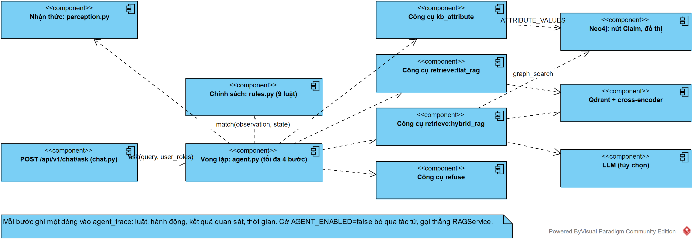

*Hình 5.1. Kiến trúc tác tử: nhận thức, chính sách, vòng lặp và bốn công cụ.*

Nhận thức không dùng mô hình học máy mà dùng lại chính bộ trích thực thể của KB, nên tác tử "nhìn" câu hỏi bằng cùng từ vựng với đồ thị:

```python
# ai-service/app/agent/perception.py (hàm perceive, rút gọn)
for shape, pattern in _SHAPES:                       # đếm / thời gian / có-không / liệt kê
    if re.search(pattern, folded):
        observation.shape = shape
        break
article = re.search(r"\bdieu\s+(\d{1,3})\b", folded)  # "Điều 15" -> article = "15"
for attribute, spec in SINGLE_VALUED.items():          # "vốn điều lệ ... bao nhiêu"
    if fold_text(spec["phrase"]) in folded and any(cue in folded for cue in _VALUE_CUES):
        observation.attribute = attribute
observation.entities = [e["name"] for e in extract_entities(question) if e["type"] not in LOCAL_ENTITY_TYPES]
```

### 5.5.3. Bảng luật

Luật được viết dưới dạng dữ liệu (`Rule(name, description, condition, action)`), duyệt theo thứ tự; luật đầu tiên có điều kiện đúng được kích hoạt. Bảng dưới được sinh tự động từ mã nguồn qua `GET /api/v1/chat/agent/rules`.

| Ưu tiên | Luật | NẾU | THÌ |
| ---: | :--- | :--- | :--- |
| 1 | R1_cau_hoi_rong | Câu hỏi dưới 2 từ có nghĩa | từ chối |
| 2 | R2_tra_loi_xong | Lần truy xuất trước đã qua cổng bằng chứng | trả lời |
| 3 | R3_thuoc_tinh_mot_gia_tri | Hỏi giá trị thuộc tính một giá trị (vốn điều lệ, mệnh giá), đồ thị khả dụng, chưa tra | `kb_attribute` |
| 4 | R4_thuoc_tinh_da_co | KB có giá trị được chấp nhận | trả lời |
| 5 | R5_dan_chieu_dieu_khoan | Câu hỏi nêu "Điều N", đồ thị khả dụng | `retrieve:hybrid_rag` |
| 6 | R6_co_thuc_the_trong_kb | Câu hỏi nhắc thực thể KB, đồ thị khả dụng, cờ `AGENT_ENTITY_HYBRID` bật (mặc định tắt, xem mục 5.6.2) | `retrieve:hybrid_rag` |
| 7 | R7_mac_dinh_vector | Chưa thử công cụ nào | `retrieve:flat_rag` |
| 8 | R8_thu_lai_mo_rong | Lần trước bị cổng từ chối, chưa thử truy xuất lai | `retrieve:hybrid_rag` |
| 9 | R9_tu_choi | Mọi trường hợp còn lại | từ chối |

*Bảng 5.3. Chính sách của tác tử hỏi đáp.*

Hai tính chất được kiểm thử tự động (`ai-service/tests/test_agent.py`, 9 ca): bảng luật luôn kết thúc bằng luật bắt-tất-cả nên tác tử luôn dừng; và khi Neo4j không khả dụng, tác tử không bao giờ chọn công cụ cần đồ thị.

### 5.5.4. Vòng lặp và ghi vết

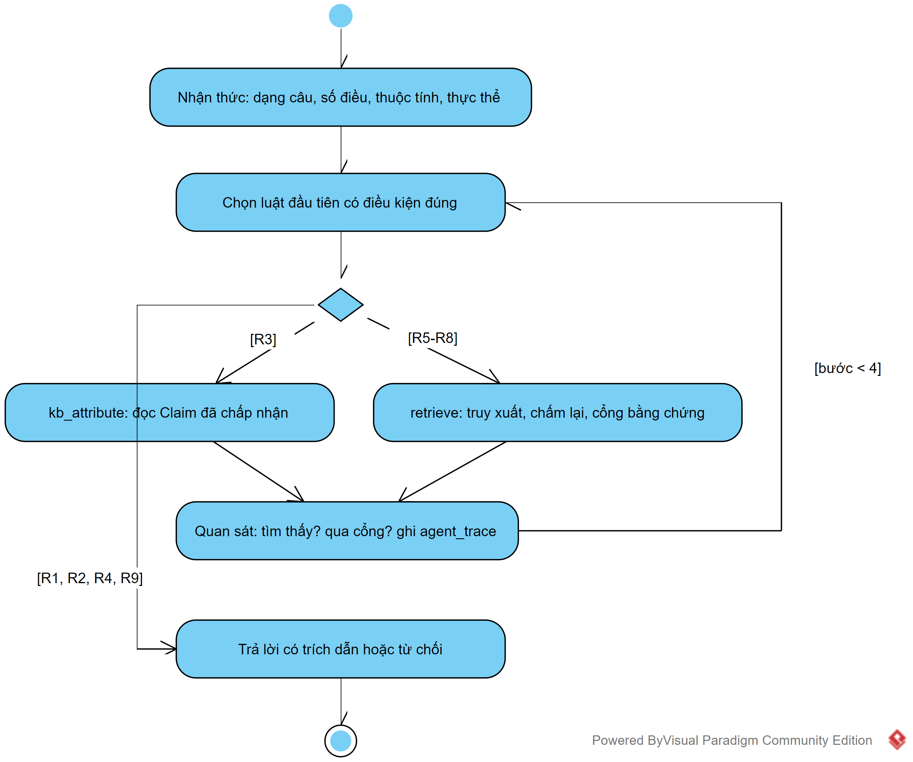

*Hình 5.2. Vòng lặp nhận thức – chọn luật – hành động – quan sát của tác tử.*

```python
# ai-service/app/agent/agent.py (vòng lặp chính, rút gọn)
while state.steps < MAX_STEPS:
    state.steps += 1
    rule = match(observation, state)                 # luật đầu tiên thỏa mãn
    if rule.action in ("respond", "refuse"):
        break
    if rule.action == "kb_attribute":
        response = self.kb_attribute(observation.attribute, query)
        state.attribute_found = response is not None
    elif rule.action.startswith("retrieve:"):
        response = self.retrieve(query, rule.action.split(":", 1)[1], **kwargs)
        state.last_answered = bool(response.citations)     # quan sát kết quả
```

Mỗi bước được ghi vào `AskResponse.agent_trace`. Ví dụ ghi vết thật của câu "Vốn điều lệ hiện nay của công ty là bao nhiêu?":

Nhận thức (bước 0): dạng câu hỏi: hỏi số lượng; thuộc tính một giá trị: Vốn điều lệ; thực thể KB: Vốn điều lệ.

| Bước | Luật kích hoạt | Hành động | Kết quả quan sát | Thời gian |
| ---: | :--- | :--- | :--- | ---: |
| 1 | `R3_thuoc_tinh_mot_gia_tri` | tra dữ kiện trong KB | tìm thấy giá trị được chấp nhận | 2,2 s |
| 2 | `R4_thuoc_tinh_da_co` | trả lời |  |  |

*Bảng 5.4. Vết xử lý của câu hỏi vốn điều lệ (chạy lại ngày 16/11/2026).*

Tác tử không truy xuất văn bản: luật R3 thấy câu hỏi về một thuộc tính một giá trị nên gọi `kb_attribute`, đọc nút `Claim` đã được phân định ở mục 4.15.7 và trả lời "13.074.049.490.000 đồng, theo Điều lệ năm 2026", kèm các giá trị cũ hơn đã bị thay thế. Ví dụ này chạy ở chế độ toàn đồ thị, chế độ dùng cho đánh giá (`CHAT_GRAPH_SOURCE_TYPE` để trống), vì Điều lệ 2025 và 2026 nằm trong KB1. Trong API hỏi đáp của người dùng, tác tử chỉ trích dẫn tài liệu tải lên (`CHAT_GRAPH_SOURCE_TYPE=upload`, mục 5.4) để mọi trích dẫn đều mở được PDF gốc.

Và của một câu hỏi không có thực thể, vector bị từ chối nên tác tử thử lại bằng truy xuất lai:

Nhận thức (bước 0): dạng câu hỏi: liệt kê; thực thể KB: không có.

| Bước | Luật kích hoạt | Hành động | Kết quả quan sát | Thời gian |
| ---: | :--- | :--- | :--- | ---: |
| 1 | `R7_mac_dinh_vector` | truy xuất vector | cổng bằng chứng từ chối | 10,0 s |
| 2 | `R8_thu_lai_mo_rong` | truy xuất lai | có bằng chứng, có trích dẫn (1 trích dẫn) | 11,5 s |
| 3 | `R2_tra_loi_xong` | trả lời |  |  |

*Bảng 5.5. Vết xử lý của một câu hỏi phải thử lại.*

Câu hỏi không chứa thực thể nên luật R7 chọn vector. Cổng bằng chứng từ chối kết quả, luật R8 thử lại bằng truy xuất lai và tìm được Điều 22 về an toàn, bảo mật thông tin. Với câu ngoài phạm vi "Công ty có bao nhiêu nhân viên?", chuỗi luật là `R7_mac_dinh_vector` → `R8_thu_lai_mo_rong` → `R9_tu_choi`: cả hai lần truy xuất đều bị cổng từ chối, tác tử từ chối thay vì đoán.

Trên 27 câu (26 câu của bộ đánh giá và câu vốn điều lệ), tác tử đi theo các chuỗi luật sau:

| Chuỗi luật | Số câu |
| :--- | ---: |
| `R7_mac_dinh_vector → R2_tra_loi_xong` | 19 |
| `R7_mac_dinh_vector → R8_thu_lai_mo_rong → R9_tu_choi` | 5 |
| `R3_thuoc_tinh_mot_gia_tri → R4_thuoc_tinh_da_co` | 1 |
| `R7_mac_dinh_vector → R8_thu_lai_mo_rong → R2_tra_loi_xong` | 1 |
| `R5_dan_chieu_dieu_khoan → R2_tra_loi_xong` | 1 |

*Bảng 5.6. Tần suất các chuỗi luật của tác tử.*

## 5.6. Học chính sách bằng học tăng cường

### 5.6.1. Bài toán

Luật R5–R8 do con người viết dựa trên quan sát. Câu hỏi đặt ra (K4) là: nếu để hệ thống **tự học** nên dùng chiến lược truy xuất nào cho loại câu hỏi nào, kết quả có tốt hơn luật không?

Bài toán được mô hình hóa thành **contextual multi-armed bandit**, dạng đơn giản nhất của học tăng cường (một bước quyết định cho mỗi câu hỏi, không có chuỗi trạng thái):

- **Ngữ cảnh** $x$: đặc trưng do bước nhận thức của tác tử sinh ra: dạng câu hỏi, có thực thể KB hay không, có số điều hay không.
- **Hành động (nhánh)** $a \in \{\text{flat\_rag}, \text{graph\_rag}, \text{hybrid\_rag}\}$.
- **Phần thưởng**: $r = \mathbb{1}[\text{câu trả lời đạt}] - \lambda \cdot t$, với $t$ là độ trễ (giây) và $\lambda = 0{,}02$. Phạt độ trễ để chính sách không chọn chiến lược đắt khi chiến lược rẻ cho kết quả như nhau.

Thuật toán **UCB1** chọn nhánh theo

> **Công thức 5.1.** $a_t = \arg\max_a \left[\bar r_{x,a} + \sqrt{\dfrac{2\ln n_x}{n_{x,a}}}\right]$

trong đó $\bar r_{x,a}$ là phần thưởng trung bình của nhánh $a$ trong ngữ cảnh $x$, $n_x$ là số lần gặp ngữ cảnh $x$ và $n_{x,a}$ là số lần chọn nhánh $a$ trong ngữ cảnh đó. Số hạng thứ hai khuyến khích thử nhánh ít được chọn (khám phá), số hạng thứ nhất khai thác nhánh tốt đã biết.

### 5.6.2. Thực nghiệm

Phần thưởng của mỗi nhánh lấy từ lần chạy đánh giá thật (mục 5.8): mỗi câu hỏi đã được trả lời bằng cả ba chiến lược. UCB1 học qua 200 lượt phát lại ngẫu nhiên. Để không "nhìn trộm" đáp án, chính sách được đánh giá bằng leave-one-out: mỗi câu được chấm bởi chính sách học từ 25 câu còn lại. Script: `ai-service/scripts/20_bandit_policy.py`.

| Chính sách | Phần thưởng trung bình |
| :--- | ---: |
| Luôn dùng vector | 0,595 |
| Luôn dùng đồ thị | 0,458 |
| Luôn dùng truy xuất lai | 0,599 |
| **Tác tử luật (mục 5.5)** | **0,618** |
| Bandit UCB1, leave-one-out | 0,432 |
| Cận trên: biết trước nhánh tốt nhất | 0,749 |

*Bảng 5.7. Phần thưởng trung bình của các chính sách chọn chiến lược (26 câu, 200 lượt học).*

Chính sách mà bandit học được trên toàn bộ dữ liệu, theo từng ngữ cảnh:

| Ngữ cảnh (dạng câu, có thực thể, có số điều) | Số câu | Nhánh được chọn | Thưởng vector / đồ thị / lai |
| :--- | ---: | :--- | :--- |
| điều khoản, có thực thể, có số điều | 1 | `graph_rag` | 0,89 / 0,95 / 0,92 |
| hỏi số lượng, không thực thể, không số điều | 2 | `graph_rag` | 0,89 / 0,98 / 0,92 |
| hỏi số lượng, có thực thể, không số điều | 6 | `hybrid_rag` | 0,49 / 0,36 / 0,53 |
| liệt kê, không thực thể, không số điều | 2 | `hybrid_rag` | 0,15 / -0,04 / 0,47 |
| liệt kê, có thực thể, không số điều | 2 | `graph_rag` | 0,45 / 0,72 / 0,33 |
| mở, không thực thể, không số điều | 3 | `hybrid_rag` | 0,90 / 0,62 / 0,92 |
| mở, có thực thể, không số điều | 2 | `hybrid_rag` | 0,82 / 0,55 / 0,90 |
| thời gian, không thực thể, không số điều | 1 | `hybrid_rag` | 0,88 / -0,07 / 0,90 |
| thời gian, có thực thể, không số điều | 2 | `graph_rag` | 0,63 / 0,97 / 0,58 |
| có/không, không thực thể, không số điều | 2 | `flat_rag` | 0,53 / -0,04 / 0,12 |
| có/không, có thực thể, không số điều | 3 | `flat_rag` | 0,64 / 0,15 / 0,30 |

*Bảng 5.8. Chính sách bandit học được theo ngữ cảnh.*

Tác tử luật đạt phần thưởng cao nhất trong các chính sách thực tế (0,618), nhỉnh hơn "luôn dùng truy xuất lai" (0,599) và "luôn dùng vector" (0,595). Bandit học bằng leave-one-out chỉ đạt 0,432, thấp hơn cả chính sách cố định đơn giản nhất. Nguyên nhân là dữ liệu quá ít: 26 câu chia vào 11 ngữ cảnh, nhiều ngữ cảnh chỉ có 1–2 câu, nên khi bỏ một câu ra để chấm thì ngữ cảnh đó gần như không còn dữ liệu học (Bảng 5.8).

Khoảng cách tới cận trên (0,749) cho thấy việc chọn chiến lược theo câu hỏi vẫn còn dư địa. Học tăng cường cũng đã góp phần sửa luật: bandit cho thấy với câu hỏi có thực thể, truy xuất lai không vượt trội rõ so với vector. Kiểm chứng trên tác tử: bật luật R6 (đưa mọi câu có thực thể sang truy xuất lai) cho tỷ lệ đạt 69,2%, tắt R6 cho 73,1%. Vì vậy R6 được giữ trong bảng luật nhưng tắt mặc định (`AGENT_ENTITY_HYBRID=false`). Kết luận thực tế: với quy mô dữ liệu hiện tại, luật do con người viết dựa trên quan sát vẫn tốt hơn chính sách học; học tăng cường trở nên có ích khi thu được phản hồi thật của người dùng (mục 5.9).

## 5.7. Triển khai nhiều mô hình

Theo vấn đề K5 và hạn chế V4 của Chương 3 (không tự huấn luyện mô hình), hệ thống triển khai nhiều mô hình ở cả ba tầng. Mô hình được chọn bằng biến môi trường, không sửa mã nguồn:

| Tầng | Mô hình đang dùng | Mô hình thay thế đã đo | Biến cấu hình |
| :--- | :--- | :--- | :--- |
| Nhúng (A) | `intfloat/multilingual-e5-small` | E5-Base, BKAI bi-encoder, MiniLM-L12 (Bảng 3.1, 3.2) | `EMBEDDING_MODEL`, `EMBEDDING_QUERY_PREFIX` |
| Chấm lại (B) | `cross-encoder/mmarco-mMiniLMv2-L12-H384-v1` | tắt chấm lại (Bảng 5.10) | `RERANKER_MODEL`, `RERANK_GATE` |
| Sinh câu trả lời | Gemini (`gemini-3.5-flash`) | OpenAI; `qwen2.5:3b` cục bộ qua Ollama; trích đoạn không LLM | `GEMINI_MODEL`, `LLM_BASE_URL`, `LLM_MODEL` |

*Bảng 5.9. Các mô hình được triển khai và cách thay thế.*

Tầng sinh có thứ tự dự phòng rõ ràng:

```python
# ai-service/app/llm_client.py (resolve_llm, rút gọn)
if settings.LLM_BASE_URL.strip() and settings.LLM_MODEL.strip():
    return LLM(client=_client(settings.LLM_API_KEY or "local", settings.LLM_BASE_URL),
               model=settings.LLM_MODEL, provider="openai-compatible")   # Ollama / vLLM
if _usable(settings.GEMINI_API_KEY):
    return LLM(client=_client(settings.GEMINI_API_KEY, GEMINI_BASE_URL),
               model=settings.GEMINI_MODEL, provider="gemini")
if _usable(settings.OPENAI_API_KEY):
    return LLM(client=_client(settings.OPENAI_API_KEY), model=settings.OPENAI_MODEL, provider="openai")
return None                                    # -> câu trả lời trích đoạn có trích dẫn
```

Khi không có LLM hoặc LLM lỗi, hệ thống vẫn trả lời bằng trích đoạn nguyên văn có trích dẫn. Khi LLM sinh câu trả lời mà bộ kiểm định không xác nhận được bằng ngữ cảnh, hệ thống cũng quay về trích đoạn (`RAGService.ask`).

## 5.8. Đánh giá toàn hệ thống

### 5.8.1. Thiết lập

Bộ đánh giá `ai-service/data/eval/eval_questions.json` có 26 câu: 18 câu có đoạn đúng được gán nhãn thủ công và 8 câu nằm ngoài phạm vi, phải từ chối. Mọi cấu hình chạy trên cùng dữ liệu (7 tài liệu upload trong Qdrant, KB 52 tài liệu trong Neo4j), cùng câu hỏi, ở chế độ trích đoạn (không LLM) để kết quả không lẫn với cách diễn đạt của LLM. Script: `ai-service/scripts/15_run_eval.py`.

### 5.8.2. Kết quả

| Cấu hình | Tỷ lệ đạt | MRR | Recall@3 | Trích dẫn đúng | Từ chối đúng | Từ chối nhầm | Độ trễ TB |
| :--- | ---: | ---: | ---: | ---: | ---: | ---: | ---: |
| Chỉ vector | 73,1% | 0,676 | 0,778 | 77,8% | 62,5% | 5,6% | 6,8 s |
| Chỉ đồ thị | 50,0% | 0,296 | 0,389 | 33,3% | 87,5% | 27,8% | 2,1 s |
| Truy xuất lai | 69,2% | 0,745 | 0,833 | 72,2% | 62,5% | 0,0% | 4,7 s |
| Truy xuất lai, tắt chấm lại | 57,7% | 0,516 | 0,611 | 77,8% | 37,5% | 5,6% | 0,9 s |
| **Tác tử luật** | 73,1% | 0,690 | 0,778 | 77,8% | 62,5% | 0,0% | 5,6 s |

*Bảng 5.10. Đánh giá đầu–cuối trên 26 câu hỏi (15/11/2026, chế độ trích đoạn, không LLM).*

Tác tử đạt tỷ lệ đạt cao nhất (73,1%, bằng cấu hình chỉ vector) và là cấu hình duy nhất vừa không từ chối nhầm câu có đáp án (0,0%) vừa giữ trích dẫn đúng ở mức cao nhất (77,8%, bằng cấu hình chỉ vector). So với chỉ vector, tác tử loại được lần từ chối nhầm (5,6% → 0,0%) nhờ luật R8 thử lại bằng truy xuất lai, và trả lời câu hỏi thuộc tính từ KB đã phân định.

Bộ chấm lại cross-encoder là thành phần đóng góp lớn nhất: tắt nó, MRR giảm từ 0,745 xuống 0,516 và tỷ lệ đạt giảm xuống 57,7%; đổi lại độ trễ giảm còn 0,9 s. Từ chối đúng của tác tử, vector và truy xuất lai chỉ ở mức 62,5% (5/8 câu ngoài phạm vi): ba câu ngoài phạm vi vẫn tìm được đoạn có điểm vượt cổng. Cấu hình chỉ đồ thị từ chối đúng 87,5% nhưng chủ yếu vì nó từ chối nhiều, kể cả 27,8% câu có đáp án. Đây là hạn chế chính cần cải thiện, ví dụ bằng cổng bằng chứng theo ngưỡng riêng cho từng dạng câu hỏi.

Độ trễ đo trên máy cá nhân chạy CPU, dao động giữa các lần chạy, nên chỉ dùng để so sánh tương đối.

## 5.9. Hạn chế và hướng phát triển

- **Tác tử đơn:** hệ thống có một tác tử điều phối các công cụ. Hướng phát triển là hệ đa tác tử, ví dụ một tác tử truy xuất, một tác tử kiểm định, một tác tử cập nhật KB, giao tiếp qua hàng đợi thông điệp.
- **Học tăng cường ngoại tuyến, mẫu nhỏ:** chính sách bandit học từ 26 câu đã chấm sẵn. Hướng phát triển là thu phản hồi người dùng (nút "hữu ích/không hữu ích" trên giao diện) làm phần thưởng trực tuyến.
- **Luật viết tay:** luật R5–R8 và ngưỡng phần thưởng dựa trên quan sát của nhóm. Khi bộ đánh giá lớn hơn, nên để chính sách học thay cho các luật này, giữ luật an toàn (R1, R9) làm ràng buộc cứng.
- **Đánh giá với LLM chưa đầy đủ:** quota miễn phí của Gemini không đủ cho một lượt đánh giá đầy đủ (khoảng 50 yêu cầu); số liệu sinh câu trả lời bằng LLM chưa được báo cáo.

## 5.10. KẾT LUẬN

Chương 5 đã trả lời sáu vấn đề đặt ra ở mục 5.1:

- **K1, K2 (kết nối module, bảo mật):** tám dịch vụ kết nối qua REST theo hợp đồng cố định; mỗi mối nối được chỉ ra bằng đoạn mã thật (mục 5.3). Backend là cổng duy nhất, tự gắn quyền từ JWT; dịch vụ AI chỉ nhận yêu cầu có `X-Internal-Token`; quyền được lọc ngay trong truy vấn Qdrant và Cypher (mục 5.4).
- **K3 (chọn chiến lược):** tác tử dựa trên luật với chín luật, bốn bước nhận thức – chọn luật – hành động – quan sát, ghi vết từng quyết định. Tác tử đạt tỷ lệ đạt 73,1%, không từ chối nhầm câu nào và đọc được dữ kiện đã phân định trong KB (mục 5.5, 5.8).
- **K4 (luật hay học):** contextual bandit UCB1 đạt 0,432 so với 0,618 của tác tử luật trên 26 câu; học tăng cường chưa thắng luật vì thiếu dữ liệu, nhưng đã giúp điều chỉnh luật R6 (mục 5.6).
- **K5 (nhiều mô hình):** ba tầng mô hình (nhúng, chấm lại, sinh) thay được bằng biến môi trường; tầng sinh có thứ tự dự phòng và luôn có đường trích đoạn khi không có LLM (mục 5.7).
- **K6 (kiểm chứng toàn hệ thống):** năm cấu hình được đo trên cùng bộ 26 câu với các chỉ số truy xuất, trích dẫn, từ chối và độ trễ (mục 5.8).

Kết quả của chương là một hệ thống chạy đầu–cuối, trong đó mô hình của Chương 3 và cơ sở tri thức của Chương 4 được một tác tử điều phối, mọi câu trả lời đều truy vết được tới trang PDF gốc. Hướng phát triển là hệ đa tác tử và học tăng cường trực tuyến từ phản hồi người dùng.
