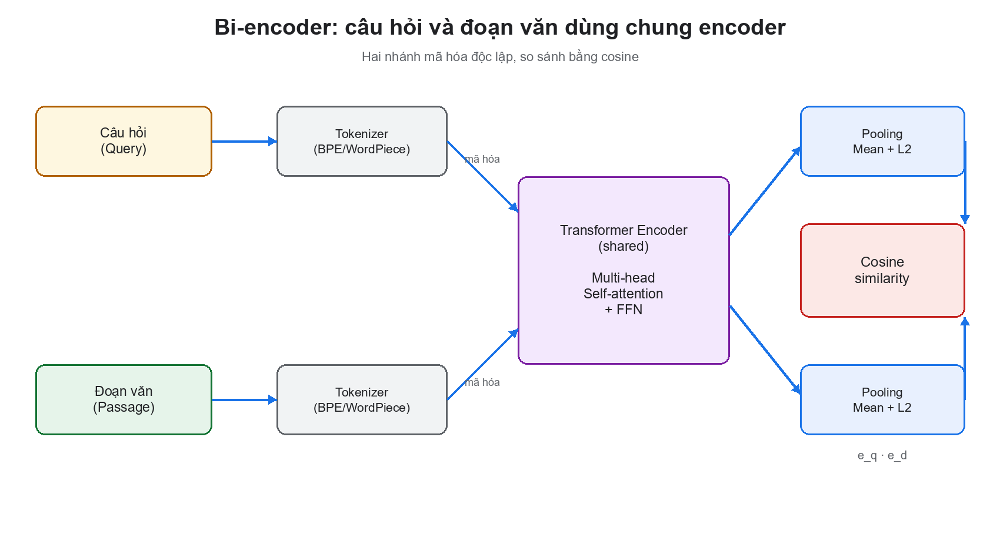
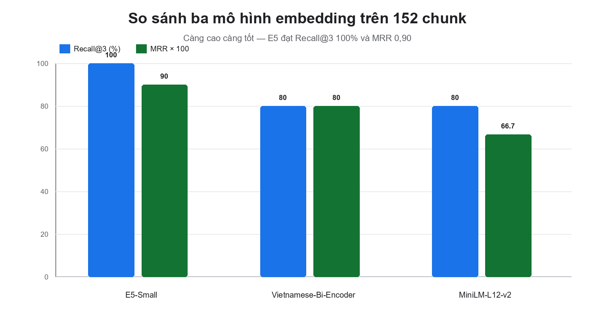
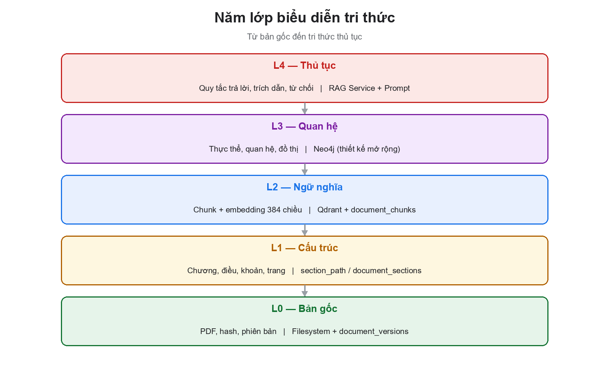
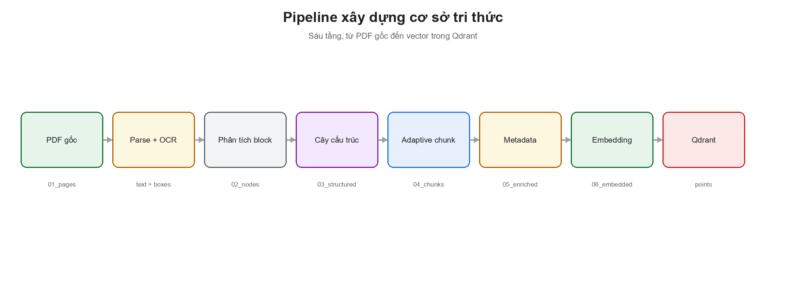
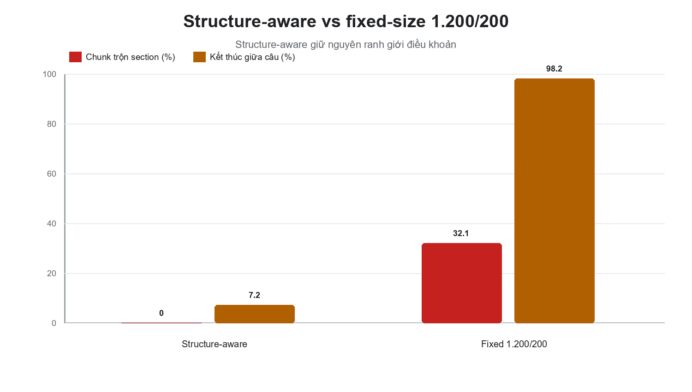
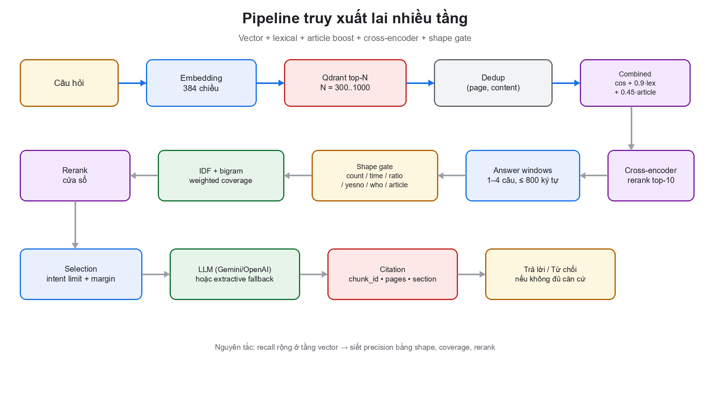
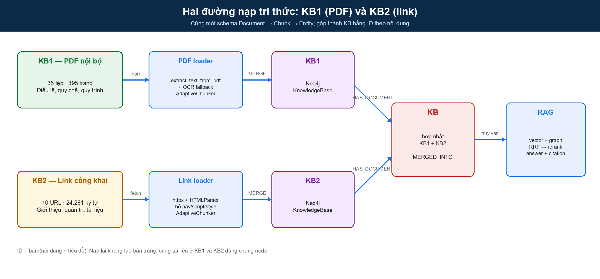
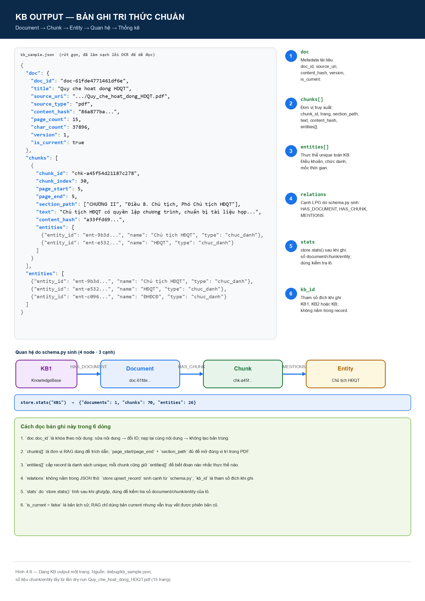
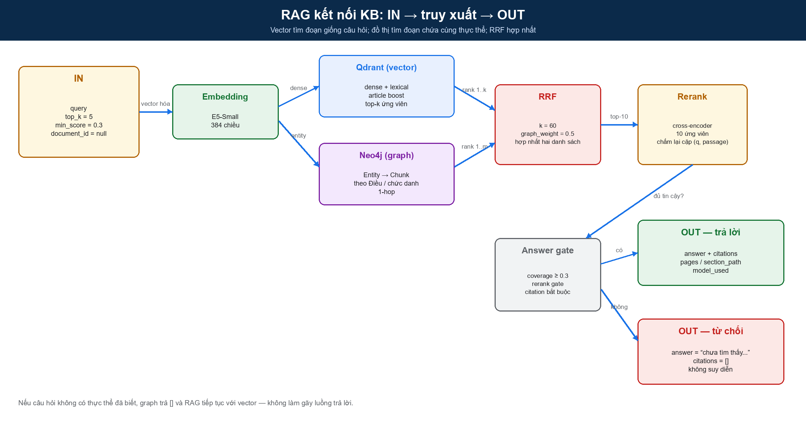

# CHƯƠNG 3. HỌC SÂU TRONG BIỂU DIỄN NGỮ NGHĨA: TỪ KIẾN TRÚC TRANSFORMER ĐẾN LỰA CHỌN MÔ HÌNH NHÚNG TIẾNG VIỆT

> **Mục tiêu của chương.** Chương này trình bày cơ sở học sâu (Deep Learning) đằng sau thành phần cốt lõi nhất của hệ thống: mô hình biểu diễn ngữ nghĩa (embedding) và mô hình chấm lại (reranker). Nội dung không dừng ở việc liệt kê khái niệm mà đi từ bài toán học biểu diễn, kiến trúc Transformer, hàm mất mát tương phản, đến thiết kế thực nghiệm có kiểm soát và kết quả lựa chọn mô hình nhúng cho tiếng Việt. Kết quả của chương là căn cứ khoa học để chốt cấu hình `intfloat/multilingual-e5-small` (384 chiều, cosine) cho toàn bộ pipeline tri xuất của hệ thống EAKWP.

---

## 3.1. Đặt vấn đề: vì sao một hệ thống RAG cần chương về học sâu

Trong các hệ thống hỏi đáp tri thức doanh nghiệp, chất lượng câu trả lời không phụ thuộc trực tiếp vào mô hình ngôn ngữ lớn (LLM) mà phụ thuộc trước hết vào **chất lượng biểu diễn và truy xuất**. Một LLM mạnh nhưng nhận sai ngữ cảnh sẽ trả lời sai một cách thuyết phục; ngược lại, một LLM nhỏ nhưng nhận đúng đoạn điều khoản, đúng trang, đúng khoản mục vẫn có thể trả lời chính xác và có căn cứ. Vì vậy, bài toán trung tâm của hệ thống là:

> Cho một câu hỏi $q$ bằng ngôn ngữ tự nhiên, tìm trong kho tài liệu $D$ một tập đoạn $C_k = \{c_1, ..., c_k\}$ sao cho nội dung của chúng chứa câu trả lời, rồi chuyển tập đoạn này thành ngữ cảnh có thể kiểm chứng cho LLM.

Có ba cách tiếp cận truyền thống:

1. **Tìm kiếm từ khóa (lexical search):** dùng BM25, TF-IDF hoặc `LIKE` trên cơ sở dữ liệu. Cách này nhanh nhưng thất bại khi người dùng diễn đạt khác từ trong văn bản (ví dụ hỏi “được nghỉ bao nhiêu ngày” trong khi tài liệu viết “số ngày nghỉ phép năm”).
2. **Tìm kiếm ngữ nghĩa bằng đặc trưng thủ công:** gán nhãn thực thể, từ đồng nghĩa, rule. Cách này phụ thuộc rất lớn vào công sức con người và không mở rộng được với hàng chục nghìn trang văn bản pháp lý.
3. **Học biểu diễn (representation learning):** dùng mạng nơ-ron để ánh xạ câu hỏi và đoạn văn vào cùng một không gian vector, nơi khoảng cách cosine phản ánh mức độ tương đồng ngữ nghĩa. Đây là nền tảng của **embedding** và là lý do hệ thống cần một chương về học sâu.

Điểm mấu chốt là học sâu không chỉ là “dùng mô hình lớn”. Học sâu cung cấp một cách biểu diễn có thể học được: thay vì con người định nghĩa đặc trưng, mô hình tự học các đặc trưng phân cấp từ dữ liệu. Với văn bản tiếng Việt, các đặc trưng này bao gồm cả cấu trúc từ, ngữ nghĩa câu, và quan hệ giữa câu hỏi với đoạn trả lời. Chương này làm rõ ba câu hỏi:

- **Học sâu biểu diễn văn bản như thế nào?** Từ token, embedding, self-attention đến vector câu.
- **Làm sao huấn luyện một mô hình biết “câu hỏi nào gần đoạn trả lời nào”?** Học tương phản (contrastive learning) và hàm mất mát InfoNCE.
- **Làm sao chọn mô hình phù hợp với tiếng Việt và giới hạn CPU của hệ thống?** Thiết kế thực nghiệm so sánh ba mô hình, đo Recall@k, MRR, độ trễ và thông lượng.

---

## 3.2. Biểu diễn dữ liệu và bài toán học sâu

### 3.2.1. Từ đặc trưng thủ công đến học biểu diễn

Trong học máy truyền thống, một văn bản được biểu diễn bằng vector thưa (sparse vector) như túi từ (bag-of-words) hoặc TF-IDF. Mỗi chiều tương ứng một từ trong từ điển; giá trị là tần suất hoặc trọng số nghịch đảo tần suất. Cách biểu diễn này có hai hạn chế cố hữu:

- **Không hiểu ngữ nghĩa:** “xe hơi” và “ô tô” là hai vector trực giao dù cùng nghĩa.
- **Không hiểu ngữ cảnh:** “điều 5” trong “Điều 5 quy định...” và “điều 5” trong “điều 5 khoản 2” có thể giống nhau về mặt từ vựng nhưng khác nhau về vai trò cấu trúc.

Học sâu thay thế bằng **biểu diễn phân tán (distributed representation)**: mỗi từ hoặc câu là một vector đặc (dense vector) trong không gian $\mathbb{R}^m$, trong đó các chiều không còn tương ứng với từ cụ thể mà mã hóa các thuộc tính ngữ nghĩa trừu tượng. Một mô hình tốt sẽ đặt các câu có nghĩa gần nhau vào gần nhau, bất kể chúng dùng từ ngữ bề mặt nào.

Về mặt hình thức, một mô hình học sâu là một hàm có tham số:

> **Công thức 3.1.** $f_\theta : \mathcal{X} \rightarrow \mathcal{Y}$, trong đó $\mathcal{X}$ là không gian đầu vào (văn bản, token), $\mathcal{Y}$ là không gian đầu ra (nhãn, vector, phân phối), và $\theta$ là tập tham số học được.

Với bài toán biểu diễn, $\mathcal{Y} = \mathbb{R}^m$ và $f_\theta$ là một encoder. Với bài toán sinh văn bản, $\mathcal{Y}$ là phân phối xác suất trên từ vựng. Với bài toán chấm lại, $\mathcal{Y}$ là một số thực biểu thị mức độ liên quan.

### 3.2.2. Hàm giả thuyết, hàm mất mát và tối ưu

Một mạng nơ-ron nhiều tầng được xây dựng từ các phép biến đổi tuyến tính và phi tuyến:

> **Công thức 3.2.** $h^{(l)} = \sigma\left(W^{(l)} h^{(l-1)} + b^{(l)}\right)$

Trong đó $W^{(l)}$ là ma trận trọng số, $b^{(l)}$ là bias, và $\sigma$ là hàm kích hoạt phi tuyến (ReLU, GELU, tanh). Nếu chỉ có các phép tuyến tính, nhiều tầng sẽ tương đương một tầng; chính hàm phi tuyến cho phép mạng xấp xỉ các hàm phức tạp.

Quá trình huấn luyện giải bài toán tối ưu:

> **Công thức 3.3.** $\theta^* = \arg\min_\theta \frac{1}{N}\sum_{i=1}^{N} \mathcal{L}\left(f_\theta(x_i), y_i\right) + \lambda \|\theta\|_2^2$

Trong đó $\mathcal{L}$ là hàm mất mát, $N$ là số mẫu, và số hạng $\lambda \|\theta\|_2^2$ là chuẩn hóa L2 để giảm quá khớp. Với bài toán phân loại, $\mathcal{L}$ thường là cross-entropy:

> **Công thức 3.4.** $\mathcal{L}_{CE} = -\sum_{c=1}^{C} y_c \log \hat{y}_c$

Với bài toán biểu diễn, hàm mất mát không còn là phân loại nhãn mà là **so sánh cặp** (pairwise) hoặc **tương phản** (contrastive), sẽ trình bày ở mục 3.4.

Việc tối ưu được thực hiện bằng lan truyền ngược (backpropagation) và các bộ tối ưu hiện đại như Adam:

> **Công thức 3.5.** $m_t = \beta_1 m_{t-1} + (1-\beta_1) g_t$; $v_t = \beta_2 v_{t-1} + (1-\beta_2) g_t^2$; $\theta_t = \theta_{t-1} - \eta \frac{\hat{m}_t}{\sqrt{\hat{v}_t} + \epsilon}$

Trong đó $g_t$ là gradient tại bước $t$, $\eta$ là learning rate, $\beta_1, \beta_2$ là hệ số suy giảm mô-men. Adam thích nghi learning rate cho từng tham số, giúp huấn luyện ổn định hơn so với gradient descent thuần.

### 3.2.3. Các thành phần chống quá khớp

Một mô hình học sâu có thể ghi nhớ dữ liệu huấn luyện thay vì học quy luật. Các kỹ thuật thường dùng:

- **Dropout:** tắt ngẫu nhiên một tỷ lệ neuron trong lúc huấn luyện, buộc mạng không phụ thuộc vào một đường đi duy nhất.
- **Weight decay:** phạt trọng số lớn, giữ mô hình đơn giản.
- **Early stopping:** dừng khi loss trên tập validation bắt đầu tăng.
- **Data augmentation:** thêm nhiễu, thay đổi cách diễn đạt, hoặc sinh cặp câu hỏi–đoạn trả lời tổng hợp.
- **Batch normalization / Layer normalization:** chuẩn hóa phân phối kích hoạt, giúp huấn luyện sâu ổn định.

Trong bài toán embedding, một dạng “chống quá khớp” quan trọng hơn là **chuẩn hóa vector** và **negative sampling chất lượng**: nếu mô hình chỉ thấy các cặp dễ, nó sẽ học ranh giới kém. Nội dung này được phân tích ở mục 3.4.

---

## 3.3. Kiến trúc Transformer

### 3.3.1. Vì sao Transformer thay thế RNN

Trước Transformer, các mô hình tuần tự như RNN/LSTM xử lý văn bản theo từng bước, thông tin phải “chảy” qua trạng thái ẩn qua nhiều bước. Điều này gây ra hai vấn đề:

- **Khó song song hóa:** mỗi bước phụ thuộc bước trước, không tận dụng được GPU/CPU nhiều lõi.
- **Quên xa (long-range dependency):** thông tin ở đầu câu khó đến được cuối câu nếu câu dài.

Transformer (Vaswani và cộng sự, 2017) giải quyết bằng cơ chế **self-attention**: mỗi token có thể “nhìn” trực tiếp mọi token khác trong câu, với trọng số học được. Khoảng cách giữa các token không còn là số bước tuần tự mà là một phép tính song song.

### 3.3.2. Tokenization và embedding đầu vào

Văn bản được chia thành các đơn vị nhỏ (token) bằng thuật toán như BPE (Byte-Pair Encoding) hoặc WordPiece. Mỗi token được ánh xạ thành một vector $x_i \in \mathbb{R}^d$ thông qua bảng embedding. Vì self-attention không có khái niệm thứ tự, người ta cộng thêm **positional encoding**:

> **Công thức 3.6.** $PE_{(pos, 2i)} = \sin\left(\frac{pos}{10000^{2i/d}}\right)$; $PE_{(pos, 2i+1)} = \cos\left(\frac{pos}{10000^{2i/d}}\right)$

Vector đầu vào của token thứ $i$ là:

> **Công thức 3.7.** $h_i^{(0)} = E[t_i] + PE_i$

Trong đó $E$ là bảng embedding học được. Với tiếng Việt, tokenization có thể tách theo âm tiết hoặc theo từ ghép tùy mô hình; điều này ảnh hưởng đến độ dài chuỗi và chất lượng biểu diễn.

### 3.3.3. Self-attention

Với mỗi token, mô hình tạo ba vector truy vấn (Query), khóa (Key), giá trị (Value) bằng các phép chiếu tuyến tính:

> **Công thức 3.8.** $Q = XW_Q$, $K = XW_K$, $V = XW_V$

Trong đó $X \in \mathbb{R}^{n \times d}$ là ma trận biểu diễn của $n$ token. Điểm chú ý giữa token $i$ và token $j$ là tích vô hướng giữa $Q_i$ và $K_j$, chia cho $\sqrt{d_k}$ để ổn định đạo hàm:

> **Công thức 3.9.** $\text{Attention}(Q, K, V) = \text{softmax}\left(\frac{QK^T}{\sqrt{d_k}}\right)V$

Hàm softmax biến điểm số thành phân phối chú ý có tổng bằng 1. Kết quả là mỗi token nhận một vector mới là tổng có trọng số của các value, trong đó trọng số thể hiện mức độ liên quan.

### 3.3.4. Multi-head attention

Một đầu chú ý chỉ học được một loại quan hệ. Multi-head attention chạy $h$ phép chú ý song song với các phép chiếu khác nhau, rồi nối kết quả:

> **Công thức 3.10.** $\text{MultiHead}(Q,K,V) = \text{Concat}(\text{head}_1, ..., \text{head}_h)W_O$

Mỗi head có thể chuyên trách một khía cạnh: quan hệ ngữ pháp, đồng tham chiếu, vị trí, hoặc ranh giới điều khoản. Với văn bản pháp lý, điều này đặc biệt hữu ích vì một câu có thể vừa tham chiếu “Điều 5”, vừa nêu ngoại lệ “trừ trường hợp...”, vừa liên kết đến “khoản 2”.

### 3.3.5. Residual, LayerNorm và Feed-Forward

Mỗi khối Transformer gồm hai thành phần chính:

1. **Multi-head self-attention** + kết nối tắt (residual) + LayerNorm.
2. **Feed-forward network** (hai lớp tuyến tính + GELU) + residual + LayerNorm.

> **Công thức 3.11.** $h' = \text{LayerNorm}\left(h + \text{MultiHead}(h)\right)$
>
> **Công thức 3.12.** $h'' = \text{LayerNorm}\left(h' + \text{FFN}(h')\right)$

Kết nối tắt giúp gradient lan truyền qua nhiều tầng mà không bị triệt tiêu; LayerNorm giữ phân phối kích hoạt ổn định. FFN mở rộng chiều ẩn (thường gấp 4 lần) để tăng khả năng biểu diễn phi tuyến.

### 3.3.6. Ba biến thể kiến trúc

| Biến thể | Đại diện | Cơ chế chú ý | Phù hợp với |
| :--- | :--- | :--- | :--- |
| Encoder-only | BERT, RoBERTa, E5 | Hai chiều (bidirectional) | Biểu diễn câu, phân loại, embedding |
| Decoder-only | GPT, Llama, Gemini | Nhân quả (causal) | Sinh văn bản, hội thoại |
| Encoder–decoder | T5, BART | Encoder hai chiều + decoder nhân quả | Dịch, tóm tắt, sinh có điều kiện |

Hệ thống EAKWP dùng **encoder-only** cho embedding và reranker, **decoder-only** (qua API) cho sinh câu trả lời. Lý do: encoder-only tạo biểu diễn hai chiều tốt cho toàn bộ đoạn văn, trong khi decoder-only tối ưu cho việc dự đoán token tiếp theo.

### 3.3.7. Độ phức tạp và giới hạn

Self-attention có độ phức tạp $O(n^2 d)$ theo số token $n$, vì phải tính ma trận $QK^T$ kích thước $n \times n$. Với đoạn văn dài (hàng nghìn token), chi phí bộ nhớ tăng bình phương. Các giải pháp như sliding window, sparse attention, hoặc chia nhỏ đoạn được dùng trong thực tế. Trong hệ thống này, chunking giữ mỗi đoạn khoảng 1.200 ký tự (~300 token), nằm trong giới hạn tối ưu của các mô hình encoder nhỏ.

---

## 3.4. Bi-encoder và học tương phản

### 3.4.1. Kiến trúc bi-encoder

Bi-encoder dùng **một encoder dùng chung** (shared encoder) để mã hóa độc lập câu hỏi và đoạn văn:

> **Công thức 3.13.** $e_q = f_\theta(q)$, $e_d = f_\theta(d)$

Sau đó so sánh hai vector bằng cosine. Ưu điểm lớn nhất là **tách rời pha mã hóa**: toàn bộ đoạn văn có thể được mã hóa trước và lưu trong vector database; khi có câu hỏi, chỉ cần mã hóa câu hỏi rồi tìm kiếm. Chi phí truy vấn không phụ thuộc số lượng tài liệu.



*Hình 3.1. Bi-encoder dùng chung encoder cho câu hỏi và đoạn văn, so sánh bằng cosine.*

Nhược điểm: câu hỏi và đoạn văn không được “nhìn thấy” nhau trong lúc mã hóa, nên mô hình không thể so sánh chi tiết từng từ. Đó là lý do cần **cross-encoder reranker** ở bước sau.

### 3.4.2. Hàm mất mát tương phản InfoNCE

Mục tiêu huấn luyện: câu hỏi $q$ phải gần đoạn trả lời đúng $d^+$ và xa các đoạn không liên quan $d^-$. Với một batch gồm $N$ cặp, InfoNCE xem bài toán là phân loại $N$ lớp: đoạn đúng là lớp mục tiêu, các đoạn còn lại là negative:

> **Công thức 3.14.** $\mathcal{L}_{InfoNCE} = -\frac{1}{N}\sum_{i=1}^{N}\log\frac{\exp\left(\text{sim}(e_{q_i}, e_{d_i^+})/\tau\right)}{\sum_{j=1}^{N}\exp\left(\text{sim}(e_{q_i}, e_{d_j})/\tau\right)}$

Trong đó $\tau$ là nhiệt độ (temperature) điều chỉnh độ sắc của phân phối. Công thức này khuyến khích mô hình tăng tương đồng với positive và giảm tương đồng với negative trong cùng batch. Các negative “khó” (hard negatives) — đoạn có từ khóa giống nhưng ngữ cảnh khác — giúp mô hình học ranh giới tốt hơn.

### 3.4.3. Negative sampling

Có ba loại negative:

- **In-batch negatives:** dùng các đoạn của câu hỏi khác trong cùng batch. Rẻ và hiệu quả, nhưng có thể trùng ngẫu nhiên với positive.
- **Hard negatives:** các đoạn được retriever hiện tại xếp hạng cao nhưng không phải đáp án. Giúp mô hình sửa lỗi cụ thể.
- **Random negatives:** đoạn ngẫu nhiên trong kho. Dễ nhưng ít thông tin.

Trong thực tế, E5 được huấn luyện trên dữ liệu yếu (weakly supervised) quy mô lớn, với nhiều cặp câu hỏi–đoạn văn từ web và các bộ dữ liệu QA. Vì vậy nó có khả năng tổng quát hóa tốt ngay cả khi không fine-tune trên dữ liệu doanh nghiệp.

### 3.4.4. Chuẩn hóa vector và cosine

Để cosine ổn định, vector được chuẩn hóa L2:

> **Công thức 3.15.** $\hat{e} = \frac{e}{\|e\|_2}$

Khi đó:

> **Công thức 3.16.** $\cos(e_q, e_d) = \hat{e}_q \cdot \hat{e}_d = \sum_{i=1}^{m}\hat{e}_{q,i}\hat{e}_{d,i}$

Giá trị nằm trong $[-1, 1]$. Với embedding văn bản, các giá trị thường dương và tập trung trong một khoảng hẹp; vì vậy cần chuẩn hóa và hiệu chỉnh ngưỡng theo từng mô hình (xem mục 4.8).

### 3.4.5. Cross-encoder reranker

Cross-encoder nhận đồng thời câu hỏi và đoạn văn, đưa qua encoder để tạo biểu diễn chung, rồi xuất một điểm liên quan:

> **Công thức 3.17.** $s(q, d) = \sigma\left(W \cdot f_\theta([q; d]) + b\right)$

Vì câu hỏi và đoạn văn được xử lý cùng nhau, cross-encoder nắm được tương tác từng từ và thường chính xác hơn bi-encoder. Nhược điểm là phải chạy mô hình cho từng cặp, không thể precompute. Vì vậy kiến trúc chuẩn là:

1. Bi-encoder lấy top-$N$ ứng viên (nhanh, phủ rộng).
2. Cross-encoder chấm lại top-$N$ (chậm nhưng chính xác).
3. Lấy top-$k$ cuối cùng.

Hệ thống dùng `cross-encoder/mmarco-mMiniLMv2-L12-H384-v1` cho bước rerank, với $N$ mặc định 10 ứng viên.

---

## 3.5. Mô hình nhúng cho tiếng Việt

### 3.5.1. Đặc thù của văn bản tiếng Việt

Tiếng Việt đặt ra một số thách thức riêng cho embedding:

1. **Dấu thanh và dấu phụ:** “nghỉ” khác “nghi”, “phép” khác “phep”. Nếu chuẩn hóa sai, nghĩa thay đổi hoàn toàn.
2. **Từ ghép và khoảng trắng:** “người lao động” là một khái niệm nhưng gồm ba âm tiết; tokenizer có thể tách rời làm mất nghĩa.
3. **Nhiễu OCR:** tài liệu scan thường mất dấu, nhầm dấu, hoặc lẫn ký tự Latin (ví dụ “Điều” thành “Diều”). Mô hình cần bền với lỗi bề mặt.
4. **Thuật ngữ pháp lý:** “điều”, “khoản”, “điểm”, “nghị quyết”, “đại hội đồng cổ đông” là các thực thể có cấu trúc, không chỉ là từ thông thường.
5. **Hiện tượng đa ngữ:** văn bản doanh nghiệp có thể chứa tiếng Anh (tên chức danh, mã chứng khoán, tên hệ thống).

Vì vậy, một mô hình tốt cho tiếng Việt không chỉ cần “biết tiếng Việt” mà còn cần **ổn định trước nhiễu OCR** và **hiểu cấu trúc điều khoản**.

### 3.5.2. Ba mô hình ứng viên

| Tiêu chí | MiniLM-L12-v2 | Vietnamese-Bi-Encoder | Multilingual-E5-Small |
| :--- | :--- | :--- | :--- |
| Mã mô hình | `sentence-transformers/paraphrase-multilingual-MiniLM-L12-v2` | `bkai-foundation-models/vietnamese-bi-encoder` | `intfloat/multilingual-e5-small` |
| Đơn vị phát triển | Hugging Face / SentenceTransformers | BKAI — ĐH Bách Khoa Hà Nội | Microsoft Research |
| Kiến trúc | MiniLM đa ngữ | RoBERTa tiếng Việt | E5 (encoder-only) |
| Số chiều | 384 | 768 | 384 |
| Dung lượng ước tính | ~470 MB | ~540 MB | ~470 MB |
| Ngôn ngữ | 50+ ngôn ngữ | Tiếng Việt | 100+ ngôn ngữ |
| Tiền tố | Không | Không | `query: ` / `passage: ` |
| Điểm mạnh | Nhanh, nhẹ, phổ biến | Hiểu tiếng Việt chuyên sâu | Cân bằng đa ngữ, huấn luyện tương phản quy mô lớn |
| Điểm yếu | Yếu với câu hỏi pháp lý dài | Vector lớn, chậm hơn | Cần tiền tố đúng cách |

### 3.5.3. Tiêu chí lựa chọn

Nhóm nghiên cứu đặt ra năm tiêu chí, theo thứ tự ưu tiên:

1. **Độ chính xác truy xuất:** Recall@1, Recall@3, MRR trên bộ câu hỏi ground truth.
2. **Chi phí lưu trữ:** số chiều vector quyết định dung lượng Qdrant và băng thông khi tìm kiếm.
3. **Độ trễ truy vấn:** phải đủ nhanh để người dùng không phải chờ.
4. **Thông lượng mã hóa:** số chunk/giây khi nạp tài liệu.
5. **Khả năng chạy trên CPU:** hệ thống triển khai trong Docker, không giả định GPU rời.

Tiêu chí 1 là điều kiện tiên quyết; các tiêu chí còn lại là ràng buộc tài nguyên. Một mô hình chính xác hơn 20% nhưng chậm gấp 10 lần có thể vẫn chấp nhận được nếu chỉ dùng offline; ngược lại, mô hình chạy online phải đáp ứng ngân sách độ trễ.

<!-- LANDSCAPE:START -->

### 3.5.4. Bảng so sánh kiến trúc và cấu hình huấn luyện (in ngang)

Bảng dưới đây bổ sung góc nhìn kỹ thuật cho phần so sánh định tính: không chỉ "mô hình nào tốt hơn" mà còn **vì sao** - số lớp, kích thước ẩn, tham số, độ dài token, learning rate và epoch. Đây là các trường mà một bảng so sánh thông thường hay bỏ qua, trong khi chúng quyết định chi phí huấn luyện, khả năng chạy CPU và độ dài ngữ cảnh.

**Bảng 3.1. So sánh kiến trúc, cấu hình huấn luyện và kết quả của các mô hình**

| Mô hình | Đặc trưng | Kiến trúc | Số layer | Hidden / Heads | Tham số | Max token | Learning rate | Epoch | Batch | Recall@1 / @3 | MRR |
| :--- | :--- | :--- | :---: | :---: | :---: | :---: | :--- | :---: | :---: | :---: | :---: |
| **MiniLM-L12-v2** | 384d; mean pooling; không prefix; 50+ ngôn ngữ; XLM-R 250k | MiniLM-L12 (BERT encoder) | 12 | 384 / 12 | ~118 M | 128 | 0 (zero-shot) | 0 | 32 | 60,0% / 80,0% | 0,6667 |
| **Vietnamese-Bi-Encoder** | 768d; mean pooling; không prefix; tiếng Việt; PhoBERT 64k | RoBERTa-base (PhoBERT) | 12 | 768 / 12 | ~135 M | 258 | 0 (zero-shot) | 0 | 32 | 80,0% / 80,0% | 0,8000 |
| **Multilingual-E5-Small** | 384d; mean pooling; prefix `query:` / `passage:`; 100+ ngôn ngữ; XLM-R 250k | E5-small (BERT encoder) | 12 | 384 / 12 | ~118 M | 512 | 0 (zero-shot) | 0 | 32 | 80,0% / 100,0% | 0,9000 |
| **Reranker mmarco** | 1 điểm; cặp (query, passage); không vector; 100+ ngôn ngữ | Cross-encoder MiniLM | 12 | 384 / 12 | ~118 M | 512 | 0 (zero-shot) | 0 | 10 cặp/query | — | — |

*Nguồn: `config.json` và `sentence_bert_config.json` của từng mô hình trên Hugging Face; kết quả đo trên 152 chunk Điều lệ Công ty. Learning rate và epoch bằng 0 vì cả bốn mô hình đều dùng trọng số pretrained, không huấn luyện lại trên corpus của đồ án. Nếu fine-tune, cấu hình đề xuất: LR 2e-5, epoch 3–5, batch 16, warmup 10%, weight decay 0,01, contrastive loss với hard negatives.*

<!-- LANDSCAPE:END -->

---

## 3.6. Thiết kế thực nghiệm

### 3.6.1. Dữ liệu thực nghiệm

Bộ dữ liệu là toàn văn **Điều lệ Công ty** (39 trang), được xử lý qua pipeline mô tả ở Chương 4 và phân đoạn thành **152 chunk ngữ nghĩa**. Đây là tài liệu thật của doanh nghiệp, có đặc điểm:

- Nhiều chương, điều, khoản; cấu trúc phân cấp rõ nhưng không đồng nhất giữa các phần.
- Có bảng, danh sách, tiêu đề viết hoa, và một số trang scan/OCR.
- Nội dung pháp lý dày đặc, nhiều câu dài, nhiều tham chiếu chéo.

Sau khi qua pipeline, corpus có các thống kê:

| Chỉ số | Giá trị |
| :--- | ---: |
| Số trang | 39 |
| Số chunk | 152 |
| Tổng số ký tự | 111.241 |
| Độ dài trung bình | 731,8 ký tự |
| Trung vị | 795 ký tự |
| Ngắn nhất | 52 ký tự |
| Dài nhất | 1.353 ký tự |
| Số section path khác nhau | 33 |

Các chunk ngắn (52 ký tự) thường là tiêu đề hoặc dòng danh sách; các chunk dài (1.353 ký tự) là điều khoản có nhiều khoản con. Việc giữ cả hai loại là có chủ đích: chunk ngắn cung cấp ngữ cảnh tiêu đề, chunk dài cung cấp nội dung đầy đủ.

### 3.6.2. Bộ câu hỏi ground truth

Năm câu hỏi được chọn để bao phủ các dạng truy vấn khác nhau: quyền hạn, thời hạn, quy trình, điều kiện, và báo cáo. Mỗi câu được gán nhãn thủ công với một hoặc nhiều chunk chứa đáp án:

| ID | Câu hỏi | Chunk đáp án | Nội dung nghiệp vụ |
| :--- | :--- | :--- | :--- |
| TC-01 | Chủ tịch Hội đồng Quản trị có quyền và nghĩa vụ gì? | 0093, 0096, 0097 | Quyền hạn Chủ tịch HĐQT (Điều 39) |
| TC-02 | Thời hạn hoạt động của Công ty là bao lâu và bắt đầu từ khi nào? | 0003, 0005, 0006 | Thời hạn và ngày thành lập (Điều 2) |
| TC-03 | Con dấu của Công ty bao gồm những hình thức nào và ai có thẩm quyền quyết định? | 0145 | Con dấu và chữ ký số (Điều 50) |
| TC-04 | Việc chỉ định công ty kiểm toán độc lập cho năm tài chính tiếp theo diễn ra như thế nào? | 0144 | Đơn vị kiểm toán độc lập (Điều 49) |
| TC-05 | Báo cáo tài chính năm của công ty phải bao gồm những gì và được công bố ra sao? | 0143 | Báo cáo tài chính và công bố thông tin (Điều 47) |

Bộ câu hỏi tuy nhỏ nhưng có chủ đích: TC-01 và TC-05 yêu cầu tổng hợp nhiều ý; TC-02 yêu cầu phân biệt “thời hạn hoạt động” với các mốc thời gian khác; TC-03 và TC-04 yêu cầu xác định đúng điều khoản chuyên biệt. Đây là các dạng lỗi phổ biến của RAG: trả lời đúng chủ đề nhưng sai điều khoản.

### 3.6.3. Quy trình thực nghiệm

Thực nghiệm được chạy trong Docker container, chế độ CPU, bằng script `benchmark_embeddings.py`. Quy trình:

1. Nạp 152 chunk từ `05_enriched_chunks.json`.
2. Với mỗi mô hình, mã hóa toàn bộ passage (có tiền tố nếu mô hình yêu cầu).
3. Với mỗi câu hỏi, mã hóa query, tính cosine với toàn bộ vector passage.
4. Lấy top-5, xác định thứ hạng đầu tiên của chunk đúng.
5. Tính Recall@1, Recall@3, Recall@5, MRR, độ trễ trung bình, thông lượng.
6. Lặp lại cho ba mô hình, giữ nguyên dữ liệu, tham số batch, và môi trường.

Mã nguồn rút gọn của vòng đo (trích `scripts/benchmark_embeddings.py`):

```python
model = SentenceTransformer(cfg["name"])
doc_vectors = model.encode(
    [cfg["prefix_passage"] + c["content"] for c in chunks],
    batch_size=32, show_progress_bar=False, convert_to_numpy=True,
)

for tc in TEST_CASES:
    query_vector = model.encode(cfg["prefix_query"] + tc["query"], convert_to_numpy=True)
    scores = compute_cosine_similarity(query_vector, doc_vectors)
    top_indices = np.argsort(scores)[::-1][:5]
    first_rank = next(
        (rank for rank, idx in enumerate(top_indices, start=1)
         if chunk_ids[idx] in set(tc["ground_truth_chunks"])),
        None,
    )
    mrr_scores.append(1.0 / first_rank if first_rank else 0.0)
```

Điểm quan trọng: cùng một hàm cosine, cùng batch 32, cùng tập chunk và cùng cách xác định hạng; chỉ mô hình thay đổi. Nếu mỗi mô hình dùng một cách chuẩn hóa hoặc một tập chunk khác, bảng so sánh sẽ mất ý nghĩa.

### 3.6.4. Chỉ số đánh giá

**Recall@k** đo tỷ lệ câu hỏi có ít nhất một chunk đúng trong top-$k$:

> **Công thức 3.18.** $\text{Recall}@k = \frac{1}{|Q|}\sum_{i=1}^{|Q|}\mathbb{1}\left[\text{rank}_i \le k\right]$

**MRR** (Mean Reciprocal Rank) đo thứ hạng trung bình của đáp án đúng đầu tiên:

> **Công thức 3.19.** $\text{MRR} = \frac{1}{|Q|}\sum_{i=1}^{|Q|}\frac{1}{\text{rank}_i}$

Nếu đáp án đúng ở top-1, điểm là 1; top-2 là 0,5; top-3 là 0,333. MRR nhạy với việc đáp án đúng nằm càng cao càng tốt, phù hợp với RAG vì LLM chỉ nhận một vài đoạn ngữ cảnh.

**Độ trễ truy vấn** là thời gian mã hóa câu hỏi và tính cosine trên toàn bộ corpus, đo bằng mili-giây. **Thông lượng** là số chunk được mã hóa trong một giây khi nạp corpus.

### 3.6.5. Kiểm soát yếu tố gây nhiễu

Để so sánh công bằng, nhóm giữ cố định:

- Cùng một corpus 152 chunk, cùng thứ tự.
- Cùng hàm cosine và cùng cách chuẩn hóa vector.
- Cùng batch size 32 khi mã hóa passage.
- Cùng môi trường CPU, cùng phiên bản thư viện.
- Cùng cách tính rank: chunk đúng đầu tiên trong top-5.

Các yếu tố không kiểm soát được: nhiệt độ CPU, tải nền của máy, trạng thái cache của mô hình. Vì vậy độ trễ chỉ có ý nghĩa tương đối; các chỉ số chất lượng (Recall, MRR) mới là căn cứ chính.

---

## 3.7. Kết quả và phân tích

### 3.7.1. Bảng tổng hợp

| Xếp hạng | Mô hình | Số chiều | Recall@1 | Recall@3 | Recall@5 | MRR | Độ trễ (ms) | Thông lượng (chunk/s) |
| :---: | :--- | :---: | :---: | :---: | :---: | :---: | :---: | :---: |
| 1 | **Multilingual-E5-Small** | 384 | 80,0% | **100,0%** | **100,0%** | **0,9000** | 283,66 | 4,9 |
| 2 | Vietnamese-Bi-Encoder | 768 | 80,0% | 80,0% | 80,0% | 0,8000 | 277,30 | 2,4 |
| 3 | MiniLM-L12-v2 | 384 | 60,0% | 80,0% | 80,0% | 0,6667 | **86,54** | **9,7** |



*Hình 3.2. So sánh định lượng ba mô hình embedding trên 152 chunk Điều lệ Công ty.*

### 3.7.2. Phân tích định lượng

**Multilingual-E5-Small** đạt Recall@3 = 100%, nghĩa là cả 5 câu hỏi đều có đáp án đúng trong top-3. Đây là ngưỡng quan trọng vì pipeline RAG lấy top-3 đến top-5 để đưa vào ngữ cảnh. MRR = 0,9 cho thấy 4/5 câu đạt top-1, 1 câu đạt top-2. Điểm cosine của top-1 dao động từ 0,8596 đến 0,9146, đủ tách biệt so với các đoạn nhiễu.

**Vietnamese-Bi-Encoder** đạt Recall@1 = 80% nhưng Recall@3 chỉ 80%, tức là một câu hỏi không có đáp án trong top-3 (TC-02). Điều này cho thấy mô hình mạnh với từ vựng tiếng Việt nhưng chưa xử lý tốt câu hỏi có nhiều mệnh đề thời gian. Vector 768 chiều cũng làm chi phí lưu trữ và tìm kiếm tăng gấp đôi.

**MiniLM-L12-v2** chỉ đạt Recall@1 = 60%, MRR = 0,6667; TC-02 và TC-04 bị xếp hạng sai. Đây là minh chứng cho việc mô hình nhỏ, huấn luyện trên dữ liệu đa ngữ chung không đủ nhạy với cấu trúc pháp lý tiếng Việt.

### 3.7.3. Phân tích theo từng câu hỏi

| Câu hỏi | E5-Small | Vietnamese-Bi-Encoder | MiniLM |
| :--- | :---: | :---: | :---: |
| TC-01 — Quyền Chủ tịch HĐQT | 1 | 1 | 1 |
| TC-02 — Thời hạn hoạt động | 2 | >5 | >5 |
| TC-03 — Con dấu | 1 | 1 | 1 |
| TC-04 — Kiểm toán độc lập | 1 | 1 | 3 |
| TC-05 — Báo cáo tài chính | 1 | 1 | 1 |

TC-02 là câu khó nhất: câu hỏi chứa hai ý (“bao lâu” và “bắt đầu từ khi nào”), trong khi đáp án nằm ở câu mở đầu Điều 2 và có thể bị tách bởi chunking. E5 vẫn đưa đáp án vào top-2 nhờ học tương phản đa ngữ; hai mô hình còn lại trượt khỏi top-5. Đây là lý do nhóm không chọn mô hình có Recall@1 cao nhất một cách máy móc, mà ưu tiên **độ phủ top-3** — yếu tố quyết định chất lượng RAG.

### 3.7.4. Độ trễ và thông lượng

MiniLM nhanh nhất (86,54 ms/query, 9,7 chunk/s) nhưng độ chính xác thấp. E5 có độ trễ 283,66 ms/query và 4,9 chunk/s — chậm hơn MiniLM khoảng 3,3 lần nhưng vẫn nằm trong ngân sách tương tác (dưới 1 giây). Vietnamese-Bi-Encoder có độ trễ tương đương E5 nhưng thông lượng chỉ 2,4 chunk/s do vector 768 chiều và kiến trúc nặng hơn.

Trong bối cảnh hệ thống, thời gian nạp corpus là offline (chấp nhận vài phút), còn thời gian truy vấn là online (cần dưới 1 giây). Vì vậy, đánh đổi 3,3 lần tốc độ để tăng Recall@3 từ 80% lên 100% là hợp lý.

### 3.7.5. Thảo luận

Kết quả cho thấy ba bài học thiết kế:

1. **Không có mô hình tốt nhất tuyệt đối, chỉ có mô hình phù hợp với ràng buộc.** MiniLM thắng về tốc độ, BKAI thắng về tiếng Việt thuần, E5 thắng về độ phủ top-3 và cân bằng tài nguyên.
2. **Recall@3 quan trọng hơn Recall@1 trong RAG.** Một đáp án ở top-2 vẫn được đưa vào ngữ cảnh; một đáp án ngoài top-5 thì mất hoàn toàn.
3. **Kích thước vector là quyết định kiến trúc, không chỉ là tham số.** 384 chiều giảm 50% dung lượng so với 768 chiều, cho phép chạy trên CPU và mở rộng kho tri thức mà không cần nâng cấp hạ tầng.

---

## 3.8. Ứng dụng trong hệ thống EAKWP

### 3.8.1. Embedding Service

Module `embedding_service.py` triển khai ba phương thức:

- `embed_query(query)`: mã hóa câu hỏi thành vector 384 chiều.
- `embed_documents(texts, batch_size=32)`: mã hóa danh sách đoạn văn theo batch.
- `embed_chunks(chunks)`: nhận danh sách chunk từ pipeline, bổ sung trường `vector`.

Mã nguồn thực tế của hai phương thức chính:

```python
def embed_query(self, query: str) -> List[float]:
    if not query or not query.strip():
        return [0.0] * self.vector_dim
    vector = self.model.encode(fold_text(query), convert_to_numpy=True)
    return vector.tolist()

def embed_documents(self, texts: List[str], batch_size: int = 32) -> List[List[float]]:
    cleaned_texts = [fold_text(t) for t in texts]
    vectors = self.model.encode(
        cleaned_texts, batch_size=batch_size,
        show_progress_bar=False, convert_to_numpy=True,
    )
    return vectors.tolist()
```

Trước khi mã hóa, văn bản được chuẩn hóa bằng `fold_text`:

> **Công thức 3.20.** `fold_text(s) = casefold(NFD(s) bỏ dấu thanh, đ→d, nén khoảng trắng)`

Việc bỏ dấu có vẻ đi ngược trực giác, nhưng có lý do thực nghiệm: OCR tiếng Việt thường xuyên mất hoặc nhầm dấu; nếu chỉ chuẩn hóa một phía (query có dấu, tài liệu mất dấu), cosine sẽ lệch. Chuẩn hóa cả hai phía về dạng không dấu giúp tăng độ ổn định. Đánh đổi là mất một phần thông tin ngữ nghĩa tinh tế (ví dụ “mã” và “má”), nhưng trong miền văn bản pháp lý, lợi ích vượt trội.

### 3.8.2. Reranker

Module `reranker_service.py` dùng cross-encoder `mmarco-mMiniLMv2-L12-H384-v1`. Cấu hình:

- `RERANK_CANDIDATES = 10`: số ứng viên đưa vào cross-encoder.
- `RERANK_PASSAGE_CHARS = 800`: cắt đoạn văn trước khi chấm để giới hạn độ dài.
- `RERANK_GATE = -1.5`: ngưỡng tin cậy; điểm cross-encoder dưới ngưỡng bị coi là nhiễu.

```python
def rerank(self, query: str, hits: List[Dict[str, Any]]) -> List[Dict[str, Any]]:
    if not self.enabled or not hits:
        return hits
    pairs = [(query, hit["content"][: settings.RERANK_PASSAGE_CHARS]) for hit in hits]
    scores = self.model.predict(pairs, show_progress_bar=False)
    for hit, score in zip(hits, scores):
        hit["rerank_score"] = round(float(score), 4)
    return sorted(hits, key=lambda hit: hit["rerank_score"], reverse=True)
```

Reranker không thay thế bi-encoder mà bổ sung tín hiệu tương tác từng từ. Trong thực nghiệm, việc thêm reranker giúp giảm các câu trả lời sai do đoạn nhiễu có cosine cao nhưng không chứa đáp án.

### 3.8.3. Tích hợp Qdrant

Vector 384 chiều được lưu trong collection `enterprise_documents` với độ đo cosine. Qdrant dùng chỉ mục HNSW để tìm kiếm xấp xỉ, giảm độ phức tạp từ $O(N)$ xuống $O(\log N)$ trung bình. Payload của mỗi point chứa `chunk_id`, `document_id`, `version_id`, `page_start`, `page_end`, `section_path`, `content`, `document_type`. Nhờ đó, kết quả tìm kiếm có thể được chuyển trực tiếp thành trích dẫn mà không cần join thêm.

### 3.8.4. Cấu hình và vận hành

Mô hình được chọn qua biến môi trường `EMBEDDING_MODEL`; mặc định trong mã nguồn và cấu hình triển khai là `intfloat/multilingual-e5-small`. Khi triển khai:

- Cache mô hình trong volume `huggingface_cache` để tránh tải lại sau mỗi lần khởi động.
- Chạy warm-up bằng một câu ngắn trước khi nhận request thật.
- Giới hạn batch size theo RAM; 32 là giá trị cân bằng cho CPU.
- Theo dõi độ trễ P95, không chỉ trung bình, vì các câu hỏi dài có thể làm latency tăng đột biến.

---

## 3.9. Hạn chế và hướng phát triển

### 3.9.1. Hạn chế của thực nghiệm

1. **Kích thước mẫu nhỏ:** 5 câu hỏi trên một tài liệu. Kết quả có tính minh chứng nhưng chưa đủ để kết luận thống kê. Cần mở rộng lên 50–100 câu hỏi, nhiều loại tài liệu, và báo cáo khoảng tin cậy (bootstrap confidence interval).
2. **Thiếu baseline từ khóa:** thực nghiệm chưa so sánh với BM25 hoặc hybrid retrieval. Một baseline BM25 sẽ cho thấy đóng góp thực sự của embedding.
3. **Chưa đánh giá sau fine-tune:** các mô hình được dùng zero-shot. Fine-tune với hard negatives từ chính corpus có thể cải thiện đáng kể.
4. **Nhiễu OCR chưa được đo tách biệt:** cần một bộ thử nghiệm riêng với các mức nhiễu khác nhau để đánh giá độ bền.

### 3.9.2. Hạn chế của mô hình

- **Mô hình nhỏ:** E5-small chỉ 384 chiều, không thể biểu diễn đầy đủ các quan hệ pháp lý phức tạp như mô hình lớn.
- **Cửa sổ ngữ cảnh hữu hạn:** đoạn quá dài bị cắt, có thể mất ngoại lệ hoặc điều kiện đi kèm.
- **Không hiểu bảng biểu:** embedding văn bản thuần không nắm được quan hệ hàng–cột; bảng cần được xử lý riêng.
- **Thiên lệch ngôn ngữ:** E5 đa ngữ nhưng không tối ưu riêng cho tiếng Việt; các mô hình chuyên biệt có thể tốt hơn sau khi fine-tune.

### 3.9.3. Hướng phát triển

1. **Mở rộng bộ đánh giá:** 100+ câu hỏi, nhiều tài liệu, nhiều miền (nhân sự, tài chính, IT), có ground truth do chuyên gia gán.
2. **Fine-tune với hard negatives:** lấy các đoạn sai do retriever hiện tại xếp hạng cao, tạo cặp huấn luyện, fine-tune E5 hoặc BKAI.
3. **Hybrid retrieval:** kết hợp BM25 và vector, dùng reciprocal rank fusion; sau đó rerank.
4. **Lượng tử hóa và ONNX:** giảm dung lượng, tăng tốc trên CPU, phục vụ triển khai biên.
5. **Đánh giá đa ngôn ngữ:** bổ sung tài liệu tiếng Anh để kiểm chứng khả năng đa ngữ của E5.
6. **Graph embedding:** kết hợp embedding văn bản với embedding thực thể trong đồ thị tri thức (Chương 4).

---

## 3.10. Kết luận chương

Chương này đã trình bày con đường từ bài toán biểu diễn ngữ nghĩa đến một quyết định kỹ thuật có căn cứ:

- **Về lý thuyết:** hệ thống hóa kiến trúc Transformer, cơ chế self-attention, bi-encoder, học tương phản và cross-encoder. Đây là nền tảng để hiểu vì sao embedding có thể thay thế tìm kiếm từ khóa trong văn bản pháp lý.
- **Về thực nghiệm:** thiết kế so sánh ba mô hình trên 152 chunk thật, với 5 câu hỏi ground truth và các chỉ số Recall@k, MRR, độ trễ, thông lượng.
- **Về kết quả:** `Multilingual-E5-Small` đạt Recall@3 = 100%, MRR = 0,9, vector 384 chiều, độ trễ dưới 300 ms — là lựa chọn cân bằng nhất cho hệ thống chạy CPU.
- **Về ứng dụng:** mô hình được tích hợp vào Embedding Service, kết hợp với reranker cross-encoder và Qdrant để tạo thành pipeline truy xuất hai tầng.

Kết quả này là tiền đề cho Chương 4, nơi vector được tổ chức thành cơ sở tri thức có cấu trúc, có trích dẫn và có cơ chế từ chối khi không đủ căn cứ. Nói cách khác, chương này trả lời câu hỏi **“biểu diễn tri thức bằng vector như thế nào?”**; chương tiếp theo trả lời câu hỏi **“lưu trữ, đồng bộ và khai thác các vector đó trong một hệ thống dữ liệu hoàn chỉnh ra sao?”**.

---

<!-- PAGEBREAK -->

# CHƯƠNG 4. XÂY DỰNG CƠ SỞ TRI THỨC VÀ CƠ CHẾ TRUY XUẤT TĂNG CƯỜNG CÓ TRÍCH DẪN

> **Mục tiêu của chương.** Chương này trình bày cách EAKWP biến tài liệu thô thành **cơ sở tri thức (Knowledge Base — KB)** có cấu trúc, có ngữ nghĩa và có khả năng kiểm chứng. Nội dung đi từ mô hình lý thuyết của tri thức, kiến trúc các lớp L0–L4, pipeline thu nhận–phân tích cấu trúc–phân đoạn–làm giàu metadata–nhúng vector, đến cơ chế truy xuất lai (dense + lexical + article boost + cross-encoder), hiểu ý định câu hỏi, sinh câu trả lời có trích dẫn và từ chối khi không đủ căn cứ. Cuối chương là đánh giá định lượng trên corpus thật, phân tích lỗi, và thiết kế mở rộng đồ thị tri thức (Knowledge Graph).

---

## 4.1. Từ dữ liệu đến tri thức

### 4.1.1. Phân biệt dữ liệu, thông tin và tri thức

Một tài liệu PDF chỉ là **dữ liệu** ở dạng byte. Sau khi bóc tách, ta có **thông tin**: chuỗi ký tự, số trang, tọa độ dòng. Chỉ khi thông tin được tổ chức theo cấu trúc, gắn ngữ nghĩa và liên kết với bối cảnh sử dụng, ta mới có **tri thức**.

Ví dụ:

| Mức | Nội dung |
| :--- | :--- |
| Dữ liệu | Tệp `Dieu_le_cong_ty_2026.pdf`, 15 MB |
| Thông tin | Trang 12 có đoạn “Điều 39. Chủ tịch Hội đồng Quản trị có các quyền...” |
| Tri thức | “Chủ tịch HĐQT có quyền triệu tập họp HĐQT; quyền này thuộc Điều 39, Chương VII, trang 12, phiên bản 2026” |

Sự khác biệt nằm ở **cấu trúc** (điều/chương/trang), **ngữ nghĩa** (quyền hạn là gì), và **truy vết** (thông tin đến từ đâu, phiên bản nào). Một cơ sở tri thức tốt phải trả lời được cả ba.

### 4.1.2. Các lớp biểu diễn tri thức

EAKWP tổ chức tri thức thành năm lớp:



*Hình 4.1. Năm lớp biểu diễn tri thức, từ bản gốc đến tri thức thủ tục.*

| Lớp | Tên | Nội dung | Kho lưu |
| :--- | :--- | :--- | :--- |
| L0 | Bản gốc | PDF, hash, phiên bản | Filesystem + PostgreSQL |
| L1 | Cấu trúc | Chương, điều, khoản, trang, thứ tự | `section_path`, `document_sections` (mở rộng) |
| L2 | Ngữ nghĩa | Chunk + embedding 384 chiều | Qdrant + `document_chunks` |
| L3 | Quan hệ | Thực thể, quan hệ, đồ thị | Neo4j (prototype, chưa bật RAG) |
| L4 | Thủ tục | Quy tắc trả lời, trích dẫn, từ chối | RAG service + prompt |

Cách phân lớp này giúp tách biệt trách nhiệm:

- L0–L1 là **nguồn sự thật**; có thể kiểm tra bằng mắt.
- L2 là **chỉ mục**; có thể rebuild.
- L3 là **suy luận**; có thể mở rộng dần.
- L4 là **chính sách**; thay đổi mà không ảnh hưởng dữ liệu.

### 4.1.3. Yêu cầu của một KB doanh nghiệp

| Mã | Yêu cầu | Diễn giải |
| :--- | :--- | :--- |
| KB-01 | Đầy đủ | Không bỏ sót điều khoản do lỗi phân đoạn |
| KB-02 | Truy vết | Mỗi câu trả lời truy ngược được trang, mục, phiên bản |
| KB-03 | Nhất quán phiên bản | Không trộn nội dung của bản cũ và bản mới |
| KB-04 | Truy xuất ngữ nghĩa | Hiểu câu hỏi diễn đạt khác từ trong tài liệu |
| KB-05 | Chịu nhiễu OCR | Không sụp đổ khi tài liệu mất dấu hoặc sai ký tự |
| KB-06 | Chống ảo giác | Không trả lời khi không có căn cứ |
| KB-07 | Có trích dẫn | Mỗi khẳng định gắn với đoạn nguồn |
| KB-08 | Mở rộng | Thêm tài liệu, ngôn ngữ, miền mà không đổi kiến trúc |

Các yêu cầu này định hình toàn bộ pipeline bên dưới.

---

## 4.2. Kiến trúc tổng thể của cơ sở tri thức

### 4.2.1. Sơ đồ pipeline



*Hình 4.2. Pipeline sáu tầng: thu nhận, phân tích cấu trúc, phân đoạn, làm giàu metadata, nhúng vector, lập chỉ mục.*

Pipeline gồm sáu tầng:

1. **Thu nhận (Acquisition):** đọc PDF, phát hiện scan, OCR nếu cần, chuẩn hóa font.
2. **Phân tích cấu trúc (Structure Analysis):** tách dòng, loại header/footer, nhận diện heading, loại mục lục, xây cây phân cấp.
3. **Phân đoạn (Chunking):** gom theo section, fallback theo đoạn/câu/ký tự.
4. **Làm giàu metadata (Enrichment):** gắn document_id, version_id, trang, section_path, loại tài liệu, ngôn ngữ.
5. **Nhúng vector (Embedding):** mã hóa chunk thành vector 384 chiều, chuẩn hóa văn bản.
6. **Lập chỉ mục (Indexing):** upsert vào Qdrant với point ID xác định, payload metadata.

### 4.2.2. Nguyên tắc thiết kế

1. **Structure-first:** cấu trúc tài liệu được khai thác trước khi cắt chunk. Điều này giữ nguyên ranh giới điều khoản — yếu tố quyết định câu trả lời pháp lý đúng.
2. **Provenance-preserving:** mọi chunk giữ trang bắt đầu/kết thúc, section_path, document_id, version_id. Không có chunk “vô danh”.
3. **Idempotent:** chunk_id và point_id xác định; nạp lại không nhân bản.
4. **Hybrid by design:** không phụ thuộc một tín hiệu. Vector bắt ngữ nghĩa; lexical bắt từ khóa chốt; article boost bắt số điều; cross-encoder bắt tương tác.
5. **Grounding-first:** câu trả lời chỉ được sinh khi có đoạn nguồn vượt qua kiểm tra dạng và ngưỡng tin cậy; nếu không, từ chối.
6. **Separation of concerns:** pipeline xây KB tách khỏi pipeline trả lời; có thể thay mô hình nhúng, reranker, LLM mà không đổi dữ liệu.

### 4.2.3. Hai đường nạp: offline corpus và online upload

Trong mã nguồn hiện tại có hai đường nạp:

| Đường nạp | Thành phần | Đơn vị | Mục đích |
| :--- | :--- | :--- | :--- |
| Offline corpus | Python pipeline (`document_parser` → `adaptive_chunker` → `metadata_enricher` → `embedding` → Qdrant) | Section-aware chunk | Xây corpus thử nghiệm, benchmark, kho tri thức nền |
| Online upload | Spring Boot (`IngestionService` → `PdfProcessor` → AI ingest) | Page-based chunk | Người dùng tải PDF lên, xem highlight, cập nhật phiên bản |

Hai đường dùng chung collection Qdrant và cùng hợp đồng payload (`chunk_id`, `content`, `document_id`, `version_id`, `page_start`, `page_end`, `section_path`). Sự khác biệt nằm ở độ mịn:

- Offline chunk theo **section** (điều/khoản), giữ ngữ nghĩa pháp lý.
- Online chunk theo **trang**, thuận lợi cho việc tô vàng chính xác trên trình xem PDF.

Đây là đánh đổi có chủ đích trong giai đoạn prototype. Hướng hoàn thiện là thống nhất về chunk theo section, đồng thời lưu `highlight_json` theo tọa độ từng từ để vẫn tô vàng được. Chương này mô tả pipeline section-aware vì đây là kiến trúc đích và là cơ sở của corpus 152 chunk dùng trong đánh giá.

---

## 4.3. Tầng thu nhận và chuẩn hóa

### 4.3.1. Phân loại PDF native và PDF scan

Không phải PDF nào cũng chứa text layer. Một tài liệu scan chỉ là ảnh; nếu đọc trực tiếp sẽ nhận chuỗi rỗng. Pipeline kiểm tra:

1. Dùng PyMuPDF (`fitz`) mở tài liệu.
2. Với mỗi trang, lấy `page.get_text("text")`.
3. Nếu tổng số ký tự text quá thấp so với diện tích trang, đánh dấu là trang scan.
4. Trang scan được render ở 300 DPI và đưa qua Tesseract với ngôn ngữ `vie`.

Ngưỡng “quá thấp” cần hiệu chỉnh theo loại tài liệu; trong mã hiện tại dùng heuristic dựa trên độ dài text và số từ. Mục tiêu là không OCR nhầm trang native (làm chậm và mất cấu trúc) và không bỏ sót trang scan.

### 4.3.2. OCR và tọa độ từ

OCR không chỉ trả text. Tesseract trả về **word boxes**: từng từ với tọa độ `(x, y, width, height)` và độ tin cậy. Pipeline chuẩn hóa tọa độ về khoảng `[0,1]` theo chiều rộng/chiều cao trang:

> **Công thức 4.1.** $x' = \frac{x}{W_{page}}$, $y' = \frac{y}{H_{page}}$

Tọa độ tương đối này được lưu trong `highlight_json`. Nhờ đó, frontend có thể tô vàng đúng vị trí trên PDF bất kể độ phân giải hiển thị. Đây là cầu nối giữa **tri thức** (chunk) và **bằng chứng** (vị trí vật lý).

### 4.3.3. Chuẩn hóa font tiếng Việt

Nhiều văn bản cũ dùng font TCVN3/ABC, khi bóc tách bị lẫn ký tự Latin:

- `\xa1` → `Ă`, `\xa2` → `Â`, `\xb5` → `à`, …
- Hoặc chữ “Điều” thành “Diều”, “đ” thành “d”.

Module `font_converter.py` ánh xạ các ký tự TCVN3 sang Unicode. Nếu không chuẩn hóa, embedding và tìm kiếm từ khóa đều sai. Đây là bước “không nhìn thấy” nhưng ảnh hưởng lớn đến chất lượng.

Sau khi chuyển font, văn bản được chuẩn hóa:

- Unicode NFC/NFD thống nhất.
- Xóa ký tự điều khiển.
- Nén khoảng trắng.
- Giữ dấu câu làm ranh giới câu.

### 4.3.4. Vì sao giữ bounding box?

Nếu chỉ lưu text, người dùng không thể kiểm chứng câu trả lời. Giữ bounding box cho phép:

- Mở đúng trang PDF.
- Tô vàng đúng đoạn trích.
- Hiển thị “bằng chứng” trực quan.
- Tính toán lại chunk nếu cần.

Đây là yêu cầu KB-02 (truy vết) và là điểm khác biệt giữa một chatbot “nói theo trí nhớ” và một trợ lý tri thức có căn cứ.

---

## 4.4. Tầng phân tích cấu trúc

### 4.4.1. Loại header/footer bằng tần suất

Header/footer là dòng lặp lại ở đầu/cuối trang: tên công ty, số trang, ngày ban hành, “Mã số: ...”. Nếu giữ lại, chúng sẽ:

- Làm nhiễu embedding (mọi chunk đều giống nhau ở phần đầu).
- Chiếm chỗ trong ngữ cảnh LLM.
- Tạo chunk rác.

Pipeline huấn luyện bộ phát hiện bằng **tần suất lặp**:

1. Với mỗi trang, lấy hai dòng đầu và hai dòng cuối.
2. Đếm số trang mà mỗi dòng xuất hiện.
3. Ngưỡng: `max(2, 15% tổng số trang)`.
4. Dòng nằm trong vùng đầu/cuối và vượt ngưỡng bị loại.

Ngoài ra, các pattern đặc thù như “Mã số:”, “Lần ban hành:”, “Ngày hiệu lực:”, “Số trang:” bị loại nếu ngắn. Quy tắc `^\d+/\d+$` hoặc `^\d+$` loại số trang.

Công thức ngưỡng:

> **Công thức 4.2.** $T = \max\left(2, \lfloor 0.15 \times P \rfloor\right)$

với $P$ là số trang. Với 39 trang, $T = 5$; một dòng phải xuất hiện ít nhất 5 trang mới bị coi là header/footer.

### 4.4.2. Tái tạo dòng bị ngắt

PDF/OCR thường ngắt một câu thành nhiều dòng. Nếu mỗi dòng là một block, heading detection và chunking sẽ sai. `LineReconstructor` gộp dòng khi:

- Dòng trước là số/chữ đơn độc (ví dụ “2.4.” hoặc “Điều 39”) — luôn gộp dòng sau.
- Dòng hiện tại không bắt đầu bằng cấu trúc (chương, điều, mục, số thứ tự, bullet).
- Dòng trước không kết thúc bằng dấu câu (`.`, `:`, `;`, `!`).
- Hoặc dòng hiện tại bắt đầu bằng chữ thường.

Quy tắc này dựa trên quan sát: dòng mới của một đoạn văn thường bắt đầu bằng chữ hoa; dòng nối tiếp thường bắt đầu bằng chữ thường hoặc không có dấu câu kết thúc. Đây là heuristic, không phải parser ngữ pháp, nhưng hiệu quả với văn bản hành chính.

### 4.4.3. Phát hiện rác

`GarbageDetector` gắn cờ (không xóa ngay) khi:

- Có ký tự lặp quá 5 lần: `EEEEEE`, `......`.
- Tỷ lệ ký tự đặc biệt trên tổng ký tự > 40%.

Cờ `is_garbage` được dùng ở tầng chunking để loại bỏ. Việc “gắn cờ thay vì xóa” giúp debug: vẫn có thể xem lại dữ liệu gốc.

### 4.4.4. Nhận diện heading

Heading là neo của toàn bộ cấu trúc. Pipeline dùng regex cho các cấp:

| Loại | Regex | Depth |
| :--- | :--- | :---: |
| PART | `^phần\s+[ivxlcdm\d]+` | 1 |
| CHAPTER | `^chương\s+[ivxlcdm\d]+` | 1 |
| ARTICLE | `^(điều\|diều\|điẽu\|đieu)\s+\d+` | 2 |
| SECTION | `^mục\s+\d+` | 2 |
| NUMBERED | `^[IVXLCDM]+\|\d+(\.\d+)*[\.\:]` | 2+ |

Điểm tin cậy dựa trên độ dài:

> **Công thức 4.3.** $c = 0.5 + 0.5 \times \ell$
>
> **Công thức 4.4.** $\ell = \begin{cases}0.5 & \text{nếu số từ} < 2\\ \max(0, 1 - \frac{\text{số từ}}{30}) & \text{ngược lại}\end{cases}$

Nếu heading là `Điều` và dài hơn 30 từ, $\ell = -1$ (coi là trích dẫn luật, không phải tiêu đề). Chỉ chấp nhận khi $c > 0.6$.

Ví dụ:

- “Điều 39” (2 từ): $\ell = 1 - 2/30 = 0.933$, $c = 0.967$ → heading.
- “Điều 39. Chủ tịch Hội đồng Quản trị có các quyền và nghĩa vụ sau đây:” (14 từ): $\ell = 0.533$, $c = 0.767$ → heading.
- Một câu dài 40 từ bắt đầu bằng “Điều 39”: $\ell = -1$, $c = 0$ → không heading.

Điểm mạnh: đơn giản, nhanh, không cần model. Điểm yếu: bỏ sót heading không theo pattern (ví dụ tiêu đề in hoa không có số) và nhầm câu trích dẫn ngắn. Hướng cải tiến: kết hợp font size/bold từ PDF native, hoặc classifier nhỏ.

### 4.4.5. Loại mục lục

Mục lục là “bẫy” lớn nhất của RAG văn bản pháp lý: nó chứa đầy đủ tên chương/điều nhưng không chứa nội dung. Nếu đưa vào KB, câu hỏi “Điều 39 quy định gì?” có thể trả về dòng mục lục “Điều 39 ... 12” thay vì nội dung.

Pipeline phát hiện mục lục bằng:

- Dấu chấm/gạch kéo dài: `....`, `____`, `……`.
- Từ khóa “Mục lục”, “Table of Contents”.
- Trạng thái `in_toc` được giữ cho đến khi gặp heading nội dung thật (Chương/Phần/Điều 1) và dòng đó không có dấu mục lục.

Tất cả node `TOC` bị loại khỏi cây cấu trúc và không vào chunk. Đây là quyết định “loại sớm để bảo vệ RAG” — nếu để lại, mọi bước sau đều bị nhiễu.

### 4.4.6. Cây cấu trúc động

`HierarchyResolver` duyệt danh sách node theo thứ tự và duy trì một **stack đường dẫn**:

```text
current_path = []
for node in nodes:
    if node is TOC: skip
    if node is HEADING:
        current_path = [p for p in current_path if p.depth < node.depth]
        current_path.append((node.depth, node.text))
        node.section_path = [p.text for p in current_path]
    else:
        node.section_path = [p.text for p in current_path]
```

Ví dụ:

| Node | Depth | current_path sau khi xử lý | section_path |
| :--- | :---: | :--- | :--- |
| CHƯƠNG VII | 1 | [(1, “CHƯƠNG VII”)] | [“CHƯƠNG VII”] |
| Điều 39 | 2 | [(1, “CHƯƠNG VII”), (2, “Điều 39”)] | [“CHƯƠNG VII”, “Điều 39”] |
| Điều 40 | 2 | [(1, “CHƯƠNG VII”), (2, “Điều 40”)] | [“CHƯƠNG VII”, “Điều 40”] |
| CHƯƠNG VIII | 1 | [(1, “CHƯƠNG VIII”)] | [“CHƯƠNG VIII”] |

Quy tắc `p.depth < node.depth` đảm bảo khi gặp heading cùng cấp, các mục cũ bị loại; khi gặp heading cấp cao hơn, toàn bộ nhánh cũ bị loại. Độ phức tạp $O(n \cdot d)$ với $d$ là độ sâu tối đa (thường ≤ 4), tương đương $O(n)$.

### 4.4.7. Hạn chế của tầng cấu trúc

- **Không có font/style:** pipeline hiện dùng text thuần, không dùng font size/bold từ PDF native. Heading in hoa không số có thể bị bỏ sót.
- **Heading giả:** câu trích dẫn bắt đầu bằng “Điều X” nhưng không phải tiêu đề có thể bị nhận nhầm; ngưỡng độ dài giảm rủi ro nhưng không loại bỏ hoàn toàn.
- **Bảng biểu:** bảng được coi là text; cấu trúc hàng/cột không được giữ. Với biểu mẫu, cần parser riêng.
- **Đa cột:** PDF hai cột có thể bị đọc xen kẽ; cần phân tích layout nâng cao.

---

## 4.5. Tầng phân đoạn thích ứng

### 4.5.1. Vì sao không dùng fixed-size chunking

Cách phổ biến là cắt văn bản thành các đoạn cố định 1.000–1.500 ký tự với overlap. Cách này:

- Không biết ranh giới điều khoản.
- Cắt giữa câu, giữa khoản, giữa bảng.
- Trộn nội dung của hai điều vào một chunk.
- Tạo chunk bắt đầu bằng đại từ “Điều này...” mà không biết “điều này” là điều nào.

Với văn bản pháp lý, một chunk trộn hai điều có thể khiến LLM trả lời sai điều khoản. Vì vậy, pipeline ưu tiên **cấu trúc** trước, chỉ fallback khi quá dài.

### 4.5.2. Thuật toán bốn mức

`AdaptiveChunker` triển khai bốn mức:

1. **Structure-aware:** gom các node cùng `section_path`. Khi section thay đổi, đóng gói chunk.
2. **Paragraph-aware:** nếu section dài hơn `chunk_size`, cắt theo đoạn văn (`\n\n`).
3. **Sentence-aware:** nếu một đoạn văn dài hơn `chunk_size`, cắt theo câu (`.`, `!`, `?`, `。`, `！`, `？`).
4. **Character-aware:** nếu một câu dài hơn `chunk_size` (hiếm), cắt cứng theo ký tự với overlap.

Mã giả:

```text
for node in nodes:
    if node is TOC or garbage: skip
    if current_group and node.section_path != current_section_path:
        flush(current_group)
    current_group.append(node)
    if length(current_group) >= chunk_size:
        flush(current_group)

flush(current_group)

flush(group):
    text = join(group)
    if length(text) <= chunk_size:
        emit(text, section_path, page_start, page_end)
    else:
        for paragraph in split(text, "\n\n"):
            if length(paragraph) <= chunk_size:
                append to current
            else:
                for sentence in split(paragraph):
                    if length(sentence) <= chunk_size:
                        append
                    else:
                        character_split(sentence, chunk_size, overlap)
```

### 4.5.3. Tham số và lý do

| Tham số | Giá trị | Lý do |
| :--- | ---: | :--- |
| `chunk_size` | 1.200 ký tự | ~300 token, nằm trong giới hạn 512 token của encoder nhỏ; đủ chứa một điều khoản trung bình |
| `chunk_overlap` | 200 ký tự | ~50 token, giữ ngữ cảnh ở ranh giới fallback |
| `min_chunk_size` | 50 ký tự | Loại chunk rác/tiêu đề trống, tránh vector vô nghĩa |

1.200 ký tự không phải con số tùy ý:

- Quá nhỏ (< 500): mất ngữ cảnh, nhiều chunk, tăng chi phí vector.
- Quá lớn (> 2.000): vượt cửa sổ mô hình, pha loãng embedding, giảm precision.
- 1.200 là điểm cân bằng cho văn bản hành chính tiếng Việt, nơi một điều khoản thường 500–1.500 ký tự.

### 4.5.4. Thực nghiệm so sánh với fixed-size

Để chứng minh hiệu quả, nhóm chạy một thực nghiệm trên cùng corpus 152 chunk:

- **Structure-aware:** pipeline hiện tại.
- **Fixed-size 1.200/200:** nối toàn bộ text theo thứ tự, cắt cố định 1.200 ký tự, overlap 200.
- **Fixed-size 1.000/200** và **1.500/200:** kiểm tra độ nhạy.

Tiêu chí:

1. **Tỷ lệ chunk trộn section:** chunk chứa nội dung từ > 1 `section_path`.
2. **Tỷ lệ kết thúc giữa câu:** ký tự cuối không phải dấu kết câu và không phải ranh giới heading.

Kết quả:

| Phương pháp | Số chunk | Chunk trộn section | Kết thúc giữa câu |
| :--- | ---: | ---: | ---: |
| Structure-aware | 152 | **0 (0%)** | 11 (7,2%) |
| Fixed 1.200/200 | 112 | 36 (32,1%) | 110 (98,2%) |
| Fixed 1.000/200 | 140 | 42 (30,0%) | 130 (92,9%) |
| Fixed 1.500/200 | 86 | 35 (40,7%) | 76 (88,4%) |



*Hình 4.3. Structure-aware giữ nguyên ranh giới section; fixed-size cắt giữa câu và trộn điều khoản.*

### 4.5.5. Phân tích kết quả

Kết quả cho thấy một điều quan trọng: **ít chunk hơn không có nghĩa là tốt hơn**.

- Fixed 1.200 tạo 112 chunk, ít hơn 40 chunk so với structure-aware, nhưng 32,1% chunk trộn hai section và 98,2% kết thúc giữa câu. Mỗi chunk “tiết kiệm” được vài trăm ký tự nhưng mất tính toàn vẹn pháp lý.
- Structure-aware tạo 152 chunk, nhiều hơn, nhưng **0% trộn section**. 7,2% kết thúc không phải dấu câu thường là chunk kết thúc bằng số thứ tự hoặc tiêu đề danh sách — chấp nhận được vì chunk kế tiếp bắt đầu cùng section.
- Fixed 1.500 tệ hơn 1.200 về cả hai tiêu chí: chunk dài hơn, trộn nhiều section hơn, và vẫn cắt giữa câu.

Đánh đổi: structure-aware tăng số vector (152 vs 112, +36%), nhưng cải thiện độ tinh khiết của ngữ cảnh. Trong RAG, một chunk nhiễu có thể làm sai toàn bộ câu trả lời; chi phí thêm 36% vector là chấp nhận được.

### 4.5.6. Hạn chế của thực nghiệm

- Chỉ đo trên một tài liệu; cần mở rộng nhiều loại văn bản.
- Tiêu chí “kết thúc giữa câu” là heuristic, không đo trực tiếp chất lượng câu trả lời.
- Chưa đo end-to-end retrieval/answer với fixed-size; đây là hướng tiếp theo.
- Chưa có ablation cho từng mức fallback (paragraph/sentence/character).

---

## 4.6. Tầng làm giàu metadata

### 4.6.1. Mô hình metadata ba nhóm

`MetadataEnricher` gắn metadata theo ba nhóm:

| Nhóm | Trường | Mục đích |
| :--- | :--- | :--- |
| A — Định danh & phả hệ | `document_id`, `version_id`, `page_start`, `page_end`, `section_path`, `section_type`, `chunk_type`, `is_current` | Truy vết, trích dẫn, lọc phiên bản |
| B — RAG | `document_type`, `language`, `char_count`, `token_count` | Lọc, thống kê, chọn ngữ cảnh |
| C — Doanh nghiệp/RBAC | `access_level`, `allowed_roles` | Phân quyền (dự kiến) |

### 4.6.2. Quy ước chunk ID

Offline:

> `DOC-001-CHUNK-0001`

Online:

> `doc-{documentId}-v{version}-c{index}`

Chunk ID cần:

- **Ổn định:** cùng một chunk qua các lần chạy phải cùng ID.
- **Duy nhất:** không trùng giữa tài liệu/phiên bản.
- **Có thể đọc:** nhìn vào biết thuộc tài liệu/phiên bản nào.

Đánh đổi: ID dài tốn dung lượng; nhưng với Qdrant, `chunk_id` là payload, không phải khóa chính, nên không ảnh hưởng nhiều.

### 4.6.3. Chuỗi truy vết

Từ một câu trả lời, có thể truy ngược:

```text
Answer
  → Citation (index, chunk_id, pages, section_path)
    → Qdrant point (payload: document_id, version_id, page_start, page_end)
      → PostgreSQL document_chunks (content, highlight_json)
        → document_versions (file_hash, storage_path)
          → PDF gốc (trang, tọa độ)
```

Đây là **provenance chain** — yếu tố biến một câu trả lời thành bằng chứng. Nếu thiếu bất kỳ mắt xích nào, người dùng không thể kiểm chứng.

### 4.6.4. Metadata chưa được khai thác

Hiện tại:

- `access_level` luôn `null`, `allowed_roles` luôn rỗng.
- `is_current` có trong payload nhưng retriever không lọc.
- `section_type` có thể null.

Đây là các điểm cần hoàn thiện:

1. Gán `access_level` theo tài liệu (public/internal/confidential).
2. Truyền role của người dùng vào filter Qdrant.
3. Lọc `is_current = true` mặc định.
4. Phân loại `section_type` (definition, procedure, policy, penalty).

---

## 4.7. Tầng biểu diễn vector

### 4.7.1. Mô hình nhúng

Mỗi chunk được mã hóa bằng `Multilingual-E5-Small` (384 chiều). Trước khi nhúng, văn bản được chuẩn hóa bằng `fold_text`:

- Chuẩn hóa Unicode NFD, bỏ dấu thanh.
- Chuyển `đ` → `d`.
- Chữ thường, nén khoảng trắng.

Lý do: OCR tiếng Việt thường mất dấu; chuẩn hóa cả query và tài liệu giúp cosine ổn định hơn. Đánh đổi: mất phân biệt một số cặp từ (“mã”/“má”), nhưng trong miền văn bản pháp lý, lợi ích lớn hơn.

### 4.7.2. Batch encoding

`EmbeddingService.embed_documents(texts, batch_size=32)` mã hóa theo batch:

- Giảm overhead gọi model.
- Kiểm soát RAM.
- Có thể chạy song song ở mức pipeline (nhiều worker) nhưng cần giới hạn CPU.

Với 152 chunk, thời gian nhúng khoảng vài giây đến vài chục giây trên CPU. Với 1 triệu chunk, cần pipeline phân tán hoặc GPU.

### 4.7.3. Lưu vector và payload

Qdrant point gồm:

- `id`: UUIDv5 từ `chunk_id`.
- `vector`: mảng 384 float.
- `payload`: metadata + content.

Point ID xác định đảm bảo idempotency. Payload chứa đủ thông tin để trả citation mà không cần join ngay.

### 4.7.4. Toán học tìm kiếm

Cosine:

> **Công thức 4.5.** $\text{cos}(q, d) = \frac{\sum_{i=1}^{384} q_i d_i}{\sqrt{\sum q_i^2}\sqrt{\sum d_i^2}}$

Qdrant dùng HNSW để tìm top-N xấp xỉ. Với 152 point, kết quả gần như chính xác; với hàng triệu point, HNSW đánh đổi một phần recall để giảm latency.

---

## 4.8. Tầng truy xuất lai

### 4.8.1. Vì sao không dùng vector search thuần

Vector search giỏi bắt ngữ nghĩa nhưng có ba điểm yếu trong miền pháp lý:

1. **Số điều không được embedding tốt.** Câu hỏi “Điều 43 quy định gì?” gần như không có tín hiệu ngữ nghĩa; model nhỏ có thể xếp đoạn nói về “quy định” lên trước đoạn thật.
2. **Từ khóa chốt bị chìm.** “mật khẩu”, “cổ tức”, “trẻ em” là các từ hiếm, quyết định đáp án; cosine của model nhỏ có thể làm chúng nằm ngoài top-60.
3. **Nhiễu OCR làm lệch vector.** Mất dấu, sai ký tự khiến embedding của đoạn đúng xa câu hỏi.

Vì vậy, kiến trúc dùng **truy xuất lai nhiều tầng**:

```text
Query
  → Embedding
  → Qdrant top-N (N = min(1000, max(top_k*20, 300)))
  → Dedup
  → Combined score = cosine + 0.9 × lexical + 0.45 × article_match
  → Cross-encoder rerank top-10
  → Answer windows + shape gate
  → IDF/bigram coverage
  → Window rerank
  → Selection + citation
```



*Hình 4.4. Truy xuất lai: vector lo phần ngữ nghĩa, lexical/article boost giữ từ khóa chốt, cross-encoder và shape gate siết precision.*

### 4.8.2. Sinh ứng viên

`VectorRetriever.search` lấy:

> **Công thức 4.6.** $N = \min\left(1000, \max(20 \times k, 300)\right)$

với $k$ là số kết quả mong muốn. Với $k=3$, $N=300$; với $k=50$, $N=1000$. Lý do lấy dư:

- Cosine của model nhỏ có thể xếp đoạn đúng ngoài top-$k$.
- Bước rerank phía sau mới là nơi quyết định.
- Chi phí lấy 300 thay vì 30 không lớn với kho nhỏ.

### 4.8.3. Khử trùng lặp

Khóa dedup:

> **Công thức 4.7.** $\text{key} = (\text{page\_start}, \text{content})$

Nếu hai point có cùng trang bắt đầu và cùng nội dung (do overlap hoặc hai phiên bản), chỉ giữ point đầu. Cách này rẻ và xử lý được triệu chứng “top-5 toàn cùng một đoạn”. Hạn chế: hai đoạn khác nhau có thể cùng trang và cùng nội dung rất ngắn; hiếm.

### 4.8.4. Điểm lexical

Lexical score đo tỷ lệ token của query xuất hiện trong chunk:

> **Công thức 4.8.** $\text{lex}(q, d) = \frac{|\{t \in T(q) : t \in T(d)\}|}{|T(q)|}$

Trong đó $T(\cdot)$ là tập token duy nhất sau `fold_text`, chỉ giữ token dài ≥ 2 ký tự. Đây là **coverage**, không phải TF-IDF; nó thưởng cho chunk chứa nhiều từ khóa của câu hỏi, nhưng không phạt chunk dài.

Ví dụ:

- Query: “thời giờ làm việc của người lao động”
- Tokens: `{thoi, gio, lam, viec, cua, nguoi, lao, dong}` (sau khi bỏ stopwords? Trong retriever, `_tokens` không loại stopwords, chỉ loại token <2 ký tự; vì vậy “cua” vẫn được tính. Đây là điểm có thể cải tiến.)
- Chunk chứa 6/8 token → lex = 0.75.

### 4.8.5. Article boost

Nếu query chứa “Điều N” và chunk chứa “Điều N”, cộng thêm 0.45:

> **Công thức 4.9.** $\text{combined} = \cos(q,d) + 0.9 \times \text{lex}(q,d) + 0.45 \times \mathbb{1}[\text{article}(q,d)]$

Hệ số 0.9 và 0.45 được chọn thực nghiệm:

- 0.9 đủ để lexical lật thứ hạng khi cosine chênh lệch nhỏ, nhưng không át hoàn toàn ngữ nghĩa.
- 0.45 đủ để chunk đúng “Điều 43” vượt lên khi cosine của nó rất thấp (câu hỏi số điều gần như không có tín hiệu ngữ nghĩa).

Đây là **hybrid ở mức chunk**, trước khi rerank. Nó rẻ (chỉ cộng số) và giải quyết đúng điểm yếu của embedding nhỏ.

### 4.8.6. Cross-encoder rerank

Sau khi sắp xếp theo combined, lấy 10 ứng viên đầu và chấm lại bằng cross-encoder:

> **Công thức 4.10.** $s_{rerank}(q,d) = \text{CrossEncoder}(q, d[:800])$

Kết quả được sắp xếp lại theo `rerank_score`. Điểm combined vẫn được giữ trong `score` để dùng cho ngưỡng và chọn ứng viên.

Lưu ý: cross-encoder ở đây chấm **cả chunk** (tối đa 800 ký tự). Ở tầng sau, `RAGService` chấm lại **cửa sổ câu** (1–4 câu) để tránh nhiễu từ các phần không liên quan trong chunk dài. Đây là hai tầng rerank có mục đích khác nhau:

- Tầng 1: chọn chunk liên quan.
- Tầng 2: chọn câu trả lời trong chunk.

### 4.8.7. Ví dụ tính điểm

Giả sử query “Điều 43 quy định gì về cổ tức?”:

- Qdrant trả về chunk A (chứa “Điều 43. Trả cổ tức...”) với cosine 0.72.
- Lexical = 4/6 = 0.667.
- Article match = 1.
- Combined = 0.72 + 0.9×0.667 + 0.45 = 1.77.

Chunk B (nói chung về “quy định”, không có Điều 43) cosine 0.78, lexical 0.5, article 0:

- Combined = 0.78 + 0.45 = 1.23.

Nhờ article boost và lexical, chunk đúng vượt lên dù cosine thấp hơn. Đây chính là mục tiêu thiết kế.

### 4.8.8. Độ phức tạp và độ trễ

- Embedding query: $O(d \cdot L)$ với $L$ là độ dài query; thực tế vài ms đến vài chục ms trên CPU.
- Qdrant HNSW: $O(\log N)$ trung bình.
- Lexical: $O(|T(q)| \cdot |T(d)|)$ cho mỗi ứng viên; với 300 ứng viên, vài ms.
- Rerank 10 cặp: $O(10 \cdot L_q \cdot L_d)$; cross-encoder là phần tốn nhất, có thể 50–200 ms trên CPU.
- Tổng: thường dưới 1 giây cho kho nhỏ.

---

## 4.9. Tầng hiểu ý định và trích xuất câu trả lời

### 4.9.1. Vì sao cần answer shape

Một chunk có thể chứa từ khóa của câu hỏi nhưng không trả lời đúng **loại thông tin**. Ví dụ:

- Hỏi “Công ty có bao nhiêu cổ đông?” — chunk nói “cổ đông sở hữu ít nhất 10% có quyền ủy quyền...” có nhiều từ “cổ đông” nhưng không nêu số lượng.
- Hỏi “Nhiệm kỳ HĐQT bao lâu?” — chunk nói “cuộc họp đầu tiên trong bảy ngày” có “nhiệm kỳ” và “bảy ngày” nhưng trả lời sai ý.

`_answer_shape(query, content)` kiểm tra **dạng** câu trả lời. Đây là lớp chặn false-positive rẻ nhưng hiệu quả.

### 4.9.2. Các intent

| Intent | Khi nào | Kiểm tra |
| :--- | :--- | :--- |
| `meeting` | Query có “lần thứ nhất/hai/ba...” | Content phải có đúng ordinal |
| `article` | Query có “Điều N” | Content phải có “Điều N” |
| `ratio` | Query có “tỷ lệ”, “phần trăm”, “%” | Content có % gần anchor (cổ đông, biểu quyết, …) |
| `count` | Query có “bao nhiêu” + thực thể | Số đứng trước thực thể hoặc “số lượng ... là N” |
| `time` | Query có “bao lâu”, “khi nào”, “thời hạn” | Số + đơn vị thời gian gần anchor, hoặc “vô thời hạn” |
| `yesno` | Query có “có ... không”, “có phải”, “bắt buộc” | Động từ/trạng thái gần thực thể |
| `who` | Query có “ai”, “người nào” | Vai trò gần hành động (ký, quyết định, bổ nhiệm) |
| `default` | Câu hỏi mở | Độ phủ token ≥ 0.3 và có ít nhất một từ dài ≥ 4 ký tự |

Các intent đặc biệt:

- **`ratio` với nghị quyết ĐHĐCĐ:** phải lấy tỷ lệ thông thường (50%/65%), không lấy ngoại lệ “100% ngay cả khi trình tự vi phạm” hoặc tỷ lệ đề cử ứng viên.
- **`time` với “thời hạn hoạt động”:** phải là “vô thời hạn” hoặc số năm/tháng, không phải mọi câu có chữ “thời hạn”.
- **`count` với “cuộc họp”:** phải có “ít nhất/mỗi quý/mỗi năm” gần “họp”.
- **`yesno` với “kiểm toán”:** phải có “phải/bắt buộc kiểm toán”, không phải “thành viên Ủy ban Kiểm toán phải có kiến thức...”.

### 4.9.3. Cửa sổ câu trả lời

Một chunk 1.200 ký tự có thể chứa nhiều quy định. Chấm cả chunk làm câu đúng bị pha loãng. `_answer_windows` sinh các cửa sổ 1–4 câu:

> **Công thức 4.11.** $W = \{s_i \oplus s_{i+1} \oplus ... \oplus s_j : 1 \le j-i+1 \le 4, |W| \le 800\}$

Trong đó $s_i$ là câu thứ $i$ sau khi tách theo `.`, `!`, `?`, `;`, `:`. Mỗi cửa sổ được kiểm tra shape và độ phủ.

Ngoài ra, `_list_windows` sinh cửa sổ bắt đầu tại tiêu đề danh sách (ví dụ “QUY TRÌNH ĐÁNH GIÁ NHÀ CUNG CẤP”) để câu trả lời không chỉ trúng mục cuối.

### 4.9.4. Độ phủ có trọng số IDF

Không phải từ nào cũng quan trọng. “công ty”, “quy định” xuất hiện khắp nơi; “mật khẩu”, “cổ tức” hiếm và quyết định. Pipeline tính IDF thô trên tập ứng viên:

> **Công thức 4.12.** $w(t) = \log\left(\frac{N+1}{df(t)+1}\right) + 1$

với $N$ là số ứng viên, $df(t)$ là số ứng viên chứa $t$. Độ phủ có trọng số:

> **Công thức 4.13.** $\text{cov}_w(q, W) = \frac{\sum_{t \in T(q) \cap T(W)} w(t)}{\sum_{t \in T(q)} w(t)}$

Tương tự cho bigram:

> **Công thức 4.14.** $\text{cov}_{bigram}(q, W) = \frac{\sum_{b \in B(q) \cap B(W)} w(b)}{\sum_{b \in B(q)} w(b)}$

Bigram giúp phân biệt “thời giờ” với “thời hạn”, “cổ tức” với “cổ phần”. Đây là tín hiệu quan trọng trong tiếng Việt, nơi nhiều cụm hai âm tiết mang nghĩa khác hẳn từng từ.

### 4.9.5. Điểm trước rerank

> **Công thức 4.15.** $s_{pre} = 0.6 \times \text{cov}_w + 0.4 \times \text{cov}_{bigram} + 0.15 \times \min(\text{combined}, 1.2) + 0.10 \times \mathbb{1}[\text{shape} \ne \text{default}] + 0.20 \times \mathbb{1}[\text{list}]$

Ý nghĩa:

- 0.6/0.4: ưu tiên độ phủ từ và cụm từ.
- 0.15: tín hiệu vector/lexical, đã được chuẩn hóa.
- 0.10: thưởng cho câu trả lời đúng dạng (số, thời gian, có/không).
- 0.20: thưởng cho cửa sổ danh sách.

Mỗi chunk giữ tối đa 2 cửa sổ tốt nhất, cộng thêm cửa sổ danh sách. Sau đó lấy top 40 + tối đa 10 cửa sổ danh sách để rerank.

### 4.9.6. Điểm cuối và chọn lọc

Với câu hỏi có dạng rõ ràng (`intent != default`), điểm cuối là **rerank score**:

> **Công thức 4.16.** $s_{final} = s_{rerank}$

Với câu hỏi mở (`default`), cộng thêm tín hiệu cụm từ và vị trí:

> **Công thức 4.17.** $s_{final} = s_{rerank} + 1.2 \times \text{cov}_{bigram} + 0.4 \times \text{cov}_w + 1.5 \times \mathbb{1}[\text{list}] + 1.5 \times \mathbb{1}[\text{heading}]$

Trong đó `heading` = cửa sổ bắt đầu bằng “Điều/Chương/Mục + số”. Lý do: câu trả lời pháp lý thường bắt đầu bằng tiêu đề điều; ưu tiên cửa sổ này giúp citation đẹp và đúng ngữ cảnh.

Chọn lọc:

1. Nếu intent `default` và điểm tốt nhất < **-6.0** → không có ứng viên (từ chối).
2. Giới hạn số đoạn theo intent:

| Intent | Số đoạn tối đa |
| :--- | ---: |
| meeting, article, count, yesno, who | 1 |
| time, ratio | 2 |
| default | min(top_k, 3) |

3. “quyền hạn” → 1; “hoãn”/“thời hạn hoạt động” → 1.
4. Biên chọn: 2.5 cho default, 2.0 cho intent khác. Chỉ lấy các ứng viên có điểm ≥ best - margin.
5. Dedup theo `chunk_id`.

### 4.9.7. Ngưỡng và căn cứ thực nghiệm

Mã nguồn ghi nhận:

- Câu hỏi ngoài phạm vi có cosine 0.28–0.42; câu hỏi khớp thật thấp nhất ~0.53. Ngưỡng tham chiếu 0.5.
- Cross-encoder: câu hợp lệ -1.06..+9.86; câu ngoài phạm vi -1.68..-6.86. Ngưỡng -1.5 trong config; luồng `ask` dùng -6.0 cho câu mở.

Tuy nhiên, luồng hiện tại **không lọc cosine trước** (min_score=0.0) vì một đoạn đúng có thể chỉ đạt 0.24 nhưng khớp chính xác “cổ tức”. Thay vào đó:

- Lọc ứng viên yếu: `hit_score < 0.25` và không có article match → bỏ.
- Kiểm tra hình dạng câu trả lời.
- Kiểm tra độ phủ.
- Dùng rerank gate -6.0 cho câu mở.

Đây là triết lý **“recall trước, precision sau”**: lấy rộng ở tầng vector, siết ở tầng shape/rerank. Nếu lọc cosine sớm, đoạn đúng có cosine thấp sẽ mất trước khi có cơ hội được rerank.

### 4.9.8. Ví dụ: câu hỏi số lượng

Query: “Công ty có bao nhiêu thành viên Hội đồng Quản trị?”

1. Retrieval trả về nhiều chunk có “Hội đồng Quản trị”.
2. `_answer_shape` xác định `count`, yêu cầu số đứng trước “thành viên” hoặc “số lượng ... là N”.
3. Chunk đúng: “Hội đồng Quản trị có từ 03 đến 11 thành viên.” → count.
4. Chunk sai: “Cổ đông sở hữu ít nhất 10% ... có thể ủy quyền tối đa 03 Người đại diện.” → không có “thành viên” sau số → loại.
5. Cửa sổ đúng được chọn, citation trỏ đến điều khoản tương ứng.

Đây là ví dụ cho thấy **shape gate** giải quyết lỗi “đúng từ khóa, sai loại thông tin” mà vector search không giải quyết được.

---

## 4.10. Tầng sinh câu trả lời và trích dẫn

### 4.10.1. Prompt chống ảo giác

System prompt quy định:

1. Chỉ trả lời dựa trên ngữ cảnh được cung cấp.
2. Nếu không đủ thông tin, trả lời “chưa tìm thấy”.
3. Mọi khẳng định phải gắn nhãn `[1]`, `[2]` tương ứng đoạn nguồn.
4. Trình bày ngắn gọn, tiếng Việt chuẩn mực.

Prompt không đủ để chống ảo giác; nó chỉ là lớp cuối. Các lớp trước (retrieval gate, shape, rerank, extractive fallback) mới là yếu tố quyết định.

### 4.10.2. Định dạng ngữ cảnh

Mỗi đoạn trong context:

```text
[1] Vị trí: Trang 12 → 13 | Phả hệ: CHƯƠNG VII > Điều 39
Nội dung: ...
```

`Vị trí` giúp LLM biết trang; `Phả hệ` giúp biết điều/chương. Nếu section_path rỗng, dùng “Văn bản chung”.

### 4.10.3. Citation object

Mỗi citation gồm:

| Trường | Ý nghĩa |
| :--- | :--- |
| `index` | Số thứ tự [1], [2] |
| `chunk_id` | Mã chunk |
| `score` | Điểm chọn |
| `document_id` | Tài liệu |
| `section_path` | Đường dẫn mục |
| `pages` | “Trang X” hoặc “Trang X → Y” |
| `snippet` | Trích đoạn tối đa 500 ký tự |

Snippet được cắt tại khoảng trắng gần 500 ký tự nhất, thêm “…” để không cắt giữa từ.

### 4.10.4. Extractive fallback

Nếu không có LLM hoặc LLM lỗi:

- Nếu không có hit/citation → trả lời từ chối.
- Nếu có → trả về các đoạn trích tốt nhất, mỗi đoạn kèm vị trí và citation.

Ví dụ:

```text
Theo quy định tại **Trang 12** [1]:

> Điều 39. Chủ tịch Hội đồng Quản trị có các quyền...

*(Thông tin được trích xuất trực tiếp từ tài liệu đã lập chỉ mục)*
```

Fallback đảm bảo hệ thống vẫn hữu ích khi chưa cấu hình API key hoặc mất mạng. Nó cũng là “chốt an toàn” chống ảo giác: không có LLM thì không thể bịa.

### 4.10.5. Từ chối khi không đủ căn cứ

Điều kiện từ chối:

- Không có ứng viên sau shape/coverage.
- Câu mở có điểm < -6.0.
- Từ dài nhất của query không xuất hiện trong bất kỳ ứng viên nào (ví dụ “pizza”) → loại tất cả.
- Không có citation sau khi chọn.

Câu trả lời từ chối:

> “Dựa trên các tài liệu nội bộ hiện tại, tôi chưa tìm thấy thông tin phù hợp với câu hỏi này.”

Đây là hành vi đúng: thà từ chối còn hơn trả lời sai trong miền pháp lý.

---

## 4.11. Đánh giá cơ sở tri thức

### 4.11.1. Thống kê corpus

| Chỉ số | Giá trị |
| :--- | ---: |
| Tài liệu | Điều lệ Công ty (39 trang) |
| Số chunk | 152 |
| Tổng ký tự | 111.241 |
| Trung bình | 731,8 ký tự |
| Trung vị | 795 |
| Ngắn nhất | 52 |
| Dài nhất | 1.353 |
| Số section path | 33 |
| Khoảng trang | 4–40 |

Phân bố section path cho thấy chunk tập trung ở các chương lớn:

| Số chunk | Section path |
| ---: | :--- |
| 22 | CHƯƠNG VI CỔ ĐÔNG VÀ ĐẠI HỘI ĐỒNG CỔ ĐÔNG > Điều 39... |
| 21 | CHƯƠNG VII HỘI ĐỒNG QUẢN TRỊ... > Điều 39... |
| 16 | CHƯƠNG VI CỔ ĐÔNG VÀ ĐẠI HỘI ĐỒNG CỔ ĐÔNG |
| 15 | CHƯƠNG VI ... > C. Tạo điều kiện cho Cổ đông... |
| 11 | CHƯƠNG VII HỘI ĐỒNG QUẢN TRỊ... |

Điều này phản ánh đặc điểm văn bản: các chương về cổ đông và HĐQT dài, nhiều điều khoản; các chương khác ngắn hơn.

### 4.11.2. Kết quả truy xuất

Từ chương Học sâu:

| Mô hình | Recall@1 | Recall@3 | MRR |
| :--- | ---: | ---: | ---: |
| E5-Small | 80% | **100%** | **0,90** |
| Vietnamese-Bi-Encoder | 80% | 80% | 0,80 |
| MiniLM | 60% | 80% | 0,6667 |

Với 5 câu hỏi, E5 đưa đáp án vào top-3 cho cả 5. Đây là mức tối thiểu để RAG hoạt động: nếu đáp án ngoài top-3, LLM không có cơ hội thấy nó.

### 4.11.3. Kiểm thử answer gate

Bộ 15 test trong `tests/test_answer_gate.py` bao phủ:

- Từ chối khi không có hit.
- Trích xuất bắt đầu đúng câu, giữ tiêu đề điều, nối dòng OCR, dừng trước chương mới.
- Count: từ chối quyền cổ đông, chấp nhận số thành viên HĐQT.
- Time: chấp nhận nhiệm kỳ, từ chối thời hạn họp; chấp nhận thời gian hoãn đúng.
- Meeting: từ chối lần thứ hai khi hỏi lần thứ ba.
- Yes/no: từ chối kiểm toán ủy ban, chấp nhận bắt buộc kiểm toán; chấp nhận cho vay có phê duyệt.
- Who: chấp nhận Tổng Giám đốc ký hợp đồng.
- Default: từ chối câu ngoài phạm vi (“pizza”).

Các test này là **hồi quy logic**, không phải đánh giá end-to-end. Chúng đảm bảo các quy tắc shape không bị vô hiệu khi sửa code.

### 4.11.4. Phân tích lỗi

| Nhóm lỗi | Ví dụ | Nguyên nhân | Giảm thiểu |
| :--- | :--- | :--- | :--- |
| OCR mất dấu | “Điều” → “Diều” | Scan chất lượng thấp | Font converter, fold_text, regex biến thể |
| Section path sai | Điều 39 nằm dưới Chương VI thay vì VII | Heading detection nhầm | Cải thiện heading, kiểm tra thủ công |
| Trộn phiên bản | Hai bản cùng tài liệu | Chưa xóa vector cũ kịp | Dedup, filter is_current, alias |
| Cắt giữa câu | Chunk kết thúc “...trừ trường hợp” | Fallback character | Tăng chunk_size, ưu tiên sentence |
| Cosine nhiễu | Đoạn “quy định chung” điểm cao | Model nhỏ | Lexical, article boost, rerank |
| Intent sai | Hỏi “bao nhiêu” nhưng trả lời quyền | Shape gate chưa phủ | Bổ sung pattern, test |
| Cửa sổ cắt mất ngoại lệ | Chỉ lấy câu đầu | Max 4 câu/800 ký tự | Tăng cửa sổ, lấy câu sau |
| LLM bịa | Số liệu không có trong context | Prompt yếu | Temperature 0.2, extractive fallback, citation check |

### 4.11.5. Hạn chế của đánh giá

- **Mẫu nhỏ:** 5 câu hỏi, một tài liệu; chưa đủ kết luận thống kê.
- **Chưa có RAGAS/faithfulness:** chưa đo mức độ trung thành của câu trả lời với ngữ cảnh.
- **Chưa có người dùng thật:** chưa đo mức hài lòng, thời gian tiết kiệm.
- **Chưa có multi-hop:** câu hỏi cần tổng hợp nhiều điều khoản chưa được đánh giá.
- **Chưa có đánh giá đa ngôn ngữ:** corpus chỉ tiếng Việt.

---

## 4.12. Từ PDF và link đến đồ thị tri thức Neo4j

### 4.12.1. Vì sao cần đồ thị tri thức?

Vector KB trả lời tốt câu hỏi “đoạn nào nói về X”. Nó yếu với:

- **Truy vấn đa bước:** “Thành viên Ủy ban Kiểm toán do ai bổ nhiệm và báo cáo cho ai?”
- **Truy vấn quan hệ:** “Những điều khoản nào bị sửa đổi bởi phụ lục lần 3?”
- **Truy vấn tổng hợp:** “Tất cả quy định về cổ tức nằm ở những chương nào?”
- **Suy luận bắc cầu:** “Nếu HĐQT bổ nhiệm Tổng Giám đốc, và Tổng Giám đốc ký hợp đồng, ai chịu trách nhiệm?”

Đồ thị tri thức (Knowledge Graph — KG) biểu diễn thực thể và quan hệ, cho phép duyệt đường đi thay vì chỉ so khớp vector. Với EAKWP, đồ thị không thay thế vector KB mà bổ sung một đường truy xuất thứ hai: vector tìm **đoạn văn giống câu hỏi**, đồ thị tìm **đoạn văn chứa cùng thực thể hoặc cùng quan hệ**.

### 4.12.2. Kiến trúc KB1, KB2 và KB hợp nhất

Thiết kế chia tri thức thành hai kho nguồn và một kho hợp nhất:

- **KB1 — kho tài liệu nghiệp vụ:** 35 tệp PDF đã thu thập (Điều lệ, phụ lục sửa đổi, quy chế, quy trình, chính sách nhân sự). Đây là nguồn có cấu trúc điều khoản, được nạp qua pipeline PDF → cấu trúc → chunk → entity.
- **KB2 — kho nguồn công khai:** 10 trang web chính thức của doanh nghiệp (giới thiệu, quản trị, công bố thông tin, báo cáo thường niên, tài liệu doanh nghiệp). Đây là nguồn cập nhật nhanh, bổ sung ngữ cảnh mà PDF có thể chưa có.
- **KB — kho hợp nhất:** liên kết tất cả Document/Chunk/Entity của KB1 và KB2 dưới cùng một `KnowledgeBase`. KB không sao chép dữ liệu; nó thêm cạnh thành viên `HAS_DOCUMENT`, nhờ đó cùng một tài liệu xuất hiện ở cả KB1 và KB vẫn chỉ có một node.



*Hình 4.5. Hai đường nạp PDF/link vào KB1/KB2, gộp thành KB và nối vào RAG.*

| Thành phần | Nguồn | Quy mô | Vai trò | Trạng thái |
| :--- | :--- | :--- | :--- | :--- |
| KB1 | PDF nội bộ | 35 tệp, 395 trang, 112,2 MB (≈107 MiB) | Điều khoản gốc, quy chế, quy trình | Có code; đã dry-run 1 PDF |
| KB2 | Link công khai | 10 URL, ~24.281 ký tự, 31 chunk | Ngữ cảnh công khai, thông tin mới | Có code; 10/10 URL trả 200 ở lần kiểm tra 04/11/2026 |
| KB | Hợp nhất KB1 + KB2 | Theo nội dung thực tế | Nguồn cho RAG và graph retrieval | Có code merge; chưa nạp toàn bộ |

**Nguyên tắc quan trọng:** ID của Document, Chunk và Entity được sinh từ **nội dung** chứ không từ thứ tự nạp. Vì vậy:

- Nạp lại cùng một PDF không tạo bản trùng.
- Cùng một tài liệu xuất hiện ở KB1 và KB2 sẽ dùng chung node.
- Gộp KB1 + KB2 chỉ thêm cạnh thành viên, không nhân đôi dữ liệu.
- Khi nội dung thay đổi, ID mới được sinh; bản cũ được đánh dấu `is_current = false` thay vì xóa cứng.

### 4.12.3. Nguồn dữ liệu: 35 tệp PDF và 10 link KB

#### a) Tổng hợp PDF theo nhóm

| Nhóm | Số tệp | Số trang | Dung lượng | Nội dung chính |
| :--- | ---: | ---: | ---: | :--- |
| Điều lệ công ty | 3 | 121 | 29,05 MB | Điều lệ 2021, 2025, 2026 |
| Phụ lục sửa đổi điều lệ | 22 | 72 | 9,41 MB | Các lần sửa đổi 1–10 và phụ lục khác |
| Nhân sự và lao động | 3 | 53 | 19,32 MB | Chính sách nhân quyền, nội quy, thỏa ước lao động |
| Quy chế và quy trình | 7 | 149 | 49,21 MB | Quản trị công ty, quản trị rủi ro, an ninh thông tin, HĐQT, nhà cung cấp, khiếu nại, xử lý vụ việc |
| **Tổng** | **35** | **395** | **112,2 MB (≈107 MiB)** | Toàn bộ corpus PDF |

#### b) Danh mục 35 tệp PDF đã thu thập

| # | Tệp | Nhóm | Trang |
| ---: | :--- | :--- | ---: |
| 1 | `Dieu_le_cong_ty_2021.pdf` | dieu_le_cong_ty | 38 |
| 2 | `Dieu_le_cong_ty_2025.pdf` | dieu_le_cong_ty | 41 |
| 3 | `Dieu_le_cong_ty_2026.pdf` | dieu_le_cong_ty | 42 |
| 4 | `Phu_luc_sua_doi_dieu_le_lan_1.pdf` | dieu_le_sua_doi | 2 |
| 5 | `Phu_luc_sua_doi_dieu_le_lan_10.pdf` | dieu_le_sua_doi | 2 |
| 6 | `Phu_luc_sua_doi_dieu_le_lan_1_1.pdf` | dieu_le_sua_doi | 1 |
| 7 | `Phu_luc_sua_doi_dieu_le_lan_1_2.pdf` | dieu_le_sua_doi | 1 |
| 8 | `Phu_luc_sua_doi_dieu_le_lan_2.pdf` | dieu_le_sua_doi | 1 |
| 9 | `Phu_luc_sua_doi_dieu_le_lan_2_1.pdf` | dieu_le_sua_doi | 1 |
| 10 | `Phu_luc_sua_doi_dieu_le_lan_2_2.pdf` | dieu_le_sua_doi | 1 |
| 11 | `Phu_luc_sua_doi_dieu_le_lan_3.pdf` | dieu_le_sua_doi | 1 |
| 12 | `Phu_luc_sua_doi_dieu_le_lan_3_1.pdf` | dieu_le_sua_doi | 3 |
| 13 | `Phu_luc_sua_doi_dieu_le_lan_3_2.pdf` | dieu_le_sua_doi | 1 |
| 14 | `Phu_luc_sua_doi_dieu_le_lan_4.pdf` | dieu_le_sua_doi | 1 |
| 15 | `Phu_luc_sua_doi_dieu_le_lan_4_1.pdf` | dieu_le_sua_doi | 5 |
| 16 | `Phu_luc_sua_doi_dieu_le_lan_5.pdf` | dieu_le_sua_doi | 1 |
| 17 | `Phu_luc_sua_doi_dieu_le_lan_5_1.pdf` | dieu_le_sua_doi | 1 |
| 18 | `Phu_luc_sua_doi_dieu_le_lan_6.pdf` | dieu_le_sua_doi | 1 |
| 19 | `Phu_luc_sua_doi_dieu_le_lan_7.pdf` | dieu_le_sua_doi | 3 |
| 20 | `Phu_luc_sua_doi_dieu_le_lan_7_1.pdf` | dieu_le_sua_doi | 1 |
| 21 | `Phu_luc_sua_doi_dieu_le_lan_8.pdf` | dieu_le_sua_doi | 1 |
| 22 | `Phu_luc_sua_doi_dieu_le_lan_8_1.pdf` | dieu_le_sua_doi | 1 |
| 23 | `Phu_luc_sua_doi_dieu_le_lan_9.pdf` | dieu_le_sua_doi | 2 |
| 24 | `Phu_luc_sua_doi_dieu_le_lan_khac.pdf` | dieu_le_sua_doi | 38 |
| 25 | `Phu_luc_sua_doi_dieu_le_lan_khac_1.pdf` | dieu_le_sua_doi | 3 |
| 26 | `Chinh_sach_nhan_quyen.pdf` | nhan_su_va_lao_dong | 4 |
| 27 | `Noi_quy_lao_dong.pdf` | nhan_su_va_lao_dong | 34 |
| 28 | `Thoa_uoc_lao_dong_tap_the.pdf` | nhan_su_va_lao_dong | 15 |
| 29 | `Chinh_sach_an_ninh_thong_tin.pdf` | quy_che_va_quy_trinh | 22 |
| 30 | `Quy_che_hoat_dong_HDQT.pdf` | quy_che_va_quy_trinh | 15 |
| 31 | `Quy_che_quan_tri_cong_ty.pdf` | quy_che_va_quy_trinh | 28 |
| 32 | `Quy_che_quan_tri_rui_ro.pdf` | quy_che_va_quy_trinh | 22 |
| 33 | `Quy_trinh_danh_gia_nha_cung_cap.pdf` | quy_che_va_quy_trinh | 13 |
| 34 | `Quy_trinh_giai_quyet_khieu_nai.pdf` | quy_che_va_quy_trinh | 40 |
| 35 | `Quy_trinh_xu_ly_vu_viec.pdf` | quy_che_va_quy_trinh | 9 |

*Nguồn: quét trực tiếp `ai-service/data/documents/`; số trang đọc bằng PyMuPDF. Danh mục đầy đủ ở `assets/source_inventory.json`.*

#### c) Danh mục 10 link KB2

| # | Nhóm | Link | Ký tự văn bản | Chunk |
| ---: | :--- | :--- | ---: | ---: |
| 1 | Doanh nghiệp | `https://masanconsumer.com/ve-masan-consumer/gioi-thieu-chung/` | 9.557 | 11 |
| 2 | Quản trị | `https://masanconsumer.com/quan-he-co-dong/gioi-thieu/` | 3.355 | 5 |
| 3 | Quản trị | `https://masanconsumer.com/quan-he-co-dong/cong-bo-thong-tin/thong-tin-cong-bo/` | 1.762 | 1 |
| 4 | Quản trị | `https://masanconsumer.com/quan-he-co-dong/bao-cao-thuong-nien/` | 450 | 1 |
| 5 | Quản trị | `https://masanconsumer.com/quan-he-co-dong/dai-hoi-dong-co-dong/` | 3.004 | 3 |
| 6 | Tài chính | `https://masanconsumer.com/quan-he-co-dong/thong-tin-tai-chinh/` | 1.583 | 1 |
| 7 | Tài liệu | `https://masanconsumer.com/tai-lieu-doanh-nghiep/` | 786 | 4 |
| 8 | Bền vững | `https://masanconsumer.com/phat-trien-ben-vung/quan-tri/` | 917 | 1 |
| 9 | Tin tức | `https://masanconsumer.com/tin-tuc/thong-cao-bao-chi/` | 1.896 | 3 |
| 10 | Tài liệu | `https://masanconsumer.com/tai-lieu/` | 971 | 1 |
| | | **Tổng** | **24.281** | **31** |

*Kiểm tra ngày 04/11/2026: cả 10 URL trả HTTP 200; số ký tự là phần văn bản sau khi loại `nav/header/footer/script/style`, không phải toàn bộ HTML.*

Hai kho này có chủ đích khác nhau. KB1 chứa **nguồn gốc có giá trị pháp lý**; KB2 chứa **ngữ cảnh công khai và thông tin mới**. Khi cùng một nội dung xuất hiện ở cả hai (ví dụ Điều lệ PDF và trang tài liệu doanh nghiệp), ID theo nội dung giúp chúng không bị nhân đôi. Khi nội dung khác nhau, cả hai cùng tồn tại và RAG có thể trích dẫn nguồn phù hợp hơn.

### 4.12.4. Mô hình đồ thị và schema Neo4j

Mô hình được chọn là **LPG (Labeled Property Graph)** — mỗi node có nhãn và thuộc tính, mỗi cạnh có kiểu và hướng. So với RDF, LPG phù hợp hơn với Neo4j và cho phép truy vấn Cypher ngắn, dễ đọc.

**Node labels:**

| Label | Thuộc tính chính | Ý nghĩa |
| :--- | :--- | :--- |
| `KnowledgeBase` | `kb_id`, `name`, `created_at` | KB1, KB2 hoặc KB |
| `Document` | `doc_id`, `title`, `source_uri`, `source_type`, `content_hash`, `page_count`, `version`, `is_current` | Một tệp PDF hoặc một trang web |
| `Chunk` | `chunk_id`, `chunk_index`, `text`, `page_start`, `page_end`, `section_path`, `content_hash` | Đơn vị truy xuất |
| `Entity` | `entity_id`, `name`, `type` | Điều khoản, chức danh, mốc thời gian |

**Edge types:**

| Edge | Từ → Đến | Ý nghĩa |
| :--- | :--- | :--- |
| `HAS_DOCUMENT` | KnowledgeBase → Document | Tài liệu thuộc kho nào |
| `HAS_CHUNK` | Document → Chunk | Đoạn trích thuộc tài liệu |
| `MENTIONS` | Chunk → Entity | Đoạn trích nhắc đến thực thể |
| `MERGED_INTO` | KnowledgeBase → KnowledgeBase | KB nguồn được gộp vào KB đích |
| `NEW_VERSION_OF` | Document → Document | Phiên bản mới thay thế phiên bản cũ |
| `RELATES_TO` | Entity ↔ Entity | Hai thực thể cùng xuất hiện trong một chunk (`kind = co_mentions`), dùng để mở rộng một chặng khi truy vấn |

Schema được tạo bằng Cypher, chạy một lần khi khởi tạo:

```cypher
CREATE CONSTRAINT kb_id IF NOT EXISTS
FOR (k:KnowledgeBase) REQUIRE k.kb_id IS UNIQUE;

CREATE CONSTRAINT doc_id IF NOT EXISTS
FOR (d:Document) REQUIRE d.doc_id IS UNIQUE;

CREATE CONSTRAINT chunk_id IF NOT EXISTS
FOR (c:Chunk) REQUIRE c.chunk_id IS UNIQUE;

CREATE CONSTRAINT entity_id IF NOT EXISTS
FOR (e:Entity) REQUIRE e.entity_id IS UNIQUE;

CREATE INDEX doc_source IF NOT EXISTS
FOR (d:Document) ON (d.source_uri);
```

ID được sinh như sau:

```python
def document_id(content_hash: str, title: str) -> str:
    return "doc-" + digest(content_hash, fold(title))

def chunk_id(doc_id: str, index: int, content: str) -> str:
    return "chk-" + digest(doc_id, str(index), sha1_text(content))

def entity_id(name: str, kind: str) -> str:
    return "ent-" + digest(fold(name), kind)
```

`fold()` bỏ dấu tiếng Việt và chuẩn hóa khoảng trắng trước khi băm. Nhờ đó “Hội đồng Quản trị”, “hội đồng quản trị” và “Hoi dong Quan tri” cho cùng một khóa băm trước khi tính `entity_id`. Lưu ý: `fold()` không chuẩn hóa số điều, nên “Điều 7” và “Điều 07” vẫn là hai khóa khác nhau; đây là hạn chế đã biết, cần xử lý ở bước chuẩn hóa thực thể.

### 4.12.5. Code nạp PDF vào KB1

Đường nạp PDF gồm bốn bước: trích văn bản (text layer + OCR fallback), phân tích cấu trúc thành section/Điều, phân đoạn bằng `AdaptiveChunker`, và ghi vào Neo4j. Mã nguồn chính nằm trong `ai-service/app/knowledge_graph/extract.py` và `pipeline.py`.

```python
def build_pdf_record(path, title=None):
    # extract_text_from_pdf: text layer trước, OCR trang scan nếu cần
    pages = extract_text_from_pdf(str(path))
    return build_record_from_pages(
        title=title or Path(path).stem.replace("_", " "),
        source_uri=str(path),
        source_type="pdf",
        pages=pages,
    )

def load_pdf(store, path, kb_id=KB1, update=False):
    record = build_pdf_record(path)
    doc = record["doc"]
    current = store.find_current(doc["source_uri"]) if update else None
    action = plan_update(current, doc["content_hash"]) if update else "insert"
    if action == "skip":
        return {"action": "skip", "doc_id": current["doc_id"], "chunks": 0}

    old_id = None
    if action == "new_version":
        old_id = store.supersede(doc["source_uri"])
        doc["version"] = int(current["version"]) + 1

    store.upsert_record(kb_id, f"Kho {kb_id}", record)
    if old_id:
        store.link_version(old_id, doc["doc_id"])
    return {"action": action, "doc_id": doc["doc_id"], "chunks": len(record["chunks"])}
```

Lệnh chạy thực tế:

```text
python scripts/10_build_neo4j_kb.py --init
python scripts/10_build_neo4j_kb.py --pdf data/documents --kb KB1
python scripts/10_build_neo4j_kb.py --pdf data/documents/quy_che_va_quy_trinh/Quy_che_hoat_dong_HDQT.pdf --dry-run --out debug/kb_sample.json
```

Kết quả dry-run trên `Quy_che_hoat_dong_HDQT.pdf`:

| Chỉ số | Giá trị |
| :--- | ---: |
| Số trang | 15 |
| Ký tự trích xuất | 37.896 |
| Số chunk | 51 |
| Số entity | 26 |
| `doc_id` | `doc-61fde4771461df6e` |
| `content_hash` | `86a877bab1e7b0974a69415331a758750ef04f53` |

Cypher ghi một tài liệu và các chunk của nó:

```cypher
MERGE (kb:KnowledgeBase {kb_id: $kb_id})
  ON CREATE SET kb.name = $kb_name, kb.created_at = datetime()
WITH kb
MERGE (d:Document {doc_id: $doc.doc_id})
SET d += $doc
MERGE (kb)-[:HAS_DOCUMENT]->(d)
WITH d
UNWIND $chunks AS c
MERGE (ch:Chunk {chunk_id: c.chunk_id})
SET ch.text = c.text,
    ch.chunk_index = c.chunk_index,
    ch.page_start = c.page_start,
    ch.page_end = c.page_end,
    ch.section_path = c.section_path,
    ch.content_hash = c.content_hash
MERGE (d)-[:HAS_CHUNK]->(ch)
WITH DISTINCT d
RETURN d.doc_id AS doc_id, size($chunks) AS chunks
```

Điểm cần nhấn mạnh: `MERGE` trên `doc_id` và `chunk_id` làm cho thao tác nạp **idempotent**. Chạy lại cùng một PDF không tạo thêm node; các thuộc tính được ghi đè bằng `SET`, nên giá trị luôn khớp với nội dung đã băm; số node không tăng. Đây là khác biệt giữa một script demo và một pipeline có thể vận hành lại.

### 4.12.6. Code nạp link vào KB2

Đường nạp link dùng `httpx` với header trình duyệt (một số site trả 403 nếu thiếu User-Agent), loại bỏ `nav/header/footer/script/style`, rồi đưa văn bản qua cùng bộ phân đoạn và trích thực thể. Nhờ vậy PDF và link cho ra **cùng một schema output**.

```python
def fetch_html(url: str, timeout: int = 30) -> str:
    headers = {
        "User-Agent": "Mozilla/5.0 ... Chrome/124.0 Safari/537.36",
        "Accept-Language": "vi-VN,vi;q=0.9,en;q=0.5",
    }
    response = httpx.get(url, headers=headers, follow_redirects=True, timeout=timeout)
    response.raise_for_status()
    return response.text

def build_link_record(url: str, html: str | None = None):
    html = html if html is not None else fetch_html(url)
    title, text = html_to_text(html)
    return build_record_from_pages(
        title=title, source_uri=url, source_type="web",
        pages=[{"page": 1, "text": text}],
    )
```

`html_to_text()` dùng `HTMLParser` chuẩn của Python, không cần BeautifulSoup. Nó bỏ qua các thẻ điều hướng và script, giữ tiêu đề `<title>` và phần nội dung. Với trang `quan-he-co-dong/gioi-thieu/`, kết quả là 3.355 ký tự, 5 chunk trong lần nạp đã ghi nhận. So sánh với việc giữ cả menu chưa được đo lại nên không đưa vào luận điểm.

Hàm nạp nhiều link có xử lý lỗi từng URL để một link hỏng không làm dừng cả lô:

```python
def load_links(store, urls, kb_id=KB2, update=False):
    loaded, failed = [], []
    for url in urls:
        try:
            record = build_link_record(url)
            doc = record["doc"]
            current = store.find_current(doc["source_uri"]) if update else None
            action = plan_update(current, doc["content_hash"]) if update else "insert"
            if action == "skip":
                loaded.append({"url": url, "action": "skip", "doc_id": current["doc_id"]})
                continue
            if action == "new_version":
                old_id = store.supersede(doc["source_uri"])
                doc["version"] = int(current["version"]) + 1
            store.upsert_record(kb_id, f"Kho {kb_id}", record)
            loaded.append({"url": url, "action": action, "doc_id": doc["doc_id"]})
        except Exception as exc:
            failed.append({"url": url, "error": str(exc)})
    return {"loaded": loaded, "failed": failed}
```

Lệnh chạy:

```text
python scripts/10_build_neo4j_kb.py --links data/kb_sources/links.json --kb KB2
```

Mỗi link trở thành một `Document` với `source_type = "web"`, `source_uri` là URL. Các chunk của trang web cũng có `page_start = page_end = 1` và `section_path` theo tiêu đề/mục trên trang. Khi RAG trả lời, citation có thể chỉ ra **URL** thay vì số trang PDF — đây là lợi ích trực tiếp của việc chuẩn hóa schema giữa hai nguồn.

### 4.12.7. Code gộp KB1 và KB2 thành KB

Gộp KB không phải là sao chép toàn bộ node sang một vùng mới. Vì Document/Chunk/Entity dùng ID theo nội dung, cùng một đối tượng có thể thuộc nhiều KB. Thao tác gộp chỉ tạo node `KB` và các cạnh thành viên:

```cypher
MERGE (target:KnowledgeBase {kb_id: $target})
  ON CREATE SET target.name = $target_name, target.created_at = datetime()
WITH target
UNWIND $sources AS sid
MATCH (src:KnowledgeBase {kb_id: sid})
MERGE (src)-[:MERGED_INTO]->(target)
WITH DISTINCT target
MATCH (src:KnowledgeBase)-[:HAS_DOCUMENT]->(d:Document)
WHERE src.kb_id IN $sources
MERGE (target)-[:HAS_DOCUMENT]->(d)
RETURN count(DISTINCT d) AS documents
```

```python
def merge(store, sources=(KB1, KB2), target=KB):
    documents = store.merge_kbs(
        sources=sources, target=target, target_name="EAKWP Knowledge Base"
    )
    return {
        "target": target,
        "sources": list(sources),
        "documents": documents,
        "stats": store.stats(target),
    }
```

Lệnh chạy:

```text
python scripts/10_build_neo4j_kb.py --merge KB1 KB2 --target KB
```

Ba tính chất của cách gộp này:

1. **Không nhân đôi:** nếu một tài liệu đã có trong KB1 và KB2, `HAS_DOCUMENT` chỉ có một cạnh từ KB đến document đó.
2. **Có thể gộp lại nhiều lần:** `MERGE` bảo đảm chạy lại không tạo cạnh trùng.
3. **Truy vết được nguồn:** cạnh `MERGED_INTO` ghi lại KB1/KB2 đã đóng góp vào KB; khi cần kiểm toán, có thể truy ngược.

Trong tương lai, khi có nhiều kho theo phòng ban (KB-PHAPCHE, KB-NHANSU, KB-KINHDOANH), cùng một hàm `merge()` có thể hợp nhất mà không cần đổi schema.

### 4.12.8. Dạng KB output một trang

Một câu hỏi thường gặp khi bảo vệ là: “KB trả ra cái gì?”. Hình dưới là **một trang output chuẩn** của KB, dựng từ `debug/kb_sample.json` của lần dry-run ngày 08/11/2026 (rút gọn; các khóa `doc`, `chunks`, `entities` giữ đúng như `build_pdf_record` trả về). Hai phần `relations` và `stats` không nằm trong JSON thô: chúng do `store.upsert_record` và `store.stats` sinh ra khi ghi Neo4j. Trang này là hợp đồng dữ liệu giữa tầng nạp và tầng RAG.



*Hình 4.6. Dạng KB output một trang: Document → Chunk → Entity → Relations → Stats.*

> Lưu ý trung thực: hình là sơ đồ minh họa, vẽ từ mẫu dry-run của `Quy_che_hoat_dong_HDQT.pdf` (15 trang, 37.896 ký tự, 51 chunk, 26 entity). Chunk trong hình đã làm sạch lỗi OCR và dùng ID ví dụ; chunk đầu thật có `chunk_id = chk-f3bc80d1a0dc0312`, chưa có entity. Trong 51 chunk, 47 chunk có ít nhất một entity.

Giải thích các thành phần:

| # | Thành phần | Ý nghĩa | Ai dùng |
| ---: | :--- | :--- | :--- |
| 1 | `doc` | Metadata tài liệu: `doc_id`, `title`, `source_uri`, `source_type`, `content_hash`, `page_count`, `char_count`, `version`, `is_current` | Hiển thị nguồn, kiểm tra phiên bản |
| 2 | `chunks[]` | Danh sách đoạn trích; mỗi đoạn có `chunk_id`, `page_start/end`, `section_path`, `text`, `content_hash`, `entities[]` | Vector hóa, trích dẫn, highlight PDF |
| 3 | `entities[]` | Danh sách thực thể unique toàn tài liệu: Điều khoản, chức danh, mốc thời gian; mỗi chunk cũng giữ thực thể của riêng nó | Graph retrieval, lọc theo thực thể |
| 4 | `relations` | Các cạnh LPG do `schema.py` sinh khi ghi: `HAS_DOCUMENT`, `HAS_CHUNK`, `MENTIONS` | Duyệt đồ thị, giải thích đường đi |
| 5 | `stats` | Số document/chunk/entity do `store.stats()` tính sau khi nạp hoặc gộp | Kiểm tra tính đầy đủ, phát hiện lô lỗi |
| 6 | `kb_id` | Tham số kho đích khi gọi `upsert_record` (KB1, KB2 hoặc KB); không nằm trong record | Kiểm toán, lọc phạm vi |

Điểm quan trọng là **output có cấu trúc, không phải một blob văn bản**. Mọi trường cần cho citation (`page_start`, `page_end`, `section_path`, `source_uri`) đều nằm trong cùng một bản ghi. Nhờ đó tầng RAG không phải suy đoán nguồn từ nội dung; nó chỉ việc đọc metadata và đóng gói citation.

### 4.12.9. RAG kết nối KB như thế nào?

RAG kết nối KB qua ba bước:

1. **Truy xuất vector:** câu hỏi → embedding → Qdrant top-k. Đây là đường hiện có trong `Retriever`.
2. **Mở rộng đồ thị:** trích thực thể từ câu hỏi (Điều 7, HĐQT, Tổng Giám đốc...) → tìm chunk chứa thực thể trong KB → trả về ứng viên bổ sung.
3. **Hợp nhất và rerank:** RRF hợp nhất hai danh sách, cross-encoder chấm lại, answer gate quyết định trả lời hay từ chối.



*Hình 4.7. Luồng IN/OUT của RAG khi nối KB: câu hỏi + tham số vào, câu trả lời + citation ra, hoặc từ chối có kiểm soát.*

Điểm nối trong code. Chế độ `hybrid_rag` trong `RAGService.retrieve_hits` (`ai-service/app/rag_service.py`) gọi hai nguồn rồi hợp nhất:

```python
vector_hits = self.retriever.search(query=cleaned_query, top_k=candidate_k,
                                    document_id=document_id, min_score=0.0,
                                    use_reranker=use_reranker)
graph_hits = graph_search(cleaned_query,
                          limit=max(settings.GRAPH_SEARCH_LIMIT, top_k * 4),
                          document_id=document_id, source_type="upload")
hits = self._fuse_hits(vector_hits, graph_hits, graph_weight=graph_weight)
```

`_fuse_hits` dùng RRF khi cả hai nguồn có kết quả; khi chỉ một nguồn có kết quả, nó giữ danh sách của nguồn đó:

```python
if vector_hits and graph_hits:
    return rrf_fuse(vector_hits, graph_hits,
                    graph_weight=settings.GRAPH_RRF_WEIGHT)   # mặc định 0,2
if graph_hits:
    return sorted(graph_hits, key=lambda h: h.get("score", 0.0), reverse=True)
return vector_hits
```

Phía đồ thị, `graph_search` (`ai-service/app/knowledge_graph/service.py`) trả về `[]` khi `GRAPH_ENABLED=false`. Khi bật, nó tìm thực thể trong câu hỏi bằng trích xuất theo luật, cộng với việc so khớp nguyên từ với tên thực thể đã có trong KB, rồi chạy Cypher sau (lấy từ `schema.py`):

```cypher
MATCH (seed:Entity)
WHERE seed.name IN $names
MATCH (seed)-[:RELATES_TO*0..1]-(e:Entity)<-[:MENTIONS]-(c:Chunk)<-[:HAS_CHUNK]-(d:Document)
MATCH (kb:KnowledgeBase)-[:HAS_DOCUMENT]->(d)
WHERE kb.kb_id IN $kb_ids
  AND ($source_type IS NULL OR d.source_type = $source_type)
WITH c, d,
     count(DISTINCT seed) AS matched,
     count(DISTINCT CASE WHEN seed <> e THEN e END) AS related
RETURN c.chunk_id AS chunk_id, c.text AS content, d.doc_id AS document_id,
       d.title AS title, c.page_start AS page_start, c.page_end AS page_end,
       c.section_path AS section_path, matched, related
ORDER BY matched DESC, related ASC, c.chunk_index
LIMIT $limit
```

Cạnh `RELATES_TO*0..1` cho phép lấy thêm chunk của các thực thể đồng xuất hiện trong cùng đoạn (cạnh `co_mentions`); đây là bước mở rộng một chặng. Hai điểm trạng thái hiện tại cần nói rõ:

- Điều kiện `source_type = "upload"` trong RAG chỉ lấy tài liệu nạp qua đường upload online. Tài liệu KB1 (`pdf`) và KB2 (`web`) nạp bằng script offline nên **chưa được đường hỏi đáp trực tiếp đọc**. Để nối KB hợp nhất vào RAG cần đổi điều kiện lọc và kiểm thử lại.
- `GRAPH_ENABLED` mặc định là `false`; khi tắt, hệ thống chạy vector thuần và kết quả không thay đổi.

Nếu câu hỏi không chứa thực thể đã biết, `graph_search` trả về danh sách rỗng và RAG tiếp tục với vector. Đây là **graceful degradation**: đồ thị là kênh bổ sung, không phải điều kiện bắt buộc để hệ thống trả lời.

#### IN — đầu vào

```json
{
  "query": "Chủ tịch Hội đồng Quản trị có quyền và nghĩa vụ gì?",
  "top_k": 5,
  "min_score": 0.3,
  "document_id": null
}
```

#### OUT — đầu ra có trích dẫn (minh họa, đã rút gọn)

```json
{
  "success": true,
  "query": "Chủ tịch Hội đồng Quản trị có quyền và nghĩa vụ gì?",
  "answer": "Theo quy định tại Trang 5 [1], Chủ tịch Hội đồng Quản trị có các quyền và nghĩa vụ: lập chương trình, kế hoạch hoạt động của Hội đồng Quản trị; chuẩn bị chương trình, nội dung, tài liệu phục vụ cuộc họp; triệu tập, chủ trì và làm chủ tọa cuộc họp; tổ chức việc thông qua nghị quyết...",
  "citations": [
    {
      "index": 1,
      "chunk_id": "chk-a45f54d21187c278",
      "score": 0.82,
      "document_id": "doc-61fde4771461df6e",
      "section_path": ["CHƯƠNG II", "Điều 8. Chủ tịch, Phó Chủ tịch Hội đồng Quản trị"],
      "pages": "Trang 5",
      "snippet": "Chủ tịch Hội đồng Quản trị có quyền và nghĩa vụ: lập chương trình, kế hoạch hoạt động; chuẩn bị tài liệu họp; triệu tập và chủ trì cuộc họp..."
    }
  ],
  "execution_time_ms": 842.5,
  "model_used": "gemini-1.5-flash"
}
```

#### OUT — từ chối khi không đủ căn cứ

```json
{
  "success": true,
  "query": "Giá cổ phiếu MCH hôm nay là bao nhiêu?",
  "answer": "Dựa trên các tài liệu nội bộ hiện tại, tôi chưa tìm thấy thông tin phù hợp với câu hỏi này.",
  "citations": [],
  "execution_time_ms": 215.3,
  "model_used": "extractive-fallback"
}
```

Hai output này thể hiện cùng một hợp đồng: **trả lời phải có citation; không có citation thì từ chối**. Đồ thị không thay đổi nguyên tắc đó. Nếu graph trả về chunk nhưng cross-encoder/answer gate đánh giá không đủ tin cậy, hệ thống vẫn từ chối — đúng yêu cầu chống hallucination.

### 4.12.10. Cập nhật KB: ý tưởng và cách thực hiện

Cập nhật là phần dễ bị bỏ qua nhất khi làm demo. Có ba chiến lược, phù hợp với ba quy mô:

| Chiến lược | Cách làm | Ưu điểm | Hạn chế | Dùng khi |
| :--- | :--- | :--- | :--- | :--- |
| **Rebuild toàn bộ** | Xóa KB, nạp lại từ đầu | Đơn giản, trạng thái sạch | Tốn thời gian, gián đoạn | Corpus nhỏ, cập nhật theo đợt |
| **Theo hash nội dung** | So `content_hash`; giống thì bỏ qua, khác thì tạo version mới | Nhanh, idempotent, giữ lịch sử | Cần lưu hash và version | Cập nhật hằng ngày |
| **Hướng sự kiện** | `ingestion_tasks` phát sự kiện → worker nạp graph | Gần thời gian thực, tách rời | Cần queue/outbox, giám sát | Hệ thống nhiều nguồn |

Đồ án chọn chiến lược thứ hai vì nó vừa đủ cho quy mô hiện tại, vừa có nền để nâng cấp. Logic quyết định:

```python
def plan_update(current, content_hash):
    if not current:
        return "insert"
    if current.get("content_hash") == content_hash:
        return "skip"
    return "new_version"
```

Khi có phiên bản mới, bản cũ không bị xóa cứng:

```cypher
MATCH (d:Document {source_uri: $source_uri, is_current: true})
SET d.is_current = false, d.superseded_at = datetime()
RETURN d.doc_id AS old_doc_id
ORDER BY d.version DESC
LIMIT 1
```

Sau đó bản mới được ghi với `version = old.version + 1` và cạnh `NEW_VERSION_OF`:

```cypher
MATCH (old:Document {doc_id: $old_doc_id})
MATCH (new:Document {doc_id: $new_doc_id})
MERGE (new)-[:NEW_VERSION_OF]->(old)
```

Quy trình cập nhật đầy đủ:

1. Tính `content_hash` của PDF/link mới.
2. Nếu trùng hash hiện tại → bỏ qua, chỉ ghi log.
3. Nếu khác → đánh dấu bản cũ `is_current = false`.
4. Nạp bản mới với `version + 1`, tạo cạnh `NEW_VERSION_OF`.
5. Xóa vector cũ theo `doc_id` khỏi Qdrant; vector hóa lại chunk mới.
6. Chạy lại kiểm tra `stats(KB)` và một smoke test RAG.

Với link, bước 1 lấy nội dung mới rồi băm; với PDF, bước 1 trích văn bản rồi băm. Vì hash tính trên **nội dung đã trích**, không phải trên byte của tệp, một PDF được scan lại nhưng nội dung không đổi sẽ không tạo phiên bản mới. Ngược lại, một PDF được sửa metadata nhưng nội dung giữ nguyên cũng không bị coi là thay đổi — đúng ngữ nghĩa của KB.

Hướng nâng cấp lên sự kiện: backend đã có bảng `ingestion_tasks`; khi task chuyển sang `COMPLETED`, một worker có thể đọc `document_id`, gọi `load_pdf` hoặc `load_links` với `update=True`, rồi ghi kết quả vào bảng `kb_sync_log`. Cách này không cần thay đổi schema hiện tại, chỉ cần thêm một consumer.

### 4.12.11. Trạng thái triển khai và kế hoạch đánh giá

Để tránh tuyên bố quá mức, bảng dưới tách rõ **đã có code**, **đã kiểm thử** và **đã chạy trong môi trường thật**:

| Hạng mục | Code | Kiểm thử | Chạy thật | Ghi chú |
| :--- | :---: | :---: | :---: | :--- |
| Schema/constraints Neo4j | Có | Chưa | Chưa | Đã thêm service `neo4j` vào compose; cần `docker compose up neo4j` |
| Nạp PDF → KB1 | Có | Dry-run 1 PDF (08/11/2026) | Chưa | 51 chunk, 26 entity |
| Nạp link → KB2 | Có | 10/10 URL HTTP 200 (lần kiểm tra 04/11/2026; 08/11 không kiểm lại được vì môi trường không có mạng) | Chưa | 31 chunk (lần chạy trước) |
| Gộp KB1 + KB2 → KB | Có | Unit test merge logic | Chưa | Cần Neo4j thật |
| Graph retrieval | Có (đã nối vào `retrieve_hits`) | Unit test RRF | Chưa | Tắt mặc định (`GRAPH_ENABLED=false`); lọc `source_type='upload'` nên chưa đọc được KB1/KB2 nạp offline |
| Cập nhật theo hash | Có | Unit test `plan_update` | Chưa | Cần Neo4j thật |
| RAG hiện tại | Có | 15 test answer gate | Có | Vector + lexical + rerank |

Các kiểm thử tự động đã chạy:

```text
python -m unittest tests.test_knowledge_graph -v
Ran 6 tests in 0.002s
OK
```

Sáu test kiểm tra: ID ổn định theo nội dung, trích thực thể, tạo record có section path, parser HTML bỏ script/nav, quyết định update, và RRF giữ cả hai nguồn.

Kế hoạch đánh giá tiếp theo:

1. **Độ phủ nạp:** chạy toàn bộ 35 PDF + 10 link, so số document/chunk/entity với kỳ vọng.
2. **Chất lượng graph:** đo tỷ lệ chunk có ít nhất một entity; tỷ lệ entity resolve đúng canonical name.
3. **Graph retrieval:** trên 15 câu hỏi answer gate, so Recall@3 của vector-only và vector + graph.
4. **Độ trễ:** đo p50/p95 khi bật graph; mục tiêu graph lookup < 80 ms.
5. **Cập nhật:** sửa một PDF, chạy `update=True`, kiểm tra chỉ chunk thay đổi được re-embed, bản cũ vẫn truy vết được.

---

## 4.13. Kết luận chương

Chương này đã trình bày cơ sở tri thức của EAKWP theo ba lớp:

1. **Tri thức dạng vector:** 152 chunk từ Điều lệ Công ty, được làm sạch, phân đoạn structure-aware, làm giàu metadata và nhúng bằng E5-Small. Đây là lớp đang chạy và đã được đánh giá định lượng.
2. **Tri thức dạng quan hệ:** 35 PDF và 10 link được chuẩn hóa vào cùng schema Document → Chunk → Entity; KB1/KB2 được gộp thành KB bằng ID theo nội dung. Đây là lớp có code tham chiếu, đã kiểm thử phần lõi, chưa nạp toàn bộ vào Neo4j.
3. **Tri thức dạng đồ thị:** các cạnh `HAS_DOCUMENT`, `HAS_CHUNK`, `MENTIONS`, `NEW_VERSION_OF` cho phép truy vấn quan hệ và mở rộng ngữ cảnh cho RAG. Đây là lớp thiết kế và code, chưa bật trong luồng trả lời production.

Điểm mạnh nhất của thiết kế là **tính kiểm chứng**: mỗi câu trả lời có thể truy ngược đến chunk, trang, mục, phiên bản, và tọa độ trên PDF; mỗi lần nạp lại có thể so hash; mỗi lần gộp KB có thể truy vết nguồn. Điểm cần hoàn thiện là **đánh giá quy mô lớn**, **RBAC theo tài liệu**, **hợp nhất hai đường nạp**, và **đồ thị tri thức** — tất cả đã có thiết kế, code và lộ trình, không chỉ là ý tưởng.

Cùng với chương Học sâu, chương này hoàn thành hai nền tảng của EAKWP: **biểu diễn tri thức bằng vector** và **xây dựng–khai thác cơ sở tri thức có trích dẫn**.
